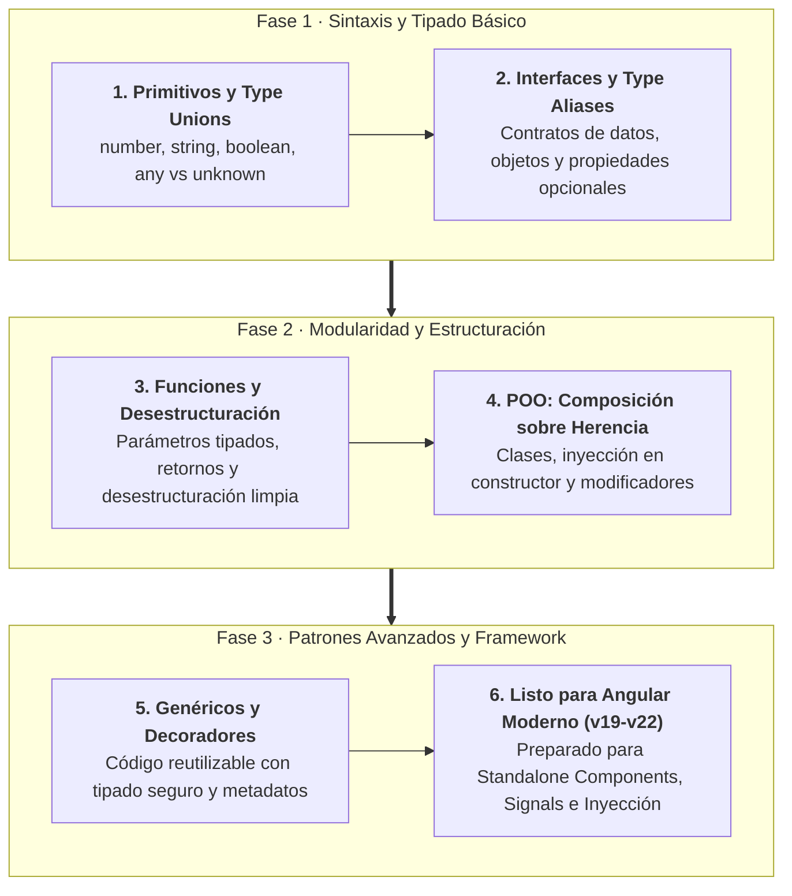
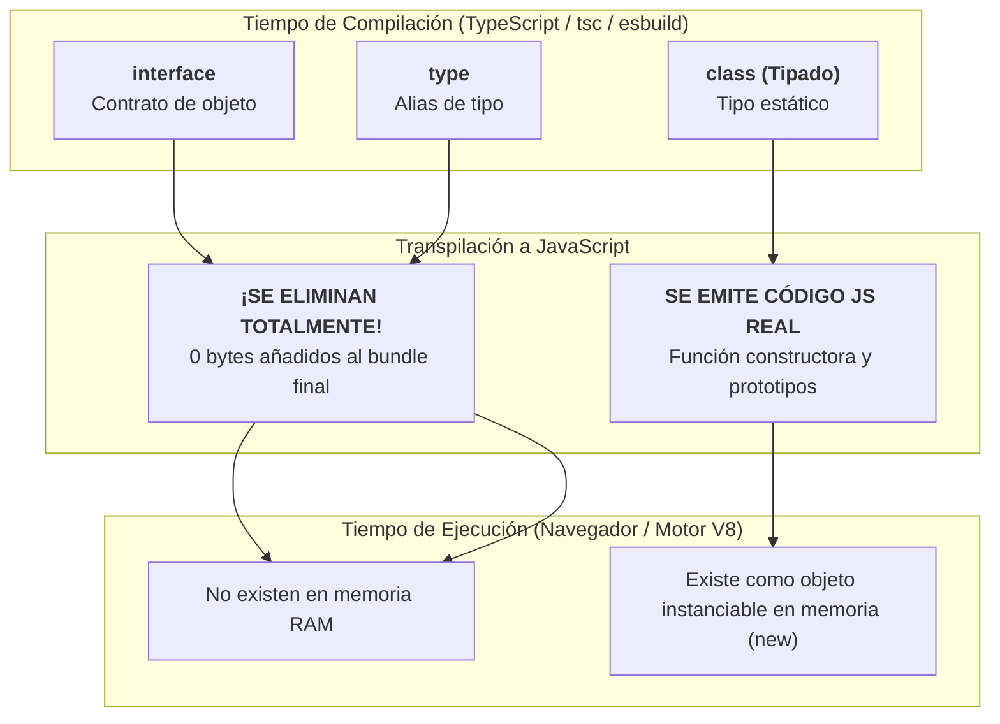
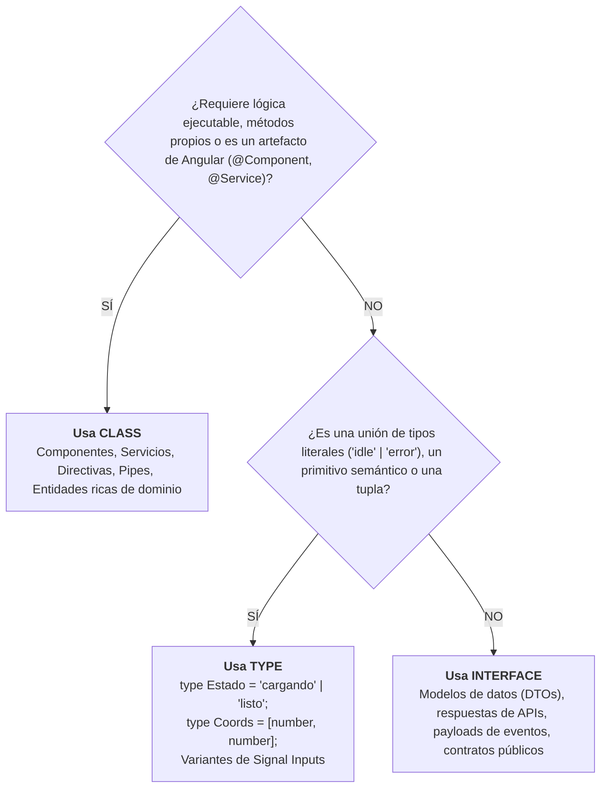

# Bases de TypeScript — Guía Completa para el Alumno y el Aula

Esta guía aborda los fundamentos de **TypeScript** necesarios para afrontar con total solvencia el desarrollo de aplicaciones en **Angular (versiones 19 a 22+)**. Su diseño pedagógico permite al docente proyectar y explicar cada concepto paso a paso, al tiempo que proporciona al estudiante un manual de laboratorio con código reproducible, errores comunes y retos con solución guiada.

---

## 📋 Ficha Técnica y Objetivos de Aprendizaje

* **Nivel:** Iniciación / Intermedio.
* **Prerrequisitos:** Conocimientos básicos de JavaScript (variables, funciones, objetos).
* **Entorno de ejecución:** Node.js 20+, Vite, Visual Studio Code.
* **Objetivo de la sesión:** Dominar el tipado estático, interfaces, funciones, desestructuración, clases modernas bajo el principio de composición y genéricos antes de escribir la primera línea de código en Angular.



---

## Hoja de Ruta de la Sección

### 🗺️ Contenido que dominaremos:

1. **Tipos Primitivos y Unión de Tipos:** `string`, `number`, `boolean`, `any`, unión con `|` y tipos literales.
2. **Interfaces y Contratos:** Definición formal de modelos de datos y propiedades opcionales (`?`).
3. **Funciones Robustas:** Tipado estricto de parámetros, valores por defecto, retornos y tipo `void`.
4. **Desestructuración Eficiente:** Simplificación de objetos, arrays y firmas de funciones con retornos de tuplas `[number, number]`.
5. **POO y la Tríada de Tipado:** Clases compactas, modificadores, composición sobre herencia y comparativa definitiva: **`interface` vs `type` vs `class`** (criterios de decisión en Angular y antipatrones comunes).
6. **Genéricos (`<T>`):** Escribir código flexible y reutilizable sin renunciar a la seguridad de tipos.
7. **Decoradores y Operadores Modernos:** El mecanismo interno tras `@Component` y la seguridad de `?.` frente al operador `!`.

---

## Creación del Entorno de Trabajo con Vite

Para experimentar con TypeScript de forma inmediata y ver los resultados en la consola del navegador sin la sobrecarga inicial de un proyecto completo de Angular, utilizaremos **Vite**. Vite compila TypeScript casi instantáneamente utilizando `esbuild`.

### Creación del Proyecto Local en Terminal

Abre tu terminal (PowerShell, Bash o la terminal integrada de VS Code) y ejecuta:

```bash
npm create vite@latest typescript-intro -- --template vanilla-ts
```

Navega a la carpeta generada, instala las dependencias e inicia el servidor de desarrollo local:

```bash
cd typescript-intro
npm install
npm run dev
```

El servidor te indicará una URL local (generalmente `http://localhost:5173/`). Ábrela en tu navegador y presiona ++f12++ (o haz clic derecho y selecciona *Inspeccionar*) para ver la pestaña **Consola**.

!!! tip "Alternativa Online sin Instalación"
    Si algún alumno tiene problemas con su entorno local de Node.js, puede seguir exactamente la misma práctica en su navegador a través del entorno interactivo:  
    👉 **[StackBlitz TypeScript Playground](https://stackblitz.com/edit/typescript-vxnz8z?file=index.ts)**

### Estructura de Trabajo del Proyecto

Para mantener el código organizado y reproducible durante las explicaciones, creamos una carpeta `src/topics/` donde alojaremos un archivo independiente para cada tema:

```
typescript-intro/
├── src/
│   ├── topics/
│   │   ├── 01-basic-types.ts
│   │   ├── 02-object-interface.ts
│   │   ├── 03-functions.ts
│   │   ├── 04-homework-types.ts
│   │   ├── 05-basic-destructuring.ts
│   │   ├── 06-function-destructuring.ts
│   │   ├── 07-import-export.ts
│   │   ├── 08-classes.ts
│   │   ├── 09-generics.ts
│   │   ├── 10-decorators.ts
│   │   └── 11-optional-chaining.ts
│   └── main.ts            # Archivo de entrada donde importamos el tema activo
├── index.html             # Shell que carga /src/main.ts
├── tsconfig.json          # Configuración del compilador TypeScript
└── package.json           # Dependencias y scripts
```

Para probar un tema en la consola, abrimos `src/main.ts` y comentamos/descomentamos la línea correspondiente:

```typescript title="src/main.ts"
import './style.css';

// Importa el tema que quieras ejecutar en la consola del navegador:
import './topics/01-basic-types';
// import './topics/02-object-interface';
// import './topics/03-functions';
```

---

## Tipos Básicos en TypeScript

En JavaScript tradicional, las variables son débilmente tipadas y pueden mutar de tipo sin control (`let x = 5; x = "hola";`), provocando errores en tiempo de ejecución. TypeScript introduce la **seguridad de tipos estática**.

### Archivo: `src/topics/01-basic-types.ts`

```typescript title="src/topics/01-basic-types.ts"
// Tipado explícito de tipos primitivos
const name: string = 'Strider';

// Unión de tipos (Union Types) y Tipos Literales
let hpPoints: number | 'FULL' = 95;

const isAlive: boolean = true;

// hpPoints puede ser un número o exactamente el string 'FULL'
hpPoints = 'FULL';

console.log({
    name, hpPoints, isAlive
});

export {}; // Convierte el archivo en un módulo aislado para evitar colisiones globales
```

### Conceptos Clave Explicados:

1. **Tipado Explícito (`: tipo`):** Escribimos dos puntos y el tipo de dato tras el nombre de la variable (`name: string`).
2. **Inferencia de Tipos:** Si no especificas el tipo pero asignas un valor inicial (`const isAlive = true`), TypeScript deduce automáticamente que es de tipo `boolean`.
3. **Unión de Tipos (`|`):** Permite que una variable acepte dos o más tipos distintos (`number | string`).
4. **Tipos Literales:** En lugar de aceptar cualquier string, `'FULL'` restringe el valor admitido únicamente a esa palabra exacta.

!!! warning "⚠️ Error Típico del Alumno"
    Si intentas asignar:
    ```typescript
    hpPoints = 'VACIO'; // Error: Type '"VACIO"' is not assignable to type 'number | "FULL"'.
    ```
    TypeScript te impedirá compilar porque `'VACIO'` no forma parte de la unión definida.

---

## Objetos, Arrays e Interfaces

!!! info "📖 Para saber más: Manual de Referencia"
    En Angular, las interfaces son el mecanismo estándar para tipar modelos de datos y respuestas de APIs. Consulta el **[Manual de Referencia: 03. Componentes Standalone](manual/03-componentes.md)** y el **[Manual de Referencia: 10. Cliente HTTP](manual/10-http.md)**.

En JavaScript, los objetos son estructuras dinámicas a las que se les puede agregar cualquier propiedad en cualquier momento. En Angular necesitamos **contratos sólidos** para asegurar que los datos de nuestros componentes y servicios tengan exactamente los campos esperados.

### Archivo: `src/topics/02-object-interface.ts`

```typescript title="src/topics/02-object-interface.ts"
// Array tipado: solo admite strings
const skills: string[] = ['Bash', 'Counter', 'Healing'];

// Definición de una Interfaz (Contrato de Objeto)
interface Character {
    name: string;
    hp: number;
    skills: string[];
    hometown?: string; // Propiedad opcional (puede ser string o undefined)
}

// Creación de un objeto bajo el contrato de la interfaz
const strider: Character = {
    name: 'Strider',
    hp: 100,
    skills: ['Bash', 'Counter'],
};

// Asignación válida de la propiedad opcional
strider.hometown = 'Rivendell';

// Imprime el objeto formateado como tabla en la consola
console.table(strider);

export {};
```

### ¿Qué es una `interface` y por qué es vital?

* **Es un molde o contrato:** Establece qué propiedades y qué tipos de datos debe tener un objeto obligatoriamente.
* **Propiedades opcionales (`?`):** Al colocar `?` tras el nombre del campo (`hometown?: string`), indicamos que el campo puede estar presente o ser `undefined`.
* **Cero impacto en producción:** Las interfaces solo existen en tiempo de compilación. Cuando el proyecto se compila a JavaScript, las interfaces se eliminan completamente. **No añaden ni un solo byte al bundle final.**

### ¿Y qué es un Type Alias (`type`)?

Un **Type Alias** permite asignar un nombre semántico a cualquier tipo (no solo objetos, sino también primitivos, uniones y tuplas):

```typescript
type Points = number;
type Status = 'activo' | 'inactivo' | 'pendiente';
type Coords = [number, number];
```

!!! info "Guía Comparativa Completa"
    Para conocer al detalle cuándo utilizar cada estructura en proyectos de Angular, consulta más adelante la sección maestra: [La Tríada de Tipado: interface vs type vs class](#la-triada-de-tipado-interface-vs-type-vs-class).

---

## Funciones en TypeScript

Las funciones son los bloques fundamentales de cualquier programa. En TypeScript debemos tipar tanto los **parámetros de entrada** como el **tipo de retorno**.

### Archivo: `src/topics/03-functions.ts`

```typescript title="src/topics/03-functions.ts"
// 1. Función tradicional con tipado de argumentos y retorno
function addNumbers(a: number, b: number): number {
    return a + b;
}

// 2. Función flecha (Arrow function)
const addNumbersArrow = (a: number, b: number): string => {
    return `${a + b}`; // Retorna un string gracias a los backticks
};

// 3. Función con parámetros opcionales y valores por defecto
// REGLA: Los parámetros obligatorios van primero, luego los opcionales y por defecto
function multiply(firstNumber: number, secondNumber?: number, base: number = 2): number {
    return firstNumber * base;
}

const result1: number = addNumbers(1, 2);
const result2: string = addNumbersArrow(1, 2);
const multiplyResult: number = multiply(5); // secondNumber no se envía, base toma 2 -> resultado: 10

console.log({ result1, result2, multiplyResult });

// 4. Funciones que reciben objetos tipados mediante interfaces
interface Character {
    name: string;
    hp: number;
    showHp: () => void; // Declaración de método sin retorno
}

const healCharacter = (character: Character, amount: number): void => {
    character.hp += amount;
};

const strider: Character = {
    name: 'Strider',
    hp: 50,
    showHp() {
        console.log(`Puntos de vida: ${this.hp}`);
    }
};

healCharacter(strider, 60);
strider.showHp(); // Imprime: Puntos de vida: 110

export {};
```

### Conceptos Clave:

* **`: void`:** Indica que la función ejecuta una acción pero no devuelve ningún valor (`return;`).
* **Orden de los argumentos:** Los parámetros obligatorios deben situarse siempre antes que los parámetros opcionales (`?`) o con valores por defecto (`= valor`).
* **Paso de objetos a funciones:** Al declarar `character: Character`, el compilador nos asegura con total certeza que el objeto recibido tendrá las propiedades `hp` y `name`.

---

## Tarea Guiada: Modelado de Interfaces Complejas

Para consolidar la creación de interfaces, resolveremos un problema clásico de diseño: **¿Cómo tipar un objeto complejo con propiedades anidadas?**

### El Reto
Partimos del siguiente objeto de JavaScript que queremos tipar estrictamente sin usar `any`:

```javascript
const superHeroe = {
    name: 'Spiderman',
    age: 30,
    address: {
        street: 'Main St',
        country: 'USA',
        city: 'NY'
    },
    showAddress() {
        return this.name + ', ' + this.address.city + ', ' + this.address.country;
    }
};
```

### Solución Paso a Paso: `src/topics/04-homework-types.ts`

En lugar de crear una única interfaz gigante y desordenada, aplicamos **Separación de Responsabilidades** creando una interfaz para la dirección (`Address`) y otra para el superhéroe (`SuperHero`):

```typescript title="src/topics/04-homework-types.ts"
// 1. Interfaz especializada para la dirección
interface Address {
    street: string;
    country: string;
    city: string;
}

// 2. Interfaz principal que compone la dirección
interface SuperHero {
    name: string;
    age: number;
    address: Address; // Composición de interfaces
    showAddress: () => string; // Método que debe retornar un string
}

// 3. Objeto implementado bajo el contrato estricto
const superHeroe: SuperHero = {
    name: 'Spiderman',
    age: 30,
    address: {
        street: 'Main St',
        country: 'USA',
        city: 'NY'
    },
    showAddress() {
        return `${this.name}, ${this.address.city}, ${this.address.country}`;
    }
};

const address = superHeroe.showAddress();
console.log(address); // Spiderman, NY, USA

export {};
```

!!! tip "Consejo de Arquitectura para el Alumno"
    Siempre que un objeto contenga sub-objetos anidados (como `address`), crea una interfaz independiente para el sub-objeto. Esto permite reutilizar `Address` en clientes, proveedores o usuarios de toda la aplicación.

---

## Desestructuración de Objetos y Arrays

La desestructuración (*Destructuring*) es una característica de TypeScript/ES6 que permite extraer valores de objetos o listas y asignarlos directamente a variables individuales de forma limpia y legible.

### Archivo: `src/topics/05-basic-destructuring.ts`

```typescript title="src/topics/05-basic-destructuring.ts"
interface AudioPlayer {
    audioVolume: number;
    songDuration: number;
    song: string;
    details: Details;
}

interface Details {
    author: string;
    year: number;
}

const audioPlayer: AudioPlayer = {
    audioVolume: 90,
    songDuration: 36,
    song: 'Mess',
    details: {
        author: 'Ed Sheeran',
        year: 2015
    }
};

// 1. DESESTRUCTURACIÓN DE OBJETOS
// Extraemos propiedades directas y renombramos 'song' a 'anotherSong' para evitar colisiones:
const { song: anotherSong, songDuration: duration, details } = audioPlayer;

// Desestructuración anidada limpia a partir de la constante extraída:
const { author } = details;

console.log('Canción:', anotherSong);
console.log('Duración:', duration);
console.log('Autor:', author);

// 2. DESESTRUCTURACIÓN DE ARRAYS
// En los arrays la posición determina la asignación.
const dbz: string[] = ['Goku', 'Vegeta', 'Trunks'];

// Si solo nos interesa el tercer personaje, dejamos espacios vacíos con comas:
const [, , trunks = 'No encontrado'] = dbz;

console.log('Personaje 3:', trunks); // Trunks

export {};
```

### Tabla Comparativa de Desestructuración

| Característica | Desestructuración de Objetos `{ a, b }` | Desestructuración de Arrays `[ x, y ]` |
| :--- | :--- | :--- |
| **Criterio de enlace** | Por **nombre de propiedad** (el orden no importa). | Por **posición o índice** (el orden es determinante). |
| **Renombrado** | Se usa dos puntos: `{ name: heroName }`. | Basta con elegir el nombre de la variable: `[ primero, segundo ]`. |
| **Valores por defecto** | `{ volume = 50 }`. | `[ , , item = 'Default' ]`. |

---

## Desestructuración de Argumentos en Funciones

Un patrón fundamental en Angular (y en librerías modernas) es pasar objetos de configuración a las funciones y desestructurar solo los campos necesarios en la firma o en el cuerpo.

### Caso Práctico: Cálculo de Impuestos en Carrito de Compras

Creamos `src/topics/06-function-destructuring.ts`:

```typescript title="src/topics/06-function-destructuring.ts"
export interface Product {
    description: string;
    price: number;
}

const phone: Product = {
    description: 'Nokia A1',
    price: 150.0
};

const tablet: Product = {
    description: 'iPad Air',
    price: 250.0
};

// Opciones de configuración del cálculo
export interface TaxCalculationOptions {
    tax: number;
    products: Product[];
}

// Función que devuelve una Tupla de dos números: [total, impuestoTotal]
export function taxCalculation(options: TaxCalculationOptions): [number, number] {
    const { tax, products } = options;
    let total = 0;

    // Desestructuramos { price } directamente en el bucle
    products.forEach(({ price }) => {
        total += price;
    });

    return [total, total * tax];
}

const shoppingCart = [phone, tablet];
const taxRate = 0.21; // 21% IVA

// Consumimos la función y desestructuramos la tupla resultante:
const [total, taxTotal] = taxCalculation({
    products: shoppingCart,
    tax: taxRate
});

console.log('Total compra:', total);       // 400
console.log('Total impuesto:', taxTotal);  // 84

export {};
```

---

## Modularidad: Importaciones y Exportaciones

En aplicaciones reales, cada interfaz, servicio o clase reside en su propio archivo para evitar archivos gigantescos y permitir la reutilización.

### Archivo: `src/topics/07-import-export.ts`

Importamos la interfaz `Product` y la función `taxCalculation` desde el archivo anterior:

```typescript title="src/topics/07-import-export.ts"
import { Product, taxCalculation } from './06-function-destructuring';

const shoppingCart: Product[] = [
    {
        description: 'Teclado Mecánico',
        price: 100
    },
    {
        description: 'Ratón Gaming',
        price: 50
    }
];

const [total, tax] = taxCalculation({
    tax: 0.15,
    products: shoppingCart
});

console.log('Total modular:', total);
console.log('Impuesto modular:', tax);
```

!!! tip "Buenas Prácticas de Exportación"
    
    * Prefiere siempre **exportaciones con nombre (`export const`, `export interface`)** frente a `export default`.
    * Las exportaciones con nombre garantizan que el nombre del símbolo sea idéntico en toda la aplicación y facilitan el autocompletado del editor (`Auto Import`).

---

## Clases y Programación Orientada a Objetos

!!! info "📖 Para saber más: Manual de Referencia"
    Para ver cómo Angular utiliza clases para estructurar componentes y servicios inyectables mediante la función `inject()`, consulta el **[Manual de Referencia: 09. Servicios e Inyección de Dependencias](manual/09-servicios.md)**.

Angular utiliza clases de TypeScript para definir **Componentes, Servicios, Directivas y Pipes**. Es imprescindible dominar su estructura interna.

### Sintaxis Tradicional vs Sintaxis Compacta de TypeScript
En JavaScript tradicional, debes declarar las propiedades fuera y asignarlas manualmente dentro del constructor con `this.propiedad = valor`. TypeScript ofrece una **sintaxis compacta revolucionaria**:

=== "Sintaxis Tradicional (Verbose)"
    ```typescript
    export class Person {
        public firstName: string;
        public lastName: string;
        private address: string;

        constructor(firstName: string, lastName: string, address: string = 'No Address') {
            this.firstName = firstName;
            this.lastName = lastName;
            this.address = address;
        }
    }
    ```

=== "Sintaxis Compacta de TypeScript (Estándar de la Industria)"
    ```typescript
    export class Person {
        // Al agregar el modificador de acceso (public, private),
        // TypeScript crea la propiedad e inicializa el valor automáticamente
        constructor(
            public firstName: string,
            public lastName: string,
            private address: string = 'No Address'
        ) {}
    }
    ```

### Modificadores de Acceso

* **`public`:** Accesible desde cualquier lugar (dentro de la clase, instancias y plantillas HTML). Es el valor por defecto si no se especifica.
* **`private`:** Accesible única y exclusivamente dentro de los métodos de la propia clase.
* **`protected`:** Accesible dentro de la clase y de las clases hijas que hereden de ella.
* **`readonly`:** Permite inicializar el valor pero impide mutarlo posteriormente.

---

### Principio de Arquitectura: Priorizar Composición sobre Herencia

Uno de los mayores errores en arquitectura de software es abusar de `extends` (herencia). Analicemos por qué la **composición** es superior:

```
[HERENCIA - Acoplamiento Rígido]
Hero ──(extends)──> Person
* Si Person añade un nuevo argumento obligatorio en su constructor,
  todas las clases hijas del proyecto revienten y deben ser reescritas.

[COMPOSICIÓN - Desacoplado y Testeable]
Hero ──(recibe una instancia)──> Person
* Hero delega en Person sin depender de cómo se construyó.
```

### Archivo: `src/topics/08-classes.ts`

```typescript title="src/topics/08-classes.ts"
export class Person {
    constructor(
        public firstName: string,
        public lastName: string,
        private address: string = 'No Address'
    ) {}
}

// APLICACIÓN DE COMPOSICIÓN:
// En lugar de `class Hero extends Person`, inyectamos la persona en el constructor
export class Hero {
    constructor(
        public alterEgo: string,
        public age: number,
        public realName: string,
        public person: Person // Inyección por composición
    ) {}
}

const tony = new Person('Tony', 'Stark', 'New York');
const ironman = new Hero('Ironman', 45, 'Tony', tony);

console.log(ironman);

export {};
```

!!! important "Por qué este concepto define tu futuro en Angular"
    Si la clase `Person` cambia mañana (por ejemplo, exige un nuevo parámetro obligatorio en su constructor), la clase `Hero` por herencia se romperá inmediatamente. Con **composición**, `Hero` simplemente recibe la instancia ya construida sin importar cómo fue creada. Este es el mismo principio tras la **Inyección de Dependencias de Angular**.

---

## La Tríada de Tipado: interface vs type vs class

Una de las dudas más frecuentes tanto en entrevistas técnicas como en el diseño de arquitecturas en Angular es: **"¿Cuándo debo usar una `interface`, cuándo un `type` y cuándo una `class`?"**.

Aunque superficialmente los tres conceptos permiten modelar datos, sus propósitos arquitectónicos, su impacto en el rendimiento y su comportamiento en tiempo de compilación frente a tiempo de ejecución son totalmente distintos.



---

### 1. Naturaleza y Ciclo de Vida: Compile-Time vs Runtime

* **`interface` y `type` son artefactos de tiempo de compilación (*compile-time*):**
    - Existen única y exclusivamente para que el compilador de TypeScript y tu IDE te asistan con autocompletado, detección temprana de errores y validación estática de contratos.
    - Cuando el proyecto se transpila a JavaScript para producción, **ambos se evaporan por completo**. No añaden peso al archivo descargado por el navegador ni consumen memoria RAM en el cliente.
* **`class` es un artefacto de tiempo de ejecución (*runtime*):**
    - Es una característica propia del estándar de JavaScript (ES6+).
    - Además de proporcionar un tipo en TypeScript, **emite código JavaScript real**. Define funciones constructoras, métodos en la cadena de prototipos y lógica ejecutable.
    - Se puede instanciar en memoria en cualquier momento mediante el operador `new`.

---

### 2. ¿Qué es y qué capacidades ofrece un Type Alias (`type`)?

Un **Type Alias** (`type`) es un identificador que asigna un nombre a **cualquier** construcción de tipo válida en TypeScript. Mientras que una interfaz está estrictamente restringida a modelar la forma de objetos o funciones, un `type` es mucho más versátil:

```typescript
// 1. Alias de tipos primitivos (Semántica limpia de dominio)
type UUID = string;
type Milisegundos = number;

// 2. Unión de Tipos Literales (Máquinas de estado y variantes fijas)
type EstadoPeticion = 'idle' | 'cargando' | 'exito' | 'error';
type RolUsuario = 'admin' | 'editor' | 'lector';
type TamanoBoton = 'sm' | 'md' | 'lg';

// 3. Tuplas (Arrays con longitud fija y tipos posicionales)
type CoordenadaGPS = [latitud: number, longitud: number];
const madrid: CoordenadaGPS = [40.4168, -3.7038];

// 4. Firmas de funciones complejas
type ManejadorEvento<T> = (evento: T) => void;

// 5. Intersección de tipos (&)
type ConAuditoria = { creadoEn: Date; actualizadoEn?: Date };
type Usuario = { id: UUID; nombre: string };
type UsuarioAuditado = Usuario & ConAuditoria;
```

---

### 3. Tabla Comparativa Exhaustiva

| Dimensión Técnica | `interface` | `type` (Type Alias) | `class` |
| :--- | :--- | :--- | :--- |
| **¿Qué puede modelar?** | Formas de objetos y firmas de llamadas. | **Cualquier tipo** (primitivos, uniones `\|`, tuplas, intersecciones `&`, objetos). | Estructuras de datos con lógica ejecutable y métodos. |
| **Código emitido en JavaScript** | ❌ **0 bytes (desaparece)** | ❌ **0 bytes (desaparece)** |  **Genera código JS real** (funciones, prototipos). |
| **Instanciable con `new`** | ❌ No | ❌ No |  **Sí** (`const u = new Usuario()`). |
| **Mecanismo de Extensión** | `extends OtraInterfaz` (muy eficiente en caché interna). | Intersección con `&` (`type C = A & B`). | `extends ClaseBase` e `implements Interfaz`. |
| **Fusión de declaraciones (*Declaration Merging*)** |  **Sí.** Si defines dos interfaces con el mismo nombre, se fusionan. | ❌ **No.** Arroja error de identificador duplicado. | ❌ **No.** Arroja error de clase duplicada. |
| **Modificadores de acceso (`public`, `private`, `#`)** | ❌ No (solo describe la superficie pública). | ❌ No. |  **Sí.** Control estricto de encapsulación. |
| **Soporte para Decoradores de Angular** | ❌ No aplicable. | ❌ No aplicable. |  **Sí.** Base obligatoria para `@Component`, `@Service`, etc. |
| **Rendimiento en el compilador (`tsc`)** | **Máximo.** TypeScript crea tipos indexados planos y los almacena en caché. | Ligeramente más costoso en uniones e intersecciones profundas. | Requiere compilación sintáctica y emisión de código. |

---

### 4. Árbol de Decisión: ¿Cuándo usar cuál?

Aplica esta regla nemotécnica en tu flujo de trabajo diario:



---

### 5. Criterios de Aplicación en Proyectos Angular

#### Cuándo usar `interface` en Angular (El estándar para Datos)
* **Respuestas de servicios y APIs REST:** Para tipar el retorno de `HttpClient.get<T>()`, `httpResource<T>()` o `fetch()`.
* **Modelos y DTOs (Data Transfer Objects):** Para estructurar los datos que viajan entre componentes o servicios (`Producto`, `Factura`, `PerfilUsuario`).
* **Contratos de configuración:** Opciones para diálogos, tablas o formularios (`MatDialogConfig`, `TableOptions`).

```typescript title="models/producto.interface.ts"
export interface Producto {
  id: number;
  nombre: string;
  precio: number;
  categoria: string;
  descripcion?: string; // Opcional
}
```

#### Cuándo usar `type` en Angular (El estándar para Estados y Variantes)
* **Estados reactivos en Signals:** Para delimitar las fases de una máquina de estado en un componente o servicio.
* **Variantes de propiedades de componentes (Signal Inputs):** Para impedir que quien use el componente pase cadenas arbitrarias.

```typescript title="types/ui-state.types.ts"
export type EstadoCarga = 'inactivo' | 'cargando' | 'completado' | 'error';
export type VarianteBoton = 'primario' | 'secundario' | 'peligro';

// En el componente Angular:
@Component({...})
export class BotonComponent {
  // Signal input restringido a las tres variantes válidas:
  variante = input<VarianteBoton>('primario');
  estado = signal<EstadoCarga>('inactivo');
}
```

#### Cuándo usar `class` en Angular (El estándar para Arquitectura)
* **Elementos estructurales del framework:** Componentes (`@Component`), Servicios (`@Service`, `@Injectable`), Directivas (`@Directive`), Pipes (`@Pipe`), Guards e Interceptores.
* **Entidades ricas de dominio:** Clases que encapsulan reglas de negocio complejas que no dependen de la vista.

---

### 6. El Antipatrón Crítico de Aula: Clases como Modelos de Datos

!!! danger "⚠️ Antipatrón de Aula: Modelar datos de servidor con `class` en lugar de `interface`"
    Uno de los errores conceptuales más comunes en desarrolladores procedentes de Java, C# o PHP es crear clases vacías para recibir respuestas de una API:

    ```typescript
    // ❌ ANTIPATRÓN: Crear una clase solo para tipar datos de una API
    export class Usuario {
      id!: number;
      nombre!: string;
      apellido!: string;

      nombreCompleto(): string {
        return `${this.nombre} ${this.apellido}`;
      }
    }
    ```

    **¿Por qué este código falla estrepitosamente en Angular?**
    
    1. **`HttpClient` no instancia clases:** Cuando ejecutas `http.get<Usuario>('/api/usuarios/1')`, el navegador recibe una cadena JSON en texto y ejecuta internamente `JSON.parse()`. Esto crea en la memoria del navegador un **objeto JavaScript plano (`Object`)**. **¡El constructor de `Usuario` jamás se ejecuta ni se vincula su prototipo!**
    2. **Falso sentido de seguridad y error en runtime:** El editor te permitirá escribir `usuario.nombreCompleto()`, pero al ejecutarse en el navegador la aplicación colapsará con una excepción fatal:  
       `Uncaught TypeError: usuario.nombreCompleto is not a function`.
    3. **Peso muerto en el bundle final:** TypeScript compilará la clase `Usuario` a una función constructora de JavaScript y la incluirá en el archivo compilado para producción, gastando ancho de banda innecesariamente.

    **✅ La Solución Arquitectónicamente Correcta (Estándar de la Industria):**
    Usa una **`interface`** (cero bytes de peso) y separa los cálculos en funciones puras o en señales computadas (`computed`):

    ```typescript
    // 1. Contrato limpio y ligero (0 bytes en el bundle final)
    export interface Usuario {
      id: number;
      nombre: string;
      apellido: string;
    }

    // 2. Función pura desacoplada, reutilizable y fácil de testear
    export function obtenerNombreCompleto(usuario: Usuario): string {
      return `${usuario.nombre} ${usuario.apellido}`;
    }
    ```

---

## Tipos Genéricos (`<T>`)

!!! info "📖 Para saber más: Manual de Referencia"
    Los genéricos son el pilar de la reactividad moderna de Angular: `signal<T>()`, `computed<T>()` e `input.required<T>()`. Profundiza en el **[Manual de Referencia: 05. Signals y Reactividad](manual/05-signals.md)**.

Los **Genéricos** permiten escribir funciones, clases o interfaces reutilizables que funcionan con múltiples tipos de datos **sin perder la seguridad de tipado** y sin tener que recurrir al peligroso `any`.

### Archivo: `src/topics/09-generics.ts`

```typescript title="src/topics/09-generics.ts"
// <T> representa un tipo de dato genérico que se determinará en el momento de la llamada
export function whatsMyType<T>(argument: T): T {
    return argument;
}

// Especificación explícita del genérico
const amIString = whatsMyType<string>('Hola Mundo');
const amINumber = whatsMyType<number>(100);
const amIArray = whatsMyType<number[]>([1, 2, 3, 4, 5]);

// TypeScript sabe exactamente qué métodos tiene cada variable gracias a <T>
console.log(amIString.split(' ')); // Métodos de string disponibles (.split)
console.log(amINumber.toFixed(2)); // Métodos de number disponibles (.toFixed)
console.log(amIArray.join(' - ')); // Métodos de array disponibles (.join)

export {};
```

### ¿Por qué los genéricos son esenciales en Angular?
Cuando en Angular consumas llamadas HTTP con `httpClient.get<Product[]>('/api/products')` o crees señales con `signal<User | null>(null)`, estarás utilizando genéricos para indicar qué tipo de datos viaja en esa operación.

---

## Decoradores en TypeScript

!!! info "📖 Para saber más: Manual de Referencia"
    Para analizar la anatomía del decorador central `@Component({ ... })` y sus metadatos (`imports`, `templateUrl`, `styleUrl`), consulta el **[Manual de Referencia: 03. Componentes Standalone](manual/03-componentes.md)**.

Los **Decoradores** son una característica avanzada de TypeScript y JavaScript que permite inspeccionar, anotar, modificar o transformar clases, métodos, accesores, propiedades o parámetros antes de que lleguen a instanciarse.

!!! important "Ciclo de Vida: ¿Cuándo se ejecuta un decorador?"
    Un decorador de clase se ejecuta **una sola vez en el momento en que se carga y evalúa el archivo/módulo en memoria**, **NO** cada vez que se crea una instancia con `new MiClase()`.

!!! note "Configuración en TypeScript estándar"
    Para utilizar decoradores experimentales en proyectos estándar de TypeScript, el archivo `tsconfig.json` debe tener activada la bandera:
    ```json
    "experimentalDecorators": true
    ```
    *(Angular gestiona y optimiza esto de forma transparente en su proceso de compilación).*

---

### 1. Qué recibe y cómo funciona por debajo (TypeScript puro)

En esencia, un decorador no es magia negra: es una **función pura de orden superior**. Cuando escribes `@MiDecorador` encima de una clase, el motor de ejecución pasa la función constructora de esa clase como argumento a la función decoradora:

```typescript
// 1. Definición del decorador de clase en TypeScript puro
function Sellada(constructor: Function) {
  // Congela el constructor y su prototipo para que nadie añada propiedades dinámicas
  Object.seal(constructor);
  Object.seal(constructor.prototype);
}

// 2. Uso con sintaxis declarativa @
@Sellada
export class Factura {
  constructor(public id: number, public total: number) {}
}
```

El código anterior equivale internamente a ejecutar:

```javascript
let Factura = class {
  constructor(id, total) {
    this.id = id;
    this.total = total;
  }
};

// El decorador envuelve la clase original:
Factura = Sellada(Factura) || Factura;
```

---

### 2. Qué tres cosas puede hacerle un decorador a una clase

Un decorador de clase puede realizar tres tipos de acciones fundamentales:

#### A. Asociar metadatos (El modelo de Angular)
Es el uso principal en frameworks como Angular (`@Component`, `@Directive`, `@Injectable`, `@Service`, `@Pipe`). El decorador no altera la lógica interna de tus métodos; simplemente adjunta un objeto de configuración (metadatos) a la clase:

```typescript
@Component({
  selector: 'app-tabla',
  templateUrl: './tabla.component.html'
})
export class TablaComponent {}
```

> **¿Qué hace el compilador de Angular (AOT) con esto?**  
> Durante la compilación, el compilador de Angular lee ese decorador y genera las instrucciones internas necesarias para que el framework sepa:
> 
> 1. Qué plantilla HTML asociarle.
> 2. Qué selector CSS buscar en el DOM.
> 3. Si debe registrar la clase en el contenedor de Inyección de Dependencias.

#### B. Extender o sustituir la clase original
El decorador puede retornar una nueva clase que herede de la original, inyectando propiedades, métodos o estampas de tiempo automáticamente:

```typescript title="src/topics/10-decorators.ts"
// Definición de un decorador que extiende la clase original
function ConFechaCreacion<T extends { new (...args: any[]): {} }>(constructorBase: T) {
  return class extends constructorBase {
    fechaCreacion = new Date();
  };
}

// Aplicación del decorador
@ConFechaCreacion
export class Pedido {
  constructor(public total: number) {}
}

const pedido = new Pedido(100);
console.log((pedido as any).fechaCreacion); // Existe automáticamente
```

#### C. Registrar la clase en un contenedor externo
Puede tomar la clase y guardarla en un registro global sin que el programador tenga que llamar a una función de registro manual (`container.register(MiClase)`). Es el patrón habitual en contenedores IoC (Inversión de Control) y enrutadores automáticos.

---

### 3. Diferencia entre un decorador de clase y otros decoradores

Un decorador puede situarse en diferentes partes de una clase, y lo que recibe su función cambia según la posición:

| Tipo de decorador | Dónde se aplica | Qué recibe por parámetro | Ejemplo en Angular | Estado en Angular Moderno |
|---|---|---|---|---|
| **De Clase** | Sobre `class Nombre` | El constructor de la clase (`constructor: Function`) | `@Component()`, `@Service()`, `@Injectable()`, `@Directive()`, `@Pipe()` | **Vigente y Obligatorio** (Núcleo estructural de Angular) |
| **De Propiedad** | Sobre una variable de instancia | El prototipo de la clase y el nombre de la propiedad | `@Input()`, `@Output()` | *En desuso*: reemplazado por Signal Inputs (`input()`) y Signal Outputs (`output()`) |
| **De Método** | Sobre una función interna | El prototipo, el nombre del método y el `PropertyDescriptor` | `@HostListener('click')` | Alternativas funcionales y eventos declarativos en plantillas |
| **De Parámetro** | En los argumentos del constructor | El prototipo, el nombre del método y el índice numérico del parámetro | `@Inject(TOKEN)` | *En desuso*: reemplazado por la función `inject()` |

---

## Encadenamiento Opcional (*Optional Chaining*)

El operador de encadenamiento opcional (`?.`) permite leer el valor de una propiedad ubicada dentro de una cadena de objetos conectados sin tener que validar expresamente si cada referencia en la cadena es válida.

### Archivo: `src/topics/11-optional-chaining.ts`

```typescript title="src/topics/11-optional-chaining.ts"
export interface Passenger {
    name: string;
    children?: string[]; // Propiedad opcional
}

const passenger1: Passenger = {
    name: 'Fernando',
};

const passenger2: Passenger = {
    name: 'Melissa',
    children: ['Natalia', 'Elizabeth'],
};

const returnChildrenNumber = (passenger: Passenger): number => {
    // Si passenger.children es undefined, ?. detiene la evaluación y retorna undefined
    // El operador ?? (Nullish Coalescing) asigna 0 si el resultado es null o undefined
    const howManyChildren = passenger.children?.length ?? 0;

    console.log(`${passenger.name} tiene ${howManyChildren} hijos.`);
    return howManyChildren;
};

returnChildrenNumber(passenger1); // Fernando tiene 0 hijos.
returnChildrenNumber(passenger2); // Melissa tiene 2 hijos.

export {};
```

### El Operador `!` (Non-null assertion operator)
Si escribieras `passenger.children!.length`, le estarías diciendo a TypeScript: *"Confía en mí, estoy 100% seguro de que children no es nulo"*.

!!! danger "⚠️ Cuidado con el Operador !"
    Si usas `!` y en tiempo de ejecución `children` es `undefined`, la aplicación lanzará un error fatal: `Cannot read properties of undefined (reading 'length')`. **Usa siempre `?.` en lugar de `!`.**

---

## Chuleta Rápida de Sintaxis TypeScript para el Alumno

| Característica | Sintaxis Ejemplo | Propósito en el Código |
| :--- | :--- | :--- |
| **Tipado Primitivo** | `const age: number = 25;` | Garantiza que la variable solo almacene números. |
| **Unión de Tipos** | `let id: string \| number;` | Permite alternar entre varios tipos admitidos. |
| **Interfaz** | `interface User { id: number; name: string; }` | Contrato estructural para objetos y modelos de datos. |
| **Opcional** | `email?: string;` | La propiedad puede omitirse o ser `undefined`. |
| **Función** | `(x: number, y: number): number => x + y;` | Tipado estricto de entradas y salida en funciones. |
| **Clase Compacta** | `constructor(public name: string) {}` | Declara e inicializa la propiedad en una sola línea. |
| **Genérico** | `function first<T>(arr: T[]): T` | Función reutilizable que preserva el tipo exacto. |
| **Safe Navigation** | `objeto?.propiedad?.subpropiedad` | Evita errores si alguna parte del objeto es nula. |

---

## Recursos y Repositorio Oficial

* **Código fuente completo del módulo:** [GitHub: `angular-introduccion-typescript`](https://github.com/Klerith/angular-introduccion-typescript)
* **Editor interactivo online:** [StackBlitz TypeScript Playground](https://stackblitz.com/edit/typescript-vxnz8z?file=index.ts)
* **Documentación oficial de TypeScript:** [Handbook oficial de TypeScript](https://www.typescriptlang.org/docs/handbook/intro.html)

---

## 🧪 Banco de Preguntas y Autoevaluación

!!! question "Pregunta 1: ¿Qué ocurre con las interfaces de TypeScript cuando el proyecto se compila a JavaScript para producción?"
    ??? success "Respuesta"
        Las interfaces desaparecen por completo durante el proceso de transpilación. Su único propósito es verificar tipos y dar autocompletado en tiempo de desarrollo. Tienen coste cero en el peso final del código.

!!! question "Pregunta 2: ¿Cuál es la diferencia entre `public name: string` dentro del constructor de una clase y declararlo fuera?"
    ??? success "Respuesta"
        Es la sintaxis compacta de TypeScript: al anteponer `public`, `private` o `readonly` a un argumento del constructor, TypeScript crea automáticamente la propiedad en la clase y le asigna el valor recibido sin necesidad de escribir `this.name = name;`.

!!! question "Pregunta 3: ¿Por qué debemos preferir la composición sobre la herencia al modelar clases complejas?"
    ??? success "Respuesta"
        Porque la herencia genera un acoplamiento rígido (*tight coupling*). Si la clase padre cambia, rompe a todas las clases hijas. La composición inyecta dependencias desacopladas, facilitando las pruebas unitarias y el mantenimiento.

---

## 📖 Material de Referencia y Profundización

Para ver cómo se aplican estos conceptos de TypeScript en la arquitectura de Angular, consulta:

* **[Manual de Referencia: 01. Introducción al Framework](manual/01-introduccion.md):** El papel nuclear de TypeScript en Angular y su comparativa frente a JavaScript plano.
* **[Manual de Referencia: 03. Componentes Standalone](manual/03-componentes.md):** Implementación de clases TypeScript con decoradores `@Component`, tipado de propiedades y métodos.
* **[Manual de Referencia: 05. Signals y Reactividad](manual/05-signals.md):** Aplicación de genéricos en señales reactivas (`signal<T>()`, `computed<T>()`).