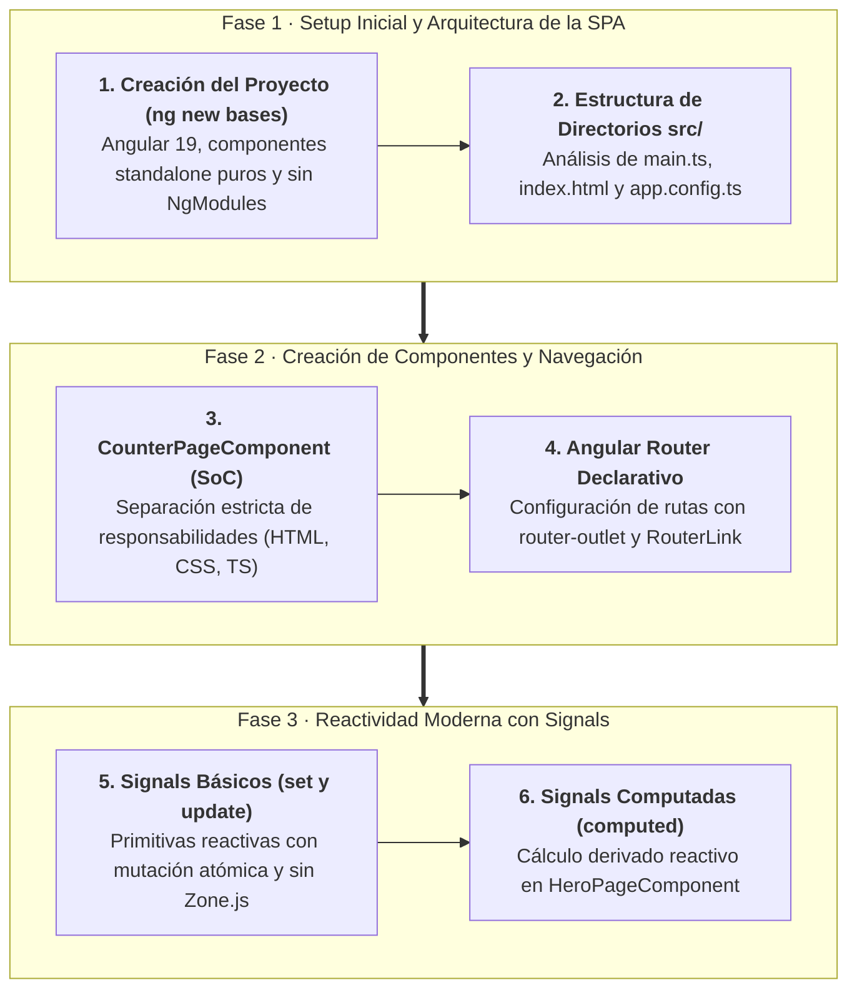
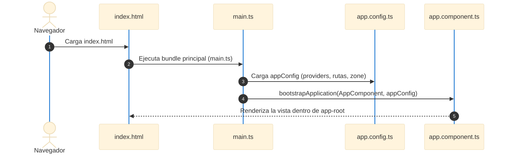
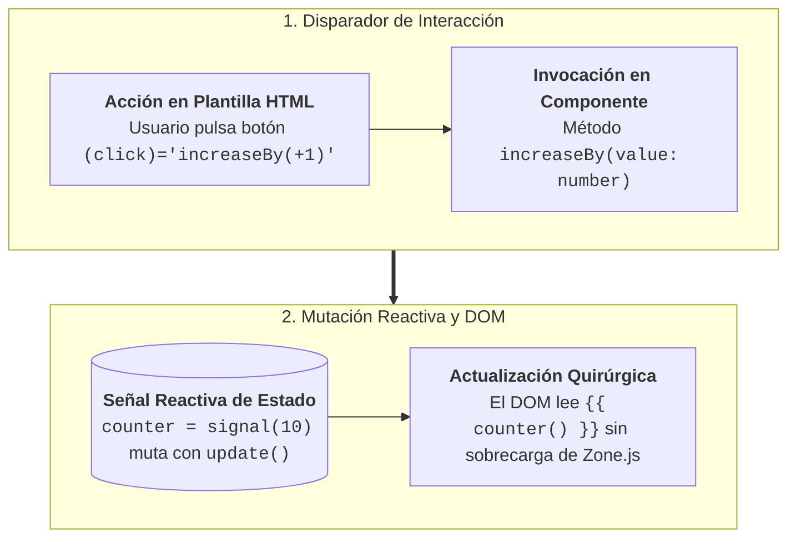

# Sección 04: Bases de Angular (Guía de Clase)

Esta guía paso a paso recoge todo el desarrollo, código incremental y explicaciones técnicas de la **Sección 04 del Curso Angular (Edición 2025)**. Está diseñada para que el docente pueda guiar las sesiones con los alumnos en clase y para que los estudiantes puedan reproducir el proyecto desde cero con la máxima claridad conceptual.

---

## 📋 Ficha Técnica y Objetivos Didácticos

* **Versión de Angular:** 19.x (Modern Angular).
* **Paradigma:** Componentes Standalone, Reactividad con Señales (*Signals*), Zoneless-ready.
* **Proyecto a construir:** `bases` (SPA con páginas de contador reactivo y gestión de héroes).
* **Repositorio de referencia final:** [GitHub - DevTalles Bases (fin-seccion-04)](https://github.com/DevTalles-corp/angular-bases/tree/fin-seccion-04)



---

## Introducción y Temas Clave

### 🎯 Lo que aprenderemos en esta sección

1. **Componentes Standalone:** Creación manual y uso sin módulos (`NgModule`).
2. **Señales (*Signals*):** El nuevo motor de reactividad nativo de Angular (`signal`, `computed`).
3. **Estado:** Diferencia entre variables tradicionales y reactividad fina.
4. **Propiedades y Métodos:** Definición de contratos y funciones de mutación.
5. **Enrutamiento Básico:** Configuración de `app.routes.ts` y salida visual con `<router-outlet />`.
6. **Sintaxis de Plantillas:** Interpolación `{{ }}`, Enlace de Eventos `(click)` y Pipes (`uppercase`).
7. **Arquitectura y Archivos:** Entender el propósito exacto de cada directorio y configuración del proyecto.

!!! tip "Guía Didáctica para el Profesor"
    **Pregunta detonante al iniciar la clase:**  
    *"¿Qué ocurre en el navegador cuando un usuario hace clic en un botón y un número cambia en pantalla? ¿Cómo se entera el framework de que tiene que repintar el DOM?"*  
    Use esta pregunta para despertar la curiosidad sobre la **detección de cambios**, que conectará más adelante con la revolución de las **Señales** y el modo **Zoneless**.

---

## Introducción a Angular 19+

### Framework vs Librería

* **Librería (ej: React):** Proporciona solo la capa de vista; el desarrollador debe elegir y ensamblar enrutador, cliente HTTP, linter, herramientas de compilación y empaquetado.
* **Framework (Angular):** Una plataforma completa e integrada respaldada por Google. Ofrece CLI, router, validación de formularios, inyección de dependencias, compilador de alto rendimiento (`esbuild` + `Vite`) y estándares de arquitectura empresarial.

### La Revolución de Angular Moderno (Angular 17+)
Tradicionalmente, Angular requería agrupar todo en módulos (`@NgModule`). A partir de las versiones recientes, el estándar de facto son los **Componentes Standalone**:

* Menos código repetitivo (*boilerplate*).
* Carga perezosa (*lazy loading*) nativa y directa.
* Sistema de señales atómico e independiente de `Zone.js`.

---

## Primer Proyecto en Angular: Creación Paso a Paso

!!! info "📖 Material de Referencia"
    Para el análisis pormenorizado del archivo `angular.json`, las fases del compilador `esbuild`/`Vite` y opciones avanzadas de scaffolding, consulta el **[Manual de Referencia: 02. Creación del Proyecto](manual/02-crear-proyecto.md)**.

### Comprobación del Entorno
Antes de comenzar, verificamos que Node.js y el Angular CLI estén instalados en el equipo:

```bash
node -v          # Requiere v20.x o superior
npm -v           # Gestor de paquetes
ng version       # Comprueba Angular CLI 19+
```

Si el Angular CLI no está instalado:
```bash
npm install -g @angular/cli
```

### Creación del Proyecto `bases`
Ejecutamos en la terminal el comando interactivo:

```bash
ng new bases
```

Durante el asistente de configuración, seleccionamos las siguientes opciones:

| Pregunta del CLI | Opción a Seleccionar | Justificación Didáctica |
| :--- | :---: | :--- |
| **Which stylesheet format would you like to use?** | **`CSS`** | Mantenerlo simple para enfocarse en la lógica de TypeScript y Angular. |
| **Do you want to enable Server-Side Rendering (SSR)?** | **`No` (N)** | Para esta primera etapa nos enfocamos exclusivamente en Client-Side Rendering (SPA). |

??? info "Comando directo sin asistente interactivo"
    Si prefieres crear el proyecto en un solo comando sin preguntas interactivas:
    ```bash
    ng new bases --style=css --ssr=false --routing
    ```

### Ejecución del Servidor de Desarrollo
Navegamos dentro del proyecto y levantamos el servidor local:

```bash
cd bases
ng serve -o
```

El parámetro `-o` (`--open`) abrirá automáticamente la aplicación en tu navegador en `http://localhost:4200/`.

!!! note "Recomendación de Terminal y Editor"
    
    * **Editor:** Visual Studio Code con la extensión oficial **Angular Language Service**.
    * **Terminal:** Warp, PowerShell 7 o la terminal integrada de VS Code.

---

## Anatomía del Proyecto: Archivos y Directorios de la Raíz

Analicemos la estructura generada en la raíz del proyecto bajo el principio del *Chesterton's Fence* (comprender por qué existe cada archivo antes de modificarlo):

```
bases/
├── .vscode/               # Ajustes y recomendaciones de extensiones para VS Code
├── public/                # Activos estáticos públicos servidos en la raíz (ej: favicon.ico)
├── src/                   # Código fuente de la aplicación
├── .editorconfig          # Convenciones de formateo de código entre editores
├── .gitignore             # Archivos ignorados por Git (node_modules, dist, etc.)
├── angular.json           # Configuración del CLI y del proceso de compilación (build/serve)
├── package.json           # Manifiesto de dependencias npm y scripts de ejecución
├── package-lock.json      # Árbol de dependencias exacto para reproducibilidad
├── tsconfig.json          # Configuración base de TypeScript para el workspace
├── tsconfig.app.json      # Configuración de compilación TS para la aplicación
└── tsconfig.spec.json     # Configuración de TypeScript para las pruebas unitarias
```

### Tabla de Responsabilidades Clave

| Archivo | Responsabilidad Principal |
| :--- | :--- |
| **`angular.json`** | Es el cerebro del CLI. Define constructores (*builders*), rutas de entrada (`main.ts`, `index.html`), hojas de estilo globales (`styles.css`) y configuraciones de producción/desarrollo. |
| **`package.json`** | Contiene scripts (`start: "ng serve"`, `build: "ng build"`) y dependencias organizadas en `@angular/*`. |
| **`tsconfig.json`** | Define la configuración global del compilador TypeScript (`target: "ES2022"`, `strict: true`, rutas relativas). Hereda a `tsconfig.app.json` (código fuente) y `tsconfig.spec.json` (tests). |
| **`public/`** | En las versiones modernas de Angular, sustituye a `src/assets`. Todo lo que se aloje aquí se expone directamente en la raíz de la URL pública. |

---

## Anatomía del Directorio `src/` y Flujo de Arranque

El directorio `src/` contiene todo el código que escribimos y compilamos:



### `src/index.html` (Shell de la SPA)
Es el único archivo HTML que el servidor entrega al cliente. Agregaremos el CDN de **Bootstrap 5** en el `<head>` para estilizar la aplicación rápidamente en clase sin perder tiempo redactando CSS manual:

```html title="src/index.html" hl_lines="10-15"
<!DOCTYPE html>
<html lang="es">
  <head>
    <meta charset="utf-8" />
    <title>Bases de Angular</title>
    <base href="/" />
    <meta name="viewport" content="width=device-width, initial-scale=1" />
    <link rel="icon" type="image/x-icon" href="favicon.ico" />

    <!-- Bootstrap 5 CSS para estilos rápidos en clase -->
    <link
      href="https://cdn.jsdelivr.net/npm/bootstrap@5.3.3/dist/css/bootstrap.min.css"
      rel="stylesheet"
      integrity="sha384-QWTKZyjpPEjISv5WaRU9OFeRpok6YctnYmDr5pNlyT2bRjXh0JMhjY6hW+ALEwIH"
      crossorigin="anonymous"
    />
  </head>
  <body>
    <app-root></app-root>
  </body>
</html>
```

### `src/main.ts` (Punto de Arranque de la Aplicación)
Inicia la aplicación de forma standalone mediante la función `bootstrapApplication`:

```typescript title="src/main.ts"
import { bootstrapApplication } from '@angular/platform-browser';
import { appConfig } from './app/app.config';
import { AppComponent } from './app/app.component';

bootstrapApplication(AppComponent, appConfig).catch((err) =>
  console.error(err)
);
```

### `src/app/app.config.ts` (Configuración y Proveedores Globales)
Define los proveedores (*providers*) globales, tales como la detección de cambios y el enrutador:

```typescript title="src/app/app.config.ts"
import { ApplicationConfig, provideZoneChangeDetection } from '@angular/core';
import { provideRouter } from '@angular/router';
import { routes } from './app.routes';

export const appConfig: ApplicationConfig = {
  providers: [
    // Coalescencia de eventos para optimizar ciclos de detección de cambio
    provideZoneChangeDetection({ eventCoalescing: true }),
    // Inyección de rutas de la aplicación
    provideRouter(routes),
  ],
};
```

---

## Creación del Primer Componente: `CounterPageComponent`

!!! info "📖 Para saber más: Manual de Referencia"
    Para conocer todos los metadatos del decorador `@Component`, la encapsulación de estilos (`ViewEncapsulation`) y el ciclo de vida, consulta el **[Manual de Referencia: 03. Componentes Standalone](manual/03-componentes.md)**.

Para que los alumnos asimilen la estructura interna de un componente sin depender de la magia de los generadores automáticos, **construiremos este primer componente de forma 100% manual**.

### Creación del Archivo
Creamos la carpeta y el archivo: `src/app/pages/counter/counter-page.component.ts`.

### Anatomía del Componente con Plantilla Inline
En esta primera fase, incluimos la plantilla de forma *inline* con template strings para visualizar la relación directa entre la clase TypeScript y su HTML:

```typescript title="src/app/pages/counter/counter-page.component.ts"
import { Component } from '@angular/core';

@Component({
  template: `
    <h1>Counter: {{ counter }}</h1>
    <hr />

    <button (click)="increaseBy(1)">+1</button>
    <button (click)="increaseBy(-1)">-1</button>
    <button (click)="resetCounter()">Reset</button>
  `,
  styles: `
    button {
      padding: 5px;
      margin: 5px 10px;
      width: 75px;
    }
  `,
})
export class CounterPageComponent {
  // Estado tradicional (propiedad de clase)
  counter = 10;

  increaseBy(value: number) {
    this.counter += value;
  }

  resetCounter() {
    this.counter = 0;
  }
}
```

### Conceptos Clave a Explicar en Clase:

1. **Decorador `@Component`:** Metadatos que transforman una clase TypeScript estándar en un componente Angular.
2. **Interpolación `{{ counter }}`:** Mecanismo unidireccional para imprimir el valor de una propiedad en la vista.
3. **Event Binding `(click)="increaseBy(1)"`:** Escucha eventos del DOM y dispara métodos de la clase.
4. **¿Por qué no tiene `selector`?:** Los componentes que se cargan exclusivamente como páginas mediante el sistema de rutas no necesitan un selector de etiqueta HTML (`<app-counter>`).

---

## 🎯 Tarea Práctica: Separar Template de la Lógica en `CounterPageComponent`

!!! info "📖 Para saber más: Manual de Referencia"
    Para profundizar en la sintaxis de plantillas, enlaces y directivas, consulta el **[Manual de Referencia: 04. Plantillas y Control Flow](manual/04-plantillas.md)**.

Hasta ahora hemos construido nuestro primer componente con la plantilla integrada de forma *inline* (`template: `...``). Sin embargo, a medida que la interfaz crece, mantener el HTML dentro del archivo TypeScript viola el principio de **Separación de Responsabilidades (SoC)** y dificulta el mantenimiento del código.

Es momento de aplicar una refactorización guiada para desacoplar la vista de la lógica.

---

### 📋 Enunciado del Reto para el Alumno

Antes de consultar la solución, realiza de forma autónoma los siguientes pasos en tu proyecto:

1. **Crear el archivo de vista:** Dentro de la carpeta `src/app/pages/counter/`, crea un nuevo archivo llamado `counter-page.component.html`.
2. **Mover el marcado HTML:** Corta el contenido HTML que se encuentra dentro del template literal del componente y pégalo limpiamente en el nuevo archivo `.html`.
3. **Vincular el template externo:** En `counter-page.component.ts`, sustituye la propiedad `template` por la propiedad de metadatos `templateUrl`, asignándole la ruta relativa al archivo HTML recién creado.
4. **Decisión sobre los estilos:** Mantén los estilos de los botones en el archivo `.ts` mediante la propiedad `styles` (o de forma opcional, sepáralos en un archivo `counter-page.component.css` usando `styleUrl`).
5. **Verificación interactiva:** Abre el navegador en `http://localhost:4200` y comprueba que:
   - El título y el valor del contador se rendericen sin advertencias ni errores en la consola de desarrollo (F12).
   - Los botones `+1`, `-1` y `Reset` mantengan intacta su funcionalidad y reactividad ante los clics.

---

### ⏸️ Reto Práctico: ¡Inténtalo tú mismo!

!!! exercise "Pausa de Trabajo Autónomo"
    Realiza esta refactorización de forma autónoma en tu editor de código antes de consultar la solución detallada.
    
    *Criterio de éxito:* La aplicación debe compilar de forma limpia y responder exactamente igual a las interacciones del usuario.

---

### 🛠️ Solución Paso a Paso y Explicación Técnica

#### Paso 1: Crear `counter-page.component.html`
Creamos el archivo de vista `src/app/pages/counter/counter-page.component.html` y trasladamos el marcado HTML puro, beneficiándonos inmediatamente del resaltado de sintaxis, formateo automático y autocompletado del editor:

```html title="src/app/pages/counter/counter-page.component.html"
<h1>Counter: {{ counter }}</h1>
<hr />

<button (click)="increaseBy(1)">+1</button>
<button (click)="increaseBy(-1)">-1</button>
<button (click)="resetCounter()">Reset</button>
```

#### Paso 2: Actualizar `counter-page.component.ts`
En el archivo TypeScript, cambiamos la propiedad `template` por `templateUrl`, indicando la ruta relativa con `./`:

```typescript title="src/app/pages/counter/counter-page.component.ts" hl_lines="4"
import { Component } from '@angular/core';

@Component({
  templateUrl: './counter-page.component.html',
  styles: `
    button {
      padding: 5px;
      margin: 5px 10px;
      width: 75px;
    }
  `,
})
export class CounterPageComponent {
  counter = 10;

  increaseBy(value: number) {
    this.counter += value;
  }

  resetCounter() {
    this.counter = 0;
  }
}
```

---

### 🔍 Análisis de la Solución y Conceptos Clave

1. **`template` frente a `templateUrl`:**
   * **`template`:** Espera una cadena de texto (*string*) con el código HTML incrustado directamente en el archivo TypeScript. Es útil para componentes diminutos o prototipos rápidos.
   * **`templateUrl`:** Espera una ruta relativa (*string*) hacia un archivo físico `.html`. Es el estándar recomendado para componentes de mediana o gran complejidad en proyectos reales.
2. **El prefijo obligatorio `./`:** En Angular moderno, la ruta asignada a `templateUrl` debe ser **relativa al directorio del propio componente**. Omitir el `./` puede generar fallos de resolución durante el empaquetado con Vite / esbuild.
3. **Manejo flexible de estilos (`styles` vs `styleUrl`):**
   Angular ofrece total flexibilidad: cuando un componente solo requiere 2 o 3 reglas CSS sencillas (como el espaciado y ancho de los botones), mantenerlas en `styles: `...`` dentro del archivo `.ts` ahorra archivos adicionales. Si las reglas visuales crecen, se extraen a un archivo `.css` independiente vinculado con `styleUrl: './counter-page.component.css'`.

---

### ⚠️ Errores Típicos del Alumno en esta Tarea

| Error Común | Síntoma en el Navegador | Causa y Solución |
| :--- | :--- | :--- |
| Dejar `template: './counter-page.component.html'` | En pantalla aparece el texto plano `"./counter-page.component.html"` en vez de los botones. | **Causa:** `template` interpreta el valor como código HTML literal. <br/>**Solución:** Cambiar el nombre de la propiedad a `templateUrl`. |
| Omitir el `./` (`templateUrl: 'counter-page.component.html'`) | Error de compilación: *Cannot find module / file not found*. | **Causa:** Sin `./`, el compilador no sabe que debe buscar en la misma carpeta. <br/>**Solución:** Escribir siempre la ruta relativa explícita `./nombre-archivo.html`. |
| Discrepancias tipográficas en el nombre del archivo | Error de compilación 404 del servidor de desarrollo. | **Causa:** Sensibilidad a mayúsculas o nombres distintos. <br/>**Solución:** Comprobar que el nombre del archivo en disco coincida exactamente con la cadena en `templateUrl`. |

---

### 🧑‍🏫 Guía Didáctica para el Docente en el Aula

!!! tip "Estrategia para Guiar esta Práctica en Clase"
    1. **Presentación del reto:** Proyecte únicamente el enunciado de la tarea en pantalla y anime a los alumnos a resolverlo de forma individual antes de mirar la solución.
    2. **Validación de conceptos:** Circule por el aula comprobando que los estudiantes identifiquen claramente la diferencia conceptual y sintáctica entre `template` y `templateUrl`.
    3. **Demostración de errores en vivo:** Pida voluntariamente a un alumno que cometa el error de asignar `template: './counter-page.component.html'` para proyectarlo; esto permite que todo el grupo comprenda visualmente por qué Angular imprime el string de la ruta en el navegador cuando se usa la propiedad incorrecta.

---

## Enrutamiento Declarativo de la Aplicación

!!! info "📖 Para saber más: Manual de Referencia"
    Para profundizar en la configuración de rutas de Angular, `RouterOutlet` y estrategias de carga, consulta el **[Manual de Referencia: 11. Angular Router y Navegación](manual/11-router.md)**.

### Configuración de Rutas en `src/app/app.routes.ts`
Configuramos la ruta inicial vacía (`''`) para renderizar nuestro componente:

```typescript title="src/app/app.routes.ts"
import { Routes } from '@angular/router';
import { CounterPageComponent } from './pages/counter/counter-page.component';

export const routes: Routes = [
  {
    path: '',
    component: CounterPageComponent,
  },
];
```

### Configuración del Shell en `src/app/app.component.html`
Limpiamos el archivo `app.component.html` original y dejamos únicamente el `<router-outlet />` envuelto en un contenedor de Bootstrap:

=== "src/app/app.component.html"
    ```html
    <section class="mx-5 mt-2">
      <router-outlet />
    </section>
    ```

=== "src/app/app.component.ts"
    ```typescript
    import { Component } from '@angular/core';
    import { RouterOutlet } from '@angular/router';

    @Component({
      selector: 'app-root',
      imports: [RouterOutlet],
      templateUrl: './app.component.html',
    })
    export class AppComponent {
      title = 'bases';
    }
    ```

!!! warning "Error Típico de los Alumnos"
    Si los alumnos olvidan agregar `RouterOutlet` al arreglo `imports: [RouterOutlet]` de `app.component.ts`, la etiqueta `<router-outlet />` no funcionará y la página quedará en blanco.

---

## La Revolución de las Señales (`Signals`)

!!! info "📖 Material de Referencia"
    Para un estudio completo de la reactividad basada en primitivas, comparativa con RxJS y funciones de igualdad personalizadas, consulta el **[Manual de Referencia: 05. Signals y Reactividad](manual/05-signals.md)**.

Las **Señales** (*Signals*) son la innovación más importante de Angular moderno. Representan un valor que puede cambiar a lo largo del tiempo y que **notifica automáticamente** a quienes dependen de él cuando ocurre una mutación.



### Actualización del Contador con Señales

Vamos a convivir el estado tradicional (`counter`) con el estado reactivo (`counterSignal`):

=== "src/app/pages/counter/counter-page.component.ts"
    ```typescript hl_lines="1 15 22 23 28"
    import { Component, signal } from '@angular/core';

    @Component({
      templateUrl: './counter-page.component.html',
      styles: `
        button {
          padding: 5px;
          margin: 5px 10px;
          width: 75px;
        }
      `,
    })
    export class CounterPageComponent {
      counter = 10;
      counterSignal = signal(10); // Inicialización de la señal

      increaseBy(value: number) {
        // Mutación tradicional
        this.counter += value;

        // Modificación de la señal usando .update()
        // Calcula el nuevo valor a partir del estado actual (función pura e inmutable)
        this.counterSignal.update((current) => current + value);
      }

      resetCounter() {
        this.counter = 0;
        // Asignación directa y reemplazo usando .set()
        this.counterSignal.set(0);
      }
    }
    ```

=== "src/app/pages/counter/counter-page.component.html"
    ```html hl_lines="2"
    <h1>Counter: {{ counter }}</h1>
    <h1>Counter Signal: {{ counterSignal() }}</h1>
    <hr />

    <button (click)="increaseBy(1)">+1</button>
    <button (click)="increaseBy(-1)">-1</button>
    <button (click)="resetCounter()">Reset</button>
    ```

### Métodos Fundamentales de una Señal Writable

* **Lectura:** Se invoca como una función `counterSignal()`. En el HTML **siempre se deben incluir los paréntesis**.
* **`.set(nuevoValor)`:** Reemplaza el valor de la señal sin importar cuál era el anterior (ideal para resetear).
* **`.update(fn)`:** Actualiza el valor aplicando una función que recibe el valor actual y retorna el nuevo (ideal para incrementos/decrementos).

!!! tip "💡 Evolución Angular 22: Expresividad en Plantillas (Arrow Functions directas)"
    En el enfoque estándar de Angular, para modificar la señal desde el botón es habitual crear métodos auxiliares en TypeScript (`increaseBy`, `resetCounter`).
    
    En **Angular 22**, el compilador de plantillas admite **expresiones con arrow functions**, permitiendo mutar o actualizar señales directamente desde el HTML en acciones sencillas sin necesidad de declarar métodos puente en la clase:
    ```html
    <!-- Sintaxis directa posible en Angular 22 -->
    <button (click)="counterSignal.update(c => c + 1)">+1</button>
    <button (click)="counterSignal.update(c => c - 1)">-1</button>
    <button (click)="counterSignal.set(0)">Reset</button>
    ```
    *Criterio didáctico:* Para operaciones complejas con validaciones o llamadas a servicios, mantén un método en TypeScript. Para mutaciones directas de estado local en la interfaz, las expresiones inline de Angular 22 ahorran código repetitivo.

---

## Detección de Cambios: De Zone.js a Zoneless

### El Modelo Tradicional con `Zone.js`
Durante años, Angular utilizó `Zone.js` para interceptar todas las operaciones asíncronas del navegador (*monkey-patching* de `addEventListener`, `setTimeout`, `fetch`, etc.). Cuando ocurría un evento asíncrono, Angular ejecutaba una verificación sucia (*dirty checking*) recorriendo **todo el árbol de componentes** para averiguar qué había cambiado.

### El Modelo Moderno: Zoneless con Señales
Con las Señales, Angular sabe **exactamente** qué componente y qué nodo del DOM depende de cada señal. Ya no es necesario recorrer todo el árbol de componentes:

```
[Árbol con Zone.js]
Disparo de Evento ──> Revisa Raíz ──> Revisa Rama A ──> Revisa Rama B ──> Repinta Nodo

[Árbol Zoneless con Signals]
Disparo de Evento ──> Señal mutada ──> Repinta ÚNICAMENTE el nodo suscrito
```

??? note "Configuración Zoneless en Angular 19 vs Angular 22"
    En `app.config.ts`, Angular 19 permitía activar el modo Zoneless experimental mediante:
    ```typescript
    import { provideExperimentalZonelessChangeDetection } from '@angular/core';

    export const appConfig: ApplicationConfig = {
      providers: [
        provideExperimentalZonelessChangeDetection(),
        provideRouter(routes),
      ],
    };
    ```
    
    **💡 Evolución Angular 22:**
    * **Zoneless Oficial y Estable:** Desaparece el prefijo `Experimental`, utilizándose directamente `provideZonelessChangeDetection()`.
    * **`OnPush` por defecto:** Los nuevos componentes en Angular 22 asumen la estrategia `ChangeDetectionStrategy.OnPush` por defecto (la estrategia tradicional pasa a llamarse `Eager`), garantizando cero desperdicio de ciclos de CPU en el navegador.

---

## 🎯 Tarea Práctica: Creación de `HeroPageComponent` y Refuerzo de Señales

!!! info "📖 Para saber más: Manual de Referencia"
    Para repasar la declaración de señales escribibles (`signal()`), el método `.set()` y el enlace de eventos, consulta el **[Manual de Referencia: 05. Signals y Reactividad](manual/05-signals.md)**.

Para afianzar de forma autónoma el uso de señales, enrutamiento, métodos y enlace de eventos (*Event Binding*), realizaremos la siguiente práctica de consolidación construyendo la página de héroes de nuestra aplicación.

---

### 📋 Enunciado del Reto para el Alumno

Antes de consultar la solución detallada, sigue paso a paso las siguientes instrucciones en tu proyecto:

1. **Configurar estilos globales con Bootstrap:**  
   Abre el archivo `src/index.html` y añade en la sección `<head>` la hoja de estilos de Bootstrap 5 mediante CDN:
   ```html
   <link
     href="https://cdn.jsdelivr.net/npm/bootstrap@5.3.3/dist/css/bootstrap.min.css"
     rel="stylesheet"
     integrity="sha384-QWTKZyjpPEjISv5WaRU9OFeRpok6YctnYmDr5pNlyT2bRjXh0JMhjY6hW+ALEwIH"
     crossorigin="anonymous"
   />
   ```

2. **Crear la plantilla HTML base:**  
   Crea la carpeta `src/app/pages/hero/` y dentro de ella el archivo `hero-page.component.html` con la siguiente estructura base de trabajo:
   ```html title="src/app/pages/hero/hero-page.component.html"
   <h1>{{ name() }}</h1>

   <dl>
     <td>Nombre:</td>
     <dd>{{ name() }}</dd>

     <td>Edad:</td>
     <dd>{{ age() }}</dd>

     <td>Método:</td>
     <dd>{{ getHeroDescription() }}</dd>

     <td>Capitalizado:</td>
     <!-- ! Reto Extra: Mostrar el nombre TODO EN MAYÚSCULAS sin crear una nueva señal -->
     <dd>{{ 'TODO EN MAYÚSCULAS' }}</dd>
   </dl>

   <button (click)="changeHero()" class="btn btn-primary mx-2">
     Cambiar nombre
   </button>

   <button class="btn btn-primary">Cambiar edad</button>

   <button (click)="resetForm()" class="btn btn-primary mx-2">Reset</button>
   ```

3. **Crear el controlador del componente:**  
   Crea el archivo `src/app/pages/hero/hero-page.component.ts` declarando el componente standalone `HeroPageComponent` vinculado a la plantilla anterior.

4. **Declaración de Señales:**  
   Define dos señales reactivas en la clase:

    * `name`: señal de tipo string con valor inicial `'Ironman'`.
    * `age`: señal de tipo number con valor inicial `45`.

5. **Implementar el método descriptivo `getHeroDescription()`:**  
   Debe retornar un string concatenando el nombre y la edad: ``${this.name()} - ${this.age()}``.

6. **Implementar métodos de actualización:**  

    * `changeHero()`: No recibe argumentos; actualiza `name` a `'Spiderman'` y `age` a `22`.
    * `changeAge()`: No recibe argumentos; actualiza `age` a `60`. Enlaza este método al evento `(click)` del botón correspondiente en el HTML.
    * `resetForm()`: Restablece `name` a `'Ironman'` y `age` a `45`.

7. **Configuración de Enrutamiento:**  
   En `src/app/app.routes.ts`, registra la ruta `'hero'` asociada a `HeroPageComponent`.

8. **⭐ Reto Extra:**  
   Muestra en la etiqueta `<dd>` de "Capitalizado" el valor de la señal `name` transformado en mayúsculas (ej. `IRONMAN` o `SPIDERMAN`), **sin crear una nueva señal**.

---

### ⏸️ Reto Práctico: ¡Inténtalo tú mismo!

!!! exercise "Pausa de Trabajo Autónomo"
    Configura el enrutamiento, las señales y los métodos en tu editor antes de verificar la solución técnica.

    **Criterios de éxito:**

    * Al acceder a `http://localhost:4200/hero`, se muestra "Ironman", edad 45 y la descripción "Ironman - 45".
    * Al pulsar "Cambiar nombre", la vista actualiza el título y datos a "Spiderman" y edad 22.
    * Al pulsar "Cambiar edad", la edad pasa a 60.
    * Al pulsar "Reset", todo vuelve a los valores iniciales.

---

### 🛠️ Solución Paso a Paso y Explicación Técnica

#### Paso 1: Importar Bootstrap en `src/index.html`

Editamos `src/index.html` e incorporamos el enlace CDN en el bloque `<head>`:

```html title="src/index.html" hl_lines="6-11"
<!doctype html>
<html lang="es">
  <head>
    <meta charset="utf-8" />
    <title>Bases</title>
    <base href="/" />
    <meta name="viewport" content="width=device-width, initial-scale=1" />
    <link rel="icon" type="image/x-icon" href="favicon.ico" />
    <!-- Bootstrap 5 CSS -->
    <link
      href="https://cdn.jsdelivr.net/npm/bootstrap@5.3.3/dist/css/bootstrap.min.css"
      rel="stylesheet"
      integrity="sha384-QWTKZyjpPEjISv5WaRU9OFeRpok6YctnYmDr5pNlyT2bRjXh0JMhjY6hW+ALEwIH"
      crossorigin="anonymous"
    />
  </head>
  <body>
    <app-root></app-root>
  </body>
</html>
```

#### Paso 2: Crear el Controlador `HeroPageComponent`

En `src/app/pages/hero/hero-page.component.ts`:

```typescript title="src/app/pages/hero/hero-page.component.ts" hl_lines="9-10 12-14 16-29"
import { Component, signal } from '@angular/core';

@Component({
  templateUrl: './hero-page.component.html',
})
export class HeroPageComponent {
  // 1. Señales reactivas
  name = signal('Ironman');
  age = signal(45);

  // 2. Método descriptivo que concatena valores reactivos
  getHeroDescription(): string {
    return `${this.name()} - ${this.age()}`;
  }

  // 3. Métodos para mutar las señales con .set()
  changeHero(): void {
    this.name.set('Spiderman');
    this.age.set(22);
  }

  changeAge(): void {
    this.age.set(60);
  }

  resetForm(): void {
    this.name.set('Ironman');
    this.age.set(45);
  }
}
```

#### Paso 3: Completar la Plantilla `hero-page.component.html`

Completamos la plantilla conectando el evento `(click)="changeAge()"` y resolviendo el reto extra de mayúsculas mediante `name().toUpperCase()`:

```html title="src/app/pages/hero/hero-page.component.html" hl_lines="13 16 23"
<h1>{{ name() }}</h1>

<dl>
  <td>Nombre:</td>
  <dd>{{ name() }}</dd>

  <td>Edad:</td>
  <dd>{{ age() }}</dd>

  <td>Método:</td>
  <dd>{{ getHeroDescription() }}</dd>

  <td>Capitalizado:</td>
  <!-- Reto Extra resuelto: invocamos toUpperCase() sobre el valor de la señal -->
  <dd>{{ name().toUpperCase() }}</dd>
</dl>

<button (click)="changeHero()" class="btn btn-primary mx-2">
  Cambiar nombre
</button>

<button (click)="changeAge()" class="btn btn-primary">
  Cambiar edad
</button>

<button (click)="resetForm()" class="btn btn-primary mx-2">
  Reset
</button>
```

#### Paso 4: Registrar la Ruta en `src/app/app.routes.ts`

Importamos `HeroPageComponent` y añadimos la ruta `'hero'`:

```typescript title="src/app/app.routes.ts" hl_lines="3 10-13"
import { Routes } from '@angular/router';
import { CounterPageComponent } from './pages/counter/counter-page.component';
import { HeroPageComponent } from './pages/hero/hero-page.component';

export const routes: Routes = [
  {
    path: '',
    component: CounterPageComponent,
  },
  {
    path: 'hero',
    component: HeroPageComponent,
  },
  {
    path: '**',
    redirectTo: '',
  },
];
```

---

### 🔍 Análisis de la Solución y Conceptos Clave

1. **Lectura de señales con paréntesis `()`:**
   * Tanto en la plantilla (`{{ name() }}`) como dentro de la clase (`this.name()`), las señales son funciones. Omitir los paréntesis retorna la definición del objeto Signal en vez del dato primitivo.
2. **Método en Plantilla (`getHeroDescription()`):**
   * Funciona correctamente y resuelve la tarea. Sin embargo, invocar funciones directamente en la plantilla HTML puede recalcularse en cada ciclo de renderizado. En la siguiente sección veremos cómo **optimizar este patrón mediante `computed()`**, el cual añade memorización automática (*memoization*).
3. **El Reto Extra (Transformación en plantilla):**
   * Al ejecutar `{{ name().toUpperCase() }}`, JavaScript transforma la cadena en tiempo de interpolación. Aunque es una solución válida para operaciones sencillas, más adelante aprenderemos que Angular ofrece una alternativa declarativa aún más limpia: **Pipes** (`{{ name() | uppercase }}`).

---

### ⚠️ Errores Típicos del Alumno en esta Tarea

| Error Común | Síntoma en el Navegador | Causa y Solución |
| :--- | :--- | :--- |
| Olvidar `(click)` en el botón "Cambiar edad" | Al hacer clic en "Cambiar edad", el número 45 no cambia. | **Causa:** El botón original del Gist no tenía el enlace de evento. <br/>**Solución:** Añadir `(click)="changeAge()"`. |
| Escribir `path: '/hero'` con barra inicial en `app.routes.ts` | Error de navegación o no coincide la ruta al entrar a `localhost:4200/hero`. | **Causa:** En Angular Router los paths no llevan barra inicial. <br/>**Solución:** Escribir `{ path: 'hero', component: HeroPageComponent }`. |
| Omitir `()` al invocar el método: `{{ getHeroDescription }}` | En pantalla se imprime la definición del código de la función en texto plano. | **Causa:** Falta invocar la función con `()`. <br/>**Solución:** Escribir `{{ getHeroDescription() }}`. |
| Olvidar incluir la hoja de estilos de Bootstrap | Los botones aparecen grises y sin espaciado ni estilos modernos. | **Causa:** No haberse añadido el `<link>` de Bootstrap en `src/index.html`. |

---

### 🧑‍🏫 Guía Didáctica para el Docente en el Aula

!!! tip "Estrategia para Guiar esta Práctica en Clase"
    1. **Fomentar el trabajo autónomo:** Entregue a los alumnos únicamente el enunciado y la plantilla HTML inicial del Gist, animándoles a deducir qué métodos y señales faltan por programar.
    2. **El gancho hacia la siguiente lección (`computed` y `Pipes`):** Cuando todos hayan completado el reto extra con `name().toUpperCase()` y la llamada a `getHeroDescription()`, abra el debate: *"¿Qué pasaría si `getHeroDescription()` hiciera un cálculo pesado con 10.000 datos en vez de una simple concatenación?"*. Esta pregunta sirve de introducción perfecta para el siguiente tema: **Señales Computadas (`computed`) y Pipes**.

---

## Señales Computadas (`computed`) y Pipes

!!! info "📖 Para saber más: Manual de Referencia"
    Para conocer el catálogo completo de pipes de Angular (`DatePipe`, `CurrencyPipe`, `JsonPipe`) y cómo crear pipes puros personalizados, consulta el **[Manual de Referencia: 06. Pipes Nativos y Custom](manual/06-pipes.md)**.

### ¿Qué es una Señal Computada?
Una señal computada (`computed`) genera un **estado derivado de solo lectura**. Se recalcula automáticamente solo cuando alguna de las señales de las que depende produce un nuevo valor, y cuenta con **memorización** (*memoization*).

```typescript
// Sintaxis básica
const resultado = computed(() => señalA() + señalB());
```

!!! important "Reglas de una Señal Computada"
    
    1. **Es de solo lectura:** No posee `.set()` ni `.update()`.
    2. **Es pura:** No debe producir efectos secundarios (no hagas llamadas HTTP ni manipules variables externas dentro de un `computed`).
    3. **Evaluación perezosa (Lazy):** Solo se evalúa cuando es leída por la vista o por otra señal.

### Alternativa: Pipes (`UpperCasePipe`)
Para transformar valores exclusivamente visuales en la plantilla, Angular proporciona **Pipes**. En componentes standalone, los pipes deben importarse explícitamente en el arreglo `imports` del decorador `@Component`.

---

### Código Final de `HeroPageComponent` con `computed` y `Pipe`

=== "src/app/pages/hero/hero-page.component.ts"
    ```typescript title="src/app/pages/hero/hero-page.component.ts" hl_lines="1 2 6 12-17"
    import { Component, computed, signal } from '@angular/core';
    import { UpperCasePipe } from '@angular/common';

    @Component({
      templateUrl: './hero-page.component.html',
      imports: [UpperCasePipe], // Importación obligatoria para usar | uppercase en el HTML
    })
    export class HeroPageComponent {
      name = signal('Ironman');
      age = signal(45);

      // Señal computada derivada
      heroDescription = computed(() => {
        return `${this.name()} - ${this.age()}`;
      });

      // Señal computada para mayúsculas
      capitalizedName = computed(() => this.name().toUpperCase());

      changeHero() {
        this.name.set('Spiderman');
        this.age.set(22);
      }

      changeAge() {
        this.age.set(60);
      }

      resetForm() {
        this.name.set('Ironman');
        this.age.set(45);
      }
    }
    ```

=== "src/app/pages/hero/hero-page.component.html"
    ```html title="src/app/pages/hero/hero-page.component.html" hl_lines="13 16-17"
    <h1>{{ name() }}</h1>

    <dl>
      <td>Nombre:</td>
      <dd>{{ name() }}</dd>

      <td>Edad:</td>
      <dd>{{ age() }}</dd>

      <td>Método:</td>
      <!-- Invocación de señal computada -->
      <dd>{{ heroDescription() }}</dd>

      <td>Capitalizado:</td>
      <!-- Opción A: Señal computada -->
      <!-- <dd>{{ capitalizedName() }}</dd> -->
      <!-- Opción B: Pipe de Angular -->
      <dd>{{ name() | uppercase }}</dd>
    </dl>

    <button (click)="changeHero()" class="btn btn-primary mx-2">
      Cambiar nombre
    </button>

    <button (click)="changeAge()" class="btn btn-primary">Cambiar edad</button>

    <button (click)="resetForm()" class="btn btn-primary mx-2">Reset</button>
    ```

### Criterio de Arquitectura: ¿Cuándo usar `computed()` vs `Pipe`?

* Usa **`computed()`** cuando la lógica derivada forma parte del **modelo de datos** y necesites reutilizar ese valor en TypeScript (ej: validaciones, cálculos matemáticos, composición de modelos).
* Usa **`Pipe`** cuando se trate únicamente de un **formato cosmético de presentación** en la plantilla (ej: dar formato a una moneda, fecha o transformar a mayúsculas).

---

## Resumen y Síntesis de Conceptos

| Característica | Propiedad Tradicional (`counter = 10`) | Señal Writable (`signal(10)`) | Señal Computada (`computed(...)`) |
| :--- | :---: | :---: | :---: |
| **Tipo de reactividad** | Dependiente de `Zone.js` | Reactividad fina nativa | Reactividad fina derivada |
| **Sintaxis de lectura** | `{{ counter }}` | `{{ counter() }}` | `{{ heroDescription() }}` |
| **¿Cómo se muta?** | Asignación directa (`this.counter = 20`) | `.set(20)` o `.update(c => c + 1)` | Inmutable (de solo lectura) |
| **Soporte Zoneless** | Incompatible | Totalmente compatible | Totalmente compatible |

---

## Repositorio Oficial y Recursos

* **Código fuente final de la sección:** [Repositorio GitHub: `angular-bases` (rama `fin-seccion-04`)](https://github.com/DevTalles-corp/angular-bases/tree/fin-seccion-04)

* **Gist de la tarea de héroes:** [Gist GitHub: Tarea de reforzamiento](https://gist.github.com/Klerith/b07bfb16b4d6aa27b8ccdbb991d316b2)

* **Documentación oficial de Angular sobre Zoneless:** [Angular.dev - Experimental Zoneless Guide](https://angular.dev/guide/experimental/zoneless)

---

## 🧪 Banco de Preguntas y Evaluación Rápida para el Aula

!!! question "Pregunta 1: ¿Por qué en la plantilla debemos escribir `{{ counterSignal() }}` con paréntesis?"
    ??? success "Respuesta"
        Porque las señales son funciones *getter*. Al invocarlas con `()`, Angular lee su valor actual y registra la suscripción automática del nodo de la vista al valor de la señal.

!!! question "Pregunta 2: ¿Cuál es la diferencia entre `.set()` y `.update()` en una señal?"
    ??? success "Respuesta"
        `.set(valor)` sobrescribe directamente el valor almacenado sin consultar el estado anterior. `.update(fn)` recibe una función pura con el valor actual y calcula el nuevo estado de forma inmutable a partir de él.

!!! question "Pregunta 3: ¿Podemos modificar directamente una señal `computed()` con `.set()`?"
    ??? success "Respuesta"
        No. Las señales computadas son estrictamente de solo lectura (*readonly*). Su valor se actualiza exclusivamente cuando alguna de las señales de las que depende cambia de valor.

---

## 📖 Material de Referencia y Profundización

Complementa las prácticas de aula con los capítulos técnicos correspondientes del **Manual de Referencia**:

* **[Manual de Referencia: 02. Creación del Proyecto](manual/02-crear-proyecto.md):** Anatomía completa de archivos, configuración de compilación y paradigma Zoneless.
* **[Manual de Referencia: 03. Componentes Standalone](manual/03-componentes.md):** Metadatos del decorador `@Component`, ciclo de vida e inmutabilidad.
* **[Manual de Referencia: 05. Signals y Reactividad](manual/05-signals.md):** Primitivas reactivas `signal()`, `computed()` y `effect()`.
* **[Manual de Referencia: 06. Pipes Nativos y Custom](manual/06-pipes.md):** Transformación cosmética de datos en plantillas.
* **[Manual de Referencia: 11. Angular Router y Navegación](manual/11-router.md):** Enrutamiento básico y salida visual con `<router-outlet />`.