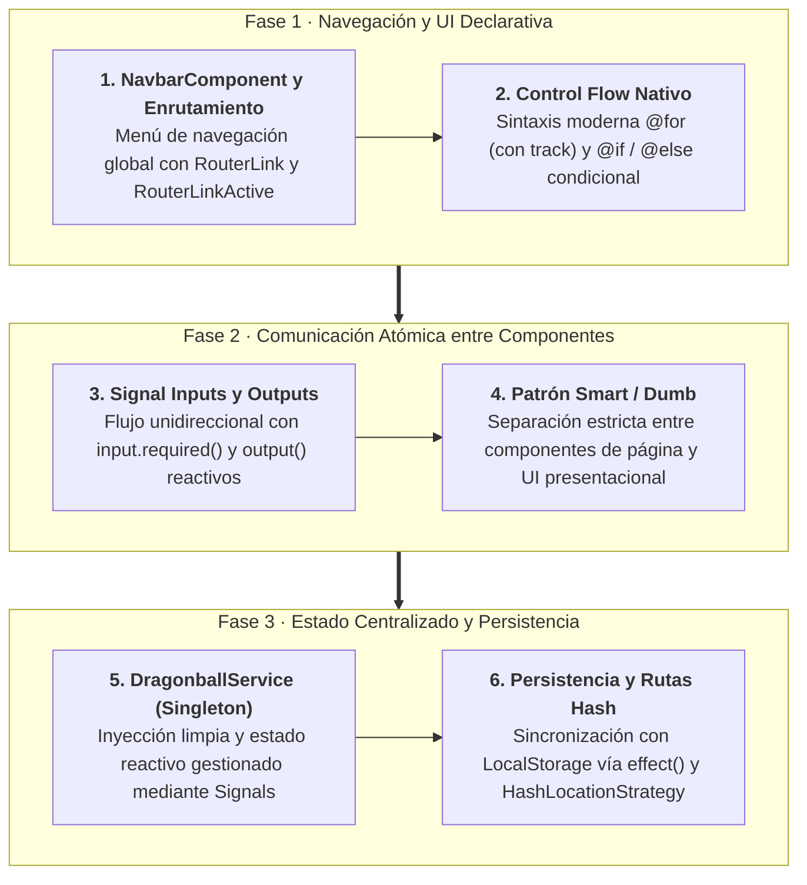
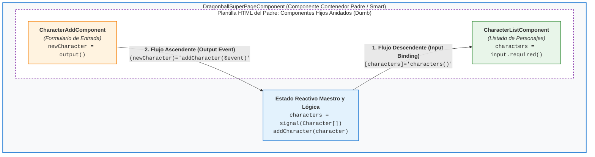
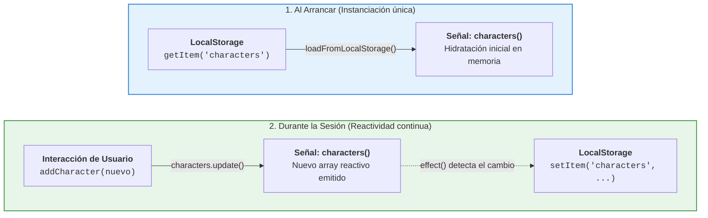

# Sección 05: Expandir Bases — Componentes, Servicios, Control Flow y LinkedSignal

En esta sección profundizamos en la arquitectura moderna de **Angular 19+**. Aprenderemos a comunicar componentes mediante **Signal Inputs y Outputs**, implementar lógica de negocio desacoplada con **Servicios**, persistir estado con **Efectos** y **LocalStorage**, utilizar el nuevo **Control Flow** (`@for`, `@if`), la primitiva **`linkedSignal`** de Angular 19, y preparar despliegues en servidores estáticos utilizando **HashLocationStrategy**.

---

## 📋 Ficha Técnica y Objetivos Didácticos

* **Proyecto:** `bases` (Ampliación con módulos de Dragonball y Dragonball Super).
* **Novedades de Angular 19:** `input.required()`, `output()`, nuevo Control Flow (`@for`, `@if`), `effect()`, `linkedSignal()`, `inject()`, `HashLocationStrategy`.
* **Repositorio de referencia final:** [GitHub - DevTalles Bases (fin-seccion-05)](https://github.com/DevTalles-corp/angular-bases/tree/fin-seccion-05)

!!! tip "📦 Código de Inicio para Seguir la Sección (Starter Kit)"
    Para realizar el seguimiento de esta sección puedes continuar directamente sobre tu proyecto de la sección anterior o descargar el código de partida limpio y verificado desde el repositorio oficial de GitHub:
    
    * 🔗 **Código de Inicio (Punto de partida - Fin de Sección 04):** [GitHub - DevTalles Bases (rama: `fin-seccion-04`)](https://github.com/DevTalles-corp/angular-bases/tree/fin-seccion-04)
    * 🔗 **Código Final de Referencia (Meta - Fin de Sección 05):** [GitHub - DevTalles Bases (rama: `fin-seccion-05`)](https://github.com/DevTalles-corp/angular-bases/tree/fin-seccion-05)

    *Instrucciones para iniciar con el código de partida:*
    ```bash
    git clone -b fin-seccion-04 https://github.com/DevTalles-corp/angular-bases.git bases-app
    cd bases-app
    npm install
    ng serve
    ```



---

## Introducción y Hoja de Ruta

A medida que una aplicación crece, mantener toda la vista y la lógica en una sola página resulta insostenible. Esta sección nos enseña los patrones de diseño esenciales para **modularizar**:

1. **Navegación declarativa:** Menú de navegación interactivo con `RouterLink` y detección de ruta activa.
2. **Sintaxis de plantillas moderna:** Reemplazo de las antiguas directivas `*ngFor` y `*ngIf` por el nuevo **Control Flow** nativo de Angular (`@for`, `@if`, `@else`).
3. **Comunicación entre componentes:** Paso de datos de padres a hijos con **`input()`** y notificación de hijos a padres con **`output()`** basados en señales.
4. **Capa de Servicios:** Centralización del estado de la aplicación mediante `@Injectable`.
5. **Efectos reactivos:** Sincronización automática del estado con `localStorage` mediante `effect()`.
6. **Nueva Primitiva `linkedSignal`:** Sincronización reactiva entre fuentes de datos persistidas y estado mutable local.
7. **Despliegues en producción:** Configuración de `HashLocationStrategy` para evitar errores 404 en hosting estático.

---

## Componente de Navegación y Enrutamiento Activo

!!! info "📖 Para saber más: Manual de Referencia"
    Para dominar la configuración de enrutadores, directivas de navegación (`routerLink`, `routerLinkActive`) y rutas hijas, consulta el **[Manual de Referencia: 11. Angular Router y Navegación](manual/11-router.md)**.

### 1. Estado Inicial de Rutas y Manejo de Rutas Desconocidas (Wildcard `**`)

Al iniciar esta sección, nuestra aplicación cuenta con dos rutas registradas en el archivo de enrutamiento principal (`src/app/app.routes.ts`): la ruta raíz `''` vinculada a `CounterPageComponent` y la ruta `'hero'` vinculada a `HeroPageComponent`.

Sin embargo, si un usuario introduce manualmente en la barra de direcciones una URL inexistente o comete una errata tipográfica (por ejemplo, `http://localhost:4200/cualquier-cosa` o `/heroes`), el motor de enrutamiento de Angular intentará hacer coincidir esa URL con las rutas configuradas. Al no encontrar correspondencia, Angular Router arroja una excepción en consola (`Error: Cannot match any routes`) y deja el `<router-outlet />` completamente en blanco, provocando una pantalla vacía sin retroalimentación visual para el usuario.

Para blindar la aplicación ante rutas desconocidas y asegurar una experiencia resiliente, definimos una **ruta comodín** (*wildcard route*) mediante la sintaxis `'**'` con redirección a la raíz:

=== "src/app/app.routes.ts"
    ```typescript title="src/app/app.routes.ts"
    import { Routes } from '@angular/router';
    import { CounterPageComponent } from './pages/counter/counter-page.component';
    import { HeroPageComponent } from './pages/hero/hero-page.component';

    export const routes: Routes = [
      {
        path: '',
        component: CounterPageComponent,
      },
      {
        path: 'hero',
        component: HeroPageComponent,
      },
      // Redirección por defecto ante cualquier ruta desconocida (Wildcard)
      {
        path: '**',
        redirectTo: '',
      },
    ];
    ```

!!! warning "Arquitectura de Enrutamiento: El Algoritmo First-Match-Wins"
    Angular Router evalúa el array de rutas de forma estrictamente secuencial (**de arriba a abajo**). La primera coincidencia que satisfaga la URL solicitada será la que se aplique.
    
    Por este motivo, la ruta comodín (`path: '**'`) debe ubicarse **obligatoriamente al final** de la lista de rutas. Si se colocase al principio o antes de otras rutas, interceptaría cualquier petición antes de que Angular pudiera evaluar las rutas específicas declaradas debajo, haciendo que esas páginas fuesen completamente inaccesibles.

Una vez asegurado el manejo de rutas desconocidas, el siguiente paso arquitectónico es evidente: los usuarios no deben depender de escribir URLs a mano en la barra del navegador. Es imprescindible construir un menú de navegación visual (`NavbarComponent`) reutilizable e integrarlo en la plantilla principal de la aplicación.

---

### 2. Creación e Integración de `NavbarComponent` en el Layout Global

Para estructurar la navegación de la aplicación de forma limpia, centralizamos el menú en un componente compartido reutilizable dentro del directorio `src/app/components/shared/navbar/`.

Creamos la clase del componente standalone:

=== "src/app/components/shared/navbar/navbar.component.ts"
    ```typescript title="src/app/components/shared/navbar/navbar.component.ts"
    import { Component } from '@angular/core';
    import { RouterLink, RouterLinkActive } from '@angular/router';

    @Component({
      selector: 'app-navbar',
      // Importamos las directivas de enrutado declarativo imprescindibles
      imports: [RouterLink, RouterLinkActive],
      templateUrl: './navbar.component.html',
    })
    export class NavbarComponent {}
    ```

Para que este menú esté presente de forma continua en todas las pantallas sin duplicar código, lo integramos de inmediato en el componente raíz `AppComponent`:

=== "src/app/app.component.ts"
    ```typescript title="src/app/app.component.ts"
    import { Component } from '@angular/core';
    import { RouterOutlet } from '@angular/router';
    import { NavbarComponent } from './components/shared/navbar/navbar.component';

    @Component({
      selector: 'app-root',
      imports: [RouterOutlet, NavbarComponent], // Registramos el Navbar en los imports
      templateUrl: './app.component.html',
    })
    export class AppComponent {}
    ```

=== "src/app/app.component.html"
    ```html title="src/app/app.component.html"
    <app-navbar />

    <section class="mx-5 mt-2">
      <!-- Aquí se renderiza dinámicamente la página activa -->
      <router-outlet />
    </section>
    ```

---

### 3. De `href` a `RouterLink`: Navegación Declarativa SPA

Al diseñar un menú en HTML tradicional, el primer impulso suele ser utilizar etiquetas de enlace estándar con el atributo `href`:

```html title="src/app/components/shared/navbar/navbar.component.html (Intento inicial con HTML clásico)"
<nav>
  <a href="/">Contador</a>
  <a href="/hero">Hero</a>
</nav>
```

#### El Problema Visible de `href` en una SPA:

Si pruebas esta plantilla en el navegador y haces clic en "Hero":

1. **El icono de carga del navegador comienza a girar.**
2. **Toda la página web parpadea en blanco y se descarga de nuevo desde el servidor.**
3. **Pérdida irreversible de estado reactivo:** Si el usuario había incrementado el contador a 15 en `CounterPageComponent`, al recargar la página **el contador vuelve a 10** (su valor inicial). Toda la memoria de JavaScript y las **Signals** se reinician por completo.

#### La Solución Angular: Directiva `RouterLink`
Sustituimos el atributo `href` por la directiva especializada **`RouterLink`**. Esta directiva intercepta el evento de clic, ejecuta internamente un `event.preventDefault()`, actualiza la URL en el historial del navegador con `history.pushState()` y reemplaza únicamente el componente activo dentro del `<router-outlet />` en microsegundos, **manteniendo intacta la memoria de la aplicación**.

Angular admite dos sintaxis para `routerLink`:

```html title="src/app/components/shared/navbar/navbar.component.html"
<nav>
  <!-- 1. Sintaxis literal simple: ideal para rutas fijas -->
  <a routerLink="/">Contador</a>

  <!-- 2. Sintaxis de array (Property Binding): necesaria para segmentos dinámicos o argumentos -->
  <a [routerLink]="['/hero']">Hero</a>
</nav>
```

!!! tip "Sintaxis Literal vs. Sintaxis de Array"
    * **`routerLink="/ruta"`:** Se utiliza cuando la ruta es una cadena estática invariable.
    * **`[routerLink]="['/ruta', parametro]"`:** Se utiliza la sintaxis de enlace de propiedad (*property binding*) con un array. Angular evalúa cada elemento del array como un segmento de la URL y se encarga de escapar caracteres especiales automáticamente mediante `encodeURIComponent`.

!!! warning "Requisito Obligatorio en Componentes Standalone"
    Para que `routerLink` funcione, es **estrictamente obligatorio** importar `RouterLink` en el array `imports` de `NavbarComponent`. Si lo omites, Angular no reconocerá la directiva y el enlace se comportará como un texto inerte que no reacciona al clic.

---

### 4. Resaltado Visual con `RouterLinkActive` y el Dilema de la Ruta Raíz

Para proporcionar una experiencia de usuario clara, el menú debe indicar visualmente en qué página se encuentra el usuario en cada momento.

#### A. Definición de Estilos Locales
Agregamos los estilos visuales en la parte superior de `navbar.component.html`:

```html title="src/app/components/shared/navbar/navbar.component.html"
<style>
  nav {
    display: flex;
    justify-content: space-around;
    background-color: #212121;
    color: white;
    padding: 10px;
  }
  nav a {
    color: white;
    text-decoration: none;
  }
  /* Estilo que se aplicará automáticamente al enlace activo */
  nav a.active {
    color: #f87171;
    font-weight: bold;
    text-decoration: underline;
  }
</style>
```

#### B. Aplicación de `RouterLinkActive`
La directiva **`RouterLinkActive`** monitoriza la URL activa del navegador y, cuando coincide con la ruta del enlace, le aplica automáticamente la clase CSS indicada (en este caso, `active`):

```html
<nav>
  <!-- Asignación directa como string -->
  <a routerLink="/" routerLinkActive="active">Contador</a>

  <!-- Asignación equivalente mediante Property Binding -->
  <a [routerLink]="['/hero']" [routerLinkActive]="'active'">Hero</a>
</nav>
```

*(Ambas sintaxis son plenamente válidas: `routerLinkActive="active"` pasa el nombre de la clase como string literal, mientras que `[routerLinkActive]="'active'"` lo evalúa como expresión JavaScript).*

#### C. El Problema en Directo: El "Efecto Raíz Permanente"

Al guardar los cambios y probar la aplicación en el navegador, surge un comportamiento anómalo:

* Si estás en la página del Contador (`/`), el enlace "Contador" se muestra en rojo. Hasta aquí, correcto.
* Sin embargo, cuando haces clic en "Hero" (`/hero`), **¡ambos enlaces aparecen marcados en rojo simultáneamente!**

##### ¿Por qué ocurre esto?

Por defecto, `routerLinkActive` evalúa las rutas mediante una coincidencia por **prefijo** (*prefix match*): considera que un enlace está activo si la URL del navegador **comienza** por la ruta del enlace.

Como la URL `/hero` comienza por el carácter `/`, Angular asume que la ruta raíz (`/`) también sigue activa.

#### D. La Solución: `[routerLinkActiveOptions]="{ exact: true }"`
Para solucionar este comportamiento y exigir que la coincidencia sea estricta, añadimos la directiva de configuración `[routerLinkActiveOptions]="{ exact: true }"` al enlace de la raíz:

=== "src/app/components/shared/navbar/navbar.component.html"
    ```html title="src/app/components/shared/navbar/navbar.component.html"
    <style>
      nav {
        display: flex;
        justify-content: space-around;
        background-color: #212121;
        color: white;
        padding: 10px;
      }
      nav a {
        color: white;
        text-decoration: none;
      }
      nav a.active {
        color: #f87171;
        font-weight: bold;
        text-decoration: underline;
      }
    </style>

    <nav>
      <!-- Coincidencia exacta estricta para la ruta raíz -->
      <a
        routerLink="/"
        routerLinkActive="active"
        [routerLinkActiveOptions]="{ exact: true }"
      >
        Contador
      </a>

      <!-- Navegación hacia la página Hero -->
      <a [routerLink]="['/hero']" [routerLinkActive]="'active'">Hero</a>

      <!-- Los enlaces a Dragonball y Dragonball Super se incorporarán en las siguientes tareas -->
    </nav>
    ```

Ahora, al alternar entre "Contador" y "Hero", la clase `active` se transfiere limpiamente de un elemento a otro sin solapamientos, logrando un menú de navegación reactivo, accesible y profesional.

---

## 🎯 Tarea Práctica 1: Preparación de la Página Dragonball y Enrutamiento

!!! info "📖 Para saber más: Manual de Referencia"
    Para dominar la configuración de rutas, componentes enrutados y directivas de navegación en Angular, consulta el **[Manual de Referencia: 11. Angular Router y Navegación](manual/11-router.md)**.

Una vez configurado nuestro menú de navegación global con `NavbarComponent`, es momento de preparar la estructura base para el nuevo módulo de la aplicación: el módulo temático de Dragonball. Esta tarea afianza el flujo de trabajo estándar en Angular para registrar nuevas páginas enrutadas en una Single Page Application (SPA).

---

### 📋 Enunciado del Reto para el Alumno

Antes de consultar la solución guiada, realiza de forma autónoma los siguientes pasos en tu proyecto:

1. **Creación de la carpeta y archivos de la página:** Dentro del directorio `src/app/pages/`, crea una subcarpeta llamada `dragonball/`. Dentro de ella, añade dos archivos:
    - `dragonball-page.component.ts`: el controlador TypeScript del componente standalone.
    - `dragonball-page.component.html`: la plantilla visual asociada.
2. **Definición del componente standalone:** En `dragonball-page.component.ts`, declara el componente con el decorador `@Component`. Debe especificar su selector (o prescindir de él si solo se usará mediante el enrutador) y vincular el archivo de plantilla mediante `templateUrl: './dragonball-page.component.html'`.
3. **Estructura básica de la vista:** En `dragonball-page.component.html`, añade un título descriptivo `<h1>DragonBall Page</h1>` y un separador horizontal `<hr />`.
4. **Registro de la ruta en `app.routes.ts`:** Abre `src/app/app.routes.ts` y añade la definición de ruta para el path `'dragonball'`, asociándola a `DragonballPageComponent`.
5. **Actualización de la barra de navegación:** Abre `src/app/components/shared/navbar/navbar.component.html` y añade un nuevo elemento `<a>` con la directiva `[routerLink]="['/dragonball']"` (o `routerLink="/dragonball"`) y `routerLinkActive="active"`.
6. **Criterio de éxito y verificación:**
    - Abre el navegador en `http://localhost:4200`.
    - Haz clic en el nuevo enlace "Dragonball" del Navbar: la URL debe cambiar de inmediato a `http://localhost:4200/dragonball` sin que la página parpadee ni se recargue el navegador.
    - El texto `DragonBall Page` debe renderizarse dentro del `<router-outlet />`.
    - El enlace de "Dragonball" en la barra de navegación debe cambiar su aspecto visual al color rojo destacado definido en la clase `.active`.

---

### ⏸️ Reto Práctico: ¡Inténtalo tú mismo!

!!! exercise "Pausa de Trabajo Autónomo"
    Configura la página, la ruta y el enlace en el menú de navegación de forma autónoma en tu editor antes de revisar la solución detallada.
    
    *Criterio de éxito:* Navegación SPA fluida y activación correcta de la clase CSS del menú al acceder a `/dragonball`.

---

### 🛠️ Solución Paso a Paso y Explicación Técnica

#### Paso 1: Crear el controlador del componente

Creamos el archivo `src/app/pages/dragonball/dragonball-page.component.ts`. Al tratarse de una versión moderna de Angular (v19+), los componentes son standalone por defecto y no requieren la propiedad obsoleta `standalone: true`:

```typescript title="src/app/pages/dragonball/dragonball-page.component.ts"
import { Component } from '@angular/core';

@Component({
  templateUrl: './dragonball-page.component.html',
})
export class DragonballPageComponent {}
```

#### Paso 2: Crear la plantilla HTML

Creamos `src/app/pages/dragonball/dragonball-page.component.html` con el encabezado semántico:

```html title="src/app/pages/dragonball/dragonball-page.component.html"
<h1>DragonBall Page</h1>
<hr />
```

#### Paso 3: Configurar la ruta en el enrutador principal

Editamos `src/app/app.routes.ts` e incorporamos la ruta al array `routes`:

```typescript title="src/app/app.routes.ts" hl_lines="9-12"
import { Routes } from '@angular/router';
import { CounterPageComponent } from './pages/counter/counter-page.component';
import { HeroPageComponent } from './pages/hero/hero-page.component';
import { DragonballPageComponent } from './pages/dragonball/dragonball-page.component';

export const routes: Routes = [
  { path: '', component: CounterPageComponent },
  { path: 'hero', component: HeroPageComponent },
  {
    path: 'dragonball',
    component: DragonballPageComponent,
  },
  { path: '**', redirectTo: '' },
];
```

#### Paso 4: Enlazar la página en el menú de navegación

Actualizamos `src/app/components/shared/navbar/navbar.component.html` añadiendo el enlace de Dragonball con su directiva de estado activo:

```html title="src/app/components/shared/navbar/navbar.component.html" hl_lines="6"
<nav>
  <a routerLink="/" routerLinkActive="active" [routerLinkActiveOptions]="{ exact: true }">
    Contador
  </a>
  <a routerLink="/hero" routerLinkActive="active">Hero</a>
  <a routerLink="/dragonball" routerLinkActive="active">Dragonball</a>
</nav>
```

---

### 🔍 Análisis de la Solución y Conceptos Clave

1. **SPA (Single Page Application) vs Navegación Tradicional:**
    * Al utilizar `routerLink` en lugar de `href`, Angular intercepta el evento de clic del usuario, evita la petición GET al servidor web y manipula directamente la API de historial del navegador (`pushState`). Esto preserva el estado en memoria de la aplicación y produce una experiencia de navegación instantánea.
2. **Sincronización del estado de UI con `routerLinkActive`:**
    * Angular supervisa internamente los eventos de navegación (`NavigationEnd`). Cuando la URL en la barra de direcciones coincide con la ruta especificada en `routerLink`, añade automáticamente la clase CSS `'active'`, eliminándola en cuanto el usuario navega a otra pantalla.
3. **Ruta comodín (`**`):**
    * Configurar `{ path: '**', redirectTo: '' }` al final del array de rutas garantiza que cualquier URL no reconocida redirija al usuario a la página por defecto sin generar pantallas en blanco.

---

### ⚠️ Errores Típicos del Alumno en esta Tarea

| Error Común | Síntoma en el Navegador | Causa y Solución |
| :--- | :--- | :--- |
| Usar `<a href="/dragonball">` en lugar de `routerLink` | La pantalla parpadea en blanco y se recarga completamente el navegador; se pierde todo el estado de la aplicación. | **Causa:** El atributo nativo `href` ejecuta una recarga HTTP completa. <br/>**Solución:** Usar siempre la directiva `routerLink="/dragonball"`. |
| Olvidar importar `RouterLink` y `RouterLinkActive` en `NavbarComponent` | Advertencia en consola de compilación: *Can't bind to 'routerLink' since it isn't a known property of 'a'*. | **Causa:** En componentes standalone, las directivas del router deben figurar explícitamente en el array `imports: [RouterLink, RouterLinkActive]`. |
| Escribir `path: '/dragonball'` con barra inicial en `app.routes.ts` | Error de configuración de rutas o fallo de coincidencia al navegar. | **Causa:** En la definición de rutas de Angular, los paths no llevan barra inicial (`/`). Solo se usa `'dragonball'`. |
| El enlace activo permanece encendido en todas las rutas | El enlace de inicio siempre aparece resaltado, sin importar en qué página estemos. | **Causa:** Toda ruta comienza con `/`. <br/>**Solución:** Añadir `[routerLinkActiveOptions]="{ exact: true }"` al enlace de la ruta raíz. |

---

### 🧑‍🏫 Guía Didáctica para el Docente en el Aula

!!! tip "Estrategia para Guiar esta Práctica en Clase"
    1. **Demostración de contraste:** Pida a un alumno que reemplace un `routerLink` por `href` e introduzca algún valor en el contador de la página anterior antes de pulsar el enlace. Al ver cómo el contador se reinicia a cero debido a la recarga de página, los estudiantes entenderán de inmediato el valor de una SPA y el papel de `routerLink`.
    2. **Inspección de elementos en vivo:** Abra las DevTools del navegador (F12) sobre el menú `<nav>` y haga clic entre las opciones. Guíe a los alumnos para que observen cómo la clase `class="active"` aparece y desaparece en el DOM en tiempo real gracias a `routerLinkActive`.

---

## El Nuevo Control Flow: `@for`, `@if` y Estilos Dinámicos

!!! info "📖 Para saber más: Manual de Referencia"
    Domina a fondo el nuevo sistema de renderizado condicional, bucles reactivos y gestión de listas vacías en el **[Manual de Referencia: 04. Plantillas y Control Flow (Control Flow Nativo)](manual/04-plantillas.md#control-flow-nativo-if-for-switch)**. Si deseas profundizar en la comparativa histórica con las directivas estructurales clásicas (`*ngIf`, `*ngFor`), consulta también el **[Manual de Referencia: 08. Directivas](manual/08-directivas.md#parte-1-control-flow-moderno-if-for-switch)**.

En versiones anteriores, Angular requería importar `CommonModule` y usar directivas como `*ngFor` y `*ngIf`. Angular 17+ introdujo una **sintaxis declarativa integrada en el compilador**, inspirada en la sintaxis de lenguajes modernos.

### Modelo de Datos: `src/app/interfaces/character.interface.ts`

!!! info "📖 Para saber más: Interfaces y Tipado Estricto"
    Si deseas profundizar en la teoría de interfaces, propiedades opcionales y la comparativa entre `interface`, `type` y `class`, consulta la guía **[03. Bases de TypeScript: Objetos, Arrays e Interfaces](03-bases-typescript.md#objetos-arrays-e-interfaces)** y su sección **[La Tríada de Tipado: interface vs type vs class](03-bases-typescript.md#la-triada-de-tipado-interface-vs-type-vs-class)**.

#### ¿Qué es una `interface` en TypeScript y por qué la usamos?

En JavaScript tradicional, los objetos son dinámicos y carecen de restricciones: es fácil cometer errores de tipeo al acceder a una propiedad o intentar leer un campo inexistente, lo que genera fallos en ejecución (`undefined is not an object`).

En TypeScript y Angular, una **`interface`** es un **contrato de diseño** o molde estricto que describe la estructura exacta (*shape*) que debe cumplir un objeto:

1. **Seguridad y Validación en Compilación:** Define qué propiedades son obligatorias (`id`, `name`, `power`) y qué tipo de dato debe tener cada una. Si intentas crear un personaje olvidando un campo o asignando un string a `power`, TypeScript marcará el error al instante.
2. **Autocompletado e IntelliSense:** Al declarar señales o arrays tipados con la interfaz (por ejemplo, `characters = signal<Character[]>([...])`), el editor de código proporciona autocompletado asistido de todas las propiedades del objeto.
3. **Cero Impacto en Producción (*Zero-Cost Abstraction*):** Las interfaces existen **exclusivamente en tiempo de desarrollo y compilación**. Al transcompilar a JavaScript para el navegador, las interfaces desaparecen por completo, por lo que **no añaden ni un solo byte de peso al bundle final**.

#### Creación del archivo de interfaz:
Creamos la carpeta `src/app/interfaces/` y definimos el contrato de los personajes:

```typescript title="src/app/interfaces/character.interface.ts"
export interface Character {
  id: number;
  name: string;
  power: number;
}
```

### Implementación Inicial de la Vista y Estructura

Antes de modularizar en componentes especializados, construimos la funcionalidad completa en una sola página contenedora (`DragonballPageComponent`). Esta arquitectura nos permite dominar dos fundamentos clave de Angular moderno:

1. El nuevo **Control Flow** (`@for`, `@if`, `@empty`).
2. La sincronización de entradas de usuario (**Formularios con Signals**) sin necesidad de librerías externas ni `ngModel`.

---

#### 1. Controlador Inicial: Datos y Señales Locales

En `src/app/pages/dragonball/dragonball-page.component.ts`:

* Importamos la interfaz `Character` para garantizar el tipado estricto.
* Definimos la señal maestra `characters` con el listado inicial de guerreros.
* Creamos dos señales locales (`name` y `power`) que custodiarán en tiempo real los valores de las cajas de texto del formulario:

=== "src/app/pages/dragonball/dragonball-page.component.ts"
    ```typescript title="src/app/pages/dragonball/dragonball-page.component.ts"
    import { Component, signal } from '@angular/core';
    import { Character } from '../../interfaces/character.interface';

    @Component({
      templateUrl: './dragonball-page.component.html',
    })
    export class DragonballPageComponent {
      // Señales para el estado del formulario de agregar personaje
      name = signal('');
      power = signal(0);

      // Señal con el listado inicial de personajes
      characters = signal<Character[]>([
        { id: 1, name: 'Goku', power: 9001 },
        { id: 2, name: 'Vegeta', power: 8000 },
        { id: 3, name: 'Piccolo', power: 3000 },
        { id: 4, name: 'Yamcha', power: 500 },
      ]);
    }
    ```

---

#### 2. Maquetación Base HTML (Estructura Estática con Bootstrap)

Antes de incorporar la lógica de Angular, definimos la estructura visual limpia en `src/app/pages/dragonball/dragonball-page.component.html`. Utilizando las clases de rejilla de Bootstrap (`row` y `col-12 col-sm-6`), dividimos la pantalla en dos columnas para que el alumno comprenda primero la maquetación visual antes de añadir la reactividad:

* **Columna Izquierda:** El formulario de entrada (cajas de texto y botón en estado estático).
* **Columna Derecha:** El listado con elementos de ejemplo para previsualizar el diseño en el navegador.

=== "src/app/pages/dragonball/dragonball-page.component.html"
    ```html title="src/app/pages/dragonball/dragonball-page.component.html (Paso 1: Estructura HTML Base)"
    <h1>DragonBall Page</h1>
    <hr />

    <section class="row">
      <!-- 1. Columna del Formulario (Estructura estática inicial) -->
      <div class="col-12 col-sm-6">
        <h3>Agregar:</h3>
        <input type="text" class="form-control" placeholder="Nombre" />
        <input type="number" class="form-control mt-2" placeholder="Poder" />
        <button class="mt-2 btn btn-primary">Agregar</button>
      </div>

      <!-- 2. Columna del Listado (Datos de muestra estáticos) -->
      <div class="col-12 col-sm-6">
        <h3>Listado de Personajes</h3>
        <ul class="list-group">
          <li class="list-group-item d-flex justify-content-between align-items-center">
            <div><strong>#1</strong> - Goku</div>
            <span class="badge text-bg-danger">9001</span>
          </li>
          <li class="list-group-item d-flex justify-content-between align-items-center">
            <div><strong>#2</strong> - Vegeta</div>
            <span class="badge text-bg-primary">8000</span>
          </li>
        </ul>
      </div>
    </section>
    ```

---

#### 3. Dinamizar la Plantilla: Control Flow y Reactividad con Signals

Una vez verificado el aspecto visual en el navegador, sustituimos los elementos cableados (*hardcoded*) por las características reactivas y directivas de Angular:

1. **Columna Derecha (Listado Dinámico):** Reemplazamos los `<li>` fijos por la directiva `@for (character of characters(); track character.id; let idx = $index)` junto con su bloque `@empty` y clases condicionales dinámicas (`[class.text-bg-danger]="character.power > 9000"`).
2. **Columna Izquierda (Formulario Reactivo):** Conectamos los `<input>` con las señales reactivas mediante `[value]` y `(input)` apoyándonos en variables de referencia de plantilla (`#txtName`, `#txtPower`), y añadimos la previsualización en vivo en el encabezado `<h3>Agregar: {{ name() }}</h3>`.

=== "src/app/pages/dragonball/dragonball-page.component.html"
    ```html title="src/app/pages/dragonball/dragonball-page.component.html (Paso 2: Plantilla Dinamizada con Angular)"
    <h1>DragonBall Page</h1>
    <hr />

    <section class="row">
      <!-- 1. Columna del Formulario Reactivo -->
      <div class="col-12 col-sm-6">
        <!-- Previsualización reactiva inmediata -->
        <h3>Agregar: {{ name() }}</h3>

        <!-- Input de texto enlazado a la señal 'name' -->
        <input
          type="text"
          class="form-control"
          placeholder="Nombre"
          [value]="name()"
          (input)="name.set(txtName.value)"
          #txtName
        />

        <!-- Input numérico enlazado a la señal 'power' -->
        <input
          type="number"
          class="form-control mt-2"
          placeholder="Poder"
          [value]="power()"
          (input)="power.set(+txtPower.value)"
          #txtPower
        />

        <!-- Botón para procesar la inserción -->
        <button class="mt-2 btn btn-primary">
          Agregar
        </button>
      </div>

      <!-- 2. Columna del Listado Dinámico con Control Flow -->
      <div class="col-12 col-sm-6">
        <h3>Listado de Personajes</h3>
        <ul class="list-group">
          @for (character of characters(); track character.id; let idx = $index) {
            <li class="list-group-item d-flex justify-content-between align-items-center">
              <div>
                <strong>#{{ idx + 1 }}</strong> - {{ character.name }}
              </div>
              <span
                class="badge"
                [class.text-bg-danger]="character.power > 9000"
                [class.text-bg-primary]="character.power <= 9000"
              >
                {{ character.power }}
              </span>
            </li>
          } @empty {
            <li class="list-group-item list-group-item-secondary">
              No hay personajes registrados en la lista.
            </li>
          }
        </ul>
      </div>
    </section>
    ```

---

#### 4. Conceptos Clave Explicados: Formulario Reactivo y Estilos Dinámicos

En Angular clásico se utilizaban directivas como `[(ngModel)]` (que requiere importar `FormsModule`). En Angular moderno con **Signals**, podemos crear formularios ligeros y reactivos utilizando únicamente enlaces nativos de plantilla:

1. **De la Signal al Input (Property Binding `[value]="name()"`):**  
   Refleja en el atributo `value` del input el valor actual de la señal.
2. **Variables de Referencia de Plantilla (`#txtName`, `#txtPower`):**  
   La almohadilla `#` crea una referencia directa al elemento `<input>` del DOM en la plantilla. Nos permite acceder a sus propiedades nativas (como `.value`) sin necesidad de inyectar nada en el archivo TypeScript.
3. **Del Input a la Signal (Event Binding `(input)="name.set(txtName.value)"`):**  
   El evento nativo `(input)` se dispara con cada pulsación de tecla. En ese instante leemos `txtName.value` y actualizamos la señal con `.set()`.
4. **Conversión Numérica con el Operador Unario `+`:**  
   Los elementos `<input type="number">` del navegador retornan siempre una cadena de texto (*string*) a través de su propiedad `.value`. Anteponer el operador `+` (`+txtPower.value`) fuerza la conversión instantánea a tipo `number` en JavaScript, evitando bugs donde los números se concatenen como texto.
5. **Previsualización Reactiva:**  
   Observa cómo en el encabezado `<h3>Agregar: {{ name() }}</h3>` el texto escrito se actualiza al milisegundo mientras el usuario teclea, demostrando la reactividad atómica de las Signals.
6. **Estilos Dinámicos con Class Binding (`[class.nombre-clase]="condición"`):**  
   En lugar de manipular clases imperativamente con JavaScript (`classList.add/remove`), Angular permite conmutar clases CSS de forma puramente declarativa:

   ```html
   <span
     class="badge"
     [class.text-bg-danger]="character.power > 9000"
     [class.text-bg-primary]="character.power <= 9000"
   >
     {{ character.power }}
   </span>
   ```

   * **Mecanismo:** Angular evalúa la expresión booleana a la derecha. Si es `true`, inyecta la clase CSS en el nodo del DOM; si es `false`, la retira de inmediato.
   * **Preservación de clases estáticas:** Las clases fijas declaradas en el atributo estándar (`class="badge"`) se conservan intactas; el binding solo conmuta las clases condicionales específicas.

##### Comparativa Técnica: `[class.nombre]` vs Directiva `[ngClass]`

| Criterio | Enlace Nativo `[class.nombreClase]="condicion"` | Directiva `[ngClass]="{ ... }"` |
| :--- | :--- | :--- |
| **Tipo de enlace** | **Nativo del compilador** (Property Binding directo). | **Directiva de atributo** externa. |
| **Imports necesarios** | **Ninguno**. Disponible directamente en cualquier componente standalone. | Requiere importar `NgClass` (o `CommonModule`) desde `@angular/common`. |
| **Rendimiento** | **Óptimo**. Mutación atómica y directa sobre el nodo del DOM. | Implica la instanciación de la directiva y evaluación del objeto de clases. |
| **Caso de uso recomendado** | **Alternar 1, 2 o pocas clases condicionales** (ej: badges de peligro/éxito, estados `activo`/`desactivado`). | Manejar un **diccionario dinámico complejo** de muchas clases simultáneas calculadas en el TypeScript. |

!!! info "📖 Para saber más: Manipulación de Clases y Estilos"
    Aprende más sobre las distintas variantes de sintaxis de estilos en el **[Manual de Referencia: 04. Plantillas (Class Binding)](manual/04-plantillas.md#class-binding)** y consulta el análisis detallado frente a directivas en el **[Manual de Referencia: 08. Directivas ([class] vs NgClass)](manual/08-directivas.md#23-class-y-style-vs-ngclass-y-ngstyle)**.

---

## 🎯 Tarea Práctica 2: Procesamiento del Formulario y Actualización Inmutable de Estado

!!! info "📖 Para saber más: Manual de Referencia"
    Para comprender a fondo la inmutabilidad en JavaScript/TypeScript, el ciclo de detección de cambios de Angular y el método `.update()` en Signals, consulta el **[Manual de Referencia: 05. Signals y Reactividad](manual/05-signals.md)**.

Ahora que ya tenemos el formulario maquetado y los campos de entrada sincronizados reactivamente con las señales locales `name` y `power`, el reto consiste en dotar de funcionalidad al botón **"Agregar"** para registrar nuevos personajes en la lista de forma robusta e inmutable.

---

### 📋 Enunciado del Reto para el Alumno

Antes de consultar la solución guiada, realiza de forma autónoma los siguientes pasos en tu proyecto:

1. **Enlace del evento en el botón:** En `dragonball-page.component.html`, añade el enlace de evento `(click)="addCharacter()"` al botón "Agregar".
2. **Implementación de `addCharacter()` con validación defensiva:** En `src/app/pages/dragonball/dragonball-page.component.ts`:
    - Aplica el **Early Return Pattern**: si el nombre está vacío (tras aplicar `.trim()`), o si el poder es menor o igual a cero (`power <= 0`), aborta la función inmediatamente con `return` sin realizar ninguna mutación.
    - Crea un nuevo objeto de tipo `Character` asignándole un identificador numérico único (por ejemplo, `this.characters().length + 1`), el nombre y el poder ingresados.
3. **Actualización Inmutable del array reactivo:**
    - Actualiza la señal `characters` empleando el método `.update()` y el operador spread (`...`):  
      `this.characters.update(list => [...list, newCharacter]);`
    - **Regla estricta:** Queda terminantemente prohibido usar `this.characters().push(newCharacter)` directamente sobre la señal, ya que mutaría el array original en la misma dirección de memoria impidiendo que Angular detecte el cambio.
4. **Limpieza del formulario:**
    - Crea un método auxiliar `resetFields()` que restablezca `name` a `''` y `power` a `0`, y ejecútalo al finalizar con éxito la inserción para limpiar las cajas de texto.
5. **Criterios de éxito y verificación:**
    - Al introducir "Krillin" con poder `1500` y pulsar "Agregar", el guerrero debe aparecer de inmediato al final de la lista renderizada por `@for`.
    - Si dejas el nombre en blanco (o solo espacios) y pulsas "Agregar", la lista debe permanecer intacta sin errores en consola.
    - Si colocas un poder negativo o cero (ej: `-50`), no debe añadirse ningún personaje.
    - Tras cada inserción exitosa, las cajas de texto deben limpiarse automáticamente.

---

### ⏸️ Reto Práctico: ¡Inténtalo tú mismo!

!!! exercise "Pausa de Trabajo Autónomo"
    Implementa la lógica del formulario y la actualización inmutable en tu editor antes de verificar la solución.
    
    *Criterio de éxito:* Inserción reactiva en el DOM con validaciones defensivas y reseteo de campos sin mutaciones directas.

---

### 🛠️ Solución Paso a Paso y Explicación Técnica

#### Paso 1: Actualizar el controlador TypeScript

En `src/app/pages/dragonball/dragonball-page.component.ts`, implementamos las señales y los métodos con validación y actualización inmutable:

```typescript title="src/app/pages/dragonball/dragonball-page.component.ts" hl_lines="20-43"
import { Component, signal } from '@angular/core';
import { Character } from '../../interfaces/character.interface';

@Component({
  templateUrl: './dragonball-page.component.html',
})
export class DragonballPageComponent {
  // Señales para el formulario reactivo
  name = signal('');
  power = signal(0);

  // Lista de personajes inicial
  characters = signal<Character[]>([
    { id: 1, name: 'Goku', power: 9001 },
    { id: 2, name: 'Vegeta', power: 8000 },
    { id: 3, name: 'Piccolo', power: 3000 },
    { id: 4, name: 'Yamcha', power: 500 },
  ]);

  addCharacter() {
    // 1. Validaciones defensivas (Early Return Pattern)
    if (!this.name().trim() || this.power() <= 0) {
      return;
    }

    // 2. Creación del nuevo registro inmutable
    const newCharacter: Character = {
      id: this.characters().length + 1,
      name: this.name().trim(),
      power: this.power(),
    };

    // 3. Actualización inmutable con .update() y operador spread
    this.characters.update((list) => [...list, newCharacter]);

    // 4. Limpieza del formulario
    this.resetFields();
  }

  resetFields() {
    this.name.set('');
    this.power.set(0);
  }
}
```

#### Paso 2: Conectar la plantilla HTML

En `src/app/pages/dragonball/dragonball-page.component.html`, enlazamos el evento `(click)` del botón "Agregar" con el método `addCharacter()` recién implementado en el controlador:

```html title="src/app/pages/dragonball/dragonball-page.component.html" hl_lines="27-29"
<h1>DragonBall Page</h1>
<hr />

<section class="row">
  <!-- Columna Formulario -->
  <div class="col-12 col-sm-6">
    <h3>Agregar Personaje</h3>
    
    <input
      type="text"
      class="form-control"
      placeholder="Nombre"
      [value]="name()"
      (input)="name.set(txtName.value)"
      #txtName
    />

    <input
      type="number"
      class="form-control mt-2"
      placeholder="Poder"
      [value]="power()"
      (input)="power.set(+txtPower.value)"
      #txtPower
    />

    <button (click)="addCharacter()" class="mt-2 btn btn-primary">
      Agregar
    </button>
  </div>

  <!-- Columna Listado -->
  <div class="col-12 col-sm-6">
    <h3>Listado de Personajes</h3>
    <ul class="list-group">
      @for (character of characters(); track character.id; let idx = $index) {
        <li class="list-group-item d-flex justify-content-between align-items-center">
          <div>
            <strong>#{{ idx + 1 }}</strong> - {{ character.name }}
          </div>
          <span
            class="badge"
            [class.text-bg-danger]="character.power > 9000"
            [class.text-bg-primary]="character.power <= 9000"
          >
            {{ character.power }}
          </span>
        </li>
      } @empty {
        <li class="list-group-item list-group-item-secondary">
          No hay personajes registrados en la lista.
        </li>
      }
    </ul>
  </div>
</section>
```

---

### 🔍 Análisis de la Solución y Conceptos Clave

1. **¿Por qué `this.characters.update()` y no `this.characters().push()`?**
    * Angular Signals utiliza una función de comparación de igualdad por defecto (`defaultEquals`), la cual evalúa si `referenciaAnterior === nuevaReferencia`.
    * Si ejecutas `this.characters().push(newCharacter)`, estás mutando el contenido interno del array pero la **dirección física en memoria heap** sigue siendo exactamente la misma (`0x001 === 0x001`). Como resultado, Angular asume que el dato no cambió y **no actualiza el DOM**.
    * Al utilizar el operador spread `[...list, newCharacter]`, JavaScript crea un **nuevo array en una dirección de memoria diferente** (`0x002`). La comparación de referencia resulta falsa (`0x001 !== 0x002`), lo que desencadena de inmediato el renderizado del nuevo elemento en la interfaz.
2. **Early Return Pattern (Código Plano vs Código Flecha):**
    * Validar las condiciones negativas al inicio de la función y salir inmediatamente con `return` previene anidamientos excesivos de bloques `if/else`, mejorando drásticamente la legibilidad y mantenibilidad del código.
3. **Conversión con operador unario `+`:**
    * Los elementos `<input type="number">` del DOM retornan siempre su valor como `string` a través de la propiedad `.value`. Anteponer el operador `+` (`+txtPower.value`) fuerza la conversión a tipo numérico primitivo en JavaScript.

---

### ⚠️ Errores Típicos del Alumno en esta Tarea

| Error Común | Síntoma en el Navegador | Causa y Solución |
| :--- | :--- | :--- |
| Usar `this.characters().push(...)` | Al hacer clic en "Agregar", la lista en pantalla no cambia absolutamente nada. | **Causa:** Mutación directa del array existente. Angular no detecta cambio de referencia. <br/>**Solución:** Usar `this.characters.update(list => [...list, nuevo])`. |
| Olvidar el operador unario `+` en el input de poder | El valor del poder se concatena como texto o genera advertencias de tipado TypeScript. | **Causa:** `txtPower.value` es siempre de tipo `string`. <br/>**Solución:** Convertir a número con `+txtPower.value` o `Number(txtPower.value)`. |
| Omitir `.trim()` en la validación | El usuario puede insertar personajes cuyo nombre consta únicamente de espacios vacíos (`"   "`). | **Causa:** Un string de espacios evalúa a `true` en JavaScript. <br/>**Solución:** Validar con `!this.name().trim()`. |
| No resetear las señales tras guardar | Los campos de entrada conservan los valores anteriores tras pulsar "Agregar". | **Causa:** No invocar `this.resetFields()` al terminar `addCharacter()`. |

---

### 🧑‍🏫 Guía Didáctica para el Docente en el Aula

!!! tip "Estrategia para Guiar esta Práctica en Clase"
    1. **El experimento del `.push()`:** Pida a los estudiantes que escriban intencionadamente `this.characters().push(newCharacter)` y pulsen el botón. Al comprobar que el DOM no reacciona, aproveche para explicar en la pizarra cómo funciona la comparación por referencia (`===`) en JavaScript y por qué la inmutabilidad es la piedra angular del rendimiento reactivo moderno.
    2. **Inspección de tipos:** Haga que los alumnos pasen el cursor sobre `txtName.value` y `txtPower.value` en su editor para que comprueben que ambos son `string`, reforzando la necesidad de la conversión numérica con el operador `+`.

### Claves del Nuevo Control Flow:

1. **Obligatoriedad de `track`:** En `@for (item of items; track item.id)`, el parámetro `track` es obligatorio por compilador. Permite a Angular reutilizar los nodos del DOM existentes cuando la lista cambia, disparando el rendimiento al evitar repintar elementos innecesarios.
2. **Variables de contexto integradas:** `$index`, `$first`, `$last`, `$even`, `$odd` están disponibles directamente con la palabra clave `let idx = $index`.
3. **Bloque `@empty`:** Se renderiza automáticamente cuando la lista está vacía, eliminando la necesidad de condicionales adicionales.
4. **Enlace condicional de clases (`[class.nombreClase]="condicion"`):** Alternativa directa y limpia a `ngClass` para añadir o retirar clases CSS según una expresión booleana.

---

## Comunicación entre Componentes con Signal Inputs y Outputs

!!! info "📖 Para saber más: Manual de Referencia"
    Profundiza en los patrones Smart/Dumb, la API moderna `input()`, `output()` y la reactividad bidireccional con `model()` en el **[Manual de Referencia: 07. Comunicación entre Componentes](manual/07-anidar-componentes.md)**.

Cuando una vista contiene un formulario y una lista, mezclar ambos en un solo archivo rompe la **Separación de Responsabilidades (SoC)**. Vamos a extraer dos componentes atómicos:

* `CharacterListComponent`: Componente tonto (*Dumb*) que solo muestra datos recibidos.
* `CharacterAddComponent`: Componente que gestiona el formulario y emite eventos hacia el padre.



### El Componente Hijo: `CharacterListComponent`
Utiliza el nuevo **`input.required<T>()`** de Angular 19:

=== "src/app/components/dragonball/character-list/character-list.component.ts"
    ```typescript title="src/app/components/dragonball/character-list/character-list.component.ts"
    import { Component, input } from '@angular/core';
    import { Character } from '../../../interfaces/character.interface';

    @Component({
      selector: 'dragonball-character-list',
      templateUrl: './character-list.component.html',
    })
    export class CharacterListComponent {
      // Input obligatorio: el padre TIENE que proporcionarlo
      characters = input.required<Character[]>();

      // Input opcional con valor por defecto
      listName = input<string>('Listado de Personajes');
    }
    ```

=== "src/app/components/dragonball/character-list/character-list.component.html"
    ```html title="src/app/components/dragonball/character-list/character-list.component.html"
    <h3>{{ listName() }}</h3>

    <ul class="list-group">
      @for (character of characters(); track character.id; let idx = $index) {
        <li class="list-group-item d-flex justify-content-between align-items-center">
          <div>
            <strong>#{{ idx + 1 }}</strong> - {{ character.name }}
          </div>
          <span
            class="badge"
            [class.text-bg-danger]="character.power > 9000"
            [class.text-bg-primary]="character.power <= 9000"
          >
            {{ character.power }}
          </span>
        </li>
      } @empty {
        <li class="list-group-item list-group-item-secondary">
          No hay personajes registrados en la lista.
        </li>
      }
    </ul>
    ```

---

## 🎯 Tarea Práctica 3: Modularización Atómica con Componentes Dumb y `output()`

!!! info "📖 Para saber más: Manual de Referencia"
    Aprende más sobre el patrón Smart/Dumb (Container/Presentational), la nueva función `output()` y la comunicación entre componentes en el **[Manual de Referencia: 07. Comunicación entre Componentes](manual/07-anidar-componentes.md)**.

En este reto aplicaremos el principio de **Separación de Responsabilidades (SoC)** y el patrón arquitectónico **Smart & Dumb Components**. Extraeremos el formulario de creación de personajes de la página principal hacia un componente hijo presentacional (`CharacterAddComponent`), el cual comunicará los nuevos datos al componente padre mediante la función reactiva **`output<T>()`** de Angular 19+.

---

### 📋 Enunciado del Reto para el Alumno

Antes de consultar la solución guiada, realiza de forma autónoma los siguientes pasos en tu proyecto:

1. **Creación del componente hijo presentacional:** Dentro de `src/app/components/dragonball/`, crea la carpeta `character-add/` con sus dos archivos:
    - `character-add.component.ts`: controlador TypeScript del componente con selector `dragonball-character-add`.
    - `character-add.component.html`: plantilla con el formulario extraído.
2. **Definición del evento de salida con `output()`:**
    - En `CharacterAddComponent`, declara un evento de salida tipado: `newCharacter = output<Character>()`.
3. **Manejo del estado local y emisión del evento:**
    - Mueve las señales locales `name` y `power`, así como el método `resetFields()`, al componente hijo.
    - En el método `addCharacter()` del hijo, valida los campos, genera el nuevo objeto `Character` (usando `Math.floor(Math.random() * 1000)` o similar para el id) y emítelo al padre mediante `this.newCharacter.emit(character)`.
    - Tras emitir, limpia los inputs locales llamando a `this.resetFields()`.
4. **Integración en el componente padre:**
    - Abre la página contenedora (`DragonballSuperPageComponent` o `DragonballPageComponent`).
    - Importa `CharacterAddComponent` en el array `imports` del decorador `@Component`.
    - En la plantilla del padre, sustituye el bloque HTML del formulario por la etiqueta del componente hijo:
     `<dragonball-character-add (newCharacter)="addCharacter($event)" />`
    - En el TypeScript del padre, implementa el método `addCharacter(newChar: Character)` que recibe el evento (`$event`) y actualiza su señal maestra mediante `this.characters.update(list => [...list, newChar])`.
5. **Criterios de éxito y verificación:**
    - La página debe compilar sin advertencias.
    - Al introducir un personaje en el formulario hijo y hacer clic en "Agregar", el componente padre debe recibir el objeto y la lista debe actualizarse de forma instantánea.
    - El componente hijo debe quedar completamente aislado: no debe conocer cómo almacena los personajes el padre ni depender de ningún servicio externo.

---

### ⏸️ Reto Práctico: ¡Inténtalo tú mismo!

!!! exercise "Pausa de Trabajo Autónomo"
    Extrae el componente de adición, declara su `output()` y conéctalo con el componente padre en tu editor antes de verificar la solución.
    
    *Criterio de éxito:* Desacoplamiento total del formulario, captura de eventos con `$event` y actualización reactiva de la lista del padre.

---

### 🛠️ Solución Paso a Paso y Explicación Técnica

#### Paso 1: Crear el Componente Hijo `CharacterAddComponent`

Creamos `src/app/components/dragonball/character-add/character-add.component.ts`. Declaramos la salida mediante la función `output<Character>()`:

```typescript title="src/app/components/dragonball/character-add/character-add.component.ts" hl_lines="12-13 15-31"
import { Component, output, signal } from '@angular/core';
import { Character } from '../../../interfaces/character.interface';

@Component({
  selector: 'dragonball-character-add',
  templateUrl: './character-add.component.html',
})
export class CharacterAddComponent {
  name = signal('');
  power = signal(0);

  // Definición del evento de salida tipado reactivo
  newCharacter = output<Character>();

  addCharacter() {
    // Validación defensiva local
    if (!this.name().trim() || this.power() <= 0) {
      return;
    }

    const character: Character = {
      id: Math.floor(Math.random() * 1000),
      name: this.name().trim(),
      power: this.power(),
    };

    // Emisión del evento fuertemente tipado hacia el componente contenedor
    this.newCharacter.emit(character);

    this.resetFields();
  }

  resetFields() {
    this.name.set('');
    this.power.set(0);
  }
}
```

#### Paso 2: Crear la Plantilla del Hijo `character-add.component.html`

Creamos `src/app/components/dragonball/character-add/character-add.component.html`:

```html title="src/app/components/dragonball/character-add/character-add.component.html"
<h3>Agregar Personaje</h3>

<input
  type="text"
  class="form-control"
  placeholder="Nombre"
  [value]="name()"
  (input)="name.set(txtName.value)"
  #txtName
/>

<input
  type="number"
  class="form-control mt-2"
  placeholder="Poder"
  [value]="power()"
  (input)="power.set(+txtPower.value)"
  #txtPower
/>

<button (click)="addCharacter()" class="mt-2 btn btn-primary">
  Agregar
</button>
```

#### Paso 3: Conectar el Hijo en el Componente Padre

En el controlador del componente padre (por ejemplo, `DragonballSuperPageComponent` o la página contenedora), importamos el nuevo componente hijo y escuchamos su evento:

```typescript title="src/app/pages/dragonball-super/dragonball-super-page.component.ts" hl_lines="4 8 16-18"
import { Component, signal } from '@angular/core';
import { Character } from '../../interfaces/character.interface';
import { CharacterListComponent } from '../../components/dragonball/character-list/character-list.component';
import { CharacterAddComponent } from '../../components/dragonball/character-add/character-add.component';

@Component({
  templateUrl: './dragonball-super-page.component.html',
  imports: [CharacterListComponent, CharacterAddComponent],
})
export class DragonballSuperPageComponent {
  characters = signal<Character[]>([
    { id: 1, name: 'Goku', power: 9001 },
    { id: 2, name: 'Vegeta', power: 8000 },
  ]);

  addCharacter(character: Character) {
    this.characters.update((list) => [...list, character]);
  }
}
```

#### Paso 4: Enlazar la Notificación en la Plantilla del Padre

En la plantilla HTML del padre, consumimos el componente hijo y capturamos el evento mediante la variable especial `$event`:

```html title="src/app/pages/dragonball-super/dragonball-super-page.component.html" hl_lines="4-6"
<section class="row">
  <!-- Columna Formulario: Componente Hijo de Adición -->
  <div class="col-12 col-sm-6">
    <dragonball-character-add
      (newCharacter)="addCharacter($event)"
    />
  </div>

  <!-- Columna Listado: Componente Hijo de Presentación -->
  <div class="col-12 col-sm-6">
    <dragonball-character-list
      [characters]="characters()"
      listName="Héroes del Torneo del Poder"
    />
  </div>
</section>
```

---

### 🔍 Análisis de la Solución y Conceptos Clave

1. **Patrón Smart & Dumb (Contenedor vs Presentacional):**
    * **Componente Dumb (`CharacterAddComponent`):** No conoce la colección completa de personajes, no tiene acceso a servicios ni sabe dónde se almacenará la información. Su única misión es recopilar datos del usuario, validarlos y emitir un evento con la carga útil (*payload*).
    * **Componente Smart (`DragonballSuperPageComponent`):** Es el dueño del estado maestro. Decide qué hacer cuando llega un evento (guardarlo en memoria, persistirlo en base de datos o enviarlo a un servicio).
2. **La función moderna `output()` frente a `@Output() EventEmitter`:**
    * En versiones anteriores, se requería importar `@Output()` y crear una instancia `new EventEmitter<T>()` de RxJS.
    * La función **`output<T>()`** de Angular 19+ es una primitiva más liviana, que no depende de RxJS para la emisión de eventos simples entre componentes, reduciendo el tamaño del bundle y simplificando la sintaxis.
3. **El argumento mágico `$event`:**
    * En el enlace de eventos `(newCharacter)="addCharacter($event)"`, Angular inyecta automáticamente el valor emitido por `this.newCharacter.emit(...)` en la variable implícita `$event`, preservando el tipado estricto `Character`.

---

### ⚠️ Errores Típicos del Alumno en esta Tarea

| Error Común | Síntoma en el Navegador | Causa y Solución |
| :--- | :--- | :--- |
| Olvidar `$event`: `(newCharacter)="addCharacter()"` | En la lista se agrega un elemento con valores `undefined` o se produce un error en tiempo de ejecución. | **Causa:** Sin `$event`, el argumento recibido en el método del padre es `undefined`. <br/>**Solución:** Escribir siempre `(newCharacter)="addCharacter($event)"`. |
| Olvidar importar `CharacterAddComponent` en el padre | Error de compilación: *'dragonball-character-add' is not a known element*. | **Causa:** En componentes standalone, todo componente hijo debe listarse en el array `imports: [...]` del padre. |
| Intentar importar y modificar la señal `characters` directamente en el hijo | Fuerte acoplamiento entre componentes; se rompe el principio de componente Dumb reutilizable. | **Causa:** Manipulación directa del estado ajeno. <br/>**Solución:** El hijo solo debe emitir eventos mediante `output()`; el padre es quien actualiza su estado. |
| Usar decorador antiguo `@Output()` mezclado con `output()` | Error de sintaxis o confusión de API. | **Causa:** Mezcla de estilos legados y modernos. <br/>**Solución:** Usar exclusivamente la función moderna `newCharacter = output<Character>()`. |

---

### 🧑‍🏫 Guía Didáctica para el Docente en el Aula

!!! tip "Estrategia para Guiar esta Práctica en Clase"
    1. **La regla de oro del flujo de datos:** Dibuje en la pizarra el diagrama fundamental de Angular: *"Propiedades bajan con `[input]`, Eventos suben con `(output)`"*. Refuerce que un componente hijo nunca debe alterar directamente las propiedades de su padre.
    2. **Demostración de reutilización:** Haga reflexionar a los alumnos sobre la ventaja de esta separación: `CharacterAddComponent` ahora podría insertarse en cualquier otra página de la aplicación sin cambiar una sola línea de su código, ya que no depende de nada exterior.

---

## Capa de Servicios, `effect()` y Persistencia

!!! info "📖 Para saber más: Manual de Referencia"
    Consulta el sistema de inyección de dependencias, la función `inject()` y la gestión de estado reactivo en el **[Manual de Referencia: 09. Servicios e Inyección de Dependencias](manual/09-servicios.md)**.

Aunque la comunicación padre-hijo mediante `input` y `output` es excelente para componentes cercanos, compartir estado entre pantallas distantes mediante eventos causa acoplamiento. La solución arquitectónica es un **Servicio Singleton de Angular**.

### El Servicio Centralizado: `DragonballService`
Creamos `src/app/services/dragonball.service.ts`:

```typescript title="src/app/services/dragonball.service.ts"
import { effect, Injectable, signal } from '@angular/core';
import { Character } from '../interfaces/character.interface';

const loadFromLocalStorage = (): Character[] => {
  const characters = localStorage.getItem('characters');
  return characters ? JSON.parse(characters) : [
    { id: 1, name: 'Goku', power: 9001 },
    { id: 2, name: 'Vegeta', power: 8000 },
  ];
};

@Injectable({ providedIn: 'root' })
export class DragonballService {
  // Estado centralizado basado en señales
  characters = signal<Character[]>(loadFromLocalStorage());

  // Efecto reactivo: se ejecuta automáticamente cada vez que la señal characters cambia
  saveToLocalStorage = effect(() => {
    localStorage.setItem('characters', JSON.stringify(this.characters()));
  });

  addCharacter(character: Character) {
    this.characters.update((list) => [...list, character]);
  }
}
```

!!! tip "💡 Evolución Angular 22: El nuevo decorador `@Service()`"
    En la implementación de Angular 19 se utiliza la sintaxis clásica `@Injectable({ providedIn: 'root' })`.
    
    A partir de **Angular 22**, el framework introduce el nuevo decorador oficial **`@Service()`**. Este decorador es autónomo (*standalone*), asume por defecto el ámbito singleton a nivel raíz (*root* y *tree-shakeable*) y elimina la necesidad de pasar el objeto de configuración `{ providedIn: 'root' }`:
    ```typescript
    // En Angular 22 (más limpio y directo):
    import { effect, Service, signal } from '@angular/core';
    import { Character } from '../interfaces/character.interface';

    @Service()
    export class DragonballService {
      characters = signal<Character[]>(loadFromLocalStorage());

      saveToLocalStorage = effect(() => {
        localStorage.setItem('characters', JSON.stringify(this.characters()));
      });

      addCharacter(character: Character) {
        this.characters.update((list) => [...list, character]);
      }
    }
    ```
    *(Ambas formas conviven y son 100% compatibles en Angular 22, pero `@Service()` es el nuevo estándar recomendado por su concisión).*

### Anatomía de la Persistencia: ¿Qué hace `loadFromLocalStorage` y cuándo se ejecuta?

En el servicio anterior destaca una función declarada fuera de la clase: `loadFromLocalStorage()`. Comprender esta función permite asimilar cómo Angular orquesta la inicialización del estado persistido en memoria.

#### 1. ¿Qué hace `loadFromLocalStorage`? (Lectura Defensiva con Fallback)

Su objetivo exclusivo es recuperar la lista de personajes guardada en sesiones anteriores del navegador:

1. **Lectura de la API nativa:** Ejecuta `localStorage.getItem('characters')`. Esta instrucción accede al almacenamiento del navegador y devuelve una cadena de texto (JSON) si la clave existe, o `null` si no se ha guardado nada previamente.
2. **Operador Ternario Defensivo (`characters ? JSON.parse(characters) : [...]`):**
    * **Si existen datos previos (`truthy`):** Invoca `JSON.parse(characters)` para deserializar la cadena de texto y convertirla de inmediato en un array de objetos JavaScript tipados con la interfaz `Character[]`.
    * **Si es la primera visita o memoria limpia (`null`):** Proporciona un conjunto de datos iniciales por defecto (*seed data / fallback*): el array inicial con Goku y Vegeta. Esto asegura que la aplicación nunca arranque con un valor `undefined` o roto.

#### 2. ¿Cuándo se ejecuta exactamente? (Ciclo de Vida del Singleton)

* **Se ejecuta una única vez:** En el instante en que el servicio `DragonballService` se **instancia por primera vez** en la aplicación.
* **Fase de Inicialización de Propiedades:** Al declarar la propiedad:
  ```typescript
  characters = signal<Character[]>(loadFromLocalStorage());
  ```
  JavaScript ejecuta la llamada a `loadFromLocalStorage()` de forma síncrona para resolver el valor inicial con el que se inicializará la señal reactiva.
* **Ámbito Singleton (`providedIn: 'root'` o `@Service()`):** Angular mantiene una única instancia compartida del servicio para toda la aplicación. Esa lectura inicial se produce al arrancar y los personajes se conservan vivos en la memoria reactiva del servicio durante toda la sesión.

#### 3. ¿Por qué está FUERA de la clase `DragonballService`?

Muchos desarrolladores se preguntan por qué no se implementa como un método interno de la clase (`this.loadFromLocalStorage()`). Esta decisión responde a tres principios arquitectónicos de **Clean Code**:

1. **Función Pura sin Dependencia de `this`:** La función es completamente agnóstica a la instancia del servicio: solo lee de `localStorage` y devuelve un array limpio. No necesita acceder a `this` ni a ninguna otra propiedad.
2. **Encapsulamiento a Nivel de Módulo:** Al ser una constante no exportada (`const loadFromLocalStorage`), queda totalmente oculta y privada dentro del archivo `dragonball.service.ts`. Ningún componente exterior puede invocarla ni corromperla por error, exponiendo únicamente la API pública que nos interesa (`characters` y `addCharacter`).
3. **Disponibilidad Síncrona Inmediata:** En la especificación estándar de clases de TypeScript, llamar a una función del ámbito del módulo para inicializar una propiedad de clase evita conflictos de contexto antes de la ejecución del constructor.

#### 4. Circuito de Persistencia: Lectura Síncrona vs Escritura Reactiva (`effect`)

Ambos mecanismos colaboran de forma simbiótica para garantizar la persistencia del estado:



* **Al nacer el servicio:** `loadFromLocalStorage()` lee del disco del navegador para hidratar la señal en memoria.
* **Al mutar el estado:** `addCharacter()` actualiza la señal con `.update()`.
* **En segundo plano:** El efecto reactivo `saveToLocalStorage = effect(() => { ... })` detecta automáticamente que la señal leída en su cuerpo (`this.characters()`) ha emitido un nuevo valor y serializa el estado en `localStorage.setItem(...)`. El alumno puede recargar la página (F5) o cerrar el navegador con la total certeza de que sus datos persisten intactos.

!!! tip "Arquitectura Pro: Consideración para Server-Side Rendering (SSR)"
    El objeto global `localStorage` es una API exclusiva de los navegadores web. Si en el futuro despliegas tu aplicación con **Server-Side Rendering (SSR)** en Node.js, acceder directamente a `localStorage` durante la instanciación de un servicio lanzará una excepción (`ReferenceError: localStorage is not defined`). En entornos con SSR se utilizan comprobaciones como `isPlatformBrowser(this.platformId)` o la primitiva `afterNextRender()` para asegurar que la lectura solo ocurra en el cliente. En aplicaciones SPA tradicionales cliente (como la desarrollada en este curso), este patrón es 100% seguro y directo.

---

### Efectos Reactivos con `effect()`: Sincronización Automática

En la declaración de `DragonballService` destaca una función del núcleo de Angular que los alumnos utilizan aquí por primera vez:

```typescript
saveToLocalStorage = effect(() => {
  localStorage.setItem('characters', JSON.stringify(this.characters()));
});
```

#### 1. ¿Qué es `effect()` y cómo opera?

`effect()` es la tercera primitiva reactiva fundamental del sistema de **Signals** de Angular (junto con `signal()` y `computed()`). Su misión específica es ejecutar una función secundaria (*side-effect*) cada vez que las señales que se leen en su interior cambian de valor.

* **Rastreo Automático de Dependencias (*Auto-dependency Tracking*):**  
  A diferencia de bibliotecas como React (donde se requiere declarar un array de dependencias manual en `useEffect`), Angular registra las dependencias automáticamente en tiempo de ejecución. Al llamar a `this.characters()` dentro de la función flecha, el motor reactivo de Angular añade dinámicamente esa señal a la lista de suscripciones del efecto. Cuando `addCharacter()` actualiza la señal con `.update()`, Angular notifica al efecto y lo ejecuta en el siguiente ciclo de microtareas.
* **Ejecución inicial:** Un efecto siempre se ejecuta al menos una vez al crearse para evaluar su cuerpo y registrar las señales dependientes.

#### 2. La Regla de Oro: El Contexto de Inyección (*Injection Context*)

`effect()` no puede invocarse libremente en cualquier parte del código: **debe crearse estrictamente dentro de un contexto de inyección**:

* **Ubicaciones válidas:**
    1. Como inicializador directo de una propiedad de clase:  
       `saveToLocalStorage = effect(() => { ... });`
    2. Dentro del cuerpo del `constructor()` de la clase.
* **Ubicaciones prohibidas:** Si un desarrollador intenta llamar a `effect()` dentro de un método normal (por ejemplo, dentro de `addCharacter()`), Angular detendrá la ejecución con un error en consola:
    ```text
    NG0203: effect() can only be used within an injection context
    ```

#### 3. Diferencia Arquitectónica: `computed()` frente a `effect()`

Es muy común que los estudiantes duden sobre cuándo usar cada primitiva:

| Criterio | Primitiva `computed()` | Primitiva `effect()` |
| :--- | :--- | :--- |
| **Propósito principal** | **Derivar datos puros** en memoria sin provocar efectos secundarios. | **Sincronizar el estado** con sistemas y APIs externas (*side-effects*). |
| **Valor de retorno** | Retorna una **Signal de solo lectura** (`Signal<T>`). | No retorna datos; devuelve una referencia `EffectRef` para control manual. |
| **Cuándo se evalúa** | **Perezosa (*Lazy*):** Solo se calcula si alguien lee su valor o la plantilla lo renderiza. | **Proactiva (*Eager*):** Se programa y ejecuta automáticamente ante cualquier mutación. |
| **Ejemplos típicos** | Calcular el total con IVA, filtrar un array, concatenar un nombre completo. | Escribir en `localStorage`, enviar métricas a Google Analytics, manipular APIs de Canvas o DOM nativo. |

!!! info "📖 Para saber más: Primitivas Reactivas en el Manual"
    Profundiza en el ciclo de vida de los efectos, funciones de limpieza (*onCleanup*) y control manual de ejecución en el **[Manual de Referencia: 05. Signals y Reactividad (effect)](manual/05-signals.md#effect)**.

---

### Consumo en la Página: `DragonballSuperPageComponent`
Inyectamos el servicio mediante la función **`inject()`**:

=== "src/app/pages/dragonball-super/dragonball-super-page.component.ts"
    ```typescript title="src/app/pages/dragonball-super/dragonball-super-page.component.ts"
    import { Component, inject } from '@angular/core';
    import { CharacterListComponent } from '../../components/dragonball/character-list/character-list.component';
    import { CharacterAddComponent } from '../../components/dragonball/character-add/character-add.component';
    import { DragonballService } from '../../services/dragonball.service';

    @Component({
      selector: 'dragonball-super',
      imports: [CharacterListComponent, CharacterAddComponent],
      templateUrl: './dragonball-super-page.component.html',
    })
    export class DragonballSuperPageComponent {
      // Inyección moderna de dependencias sin constructor
      public dragonballService = inject(DragonballService);
    }
    ```

=== "src/app/pages/dragonball-super/dragonball-super-page.component.html"
    ```html title="src/app/pages/dragonball-super/dragonball-super-page.component.html"
    <h1>DragonBall Super (Con Servicio Centralizado)</h1>
    <hr />

    <section class="row">
      <div class="col-12 col-sm-6">
        <!-- Conecta directamente el evento emitido al método del servicio -->
        <dragonball-character-add
          (newCharacter)="dragonballService.addCharacter($event)"
        />
      </div>

      <div class="col-12 col-sm-6">
        <!-- Pasa los datos del servicio como señal al componente hijo -->
        <dragonball-character-list
          listName="Guerreros Z"
          [characters]="dragonballService.characters()"
        />
      </div>
    </section>
    ```

---

## La Primitiva `linkedSignal`: De Angular 19 a Angular 22

En Angular 19 se introdujo **`linkedSignal`**, una primitiva diseñada para resolver el problema de las **señales que derivan de otra señal o entrada pero que a la vez necesitan ser mutables localmente**.

!!! note "Evolución de la API: De Developer Preview a Estable"
    En **Angular 19**, `linkedSignal` se lanzó en fase experimental (*Developer Preview*). En **Angular 22**, la API se ha consolidado como **100% estable y parte del núcleo oficial de Angular**, convirtiéndose en la mejor solución arquitectónica para formularios dinámicos y estados derivados mutables.

```
[Fuente Reactiva (ej: input / service)] ──> linkedSignal() ──> [Valor Mutable Local]
                    │                                                  ▲
                    │                                                  │
                    └─────────── (Cuando la fuente cambia) ────────────┘
                                  Resetea o recalcula el valor local
```

### ¿Cuándo usar `linkedSignal`?

* Si usas `computed()`, la señal es **estrictamente de solo lectura** (no tiene `.set()` ni `.update()`).
* Si usas `signal()`, el valor es mutable, pero **se desvincula de la fuente** si la fuente cambia.
* **`linkedSignal()` ofrece lo mejor de ambos mundos:** es mutable con `.set()` y `.update()`, pero si su señal origen cambia, se reinicia automáticamente al nuevo valor derivado.

### Ejemplo Práctico: Selección de Personaje con `linkedSignal`

```typescript title="src/app/components/dragonball/character-detail/character-detail.component.ts"
import { Component, input, linkedSignal } from '@angular/core';
import { Character } from '../../../interfaces/character.interface';

@Component({
  selector: 'dragonball-character-detail',
  template: `
    <div>
      <h4>Detalle de: {{ character().name }}</h4>
      <p>Poder actual: {{ currentPower() }}</p>
      
      <!-- Podemos mutar currentPower localmente sin romper el input del padre -->
      <button (click)="boostPower()">Entrenar (+100)</button>
    </div>
  `,
})
export class CharacterDetailComponent {
  // Entrada obligatoria que viene del componente padre
  character = input.required<Character>();

  // linkedSignal: su valor inicial es el poder del personaje,
  // pero si el padre cambia el personaje seleccionado, currentPower se sincroniza automáticamente
  currentPower = linkedSignal(() => this.character().power);

  boostPower() {
    this.currentPower.update((p) => p + 100);
  }
}
```

---

## Despliegues y `HashLocationStrategy`

Al subir una aplicación SPA a un hosting estático (como Netlify, Vercel o GitHub Pages), si el usuario navega a `misitio.com/dragonball` y refresca el navegador (++f5++), el servidor busca un archivo físico llamado `dragonball/index.html` que no existe, arrojando un **Error 404 Not Found**.

### Solución 1: HashLocationStrategy en `src/app/app.config.ts`
Agregamos la estrategia de hash para que las rutas viajen tras el símbolo `#` (`misitio.com/#/dragonball`), lo que garantiza que el servidor siempre sirva el `index.html` raíz:

```typescript title="src/app/app.config.ts" hl_lines="4 12-15"
import { ApplicationConfig, provideZoneChangeDetection } from '@angular/core';
import { provideRouter } from '@angular/router';
import { routes } from './app.routes';
import { HashLocationStrategy, LocationStrategy } from '@angular/common';

export const appConfig: ApplicationConfig = {
  providers: [
    provideZoneChangeDetection({ eventCoalescing: true }),
    provideRouter(routes),

    // Activación de la estrategia de Hash para evitar errores 404 en servidores estáticos
    {
      provide: LocationStrategy,
      useClass: HashLocationStrategy,
    },
  ],
};
```

### Solución 2: Archivo de Redirección para Netlify (`_redirects`)
Si prefieres mantener URLs limpias sin `#` (`misitio.com/dragonball`), crea un archivo `public/_redirects` con el siguiente contenido:

```text
/*    /index.html   200
```
Esto instruye a Netlify a redirigir internamente todas las peticiones a `index.html` devolviendo código HTTP 200, delegando el enrutamiento a Angular.

---

## 🚀 Práctica Global Integradora (Unidades 04 y 05)

!!! tip "🎯 Práctica Autónoma para Casa: Tracker Reactivo SPA"
    Para afianzar y poner a prueba todos los conceptos arquitectónicos adquiridos en las **Unidades 04 y 05** (Signals, Componentes Smart/Dumb, Inmutabilidad, Servicios Singleton, `effect()` y Enrutamiento SPA), dispones del enunciado completo, especificaciones técnicas, arquetipos temáticos y rúbrica de evaluación en la sección de prácticas:
    
    👉 **[Ir a la Práctica 01: Tracker Reactivo SPA](practicas/01-tracker-spa.md)**

---

## 🧪 Evaluación y Preguntas para el Aula

!!! question "Pregunta 1: ¿Por qué en `@for` es obligatorio el parámetro `track`?"
    ??? success "Respuesta"
        Porque le permite al motor de detección de cambios de Angular identificar de forma unívoca cada elemento del array. Si un elemento se modifica, inserta o elimina, Angular solo altera ese nodo del DOM en lugar de repintar la lista entera.

!!! question "Pregunta 2: ¿Qué diferencia existe entre `input()` y `@Input()` tradicional?"
    ??? success "Respuesta"
        `input()` es una señal reactiva de solo lectura. Permite leer su valor con sintaxis de señal `propiedad()`, componerla con `computed()` y encaja de forma natural en la arquitectura Zoneless sin necesidad de ngOnChanges.

!!! question "Pregunta 3: ¿Cuándo debemos usar un Servicio en lugar de comunicar componentes con Input/Output?"
    ??? success "Respuesta"
        Cuando los componentes no tienen una relación directa de padre e hijo inmediato, o cuando la lógica y el estado deben persistir independientemente del ciclo de vida visual de una pantalla específica.

!!! question "Pregunta 4: ¿Cuál es la diferencia principal entre `computed()` y `linkedSignal()`?"
    ??? success "Respuesta"
        `computed()` es estrictamente inmutable y solo lectura; no puede mutarse manualmente. `linkedSignal()` deriva su valor inicial de una señal fuente, pero es writable (permite `.set()` y `.update()`) y se reinicia automáticamente si la señal fuente de la que depende produce un nuevo valor.

---

## 📖 Material de Referencia y Profundización

Para afianzar y ampliar los conceptos arquitectónicos desarrollados en esta sección, consulta:

* **[Manual de Referencia: 04. Plantillas y Control Flow](manual/04-plantillas.md):** Comparativa detallada entre directivas estructurales antiguas (`*ngIf`, `*ngFor`) y el nuevo Control Flow (`@if`, `@for`, `@switch`) y vistas diferidas (`@defer`).
* **[Manual de Referencia: 05. Signals y Reactividad](manual/05-signals.md):** Guía exhaustiva de Signals, WritableSignal, computed, effect y `linkedSignal()`.
* **[Recurso Multimedia Didáctico] Carlos Codea — ¿Qué son las signals en Angular y por qué son tan importantes?:** [Ver en YouTube](https://www.youtube.com/watch?v=fKp4VUKDyA4) (Vídeo recomendado para consolidar de forma gráfica la reactividad granular y el modelo de ejecución moderno).
* **[Manual de Referencia: 07. Comunicación entre Componentes](manual/07-anidar-componentes.md):** Patrón contenedor/presentador (Smart vs Dumb), Signal Inputs (`input()`), Signal Outputs (`output()`) y enlace bidireccional (`model()`).
* **[Manual de Referencia: 09. Servicios e Inyección de Dependencias](manual/09-servicios.md):** Arquitectura de estado singleton, funciones `inject()` y efectos reactivos con `effect()`.
* **[Manual de Referencia: 11. Angular Router y Navegación](manual/11-router.md):** Configuración de rutas, directivas de navegación (`routerLink`, `routerLinkActive`) y estrategias de localización de URLs.