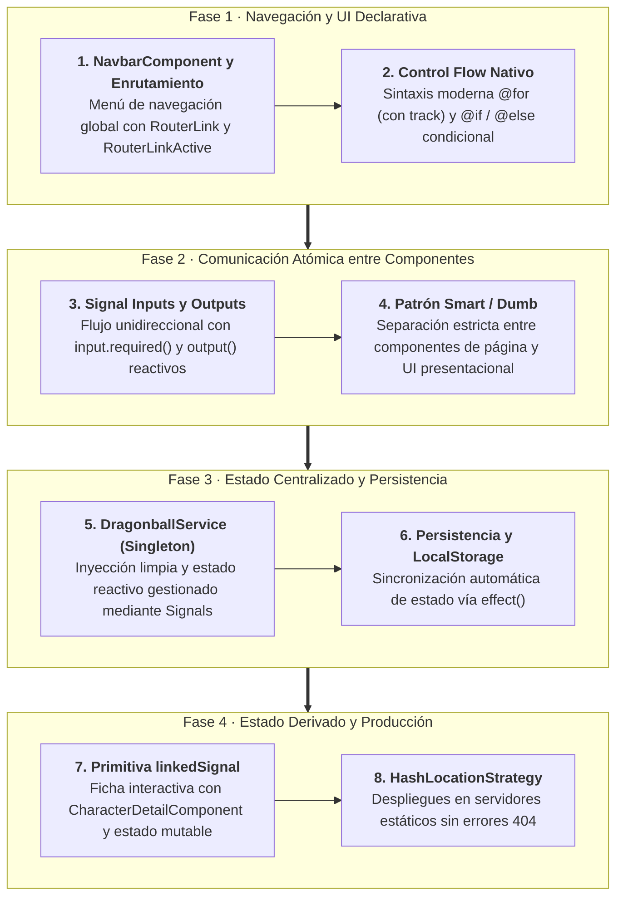
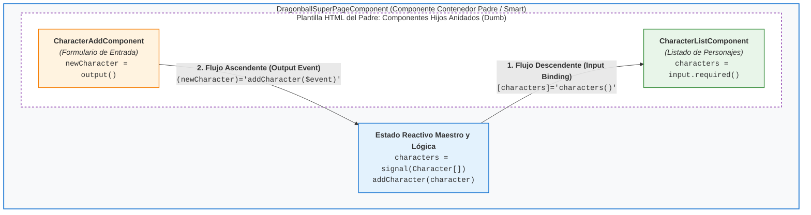
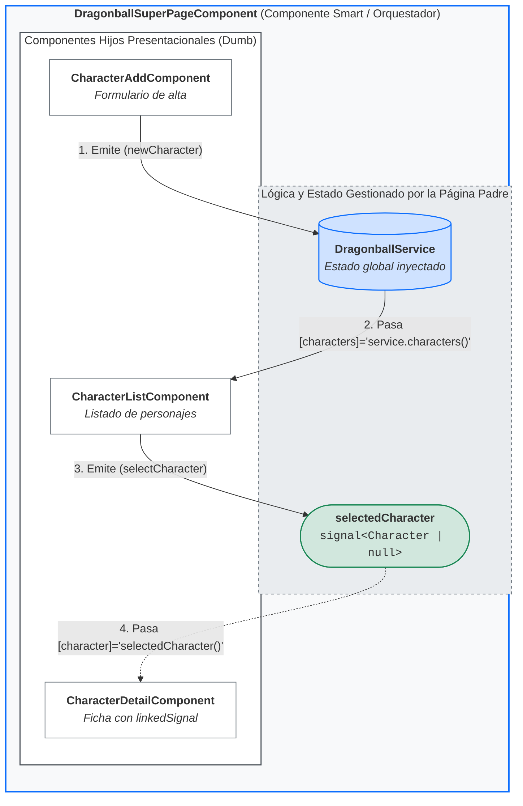
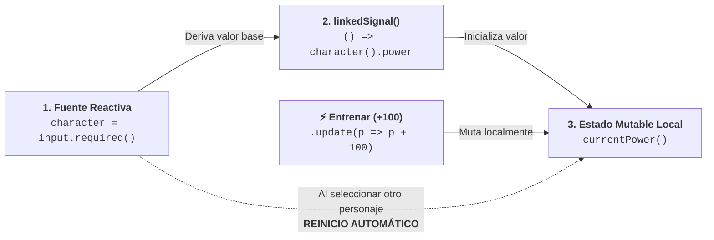
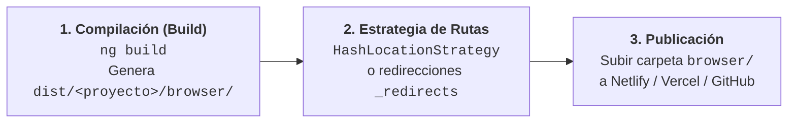

# Sección 05: Expandir Bases — Componentes, Servicios, Control Flow y LinkedSignal

En esta sección profundizamos en la arquitectura moderna de **Angular 19+**. Aprenderemos a comunicar componentes mediante **Signal Inputs y Outputs**, implementar lógica de negocio desacoplada con **Servicios**, persistir estado con **Efectos** y **LocalStorage**, utilizar el nuevo **Control Flow** (`@for`, `@if`), la primitiva **`linkedSignal`** de Angular 19, y preparar despliegues en servidores estáticos utilizando **HashLocationStrategy**.

---

## 📋 Ficha Técnica y Objetivos Didácticos

* **Proyecto:** `bases` (Ampliación con módulos de Dragonball y Dragonball Super).
* **Novedades de Angular 19:** `input.required()`, `output()`, nuevo Control Flow (`@for`, `@if`), `effect()`, `linkedSignal()`, `inject()`, `HashLocationStrategy`.
* **Repositorio de referencia final:** [GitHub - DevTalles Bases (fin-seccion-05)](https://github.com/DevTalles-corp/angular-bases/tree/fin-seccion-05)

!!! tip "📦 Código de Inicio para Seguir la Sección (Starter Kit)"
    Para realizar el seguimiento de esta sección puedes continuar directamente sobre tu proyecto de la sección anterior o descargar el código de partida limpio y verificado desde el repositorio oficial de GitHub:
    
    * 🔗 **Código de Inicio (Punto de partida - Fin de Sección 04):** [GitHub - DevTalles Bases (rama: `fin-seccion-04`)](https://github.com/DevTalles-corp/angular-bases/tree/fin-seccion-04)
    * 🔗 **Código Final de Referencia (Meta - Fin de Sección 05):** [GitHub - DevTalles Bases (rama: `fin-seccion-05`)](https://github.com/DevTalles-corp/angular-bases/tree/fin-seccion-05)

    *Instrucciones para iniciar con el código de partida:*
    ```bash
    git clone -b fin-seccion-04 https://github.com/DevTalles-corp/angular-bases.git bases-app
    cd bases-app
    npm install
    ng serve
    ```



---

## Introducción y Hoja de Ruta

A medida que una aplicación crece, mantener toda la vista y la lógica en una sola página resulta insostenible. Esta sección nos enseña los patrones de diseño esenciales para **modularizar**:

1. **Navegación declarativa:** Menú de navegación interactivo con `RouterLink` y detección de ruta activa.
2. **Sintaxis de plantillas moderna:** Reemplazo de las antiguas directivas `*ngFor` y `*ngIf` por el nuevo **Control Flow** nativo de Angular (`@for`, `@if`, `@else`).
3. **Comunicación entre componentes:** Paso de datos de padres a hijos con **`input()`** y notificación de hijos a padres con **`output()`** basados en señales.
4. **Capa de Servicios:** Centralización del estado de la aplicación mediante `@Injectable`.
5. **Efectos reactivos:** Sincronización automática del estado con `localStorage` mediante `effect()`.
6. **Nueva Primitiva `linkedSignal`:** Sincronización reactiva entre fuentes de datos persistidas y estado mutable local.
7. **Despliegues en producción:** Configuración de `HashLocationStrategy` para evitar errores 404 en hosting estático.

---

## Componente de Navegación y Enrutamiento Activo

!!! info "📖 Para saber más: Manual de Referencia"
    Para dominar la configuración de enrutadores, directivas de navegación (`routerLink`, `routerLinkActive`) y rutas hijas, consulta el **[Manual de Referencia: 11. Angular Router y Navegación](manual/11-router.md)**.

### 1. Estado Inicial de Rutas y Manejo de Rutas Desconocidas (Wildcard `**`)

Al iniciar esta sección, nuestra aplicación cuenta con dos rutas registradas en el archivo de enrutamiento principal (`src/app/app.routes.ts`): la ruta raíz `''` vinculada a `CounterPageComponent` y la ruta `'hero'` vinculada a `HeroPageComponent`.

Sin embargo, si un usuario introduce manualmente en la barra de direcciones una URL inexistente o comete una errata tipográfica (por ejemplo, `http://localhost:4200/cualquier-cosa` o `/heroes`), el motor de enrutamiento de Angular intentará hacer coincidir esa URL con las rutas configuradas. Al no encontrar correspondencia, Angular Router arroja una excepción en consola (`Error: Cannot match any routes`) y deja el `<router-outlet />` completamente en blanco, provocando una pantalla vacía sin retroalimentación visual para el usuario.

Para blindar la aplicación ante rutas desconocidas y asegurar una experiencia resiliente, definimos una **ruta comodín** (*wildcard route*) mediante la sintaxis `'**'` con redirección a la raíz:

=== "src/app/app.routes.ts"
    ```typescript title="src/app/app.routes.ts"
    import { Routes } from '@angular/router';
    import { CounterPageComponent } from './pages/counter/counter-page.component';
    import { HeroPageComponent } from './pages/hero/hero-page.component';

    export const routes: Routes = [
      {
        path: '',
        component: CounterPageComponent,
      },
      {
        path: 'hero',
        component: HeroPageComponent,
      },
      // Redirección por defecto ante cualquier ruta desconocida (Wildcard)
      {
        path: '**',
        redirectTo: '',
      },
    ];
    ```

!!! warning "Arquitectura de Enrutamiento: El Algoritmo First-Match-Wins"
    Angular Router evalúa el array de rutas de forma estrictamente secuencial (**de arriba a abajo**). La primera coincidencia que satisfaga la URL solicitada será la que se aplique.
    
    Por este motivo, la ruta comodín (`path: '**'`) debe ubicarse **obligatoriamente al final** de la lista de rutas. Si se colocase al principio o antes de otras rutas, interceptaría cualquier petición antes de que Angular pudiera evaluar las rutas específicas declaradas debajo, haciendo que esas páginas fuesen completamente inaccesibles.

Una vez asegurado el manejo de rutas desconocidas, el siguiente paso arquitectónico es evidente: los usuarios no deben depender de escribir URLs a mano en la barra del navegador. Es imprescindible construir un menú de navegación visual (`NavbarComponent`) reutilizable e integrarlo en la plantilla principal de la aplicación.

---

### 2. Creación e Integración de `NavbarComponent` en el Layout Global

Para estructurar la navegación de la aplicación de forma limpia, centralizamos el menú en un componente compartido reutilizable dentro del directorio `src/app/components/shared/navbar/`.

Creamos la clase del componente standalone:

=== "src/app/components/shared/navbar/navbar.component.ts"
    ```typescript title="src/app/components/shared/navbar/navbar.component.ts"
    import { Component } from '@angular/core';
    import { RouterLink, RouterLinkActive } from '@angular/router';

    @Component({
      selector: 'app-navbar',
      // Importamos las directivas de enrutado declarativo imprescindibles
      imports: [RouterLink, RouterLinkActive],
      templateUrl: './navbar.component.html',
    })
    export class NavbarComponent {}
    ```

Para que este menú esté presente de forma continua en todas las pantallas sin duplicar código, lo integramos de inmediato en el componente raíz `AppComponent`:

=== "src/app/app.component.ts"
    ```typescript title="src/app/app.component.ts"
    import { Component } from '@angular/core';
    import { RouterOutlet } from '@angular/router';
    import { NavbarComponent } from './components/shared/navbar/navbar.component';

    @Component({
      selector: 'app-root',
      imports: [RouterOutlet, NavbarComponent], // Registramos el Navbar en los imports
      templateUrl: './app.component.html',
    })
    export class AppComponent {}
    ```

=== "src/app/app.component.html"
    ```html title="src/app/app.component.html"
    <app-navbar />

    <section class="mx-5 mt-2">
      <!-- Aquí se renderiza dinámicamente la página activa -->
      <router-outlet />
    </section>
    ```

---

### 3. De `href` a `RouterLink`: Navegación Declarativa SPA

Al diseñar un menú en HTML tradicional, el primer impulso suele ser utilizar etiquetas de enlace estándar con el atributo `href`:

```html title="src/app/components/shared/navbar/navbar.component.html (Intento inicial con HTML clásico)"
<nav>
  <a href="/">Contador</a>
  <a href="/hero">Hero</a>
</nav>
```

#### El Problema Visible de `href` en una SPA:

Si pruebas esta plantilla en el navegador y haces clic en "Hero":

1. **El icono de carga del navegador comienza a girar.**
2. **Toda la página web parpadea en blanco y se descarga de nuevo desde el servidor.**
3. **Pérdida irreversible de estado reactivo:** Si el usuario había incrementado el contador a 15 en `CounterPageComponent`, al recargar la página **el contador vuelve a 10** (su valor inicial). Toda la memoria de JavaScript y las **Signals** se reinician por completo.

#### La Solución Angular: Directiva `RouterLink`
Sustituimos el atributo `href` por la directiva especializada **`RouterLink`**. Esta directiva intercepta el evento de clic, ejecuta internamente un `event.preventDefault()`, actualiza la URL en el historial del navegador con `history.pushState()` y reemplaza únicamente el componente activo dentro del `<router-outlet />` en microsegundos, **manteniendo intacta la memoria de la aplicación**.

Angular admite dos sintaxis para `routerLink`:

```html title="src/app/components/shared/navbar/navbar.component.html"
<nav>
  <!-- 1. Sintaxis literal simple: ideal para rutas fijas -->
  <a routerLink="/">Contador</a>

  <!-- 2. Sintaxis de array (Property Binding): necesaria para segmentos dinámicos o argumentos -->
  <a [routerLink]="['/hero']">Hero</a>
</nav>
```

!!! tip "Sintaxis Literal vs. Sintaxis de Array"
    * **`routerLink="/ruta"`:** Se utiliza cuando la ruta es una cadena estática invariable.
    * **`[routerLink]="['/ruta', parametro]"`:** Se utiliza la sintaxis de enlace de propiedad (*property binding*) con un array. Angular evalúa cada elemento del array como un segmento de la URL y se encarga de escapar caracteres especiales automáticamente mediante `encodeURIComponent`.

!!! warning "Requisito Obligatorio en Componentes Standalone"
    Para que `routerLink` funcione, es **estrictamente obligatorio** importar `RouterLink` en el array `imports` de `NavbarComponent`. Si lo omites, Angular no reconocerá la directiva y el enlace se comportará como un texto inerte que no reacciona al clic.

---

### 4. Resaltado Visual con `RouterLinkActive` y el Dilema de la Ruta Raíz

Para proporcionar una experiencia de usuario clara, el menú debe indicar visualmente en qué página se encuentra el usuario en cada momento.

#### A. Definición de Estilos Locales
Agregamos los estilos visuales en la parte superior de `navbar.component.html`:

```html title="src/app/components/shared/navbar/navbar.component.html"
<style>
  nav {
    display: flex;
    justify-content: space-around;
    background-color: #212121;
    color: white;
    padding: 10px;
  }
  nav a {
    color: white;
    text-decoration: none;
  }
  /* Estilo que se aplicará automáticamente al enlace activo */
  nav a.active {
    color: #f87171;
    font-weight: bold;
    text-decoration: underline;
  }
</style>
```

#### B. Aplicación de `RouterLinkActive`
La directiva **`RouterLinkActive`** monitoriza la URL activa del navegador y, cuando coincide con la ruta del enlace, le aplica automáticamente la clase CSS indicada (en este caso, `active`):

```html
<nav>
  <!-- Asignación directa como string -->
  <a routerLink="/" routerLinkActive="active">Contador</a>

  <!-- Asignación equivalente mediante Property Binding -->
  <a [routerLink]="['/hero']" [routerLinkActive]="'active'">Hero</a>
</nav>
```

*(Ambas sintaxis son plenamente válidas: `routerLinkActive="active"` pasa el nombre de la clase como string literal, mientras que `[routerLinkActive]="'active'"` lo evalúa como expresión JavaScript).*

#### C. El Problema en Directo: El "Efecto Raíz Permanente"

Al guardar los cambios y probar la aplicación en el navegador, surge un comportamiento anómalo:

* Si estás en la página del Contador (`/`), el enlace "Contador" se muestra en rojo. Hasta aquí, correcto.
* Sin embargo, cuando haces clic en "Hero" (`/hero`), **¡ambos enlaces aparecen marcados en rojo simultáneamente!**

##### ¿Por qué ocurre esto?

Por defecto, `routerLinkActive` evalúa las rutas mediante una coincidencia por **prefijo** (*prefix match*): considera que un enlace está activo si la URL del navegador **comienza** por la ruta del enlace.

Como la URL `/hero` comienza por el carácter `/`, Angular asume que la ruta raíz (`/`) también sigue activa.

#### D. La Solución: `[routerLinkActiveOptions]="{ exact: true }"`
Para solucionar este comportamiento y exigir que la coincidencia sea estricta, añadimos la directiva de configuración `[routerLinkActiveOptions]="{ exact: true }"` al enlace de la raíz:

=== "src/app/components/shared/navbar/navbar.component.html"
    ```html title="src/app/components/shared/navbar/navbar.component.html"
    <style>
      nav {
        display: flex;
        justify-content: space-around;
        background-color: #212121;
        color: white;
        padding: 10px;
      }
      nav a {
        color: white;
        text-decoration: none;
      }
      nav a.active {
        color: #f87171;
        font-weight: bold;
        text-decoration: underline;
      }
    </style>

    <nav>
      <!-- Coincidencia exacta estricta para la ruta raíz -->
      <a
        routerLink="/"
        routerLinkActive="active"
        [routerLinkActiveOptions]="{ exact: true }"
      >
        Contador
      </a>

      <!-- Navegación hacia la página Hero -->
      <a [routerLink]="['/hero']" [routerLinkActive]="'active'">Hero</a>

      <!-- Los enlaces a Dragonball y Dragonball Super se incorporarán en las siguientes tareas -->
    </nav>
    ```

Ahora, al alternar entre "Contador" y "Hero", la clase `active` se transfiere limpiamente de un elemento a otro sin solapamientos, logrando un menú de navegación reactivo, accesible y profesional.

---

## 🎯 Tarea Práctica 1: Preparación de la Página Dragonball y Enrutamiento

!!! info "📖 Para saber más: Manual de Referencia"
    Para dominar la configuración de rutas, componentes enrutados y directivas de navegación en Angular, consulta el **[Manual de Referencia: 11. Angular Router y Navegación](manual/11-router.md)**.

Una vez configurado nuestro menú de navegación global con `NavbarComponent`, es momento de preparar la estructura base para el nuevo módulo de la aplicación: el módulo temático de Dragonball. Esta tarea afianza el flujo de trabajo estándar en Angular para registrar nuevas páginas enrutadas en una Single Page Application (SPA).

---

### 📋 Enunciado del Reto para el Alumno

Antes de consultar la solución guiada, realiza de forma autónoma los siguientes pasos en tu proyecto:

1. **Creación de la carpeta y archivos de la página:** Dentro del directorio `src/app/pages/`, crea una subcarpeta llamada `dragonball/`. Dentro de ella, añade dos archivos:
    - `dragonball-page.component.ts`: el controlador TypeScript del componente standalone.
    - `dragonball-page.component.html`: la plantilla visual asociada.
2. **Definición del componente standalone:** En `dragonball-page.component.ts`, declara el componente con el decorador `@Component`. Debe especificar su selector (o prescindir de él si solo se usará mediante el enrutador) y vincular el archivo de plantilla mediante `templateUrl: './dragonball-page.component.html'`.
3. **Estructura básica de la vista:** En `dragonball-page.component.html`, añade un título descriptivo `<h1>DragonBall Page</h1>` y un separador horizontal `<hr />`.
4. **Registro de la ruta en `app.routes.ts`:** Abre `src/app/app.routes.ts` y añade la definición de ruta para el path `'dragonball'`, asociándola a `DragonballPageComponent`.
5. **Actualización de la barra de navegación:** Abre `src/app/components/shared/navbar/navbar.component.html` y añade un nuevo elemento `<a>` con la directiva `[routerLink]="['/dragonball']"` (o `routerLink="/dragonball"`) y `routerLinkActive="active"`.
6. **Criterio de éxito y verificación:**
    - Abre el navegador en `http://localhost:4200`.
    - Haz clic en el nuevo enlace "Dragonball" del Navbar: la URL debe cambiar de inmediato a `http://localhost:4200/dragonball` sin que la página parpadee ni se recargue el navegador.
    - El texto `DragonBall Page` debe renderizarse dentro del `<router-outlet />`.
    - El enlace de "Dragonball" en la barra de navegación debe cambiar su aspecto visual al color rojo destacado definido en la clase `.active`.

---

### ⏸️ Reto Práctico: ¡Inténtalo tú mismo!

!!! exercise "Pausa de Trabajo Autónomo"
    Configura la página, la ruta y el enlace en el menú de navegación de forma autónoma en tu editor antes de revisar la solución detallada.
    
    *Criterio de éxito:* Navegación SPA fluida y activación correcta de la clase CSS del menú al acceder a `/dragonball`.

---

### 🛠️ Solución Paso a Paso y Explicación Técnica

#### Paso 1: Crear el controlador del componente

Creamos el archivo `src/app/pages/dragonball/dragonball-page.component.ts`. Al tratarse de una versión moderna de Angular (v19+), los componentes son standalone por defecto y no requieren la propiedad obsoleta `standalone: true`:

```typescript title="src/app/pages/dragonball/dragonball-page.component.ts"
import { Component } from '@angular/core';

@Component({
  templateUrl: './dragonball-page.component.html',
})
export class DragonballPageComponent {}
```

#### Paso 2: Crear la plantilla HTML

Creamos `src/app/pages/dragonball/dragonball-page.component.html` con el encabezado semántico:

```html title="src/app/pages/dragonball/dragonball-page.component.html"
<h1>DragonBall Page</h1>
<hr />
```

#### Paso 3: Configurar la ruta en el enrutador principal

Editamos `src/app/app.routes.ts` e incorporamos la ruta al array `routes`:

```typescript title="src/app/app.routes.ts" hl_lines="9-12"
import { Routes } from '@angular/router';
import { CounterPageComponent } from './pages/counter/counter-page.component';
import { HeroPageComponent } from './pages/hero/hero-page.component';
import { DragonballPageComponent } from './pages/dragonball/dragonball-page.component';

export const routes: Routes = [
  { path: '', component: CounterPageComponent },
  { path: 'hero', component: HeroPageComponent },
  {
    path: 'dragonball',
    component: DragonballPageComponent,
  },
  { path: '**', redirectTo: '' },
];
```

#### Paso 4: Enlazar la página en el menú de navegación

Actualizamos `src/app/components/shared/navbar/navbar.component.html` añadiendo el enlace de Dragonball con su directiva de estado activo:

```html title="src/app/components/shared/navbar/navbar.component.html" hl_lines="6"
<nav>
  <a routerLink="/" routerLinkActive="active" [routerLinkActiveOptions]="{ exact: true }">
    Contador
  </a>
  <a routerLink="/hero" routerLinkActive="active">Hero</a>
  <a routerLink="/dragonball" routerLinkActive="active">Dragonball</a>
</nav>
```

---

### 🔍 Análisis de la Solución y Conceptos Clave

1. **SPA (Single Page Application) vs Navegación Tradicional:**  
   Al utilizar `routerLink` en lugar de `href`, Angular intercepta el evento de clic del usuario, evita la petición GET al servidor web y manipula directamente la API de historial del navegador (`pushState`). Esto preserva el estado en memoria de la aplicación y produce una experiencia de navegación instantánea.

2. **Sincronización del estado de UI con `routerLinkActive`:**  
   Angular supervisa internamente los eventos de navegación (`NavigationEnd`). Cuando la URL en la barra de direcciones coincide con la ruta especificada en `routerLink`, añade automáticamente la clase CSS `'active'`, eliminándola en cuanto el usuario navega a otra pantalla.

3. **Ruta comodín (`**`):**  
   Configurar `{ path: '**', redirectTo: '' }` al final del array de rutas garantiza que cualquier URL no reconocida redirija al usuario a la página por defecto sin generar pantallas en blanco.

---

### ⚠️ Errores Típicos del Alumno en esta Tarea

| Error Común | Síntoma en el Navegador | Causa y Solución |
| :--- | :--- | :--- |
| Usar `<a href="/dragonball">` en lugar de `routerLink` | La pantalla parpadea en blanco y se recarga completamente el navegador; se pierde todo el estado de la aplicación. | **Causa:** El atributo nativo `href` ejecuta una recarga HTTP completa. <br/>**Solución:** Usar siempre la directiva `routerLink="/dragonball"`. |
| Olvidar importar `RouterLink` y `RouterLinkActive` en `NavbarComponent` | Advertencia en consola de compilación: *Can't bind to 'routerLink' since it isn't a known property of 'a'*. | **Causa:** En componentes standalone, las directivas del router deben figurar explícitamente en el array `imports: [RouterLink, RouterLinkActive]`. |
| Escribir `path: '/dragonball'` con barra inicial en `app.routes.ts` | Error de configuración de rutas o fallo de coincidencia al navegar. | **Causa:** En la definición de rutas de Angular, los paths no llevan barra inicial (`/`). Solo se usa `'dragonball'`. |
| El enlace activo permanece encendido en todas las rutas | El enlace de inicio siempre aparece resaltado, sin importar en qué página estemos. | **Causa:** Toda ruta comienza con `/`. <br/>**Solución:** Añadir `[routerLinkActiveOptions]="{ exact: true }"` al enlace de la ruta raíz. |

---

### 🧑‍🏫 Guía Didáctica para el Docente en el Aula

!!! tip "Estrategia para Guiar esta Práctica en Clase"
    1. **Demostración de contraste:** Pida a un alumno que reemplace un `routerLink` por `href` e introduzca algún valor en el contador de la página anterior antes de pulsar el enlace. Al ver cómo el contador se reinicia a cero debido a la recarga de página, los estudiantes entenderán de inmediato el valor de una SPA y el papel de `routerLink`.
    2. **Inspección de elementos en vivo:** Abra las DevTools del navegador (F12) sobre el menú `<nav>` y haga clic entre las opciones. Guíe a los alumnos para que observen cómo la clase `class="active"` aparece y desaparece en el DOM en tiempo real gracias a `routerLinkActive`.

---

## El Nuevo Control Flow: `@for`, `@if` y Estilos Dinámicos

!!! info "📖 Para saber más: Manual de Referencia"
    Domina a fondo el nuevo sistema de renderizado condicional, bucles reactivos y gestión de listas vacías en el **[Manual de Referencia: 04. Plantillas y Control Flow (Control Flow Nativo)](manual/04-plantillas.md#control-flow-nativo-if-for-switch)**. Si deseas profundizar en la comparativa histórica con las directivas estructurales clásicas (`*ngIf`, `*ngFor`), consulta también el **[Manual de Referencia: 08. Directivas](manual/08-directivas.md#parte-1-control-flow-moderno-if-for-switch)**.

En versiones anteriores, Angular requería importar `CommonModule` y usar directivas como `*ngFor` y `*ngIf`. Angular 17+ introdujo una **sintaxis declarativa integrada en el compilador**, inspirada en la sintaxis de lenguajes modernos.

### Modelo de Datos: `src/app/interfaces/character.interface.ts`

!!! info "📖 Para saber más: Interfaces y Tipado Estricto"
    Si deseas profundizar en la teoría de interfaces, propiedades opcionales y la comparativa entre `interface`, `type` y `class`, consulta la guía **[03. Bases de TypeScript: Objetos, Arrays e Interfaces](03-bases-typescript.md#objetos-arrays-e-interfaces)** y su sección **[La Tríada de Tipado: interface vs type vs class](03-bases-typescript.md#la-triada-de-tipado-interface-vs-type-vs-class)**.

#### ¿Qué es una `interface` en TypeScript y por qué la usamos?

En JavaScript tradicional, los objetos son dinámicos y carecen de restricciones: es fácil cometer errores de tipeo al acceder a una propiedad o intentar leer un campo inexistente, lo que genera fallos en ejecución (`undefined is not an object`).

En TypeScript y Angular, una **`interface`** es un **contrato de diseño** o molde estricto que describe la estructura exacta (*shape*) que debe cumplir un objeto:

1. **Seguridad y Validación en Compilación:** Define qué propiedades son obligatorias (`id`, `name`, `power`) y qué tipo de dato debe tener cada una. Si intentas crear un personaje olvidando un campo o asignando un string a `power`, TypeScript marcará el error al instante.
2. **Autocompletado e IntelliSense:** Al declarar señales o arrays tipados con la interfaz (por ejemplo, `characters = signal<Character[]>([...])`), el editor de código proporciona autocompletado asistido de todas las propiedades del objeto.
3. **Cero Impacto en Producción (*Zero-Cost Abstraction*):** Las interfaces existen **exclusivamente en tiempo de desarrollo y compilación**. Al transcompilar a JavaScript para el navegador, las interfaces desaparecen por completo, por lo que **no añaden ni un solo byte de peso al bundle final**.

#### Creación del archivo de interfaz:
Creamos la carpeta `src/app/interfaces/` y definimos el contrato de los personajes:

```typescript title="src/app/interfaces/character.interface.ts"
export interface Character {
  id: number;
  name: string;
  power: number;
}
```

### Implementación Inicial de la Vista y Estructura

Antes de modularizar en componentes especializados, construimos la funcionalidad completa en una sola página contenedora (`DragonballPageComponent`). Esta arquitectura nos permite dominar dos fundamentos clave de Angular moderno:

1. El nuevo **Control Flow** (`@for`, `@if`, `@empty`).
2. La sincronización de entradas de usuario (**Formularios con Signals**) sin necesidad de librerías externas ni `ngModel`.

---

#### 1. Controlador Inicial: Datos y Señales Locales

En `src/app/pages/dragonball/dragonball-page.component.ts`:

* Importamos la interfaz `Character` para garantizar el tipado estricto.
* Definimos la señal maestra `characters` con el listado inicial de guerreros.
* Creamos dos señales locales (`name` y `power`) que custodiarán en tiempo real los valores de las cajas de texto del formulario:

=== "src/app/pages/dragonball/dragonball-page.component.ts"
    ```typescript title="src/app/pages/dragonball/dragonball-page.component.ts"
    import { Component, signal } from '@angular/core';
    import { Character } from '../../interfaces/character.interface';

    @Component({
      templateUrl: './dragonball-page.component.html',
    })
    export class DragonballPageComponent {
      // Señales para el estado del formulario de agregar personaje
      name = signal('');
      power = signal(0);

      // Señal con el listado inicial de personajes
      characters = signal<Character[]>([
        { id: 1, name: 'Goku', power: 9001 },
        { id: 2, name: 'Vegeta', power: 8000 },
        { id: 3, name: 'Piccolo', power: 3000 },
        { id: 4, name: 'Yamcha', power: 500 },
      ]);
    }
    ```

---

#### 2. Maquetación Base HTML (Estructura Estática con Bootstrap)

Antes de incorporar la lógica de Angular, definimos la estructura visual limpia en `src/app/pages/dragonball/dragonball-page.component.html`. Utilizando las clases de rejilla de Bootstrap (`row` y `col-12 col-sm-6`), dividimos la pantalla en dos columnas para que el alumno comprenda primero la maquetación visual antes de añadir la reactividad:

* **Columna Izquierda:** El formulario de entrada (cajas de texto y botón en estado estático).
* **Columna Derecha:** El listado con elementos de ejemplo para previsualizar el diseño en el navegador.

=== "src/app/pages/dragonball/dragonball-page.component.html"
    ```html title="src/app/pages/dragonball/dragonball-page.component.html (Paso 1: Estructura HTML Base)"
    <h1>DragonBall Page</h1>
    <hr />

    <section class="row">
      <!-- 1. Columna del Formulario (Estructura estática inicial) -->
      <div class="col-12 col-sm-6">
        <h3>Agregar:</h3>
        <input type="text" class="form-control" placeholder="Nombre" />
        <input type="number" class="form-control mt-2" placeholder="Poder" />
        <button class="mt-2 btn btn-primary">Agregar</button>
      </div>

      <!-- 2. Columna del Listado (Datos de muestra estáticos) -->
      <div class="col-12 col-sm-6">
        <h3>Listado de Personajes</h3>
        <ul class="list-group">
          <li class="list-group-item d-flex justify-content-between align-items-center">
            <div><strong>#1</strong> - Goku</div>
            <span class="badge text-bg-danger">9001</span>
          </li>
          <li class="list-group-item d-flex justify-content-between align-items-center">
            <div><strong>#2</strong> - Vegeta</div>
            <span class="badge text-bg-primary">8000</span>
          </li>
        </ul>
      </div>
    </section>
    ```

---

#### 3. Dinamizar la Plantilla: Control Flow y Reactividad con Signals

Una vez verificado el aspecto visual en el navegador, sustituimos los elementos cableados (*hardcoded*) por las características reactivas y directivas de Angular:

1. **Columna Derecha (Listado Dinámico):** Reemplazamos los `<li>` fijos por la directiva `@for (character of characters(); track character.id; let idx = $index)` junto con su bloque `@empty` y clases condicionales dinámicas (`[class.text-bg-danger]="character.power > 9000"`).
2. **Columna Izquierda (Formulario Reactivo):** Conectamos los `<input>` con las señales reactivas mediante `[value]` y `(input)` apoyándonos en variables de referencia de plantilla (`#txtName`, `#txtPower`), y añadimos la previsualización en vivo en el encabezado `<h3>Agregar: {{ name() }}</h3>`.

=== "src/app/pages/dragonball/dragonball-page.component.html"
    ```html title="src/app/pages/dragonball/dragonball-page.component.html (Paso 2: Plantilla Dinamizada con Angular)"
    <h1>DragonBall Page</h1>
    <hr />

    <section class="row">
      <!-- 1. Columna del Formulario Reactivo -->
      <div class="col-12 col-sm-6">
        <!-- Previsualización reactiva inmediata -->
        <h3>Agregar: {{ name() }}</h3>

        <!-- Input de texto enlazado a la señal 'name' -->
        <input
          type="text"
          class="form-control"
          placeholder="Nombre"
          [value]="name()"
          (input)="name.set(txtName.value)"
          #txtName
        />

        <!-- Input numérico enlazado a la señal 'power' -->
        <input
          type="number"
          class="form-control mt-2"
          placeholder="Poder"
          [value]="power()"
          (input)="power.set(+txtPower.value)"
          #txtPower
        />

        <!-- Botón para procesar la inserción -->
        <button class="mt-2 btn btn-primary">
          Agregar
        </button>
      </div>

      <!-- 2. Columna del Listado Dinámico con Control Flow -->
      <div class="col-12 col-sm-6">
        <h3>Listado de Personajes</h3>
        <ul class="list-group">
          @for (character of characters(); track character.id; let idx = $index) {
            <li class="list-group-item d-flex justify-content-between align-items-center">
              <div>
                <strong>#{{ idx + 1 }}</strong> - {{ character.name }}
              </div>
              <span
                class="badge"
                [class.text-bg-danger]="character.power > 9000"
                [class.text-bg-primary]="character.power <= 9000"
              >
                {{ character.power }}
              </span>
            </li>
          } @empty {
            <li class="list-group-item list-group-item-secondary">
              No hay personajes registrados en la lista.
            </li>
          }
        </ul>
      </div>
    </section>
    ```

---

#### 4. Conceptos Clave Explicados: Formulario Reactivo y Estilos Dinámicos

En Angular clásico se utilizaban directivas como `[(ngModel)]` (que requiere importar `FormsModule`). En Angular moderno con **Signals**, podemos crear formularios ligeros y reactivos utilizando únicamente enlaces nativos de plantilla:

1. **De la Signal al Input (Property Binding `[value]="name()"`):**  
   Refleja en el atributo `value` del input el valor actual de la señal.
2. **Variables de Referencia de Plantilla (`#txtName`, `#txtPower`):**  
   La almohadilla `#` crea una referencia directa al elemento `<input>` del DOM en la plantilla. Nos permite acceder a sus propiedades nativas (como `.value`) sin necesidad de inyectar nada en el archivo TypeScript.
3. **Del Input a la Signal (Event Binding `(input)="name.set(txtName.value)"`):**  
   El evento nativo `(input)` se dispara con cada pulsación de tecla. En ese instante leemos `txtName.value` y actualizamos la señal con `.set()`.
4. **Conversión Numérica con el Operador Unario `+`:**  
   Los elementos `<input type="number">` del navegador retornan siempre una cadena de texto (*string*) a través de su propiedad `.value`. Anteponer el operador `+` (`+txtPower.value`) fuerza la conversión instantánea a tipo `number` en JavaScript, evitando bugs donde los números se concatenen como texto.
5. **Previsualización Reactiva:**  
   Observa cómo en el encabezado `<h3>Agregar: {{ name() }}</h3>` el texto escrito se actualiza al milisegundo mientras el usuario teclea, demostrando la reactividad atómica de las Signals.
6. **Estilos Dinámicos con Class Binding (`[class.nombre-clase]="condición"`):**  
   En lugar de manipular clases imperativamente con JavaScript (`classList.add/remove`), Angular permite conmutar clases CSS de forma puramente declarativa:

   ```html
   <span
     class="badge"
     [class.text-bg-danger]="character.power > 9000"
     [class.text-bg-primary]="character.power <= 9000"
   >
     {{ character.power }}
   </span>
   ```

   * **Mecanismo:** Angular evalúa la expresión booleana a la derecha. Si es `true`, inyecta la clase CSS en el nodo del DOM; si es `false`, la retira de inmediato.
   * **Preservación de clases estáticas:** Las clases fijas declaradas en el atributo estándar (`class="badge"`) se conservan intactas; el binding solo conmuta las clases condicionales específicas.

##### Comparativa Técnica: `[class.nombre]` vs Directiva `[ngClass]`

| Criterio | Enlace Nativo `[class.nombreClase]="condicion"` | Directiva `[ngClass]="{ ... }"` |
| :--- | :--- | :--- |
| **Tipo de enlace** | **Nativo del compilador** (Property Binding directo). | **Directiva de atributo** externa. |
| **Imports necesarios** | **Ninguno**. Disponible directamente en cualquier componente standalone. | Requiere importar `NgClass` (o `CommonModule`) desde `@angular/common`. |
| **Rendimiento** | **Óptimo**. Mutación atómica y directa sobre el nodo del DOM. | Implica la instanciación de la directiva y evaluación del objeto de clases. |
| **Caso de uso recomendado** | **Alternar 1, 2 o pocas clases condicionales** (ej: badges de peligro/éxito, estados `activo`/`desactivado`). | Manejar un **diccionario dinámico complejo** de muchas clases simultáneas calculadas en el TypeScript. |

!!! info "📖 Para saber más: Manipulación de Clases y Estilos"
    Aprende más sobre las distintas variantes de sintaxis de estilos en el **[Manual de Referencia: 04. Plantillas (Class Binding)](manual/04-plantillas.md#class-binding)** y consulta el análisis detallado frente a directivas en el **[Manual de Referencia: 08. Directivas ([class] vs NgClass)](manual/08-directivas.md#23-class-y-style-vs-ngclass-y-ngstyle)**.

---

## 🎯 Tarea Práctica 2: Procesamiento del Formulario y Actualización Inmutable de Estado

!!! info "📖 Para saber más: Manual de Referencia"
    Para comprender a fondo la inmutabilidad en JavaScript/TypeScript, el ciclo de detección de cambios de Angular y el método `.update()` en Signals, consulta el **[Manual de Referencia: 05. Signals y Reactividad](manual/05-signals.md)**.

Ahora que ya tenemos el formulario maquetado y los campos de entrada sincronizados reactivamente con las señales locales `name` y `power`, el reto consiste en dotar de funcionalidad al botón **"Agregar"** para registrar nuevos personajes en la lista de forma robusta e inmutable.

---

### 📋 Enunciado del Reto para el Alumno

Antes de consultar la solución guiada, realiza de forma autónoma los siguientes pasos en tu proyecto:

1. **Enlace del evento en el botón:** En `dragonball-page.component.html`, añade el enlace de evento `(click)="addCharacter()"` al botón "Agregar".
2. **Implementación de `addCharacter()` con validación defensiva:** En `src/app/pages/dragonball/dragonball-page.component.ts`:
    - Aplica el **Early Return Pattern**: si el nombre está vacío (tras aplicar `.trim()`), o si el poder es menor o igual a cero (`power <= 0`), aborta la función inmediatamente con `return` sin realizar ninguna mutación.
    - Crea un nuevo objeto de tipo `Character` asignándole un identificador numérico único (por ejemplo, `this.characters().length + 1`), el nombre y el poder ingresados.
3. **Actualización Inmutable del array reactivo:**
    - Actualiza la señal `characters` empleando el método `.update()` y el operador spread (`...`):  
      `this.characters.update(list => [...list, newCharacter]);`
    - **Regla estricta:** Queda terminantemente prohibido usar `this.characters().push(newCharacter)` directamente sobre la señal, ya que mutaría el array original en la misma dirección de memoria impidiendo que Angular detecte el cambio.
4. **Limpieza del formulario:**
    - Crea un método auxiliar `resetFields()` que restablezca `name` a `''` y `power` a `0`, y ejecútalo al finalizar con éxito la inserción para limpiar las cajas de texto.
5. **Criterios de éxito y verificación:**
    - Al introducir "Krillin" con poder `1500` y pulsar "Agregar", el guerrero debe aparecer de inmediato al final de la lista renderizada por `@for`.
    - Si dejas el nombre en blanco (o solo espacios) y pulsas "Agregar", la lista debe permanecer intacta sin errores en consola.
    - Si colocas un poder negativo o cero (ej: `-50`), no debe añadirse ningún personaje.
    - Tras cada inserción exitosa, las cajas de texto deben limpiarse automáticamente.

---

### ⏸️ Reto Práctico: ¡Inténtalo tú mismo!

!!! exercise "Pausa de Trabajo Autónomo"
    Implementa la lógica del formulario y la actualización inmutable en tu editor antes de verificar la solución.
    
    *Criterio de éxito:* Inserción reactiva en el DOM con validaciones defensivas y reseteo de campos sin mutaciones directas.

---

### 🛠️ Solución Paso a Paso y Explicación Técnica

#### Paso 1: Actualizar el controlador TypeScript

En `src/app/pages/dragonball/dragonball-page.component.ts`, implementamos las señales y los métodos con validación y actualización inmutable:

```typescript title="src/app/pages/dragonball/dragonball-page.component.ts" hl_lines="20-43"
import { Component, signal } from '@angular/core';
import { Character } from '../../interfaces/character.interface';

@Component({
  templateUrl: './dragonball-page.component.html',
})
export class DragonballPageComponent {
  // Señales para el formulario reactivo
  name = signal('');
  power = signal(0);

  // Lista de personajes inicial
  characters = signal<Character[]>([
    { id: 1, name: 'Goku', power: 9001 },
    { id: 2, name: 'Vegeta', power: 8000 },
    { id: 3, name: 'Piccolo', power: 3000 },
    { id: 4, name: 'Yamcha', power: 500 },
  ]);

  addCharacter() {
    // 1. Validaciones defensivas (Early Return Pattern)
    if (!this.name().trim() || this.power() <= 0) {
      return;
    }

    // 2. Creación del nuevo registro inmutable
    const newCharacter: Character = {
      id: this.characters().length + 1,
      name: this.name().trim(),
      power: this.power(),
    };

    // 3. Actualización inmutable con .update() y operador spread
    this.characters.update((list) => [...list, newCharacter]);

    // 4. Limpieza del formulario
    this.resetFields();
  }

  resetFields() {
    this.name.set('');
    this.power.set(0);
  }
}
```

#### Paso 2: Conectar la plantilla HTML

En `src/app/pages/dragonball/dragonball-page.component.html`, enlazamos el evento `(click)` del botón "Agregar" con el método `addCharacter()` recién implementado en el controlador:

```html title="src/app/pages/dragonball/dragonball-page.component.html" hl_lines="27-29"
<h1>DragonBall Page</h1>
<hr />

<section class="row">
  <!-- Columna Formulario -->
  <div class="col-12 col-sm-6">
    <h3>Agregar Personaje</h3>
    
    <input
      type="text"
      class="form-control"
      placeholder="Nombre"
      [value]="name()"
      (input)="name.set(txtName.value)"
      #txtName
    />

    <input
      type="number"
      class="form-control mt-2"
      placeholder="Poder"
      [value]="power()"
      (input)="power.set(+txtPower.value)"
      #txtPower
    />

    <button (click)="addCharacter()" class="mt-2 btn btn-primary">
      Agregar
    </button>
  </div>

  <!-- Columna Listado -->
  <div class="col-12 col-sm-6">
    <h3>Listado de Personajes</h3>
    <ul class="list-group">
      @for (character of characters(); track character.id; let idx = $index) {
        <li class="list-group-item d-flex justify-content-between align-items-center">
          <div>
            <strong>#{{ idx + 1 }}</strong> - {{ character.name }}
          </div>
          <span
            class="badge"
            [class.text-bg-danger]="character.power > 9000"
            [class.text-bg-primary]="character.power <= 9000"
          >
            {{ character.power }}
          </span>
        </li>
      } @empty {
        <li class="list-group-item list-group-item-secondary">
          No hay personajes registrados en la lista.
        </li>
      }
    </ul>
  </div>
</section>
```

---

### 🔍 Análisis de la Solución y Conceptos Clave

1. **¿Por qué `this.characters.update()` y no `this.characters().push()`?**  
   Angular Signals utiliza una función de comparación de igualdad por defecto (`defaultEquals`), la cual evalúa si `referenciaAnterior === nuevaReferencia`.  
   Si ejecutas `this.characters().push(newCharacter)`, estás mutando el contenido interno del array pero la **dirección física en memoria heap** sigue siendo exactamente la misma (`0x001 === 0x001`). Como resultado, Angular asume que el dato no cambió y **no actualiza el DOM**.  
   Al utilizar el operador spread `[...list, newCharacter]`, JavaScript crea un **nuevo array en una dirección de memoria diferente** (`0x002`). La comparación de referencia resulta falsa (`0x001 !== 0x002`), lo que desencadena de inmediato el renderizado del nuevo elemento en la interfaz.

2. **Early Return Pattern (Código Plano vs Código Flecha):**  
   Validar las condiciones negativas al inicio de la función y salir inmediatamente con `return` previene anidamientos excesivos de bloques `if/else`, mejorando drásticamente la legibilidad y mantenibilidad del código.

3. **Conversión con operador unario `+`:**  
   Los elementos `<input type="number">` del DOM retornan siempre su valor como `string` a través de la propiedad `.value`. Anteponer el operador `+` (`+txtPower.value`) fuerza la conversión a tipo numérico primitivo en JavaScript.

---

### ⚠️ Errores Típicos del Alumno en esta Tarea

| Error Común | Síntoma en el Navegador | Causa y Solución |
| :--- | :--- | :--- |
| Usar `this.characters().push(...)` | Al hacer clic en "Agregar", la lista en pantalla no cambia absolutamente nada. | **Causa:** Mutación directa del array existente. Angular no detecta cambio de referencia. <br/>**Solución:** Usar `this.characters.update(list => [...list, nuevo])`. |
| Olvidar el operador unario `+` en el input de poder | El valor del poder se concatena como texto o genera advertencias de tipado TypeScript. | **Causa:** `txtPower.value` es siempre de tipo `string`. <br/>**Solución:** Convertir a número con `+txtPower.value` o `Number(txtPower.value)`. |
| Omitir `.trim()` en la validación | El usuario puede insertar personajes cuyo nombre consta únicamente de espacios vacíos (`"   "`). | **Causa:** Un string de espacios evalúa a `true` en JavaScript. <br/>**Solución:** Validar con `!this.name().trim()`. |
| No resetear las señales tras guardar | Los campos de entrada conservan los valores anteriores tras pulsar "Agregar". | **Causa:** No invocar `this.resetFields()` al terminar `addCharacter()`. |

---

### 🧑‍🏫 Guía Didáctica para el Docente en el Aula

!!! tip "Estrategia para Guiar esta Práctica en Clase"
    1. **El experimento del `.push()`:** Pida a los estudiantes que escriban intencionadamente `this.characters().push(newCharacter)` y pulsen el botón. Al comprobar que el DOM no reacciona, aproveche para explicar en la pizarra cómo funciona la comparación por referencia (`===`) en JavaScript y por qué la inmutabilidad es la piedra angular del rendimiento reactivo moderno.
    2. **Inspección de tipos:** Haga que los alumnos pasen el cursor sobre `txtName.value` y `txtPower.value` en su editor para que comprueben que ambos son `string`, reforzando la necesidad de la conversión numérica con el operador `+`.

### Claves del Nuevo Control Flow:

1. **Obligatoriedad de `track`:** En `@for (item of items; track item.id)`, el parámetro `track` es obligatorio por compilador. Permite a Angular reutilizar los nodos del DOM existentes cuando la lista cambia, disparando el rendimiento al evitar repintar elementos innecesarios.
2. **Variables de contexto integradas:** `$index`, `$first`, `$last`, `$even`, `$odd` están disponibles directamente con la palabra clave `let idx = $index`.
3. **Bloque `@empty`:** Se renderiza automáticamente cuando la lista está vacía, eliminando la necesidad de condicionales adicionales.
4. **Enlace condicional de clases (`[class.nombreClase]="condicion"`):** Alternativa directa y limpia a `ngClass` para añadir o retirar clases CSS según una expresión booleana.

---

## Comunicación entre Componentes con Signal Inputs y Outputs

!!! info "📖 Para saber más: Manual de Referencia"
    Profundiza en los patrones Smart/Dumb, la API moderna `input()`, `output()` y la reactividad bidireccional con `model()` en el **[Manual de Referencia: 07. Comunicación entre Componentes](manual/07-anidar-componentes.md)**.

Cuando una vista contiene un formulario y una lista, mezclar ambos en un solo archivo rompe la **Separación de Responsabilidades (SoC)**. Vamos a extraer dos componentes atómicos:

* `CharacterListComponent`: Componente tonto (*Dumb*) que solo muestra datos recibidos.
* `CharacterAddComponent`: Componente que gestiona el formulario y emite eventos hacia el padre.



### El Componente Hijo: `CharacterListComponent`
Utiliza el nuevo **`input.required<T>()`** de Angular 19:

=== "src/app/components/dragonball/character-list/character-list.component.ts"
    ```typescript title="src/app/components/dragonball/character-list/character-list.component.ts"
    import { Component, input } from '@angular/core';
    import { Character } from '../../../interfaces/character.interface';

    @Component({
      selector: 'dragonball-character-list',
      templateUrl: './character-list.component.html',
    })
    export class CharacterListComponent {
      // Input obligatorio: el padre TIENE que proporcionarlo
      characters = input.required<Character[]>();

      // Input opcional con valor por defecto
      listName = input<string>('Listado de Personajes');
    }
    ```

=== "src/app/components/dragonball/character-list/character-list.component.html"
    ```html title="src/app/components/dragonball/character-list/character-list.component.html"
    <h3>{{ listName() }}</h3>

    <ul class="list-group">
      @for (character of characters(); track character.id; let idx = $index) {
        <li class="list-group-item d-flex justify-content-between align-items-center">
          <div>
            <strong>#{{ idx + 1 }}</strong> - {{ character.name }}
          </div>
          <span
            class="badge"
            [class.text-bg-danger]="character.power > 9000"
            [class.text-bg-primary]="character.power <= 9000"
          >
            {{ character.power }}
          </span>
        </li>
      } @empty {
        <li class="list-group-item list-group-item-secondary">
          No hay personajes registrados en la lista.
        </li>
      }
    </ul>
    ```

---

## 🎯 Tarea Práctica 3: Modularización Atómica con Componentes Dumb y `output()`

!!! info "📖 Para saber más: Manual de Referencia"
    Aprende más sobre el patrón Smart/Dumb (Container/Presentational), la nueva función `output()` y la comunicación entre componentes en el **[Manual de Referencia: 07. Comunicación entre Componentes](manual/07-anidar-componentes.md)**.

En este reto aplicaremos el principio de **Separación de Responsabilidades (SoC)** y el patrón arquitectónico **Smart & Dumb Components**. Extraeremos el formulario de creación de personajes de la página principal hacia un componente hijo presentacional (`CharacterAddComponent`), el cual comunicará los nuevos datos al componente padre mediante la función reactiva **`output<T>()`** de Angular 19+.

---

### 📋 Enunciado del Reto para el Alumno

Antes de consultar la solución guiada, realiza de forma autónoma los siguientes pasos en tu proyecto:

1. **Creación del componente hijo presentacional:** Dentro de `src/app/components/dragonball/`, crea la carpeta `character-add/` con sus dos archivos:
    * `character-add.component.ts`: controlador TypeScript del componente con selector `dragonball-character-add`.
    * `character-add.component.html`: plantilla con el formulario extraído.
2. **Definición del evento de salida con `output()`:**
    * En `CharacterAddComponent`, declara un evento de salida tipado: `newCharacter = output<Character>()`.
3. **Manejo del estado local y emisión del evento:**
    * Mueve las señales locales `name` y `power`, así como el método `resetFields()`, al componente hijo.
    * En el método `addCharacter()` del hijo, valida los campos, genera el nuevo objeto `Character` (usando `Math.floor(Math.random() * 1000)` o similar para el id) y emítelo al padre mediante `this.newCharacter.emit(character)`.
    * Tras emitir, limpia los inputs locales llamando a `this.resetFields()`.
4. **Integración en el componente padre:**
    * Abre la página contenedora (`DragonballSuperPageComponent` o `DragonballPageComponent`).
    * Importa `CharacterAddComponent` en el array `imports` del decorador `@Component`.
    * En la plantilla del padre, sustituye el bloque HTML del formulario por la etiqueta del componente hijo:
      ```html
      <dragonball-character-add (newCharacter)="addCharacter($event)" />
      ```
    * En el TypeScript del padre, implementa el método `addCharacter(newChar: Character)` que recibe el evento (`$event`) y actualiza su señal maestra mediante `this.characters.update(list => [...list, newChar])`.
5. **Criterios de éxito y verificación:**
    * La página debe compilar sin advertencias.
    * Al introducir un personaje en el formulario hijo y hacer clic en "Agregar", el componente padre debe recibir el objeto y la lista debe actualizarse de forma instantánea.
    * El componente hijo debe quedar completamente aislado: no debe conocer cómo almacena los personajes el padre ni depender de ningún servicio externo.

---

### ⏸️ Reto Práctico: ¡Inténtalo tú mismo!

!!! exercise "Pausa de Trabajo Autónomo"
    Extrae el componente de adición, declara su `output()` y conéctalo con el componente padre en tu editor antes de verificar la solución.
    
    *Criterio de éxito:* Desacoplamiento total del formulario, captura de eventos con `$event` y actualización reactiva de la lista del padre.

---

### 🛠️ Solución Paso a Paso y Explicación Técnica

#### Paso 1: Crear el Componente Hijo `CharacterAddComponent`

Creamos `src/app/components/dragonball/character-add/character-add.component.ts`. Declaramos la salida mediante la función `output<Character>()`:

```typescript title="src/app/components/dragonball/character-add/character-add.component.ts" hl_lines="12-13 15-31"
import { Component, output, signal } from '@angular/core';
import { Character } from '../../../interfaces/character.interface';

@Component({
  selector: 'dragonball-character-add',
  templateUrl: './character-add.component.html',
})
export class CharacterAddComponent {
  name = signal('');
  power = signal(0);

  // Definición del evento de salida tipado reactivo
  newCharacter = output<Character>();

  addCharacter() {
    // Validación defensiva local
    if (!this.name().trim() || this.power() <= 0) {
      return;
    }

    const character: Character = {
      id: Math.floor(Math.random() * 1000),
      name: this.name().trim(),
      power: this.power(),
    };

    // Emisión del evento fuertemente tipado hacia el componente contenedor
    this.newCharacter.emit(character);

    this.resetFields();
  }

  resetFields() {
    this.name.set('');
    this.power.set(0);
  }
}
```

#### Paso 2: Crear la Plantilla del Hijo `character-add.component.html`

Creamos `src/app/components/dragonball/character-add/character-add.component.html`:

```html title="src/app/components/dragonball/character-add/character-add.component.html"
<h3>Agregar Personaje</h3>

<input
  type="text"
  class="form-control"
  placeholder="Nombre"
  [value]="name()"
  (input)="name.set(txtName.value)"
  #txtName
/>

<input
  type="number"
  class="form-control mt-2"
  placeholder="Poder"
  [value]="power()"
  (input)="power.set(+txtPower.value)"
  #txtPower
/>

<button (click)="addCharacter()" class="mt-2 btn btn-primary">
  Agregar
</button>
```

#### Paso 3: Conectar el Hijo en el Componente Padre

En el controlador del componente padre (por ejemplo, `DragonballSuperPageComponent` o la página contenedora), importamos el nuevo componente hijo y escuchamos su evento:

```typescript title="src/app/pages/dragonball-super/dragonball-super-page.component.ts" hl_lines="4 8 16-18"
import { Component, signal } from '@angular/core';
import { Character } from '../../interfaces/character.interface';
import { CharacterListComponent } from '../../components/dragonball/character-list/character-list.component';
import { CharacterAddComponent } from '../../components/dragonball/character-add/character-add.component';

@Component({
  templateUrl: './dragonball-super-page.component.html',
  imports: [CharacterListComponent, CharacterAddComponent],
})
export class DragonballSuperPageComponent {
  characters = signal<Character[]>([
    { id: 1, name: 'Goku', power: 9001 },
    { id: 2, name: 'Vegeta', power: 8000 },
  ]);

  addCharacter(character: Character) {
    this.characters.update((list) => [...list, character]);
  }
}
```

#### Paso 4: Enlazar la Notificación en la Plantilla del Padre

En la plantilla HTML del padre, consumimos el componente hijo y capturamos el evento mediante la variable especial `$event`:

```html title="src/app/pages/dragonball-super/dragonball-super-page.component.html" hl_lines="4-6"
<section class="row">
  <!-- Columna Formulario: Componente Hijo de Adición -->
  <div class="col-12 col-sm-6">
    <dragonball-character-add
      (newCharacter)="addCharacter($event)"
    />
  </div>

  <!-- Columna Listado: Componente Hijo de Presentación -->
  <div class="col-12 col-sm-6">
    <dragonball-character-list
      [characters]="characters()"
      listName="Héroes del Torneo del Poder"
    />
  </div>
</section>
```

---

### 🔍 Análisis de la Solución y Conceptos Clave

1. **Patrón Smart & Dumb (Contenedor vs Presentacional):**  
   * **Componente Dumb (`CharacterAddComponent`):** No conoce la colección completa de personajes, no tiene acceso a servicios ni sabe dónde se almacenará la información. Su única misión es recopilar datos del usuario, validarlos y emitir un evento con la carga útil (*payload*).
   * **Componente Smart (`DragonballSuperPageComponent`):** Es el dueño del estado maestro. Decide qué hacer cuando llega un evento (guardarlo en memoria, persistirlo en base de datos o enviarlo a un servicio).

2. **La función moderna `output()` frente a `@Output() EventEmitter`:**  
   En versiones anteriores, se requería importar `@Output()` y crear una instancia `new EventEmitter<T>()` de RxJS. La función **`output<T>()`** de Angular 19+ es una primitiva más liviana, que no depende de RxJS para la emisión de eventos simples entre componentes, reduciendo el tamaño del bundle y simplificando la sintaxis.

3. **El argumento mágico `$event`:**  
   En el enlace de eventos `(newCharacter)="addCharacter($event)"`, Angular inyecta automáticamente el valor emitido por `this.newCharacter.emit(...)` en la variable implícita `$event`, preservando el tipado estricto `Character`.

---

### ⚠️ Errores Típicos del Alumno en esta Tarea

| Error Común | Síntoma en el Navegador | Causa y Solución |
| :--- | :--- | :--- |
| Olvidar `$event`: `(newCharacter)="addCharacter()"` | En la lista se agrega un elemento con valores `undefined` o se produce un error en tiempo de ejecución. | **Causa:** Sin `$event`, el argumento recibido en el método del padre es `undefined`. <br/>**Solución:** Escribir siempre `(newCharacter)="addCharacter($event)"`. |
| Olvidar importar `CharacterAddComponent` en el padre | Error de compilación: *'dragonball-character-add' is not a known element*. | **Causa:** En componentes standalone, todo componente hijo debe listarse en el array `imports: [...]` del padre. |
| Intentar importar y modificar la señal `characters` directamente en el hijo | Fuerte acoplamiento entre componentes; se rompe el principio de componente Dumb reutilizable. | **Causa:** Manipulación directa del estado ajeno. <br/>**Solución:** El hijo solo debe emitir eventos mediante `output()`; el padre es quien actualiza su estado. |
| Usar decorador antiguo `@Output()` mezclado con `output()` | Error de sintaxis o confusión de API. | **Causa:** Mezcla de estilos legados y modernos. <br/>**Solución:** Usar exclusivamente la función moderna `newCharacter = output<Character>()`. |

---

### 🧑‍🏫 Guía Didáctica para el Docente en el Aula

!!! tip "Estrategia para Guiar esta Práctica en Clase"
    1. **La regla de oro del flujo de datos:** Dibuje en la pizarra el diagrama fundamental de Angular: *"Propiedades bajan con `[input]`, Eventos suben con `(output)`"*. Refuerce que un componente hijo nunca debe alterar directamente las propiedades de su padre.
    2. **Demostración de reutilización:** Haga reflexionar a los alumnos sobre la ventaja de esta separación: `CharacterAddComponent` ahora podría insertarse en cualquier otra página de la aplicación sin cambiar una sola línea de su código, ya que no depende de nada exterior.

---

## Capa de Servicios, `effect()` y Persistencia

!!! info "📖 Para saber más: Manual de Referencia"
    Consulta el sistema de inyección de dependencias, la función `inject()` y la gestión de estado reactivo en el **[Manual de Referencia: 09. Servicios e Inyección de Dependencias](manual/09-servicios.md)**.

Hasta este punto, nuestra aplicación funciona correctamente, pero presenta una limitación arquitectónica fundamental: **el estado reactivo de los personajes (`characters`) y la lógica para agregarlos (`addCharacter`) están acoplados directamente dentro del componente de página (`DragonballSuperPageComponent`)**.

Si en el futuro creamos un menú de navegación que muestre el total de héroes registrados, un panel de estadísticas secundario o una pantalla de batalla, no podríamos acceder a esos datos sin duplicar la señal o recurrir a pasar propiedades innecesarias a través de múltiples niveles (*prop drilling*).

Para resolver esta limitación desacoplando la lógica de negocio de la capa de presentación, estructuraremos la solución en dos fases didácticas:

1. **Fase 1: Extracción del estado a un Servicio Singleton (`DragonballService`):** Movemos la señal de personajes y la función de adición fuera del componente y conectamos la vista mediante `inject()`.
2. **Fase 2: Persistencia con `localStorage` y reactividad con `effect()`:** Resolvemos la volatilidad de la memoria RAM para que los personajes no se borren al recargar la página.

---

### Fase 1: Extracción del Estado a un Servicio Centralizado (`DragonballService`)

#### 1. ¿Qué es un Servicio en Angular?
Un **Servicio** es una clase TypeScript que encapsula datos y operaciones de negocio para ser compartidos por cualquier componente de la aplicación. Al decorarlo con `@Injectable({ providedIn: 'root' })`, Angular lo gestiona como un **Singleton**: crea una única instancia viva a nivel global que se comparte en toda la aplicación.

#### 2. Paso 1: Mover la señal y la lógica al Servicio
Creamos el archivo `src/app/services/dragonball.service.ts`. Trasladamos la señal `characters` y el método `addCharacter()` que antes estaban en `DragonballSuperPageComponent`:

```typescript title="src/app/services/dragonball.service.ts"
import { Injectable, signal } from '@angular/core';
import { Character } from '../interfaces/character.interface';

@Injectable({ providedIn: 'root' })
export class DragonballService {
  // Estado centralizado en memoria (movido desde el componente padre)
  characters = signal<Character[]>([
    { id: 1, name: 'Goku', power: 9001 },
    { id: 2, name: 'Vegeta', power: 8000 },
  ]);

  // Método de negocio para actualizar la colección inmutablemente
  addCharacter(character: Character) {
    this.characters.update((list) => [...list, character]);
  }
}
```

!!! tip "💡 Evolución Angular 22: El nuevo decorador `@Service()`"
    En la sintaxis habitual de Angular 19 se utiliza `@Injectable({ providedIn: 'root' })`.
    
    A partir de **Angular 22**, el framework introduce el decorador oficial **`@Service()`**. Es autónomo (*standalone*), asume por defecto el ámbito singleton a nivel raíz (*root* y *tree-shakeable*) y elimina la necesidad de pasar el objeto de configuración `{ providedIn: 'root' }`:
    ```typescript
    import { Service, signal } from '@angular/core';
    import { Character } from '../interfaces/character.interface';

    @Service()
    export class DragonballService {
      characters = signal<Character[]>([ ... ]);
      addCharacter(character: Character) { ... }
    }
    ```
    *(Ambas formas conviven y son 100% compatibles en Angular 22, pero `@Service()` es el nuevo estándar recomendado por su concisión).*

#### 3. Paso 2: Inyectar y Consumir el Servicio en el Componente Padre

Ahora que el estado no le pertenece a la página, refactorizamos `DragonballSuperPageComponent`:

* Eliminamos la señal local `characters` y el método `addCharacter()`.
* Inyectamos el servicio mediante la función moderna **`inject()`** de Angular Core (sin necesidad de declarar constructores tradicionales).

=== "src/app/pages/dragonball-super/dragonball-super-page.component.ts"
    ```typescript title="src/app/pages/dragonball-super/dragonball-super-page.component.ts"
    import { Component, inject } from '@angular/core';
    import { CharacterListComponent } from '../../components/dragonball/character-list/character-list.component';
    import { CharacterAddComponent } from '../../components/dragonball/character-add/character-add.component';
    import { DragonballService } from '../../services/dragonball.service';

    @Component({
      selector: 'dragonball-super',
      imports: [CharacterListComponent, CharacterAddComponent],
      templateUrl: './dragonball-super-page.component.html',
    })
    export class DragonballSuperPageComponent {
      // Inyección moderna de dependencias limpia y directa sin constructor
      public dragonballService = inject(DragonballService);
    }
    ```

=== "src/app/pages/dragonball-super/dragonball-super-page.component.html"
    ```html title="src/app/pages/dragonball-super/dragonball-super-page.component.html"
    <h1>DragonBall Super (Con Servicio Centralizado)</h1>
    <hr />

    <section class="row">
      <div class="col-12 col-sm-6">
        <!-- Conecta directamente el evento emitido al método del servicio inyectado -->
        <dragonball-character-add
          (newCharacter)="dragonballService.addCharacter($event)"
        />
      </div>

      <div class="col-12 col-sm-6">
        <!-- Pasa la señal del servicio al componente hijo presentacional -->
        <dragonball-character-list
          listName="Guerreros Z"
          [characters]="dragonballService.characters()"
        />
      </div>
    </section>
    ```

> 🧪 **Verificación de la Fase 1:** Guarda los cambios y pruébalo en el navegador. La aplicación responde exactamente igual que antes: puedes añadir personajes y la lista se actualiza. Sin embargo, la arquitectura ha dado un salto cualitativo: **la página es ahora un mero orquestador visual y el estado reside en una fuente de verdad única desacoplada**.

---

### Fase 2: Persistencia con `localStorage` y Sincronización con `effect()`

#### El Problema de la Volatilidad de la Memoria RAM
Pide a los alumnos que agreguen un nuevo personaje (por ejemplo, *"Krillin"*, poder `1500`) y pulsen la tecla **`F5`** para recargar la página.

*¿Qué sucede?* **El nuevo personaje desaparece y la lista regresa a los dos personajes iniciales (Goku y Vegeta).**  
Esto ocurre porque las señales del servicio residen exclusivamente en la memoria RAM del navegador. Al recargar la página o cerrar la pestaña, el contexto de JavaScript se destruye y la aplicación vuelve a inicializarse desde cero.

Para solucionar este comportamiento y conservar los datos entre sesiones, utilizaremos la API nativa de **`localStorage`** del navegador combinada con la reactividad automática de **`effect()`**.

#### 1. ¿Cómo funciona la API `localStorage`?

`localStorage` es un mecanismo de almacenamiento persistente en el navegador web que conserva la información incluso después de reiniciar el equipo:

* **Almacenamiento Clave-Valor:** Guarda datos bajo una clave de texto: `localStorage.setItem('clave', 'valor')`.
* **Limitación estricta a texto (*strings*):** No puede almacenar objetos o arrays de JavaScript directamente:
    * Para **guardar** un array: debemos serializarlo a string con `JSON.stringify(this.characters())`.
    * Para **recuperar** un array: debemos parsear el string con `JSON.parse(datosString)`.

#### 2. Escritura Reactiva Automática con `effect()`

En lugar de tener que recordar invocar `localStorage.setItem()` manualmente dentro de cada método que modifique personajes, aprovechamos la primitiva reactiva **`effect()`** de Angular:

```typescript
// Efecto reactivo: se ejecuta automáticamente cada vez que la señal characters cambia
saveToLocalStorage = effect(() => {
  localStorage.setItem('characters', JSON.stringify(this.characters()));
});
```

* **Rastreo Automático de Dependencias:** Al llamar a `this.characters()` dentro del cuerpo del efecto, Angular registra automáticamente que este efecto depende de esa señal.
* **Ejecución en segundo plano:** Cada vez que `addCharacter()` actualiza la señal con `.update()`, Angular notifica al efecto y escribe el nuevo array en el disco del navegador en el siguiente ciclo de microtareas.
* **La Regla de Oro del Contexto de Inyección (*Injection Context*):** `effect()` debe definirse como propiedad directa de la clase o dentro del `constructor()`. No puede invocarse dentro de métodos ordinarios.

| Criterio | Primitiva `computed()` | Primitiva `effect()` |
| :--- | :--- | :--- |
| **Propósito principal** | **Derivar datos puros** en memoria sin provocar efectos secundarios. | **Sincronizar el estado** con sistemas y APIs externas (*side-effects*). |
| **Valor de retorno** | Retorna una **Signal de solo lectura** (`Signal<T>`). | No retorna datos; devuelve una referencia `EffectRef` para control manual. |
| **Cuándo se evalúa** | **Perezosa (*Lazy*):** Solo se calcula si alguien lee su valor o la plantilla lo renderiza. | **Proactiva (*Eager*):** Se programa y ejecuta automáticamente ante cualquier mutación. |
| **Ejemplos típicos** | Calcular el total con IVA, filtrar un array, concatenar un nombre completo. | Escribir en `localStorage`, enviar métricas a Google Analytics, manipular APIs de Canvas o DOM nativo. |

#### 3. Lectura Defensiva Inicial: `loadFromLocalStorage()`

Para que los personajes guardados se restauren al volver a entrar a la aplicación, necesitamos hidratar la señal `characters` en el momento en que el servicio se crea.

Implementamos una función pura auxiliar situada fuera de la clase:

```typescript
const loadFromLocalStorage = (): Character[] => {
  const characters = localStorage.getItem('characters');
  return characters ? JSON.parse(characters) : [
    { id: 1, name: 'Goku', power: 9001 },
    { id: 2, name: 'Vegeta', power: 8000 },
  ];
};
```

##### ¿Por qué está FUERA de la clase `DragonballService`?

1. **Función Pura sin `this`:** No necesita acceder a la instancia del servicio; solo lee de `localStorage` y devuelve un array limpio.
2. **Encapsulamiento privado de módulo:** Al ser una constante no exportada, queda oculta dentro del archivo `dragonball.service.ts`, impidiendo que ningún componente exterior la invoque o corrompa por error.
3. **Disponibilidad síncrona inmediata:** Permite inicializar la propiedad `characters = signal<Character[]>(loadFromLocalStorage());` de forma síncrona antes de que se ejecute el constructor de la clase.

##### Operador Ternario Defensivo con Fallback

* **Si existen datos previos en el navegador (`characters` no es `null`):** Los deserializa con `JSON.parse()`.
* **Si es la primera visita del usuario o el almacenamiento está vacío (`null`):** Entrega el array inicial por defecto (*seed data* con Goku y Vegeta) para evitar que la aplicación arranque vacía o rota.

#### 4. Circuito Completo de Persistencia
Ambos mecanismos colaboran de forma simbiótica en el ciclo de vida de la aplicación:


#### 5. Código Final del Servicio con Persistencia
Con todos los componentes integrados, el archivo `src/app/services/dragonball.service.ts` definitivo queda así:

```typescript title="src/app/services/dragonball.service.ts"
import { effect, Injectable, signal } from '@angular/core';
import { Character } from '../interfaces/character.interface';

// 1. Función pura auxiliar para inicializar la señal con datos persistidos
const loadFromLocalStorage = (): Character[] => {
  const characters = localStorage.getItem('characters');
  return characters ? JSON.parse(characters) : [
    { id: 1, name: 'Goku', power: 9001 },
    { id: 2, name: 'Vegeta', power: 8000 },
  ];
};

@Injectable({ providedIn: 'root' })
export class DragonballService {
  // 2. Señal hidratada al arrancar con los datos de localStorage
  characters = signal<Character[]>(loadFromLocalStorage());

  // 3. Efecto reactivo: guarda automáticamente cada vez que la señal cambie
  saveToLocalStorage = effect(() => {
    localStorage.setItem('characters', JSON.stringify(this.characters()));
  });

  // 4. Método público de actualización
  addCharacter(character: Character) {
    this.characters.update((list) => [...list, character]);
  }
}
```

!!! tip "Arquitectura Pro: Consideración para Server-Side Rendering (SSR)"
    El objeto global `localStorage` es una API exclusiva de los navegadores web. Si en el futuro despliegas tu aplicación con **Server-Side Rendering (SSR)** en Node.js, acceder directamente a `localStorage` durante la instanciación de un servicio lanzará una excepción (`ReferenceError: localStorage is not defined`). En entornos con SSR se utilizan comprobaciones como `isPlatformBrowser(this.platformId)` o la primitiva `afterNextRender()` para asegurar que la lectura solo ocurra en el cliente. En aplicaciones cliente tradicionales como la desarrollada aquí, este patrón es 100% directo y seguro.

---

## Estado Derivado y Mutable: La Primitiva `linkedSignal` (Angular 19 - 22)

En los temas iniciales de esta sección aparecía listado el concepto **`linkedSignal`**. Aunque en la lección de persistencia resolvimos la carga inicial de datos mediante `signal(loadFromLocalStorage())`, en aplicaciones Angular modernas surge con frecuencia un dilema arquitectónico cuando un componente hijo necesita **derivar un estado a partir de un `input()`, pero además permitir que el usuario lo modifique localmente** (por ejemplo, en un formulario de edición rápida o un panel de detalle interactivo).

Para dar respuesta a esta necesidad y comprender en profundidad por qué Angular introdujo esta primitiva, vamos a incorporar una nueva funcionalidad a nuestra aplicación: el componente **`CharacterDetailComponent`**.

---

### 1. Justificación Didáctica: ¿Por qué creamos `CharacterDetailComponent`?

Hasta este momento, nuestra pantalla de DragonBall Super cuenta con dos componentes principales:

1. **`CharacterAddComponent`**: Formulario para introducir nuevos guerreros.
2. **`CharacterListComponent`**: Listado reactivo para mostrar los personajes registrados.

Ahora planteamos el siguiente requerimiento funcional en clase:

> 🎯 **Nuevo Requerimiento Didáctico:**  
> Queremos que al hacer clic sobre cualquier guerrero de la lista, se muestre en pantalla una **tarjeta de detalle (`CharacterDetailComponent`)** con su ficha técnica. Además, el usuario dispondrá de un botón para **"Entrenar (+100 de poder)"** que aumentará temporalmente su fuerza en pantalla antes de confirmar los cambios o para simular combates.



#### El Conflicto Técnico con las Primitivas Tradicionales

El componente de detalle recibe el personaje como entrada:
```typescript
character = input.required<Character>();
```

Necesitamos una variable para gestionar su poder actual (`currentPower`), que empieza con el poder del personaje pero debe poder incrementarse con el botón. Analicemos por qué las herramientas tradicionales fallan:

1. **¿Podemos usar una señal computada `computed()`?**
   ```typescript
   // ❌ ERROR: computed es estrictamente de SOLO LECTURA
   currentPower = computed(() => this.character().power);
   // Si intentas hacer: this.currentPower.update(p => p + 100); -> Error de compilación en TypeScript.
   ```
   Las señales computadas no disponen de métodos `.set()` ni `.update()`.

2. **¿Podemos usar una señal normal `signal()`?**
   ```typescript
   // ⚠️ PROBLEMA: Se desconecta de la fuente tras crearse
   currentPower = signal(this.character().power);
   ```
   Aunque `signal()` sí permite `.update()`, **solo se inicializa una vez**. Si el usuario hace clic en Goku (poder 9001) y luego hace clic en Vegeta (poder 8000), `this.currentPower` seguirá mostrando el poder de Goku porque la señal normal no se entera de que el `input` padre ha cambiado.

3. **¿Podemos usar un `effect()` para sincronizarlos?**
   En versiones anteriores de Angular (16-18) se recurría a efectos con `allowSignalWrites: true` para escuchar cambios en el input y sobreescribir la señal manual. Esto se consideraba un antipatrón propenso a bucles infinitos, parpadeos (*glitches*) y código innecesariamente engorroso.

#### La Solución Maestra: `linkedSignal()`

Angular 19 resolvió este problema de raíz creando **`linkedSignal()`**:

* Es **mutable** (permite `.set()` y `.update()` igual que un `signal` tradicional).
* Pero está **enlazada a una señal fuente**. En cuanto la fuente (`this.character()`) cambia de valor, `linkedSignal` desecha el valor anterior y se recalcula automáticamente con el nuevo dato de entrada.



---

### 2. Paso 1: Crear el Componente `CharacterDetailComponent`

Creamos el archivo `src/app/components/dragonball/character-detail/character-detail.component.ts`. Diseñamos una tarjeta con Bootstrap que muestra el estado derivado y los controles para interactuar con él:

```typescript title="src/app/components/dragonball/character-detail/character-detail.component.ts"
import { Component, input, linkedSignal } from '@angular/core';
import { Character } from '../../../interfaces/character.interface';

@Component({
  selector: 'dragonball-character-detail',
  imports: [],
  template: `
    <div class="card border-primary shadow-sm">
      <div class="card-header bg-primary text-white d-flex justify-content-between align-items-center">
        <h4 class="mb-0">Ficha de: {{ character().name }}</h4>
        <span class="badge bg-light text-primary">ID: #{{ character().id }}</span>
      </div>

      <div class="card-body">
        <p class="card-text mb-1">
          <strong>Poder Base Original:</strong> 
          <span class="badge bg-secondary">{{ character().power }}</span>
        </p>

        <p class="card-text fs-5">
          <strong>Poder Actual (Con Entrenamiento):</strong> 
          <span 
            class="badge"
            [class.text-bg-success]="currentPower() > character().power"
            [class.text-bg-primary]="currentPower() === character().power"
          >
            {{ currentPower() }}
          </span>
        </p>

        <!-- Acciones reactivas sobre el linkedSignal -->
        <div class="d-flex gap-2 mt-3">
          <button 
            type="button" 
            class="btn btn-success" 
            (click)="boostPower()"
          >
            ⚡ Entrenar (+100)
          </button>

          <button 
            type="button" 
            class="btn btn-outline-secondary" 
            (click)="resetPower()"
            [disabled]="currentPower() === character().power"
          >
            ↺ Restablecer
          </button>
        </div>
      </div>
    </div>
  `,
})
export class CharacterDetailComponent {
  // 1. Entrada requerida: el personaje seleccionado por el componente padre
  character = input.required<Character>();

  // 2. linkedSignal: nace con el poder del personaje, pero permite mutación local (.update / .set)
  // Si 'character' cambia en el padre, 'currentPower' se sincroniza automáticamente con el nuevo valor
  currentPower = linkedSignal(() => this.character().power);

  // 3. Muta el valor localmente sin alterar el array original del servicio
  boostPower(): void {
    this.currentPower.update((power) => power + 100);
  }

  // 4. Restablece el valor local al poder base de la fuente
  resetPower(): void {
    this.currentPower.set(this.character().power);
  }
}
```

---

### 3. Paso 2: Permitir la Selección desde `CharacterListComponent`

Para que el usuario pueda seleccionar qué guerrero consultar en detalle, modificamos **ambos archivos** de `CharacterListComponent` (el TypeScript y su plantilla HTML) para emitir un evento mediante **`output<Character>()`** al pulsar el botón **"Detalles"**:

#### A. Controlador TypeScript (`character-list.component.ts`)

```typescript title="src/app/components/dragonball/character-list/character-list.component.ts" hl_lines="1 13"
import { Component, input, output } from '@angular/core';
import { Character } from '../../../interfaces/character.interface';

@Component({
  selector: 'dragonball-character-list',
  templateUrl: './character-list.component.html',
})
export class CharacterListComponent {
  // Entradas requeridas y opcionales con signals
  characters = input.required<Character[]>();
  listName = input<string>('Listado de Personajes');

  // Nuevo Output para emitir el personaje seleccionado al padre
  selectCharacter = output<Character>();
}
```

#### B. Plantilla HTML (`character-list.component.html`)

```html title="src/app/components/dragonball/character-list/character-list.component.html" hl_lines="18-24"
<h3>{{ listName() }}</h3>

<ul class="list-group">
  @for (character of characters(); track character.id; let idx = $index) {
    <li class="list-group-item d-flex justify-content-between align-items-center">
      <div>
        <strong>#{{ idx + 1 }}</strong> - {{ character.name }}
      </div>

      <div class="d-flex align-items-center gap-2">
        <span
          class="badge"
          [class.text-bg-danger]="character.power > 9000"
          [class.text-bg-primary]="character.power <= 9000"
        >
          {{ character.power }}
        </span>

        <!-- Botón interactivo que emite el personaje seleccionado -->
        <button 
          type="button" 
          class="btn btn-sm btn-outline-primary"
          (click)="selectCharacter.emit(character)"
        >
          Detalles
        </button>
      </div>
    </li>
  } @empty {
    <li class="list-group-item list-group-item-secondary">
      No hay personajes registrados en la lista.
    </li>
  }
</ul>
```

!!! info "💡 Concepto de Eventos en el DOM: ¿Por qué ya no necesitamos `$event.stopPropagation()`?"
    En el DOM de los navegadores web rige el mecanismo de **Propagación o Burbujeo de Eventos (*Event Bubbling*)**: cuando se produce un evento sobre un elemento hijo (como un `<button>`), este asciende en cascada activando los manejadores de eventos de sus contenedores ancestros (`<li>`, `<ul>`, etc.).
    
    Si hubiésemos colocado un `(click)` sobre la fila `<li>` entera y además otro `(click)` en el botón, hacer clic en el botón dispararía ambos eventos en cascada; en ese caso se usa `$event.stopPropagation()` para cortar el ascenso. Sin embargo, **la regla de diseño limpio es evitar listeners duplicados**: al colocar el evento `(click)` de forma exclusiva y limpia sobre el botón **"Detalles"**, la propagación no genera ningún conflicto secundario y no hace falta invocar `stopPropagation()`.

---

### 4. Paso 3: Integrar y Visualizar en la Página Orquestadora

Por último, integramos `CharacterDetailComponent` en nuestra página padre (`DragonballSuperPageComponent`), editando **tanto su archivo TypeScript como su HTML** para guardar el personaje seleccionado y mostrar su ficha en pantalla.

!!! tip "📌 Nota sobre nombres de archivos (Angular 19 vs Angular 20+)"
    Si estás trabajando en la página `DragonballPage` (`dragonball-page.ts` / `dragonball-page.html`) o usas la convención moderna de Angular 20+ sin sufijos `.component` en los nombres de archivos (por ejemplo, `character-detail.ts` o `dragonball.ts`), aplica **exactamente estos mismos cambios** en tu página activa donde estás renderizando `<dragonball-character-list>`.

#### A. Controlador TypeScript de la Página (`dragonball-super-page.component.ts`)

Asegúrate de:

1. Importar `signal`, `Character` y `CharacterDetailComponent`.
2. Añadir `CharacterDetailComponent` dentro del array `imports` de `@Component`.
3. Declarar la propiedad `public selectedCharacter = signal<Character | null>(null);` dentro de la clase.

```typescript title="src/app/pages/dragonball-super/dragonball-super-page.component.ts" hl_lines="1 4 6 10 17"
import { Component, inject, signal } from '@angular/core';
import { CharacterListComponent } from '../../components/dragonball/character-list/character-list.component';
import { CharacterAddComponent } from '../../components/dragonball/character-add/character-add.component';
import { CharacterDetailComponent } from '../../components/dragonball/character-detail/character-detail.component';
import { DragonballService } from '../../services/dragonball.service';
import { Character } from '../../interfaces/character.interface';

@Component({
  selector: 'dragonball-super',
  imports: [CharacterListComponent, CharacterAddComponent, CharacterDetailComponent],
  templateUrl: './dragonball-super-page.component.html',
})
export class DragonballSuperPageComponent {
  // Inyección del servicio de datos
  public dragonballService = inject(DragonballService);

  // 👉 IMPRESCINDIBLE: Señal para almacenar el personaje que el usuario decida ver en detalle
  public selectedCharacter = signal<Character | null>(null);
}
```

#### B. Plantilla HTML de la Página (`dragonball-super-page.component.html`)

Realiza dos acciones en tu archivo HTML:

1. En `<dragonball-character-list>`, conecta el evento de salida: `(selectCharacter)="selectedCharacter.set($event)"`.
2. Añade debajo del `</section>` principal el bloque `@if (selectedCharacter(); as character)` con la etiqueta `<dragonball-character-detail [character]="character" />`.

```html title="src/app/pages/dragonball-super/dragonball-super-page.component.html" hl_lines="17 23-33"
<h1>DragonBall Super (Con Servicio y Detalle Reactivo)</h1>
<hr />

<section class="row">
  <!-- Columna 1: Formulario de Alta -->
  <div class="col-12 col-sm-6">
    <dragonball-character-add
      (newCharacter)="dragonballService.addCharacter($event)"
    />
  </div>

  <!-- Columna 2: Listado con Emisión de Selección -->
  <div class="col-12 col-sm-6">
    <dragonball-character-list
      listName="Guerreros Z"
      [characters]="dragonballService.characters()"
      (selectCharacter)="selectedCharacter.set($event)"
    />
  </div>
</section>

<!-- Fila Inferior: Panel de Detalle con linkedSignal -->
<section class="row mt-4">
  <div class="col-12">
    @if (selectedCharacter(); as character) {
      <dragonball-character-detail [character]="character" />
    } @else {
      <div class="alert alert-info d-flex align-items-center" role="alert">
        <span class="fs-4 me-2">💡</span>
        <div>
          <strong>Panel de Detalle:</strong> Haz clic en el botón <em>"Detalles"</em> de cualquier guerrero de la lista para ver su tarjeta interactiva y experimentar el comportamiento de <code>linkedSignal()</code>.
        </div>
      </div>
    }
  </div>
</section>
```

!!! warning "🔍 Guía Rápida de Resolución de Problemas y Errores Comunes"
    Si tienes algún error de compilación o al pulsar **"Detalles"** no aparece nada, revisa esta lista de verificación:

    1. **Error rojo en el HTML: `Property 'selectedCharacter' does not exist on type '...'`**  
       **Causa:** En el archivo `.ts` de la página olvidaste declarar la señal dentro de la clase.  
       **Solución:** Añade `public selectedCharacter = signal<Character | null>(null);` en tu clase TypeScript (asegurándote de tener importados `signal` de `@angular/core` y la interfaz `Character`).

    2. **Aviso amarillo en `@Component({ imports: [..., CharacterDetailComponent] })` (`is not used within the template`)**  
       **Causa:** Importaste `CharacterDetailComponent` en el TypeScript, pero todavía no añadiste la etiqueta `<dragonball-character-detail [character]="character" />` dentro del HTML.  
       **Solución:** Añade la `<section class="row mt-4">` inferior con el bloque `@if (selectedCharacter(); as character)` en tu plantilla HTML y verifica que el selector en `CharacterDetailComponent` sea `'dragonball-character-detail'`.

    3. **Compila sin errores, pero al pulsar "Detalles" no ocurre nada:**  
       * **Verifica la ruta del navegador:** Asegúrate de estar en la ruta donde integraste estos cambios (por ejemplo, `http://localhost:4200/dragonball-super` o `/dragonball` según dónde hayas editado).
       * **Verifica el enlace de evento:** Comprueba que `<dragonball-character-list>` tiene `(selectCharacter)="selectedCharacter.set($event)"` en el HTML del padre y que `selectCharacter = output<Character>();` está declarado en el `.ts` del hijo.

---

### 5. Verificación Visual en el Navegador (El "Momento Eureka")

Guarda todos los archivos y abre la aplicación en el navegador (`http://localhost:4200/dragonball-super` o tu ruta activa):

1. **Estado Inicial:** Verás la alerta azul en la parte inferior indicando que todavía no hay ningún guerrero seleccionado.
2. **Selección del Primer Personaje:** Haz clic en el botón **"Detalles"** de **Goku** (Poder base: `9001`). Aparecerá la tarjeta inferior mostrando *Goku* y *Poder Actual: 9001*.
3. **Mutación Local del `linkedSignal`:** Pulsa **3 veces** el botón verde **"⚡ Entrenar (+100)"**. Observa cómo el poder en la tarjeta sube a `9101`, luego a `9201` y finalmente a `9301`.  
   *(Esto demuestra que `currentPower` es mutable localmente sin alterar los datos originales de la lista).*
4. **La Magia de la Sincronización al Cambiar desde el Padre:** Ahora haz clic en **"Detalles"** en otro personaje, por ejemplo **Vegeta** (Poder base: `8000`).  
   *¿Qué ocurre por dentro?* Aunque veas cambiar los datos, Angular **NO destruye ni vuelve a crear** `CharacterDetailComponent` (el `@if` sigue siendo verdadero); simplemente **actualiza la entrada `[character]` desde el padre**. En ese instante, `linkedSignal` detecta el cambio en la señal fuente y **reinicia automáticamente `currentPower` a `8000`**, descartando los 300 puntos de Goku sin escribir ningún `ngOnChanges` ni `effect()`.

---

### 6. Experimento Avanzado (Opcional): Ver cómo cambia el *mismo* personaje desde el Padre

¿Y si quieres probar explícitamente en clase qué sucede si el **mismo personaje** que estás viendo sufre un cambio de poder desde el componente padre mientras su ficha sigue abierta?

Podemos añadir un botón de prueba en la página padre para mutar su señal `selectedCharacter` directamente:

#### A. Añade el método de prueba en el TypeScript de la página padre:

```typescript
// Método didáctico para simular que el componente padre actualiza el poder del personaje actual
boostSelectedFromParent(): void {
  const current = this.selectedCharacter();
  if (!current) return;

  // Actualización inmutable: generamos una nueva referencia de objeto para que la señal detecte el cambio
  this.selectedCharacter.set({
    ...current,
    power: current.power + 500,
  });
}
```

#### B. Añade el botón justo encima de `<dragonball-character-detail>` en el HTML del padre:

```html
@if (selectedCharacter(); as character) {
  <!-- Botón de prueba para demostrar el cambio desde el padre hacia el hijo -->
  <button 
    type="button" 
    class="btn btn-warning mb-3" 
    (click)="boostSelectedFromParent()"
  >
    🔥 Modificar poder desde el Padre (+500)
  </button>

  <dragonball-character-detail [character]="character" />
}
```

#### C. Qué observarás en el navegador:

1. Pulsa **"Detalles"** en cualquier personaje (por ejemplo, uno con poder base `1234`).
2. Muta el valor local dentro del hijo pulsando dos veces **"⚡ Entrenar (+100)"** (el *Poder Actual* sube a `1434`, mientras que el *Poder Base Original* sigue en `1234`).
3. Ahora pulsa el botón amarillo del padre **"🔥 Modificar poder desde el Padre (+500)"**.
4. **Resultado inmediato:** El *Poder Base Original* (que proviene del input del padre) cambia de `1234` a **`1734`**, y el *Poder Actual* (`linkedSignal`) **descarta la mutación local (`1434`) y se resincroniza al instante a `1734`**.

!!! note "💡 Nota de Arquitectura sobre el Experimento"
    Este botón modifica únicamente la señal `selectedCharacter` del padre como laboratorio visual para demostrar el enlace `input() ➔ linkedSignal()`. Por eso, la lista de la derecha conserva su valor original salvo que también actualices el array dentro de `DragonballService`. Además, fíjate en que si usáramos una señal normal `signal()` en lugar de `linkedSignal()`, al pulsar el botón amarillo el *Poder Base Original* cambiaría a `1734`, pero el *Poder Actual* se quedaría congelado y desincronizado en `1434`.

#### Cuadro Comparativo Definitivo

| Característica | `signal()` | `computed()` | `linkedSignal()` |
| :--- | :---: | :---: | :---: |
| **¿Es mutable localmente (`.set()` / `.update()`)?** | ✅ Sí | ❌ No (solo lectura) | **✅ Sí** |
| **¿Deriva su valor inicial de otra señal o `input()`?** | ⚠️ Solo una vez al crearse | ✅ Sí, siempre | **✅ Sí, siempre** |
| **¿Se reinicia si la señal fuente cambia?** | ❌ No (queda desvinculada) | ✅ Sí | **✅ Sí (reseteo automático)** |
| **Caso de uso idóneo** | Estado local puro de un componente | Cálculos matemáticos o formateo de solo lectura | **Formularios, paneles de edición y estado derivado mutable** |

---

## Despliegues a Producción y `HashLocationStrategy`

Hasta ahora hemos ejecutado nuestra aplicación usando `ng serve` en modo desarrollo (`http://localhost:4200`), donde Angular compila el código en memoria RAM al instante y lo sirve con herramientas de depuración incluidas. Sin embargo, los servidores web en producción (como Netlify, Vercel, GitHub Pages, Apache o Nginx) **no entienden archivos `.ts` ni ejecutan `ng serve`**: únicamente sirven archivos estáticos optimizados (`HTML`, `CSS` y `JavaScript` compilado).

Para publicar nuestra aplicación en Internet seguiremos un flujo en **3 fases claras**:



---

### Paso 1: Generar el Build de Producción (`ng build`)

Antes de subir nada a ningún servidor, debemos pedirle a Angular CLI que compile, optimice, minifique y empaquete nuestra aplicación para producción.

1. Detén el servidor de desarrollo si lo tienes abierto (++ctrl+c++ en la terminal) o abre una nueva pestaña de terminal en la raíz de tu proyecto.
2. Ejecuta el comando de compilación:

```bash
ng build
```
*(Alternativamente: `npm run build`)*

**¿Qué hace exactamente este comando?**

* Convierte todo tu código TypeScript a JavaScript estándar compatible con los navegadores.
* Elimina código muerto (*Tree Shaking*) y comprime los archivos (`main-*.js`, `styles-*.css`) para que la web cargue en milisegundos.
* Genera una nueva carpeta **`dist/`** en la raíz de tu proyecto.

!!! danger "⚠️ ¡Cuidado Crítico! ¿Qué carpeta exacta se sube a producción?"
    En versiones modernas de Angular (Angular 17+), la compilación genera una estructura anidada:

    ```text
    dist/
    └── bases/                  <-- ❌ NO subas esta carpeta padre
        ├── prerendered-routes.json
        └── browser/            <-- ✅ ESTA ES LA CARPETA QUE DEBES SUBIR
            ├── index.html
            ├── favicon.ico
            ├── main-XXXXXX.js
            ├── polyfills-XXXXXX.js
            └── styles-XXXXXX.css
    ```

    * Nota: El nombre `bases` corresponde al nombre de tu proyecto definido en `angular.json`.
    * **Regla de Oro:** El archivo `index.html` **debe quedar en la raíz del servidor**. Si subes la carpeta padre `dist/bases/`, el hosting mostrará un error 404 porque `index.html` estaría un nivel por debajo dentro de `browser/`.

#### Prueba Local del Build antes de subirlo (Opcional pero Recomendado)

Si quieres comprobar cómo se comporta la aplicación compilada tal cual la verá el servidor en producción antes de subirla a Internet:

```bash
npx http-server -o dist/bases/browser
```
*(Sustituye `bases` por el nombre de tu carpeta dentro de `dist/`)*.

---

### Paso 2: Resolver el Error `404 Not Found` al Recargar (`F5`)

#### El Problema Real en Producción
Cuando pruebas tu web publicada, entras a `https://mi-web.netlify.app/`, navegas a `/dragonball-super` haciendo clic en el menú y todo funciona bien (porque Angular intercepta el clic internamente).  
**Pero si en ese momento pulsas ++f5++ (recargar navegador) o compartes esa URL directamente:**

* El navegador pide al servidor el archivo físico `/dragonball-super/index.html`.
* Como en una **SPA** (*Single Page Application*) **solo existe un único `index.html` raíz**, el servidor responde con un **Error 404 (Page Not Found)**.

Para evitar este error fatal, disponemos de **dos soluciones arquitectónicas**:

#### Solución A: `HashLocationStrategy` (Universal — Funciona en cualquier hosting)

Consiste en añadir un `#` (almohadilla) tras el dominio raíz en todas las rutas (`misitio.com/#/dragonball-super`). Todo lo que va detrás del `#` es gestionado exclusivamente por el navegador; el servidor web recibe únicamente la petición de la raíz `/` y devuelve siempre el `index.html` correcto, incluso al pulsar ++f5++.

Configúralo en `src/app/app.config.ts`:

```typescript title="src/app/app.config.ts" hl_lines="4 12-15"
import { ApplicationConfig, provideZoneChangeDetection } from '@angular/core';
import { provideRouter } from '@angular/router';
import { routes } from './app.routes';
import { HashLocationStrategy, LocationStrategy } from '@angular/common';

export const appConfig: ApplicationConfig = {
  providers: [
    provideZoneChangeDetection({ eventCoalescing: true }),
    provideRouter(routes),

    // Activación de la estrategia de Hash para evitar errores 404 en servidores estáticos
    {
      provide: LocationStrategy,
      useClass: HashLocationStrategy,
    },
  ],
};
```

> 🔄 **Importante tras cambiar `app.config.ts`:** Cada vez que modifiques cualquier archivo de tu aplicación (como activar `HashLocationStrategy`), debes **volver a ejecutar `ng build`** en tu terminal antes de subir los archivos de nuevo, para que los cambios pasen a la carpeta `dist/.../browser/`.

#### Solución B: Reglas de Redirección del Servidor (URLs limpias sin `#`)

Si prefieres mantener URLs limpias como `misitio.com/dragonball-super`, debes indicar al hosting que redirija cualquier ruta desconocida hacia `index.html`:

* **En Netlify:** Crea un archivo llamado `_redirects` (sin extensión) dentro de la carpeta **`public/`** de tu proyecto Angular (`public/_redirects`):

  ```text title="public/_redirects"
  /*    /index.html   200
  ```
  *(En Angular 18+, todo archivo dentro de `public/` se copia automáticamente a la raíz de `dist/.../browser/` al ejecutar `ng build`)*.

* **En Vercel:** Crea un archivo `vercel.json` en la raíz de tu proyecto:

  ```json title="vercel.json"
  {
    "rewrites": [
      { "source": "/(.*)", "destination": "/index.html" }
    ]
  }
  ```

---

### Paso 3: Guía Paso a Paso por Plataforma de Despliegue

Elige la plataforma gratuita que prefieras para publicar tu proyecto:

#### Opción 1: Netlify (Despliegue Manual *Drag & Drop* — La más rápida para clase)

Ideal si quieres desplegar en 30 segundos sin necesidad de configurar repositorios remotos:

1. Ejecuta `ng build` en tu proyecto y verifica que se ha generado `dist/<tu-proyecto>/browser/`.
2. Entra en [app.netlify.com](https://app.netlify.com/) e inicia sesión (puedes usar tu cuenta de GitHub).
3. En el panel principal (**Sites**), haz clic en el botón **"Add new site"** y selecciona **"Deploy manually"**.
4. Abre el explorador de archivos de tu sistema operativo, navega hasta `dist/<tu-proyecto>/` y **arrastra la carpeta `browser` completa** dentro del área punteada de Netlify.
5. En unos segundos Netlify procesará los archivos y te dará una URL pública aleatoria (ej: `https://peppy-custard-3041ac.netlify.app`).
6. *(Opcional)* Para personalizar la URL: ve a **Site configuration → General → Site details → Change site name** y elige tu propio subdominio.
7. **Para actualizar tu web más adelante:** Tras editar tu código, ejecuta de nuevo `ng build`, entra en la pestaña **Deploys** de tu sitio en Netlify y vuelve a arrastrar la carpeta `browser` actualizada.

#### Opción 2: Vercel (Despliegue Automático desde GitHub o CLI)

Ideal para flujos profesionales conectados a Git (*CI/CD*):

**Vía Web (con GitHub):**

1. Sube tu proyecto a un repositorio en GitHub.
2. Inicia sesión en [vercel.com](https://vercel.com/) con GitHub y pulsa **"Add New... → Project"**.
3. Importa tu repositorio de Angular. Vercel detectará el framework automáticamente:
    * **Build Command:** `npm run build` (o `ng build`)
    * **Output Directory:** `dist/<tu-proyecto>/browser` *(revisa o sustituye `<tu-proyecto>` según el nombre en tu `angular.json`)*.
4. Pulsa **Deploy**. A partir de ese momento, cada `git push` actualizará tu web automáticamente.

**Vía Terminal (Vercel CLI):**

1. Ejecuta `npx vercel` en la raíz de tu proyecto (la primera vez te pedirá iniciar sesión).
2. Cuando pregunte el directorio donde reside el código compilado, indica `dist/<tu-proyecto>/browser`.
3. Para publicar la URL final de producción: `npx vercel --prod`.

#### Opción 3: GitHub Pages (Hosting gratuito directo desde tu repositorio)

Ten en cuenta que GitHub Pages suele publicar el proyecto dentro de una subruta con el nombre de tu repositorio (`https://tu-usuario.github.io/nombre-repo/`), por lo que requiere indicar el parámetro `--base-href`:

1. Asegúrate de tener activada **`HashLocationStrategy`** en `app.config.ts` (GitHub Pages no soporta archivos `_redirects` de servidor de forma nativa).
2. Compila indicando el nombre exacto de tu repositorio en GitHub (conservando las barras `/` al principio y al final):
   ```bash
   ng build --base-href "/nombre-de-tu-repositorio/"
   ```
3. Despliega la carpeta compilada a la rama `gh-pages` automáticamente con la herramienta oficial:
   ```bash
   npx angular-cli-ghpages --dir=dist/<tu-proyecto>/browser
   ```
4. En tu repositorio de GitHub, ve a **Settings → Pages**, comprueba que la fuente (*Source*) apunta a la rama **`gh-pages`** (carpeta `/ (root)`), y en un minuto tu aplicación estará publicada online.

---

## 🚀 Práctica Global Integradora (Unidades 04 y 05)

!!! tip "🎯 Práctica Autónoma para Casa: Tracker Reactivo SPA"
    Para afianzar y poner a prueba todos los conceptos arquitectónicos adquiridos en las **Unidades 04 y 05** (Signals, Componentes Smart/Dumb, Inmutabilidad, Servicios Singleton, `effect()` y Enrutamiento SPA), dispones del enunciado completo, especificaciones técnicas, arquetipos temáticos y rúbrica de evaluación en la sección de prácticas:
    
    👉 **[Ir a la Práctica 01: Tracker Reactivo SPA](practicas/01-tracker-spa.md)**

---

## 🧪 Evaluación y Preguntas para el Aula

!!! question "Pregunta 1: ¿Por qué en `@for` es obligatorio el parámetro `track`?"
    ??? success "Respuesta"
        Porque le permite al motor de detección de cambios de Angular identificar de forma unívoca cada elemento del array. Si un elemento se modifica, inserta o elimina, Angular solo altera ese nodo del DOM en lugar de repintar la lista entera.

!!! question "Pregunta 2: ¿Qué diferencia existe entre `input()` y `@Input()` tradicional?"
    ??? success "Respuesta"
        `input()` es una señal reactiva de solo lectura. Permite leer su valor con sintaxis de señal `propiedad()`, componerla con `computed()` y encaja de forma natural en la arquitectura Zoneless sin necesidad de ngOnChanges.

!!! question "Pregunta 3: ¿Cuándo debemos usar un Servicio en lugar de comunicar componentes con Input/Output?"
    ??? success "Respuesta"
        Cuando los componentes no tienen una relación directa de padre e hijo inmediato, o cuando la lógica y el estado deben persistir independientemente del ciclo de vida visual de una pantalla específica.

!!! question "Pregunta 4: ¿Cuál es la diferencia principal entre `computed()` y `linkedSignal()`?"
    ??? success "Respuesta"
        `computed()` es estrictamente inmutable y solo lectura; no puede mutarse manualmente. `linkedSignal()` deriva su valor inicial de una señal fuente, pero es writable (permite `.set()` y `.update()`) y se reinicia automáticamente si la señal fuente de la que depende produce un nuevo valor.

---

## 📖 Material de Referencia y Profundización

Para afianzar y ampliar los conceptos arquitectónicos desarrollados en esta sección, consulta:

* **[Manual de Referencia: 04. Plantillas y Control Flow](manual/04-plantillas.md):** Comparativa detallada entre directivas estructurales antiguas (`*ngIf`, `*ngFor`) y el nuevo Control Flow (`@if`, `@for`, `@switch`) y vistas diferidas (`@defer`).
* **[Manual de Referencia: 05. Signals y Reactividad](manual/05-signals.md):** Guía exhaustiva de Signals, WritableSignal, computed, effect y `linkedSignal()`.
* **[Recurso Multimedia Didáctico] Carlos Codea — ¿Qué son las signals en Angular y por qué son tan importantes?:** [Ver en YouTube](https://www.youtube.com/watch?v=fKp4VUKDyA4) (Recurso didáctico recomendado para consolidar de forma gráfica la reactividad granular y el modelo de ejecución moderno).
* **[Manual de Referencia: 07. Comunicación entre Componentes](manual/07-anidar-componentes.md):** Patrón contenedor/presentador (Smart vs Dumb), Signal Inputs (`input()`), Signal Outputs (`output()`) y enlace bidireccional (`model()`).
* **[Manual de Referencia: 09. Servicios e Inyección de Dependencias](manual/09-servicios.md):** Arquitectura de estado singleton, funciones `inject()` y efectos reactivos con `effect()`.
* **[Manual de Referencia: 11. Angular Router y Navegación](manual/11-router.md):** Configuración de rutas, directivas de navegación (`routerLink`, `routerLinkActive`) y estrategias de localización de URLs.