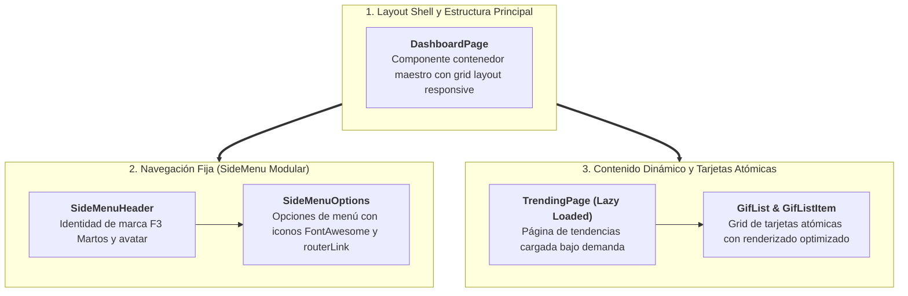
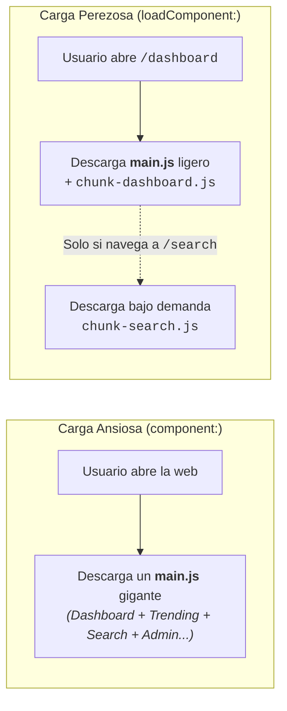
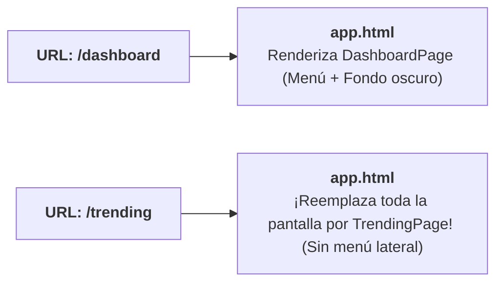
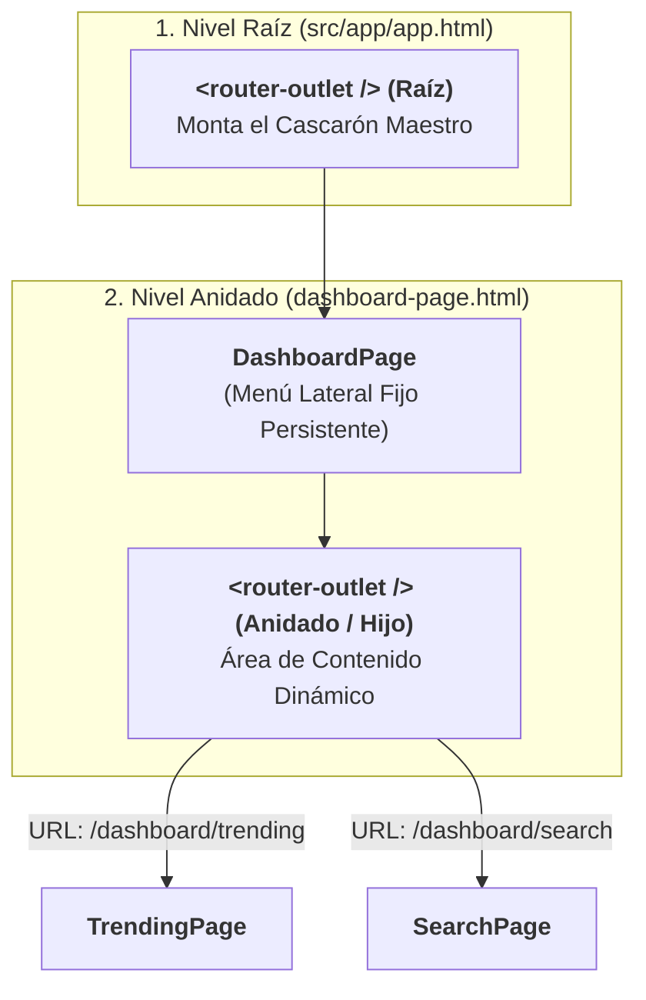
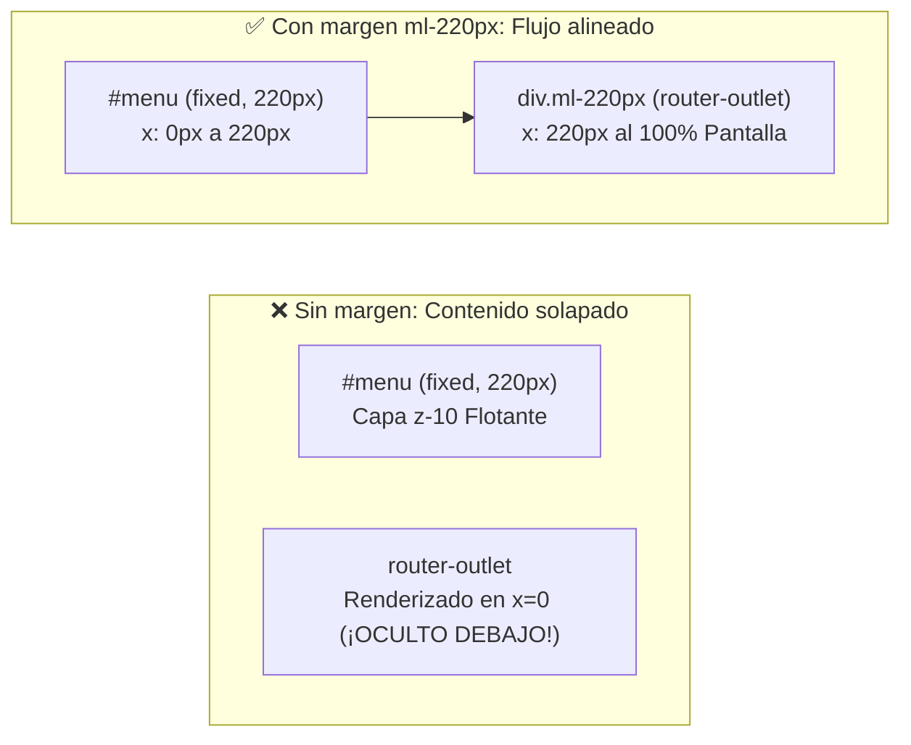
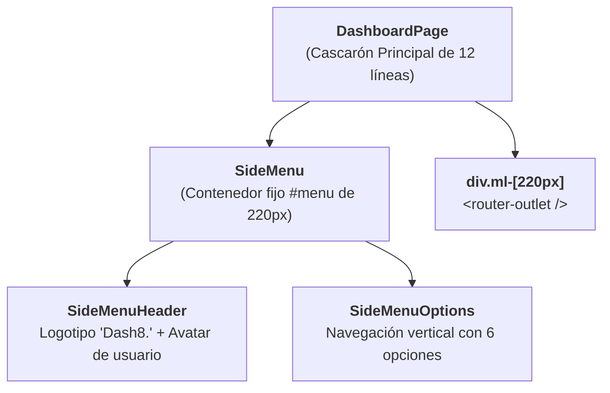
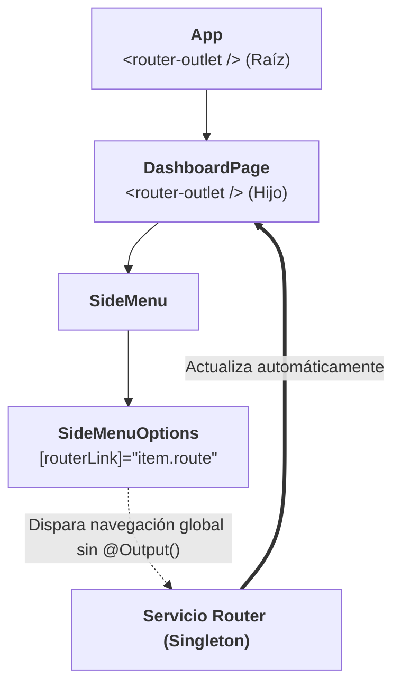

# Sección 06: GifsApp — Pensando en Componentes y Tailwind CSS

En esta sección construimos los cimientos de nuestra aplicación profesional **GifsApp**. Aplicamos los principios de **Componentización Atómica**, configuramos **Tailwind CSS en Angular 19**, implementamos **Rutas Hijas con Carga Perezosa (*Lazy Loading*)**, configuramos **Alias de Rutas (*Path Aliases*)**, integramos **FontAwesome** y preparamos componentes de galería desacoplados alimentados mediante **Signal Inputs**.

---

## 📋 Ficha Técnica y Objetivos Didácticos

* **Proyecto:** `gifs-app` (Nuevo proyecto generado con Angular CLI).
* **Stack Tecnológico:** Angular 20+ / 22.x, Tailwind CSS 4, FontAwesome 6, Standalone Components.
* **Patrones Arquitectónicos:** Atomic Design (Layout → Componentes Contenedores → Componentes de Presentación), Lazy Loading con `loadComponent`.
* **Código Fuente de Referencia:** [GitHub - DevTalles GifsApp (fin-seccion-06)](https://github.com/DevTalles-corp/angular-gif-app/tree/fin-seccion-06)



---

## Inicio del Proyecto y Configuración de Tailwind CSS

!!! info "📖 Para saber más: Manual de Referencia"
    Para conocer la integración de frameworks CSS (Tailwind, Bootstrap) y librerías de componentes UI en Angular 19, consulta el **[Manual de Referencia: 16. Integración de Librerías y UI](manual/16-integracion-librerias.md)**.

### Creación del Proyecto con Angular CLI
Generamos el proyecto configurando enrutamiento y estilos CSS nativos:

```bash
ng new gifs-app --routing --style=css --ssr=false
cd gifs-app
```

### Instalación de Tailwind CSS v4

Instalamos Tailwind CSS junto con el plugin oficial `@tailwindcss/postcss` para procesar los estilos en desarrollo:

```bash
npm install -D tailwindcss @tailwindcss/postcss postcss
```

### Configuración de PostCSS (`.postcssrc.json`)

En la raíz del proyecto (junto a `angular.json`), creamos el archivo `.postcssrc.json` para conectar Tailwind al pipeline de compilación de Angular CLI:

```json title=".postcssrc.json"
{
  "plugins": {
    "@tailwindcss/postcss": {}
  }
}
```

### Importación en `src/styles.css`

Reemplazamos el contenido de `src/styles.css` con la directiva de importación de Tailwind v4 y los estilos base:

```css title="src/styles.css"
@import "tailwindcss";

html, body {
  height: 100%;
  margin: 0;
  background-color: #0f172a; /* Slate 900 */
  color: #f8fafc;
}
```

!!! tip "Arquitectura Pro: De Tailwind v3 (Legacy) a Tailwind v4 (Estándar Actual)"
    **¿Por qué ya no creamos `tailwind.config.js` ni escribimos `@tailwind`?**  
    En proyectos o tutoriales anteriores basados en versiones previas se solía ejecutar `npx tailwindcss init`, editar `tailwind.config.js` con las rutas de las plantillas y usar tres directivas `@tailwind base; ...`. Ese era el procedimiento de **Tailwind CSS v3**.  
    
    En **Tailwind CSS v4** (con el que trabajamos en esta guía), el framework evoluciona a una arquitectura **CSS-first**:
    
    * **Sin archivo JS de configuración:** Ya no existe `tailwind.config.js` ni el comando `init`.
    * **Detección automática de fuentes (*Content Scanning*):** Ya no necesitas declarar la matriz `content: ["./src/**/*.{html,ts}"]`. El motor nativo de Tailwind v4 detecta y rastrea automáticamente todas las clases en tus componentes `.html` y `.ts`.
    * **Directiva única:** Todo el framework se importa con `@import "tailwindcss";`.
    * **Personalización de temas:** Si en el futuro necesitas añadir colores o fuentes personalizadas, se declaran directamente en tu CSS mediante la regla `@theme { --color-mi-color: #123456; }` en lugar de objetos JavaScript.

### Integración de FontAwesome en `src/index.html`:
Para los iconos del menú de navegación, añadimos el CDN de FontAwesome en el `<head>` de `src/index.html`:

```html title="src/index.html" hl_lines="10-15"
<!doctype html>
<html lang="es">
<head>
  <meta charset="utf-8">
  <title>GifsApp</title>
  <base href="/">
  <meta name="viewport" content="width=device-width, initial-scale=1">
  <link rel="icon" type="image/x-icon" href="favicon.ico">
  
  <!-- FontAwesome 6 CDN para Iconografía -->
  <link
    rel="stylesheet"
    href="https://cdnjs.cloudflare.com/ajax/libs/font-awesome/6.5.2/css/all.min.css"
    crossorigin="anonymous"
  />
</head>
<body>
  <app-root></app-root>
</body>
</html>
```

### Verificación Rápida (*Smoke Test*): ¿Funcionan Tailwind CSS y FontAwesome?

Antes de maquetar el dashboard o configurar rutas, es muy recomendable realizar una **prueba rápida de verificación**. De este modo confirmamos desde el minuto uno que la tubería de compilación de Tailwind CSS v4 y el CDN de FontAwesome cargan sin errores.

Sustituye temporalmente el contenido del componente raíz (`src/app/app.html`) por este pequeño código de prueba:

```html title="src/app/app.html — Prueba temporal"
<div class="p-6">
  <h1 class="text-3xl font-bold underline">
    Hello world!
  </h1>

  <div class="mt-4 flex items-center gap-2 text-xl">
    <i class="fa-solid fa-house text-sky-400"></i>
    <span>Tailwind CSS y FontAwesome listos</span>
  </div>
</div>
```

Ejecuta `ng serve` en la terminal y abre `http://localhost:4200` en tu navegador:

* **Si Tailwind funciona:** Verás el fondo oscuro (`#0f172a`), el título *"Hello world!"* grande, en negrita y subrayado (`text-3xl font-bold underline`), y un espaciado limpio.
* **Si FontAwesome funciona:** Verás dibujado el icono de la casa (`🏠`) en color azul cielo (`text-sky-400`) junto al texto.

!!! warning "⚠️ ¿Tailwind no aplica los estilos?"
    Si tenías `ng serve` ejecutándose antes de crear el archivo `.postcssrc.json`, **detén el servidor con ++ctrl+c++ y vuelve a ejecutar `ng serve`**. Angular CLI solo lee la configuración de PostCSS en el arranque inicial.

*(En cuanto compruebes que ambos se visualizan correctamente, en el siguiente paso sustituiremos esta prueba temporal por `<router-outlet />`).*

---

## Selección de la Plantilla Base: Dashboard Administrativo

En el desarrollo profesional de aplicaciones web, rara vez se maquetan paneles de control (*dashboards*) desde una hoja de estilos en blanco. La práctica estándar en la industria consiste en seleccionar un diseño base probado en repositorios de componentes de Tailwind y refactorizarlo hacia la arquitectura de componentes de nuestro framework.

### La Fuente del Diseño: Tailwind Components (Creative Tim)

Para el cascarón administrativo de **GifsApp**, seleccionamos la plantilla comunitaria de navegación de Tailwind:

* **Recurso UI de Referencia:** [Tailwind Components — Dashboard Navigation (Creative Tim)](https://www.creative-tim.com/twcomponents/component/dashboard-navigation)
* **Estructura Visual de la Plantilla Original:**
    * **Panel lateral izquierdo (*Sidebar*):** Fondo oscuro (`bg-slate-900`), cabecera con logotipo, avatar del usuario y menú vertical de enlaces con iconos.
    * **Área principal de contenido (*Main Content*):** Fondo contrastado (`bg-slate-800`), barra superior y contenedor para las diferentes pantallas operativas.

### Creación del Cascarón Inicial: `DashboardPage`

Comenzamos generando el componente contenedor maestro que alojará este diseño:

```bash
ng g c gifs/pages/dashboard-page
```

En su archivo de plantilla `src/app/gifs/pages/dashboard-page/dashboard-page.html`, pegamos la estructura visual del panel administrativo de Creative Tim, y añadimos **`export default`** (`export default class DashboardPage`) en su controlador TypeScript para habilitar su carga perezosa en el enrutador (como explicamos justo debajo):

!!! info "Estructura original del menú en la plantilla (`w-64`)"
    En el código original que copiamos de Creative Tim, el menú lateral viene definido como:
    ```html
    <div id="menu" class="bg-gray-900 min-h-screen z-10 text-slate-300 w-64 fixed left-0 h-screen overflow-y-scroll">
    ```
    Observa que incluye la clase `w-64` (anchura estándar de Tailwind de `16rem` o 256px) y `fixed left-0`. Más adelante, al desacoplar el diseño en rutas hijas independientes, ajustaremos esta anchura a una medida personalizada (`w-[220px]`) e introduciremos su correspondiente margen compensatorio.

```typescript title="src/app/gifs/pages/dashboard-page/dashboard-page.ts"
import { Component } from '@angular/core';

@Component({
  selector: 'app-dashboard-page',
  imports: [],
  templateUrl: './dashboard-page.html',
})
export default class DashboardPage {}
```

### Limpieza del Punto de Entrada: `src/app/app.html`

Una vez verificados Tailwind CSS y FontAwesome en el paso anterior, **borramos el código de prueba**. El componente raíz `App` no debe albergar estilos ni maquetación propia del dashboard; su única función es actuar como punto de montaje global para el enrutador de Angular:

```html title="src/app/app.html"
<!-- El componente raíz únicamente sirve como anclaje del enrutador de la SPA -->
<router-outlet />
```

### Concepto Clave: ¿Qué es la Carga Perezosa (*Lazy Loading*)?

En proyectos iniciales configurábamos las rutas importando directamente cada componente al principio de `app.routes.ts` y asignándolo mediante la propiedad **`component:`** (por ejemplo, `component: DragonballPage`). Eso se conoce como **Carga Ansiosa (*Eager Loading*)**: todas las páginas se empaquetan juntas en un único archivo `main.js` y el usuario las descarga todas de golpe al entrar a la web, aunque solo visite la pantalla de inicio.

A partir de este proyecto trabajaremos con **Carga Perezosa (*Lazy Loading*)** mediante la propiedad **`loadComponent`**, el estándar profesional en Angular moderno:



#### ¿Cómo funciona en código? (`loadComponent` y `export default`)

1. **Importación dinámica (`() => import(...)`):**  
   En lugar de importar el componente en la cabecera del archivo, `loadComponent` recibe una función flecha que ejecuta un `import(...)` dinámico de JavaScript. Esto indica al compilador de Angular que **separe esa vista en un archivo `.js` independiente (*chunk*)** y solo la descargue de la red cuando el usuario entre en esa URL.

2. **¿Por qué añadimos `export default class` al componente?**  
   Sin `default`, al importar dinámicamente tendríamos que extraer manualmente la clase usando `.then()`:
   ```typescript
   // ❌ Sin export default (más verboso):
   loadComponent: () => import('./gifs/pages/dashboard-page/dashboard-page')
     .then(m => m.DashboardPage)
   ```
   Al colocar **`export default class DashboardPage`**, Angular identifica automáticamente la clase principal del archivo, permitiéndonos escribir la sintaxis limpia y directa:
   ```typescript
   // ✅ Con export default (limpio y directo):
   loadComponent: () => import('./gifs/pages/dashboard-page/dashboard-page')
   ```

#### Comparativa: Carga Ansiosa (*Eager*) vs Carga Perezosa (*Lazy*)

| Criterio de Arquitectura | Carga Ansiosa (`component`) | Carga Perezosa (`loadComponent`) |
| :--- | :--- | :--- |
| **Ubicación del código compilado** | Todo fusionado en el paquete maestro `main.js`. | Dividido en archivos independientes (*lazy chunks*). |
| **Sentencia de importación** | Estática en cabecera: `import { MiComponente } from ...` | Dinámica en función: `() => import('...')` |
| **Momento de descarga en red** | De golpe al abrir la aplicación por primera vez. | En diferido, solo cuando el usuario navega a la URL. |
| **Impacto en pantallas no visitadas** | Se descargan y consumen ancho de banda y memoria inútilmente. | **Cero impacto.** Si el usuario nunca visita la ruta, el código nunca viaja por red. |
| **Impacto en rendimiento (FCP / TTI)** | Mayor tiempo de carga inicial a medida que la app crece. | Carga inicial instantánea e independiente del tamaño global de la app. |

### El Primer Enrutamiento Simple (Paso Inicial)

Ahora que entendemos el porqué de `loadComponent` y `export default`, configuramos una primera ruta plana con carga perezosa en `src/app/app.routes.ts` para verificar que nuestro dashboard compila y Tailwind CSS procesa los estilos:

```typescript title="src/app/app.routes.ts (Paso Inicial: Ruta Simple)"
import { Routes } from '@angular/router';

export const routes: Routes = [
  {
    path: 'dashboard',
    loadComponent: () => import('./gifs/pages/dashboard-page/dashboard-page'),
  },
  {
    path: '**',
    redirectTo: 'dashboard',
  },
];
```

Al guardar los cambios y abrir `http://localhost:4200`, el enrutador redirige a `/dashboard` y comprobamos que el panel administrativo se muestra íntegramente en el navegador con sus estilos oscuros de Tailwind CSS.

---

## Pensemos en Componentes: De la Plantilla Monolítica a Vistas Independientes

Una vez que tenemos el cascarón visual en pantalla, nos enfrentamos al **reto de arquitectura**:

En la plantilla original de Creative Tim, todo el layout se entrega como un **único bloque monolítico de HTML de más de 100 líneas**. Si dejamos todo ese código junto:

* **Violación de Separación de Responsabilidades (SoC):** El menú lateral, los enlaces, el avatar y el contenido dinámico están mezclados en un solo archivo.
* **Cero Dinamismo:** El área principal contiene datos fijos cableados (*hardcoded*). ¿Cómo mostramos los GIFs en tendencia o la página del buscador?

El objetivo es aplicar el principio de **Componentización Recursiva**: identificar qué páginas funcionales necesitamos dentro de `GifsApp` y desacoplarlas en componentes independientes:

| Componente | Rol Arquitectónico | Ruta Asignada | Responsabilidad Principal |
| :--- | :--- | :--- | :--- |
| **`DashboardPage`** | **Layout Shell (Cascarón)** | `/dashboard` | Alberga el menú lateral fijo y contiene el área donde se inyectan las vistas. |
| **`TrendingPage`** | **Página de Contenido** | `/trending` | Renderizará la cuadrícula de GIFs en tendencia y más populares. |
| **`SearchPage`** | **Página de Contenido** | `/search` | Alojará el campo de búsqueda de GIFs y el historial de consultas. |

### Arquitectura de Carpetas: Organización Modular por Dominio (*Feature Folders*)

Para mantener la integridad estructural y evitar que el proyecto se convierta en un repositorio caótico de archivos a medida que crezca, aplicamos una **Arquitectura Guiada por Dominio o Funcionalidad (*Feature-Driven Architecture*)**.

En lugar de crear carpetas técnicas globales (`src/app/components/`, `src/app/services/`), aislamos todo lo referente a una funcionalidad en su propio directorio raíz (`src/app/gifs/`). De este modo, si en el futuro la aplicación incorporase autenticación (`auth/`) o administración (`admin/`), cada módulo sería completamente autónomo.

Dentro de `src/app/gifs/`, organizamos los archivos en **cuatro subdirectorios especializados**:

```text
src/app/
├── gifs/                          # Dominio funcional principal de la aplicación
│   ├── pages/                     # Vistas completas vinculadas al enrutador (Smart Components)
│   │   ├── dashboard-page/        # Layout maestro (cascarón con sidebar y <router-outlet>)
│   │   ├── trending-page/         # Página de GIFs populares (/dashboard/trending)
│   │   └── search-page/           # Página del buscador (/dashboard/search)
│   ├── components/                # Componentes presentacionales reutilizables (Dumb Components)
│   │   ├── side-menu/             # Menú lateral y sus subcomponentes
│   │   ├── gif-list/              # Cuadrícula o listado de GIFs
│   │   └── gif-item/              # Tarjeta individual con imagen y botón de copia
│   ├── services/                  # Lógica de negocio, HTTP y estado reactivo (Signals)
│   │   └── gifs.ts                # Servicio singleton con llamadas a la API de Giphy
│   └── interfaces/                # Modelos de datos y contratos TypeScript puros
│       └── gif.interface.ts       # Tipado estricto de las respuestas de Giphy
├── app.ts                         # Componente raíz (anclaje de <router-outlet />)
├── app.config.ts                  # Configuración y proveedores globales de Angular
└── app.routes.ts                  # Definición del enrutamiento de la aplicación
```

#### Roles y Responsabilidades de cada Subdirectorio

| Subcarpeta | Tipo de Artefacto | Responsabilidad en la Arquitectura | ¿Se Enruta en `app.routes.ts`? |
| :--- | :--- | :--- | :--- |
| **`pages/`** | **Smart Components (Páginas)** | Orquestadores de vista completa. Inyectan servicios, leen parámetros de URL y reparten datos a los componentes hijos. Se cargan de forma perezosa (*Lazy Loading*). | **Sí** (tienen asignada una ruta `path`). |
| **`components/`** | **Dumb / Presentational Components** | Piezas visuales atómicas y reutilizables. Solo reciben datos con `input()` y notifican interacciones con `output()`. No conocen el enrutador. | **No** (se insertan dentro de plantillas de páginas u otros componentes). |
| **`services/`** | **Servicios Injectables (`@Injectable`)** | Capa de datos y lógica de negocio (SoC). Realizan peticiones HTTP a la API de Giphy, mantienen el estado reactivo centralizado con `signal()` y gestionan la persistencia en `localStorage`. | **No** (se inyectan mediante `inject(GifsService)`). |
| **`interfaces/`** | **Contratos TypeScript (`interface`, `type`)** | Tipado estático estricto para las respuestas de la API y modelos internos. No generan código JavaScript en el bundle final compilado. | **No** (solo existen en tiempo de compilación). |

#### ¿Cómo se crean estas carpetas con Angular CLI?

No es necesario crear manualmente cada carpeta antes de empezar. El CLI de Angular crea de forma automática todos los directorios intermedios cuando especificamos la ruta relativa en el comando:

```bash
# 1. Crea automáticamente gifs/pages/ y el componente de la página:
ng g c gifs/pages/trending-page

# 2. Crea automáticamente gifs/components/ y el componente de interfaz:
ng g c gifs/components/side-menu

# 3. Crea automáticamente gifs/services/ y el archivo de servicio:
ng g s gifs/services/gifs

# 4. Crea automáticamente gifs/interfaces/ y el archivo de tipado:
ng g i gifs/interfaces/gif
```

!!! tip "Buenas Prácticas de Arquitectura"
    Si prefieres tener la estructura vacía visible en tu editor de código desde el primer minuto, puedes crear manualmente las carpetas `components`, `pages`, `services` e `interfaces` dentro de `src/app/gifs/`. De ambas formas el resultado en disco es exactamente el mismo.

---

## 🎯 Tarea Práctica 1: Creación de Páginas y Enrutamiento Plano

!!! info "📖 Para saber más: Manual de Referencia"
    Para repasar la definición de rutas, componentes standalone y redirecciones en Angular, consulta el **[Manual de Referencia: 11. Angular Router y Navegación](manual/11-router.md)**.

Antes de estudiar la solución avanzada con rutas anidadas, vamos a reproducir el flujo de desarrollo estándar experimentando con rutas planas independientes.

### 📋 Enunciado del Reto para el Alumno

Realiza de forma autónoma los siguientes pasos en tu proyecto:

1. **Generación de las Páginas de Contenido:** Mediante Angular CLI, genera los dos componentes dentro del directorio de páginas del dominio `gifs`:
   ```bash
   ng g c gifs/pages/trending-page
   ng g c gifs/pages/search-page
   ```
2. **Exportación por defecto:** Añade `export default class` a `TrendingPage` y `SearchPage` para permitir su importación dinámica en el enrutador.
3. **Plantillas de prueba:** En `trending-page.html` y `search-page.html`, añade un texto identificativo visible (por ejemplo `<h1>Trending GIFs</h1>` y `<h1>Buscador de GIFs</h1>`).
4. **Registro de Rutas Planas:** En `src/app/app.routes.ts`, registra ambas páginas como rutas independientes al mismo nivel que `dashboard`.
5. **Verificación en el navegador:** Accede manualmente a:
    * `http://localhost:4200/dashboard`
    * `http://localhost:4200/trending`
    * `http://localhost:4200/search`

### ⏸️ Reto Práctico: ¡Inténtalo tú mismo!

!!! tip "Consejo para la prueba"
    Observa con atención qué ocurre con el menú lateral izquierdo cuando navegas entre `/dashboard` y `/trending`. ¿Se mantiene visible o desaparece?

---

### 🛠️ Solución Paso a Paso y Explicación Técnica

#### Paso 1: Controladores y Plantillas de las Páginas

=== "src/app/gifs/pages/trending-page/trending-page.ts"
    ```typescript title="src/app/gifs/pages/trending-page/trending-page.ts"
    import { Component } from '@angular/core';

    @Component({
      selector: 'app-trending-page',
      imports: [],
      templateUrl: './trending-page.html',
    })
    export default class TrendingPage {}
    ```

=== "src/app/gifs/pages/trending-page/trending-page.html"
    ```html title="src/app/gifs/pages/trending-page/trending-page.html"
    <div class="p-6">
      <h1 class="text-3xl font-bold text-white mb-2">Trending GIFs</h1>
      <p class="text-slate-400">trending-page works!</p>
    </div>
    ```

=== "src/app/gifs/pages/search-page/search-page.ts"
    ```typescript title="src/app/gifs/pages/search-page/search-page.ts"
    import { Component } from '@angular/core';

    @Component({
      selector: 'app-search-page',
      imports: [],
      templateUrl: './search-page.html',
    })
    export default class SearchPage {}
    ```

=== "src/app/gifs/pages/search-page/search-page.html"
    ```html title="src/app/gifs/pages/search-page/search-page.html"
    <div class="p-6">
      <h1 class="text-3xl font-bold text-white mb-2">Buscador de GIFs</h1>
      <p class="text-slate-400">search-page works!</p>
    </div>
    ```

#### Paso 2: Configuración del Enrutamiento Plano en `src/app/app.routes.ts`

```typescript title="src/app/app.routes.ts (Enfoque Plano)"
import { Routes } from '@angular/router';

export const routes: Routes = [
  {
    path: 'dashboard',
    loadComponent: () => import('./gifs/pages/dashboard-page/dashboard-page'),
  },
  {
    path: 'trending',
    loadComponent: () => import('./gifs/pages/trending-page/trending-page'),
  },
  {
    path: 'search',
    loadComponent: () => import('./gifs/pages/search-page/search-page'),
  },
  {
    path: '**',
    redirectTo: 'dashboard',
  },
];
```

---

### 🔍 Análisis de la Solución: El Conflicto de la Pantalla en Blanco

Al probar este enrutamiento plano en el navegador descubrimos un **problema arquitectónico evidente**:

* Cuando accedemos a `http://localhost:4200/dashboard`, se ve el menú lateral y el diseño completo.
* Pero en cuanto navegamos a `http://localhost:4200/trending` o `http://localhost:4200/search`, **¡el menú lateral desaparece por completo!** Solo vemos el texto suelto sobre un fondo blanco descontextualizado.



#### ¿Por qué ocurre esto?
Porque todas estas rutas están compitiendo por el **mismo y único viewport**: el `<router-outlet />` ubicado en `src/app/app.html`.  
Al cambiar de URL de `/dashboard` a `/trending`, Angular destruye el componente `DashboardPage` entero y monta en su lugar `TrendingPage` a pantalla completa.

---

### ⚠️ Errores Típicos del Alumno en esta Tarea

1. **Olvidar `export default` en los componentes:**  
   Si declaras `export class TrendingPage` sin `default`, la sintaxis de carga perezosa `() => import(...)` fallará al no encontrar una exportación predeterminada.

2. **Error en las rutas relativas del `import()`:**  
   Escribir `./pages/...` en lugar de `./gifs/pages/...`. La ruta relativa debe calcularse siempre con respecto a la ubicación del archivo `app.routes.ts`.

---

### 🧑‍🏫 Guía Didáctica para el Docente en el Aula

* **La pregunta disparadora:** Pida a los alumnos que naveguen a `/trending` y pregúnteles: *«¿Dónde está nuestro menú lateral de Tailwind que montamos con tanto esfuerzo en el paso anterior?»*.
* **El concepto clave:** Explique que una aplicación tipo Dashboard requiere un **Layout Persistente** (un cascarón que nunca se destruye) y que la solución natural de Angular son las **Rutas Hijas (*Nested Routes*)**.

---

## La Solución Arquitectónica: Rutas Hijas (*Nested Routes*) y Viewports Anidados

!!! info "📖 Para saber más: Manual de Referencia"
    Para estudiar en profundidad la división de código (*code-splitting*), estrategias de precarga (*preloading*) y protección con Guards, consulta el **[Manual de Referencia: 11. Angular Router y Navegación (Lazy Loading)](manual/11-router.md#seccion-3-lazy-loading)**.

Para que el menú lateral del Dashboard permanezca siempre visible y las páginas `trending` y `search` se rendericen **dentro del área de contenido del Dashboard**, debemos implementar una jerarquía de **Rutas Hijas** con **dos niveles de `<router-outlet />`**.



### Paso 1: Preparar el Cascarón (`DashboardPage`) y Ajustar el Layout

En el componente cascarón realizamos las modificaciones necesarias para habilitar el anidamiento de vistas:

#### 1. Importar `RouterOutlet` en el controlador
En `dashboard-page.ts`, añadimos `RouterOutlet` al array `imports` para que la plantilla reconozca la etiqueta `<router-outlet />`:

```typescript title="src/app/gifs/pages/dashboard-page/dashboard-page.ts" hl_lines="2 6"
import { Component } from '@angular/core';
import { RouterOutlet } from '@angular/router';

@Component({
  selector: 'app-dashboard-page',
  imports: [RouterOutlet],
  templateUrl: './dashboard-page.html',
})
export default class DashboardPage {}
```

#### 2. Ajuste de anchura del menú (`w-[220px]`) e incrustación de `<router-outlet />` con margen compensatorio (`ml-[220px]`)

En este punto realizamos dos ajustes esenciales de maquetación en `src/app/gifs/pages/dashboard-page/dashboard-page.html`:

**A. Ajuste de la anchura del sidebar (`w-64` → `w-[220px]`):**  
La plantilla comunitaria original de Creative Tim venía maquetada con la clase `w-64` (anchura estándar de Tailwind de 16rem o 256px). Para dejar más superficie libre a las cuadrículas de imágenes y conseguir un diseño más estilizado, **reemplazamos `w-64` por la clase de valor arbitrario `w-[220px]`**:

```html
<!-- ❌ Plantilla original (256px de ancho): -->
<!-- <div id="menu" class="bg-gray-900 ... w-64 fixed left-0 ..."> -->

<!-- ✅ Ajuste personalizado más estilizado (220px de ancho): -->
<div id="menu" class="w-[220px] bg-gray-900 min-h-screen z-10 text-slate-300 fixed left-0 h-screen overflow-y-scroll">
```

**B. El problema de `fixed left-0` y la necesidad del margen compensatorio (`ml-[220px]`):**  
El menú lateral `#menu` tiene declarada la propiedad CSS **`fixed left-0`** (con elevación de capa `z-10`). En la especificación de CSS:

* Un elemento con posición fija se **extrae completamente del flujo natural del documento HTML**; no ocupa espacio ni empuja a los elementos adyacentes.
* Por consiguiente, cualquier elemento hermano contiguo (como el contenedor del enrutador) empezará a renderizarse desde el borde izquierdo de la pantalla en la coordenada horizontal **x = 0**.
* El resultado visual sin corrección sería un fallo grave: **las páginas cargadas en `<router-outlet />` quedarían completamente ocultas debajo del menú lateral oscuro**.



**C. Aplicación en la plantilla:**  
Para solventar este solapamiento, envolvemos la directiva `<router-outlet />` dentro de un contenedor `<div>` con la clase **`ml-[220px]`** (*margin-left: 220px*). Este margen empuja el área de contenido exactamente los mismos 220 píxeles que ocupa el menú lateral:

```html title="src/app/gifs/pages/dashboard-page/dashboard-page.html" hl_lines="4 9-11"
<div class="bg-slate-100 overflow-y-scroll w-screen h-screen antialiased text-slate-300 selection:bg-blue-600 selection:text-white">
  <div class="flex flex-col relative w-screen">
    <!-- 1. Menú lateral: sustituimos w-64 por w-[220px] -->
    <div id="menu" class="w-[220px] bg-gray-900 min-h-screen z-10 text-slate-300 fixed left-0 h-screen overflow-y-scroll">
      <!-- Contenido del menú de Creative Tim... -->
    </div>

    <!-- 2. Área de contenido dinámico con margen compensatorio de 220px -->
    <div class="ml-[220px] px-4 flex flex-col flex-1 w-full h-full text-slate-800">
      <router-outlet />
    </div>
  </div>
</div>
```

!!! info "¿Es necesario `ChangeDetectionStrategy.OnPush` en las páginas hijas?"
    **No es obligatorio.** La aplicación, las rutas hijas y la carga perezosa funcionan al 100% sin esta configuración (utilizando la estrategia por defecto de Angular).
    
    En proyectos modernos de Angular con Signals, es una recomendación habitual declarar `changeDetection: ChangeDetectionStrategy.OnPush` en los componentes de página para optimizar el rendimiento (evitando ciclos de verificación innecesarios cuando las entradas o señales no han cambiado). Puedes incluirlo en `SearchPage` si deseas adoptar esta buena práctica profesional, o dejar el componente sin él; el enrutador funcionará exactamente igual en ambos casos.

---

### Paso 2: Configurar las Rutas Anidadas (`children`) y Doble Redirección en `src/app/app.routes.ts`

Transformamos el archivo de rutas moviendo `trending` y `search` dentro del array **`children`** de la ruta `dashboard`, implementando un sistema de **doble comodín (`**`)**:

```typescript title="src/app/app.routes.ts (Solución Definitiva: Rutas Hijas)" hl_lines="8-25 27-30"
import { Routes } from '@angular/router';

export const routes: Routes = [
  {
    path: 'dashboard',
    // 1. Carga perezosa del Cascarón Principal (Layout Shell)
    loadComponent: () => import('./gifs/pages/dashboard-page/dashboard-page'),
    children: [
      {
        path: 'trending',
        // 2. Carga perezosa de la vista de Tendencias dentro del Dashboard
        loadComponent: () => import('./gifs/pages/trending-page/trending-page'),
      },
      {
        path: 'search',
        // 3. Carga perezosa del Buscador (solo se descarga al navegar a /search)
        loadComponent: () => import('./gifs/pages/search-page/search-page'),
      },
      {
        // 4. Comodín hijo: cualquier subruta no reconocida bajo /dashboard redirige a /dashboard/trending
        path: '**',
        redirectTo: 'trending',
      },
    ],
  },
  {
    // 5. Comodín raíz: cualquier ruta desconocida redirige al dashboard
    path: '**',
    redirectTo: 'dashboard',
  },
];
```

#### ¿Por qué dos redirecciones comodín (`**`)?
* **Comodín Hijo (`children`):** Si el usuario escribe en la barra de direcciones `http://localhost:4200/dashboard/ajustes-inventados`, el enrutador hijo captura el fallo y lo redirige elegantemente a `/dashboard/trending` **sin desmontar el dashboard ni recargar el menú lateral**.
* **Comodín Raíz (`root`):** Si el usuario accede a una URL de primer nivel desconocida como `http://localhost:4200/perfil`, el enrutador principal lo redirige a `/dashboard`.

---

### ¿Por qué tiene sentido aplicar Carga Perezosa también en rutas hijas?

Es muy común que los estudiantes se pregunten:  
*«Si al entrar en la web la ruta redirige a `/dashboard` y de inmediato a `/dashboard/trending`, el navegador siempre va a cargar ambos componentes al arrancar. ¿Para qué molestarse en hacer las rutas hijas perezosas con `loadComponent`?»*

Existen **4 razones arquitectónicas de primer nivel** que justifican plenamente este patrón:

1. **`SearchPage` NO se descarga al arrancar (Ahorro real de recursos):**  
   Aunque el usuario descargue `dashboard` y `trending` en el primer segundo, el archivo `.js` de `SearchPage` (y en el futuro, toda su lógica de filtrado, APIs y componentes) **no se descarga ni se parsea**. En aplicaciones reales con decenas de rutas hijas (Historial, Favoritos, Configuración, Perfil...), el usuario solo descarga la vista activa, ahorrando hasta un 90% del peso en red.

2. **Blindaje del paquete principal (`main.js`) y mejora de Core Web Vitals:**  
   Al eliminar las importaciones estáticas de `app.routes.ts`, el archivo `main.js` se mantiene ultraligero (pesa únicamente el motor de Angular y la tabla de enrutamiento básica). El navegador lo descarga en pocos milisegundos, permitiendo que la página pinte su estructura visual inmediatamente (**First Contentful Paint - FCP**).

3. **Carga óptima ante Enlaces Directos (*Deep Linking*):**  
   Los usuarios no siempre entran por la página de inicio. Si un usuario abre un enlace guardado en favoritos o compartido por un colega como `http://localhost:4200/dashboard/search`:

    * Angular descargará los paquetes de `DashboardPage` y `SearchPage`.
    * **`TrendingPage` nunca llegará a descargarse ni a ejecutarse en su navegador.**

4. **Preparación para la Escalabilidad del Proyecto (Ejemplo: Módulos de Autenticación):**  
   Si en secciones posteriores añadimos una pantalla de inicio de sesión (`/auth/login`), un usuario no autenticado que entra a la plataforma solo descargará el módulo de autenticación. Gracias a la carga perezosa, **no descargará ni un solo byte de `dashboard` ni de `GifsApp`** hasta haber iniciado sesión con éxito.

---

## Descomposición Atómica del Menú Lateral (Refactorización Estructural)

En la plantilla de Creative Tim, el archivo `dashboard-page.html` acumula más de **230 líneas de HTML**, mezclando el logotipo, la información del perfil del usuario, seis opciones de menú con SVG gigantescos y el área de contenido principal.

Para cumplir con la **Regla de Separación Estricta de Responsabilidades (SoC)** y la **Componentización Recursiva**, aplicaremos el principio de ingeniería de software:  
> *"Haz que funcione primero, organízalo después, y dinamízalo al final" (Make it work, make it right, make it fast).*

En esta fase dividimos el monolito en **3 componentes atómicos** conservando temporalmente el HTML estático de Tailwind, para verificar en el navegador que el árbol de componentes se ensambla a la perfección sin alterar el diseño:



### 1. Generación de Componentes con Angular CLI

Generamos los tres componentes en la carpeta `src/app/gifs/components/side-menu`:

```bash
ng g c gifs/components/side-menu
ng g c gifs/components/side-menu/side-menu-header
ng g c gifs/components/side-menu/side-menu-options
```

!!! tip "Convención de Nomenclatura: Prefijo de Dominio"
    Por defecto, Angular CLI asigna el prefijo `app-` a los selectores. En arquitecturas empresariales modulares, es una excelente práctica utilizar el nombre del dominio funcional como prefijo (`gifs-side-menu`, `gifs-side-menu-header`, `gifs-side-menu-options`), diferenciando los componentes del dominio `gifs` de componentes genéricos compartidos (`shared`).

---

### 2. Componente 1: Cabecera y Perfil (`SideMenuHeader`)

Cortamos la sección del logotipo y el perfil de usuario de `dashboard-page.html` y la trasladamos a su propio componente atómico:

=== "src/app/gifs/components/side-menu/side-menu-header/side-menu-header.ts"
    ```typescript title="src/app/gifs/components/side-menu/side-menu-header/side-menu-header.ts"
    import { Component } from '@angular/core';

    @Component({
      selector: 'gifs-side-menu-header',
      imports: [],
      templateUrl: './side-menu-header.html',
    })
    export class SideMenuHeader {}
    ```

=== "src/app/gifs/components/side-menu/side-menu-header/side-menu-header.html"
    ```html title="src/app/gifs/components/side-menu/side-menu-header/side-menu-header.html"
    <div id="logo" class="my-4 px-6">
      <h1 class="text-lg md:text-2xl font-bold text-white">
        Dash<span class="text-blue-500">8</span>.
      </h1>
      <p class="text-slate-500 text-sm">Manage your actions and activities</p>
    </div>

    <div id="profile" class="px-6 py-10">
      <p class="text-slate-500">Welcome back,</p>
      <a href="#" class="inline-flex space-x-2 items-center">
        <span>
          
        </span>
        <span class="text-sm md:text-base font-bold"> Edward Tompson </span>
      </a>
    </div>
    ```

---

### 3. Componente 2: Opciones de Navegación Estáticas (`SideMenuOptions`)

Cortamos el bloque `<div id="nav">` con los enlaces estáticos originales de Tailwind de `dashboard-page.html` y lo pegamos en `side-menu-options`:

=== "src/app/gifs/components/side-menu/side-menu-options/side-menu-options.ts"
    ```typescript title="src/app/gifs/components/side-menu/side-menu-options/side-menu-options.ts"
    import { Component } from '@angular/core';

    @Component({
      selector: 'gifs-side-menu-options',
      imports: [],
      templateUrl: './side-menu-options.html',
    })
    export class SideMenuOptions {}
    ```

=== "src/app/gifs/components/side-menu/side-menu-options/side-menu-options.html"
    ```html title="src/app/gifs/components/side-menu/side-menu-options/side-menu-options.html"
    <div id="nav" class="w-full px-6">
      <a href="#" class="w-full px-2 inline-flex space-x-2 items-center border-b border-slate-700 py-3 bg-blue-800 hover:bg-white/5 transition ease-linear duration-150">
        <span class="text-white font-bold leading-5">Dashboard</span>
      </a>
      <a href="#" class="w-full px-2 inline-flex space-x-2 items-center border-b border-slate-700 py-3 hover:bg-white/5 transition ease-linear duration-150">
        <span class="text-slate-300 font-bold leading-5">Database</span>
      </a>
      <a href="#" class="w-full px-2 inline-flex space-x-2 items-center border-b border-slate-700 py-3 hover:bg-white/5 transition ease-linear duration-150">
        <span class="text-slate-300 font-bold leading-5">Reports</span>
      </a>
      <!-- Resto de opciones estáticas de la plantilla original... -->
    </div>
    ```

---

### 4. Componente 3: El Contenedor Ensamblador (`SideMenu`)

`SideMenu` actúa como el cascarón modular del menú lateral. En su plantilla mantiene el contenedor `#menu` con sus clases de Tailwind fijas (`w-[220px] fixed left-0`) y ensambla la cabecera y las opciones:

=== "src/app/gifs/components/side-menu/side-menu.ts"
    ```typescript title="src/app/gifs/components/side-menu/side-menu.ts"
    import { Component } from '@angular/core';
    import { SideMenuHeader } from './side-menu-header/side-menu-header';
    import { SideMenuOptions } from './side-menu-options/side-menu-options';

    @Component({
      selector: 'gifs-side-menu',
      imports: [SideMenuHeader, SideMenuOptions],
      templateUrl: './side-menu.html',
    })
    export class SideMenu {}
    ```

=== "src/app/gifs/components/side-menu/side-menu.html"
    ```html title="src/app/gifs/components/side-menu/side-menu.html"
    <div
      id="menu"
      class="w-[220px] bg-gray-900 min-h-screen z-10 text-slate-300 fixed left-0 h-screen overflow-y-scroll"
    >
      <!-- Cabecera con Logotipo y Avatar -->
      <gifs-side-menu-header />

      <!-- Lista de Opciones de Navegación -->
      <gifs-side-menu-options />
    </div>
    ```

---

### 5. La Limpieza del Cascarón: `DashboardPage` (12 líneas)

Ahora que toda la complejidad visual del menú lateral ha sido desacoplada en sus respectivos componentes atómicos, `DashboardPage` se reduce a una estructura mínima, expresiva y altamente mantenible:

=== "src/app/gifs/pages/dashboard-page/dashboard-page.ts"
    ```typescript title="src/app/gifs/pages/dashboard-page/dashboard-page.ts" hl_lines="3 7"
    import { Component } from '@angular/core';
    import { RouterOutlet } from '@angular/router';
    import { SideMenu } from '../../components/side-menu/side-menu';

    @Component({
      selector: 'app-dashboard-page',
      imports: [RouterOutlet, SideMenu],
      templateUrl: './dashboard-page.html',
    })
    export default class DashboardPage {}
    ```

=== "src/app/gifs/pages/dashboard-page/dashboard-page.html"
    ```html title="src/app/gifs/pages/dashboard-page/dashboard-page.html"
    <div
      class="bg-slate-100 overflow-y-scroll w-screen h-screen antialiased text-slate-300 selection:bg-blue-600 selection:text-white"
    >
      <div class="flex flex-col relative w-screen">
        <!-- 1. Menú lateral atómico independiente -->
        <gifs-side-menu />

        <!-- 2. Área de contenido dinámico de rutas hijas con margen compensatorio -->
        <div class="ml-[220px] px-4 flex flex-col flex-1 w-full h-full text-slate-800">
          <router-outlet />
        </div>
      </div>
    </div>
    ```

Al recargar el navegador en `http://localhost:4200/dashboard`, comprobamos que **la interfaz de usuario no ha cambiado en absoluto**, pero la calidad arquitectónica del proyecto se ha transformado radicalmente:

* `DashboardPage` es ahora un componente de orquestación puro (12 líneas).
* Si cambia el logotipo, modificamos únicamente `SideMenuHeader`.
* Si cambia la barra lateral, `SideMenu` está totalmente aislado del resto de páginas.

---

## 🎯 Tarea Práctica 2: Menú Lateral Dinámico y Tipado con `MenuOption`

!!! info "📖 Para saber más: Manual de Referencia"
    Para dominar la definición de interfaces en TypeScript, el renderizado de listas con `@for` y la navegación activa en Angular, consulta el **[Manual de Referencia: 11. Angular Router y Navegación](manual/11-router.md)** y el **[Manual de Referencia: 04. Plantillas y Control Flow](manual/04-plantillas.md)**.

En la arquitectura del panel de control (*Dashboard*), un menú lateral estático con enlaces duplicados en HTML y decenas de etiquetas SVG en línea es difícil de mantener y propenso a inconsistencias. En esta práctica aplicaremos el principio de **Separación de Responsabilidades** para transformar `SideMenuOptions` en un componente navegable autónomo, dinámico y fuertemente tipado.

### 💡 Concepto Clave: RouterLinks desde Componentes Hijos Desacoplados

Un aspecto fundamental de la arquitectura de Angular Router es que **las directivas de navegación son completamente agnósticas a la jerarquía de componentes**:



* `SideMenuOptions` se encuentra en el cuarto nivel de profundidad del árbol de componentes (`App` → `Dashboard` → `SideMenu` → `SideMenuOptions`).
* En otros frameworks o arquitecturas acopladas, para que un componente hijo modifique la vista de su ancestro se requeriría emitir eventos hacia arriba mediante `@Output()`, `EventEmitter` o un store centralizado.
* En Angular, la directiva `[routerLink]` interactúa directamente con el servicio singleton global del Router. Al pulsar un enlace, el enrutador actualiza la URL y renderiza el componente correspondiente en el `<router-outlet />` de `DashboardPage`, **sin que los componentes intermedios deban saber nada sobre la navegación**.

---

### Requisito Previo: Inclusión de FontAwesome 6 en `src/index.html`

En la plantilla original de Creative Tim, los 6 enlaces de navegación contenían más de 120 líneas de código SVG inline repetitivo y de difícil lectura.  
Para resolver este problema arquitectónico y permitir que cada opción defina su icono como una simple propiedad de texto tipada (`icon: string`), incorporamos la librería de iconos **FontAwesome 6** en `src/index.html`:

```html title="src/index.html" hl_lines="10-17"
<!DOCTYPE html>
<html lang="en">
  <head>
    <meta charset="utf-8" />
    <title>GifsApp</title>
    <base href="/" />
    <meta name="viewport" content="width=device-width, initial-scale=1" />
    <link rel="icon" type="image/x-icon" href="favicon.ico" />

    <!-- FontAwesome 6 CDN -->
    <link
      rel="stylesheet"
      href="https://cdnjs.cloudflare.com/ajax/libs/font-awesome/6.7.1/css/all.min.css"
      integrity="sha512-5Hs3dF2AEPkpNAR7UiOHba+lRSJNeM2ECkwxUIxC1Q/FLycGTbNapWXB4tP889k5T5Ju8fs4b1P5z/iB4nMfSQ=="
      crossorigin="anonymous"
      referrerpolicy="no-referrer"
    />
  </head>
  <body>
    <app-root></app-root>
  </body>
</html>
```

!!! tip "Búsqueda de Iconos"
    Puedes explorar el catálogo completo de iconos gratuitos en [FontAwesome Icons](https://fontawesome.com/icons) (por ejemplo: `fa-solid fa-chart-line` para tendencias o `fa-solid fa-magnifying-glass` para búsqueda).

---

### 📋 Enunciado del Reto para el Alumno

Realiza de forma autónoma los siguientes pasos en tu proyecto:

1. **Definición del contrato de datos (`interface MenuOption`):**  
   En `src/app/gifs/components/side-menu/side-menu-options/side-menu-options.ts`, declara una interfaz llamada `MenuOption` con las siguientes propiedades obligatorias:

    * `icon`: string con las clases CSS del icono de FontAwesome (ej: `'fa-solid fa-chart-line'`).
    * `label`: string con el título principal de la opción (ej: `'Trending'`).
    * `subLabel`: string con una descripción secundaria breve (ej: `'Gifs Populares'`).
    * `route`: string con la ruta absoluta del Dashboard (ej: `'/dashboard/trending'`).

2. **Colección tipada de rutas:**  
   Dentro de la clase `SideMenuOptions`, inicializa la propiedad `menuOptions` de tipo `MenuOption[]` con las dos opciones activas de navegación:

    * **Trending:** Icono `'fa-solid fa-chart-line'`, título `'Trending'`, subtítulo `'Gifs Populares'`, ruta `'/dashboard/trending'`.
    * **Buscador:** Icono `'fa-solid fa-magnifying-glass'`, título `'Buscador'`, subtítulo `'Buscar Gifs'`, ruta `'/dashboard/search'`.

3. **Plantilla declarativa con Control Flow (`@for`):**  
   En `side-menu-options.html`, reemplaza la lista de enlaces estáticos por una estructura iterativa nativa:
   ```html
   @for (item of menuOptions; track item.route) { ... }
   ```

4. **Navegación SPA y estilos activos de Tailwind:**
    * Enlaza cada opción mediante property binding: `[routerLink]="item.route"`.
    * Configura la clase CSS que se activará cuando la ruta coincida con la URL activa usando: `routerLinkActive="bg-blue-800"`.
    * Añade las clases de interacción de Tailwind: `hover:bg-white/5 transition ease-linear duration-150`.
    * Importa `RouterLink` y `RouterLinkActive` en el array `imports` del componente standalone.

5. **Criterios de éxito y verificación:**
    * Abre `http://localhost:4200/dashboard/trending` en tu navegador.
    * La opción "Trending" debe aparecer resaltada con fondo azul oscuro (`bg-blue-800`).
    * Haz clic en "Buscador": la URL debe cambiar fluidamente a `/dashboard/search` sin recargar la página completa, y el resalte azul debe trasladarse de inmediato a la opción "Buscador".

---

### ⏸️ Reto Práctico: ¡Inténtalo tú mismo!

!!! exercise "Pausa de Trabajo Autónomo"
    Implementa la interfaz, la colección de opciones y la plantilla iterativa en tu editor antes de verificar la solución técnica.
    
    *Criterio de éxito:* Menú renderizado dinámicamente mediante `@for` y navegación SPA reactiva con clases activas sincronizadas.

---

### 🛠️ Solución Paso a Paso y Explicación Técnica

#### Paso 1: Crear el Controlador TypeScript con Tipado Estricto

En `src/app/gifs/components/side-menu/side-menu-options/side-menu-options.ts`:

```typescript title="src/app/gifs/components/side-menu/side-menu-options/side-menu-options.ts" hl_lines="4-9 13 17-30"
import { Component } from '@angular/core';
import { RouterLink, RouterLinkActive } from '@angular/router';

interface MenuOption {
  icon: string;
  label: string;
  subLabel: string;
  route: string;
}

@Component({
  selector: 'gifs-side-menu-options',
  imports: [RouterLink, RouterLinkActive],
  templateUrl: './side-menu-options.html',
})
export class SideMenuOptions {
  menuOptions: MenuOption[] = [
    {
      icon: 'fa-solid fa-chart-line',
      label: 'Trending',
      subLabel: 'Gifs Populares',
      route: '/dashboard/trending',
    },
    {
      icon: 'fa-solid fa-magnifying-glass',
      label: 'Buscador',
      subLabel: 'Buscar Gifs',
      route: '/dashboard/search',
    },
  ];
}
```

#### Paso 2: Crear la Plantilla HTML Declarativa con Tailwind CSS

En `src/app/gifs/components/side-menu/side-menu-options/side-menu-options.html`:

```html title="src/app/gifs/components/side-menu/side-menu-options/side-menu-options.html" hl_lines="2 4-5 9 12-13 16"
<div id="nav" class="w-full px-6">
  @for (item of menuOptions; track item.route) {
    <a
      [routerLink]="item.route"
      routerLinkActive="bg-blue-800"
      class="w-full px-2 inline-flex space-x-2 items-center border-b border-slate-700 py-3 hover:bg-white/5 transition ease-linear duration-150"
    >
      <div>
        <i [class]="item.icon"></i>
      </div>
      <div class="flex flex-col">
        <span class="text-lg font-bold leading-5 text-white">{{ item.label }}</span>
        <span class="text-sm text-white/50 hidden md:block">{{ item.subLabel }}</span>
      </div>
    </a>
  }
</div>
```

---

### 🔍 Análisis de la Solución y Conceptos Clave

1. **Beneficios de la Colección Declarativa (`MenuOption[]`):**
    * Desacopla los datos de la presentación visual. Si en el futuro se añade una tercera pantalla (por ejemplo, "Historial" o "Favoritos"), solo se requiere agregar un nuevo objeto al array `menuOptions`, sin tocar la estructura HTML de la plantilla.
2. **Optimización con `track item.route`:**
    * En Angular moderno, el parámetro `track` de la directiva `@for` es mandatorio. Al usar una clave única como `item.route`, el algoritmo de renderizado de Angular puede identificar de forma determinista qué nodo del DOM corresponde a cada opción, evitando recreaciones innecesarias del árbol de elementos.
3. **Gestión de Clases Activas (`routerLinkActive`):**
    * Angular supervisa las transiciones del router y aplica automáticamente las clases CSS especificadas en `routerLinkActive` únicamente al elemento cuya ruta coincide con la URL activa en el navegador.

---

### ⚠️ Errores Típicos del Alumno en esta Tarea

| Error Común | Síntoma en el Navegador | Causa y Solución |
| :--- | :--- | :--- |
| Olvidar importar `RouterLink` y `RouterLinkActive` | Error de compilación: *Can't bind to 'routerLink' since it isn't a known property of 'a'*. | **Causa:** En componentes standalone, las directivas del enrutador deben incluirse explícitamente en el array `imports`. |
| Usar rutas relativas `'trending'` en lugar de `'/dashboard/trending'` | La navegación falla o se anida incorrectamente en la URL al hacer clics repetidos. | **Causa:** Las rutas relativas dependen del segmento actual. <br/>**Solución:** Usar rutas absolutas que inicien con barra: `'/dashboard/trending'`. |
| Omitir el parámetro `track` en `@for` | Error de compilación en la plantilla: *@for statement must have a 'track' expression*. | **Causa:** En el nuevo Control Flow de Angular, `track` es obligatorio por diseño. |
| Clases de FontAwesome no visibles | Aparecen cuadrados vacíos o texto sin icono. | **Causa:** No haberse importado la hoja de estilos de FontAwesome en `src/index.html`. |

---

### 🧑‍🏫 Guía Didáctica para el Docente en el Aula

!!! tip "Estrategia para Guiar esta Práctica en Clase"
    1. **Demostración de escalabilidad:** Pida a los estudiantes que añadan una tercera opción ficticia (`{ icon: 'fa-solid fa-heart', label: 'Favoritos', subLabel: 'Mis Gifs', route: '/dashboard/favorites' }`) solo modificando el array TypeScript. Al ver cómo la plantilla se actualiza automáticamente respetando estilos y layout, entenderán el principio de código DRY (Don't Repeat Yourself).
    2. **Inspección de routerLinkActive:** Guíe a los alumnos para que abran las herramientas de desarrollo (F12) e inspeccionen los atributos `class` de las etiquetas `<a>` mientras navegan entre "Trending" y "Buscador" para constatar en vivo cómo Angular gestiona las clases CSS dinámicas.

---

## Variables de Entorno y Path Aliases en TypeScript

En proyectos de escala profesional, dos problemas de arquitectura aparecen rápidamente:

1. **Rutas relativas frágiles e interminables:** Escribir `import { ... } from '../../../../../environments/environment'` es propenso a errores y se rompe al mover archivos de directorio.
2. **Configuraciones cableadas en código (*hardcoded*):** Los nombres de la empresa, eslóganes, URLs de APIs o claves públicas deben residir en archivos de configuración externos y desacoplados según el entorno de ejecución (desarrollo vs producción).

---

### 1. Generación de Archivos de Entorno con Angular CLI

A partir de las versiones modernas de Angular, los archivos de entorno no se crean de forma predeterminada al generar el proyecto con `ng new`. Se generan explícitamente mediante el comando:

```bash
ng g environments
```

Este comando realiza dos acciones automáticas:

1. Crea el directorio `src/environments/` con dos archivos:
    * `src/environments/environment.ts`: Archivo base / producción.
    * `src/environments/environment.development.ts`: Archivo para desarrollo local.
2. **Actualiza la configuración de construcción en `angular.json`** agregando la directiva de reemplazo de archivos.

---

### 2. El Mecanismo `fileReplacements` en `angular.json`

Si inspeccionas `angular.json`, observarás que el CLI ha añadido la siguiente configuración en la sección de desarrollo:

```json title="angular.json" hl_lines="6-11"
"configurations": {
  "development": {
    "optimization": false,
    "extractLicenses": false,
    "sourceMap": true,
    "fileReplacements": [
      {
        "replace": "src/environments/environment.ts",
        "with": "src/environments/environment.development.ts"
      }
    ]
  }
}
```

#### ¿Cómo opera `fileReplacements`?
* **En Desarrollo (`ng serve`):** Angular compila la aplicación usando la configuración `development`. El empaquetador detecta que cualquier sentencia `import { environment } from '...'` que apunte a `environment.ts` debe ser **sustituida en memoria** por el contenido de `environment.development.ts`.
* **En Producción (`ng build`):** Angular empaqueta el código directamente desde `environment.ts` (con optimización, minificación y sin reemplazo).

---

### 3. Definición de Variables de la Aplicación (Branding)

Configuramos las variables de identidad de nuestra aplicación en ambos entornos:

=== "src/environments/environment.development.ts (Desarrollo)"
    ```typescript title="src/environments/environment.development.ts"
    export const environment = {
      production: false,
      companyName: 'Gifs',
      companyName2: 'App',
      companySlogan: 'Maneja tus gifs',

      // ApiKeys y URLs se añadirán al conectar servicios HTTP
    };
    ```

=== "src/environments/environment.ts (Producción)"
    ```typescript title="src/environments/environment.ts"
    export const environment = {
      production: true,
      companyName: 'Gifs',
      companyName2: 'App',
      companySlogan: 'Maneja tus gifs',

      // ApiKeys y URLs se añadirán al conectar servicios HTTP
    };
    ```

---

### 4. Configuración de Path Aliases en `tsconfig.json`

Para evitar importaciones relativas complejas como `../../../../../environments/environment`, configuramos alias de rutas en TypeScript.

Abrimos `tsconfig.json` en la raíz del proyecto y añadimos la propiedad `paths` dentro del objeto `compilerOptions`:

```json title="tsconfig.json" hl_lines="4-8"
{
  "compileOnSave": false,
  "compilerOptions": {
    "paths": {
      "@environments/*": ["./src/environments/*"],
      "@gifs/*": ["./src/app/gifs/*"],
      "@shared/*": ["./src/app/shared/*"]
    }
  }
}
```

!!! note "TypeScript Moderno: Rutas relativas con `./` y sin `"baseUrl"`"
    En versiones clásicas de TypeScript, era obligatorio añadir `"baseUrl": "."` junto a `paths`, lo que permitía escribir `"src/..."` sin el prefijo `./`.
    
    Sin embargo, en TypeScript moderno `"baseUrl"` está marcada como obsoleta (`TS5101: Option 'baseUrl' is deprecated...`). Al omitir `"baseUrl"`, la especificación de TypeScript exige que todas las rutas dentro de `paths` sean **explícitamente relativas comenzando por `./`** (por ejemplo `"./src/environments/*"`). Si se olvida el `./` inicial, el compilador emitirá el error `TS5090: Non-relative paths are not allowed when 'baseUrl' is not set. Did you forget a leading './'?`.
    
    Por ello, la sintaxis moderna, estándar y libre de errores consiste en **usar el prefijo `./` en cada ruta de `paths` sin declarar `baseUrl`**.

!!! warning "💡 Tip Pro: Reinicio del Servidor de TypeScript en VSCode"
    Al modificar `paths` en `tsconfig.json`, el editor Visual Studio Code mantiene en memoria la caché del analizador y suele marcar los nuevos alias con un subrayado rojo de error (*Cannot find module '@environments/environment'*).
    
    Para solucionarlo de inmediato sin reiniciar el editor:

    1. Pulsa ++ctrl+shift+p++ (o ++cmd+shift+p++ en macOS) para abrir la paleta de comandos.
    2. Escribe y ejecuta: **TypeScript: Restart TS Server**.
    3. Si el servidor de desarrollo `ng serve` estaba ejecutándose en segundo plano, reinícialo para que el compilador tome los nuevos alias.

---

### 5. Integración Práctica: Consumo de Entornos en `SideMenuHeader`

Ahora aplicamos el entorno y el alias en nuestro componente de cabecera, sustituyendo los textos fijos de Creative Tim por las variables centralizadas:

#### Paso 1: Importar el Entorno en el Controlador

En `src/app/gifs/components/side-menu/side-menu-header/side-menu-header.ts`:

```typescript title="src/app/gifs/components/side-menu/side-menu-header/side-menu-header.ts" hl_lines="2 10"
import { Component } from '@angular/core';
import { environment } from '@environments/environment';

@Component({
  selector: 'gifs-side-menu-header',
  imports: [],
  templateUrl: './side-menu-header.html',
})
export class SideMenuHeader {
  envs = environment;
}
```

#### Paso 2: Interpolar las Variables en la Plantilla HTML

En `src/app/gifs/components/side-menu/side-menu-header/side-menu-header.html`:

```html title="src/app/gifs/components/side-menu/side-menu-header/side-menu-header.html" hl_lines="3-5 7 11"
<div id="logo" class="my-4 px-6">
  <h1 class="text-lg md:text-2xl font-bold text-white">
    {{ envs.companyName }}
    <span class="text-blue-500">{{ envs.companyName2 }}</span
    >.
  </h1>
  <p class="text-slate-500 text-sm">{{ envs.companySlogan }}</p>
</div>

<div id="profile" class="px-6 py-10">
  <p class="text-slate-500">Bienvenido,</p>
  <a href="#" class="inline-flex space-x-2 items-center">
    <span>
      
    </span>
    <span class="text-sm md:text-base font-bold"> Edward Tompson </span>
  </a>
</div>
```

Al verificar en el navegador (`http://localhost:4200/dashboard`), el logotipo ahora muestra dinámicamente **GifsApp.** y el subtítulo **Maneja tus gifs**, demostrando cómo la configuración del sistema viaja desde los archivos de entorno centralizados hasta los componentes de la vista mediante alias de rutas limpios.

---

## Construcción de la Galería: Componentes de Presentación Estáticos

En la arquitectura de frontend, un patrón clásico de **Atomic Design** consiste en desacoplar la renderización de catálogos visuales en dos capas bien diferenciadas:

1. **Un Componente Contenedor de Lista (`GifList`):** Responsable exclusivamente de gestionar la cuadrícula (*grid*), los puntos de ruptura responsive (*breakpoints*) y la distribución espacial de los elementos.
2. **Un Componente Atómico de Elemento (`GifListItem`):** Responsable de encapsular la presentación visual de una única tarjeta o imagen, asegurando la consistencia de bordes redondeados y proporciones.

### La Fuente del Diseño: Flowbite Component Gallery

Para la cuadrícula de imágenes tomamos como referencia el diseño estándar de galería de [Flowbite Gallery](https://flowbite.com/docs/components/gallery/):

* **Estructura de Rejilla:** `grid grid-cols-1 sm:grid-cols-2 md:grid-cols-3 gap-4` (1 columna en móviles, 2 en pantallas pequeñas, 3 en pantallas medianas y superiores).
* **Estilo Visual de la Imagen:** `h-auto max-w-full rounded-lg` para garantizar imágenes adaptables con esquinas suaves.

---

### 1. Generación de los Componentes con Angular CLI

Generamos ambos componentes dentro del dominio de `gifs`:

```bash
ng g c gifs/components/gif-list
ng g c gifs/components/gif-list/gif-list-item
```

Esto crea la estructura de directorios:
```text
src/app/gifs/components/gif-list/
├── gif-list-item/
│   ├── gif-list-item.html
│   └── gif-list-item.ts
├── gif-list.html
└── gif-list.ts
```

---

### 2. Implementación Inicial del Elemento Atómico (`GifListItem`)

En este primer paso de maquetación, el componente atómico muestra una imagen fija de relleno (*placeholder*) para verificar que Tailwind aplica correctamente las clases:

=== "src/app/gifs/components/gif-list/gif-list-item/gif-list-item.ts"
    ```typescript title="src/app/gifs/components/gif-list/gif-list-item/gif-list-item.ts"
    import { Component } from '@angular/core';

    @Component({
      selector: 'gif-list-item',
      imports: [],
      templateUrl: './gif-list-item.html',
    })
    export class GifListItem {}
    ```

=== "src/app/gifs/components/gif-list/gif-list-item/gif-list-item.html"
    ```html title="src/app/gifs/components/gif-list/gif-list-item/gif-list-item.html"
    <div>
      
    </div>
    ```

---

### 3. Implementación Inicial de la Cuadrícula (`GifList`)

En `GifList`, importamos `GifListItem` y duplicamos temporalmente la etiqueta para maquetar la rejilla visual:

=== "src/app/gifs/components/gif-list/gif-list.ts"
    ```typescript title="src/app/gifs/components/gif-list/gif-list.ts" hl_lines="2 6"
    import { Component } from '@angular/core';
    import { GifListItem } from './gif-list-item/gif-list-item';

    @Component({
      selector: 'gif-list',
      imports: [GifListItem],
      templateUrl: './gif-list.html',
    })
    export class GifList {}
    ```

=== "src/app/gifs/components/gif-list/gif-list.html"
    ```html title="src/app/gifs/components/gif-list/gif-list.html"
    <div class="grid grid-cols-1 sm:grid-cols-2 md:grid-cols-3 gap-4">
      <gif-list-item />
      <gif-list-item />
      <gif-list-item />
      <gif-list-item />
      <gif-list-item />
      <gif-list-item />
      <gif-list-item />
      <gif-list-item />
      <gif-list-item />
    </div>
    ```

---

### 4. Inserción en la Vista Principal (`TrendingPage`)

Montamos la galería en la página de tendencias dentro de una sección con espaciado vertical:

=== "src/app/gifs/pages/trending-page/trending-page.ts"
    ```typescript title="src/app/gifs/pages/trending-page/trending-page.ts" hl_lines="2 6"
    import { Component } from '@angular/core';
    import { GifList } from '../../components/gif-list/gif-list';

    @Component({
      selector: 'app-trending-page',
      imports: [GifList],
      templateUrl: './trending-page.html',
    })
    export default class TrendingPage {}
    ```

=== "src/app/gifs/pages/trending-page/trending-page.html"
    ```html title="src/app/gifs/pages/trending-page/trending-page.html"
    <section class="py-5">
      <gif-list />
    </section>
    ```

Al abrir `http://localhost:4200/dashboard/trending`, comprobamos que la cuadrícula se distribuye en 3 columnas adaptables. Sin embargo, el diseño es 100% rígido: todas las tarjetas muestran la misma imagen y no existe forma de suministrar datos dinámicos.

---

## 🎯 Tarea Práctica 3: Parametrización Dinámica de la Galería con Signal Inputs

!!! info "📖 Para saber más: Manual de Referencia"
    Para dominar la API moderna de entradas reactivas `input()`, `input.required()` y la comunicación de componentes en Angular, consulta el **[Manual de Referencia: 07. Comunicación entre Componentes](manual/07-anidar-componentes.md)** y el **[Manual de Referencia: 05. Signals y Reactividad](manual/05-signals.md)**.

El objetivo de esta práctica es transformar este mockup estático en un sistema de presentación verdaderamente desacoplado y reutilizable, convirtiendo tanto a `GifListItem` como a `GifList` en **Componentes Tontos o Presentacionales (*Dumb Components*)** alimentados mediante **Signal Inputs obligatorios (`input.required()`)**.

### Datos de Prueba Iniciales (Colección de 12 Imágenes)

Para alimentar la galería con imágenes variadas antes de conectar la API de Giphy en la siguiente sección, utilizaremos la lista de 12 URLs cuadradas de Flowbite:

```typescript
const imageUrls: string[] = [
  'https://flowbite.s3.amazonaws.com/docs/gallery/square/image.jpg',
  'https://flowbite.s3.amazonaws.com/docs/gallery/square/image-1.jpg',
  'https://flowbite.s3.amazonaws.com/docs/gallery/square/image-2.jpg',
  'https://flowbite.s3.amazonaws.com/docs/gallery/square/image-3.jpg',
  'https://flowbite.s3.amazonaws.com/docs/gallery/square/image-4.jpg',
  'https://flowbite.s3.amazonaws.com/docs/gallery/square/image-5.jpg',
  'https://flowbite.s3.amazonaws.com/docs/gallery/square/image-6.jpg',
  'https://flowbite.s3.amazonaws.com/docs/gallery/square/image-7.jpg',
  'https://flowbite.s3.amazonaws.com/docs/gallery/square/image-8.jpg',
  'https://flowbite.s3.amazonaws.com/docs/gallery/square/image-9.jpg',
  'https://flowbite.s3.amazonaws.com/docs/gallery/square/image-10.jpg',
  'https://flowbite.s3.amazonaws.com/docs/gallery/square/image-11.jpg',
];
```

---

### 📋 Enunciado del Reto para el Alumno

Realiza de forma autónoma los siguientes pasos en tu proyecto:

1. **Parametrización del Item Individual (`GifListItem`):**
    * En `src/app/gifs/components/gif-list/gif-list-item/gif-list-item.ts`, declara una entrada obligatoria: `imageUrl = input.required<string>()`.
    * En `gif-list-item.html`, enlaza la propiedad `src` de la imagen al valor de la señal: `[src]="imageUrl()"`.
2. **Parametrización de la Cuadrícula (`GifList`):**
    * En `src/app/gifs/components/gif-list/gif-list.ts`, declara la entrada reactiva obligatoria: `gifs = input.required<string[]>()`.
    * En `gif-list.html`, elimina las etiquetas repetidas a mano e implementa la iteración con `@for (gif of gifs(); track gif)`, pasando cada URL al componente hijo: `<gif-list-item [imageUrl]="gif" />`.
3. **Custodia y Paso del Estado en la Página Contenedora (`TrendingPage`):**
    * En `src/app/gifs/pages/trending-page/trending-page.ts`, declara el array constante `imageUrls` y define una señal reactiva que custodie este estado: `gifs = signal(imageUrls)`.
    * En `trending-page.html`, pasa la señal desempaquetada a la cuadrícula: `<gif-list [gifs]="gifs()" />`.
4. **Criterios de éxito y verificación:**
    * La aplicación debe compilar limpiamente sin errores de TypeScript.
    * Al abrir `http://localhost:4200/dashboard/trending`, deben mostrarse las 12 imágenes diferentes distribuidas en la rejilla de Tailwind.

---

### ⏸️ Reto Práctico: ¡Inténtalo tú mismo!

!!! exercise "Pausa de Trabajo Autónomo"
    Refactoriza ambos componentes de la galería y conecta la señal en `TrendingPage` en tu editor antes de verificar la solución guiada.
    
    *Criterio de éxito:* Galería gobernada por Signal Inputs reactivos mostrando las 12 imágenes del array.

---

### 🛠️ Solución Paso a Paso y Explicación Técnica

#### Paso 1: Refactorizar `GifListItem`

Transformamos el componente atómico en una pieza presentacional pura que exige su URL:

=== "src/app/gifs/components/gif-list/gif-list-item/gif-list-item.ts"
    ```typescript title="src/app/gifs/components/gif-list/gif-list-item/gif-list-item.ts" hl_lines="1 9"
    import { Component, input } from '@angular/core';

    @Component({
      selector: 'gif-list-item',
      imports: [],
      templateUrl: './gif-list-item.html',
    })
    export class GifListItem {
      imageUrl = input.required<string>();
    }
    ```

=== "src/app/gifs/components/gif-list/gif-list-item/gif-list-item.html"
    ```html title="src/app/gifs/components/gif-list/gif-list-item/gif-list-item.html" hl_lines="2"
    <div>
      
    </div>
    ```

---

#### Paso 2: Refactorizar `GifList`

En el componente de cuadrícula declaramos el input `gifs = input.required<string[]>()` e iteramos de forma declarativa:

=== "src/app/gifs/components/gif-list/gif-list.ts"
    ```typescript title="src/app/gifs/components/gif-list/gif-list.ts" hl_lines="1 10"
    import { Component, input } from '@angular/core';
    import { GifListItem } from './gif-list-item/gif-list-item';

    @Component({
      selector: 'gif-list',
      imports: [GifListItem],
      templateUrl: './gif-list.html',
    })
    export class GifList {
      gifs = input.required<string[]>();
    }
    ```

=== "src/app/gifs/components/gif-list/gif-list.html"
    ```html title="src/app/gifs/components/gif-list/gif-list.html" hl_lines="2-4"
    <div class="grid grid-cols-1 sm:grid-cols-2 md:grid-cols-3 gap-4">
      @for (gif of gifs(); track gif) {
        <gif-list-item [imageUrl]="gif" />
      }
    </div>
    ```

---

#### Paso 3: Conectar la Señal en `TrendingPage`

En la página contenedora, definimos la constante con las imágenes y creamos la señal reactiva `gifs`:

=== "src/app/gifs/pages/trending-page/trending-page.ts"
    ```typescript title="src/app/gifs/pages/trending-page/trending-page.ts" hl_lines="1 4-17 25"
    import { Component, signal } from '@angular/core';
    import { GifList } from '../../components/gif-list/gif-list';

    const imageUrls: string[] = [
      'https://flowbite.s3.amazonaws.com/docs/gallery/square/image.jpg',
      'https://flowbite.s3.amazonaws.com/docs/gallery/square/image-1.jpg',
      'https://flowbite.s3.amazonaws.com/docs/gallery/square/image-2.jpg',
      'https://flowbite.s3.amazonaws.com/docs/gallery/square/image-3.jpg',
      'https://flowbite.s3.amazonaws.com/docs/gallery/square/image-4.jpg',
      'https://flowbite.s3.amazonaws.com/docs/gallery/square/image-5.jpg',
      'https://flowbite.s3.amazonaws.com/docs/gallery/square/image-6.jpg',
      'https://flowbite.s3.amazonaws.com/docs/gallery/square/image-7.jpg',
      'https://flowbite.s3.amazonaws.com/docs/gallery/square/image-8.jpg',
      'https://flowbite.s3.amazonaws.com/docs/gallery/square/image-9.jpg',
      'https://flowbite.s3.amazonaws.com/docs/gallery/square/image-10.jpg',
      'https://flowbite.s3.amazonaws.com/docs/gallery/square/image-11.jpg',
    ];

    @Component({
      selector: 'app-trending-page',
      imports: [GifList],
      templateUrl: './trending-page.html',
    })
    export default class TrendingPage {
      gifs = signal(imageUrls);
    }
    ```

=== "src/app/gifs/pages/trending-page/trending-page.html"
    ```html title="src/app/gifs/pages/trending-page/trending-page.html" hl_lines="2"
    <section class="py-5">
      <gif-list [gifs]="gifs()" />
    </section>
    ```

---

### 🔍 Análisis de la Solución y Conceptos Clave

1. **La Revolución de `input.required<T>()` en Angular moderno:**
    * Sustituye al decorador clásico `@Input({ required: true })`. Al ser una función reactiva que devuelve una `InputSignal<T>`, el compilador de Angular realiza una verificación estricta en tiempo de construcción: si el componente padre olvida suministrar el atributo `[gifs]` o `[imageUrl]`, la aplicación no compila, eliminando errores silenciosos en tiempo de ejecución.
2. **Lectura de Señales en Plantillas (`imageUrl()` y `gifs()`):**
    * Las entradas basadas en Signal son funciones de lectura reactiva (*read-only Signals*). Por esta razón, en la plantilla HTML se debe invocar la señal con paréntesis: `[src]="imageUrl()"`.
3. **Patrón Smart Component vs Dumb Component:**
    * `TrendingPage` es el **Componente Inteligente (*Smart Component*)**: custodia el estado reactivo (`gifs = signal(...)`) y decide qué datos se muestran.
    * `GifList` y `GifListItem` son **Componentes Tontos o Presentacionales (*Dumb Components*)**: no saben de dónde provienen las URLs (si de un array mock, de una base de datos o de una API REST). Esta ausencia total de dependencias permitirá reutilizar exactamente los mismos componentes en la siguiente unidad cuando consultemos la API real de Giphy.

---

### ⚠️ Errores Típicos del Alumno en esta Tarea

| Error Común | Síntoma en el Navegador | Causa y Solución |
| :--- | :--- | :--- |
| Omitir paréntesis en la plantilla: `[src]="imageUrl"` | En la pantalla la imagen no carga o aparece `[object Object]` en el atributo `src`. | **Causa:** `imageUrl` es una señal (función); debe ejecutarse como `imageUrl()` para obtener el valor string primitivo. |
| Olvidar pasar el input requerido en el padre: `<gif-list />` | Error de compilación estricto: *Required input 'gifs' has not been provided*. | **Causa:** `input.required()` exige obligatoriamente suministrar el binding: `<gif-list [gifs]="gifs()" />`. |
| Olvidar importar `GifListItem` en `GifList` | Error de compilación: *'gif-list-item' is not a known element*. | **Causa:** En componentes standalone, los componentes hijos deben registrarse en el array `imports`. |
| Pasar la señal completa sin invocar en el binding del padre: `[gifs]="gifs"` | Advertencia o error de tipos: *Signal<string[]> is not assignable to string[]*. | **Causa:** El input espera un array `string[]`. Debe pasarse la señal desempaquetada: `[gifs]="gifs()"`. |

---

### 🧑‍🏫 Guía Didáctica para el Docente en el Aula

!!! tip "Estrategia para Guiar esta Práctica en Clase"
    1. **La prueba del error de compilación:** Pida a los alumnos que eliminen intencionadamente `[gifs]="gifs()"` en `trending-page.html`. Muéstreles cómo la consola de Angular señala con precisión quirúrgica que el input obligatorio no fue provisto. Esto consolida el enorme valor de seguridad de tipos que introduce `input.required()`.
    2. **Demostración de reactividad:** Indique a los alumnos que agreguen un botón simple en `TrendingPage` que ejecute `gifs.set([])`. Al ver cómo la cuadrícula completa desaparece limpiamente al mutar la señal, asimilarán el poder de la reactividad unidireccional en Angular.

---

## 🧪 Evaluación y Preguntas para el Aula

!!! question "Pregunta 1: ¿Por qué utilizamos `loadComponent` en lugar de importar el componente directamente en `app.routes.ts`?"
    ??? success "Respuesta"
        Porque habilita la **Carga Perezosa (Lazy Loading)**. El navegador solo descarga el código JavaScript del componente en el momento exacto en que el usuario navega a esa ruta, acelerando drásticamente la carga inicial de la aplicación.

!!! question "Pregunta 2: ¿Qué ventaja ofrece separar `GifList` de `GifListItem`?"
    ??? success "Respuesta"
        Cumple el principio de responsabilidad única. `GifList` controla la cuadrícula y la iteración, mientras que `GifListItem` controla la presentación, carga y posibles efectos visuales de la tarjeta individual.

!!! question "Pregunta 3: ¿Qué problema resuelven los Path Aliases en `tsconfig.json`?"
    ??? success "Respuesta"
        Evitan el uso de rutas relativas frágiles y complejas (`../../../../`), permitiendo importar módulos mediante nombres limpios y absolutos (`@gifs/components/...`), lo que hace que refactorizar o mover archivos de carpeta no rompa las importaciones.

---

## 📖 Material de Referencia y Profundización

Para consultar las especificaciones técnicas completas de los conceptos vistos en esta sección:

* **[Manual de Referencia: 03. Componentes Standalone](manual/03-componentes.md):** Arquitectura y buenas prácticas en la descomposición de componentes.
* **[Manual de Referencia: 07. Comunicación entre Componentes](manual/07-anidar-componentes.md):** Señales de entrada obligatorias (`input.required<T>()`) y tipado seguro.
* **[Manual de Referencia: 11. Angular Router y Navegación](manual/11-router.md):** Rutas anidadas (`children`), cascarones de layout y división de código (*code-splitting*).
* **[Manual de Referencia: 16. Integración de Librerías y UI](manual/16-integracion-librerias.md):** Guía exhaustiva de integración y personalización de Tailwind CSS en Angular 19.