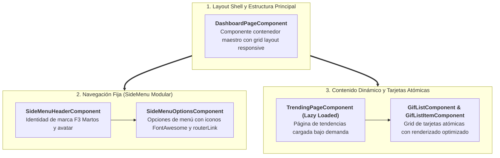

# Sección 06: GifsApp — Pensando en Componentes y Tailwind CSS

En esta sección construimos los cimientos de nuestra aplicación profesional **GifsApp**. Aplicamos los principios de **Componentización Atómica**, configuramos **Tailwind CSS en Angular 19**, implementamos **Rutas Hijas con Carga Perezosa (*Lazy Loading*)**, configuramos **Alias de Rutas (*Path Aliases*)**, integramos **FontAwesome** y preparamos componentes de galería desacoplados alimentados mediante **Signal Inputs**.

---

## 📋 Ficha Técnica y Objetivos Didácticos

* **Proyecto:** `gifs-app` (Nuevo proyecto generado con Angular CLI).
* **Stack Tecnológico:** Angular 19+, Tailwind CSS 3/4, FontAwesome 6, Standalone Components.
* **Patrones Arquitectónicos:** Atomic Design (Layout $\rightarrow$ Componentes Contenedores $\rightarrow$ Componentes de Presentación), Lazy Loading con `loadComponent`.
* **Código Fuente de Referencia:** [GitHub - DevTalles GifsApp (fin-seccion-06)](https://github.com/DevTalles-corp/angular-gif-app/tree/fin-seccion-06)



---

## Inicio del Proyecto y Configuración de Tailwind CSS

!!! info "📖 Para saber más: Manual de Referencia"
    Para conocer la integración de frameworks CSS (Tailwind, Bootstrap) y librerías de componentes UI en Angular 19, consulta el **[Manual de Referencia: 16. Integración de Librerías y UI](manual/16-integracion-librerias.md)**.

### Creación del Proyecto con Angular CLI
Generamos el proyecto configurando enrutamiento y estilos CSS nativos:

```bash
ng new gifs-app --routing --style=css --ssr=false
cd gifs-app
```

### Instalación de Tailwind CSS
Instalamos Tailwind y sus herramientas de procesamiento en desarrollo:

```bash
npm install -D tailwindcss postcss autoprefixer
npx tailwindcss init
```

### Configuración de `tailwind.config.js`:
Indicamos a Tailwind qué archivos debe escanear para compilar únicamente las clases CSS que estemos utilizando (*JIT compiler*):

```javascript title="tailwind.config.js"
/** @type {import('tailwindcss').Config} */
module.exports = {
  content: [
    "./src/**/*.{html,ts}",
  ],
  theme: {
    extend: {},
  },
  plugins: [],
}
```

### Inclusión de Directivas en `src/styles.css`:
Reemplazamos el contenido de `src/styles.css` con las tres capas fundamentales de Tailwind:

```css title="src/styles.css"
@tailwind base;
@tailwind components;
@tailwind utilities;

html, body {
  height: 100%;
  margin: 0;
  background-color: #0f172a; /* Slate 900 */
  color: #f8fafc;
}
```

### Integración de FontAwesome en `src/index.html`:
Para los iconos del menú de navegación, añadimos el CDN de FontAwesome en el `<head>` de `src/index.html`:

```html title="src/index.html" hl_lines="8-12"
<!doctype html>
<html lang="es">
<head>
  <meta charset="utf-8">
  <title>GifsApp</title>
  <base href="/">
  <meta name="viewport" content="width=device-width, initial-scale=1">
  <link rel="icon" type="image/x-icon" href="favicon.ico">
  
  <!-- FontAwesome 6 CDN para Iconografía -->
  <link
    rel="stylesheet"
    href="https://cdnjs.cloudflare.com/ajax/libs/font-awesome/6.5.2/css/all.min.css"
    crossorigin="anonymous"
  />
</head>
<body>
  <app-root></app-root>
</body>
</html>
```

---

## Rutas Hijas y Carga Perezosa (*Lazy Loading*)

!!! info "📖 Para saber más: Manual de Referencia"
    Para estudiar la división de código (*code-splitting*), rutas hijas (`children`) y protección de rutas con Guards, consulta el **[Manual de Referencia: 11. Angular Router y Navegación](manual/11-router.md)**.

Una buena arquitectura divide la aplicación en módulos funcionales independientes. En Angular 19, utilizamos la función **`loadComponent`** en combinación con las importaciones dinámicas de TypeScript (`import(...)`) para que el navegador solo descargue el JavaScript de una página cuando el usuario entra en ella.

### Configuración del Árbol de Rutas: `src/app/app.routes.ts`

```typescript title="src/app/app.routes.ts"
import { Routes } from '@angular/router';

export const routes: Routes = [
  {
    path: 'dashboard',
    // Carga perezosa del Cascarón Principal (Shell)
    loadComponent: () => import('./gifs/pages/dashboard-page/dashboard-page.component'),
    children: [
      {
        path: 'trending',
        loadComponent: () => import('./gifs/pages/trending-page/trending-page.component'),
      },
      {
        path: 'search',
        loadComponent: () => import('./gifs/pages/search-page/search-page.component'),
      },
      {
        path: '**',
        redirectTo: 'trending',
      },
    ],
  },
  {
    path: '**',
    redirectTo: 'dashboard',
  },
];
```

### El Componente Cascarón: `DashboardPageComponent`

Este componente define el diseño general (*layout*): un menú lateral fijo a la izquierda y un contenedor de contenido dinámico a la derecha gobernado por `<router-outlet />`.

=== "src/app/gifs/pages/dashboard-page/dashboard-page.component.ts"
    ```typescript title="src/app/gifs/pages/dashboard-page/dashboard-page.component.ts"
    import { Component } from '@angular/core';
    import { RouterOutlet } from '@angular/router';
    import { SideMenuComponent } from '../../components/side-menu/side-menu.component';

    @Component({
      selector: 'app-dashboard-page',
      imports: [RouterOutlet, SideMenuComponent],
      templateUrl: './dashboard-page.component.html',
    })
    export default class DashboardPageComponent {}
    ```

=== "src/app/gifs/pages/dashboard-page/dashboard-page.component.html"
    ```html title="src/app/gifs/pages/dashboard-page/dashboard-page.component.html"
    <div class="flex h-screen bg-slate-900 text-slate-100 overflow-hidden">
      <!-- Menú Lateral Fijo (Ancho 64) -->
      <gifs-side-menu class="w-64 flex-shrink-0" />

      <!-- Contenedor Principal Dinámico con Scroll Independiente -->
      <main class="flex-1 overflow-y-auto p-4 md:p-6 bg-slate-800">
        <router-outlet />
      </main>
    </div>
    ```

---

## Descomposición Atómica del Menú Lateral

Siguiendo el principio de **Componentización Recursiva**, dividimos el menú lateral en piezas independientes para facilitar su mantenimiento y evitar archivos sobrecargados:

1. `SideMenuHeaderComponent`: Cabecera visual, título de la aplicación y avatar del usuario.
2. `SideMenuOptionsComponent`: Lista dinámica de opciones navegables con iconos y rutas activas.
3. `SideMenuComponent`: Componente contenedor que ensambla ambas piezas.

### Cabecera del Menú: `SideMenuHeaderComponent`

=== "src/app/gifs/components/side-menu/side-menu-header/side-menu-header.component.ts"
    ```typescript title="src/app/gifs/components/side-menu/side-menu-header/side-menu-header.component.ts"
    import { Component } from '@angular/core';
    import { environment } from '@environments/environment';

    @Component({
      selector: 'gifs-side-menu-header',
      templateUrl: './side-menu-header.component.html',
    })
    export class SideMenuHeaderComponent {
      // Tomamos valores de configuración o constantes
      public appTitle = 'GifsApp';
      public appSubTitle = 'Explorador Interactivo';
    }
    ```

=== "src/app/gifs/components/side-menu/side-menu-header/side-menu-header.component.html"
    ```html title="src/app/gifs/components/side-menu/side-menu-header/side-menu-header.component.html"
    <div class="px-6 py-5 border-b border-slate-700 flex items-center space-x-3">
      <div class="w-10 h-10 rounded-full bg-blue-600 flex items-center justify-center text-white shadow-md">
        <i class="fa-solid fa-bolt text-lg"></i>
      </div>
      <div>
        <h1 class="text-lg font-bold text-white tracking-wide">{{ appTitle }}</h1>
        <p class="text-xs text-slate-400">{{ appSubTitle }}</p>
      </div>
    </div>
    ```

---

## 🎯 Tarea Práctica 1: Menú Lateral Dinámico y Tipado con `MenuOption`

!!! info "📖 Para saber más: Manual de Referencia"
    Para dominar la definición de interfaces en TypeScript, el renderizado de listas con `@for` y la navegación activa en Angular, consulta el **[Manual de Referencia: 11. Angular Router y Navegación](manual/11-router.md)** y el **[Manual de Referencia: 04. Plantillas y Control Flow](manual/04-plantillas.md)**.

En la arquitectura del panel de control (*Dashboard*), un menú lateral estático con enlaces duplicados en HTML es difícil de mantener y propenso a inconsistencias. En esta práctica aplicaremos el principio de **Separación de Responsabilidades** para construir un componente navegable autónomo y fuertemente tipado: `SideMenuOptionsComponent`.

---

### 📋 Enunciado del Reto para el Alumno

Antes de consultar la solución guiada, realiza de forma autónoma los siguientes pasos en tu proyecto:

1. **Definición del contrato de datos:** En `src/app/gifs/components/side-menu/side-menu-options/side-menu-options.component.ts`, declara una interfaz llamada `MenuOption` que contenga las siguientes propiedades obligatorias:
   - `icon`: string con la clase del icono de FontAwesome (por ejemplo `'fa-solid fa-chart-line'`).
   - `label`: string con el título principal de la opción (por ejemplo `'Trending'`).
   - `subLabel`: string con una descripción secundaria breve (por ejemplo `'Gifs Populares'`).
   - `route`: string con la ruta absoluta del Dashboard (por ejemplo `'/dashboard/trending'`).
2. **Colección tipada de rutas:** Dentro de la clase `SideMenuOptionsComponent`, inicializa una propiedad `menuOptions` de tipo `MenuOption[]` que contenga las dos opciones de navegación principales:
   - **Trending:** Icono `'fa-solid fa-chart-line'`, título `'Trending'`, subtítulo `'Gifs Populares'`, ruta `'/dashboard/trending'`.
   - **Buscador:** Icono `'fa-solid fa-magnifying-glass'`, título `'Buscador'`, subtítulo `'Buscar Gifs'`, ruta `'/dashboard/search'`.
3. **Plantilla declarativa con Control Flow:** En `side-menu-options.component.html`, reemplaza cualquier enlace estático por una estructura iterativa utilizando la directiva nativa `@for (item of menuOptions; track item.route)`.
4. **Navegación y estilos activos:**
   - Enlaza cada opción mediante property binding: `[routerLink]="item.route"`.
   - Configura la clase CSS que se activará cuando la ruta esté seleccionada usando: `routerLinkActive="bg-blue-600 text-white shadow-lg"`.
   - Asegúrate de importar `RouterLink` y `RouterLinkActive` en el arreglo `imports` del componente standalone.
5. **Criterios de éxito y verificación:**
   - Abre `http://localhost:4200/dashboard/trending` en tu navegador.
   - La opción "Trending" debe aparecer resaltada con fondo azul (`bg-blue-600`) y sombra.
   - Haz clic en "Buscador": la URL debe cambiar fluidamente a `/dashboard/search` sin recargar la página, y el resalte azul debe trasladarse de inmediato a la opción "Buscador".

---

### ⏸️ Reto Práctico: ¡Inténtalo tú mismo!

!!! exercise "Pausa de Trabajo Autónomo"
    Implementa la interfaz, la colección de opciones y la plantilla iterativa en tu editor antes de verificar la solución técnica.
    
    *Criterio de éxito:* Menú renderizado dinámicamente mediante `@for` y navegación SPA reactiva con clases activas sincronizadas.

---

### 🛠️ Solución Paso a Paso y Explicación Técnica

#### Paso 1: Crear el Controlador TypeScript con Tipado Estricto

En `src/app/gifs/components/side-menu/side-menu-options/side-menu-options.component.ts`:

```typescript title="src/app/gifs/components/side-menu/side-menu-options/side-menu-options.component.ts" hl_lines="4-9 13 17-31"
import { Component } from '@angular/core';
import { RouterLink, RouterLinkActive } from '@angular/router';

interface MenuOption {
  icon: string;
  label: string;
  subLabel: string;
  route: string;
}

@Component({
  selector: 'gifs-side-menu-options',
  imports: [RouterLink, RouterLinkActive],
  templateUrl: './side-menu-options.component.html',
})
export class SideMenuOptionsComponent {
  menuOptions: MenuOption[] = [
    {
      icon: 'fa-solid fa-chart-line',
      label: 'Trending',
      subLabel: 'Gifs Populares',
      route: '/dashboard/trending',
    },
    {
      icon: 'fa-solid fa-magnifying-glass',
      label: 'Buscador',
      subLabel: 'Buscar Gifs',
      route: '/dashboard/search',
    },
  ];
}
```

#### Paso 2: Crear la Plantilla HTML Declarativa con Tailwind CSS

En `src/app/gifs/components/side-menu/side-menu-options/side-menu-options.component.html`:

```html title="src/app/gifs/components/side-menu/side-menu-options/side-menu-options.component.html" hl_lines="2 4-5 9 12-13"
<div id="nav" class="w-full px-4 py-4 space-y-1">
  @for (item of menuOptions; track item.route) {
    <a
      [routerLink]="item.route"
      routerLinkActive="bg-blue-600 text-white shadow-lg"
      class="w-full px-3 py-3 inline-flex space-x-3 items-center text-slate-300 hover:bg-slate-800 hover:text-white transition duration-150 rounded-lg cursor-pointer"
    >
      <div class="w-6 text-center text-lg">
        <i [class]="item.icon"></i>
      </div>
      <div class="flex flex-col">
        <span class="text-sm font-semibold">{{ item.label }}</span>
        <span class="text-xs text-slate-400">{{ item.subLabel }}</span>
      </div>
    </a>
  }
</div>
```

---

### 🔍 Análisis de la Solución y Conceptos Clave

1. **Beneficios de la Colección Declarativa (`MenuOption[]`):**
   * Desacopla los datos de la presentación visual. Si en el futuro se añade una tercera pantalla (por ejemplo, "Favoritos" o "Historial"), solo se requiere agregar un nuevo objeto al arreglo `menuOptions`, sin tocar la estructura HTML de la plantilla.
2. **Optimización con `track item.route`:**
   * En Angular moderno, el parámetro `track` de la directiva `@for` es mandatorio. Al usar una clave única como `item.route`, el algoritmo de renderizado de Angular puede identificar de forma determinista qué nodo del DOM corresponde a cada opción, evitando recreaciones innecesarias del árbol de elementos.
3. **Gestión de Clases Activas (`routerLinkActive`):**
   * Angular supervisa las transiciones del router y aplica automáticamente las clases CSS especificadas en `routerLinkActive` únicamente al elemento cuya ruta coincide con la URL activa en el navegador.

---

### ⚠️ Errores Típicos del Alumno en esta Tarea

| Error Común | Síntoma en el Navegador | Causa y Solución |
| :--- | :--- | :--- |
| Olvidar importar `RouterLink` y `RouterLinkActive` | Error de compilación: *Can't bind to 'routerLink' since it isn't a known property of 'a'*. | **Causa:** En componentes standalone, las directivas del enrutador deben incluirse explícitamente en el arreglo `imports`. |
| Usar rutas relativas `'trending'` en lugar de `'/dashboard/trending'` | La navegación falla o se anida incorrectamente en la URL al hacer clics repetidos. | **Causa:** Las rutas relativas dependen del segmento actual. <br/>**Solución:** Usar rutas absolutas que inicien con barra: `'/dashboard/trending'`. |
| Omitir el parámetro `track` en `@for` | Error de compilación en la plantilla: *@for statement must have a 'track' expression*. | **Causa:** En el nuevo Control Flow de Angular, `track` es obligatorio por diseño. |
| Clases de FontAwesome no visibles | Aparecen cuadrados vacíos o texto sin icono. | **Causa:** No haberse importado la hoja de estilos de FontAwesome en `src/index.html`. |

---

### 🧑‍🏫 Guía Didáctica para el Docente en el Aula

!!! tip "Estrategia para Guiar esta Práctica en Clase"
    1. **Demostración de escalabilidad:** Pida a los estudiantes que añadan una tercera opción ficticia (`{ icon: 'fa-solid fa-heart', label: 'Favoritos', subLabel: 'Mis Gifs', route: '/dashboard/favorites' }`) solo modificando el arreglo TypeScript. Al ver cómo la plantilla se actualiza automáticamente respetando estilos y layout, entenderán el principio de código DRY (Don't Repeat Yourself).
    2. **Inspección de routerLinkActive:** Guíe a los alumnos para que abran las herramientas de desarrollo (F12) e inspeccionen los atributos `class` de las etiquetas `<a>` mientras navegan entre "Trending" y "Buscador" para constatar en vivo cómo Angular gestiona las clases CSS dinámicas.

---

### Componente Ensamblador: `SideMenuComponent`

=== "src/app/gifs/components/side-menu/side-menu.component.ts"
    ```typescript title="src/app/gifs/components/side-menu/side-menu.component.ts"
    import { Component } from '@angular/core';
    import { SideMenuHeaderComponent } from './side-menu-header/side-menu-header.component';
    import { SideMenuOptionsComponent } from './side-menu-options/side-menu-options.component';

    @Component({
      selector: 'gifs-side-menu',
      imports: [SideMenuHeaderComponent, SideMenuOptionsComponent],
      template: `
        <div class="bg-slate-900 border-r border-slate-800 h-full flex flex-col">
          <gifs-side-menu-header />
          <gifs-side-menu-options class="flex-1" />
        </div>
      `,
    })
    export class SideMenuComponent {}
    ```

---

## Alias de Rutas (*Path Aliases*) y Variables de Entorno

A medida que una aplicación crece, escribir rutas relativas como `../../../../environments/environment` resulta propenso a errores y poco profesional. En Angular configuramos **Path Aliases** en TypeScript.

### Configuración de `tsconfig.json`:
Abrimos el archivo `tsconfig.json` en la raíz del proyecto y agregamos las propiedades `baseUrl` y `paths`:

```json title="tsconfig.json" hl_lines="4-10"
{
  "compilerOptions": {
    "baseUrl": "./",
    "paths": {
      "@environments/*": ["src/environments/*"],
      "@gifs/*": ["src/app/gifs/*"],
      "@shared/*": ["src/app/shared/*"]
    }
  }
}
```

Ahora podemos importar desde cualquier lugar con:
```typescript
import { environment } from '@environments/environment';
import { GifListComponent } from '@gifs/components/gif-list/gif-list.component';
```

### Generación de Variables de Entorno:
Creamos los entornos de trabajo con el CLI:

```bash
ng g environments
```

Esto genera `src/environments/environment.ts`:

```typescript title="src/environments/environment.ts"
export const environment = {
  production: false,
  giphyApiKey: 'TU_API_KEY_DE_GIPHY',
  giphyUrl: 'https://api.giphy.com/v1',
};
```

---

## Componentes de Galería Reutilizables

!!! info "📖 Para saber más: Manual de Referencia"
    Para profundizar en la creación de componentes independientes y reutilizables con señales de entrada, consulta el **[Manual de Referencia: 03. Componentes Standalone](manual/03-componentes.md)** y **[Manual de Referencia: 07. Comunicación entre Componentes](manual/07-anidar-componentes.md)**.

Separamos la visualización de las imágenes en dos componentes desacoplados inspirados en los diseños de Flowbite:

* `GifListItemComponent`: Componente atómico responsable de una única imagen.
* `GifListComponent`: Componente contenedor de cuadrícula (*grid*) responsive.

---

## 🎯 Tarea Práctica 2: Parametrización Dinámica de la Galería con Signal Inputs

!!! info "📖 Para saber más: Manual de Referencia"
    Para dominar la API moderna de entradas reactivas `input()`, `input.required()` y la comunicación de componentes en Angular, consulta el **[Manual de Referencia: 07. Comunicación entre Componentes](manual/07-anidar-componentes.md)** y el **[Manual de Referencia: 05. Signals y Reactividad](manual/05-signals.md)**.

En el diseño inicial de la aplicación, los componentes de cuadrícula visualizaban imágenes estáticas predefinidas en el código HTML. Para que nuestra galería sea un sistema de presentación verdaderamente profesional y reutilizable, debemos convertir tanto el elemento individual (`GifListItemComponent`) como la cuadrícula contenedora (`GifListComponent`) en **Componentes Tontos o Presentacionales (*Dumb Components*)** altamente desacoplados, alimentados mediante **Signal Inputs obligatorios (`input.required()`)**.

---

### 📋 Enunciado del Reto para el Alumno

Antes de consultar la solución guiada, realiza de forma autónoma los siguientes pasos en tu proyecto:

1. **Parametrización del Item Individual (`GifListItemComponent`):**
   - En `src/app/gifs/components/gif-list/gif-list-item/gif-list-item.component.ts`, sustituye cualquier URL fija por una propiedad de entrada reactiva obligatoria llamada `imageUrl` utilizando la función `input.required<string>()`.
   - En `gif-list-item.component.html`, enlaza la propiedad `src` de la etiqueta `` al valor emitido por la señal: `[src]="imageUrl()"`.
2. **Parametrización de la Cuadrícula (`GifListComponent`):**
   - En `src/app/gifs/components/gif-list/gif-list.component.ts`, declara una propiedad de entrada reactiva obligatoria llamada `gifs` que reciba un arreglo de strings: `gifs = input.required<string[]>()`.
   - En `gif-list.component.html`, elimina los elementos duplicados e implementa la iteración con `@for (gif of gifs(); track gif)`, instanciando el componente hijo para cada elemento: `<gif-list-item [imageUrl]="gif" />`.
   - Añade el bloque `@empty` para mostrar un mensaje amigable con icono cuando no haya imágenes disponibles.
3. **Consumo en la Página Contenedora (`TrendingPageComponent`):**
   - En `src/app/gifs/pages/trending-page/trending-page.component.ts`, declara un arreglo constante con URLs de prueba (`imageUrls`) y define una señal reactiva que custodie este estado: `gifs = signal(imageUrls)`.
   - En `trending-page.component.html`, consume el componente de cuadrícula vinculando el arreglo reactivo: `<gif-list [gifs]="gifs()" />`.
4. **Criterios de éxito y verificación:**
   - La aplicación debe compilar de forma limpia sin errores de TypeScript ni advertencias en consola.
   - Al acceder a `http://localhost:4200/dashboard/trending`, deben renderizarse las 12 imágenes del arreglo de prueba distribuidas en la cuadrícula responsive (1 columna en móvil, 2 en pantallas pequeñas, 3 en pantallas medianas y 4 en pantallas grandes gracias a Tailwind CSS).
   - Si se inicializa la señal con un arreglo vacío (`signal([])`), el bloque `@empty` debe mostrarse correctamente en pantalla.

---

### ⏸️ Reto Práctico: ¡Inténtalo tú mismo!

!!! exercise "Pausa de Trabajo Autónomo"
    Refactoriza los dos componentes de la galería y conéctalos en `TrendingPageComponent` de forma autónoma en tu editor antes de revisar la solución detallada.
    
    *Criterio de éxito:* Galería completamente desacoplada y gobernada por Signal Inputs, con soporte para lista vacía y diseño adaptable.

---

### 🛠️ Solución Paso a Paso y Explicación Técnica

#### Paso 1: Refactorizar `GifListItemComponent`

Convertimos el elemento atómico en un componente puramente presentacional que exige su URL mediante `input.required<string>()`:

=== "src/app/gifs/components/gif-list/gif-list-item/gif-list-item.component.ts"
    ```typescript title="src/app/gifs/components/gif-list/gif-list-item/gif-list-item.component.ts" hl_lines="1 8"
    import { Component, input } from '@angular/core';

    @Component({
      selector: 'gif-list-item',
      templateUrl: './gif-list-item.component.html',
    })
    export class GifListItemComponent {
      imageUrl = input.required<string>();
    }
    ```

=== "src/app/gifs/components/gif-list/gif-list-item/gif-list-item.component.html"
    ```html title="src/app/gifs/components/gif-list/gif-list-item/gif-list-item.component.html" hl_lines="4"
    <div class="relative overflow-hidden rounded-lg shadow-md hover:shadow-xl transition-shadow duration-300 bg-slate-800">
      
    </div>
    ```

#### Paso 2: Refactorizar `GifListComponent`

Definimos la entrada obligatoria `gifs = input.required<string[]>()` y renderizamos dinámicamente cada tarjeta:

=== "src/app/gifs/components/gif-list/gif-list.component.ts"
    ```typescript title="src/app/gifs/components/gif-list/gif-list.component.ts" hl_lines="1 9"
    import { Component, input } from '@angular/core';
    import { GifListItemComponent } from './gif-list-item/gif-list-item.component';

    @Component({
      selector: 'gif-list',
      imports: [GifListItemComponent],
      templateUrl: './gif-list.component.html',
    })
    export class GifListComponent {
      gifs = input.required<string[]>();
    }
    ```

=== "src/app/gifs/components/gif-list/gif-list.component.html"
    ```html title="src/app/gifs/components/gif-list/gif-list.component.html" hl_lines="2-4 5-8"
    <div class="grid grid-cols-1 sm:grid-cols-2 md:grid-cols-3 lg:grid-cols-4 gap-4">
      @for (gif of gifs(); track gif) {
        <gif-list-item [imageUrl]="gif" />
      } @empty {
        <div class="col-span-full py-12 text-center text-slate-400">
          <i class="fa-regular fa-image text-4xl mb-3"></i>
          <p>No hay imágenes disponibles para mostrar.</p>
        </div>
      }
    </div>
    ```

#### Paso 3: Conectar los Componentes en `TrendingPageComponent`

En la página contenedora, declaramos la colección de datos de prueba y alimentamos el componente de cuadrícula:

=== "src/app/gifs/pages/trending-page/trending-page.component.ts"
    ```typescript title="src/app/gifs/pages/trending-page/trending-page.component.ts" hl_lines="4-17 25"
    import { Component, signal } from '@angular/core';
    import { GifListComponent } from '../../components/gif-list/gif-list.component';

    const defaultImageUrls: string[] = [
      'https://flowbite.s3.amazonaws.com/docs/gallery/square/image.jpg',
      'https://flowbite.s3.amazonaws.com/docs/gallery/square/image-1.jpg',
      'https://flowbite.s3.amazonaws.com/docs/gallery/square/image-2.jpg',
      'https://flowbite.s3.amazonaws.com/docs/gallery/square/image-3.jpg',
      'https://flowbite.s3.amazonaws.com/docs/gallery/square/image-4.jpg',
      'https://flowbite.s3.amazonaws.com/docs/gallery/square/image-5.jpg',
      'https://flowbite.s3.amazonaws.com/docs/gallery/square/image-6.jpg',
      'https://flowbite.s3.amazonaws.com/docs/gallery/square/image-7.jpg',
      'https://flowbite.s3.amazonaws.com/docs/gallery/square/image-8.jpg',
      'https://flowbite.s3.amazonaws.com/docs/gallery/square/image-9.jpg',
      'https://flowbite.s3.amazonaws.com/docs/gallery/square/image-10.jpg',
      'https://flowbite.s3.amazonaws.com/docs/gallery/square/image-11.jpg',
    ];

    @Component({
      selector: 'app-trending-page',
      imports: [GifListComponent],
      templateUrl: './trending-page.component.html',
    })
    export default class TrendingPageComponent {
      gifs = signal<string[]>(defaultImageUrls);
    }
    ```

=== "src/app/gifs/pages/trending-page/trending-page.component.html"
    ```html title="src/app/gifs/pages/trending-page/trending-page.component.html" hl_lines="5"
    <section class="py-4">
      <h2 class="text-2xl font-bold text-white mb-4">Gifs Populares (Tendencias)</h2>
      
      <!-- Consumo del componente reutilizable pasando la señal desempaquetada -->
      <gif-list [gifs]="gifs()" />
    </section>
    ```

---

### 🔍 Análisis de la Solución y Conceptos Clave

1. **La Revolución de `input.required<T>()` en Angular 19+:**
   * Sustituye al decorador clásico `@Input({ required: true })`. Al ser una función reactiva que devuelve una `InputSignal<T>`, el compilador de Angular realiza una verificación estricta en tiempo de construcción: si el componente padre olvida suministrar el atributo `[gifs]` o `[imageUrl]`, la aplicación no compila, eliminando errores en tiempo de ejecución.
2. **Lectura de Señales en Plantillas (`imageUrl()` y `gifs()`):**
   * Debido a que las entradas basadas en Signal son funciones de lectura de solo lectura (*read-only Signals*), en el archivo HTML es imprescindible invocar la señal con paréntesis: `[src]="imageUrl()"`.
3. **Arquitectura Dumb / Presentacional Pura:**
   * Ni `GifListComponent` ni `GifListItemComponent` conocen la procedencia de los datos (si vienen de una API externa, de LocalStorage o de un arreglo fijo). Esta ausencia total de dependencias permite reutilizar exactamente los mismos componentes en la página de tendencias, en la página de búsquedas o en cualquier otra sección del proyecto sin modificar su código.

---

### ⚠️ Errores Típicos del Alumno en esta Tarea

| Error Común | Síntoma en el Navegador | Causa y Solución |
| :--- | :--- | :--- |
| Omitir paréntesis en la plantilla: `[src]="imageUrl"` | En la pantalla la imagen no carga o aparece `[object Object]` en el atributo `src`. | **Causa:** `imageUrl` es una señal (función); debe ejecutarse como `imageUrl()` para obtener el valor primitivo string. |
| Olvidar pasar el input requerido en el padre: `<gif-list />` | Error de compilación estricto: *Required input 'gifs' has not been provided*. | **Causa:** `input.required()` exige obligatoriamente suministrar el binding: `<gif-list [gifs]="gifs()" />`. |
| Olvidar importar `GifListItemComponent` en `GifListComponent` | Error de compilación: *'gif-list-item' is not a known element*. | **Causa:** En componentes standalone, los componentes hijos deben registrarse en el array `imports`. |
| Pasar la señal completa sin invocar en el binding del padre: `[gifs]="gifs"` | Advertencia o error de tipos: *Signal<string[]> is not assignable to string[]*. | **Causa:** El input espera un arreglo `string[]`. Debe pasarse `[gifs]="gifs()"`. |

---

### 🧑‍🏫 Guía Didáctica para el Docente en el Aula

!!! tip "Estrategia para Guiar esta Práctica en Clase"
    1. **La prueba del error de compilación:** Pida a los alumnos que eliminen intencionadamente `[gifs]="gifs()"` en `trending-page.component.html`. Muéstreles cómo la consola de Angular señala con precisión quirúrgica que el input obligatorio no fue provisto. Esto consolida el enorme valor de seguridad de tipos que introduce `input.required()`.
    2. **Demostración del bloque `@empty`:** Indique a los estudiantes que cambien temporalmente la señal en `TrendingPageComponent` a `gifs = signal([])`. Al guardar y ver aparecer de inmediato el mensaje con icono de *"No hay imágenes disponibles para mostrar"*, quedará demostrada la elegancia del nuevo Control Flow sin necesidad de anidar directivas condicionales.

---

## 🧪 Evaluación y Preguntas para el Aula

!!! question "Pregunta 1: ¿Por qué utilizamos `loadComponent` en lugar de importar el componente directamente en `app.routes.ts`?"
    ??? success "Respuesta"
        Porque habilita la **Carga Perezosa (Lazy Loading)**. El navegador solo descarga el código JavaScript del componente en el momento exacto en que el usuario navega a esa ruta, acelerando drásticamente la carga inicial de la aplicación.

!!! question "Pregunta 2: ¿Qué ventaja ofrece separar `GifListComponent` de `GifListItemComponent`?"
    ??? success "Respuesta"
        Cumple el principio de responsabilidad única. `GifListComponent` controla la cuadrícula y la iteración, mientras que `GifListItemComponent` controla la presentación, carga y posibles efectos visuales de la tarjeta individual.

!!! question "Pregunta 3: ¿Qué problema resuelven los Path Aliases en `tsconfig.json`?"
    ??? success "Respuesta"
        Evitan el uso de rutas relativas frágiles y complejas (`../../../../`), permitiendo importar módulos mediante nombres limpios y absolutos (`@gifs/components/...`), lo que hace que refactorizar o mover archivos de carpeta no rompa las importaciones.

---

## 📖 Material de Referencia y Profundización

Para consultar las especificaciones técnicas completas de los conceptos vistos en esta sección:

* **[Manual de Referencia: 03. Componentes Standalone](manual/03-componentes.md):** Arquitectura y buenas prácticas en la descomposición de componentes.
* **[Manual de Referencia: 07. Comunicación entre Componentes](manual/07-anidar-componentes.md):** Señales de entrada obligatorias (`input.required<T>()`) y tipado seguro.
* **[Manual de Referencia: 11. Angular Router y Navegación](manual/11-router.md):** Rutas anidadas (`children`), cascarones de layout y división de código (*code-splitting*).
* **[Manual de Referencia: 16. Integración de Librerías y UI](manual/16-integracion-librerias.md):** Guía exhaustiva de integración y personalización de Tailwind CSS en Angular 19.