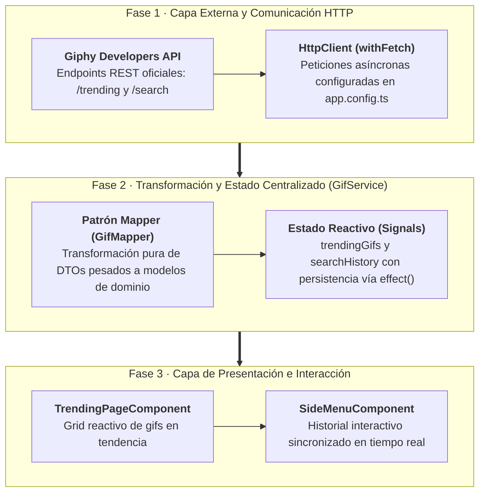
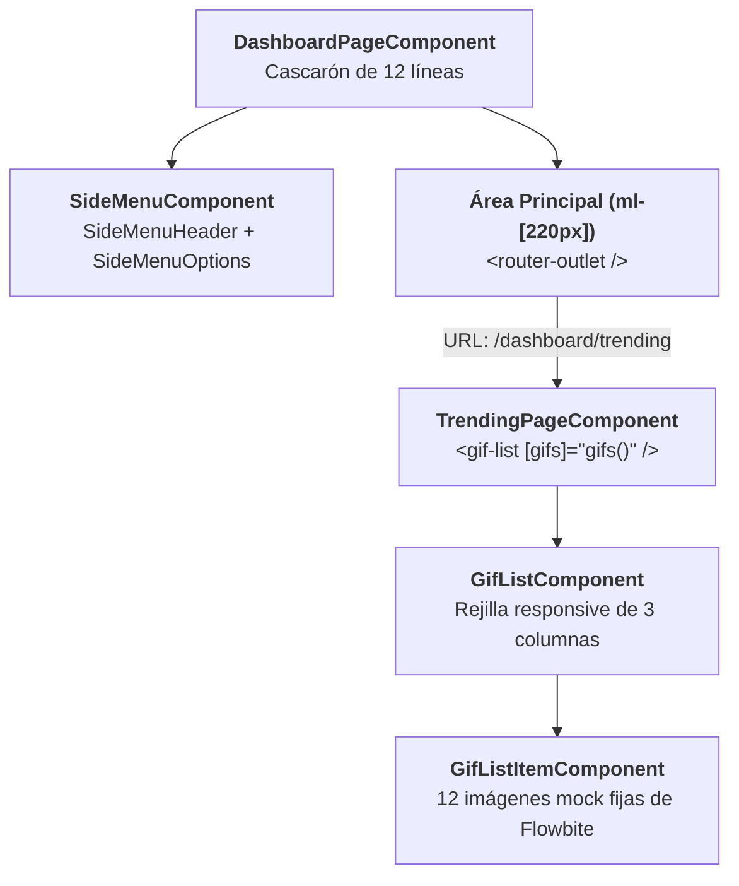
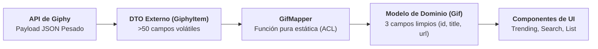
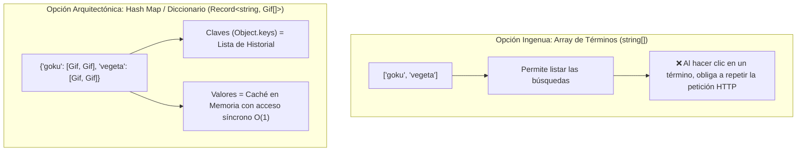
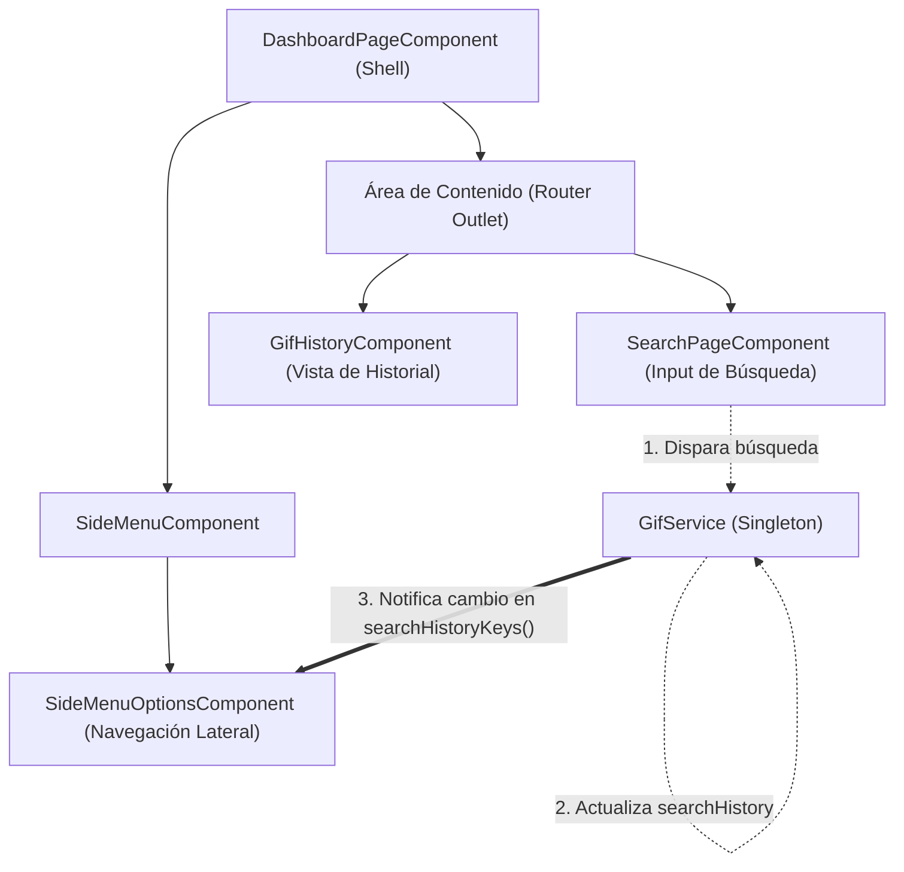

# Sección 07: GifsApp — Servicios, HTTP, Mappers y Persistencia

En esta sección conectamos nuestra aplicación con una API del mundo real: **Giphy API**. Aprenderemos a configurar el nuevo **`provideHttpClient()`**, modelar respuestas JSON complejas mediante **QuickType**, implementar el **Patrón Mapper** para blindar nuestra aplicación frente a cambios en APIs externas, construir un **Buscador con Caché en Memoria**, enlazar **Parámetros Dinámicos de URL** con **`toSignal()`**, y persistir el historial en **`LocalStorage`** usando **`effect()`**.

---

## 📋 Ficha Técnica y Objetivos Didácticos

* **Proyecto:** `gifs-app` (Continuación e integración de servicios).
* **API Externa:** Giphy Developers API (Endpoints: `/trending` y `/search`).
* **Patrones Arquitectónicos:** Patrón Mapper, Separación de Interfaces de Dominio vs API, Caché de Búsqueda en Servicio Singleton, Interoperabilidad RxJS ↔ Signals con `toSignal()`.
* **Código Fuente de Referencia:** [GitHub - DevTalles GifsApp (fin-seccion-07)](https://github.com/DevTalles-corp/angular-gif-app/tree/fin-seccion-07)



---

## Continuación del Proyecto y Preparación del Entorno

Al iniciar esta sección, retomamos la aplicación **GifsApp** desarrollada en la unidad anterior.  
Para asegurar que todo el alumnado parte de una base idéntica y libre de inconsistencias:

* **Continuación sobre el proyecto local:** Si vienes de completar la sección anterior, puedes continuar directamente en tu directorio de trabajo.
* **Continuación desde el repositorio de referencia:** Si deseas iniciar con una copia limpia y verificada por el instructor, puedes clonar o descargar la rama oficial:
  [GitHub - DevTalles GifsApp (fin-seccion-06)](https://github.com/DevTalles-corp/angular-gif-app/tree/fin-seccion-06).

### 1. Verificación de Dependencias y Servidor de Desarrollo

Si has clonado o descargado el proyecto, el directorio `node_modules` no estará incluido. Ejecuta la instalación limpia de dependencias:

```bash
npm install
```

Esto instalará todos los paquetes del core de Angular, el compilador PostCSS, Tailwind CSS v4 y las fuentes de FontAwesome 6. A continuación, inicia el servidor de desarrollo:

```bash
ng serve
```

Abre `http://localhost:4200/dashboard` en tu navegador y comprueba que la aplicación compila y responde con normalidad.

---

### 2. Inventario del Estado Arquitectónico Inicial

Antes de escribir nuevo código, repasemos las piezas clave construidas hasta el momento:



* **El Cascarón (*Layout Shell*):** `DashboardPageComponent` actúa como contenedor principal, orquestando el menú lateral modular y el área de contenido con margen compensatorio (`ml-[220px]`).
* **Enrutamiento Anidado:** El archivo `app.routes.ts` define las rutas hijas `/dashboard/trending` y `/dashboard/search`.
* **Galería Estática con Signal Inputs:** `TrendingPageComponent` custodia una señal `gifs = signal(imageUrls)` con 12 URLs cuadradas de prueba de Flowbite, inyectadas a través de `GifListComponent` y `GifListItemComponent` mediante `input.required()`.
* **Path Aliases y Entornos:** `@environments/*`, `@gifs/*` y `@shared/*` configurados en `tsconfig.json`.

### El Reto de esta Unidad: De Datos Mock a Datos Reales
En las aplicaciones del mundo real, los datos no residen en arrays estáticos dentro de los componentes. El objetivo de esta sección es **sustituir el mock de Flowbite por peticiones asíncronas en vivo a la API oficial de Giphy**, centralizando la red y el estado en un **Servicio Singleton (`GifService`)** para que los componentes de la interfaz continúen siendo 100% tontos y reutilizables (*Dumb Components*).

---

## Integración con Giphy Developers API y Exploración REST

Para consumir imágenes animadas en vivo, nos conectaremos con **Giphy**, la mayor plataforma de GIFs del mundo, a través de su API pública para desarrolladores.

### 1. Obtención de la API Key en el Portal de Desarrolladores

1. Accede al portal oficial: [developers.giphy.com](https://developers.giphy.com/).
2. Inicia sesión con tu cuenta de Giphy o crea una cuenta nueva gratuita.
3. En el panel de control (*Dashboard*), pulsa en el botón **Create an App**.
4. **Selección Crucial: API frente a SDK:**  
   Giphy ofrece dos modalidades de integración:
    * **SDK:** Librerías prefabricadas de Giphy (con componentes UI cerrados y dependencias pesadas).
    * **API (Opción que debemos seleccionar):** Acceso directo a los endpoints REST estándar mediante HTTP. En Angular seleccionamos **API** porque utilizaremos el cliente HTTP nativo del framework (`HttpClient`), manteniendo un control absoluto sobre el ciclo de vida, el tipado y el empaquetado final de nuestra aplicación.
5. Asigna un nombre a tu aplicación (por ejemplo `Angular-GifsApp`), añade una descripción breve, acepta los términos del servicio y pulsa en **Create App**.
6. Copia tu **API Key** personal generada en pantalla.

---

### 2. Configuración Segura de Variables de Entorno

Una API Key es una credencial que identifica y autoriza a tu aplicación frente a los límites de consumo del proveedor. Siguiendo las mejores prácticas de arquitectura, nunca debemos cablear (*hardcode*) credenciales directamente en los componentes ni en las llamadas HTTP.

Actualizamos nuestros archivos de entorno en `src/environments/`:

=== "src/environments/environment.development.ts (Desarrollo)"
    ```typescript title="src/environments/environment.development.ts" hl_lines="8-10"
    export const environment = {
      production: false,
      companyName: 'Gifs',
      companyName2: 'App',
      companySlogan: 'Maneja tus gifs',

      // Giphy API Configuration
      // https://developers.giphy.com/dashboard/
      giphyApiKey: 'TU_API_KEY_DE_GIPHY',
      giphyUrl: 'https://api.giphy.com/v1',
    };
    ```

=== "src/environments/environment.ts (Producción)"
    ```typescript title="src/environments/environment.ts" hl_lines="8-10"
    export const environment = {
      production: true,
      companyName: 'Gifs',
      companyName2: 'App',
      companySlogan: 'Maneja tus gifs',

      // Giphy API Configuration
      // https://developers.giphy.com/dashboard/
      giphyApiKey: 'TU_API_KEY_DE_GIPHY',
      giphyUrl: 'https://api.giphy.com/v1',
    };
    ```

---

### 3. Exploración de Endpoints y Anatomía del Payload JSON

Antes de escribir código en Angular, es una práctica profesional indispensable **inspeccionar la respuesta real de la API** abriendo la URL en el navegador o utilizando un cliente HTTP (Thunder Client, Postman o curl).

#### Endpoint de Tendencias (Trending)
Retorna los GIFs más populares del momento:
```http
GET https://api.giphy.com/v1/gifs/trending?api_key=TU_API_KEY&limit=20
```

#### Endpoint de Búsqueda (Search)
Permite realizar búsquedas por término o palabra clave:
```http
GET https://api.giphy.com/v1/gifs/search?api_key=TU_API_KEY&q=goku&limit=20
```

#### Anatomía de la Respuesta JSON Cruda
Al ejecutar la petición en el navegador, observamos la siguiente estructura raíz:

```json
{
  "data": [
    {
      "type": "gif",
      "id": "xT4uQulxzUGnHGL63m",
      "url": "https://giphy.com/gifs/...",
      "title": "Happy Dance GIF",
      "rating": "g",
      "images": {
        "original": {
          "url": "https://media.giphy.com/media/.../giphy.gif",
          "width": "480",
          "height": "270"
        },
        "fixed_height": { ... },
        "fixed_width": { ... }
      }
      // ... más de 40 propiedades adicionales por cada elemento
    }
  ],
  "pagination": {
    "total_count": 52340,
    "count": 20,
    "offset": 0
  },
  "meta": {
    "status": 200,
    "msg": "OK",
    "response_id": "3x8f9a2b..."
  }
}
```

!!! warning "El Reto del Payload Pesado: ¿Por qué no usar el JSON directo?"
    Cada elemento individual del array `data` contiene **más de 50 propiedades** (dimensiones en webp, mp4, gifs fijos, datos de analytics, autor, flags).
    
    Si consumiéramos este objeto tal cual en nuestros componentes:
    1. Acoplaríamos nuestra interfaz a los nombres de campos de Giphy.
    2. Sobrecargaríamos la memoria del navegador reteniendo datos que nunca mostraremos.
    3. Si Giphy cambia su estructura, se romperían todas nuestras plantillas.
    
    Por ello, en las siguientes lecciones modelaremos esta respuesta con **QuickType** y construiremos un **Mapper** que la filtre a un modelo limpio de solo 3 propiedades (`id`, `title`, `url`).

---

## Creación y Rol Arquitectónico del Servicio Singleton (`GifService`)

En el patrón de arquitectura de Angular, **los componentes nunca deben realizar llamadas HTTP directamente**.  
La regla de **Separación de Responsabilidades (SoC)** dicta que:
* La **UI (Componentes)** es "tonta": solo recibe datos ya procesados y emite eventos de usuario.
* La **Capa de Servicios**: es "ciega" respecto a cómo se pintan los datos, pero es la encargada de consultar la API externa, mapear los resultados y custodiar el estado reactivo centralizado (*Single Source of Truth*).

### 1. Generación del Servicio con Angular CLI

Generamos el servicio dentro de la carpeta `services` del dominio `gifs`:

```bash
ng g s gifs/services/gifs
```

Este comando genera:
* `src/app/gifs/services/gifs.service.ts`: La clase del servicio inyectable.
* `src/app/gifs/services/gifs.service.spec.ts`: Archivo de pruebas unitarias.

---

### 2. Esqueleto Inicial del Servicio

El servicio se crea decorado con `@Injectable({ providedIn: 'root' })`, lo que indica a Angular que existirá **una única instancia compartida (*Singleton*)** en toda la aplicación:

```typescript title="src/app/gifs/services/gifs.service.ts (Esqueleto Inicial)"
import { Injectable, signal } from '@angular/core';

@Injectable({ providedIn: 'root' })
export class GifService {
  // Estado reactivo: lista de gifs y bandera de carga
  trendingGifs = signal<any[]>([]);
  trendingGifsLoading = signal(true);

  constructor() {
    console.log('GifService inicializado');
  }
}
```

En las siguientes fases conectaremos `HttpClient` y tiparemos `trendingGifs` con nuestro modelo de dominio `Gif[]`.

---

## Configuración Global del Cliente HTTP: `provideHttpClient()`

!!! info "📖 Para saber más: Manual de Referencia"
    Para dominar `provideHttpClient()`, configuración de interceptores funcionales y manejo de errores HTTP, consulta el **[Manual de Referencia: 10. Cliente HTTP y Comunicación con APIs](manual/10-http.md)**.

Para que `GifService` pueda realizar peticiones asíncronas en red mediante `HttpClient`, debemos registrar el proveedor del cliente HTTP en la raíz de la aplicación.

En Angular moderno no importamos módulos (`HttpClientModule` está formalmente en desuso). Registramos la función **`provideHttpClient()`** en los proveedores de `src/app/app.config.ts`:

```typescript title="src/app/app.config.ts" hl_lines="3 9"
import { ApplicationConfig, provideZoneChangeDetection } from '@angular/core';
import { provideRouter } from '@angular/router';
import { provideHttpClient } from '@angular/common/http';
import { routes } from './app.routes';

export const appConfig: ApplicationConfig = {
  providers: [
    provideZoneChangeDetection({ eventCoalescing: true }),
    provideHttpClient(), // Cliente HTTP disponible globalmente para inyección
    provideRouter(routes),
  ],
};
```

---

## Modelos, DTOs y el Patrón Mapper (Capa Anticorrupción)

!!! info "📖 Para saber más: Manual de Referencia"
    Para estudiar los principios de diseño de servicios y la separación de contratos de datos, consulta el **[Manual de Referencia: 09. Servicios e Inyección de Dependencias](manual/09-servicios.md)**.

Al consumir APIs de terceros, uno de los errores más comunes en frontend es utilizar los objetos devueltos por el backend directamente en las plantillas y componentes.

La respuesta de Giphy para cada gif contiene **más de 50 propiedades** (múltiples dimensiones en formatos mp4, webp, información analítica, flags de moderación, datos de usuario, etc.). Si inyectamos este objeto tal cual en nuestra aplicación:

1. **Acoplamiento Fuerte:** Si Giphy altera mañana el nombre de una propiedad o reorganiza sus nodos, tendríamos que buscar y modificar decenas de componentes `.html` y `.ts`.
2. **Consumo Innecesario de Memoria:** Retenemos cientos de campos pesados que la UI jamás llegará a pintar.
3. **Pérdida de Legibilidad:** Trabajar con rutas kilométricas como `item.images.original.url` ensucia las plantillas y propicia errores tipográficos.

Para resolver esto, implementamos una **Capa Anticorrupción (*Anti-Corruption Layer - ACL*)** mediante la separación estricta entre **DTOs** y **Modelos de Dominio**, articulada por el **Patrón Mapper**:



---

### 1. Tipado Automático de la Respuesta de la API con QuickType

Para tipar el contrato externo que recibimos del servidor, no escribimos las interfaces manualmente campo por campo. Utilizamos la herramienta [quicktype.io](https://quicktype.io/) o la extensión de VS Code **Paste JSON as Code** (`quicktype.quicktype`):

1. Realiza una petición de prueba a Giphy en el navegador (`/gifs/trending?api_key=...&limit=20`) y copia el JSON completo devuelto.
2. En Visual Studio Code, crea el archivo `src/app/gifs/interfaces/giphy.interfaces.ts`.
3. Abre la paleta de comandos con ++ctrl+shift+p++ (o ++cmd+shift+p++ en macOS), selecciona **Paste JSON as Code** y escribe como nombre de interfaz superior: `GiphyResponse`.

El archivo `src/app/gifs/interfaces/giphy.interfaces.ts` tipa exhaustivamente la estructura del DTO externo:

```typescript title="src/app/gifs/interfaces/giphy.interfaces.ts"
export interface GiphyResponse {
  data:       GiphyItem[];
  meta:       Meta;
  pagination: Pagination;
}

export interface GiphyItem {
  type:                       string;
  id:                         string;
  url:                        string;
  slug:                       string;
  bitly_gif_url:              string;
  bitly_url:                  string;
  embed_url:                  string;
  username:                   string;
  source:                     string;
  title:                      string;
  rating:                     string;
  images:                     Images;
}

export interface Images {
  original: ImageProperties;
  fixed_height?: ImageProperties;
  fixed_width?: ImageProperties;
}

export interface ImageProperties {
  height:    string;
  width:     string;
  size:      string;
  url:       string;
}

export interface Meta {
  status:      number;
  msg:         string;
  response_id: string;
}

export interface Pagination {
  total_count: number;
  count:       number;
  offset:      number;
}
```

---

### 2. Modelo de Dominio Interno: `src/app/gifs/interfaces/gif.interface.ts`

Definimos la entidad limpia que representará a un GIF en toda nuestra aplicación. Este es el **único contrato** que conocerán nuestros componentes:

```typescript title="src/app/gifs/interfaces/gif.interface.ts"
export interface Gif {
  id: string;
  title: string;
  url: string;
}
```

---

### 3. El Mapper: `src/app/gifs/mapper/gif.mapper.ts`

Creamos la clase utilitaria `GifMapper` que contiene funciones puras estáticas encargadas de la transformación:

```typescript title="src/app/gifs/mapper/gif.mapper.ts"
import { Gif } from '../interfaces/gif.interface';
import { GiphyItem } from '../interfaces/giphy.interfaces';

export class GifMapper {
  // Transforma un único DTO de Giphy a nuestro modelo limpio Gif
  static mapGiphyItemToGif(item: GiphyItem): Gif {
    return {
      id: item.id,
      title: item.title,
      url: item.images.original.url,
    };
  }

  // Transforma una colección completa aplicando map funcional
  static mapGiphyItemsToGifArray(items: GiphyItem[]): Gif[] {
    return items.map(this.mapGiphyItemToGif);
  }
}
```

!!! tip "¿Por qué métodos `static` en el Mapper?"
    `GifMapper` no mantiene estado ni interactúa con la red; es una caja de transformación determinista: ante un mismo `GiphyItem`, siempre devuelve el mismo `Gif`. Al declarar sus métodos como `static`, podemos consumirlo directamente como `GifMapper.mapGiphyItemsToGifArray(...)` sin necesidad de instanciarlo con `new` ni inyectarlo mediante DI.

---

## Carga de Tendencias con `HttpClient`: Petición HTTP GET

Ahora que contamos con los contratos tipados y el mapper, volvemos a `src/app/gifs/services/gifs.service.ts` para implementar la llamada de red para las tendencias.

### 1. Inyección Funcional de `HttpClient` y Estado Reactivo

En Angular moderno inyectamos `HttpClient` utilizando la función `inject()` a nivel de campo:

```typescript title="src/app/gifs/services/gifs.service.ts (Fase 1: Tendencias)" hl_lines="2 8 11-13 19-33"
import { HttpClient } from '@angular/common/http';
import { inject, Injectable, signal } from '@angular/core';
import { environment } from '@environments/environment';
import type { GiphyResponse } from '../interfaces/giphy.interfaces';
import { Gif } from '../interfaces/gif.interface';
import { GifMapper } from '../mapper/gif.mapper';

@Injectable({ providedIn: 'root' })
export class GifService {
  private http = inject(HttpClient);

  // Señales de estado: lista tipada y bandera de carga
  trendingGifs = signal<Gif[]>([]);
  trendingGifsLoading = signal(true);

  constructor() {
    this.loadTrendingGifs();
  }

  loadTrendingGifs() {
    this.http
      .get<GiphyResponse>(`${environment.giphyUrl}/gifs/trending`, {
        params: {
          api_key: environment.giphyApiKey,
          limit: 20,
        },
      })
      .subscribe((resp) => {
        const gifs = GifMapper.mapGiphyItemsToGifArray(resp.data);
        this.trendingGifs.set(gifs);
        this.trendingGifsLoading.set(false);
        console.log({ gifs });
      });
  }
}
```

---

### 2. Anatomía Técnica de la Petición `http.get()`

La instrucción `this.http.get<GiphyResponse>(...)` encapsula cuatro principios de arquitectura esenciales:

1. **Parámetro Genérico de Tipado (`<GiphyResponse>`):**  
   Le indica al compilador de TypeScript cuál es la forma exacta del cuerpo (*body*) que esperamos recibir del servidor. Esto habilita el autocompletado y la verificación estricta de tipos en `resp.data`.
2. **Gestión Segura de Query Parameters con `params`:**  
   En lugar de concatenar cadenas manualmente (`${url}?api_key=${key}&limit=20`), pasamos un objeto en la propiedad `params`. `HttpClient` se encarga automáticamente de formatear, concatenar y codificar en formato URL (*URL-encoding*) todos los parámetros de búsqueda de forma segura contra inyecciones.
3. **La Naturaleza de los Observables Fríos (*Cold Observables*):**  
   El método `http.get()` retorna un `Observable`. En la biblioteca RxJS, las llamadas HTTP de Angular son **frías por diseño**: si no ejecutas `.subscribe(...)`, **la petición HTTP nunca se emitirá por la red**. La suscripción es el disparador que activa la transferencia de datos.
4. **Transformación Reactiva y Actualización de Señales:**  
   En el momento en que la respuesta llega del servidor:
    * El mapper transforma los DTOs en modelos de dominio: `GifMapper.mapGiphyItemsToGifArray(resp.data)`.
    * Mutamos la señal reactiva con el nuevo valor: `this.trendingGifs.set(gifs)`.
    * Desactivamos el estado de carga: `this.trendingGifsLoading.set(false)`.

---

### 3. Verificación en el Navegador (DevTools)

Al guardar los cambios y abrir `http://localhost:4200/dashboard`:

1. Abre las **Herramientas de Desarrollador** de tu navegador (++f12++).
2. En la pestaña **Network (Red)**, filtra por `Fetch/XHR`:
    * Observarás una petición saliente a `https://api.giphy.com/v1/gifs/trending?api_key=...&limit=20` con código de estado **200 OK**.
3. En la pestaña **Console (Consola)**, verás la salida estructurada de `console.log({ gifs })`:
    * Un array de 20 objetos limpios con únicamente las propiedades `id`, `title` y `url`.

---

!!! tip "💡 Evolución Angular 22: Servicios con `@Service()` y Reactividad Asíncrona con `rxResource()`"
    En el patrón clásico de Angular 19, observamos dos prácticas habituales:
    1. El decorador `@Injectable({ providedIn: 'root' })`.
    2. La suscripción manual a `HttpClient` con `.subscribe()` y la gestión de dos señales separadas: `trendingGifs` y `trendingGifsLoading = signal(true)`.

    En **Angular 22**, estos dos aspectos se simplifican con las nuevas características estables del framework:
    
    * **Nuevo decorador `@Service()`:** Reemplaza a `@Injectable({ providedIn: 'root' })` de forma autónoma.
    * **Reactividad Asíncrona Estable con `rxResource()`:** Elimina por completo las suscripciones manuales y los booleanos de carga. Angular gestiona automáticamente el ciclo de vida:
    
    ```typescript
    // Alternativa Angular 22 con @Service() y rxResource():
    import { inject, Service } from '@angular/core';
    import { rxResource } from '@angular/core/rxjs-interop';
    import { HttpClient } from '@angular/common/http';
    import { environment } from '@environments/environment';
    import { map } from 'rxjs';
    import type { GiphyResponse } from '../interfaces/giphy.interfaces';
    import { GifMapper } from '../mapper/gif.mapper';

    @Service()
    export class GifService {
      private http = inject(HttpClient);

      // Recurso reactivo asíncrono: carga automática y señales integradas
      readonly trendingResource = rxResource({
        loader: () => this.http.get<GiphyResponse>(`${environment.giphyUrl}/gifs/trending`, {
          params: { api_key: environment.giphyApiKey, limit: 20 }
        }).pipe(
          map(resp => GifMapper.mapGiphyItemsToGifArray(resp.data))
        )
      });

      // Acceso directo en la plantilla o componentes:
      // trendingResource.value()      -> Array de Gif[] cargado (o undefined mientras carga)
      // trendingResource.isLoading()  -> Booleano automático de carga
      // trendingResource.error()      -> Información del error si falla la petición
    }
    ```
    *Conclusión didáctica:* Ambas formas son plenamente funcionales. Aprender primero el `.subscribe()` permite entender el flujo HTTP nativo, mientras que `rxResource()` muestra el futuro declarativo hacia el que avanza Angular.

---

## Consumo Real de Tendencias y Actualización de Contratos

Tras haber configurado el cliente HTTP y la llamada hacia el endpoint `/trending` en `GifService`, el siguiente paso consiste en sustituir las imágenes estáticas (*mock data*) de la galería por las animaciones vivas devueltas por la API de Giphy.

Sin embargo, al conectar directamente los datos del servicio con la capa de presentación, surge un conflicto de tipos en el contrato de componentes.

### 1. Diagnóstico del Error de Tipado en `GifListComponent`

En el diseño inicial de la aplicación (cuando trabajábamos con datos de prueba), definimos la entrada de `GifListComponent` como una colección de cadenas simples de texto:

```typescript
// Contrato inicial (basado en URLs de texto plano):
gifs = input.required<string[]>();
```

Ahora, la señal reactiva expuesta por `GifService` no emite URLs crudas, sino una lista tipada con nuestro modelo de dominio:

```typescript
trendingGifs = signal<Gif[]>([]);
```

Si intentamos pasar `gifService.trendingGifs()` directamente a la propiedad `[gifs]` de `GifListComponent`, el compilador estricto de TypeScript detiene la compilación inmediatamente con un error de incompatibilidad de tipos:

```text
Type 'Gif[]' is not assignable to type 'string[]'.
  Type 'Gif' is not assignable to type 'string'.
```

### 2. Refactorización del Contrato: `GifListComponent`

Para resolver la incompatibilidad y mantener la coherencia arquitectónica, actualizamos el contrato de entrada para que trabaje formalmente con la interfaz de dominio `Gif`:

```typescript title="src/app/gifs/components/gif-list/gif-list.component.ts" hl_lines="3 11"
import { Component, input } from '@angular/core';
import { GifListItemComponent } from './gif-list-item/gif-list-item.component';
import { Gif } from '../../interfaces/gif.interface';

@Component({
  selector: 'gif-list',
  imports: [GifListItemComponent],
  templateUrl: './gif-list.component.html',
})
export class GifListComponent {
  gifs = input.required<Gif[]>();
}
```

En la plantilla HTML de `GifListComponent`, iteramos sobre la lista de objetos `Gif`. Como el modelo de dominio expone la propiedad `url` limpia (transformada previamente por el `GifMapper`), la enlazamos hacia la entrada `[imageUrl]` del componente hijo `GifListItemComponent`:

```html title="src/app/gifs/components/gif-list/gif-list.component.html" hl_lines="2-3"
<div class="grid grid-cols-1 sm:grid-cols-2 md:grid-cols-3 gap-4">
  @for (gif of gifs(); track gif.id) {
    <gif-list-item [imageUrl]="gif.url" />
  }
</div>
```

> [!NOTE] Optimización del seguimiento (`track gif.id`)
> Al iterar sobre colecciones reactivas en la directiva `@for`, utilizar un identificador único e inmutable como `gif.id` optimiza la reconciliación del DOM virtual de Angular, evitando renderizados innecesarios cuando la lista se actualiza.

### 3. Ajuste de Estilos en `GifListItemComponent` (`object-cover`)

Las imágenes cuadradas fijas utilizadas durante la fase de maquetación compartían proporciones idénticas. En contraste, las animaciones devueltas por Giphy poseen dimensiones heterogéneas (formatos panorámicos, verticales y proporciones variables).

Para evitar que las imágenes se deformen, estiren o desborden la cuadrícula, aplicamos la regla de ajuste `object-cover`:

```html title="src/app/gifs/components/gif-list/gif-list-item/gif-list-item.component.html" hl_lines="3"
<div>
  
</div>
```

* `h-full w-full`: Garantiza que el elemento ocupe la totalidad del espacio asignado por la celda de la rejilla.
* `object-cover`: Escala la animación para rellenar la caja manteniendo su relación de aspecto (*aspect ratio*), recortando suavemente los bordes sobrantes sin distorsionar la imagen.
* `rounded-lg`: Mantiene la estética visual del sistema de diseño atómico.

### 4. Integración Reactiva en `TrendingPageComponent`

Una vez actualizados los contratos hijos, refactorizamos `TrendingPageComponent` eliminando cualquier rastro de la constante local `imageUrls` e inyectando `GifService` mediante la función funcional `inject()`:

=== "src/app/gifs/pages/trending-page/trending-page.component.ts"
    ```typescript title="src/app/gifs/pages/trending-page/trending-page.component.ts"
    import { Component, inject } from '@angular/core';
    import { GifService } from '../../services/gifs.service';
    import { GifListComponent } from '../../components/gif-list/gif-list.component';

    @Component({
      selector: 'app-trending-page',
      imports: [GifListComponent],
      templateUrl: './trending-page.component.html',
    })
    export default class TrendingPageComponent {
      gifService = inject(GifService);
    }
    ```

=== "src/app/gifs/pages/trending-page/trending-page.component.html"
    ```html title="src/app/gifs/pages/trending-page/trending-page.component.html"
    <section class="py-5">
      @if (gifService.trendingGifsLoading()) {
        <div class="flex justify-center items-center py-20 text-blue-500">
          <i class="fa-solid fa-spinner fa-spin text-4xl"></i>
          <span class="ml-3 text-lg text-slate-300">Cargando tendencias...</span>
        </div>
      } @else {
        <gif-list [gifs]="gifService.trendingGifs()" />
      }
    </section>
    ```

El flujo de renderizado opera de forma 100% reactiva:

1. Mientras la petición HTTP viaja por la red, `gifService.trendingGifsLoading()` evalúa a `true`, mostrando el indicador de carga (*spinner*).
2. Cuando el flujo HTTP completa la transformación en `GifService` y actualiza la señal `trendingGifs.set(gifs)`, el estado `trendingGifsLoading.set(false)` desencadena el repintado automático, mostrando la cuadrícula de tendencias en tiempo real.

---

## Diseño de Pantalla y Captura de Eventos: `SearchPageComponent`

Una vez resuelto el consumo de tendencias, abordamos la funcionalidad del **Buscador de Gifs**. Siguiendo el principio de arquitectura de **Separación de Responsabilidades**, diseñamos en primer lugar la vista de usuario y el canal de captura de eventos antes de introducir la capa de comunicación de red.

### 1. Estructura y Maquetación de la Vista

La página de búsqueda requiere un encabezado contextual, un campo de texto interactivo para la introducción del término de búsqueda y la cuadrícula para renderizar los resultados coincidentes.

```html title="src/app/gifs/pages/search-page/search-page.component.html"
<h2 class="text-2xl font-bold mt-5 text-white">Buscar Gifs</h2>
<h3 class="text-sm text-slate-400">
  Buscar gifs por nombre, descripción o tags
</h3>

<section class="flex flex-col gap-4">
  <input
    type="text"
    placeholder="Buscar Gifs y presiona Enter..."
    class="mt-3 bg-slate-900 border border-slate-700 rounded-md p-2.5 text-white placeholder-slate-400 focus:outline-none focus:border-blue-500"
    (keyup.enter)="onSearch(txtSearch.value)"
    #txtSearch
  />
</section>

<section class="py-5">
  <gif-list [gifs]="gifs()" />
</section>
```

### 2. Variables de Referencia de Plantilla (`#txtSearch`) vs Formularios

Una de las decisiones arquitectónicas más importantes al capturar datos de usuario en Angular es determinar qué mecanismo utilizar:

| Mecanismo | Módulos requeridos | Complejidad | Caso de Uso Óptimo |
| :--- | :--- | :--- | :--- |
| **Variable de Referencia (`#ref`)** | Ninguno (Nativo) | Mínima (0 overhead) | Lectura bajo demanda en una acción específica (ej: pulsar ++enter++) |
| **`[(ngModel)]` (Template Forms)** | `FormsModule` | Media | Sincronización bidireccional continua en tiempo real |
| **`FormControl` (Reactive Forms)** | `ReactiveFormsModule` | Alta (Estructurada) | Validación síncrona/asíncrona compleja, múltiples campos y tracking de estado |

#### ¿Por qué `#txtSearch` en lugar de `FormsModule`?

En este caso, la búsqueda solo se dispara cuando el usuario decide ejecutarla presionando la tecla ++enter++. No necesitamos saber qué escribe letra a letra ni rastrear si el campo está sucio (*dirty*) o tocado (*touched*).

Al declarar `#txtSearch` sobre la etiqueta `<input>`:

1. Angular crea una **Variable de Referencia de Plantilla** que apunta directamente a la instancia del elemento nativo del DOM (`HTMLInputElement`).
2. Podemos acceder a cualquier propiedad nativa del elemento dentro del ámbito de la plantilla, como `txtSearch.value`.
3. Mantenemos el componente ultraligero, sin necesidad de importar `FormsModule` ni `ReactiveFormsModule` en los `imports` del componente *standalone*.

### 3. Event Binding Declarativo de Teclado con `(keyup.enter)`

En JavaScript tradicional o enfoques imperativos, la captura de la tecla Enter requiere interceptar el evento general `keyup` y verificar manualmente el código de la tecla:

```typescript
// Enfoque imperativo manual (no recomendado):
handleKeyUp(event: KeyboardEvent) {
  if (event.key === 'Enter') {
    this.executeSearch();
  }
}
```

Angular proporciona **pseudo-eventos declarativos de teclado**. La sintaxis `(keyup.enter)` actúa como un filtro que el propio motor de Angular evalúa antes de ejecutar la expresión:

* La expresión `onSearch(txtSearch.value)` **únicamente** se evalúa cuando la tecla pulsada y liberada es ++enter++.
* Cualquier otra tecla (letras, números, flechas de dirección) es ignorada por el binding, evitando llamadas innecesarias al método del componente.

### 4. Implementación del Componente de Búsqueda (Estado Inicial)

Implementamos la clase del componente con una señal local `gifs` que custodiará los resultados encontrados:

```typescript title="src/app/gifs/pages/search-page/search-page.component.ts"
import { Component, signal } from '@angular/core';
import { GifListComponent } from '../../components/gif-list/gif-list.component';
import { Gif } from '../../interfaces/gif.interface';

@Component({
  selector: 'app-search-page',
  imports: [GifListComponent],
  templateUrl: './search-page.component.html',
})
export default class SearchPageComponent {
  // Señal local que custodia los gifs encontrados en la búsqueda actual
  gifs = signal<Gif[]>([]);

  onSearch(query: string) {
    console.log({ query });
  }
}
```

### 5. Verificación en el Navegador

Para comprobar que el canal de eventos está correctamente acoplado:

1. Abrimos las **Herramientas de Desarrollador** del navegador (++f12++ o ++ctrl+shift+i++) en la pestaña **Console**.
2. Navegamos a la ruta `/dashboard/search`.
3. Escribimos un término en el campo de texto (ej: `goku`) y pulsamos ++enter++.
4. Verificamos que la consola imprime inmediatamente el objeto `{ query: 'goku' }` sin recargar la página.

Una vez validada la captura limpia del evento, la interfaz de usuario queda lista para conectarse con el servicio HTTP.

---

## Búsqueda de Gifs: Conexión HTTP y Resultados en Vivo

Una vez validada la captura limpia del evento de teclado en `SearchPageComponent`, conectamos la interfaz de usuario con el endpoint oficial de búsqueda de Giphy (`/gifs/search`).

### 1. El Antipatrón Asíncrono Clásico vs Retorno de Observables

Al diseñar métodos de búsqueda en servicios de Angular que consumen APIs externas, los desarrolladores suelen enfrentarse a un error conceptual muy extendido: intentar resolver la suscripción dentro del propio servicio y retornar los datos síncronamente.

```typescript
// ❌ ANTIPATRÓN COMÚN: Intentar tratar una llamada asíncrona como síncrona
searchGifs(query: string) {
  this.http.get<GiphyResponse>(`${environment.giphyUrl}/gifs/search`, {
    params: { api_key: environment.giphyApiKey, limit: 20, q: query }
  }).subscribe((resp) => {
    const gifs = GifMapper.mapGiphyItemsToGifArray(resp.data);
    return gifs; // ¡Error conceptual! Retorna al callback interno de subscribe, no a quien invocó searchGifs()
  });

  // El método searchGifs() finaliza inmediatamente antes de recibir la respuesta y retorna undefined
}
```

!!! danger "Antipatrón Didáctico: Suscripciones prematuras en Servicios"
    * `HttpClient.get()` no devuelve datos inmediatos: retorna un **Observable frío**.
    * La sentencia `return gifs;` dentro de la función de callback de `.subscribe()` entrega el valor al suscriptor interno de RxJS, jamás al componente que llamó a `searchGifs()`.
    * Como la llamada de red es asíncrona, el método `searchGifs()` termina su ejecución síncrona en microsegundos y devuelve `undefined` al componente.

#### La Solución Arquitectónica
En una arquitectura limpia con RxJS y Angular, **el servicio prepara, transforma y expone el flujo reactivo**, retornando un `Observable<Gif[]>`. Es el componente de presentación el encargado de suscribirse al flujo para volcar los resultados en su estado local (mediante Signals):

``` mermaid
flowchart LR
    Service["<b>GifService.searchGifs()</b><br/>Prepara petición + pipe(map)"] -->|Retorna Observable&lt;Gif[]&gt;| Component["<b>SearchPageComponent</b><br/>.subscribe((gifs) =&gt; gifs.set(gifs))"]
    Component -->|Actualiza Señal| View["<b>&lt;gif-list [gifs]='gifs()' /&gt;</b><br/>Renderizado Reactivo"]
```

### 2. Implementación en `GifService`: Método `searchGifs()`

Añadimos a `GifService` el método `searchGifs(query: string)`, tipado estrictamente con `Observable<Gif[]>`:

```typescript title="src/app/gifs/services/gifs.service.ts (Ampliación: Búsqueda HTTP)"
// Petición HTTP GET hacia el endpoint /gifs/search
searchGifs(query: string): Observable<Gif[]> {
  return this.http
    .get<GiphyResponse>(`${environment.giphyUrl}/gifs/search`, {
      params: {
        api_key: environment.giphyApiKey,
        limit: 20,
        q: query,
      },
    })
    .pipe(
      map(({ data }) => data),
      map((items) => GifMapper.mapGiphyItemsToGifArray(items))
    );
}
```

* **`q: query`**: Parámetro de consulta requerido por Giphy con la frase o término a buscar.
* **Pipeline de Transformación (`pipe`):**
    1. `map(({ data }) => data)`: Extrae limpiamente el payload de items del DTO `GiphyResponse`.
    2. `map((items) => GifMapper.mapGiphyItemsToGifArray(items))`: Transforma cada item de Giphy al modelo de dominio inmutable `Gif[]`.

### 3. Conexión de `SearchPageComponent` con `GifService`

Inyectamos `GifService` en `SearchPageComponent` mediante `inject()` y actualizamos `onSearch()` aplicando el patrón *Early Return* para sanitizar la entrada de usuario antes de disparar la petición HTTP:

```typescript title="src/app/gifs/pages/search-page/search-page.component.ts" hl_lines="2 13 18-25"
import { Component, inject, signal } from '@angular/core';
import { GifService } from '../../services/gifs.service';
import { GifListComponent } from '../../components/gif-list/gif-list.component';
import { Gif } from '../../interfaces/gif.interface';

@Component({
  selector: 'app-search-page',
  imports: [GifListComponent],
  templateUrl: './search-page.component.html',
})
export default class SearchPageComponent {
  gifService = inject(GifService);
  gifs = signal<Gif[]>([]);

  onSearch(query: string) {
    const cleanQuery = query.trim();
    if (!cleanQuery) return;

    this.gifService.searchGifs(cleanQuery).subscribe((resp) => {
      this.gifs.set(resp);
    });
  }
}
```

* **Sanitización y Early Return (`cleanQuery`)**: Si el usuario pulsa Enter en un campo vacío o compuesto únicamente por espacios en blanco, la función finaliza de inmediato sin consumir cuota de red de la API.
* **Actualización Reactiva de Señales (`this.gifs.set(resp)`)**: Al asignar los nuevos GIFs a la señal local, Angular propaga el cambio automáticamente hacia la plantilla `<gif-list [gifs]="gifs()" />`.

### 4. Verificación en el Navegador

1. Con el servidor activo (`ng serve`), navegamos a la ruta `/dashboard/search`.
2. Abrimos la pestaña **Network (Red)** en las Herramientas de Desarrollador del navegador (++f12++).
3. Tecleamos un término (ej: `dragon ball`) y pulsamos ++enter++.
4. Verificamos que se genera una petición GET hacia `https://api.giphy.com/v1/gifs/search?api_key=...&limit=20&q=dragon+ball` con código de estado HTTP `200 OK`, y que la rejilla se actualiza instantáneamente con las animaciones devueltas.

---

## Historial de Búsquedas y Optimización con Caché en Memoria

Tras implementar la búsqueda, surge un problema arquitectónico común en el consumo de servicios web. Si observamos la pestaña **Network** en las DevTools del navegador al realizar búsquedas repetidas:

1. Buscamos `"goku"` → Petición HTTP a la API.
2. Buscamos `"vegeta"` → Petición HTTP a la API.
3. Volvemos a buscar `"goku"` → **¡Nueva petición HTTP idéntica a la API!**

Este comportamiento acarrea múltiples desventajas:

* **Consumo innecesario de cuota:** Las claves de desarrollador gratuitas tienen límites estrictos de peticiones por hora.
* **Desperdicio de recursos y ancho de banda.**
* **Latencia perceptible:** El usuario experimenta un retraso de red esperando datos que ya se descargaron hace segundos.

### 1. Diseño de la Estructura de Datos: `Record<string, Gif[]>` vs `string[]`

Para almacenar el historial y optimizar la aplicación, evaluamos dos aproximaciones:



Al utilizar una estructura de diccionario indexada por término (`Record<string, Gif[]>`):

* **Fuente Única de Verdad:** Las claves del objeto representan el historial cronológico de términos.
* **Caché en Memoria Instantánea:** Los valores almacenan las animaciones previamente recuperadas, eliminando la necesidad de volver a consultar la API externa.

### 2. El Operador RxJS `tap()` como Interceptor de Efectos Secundarios

Para guardar las búsquedas en la caché en el instante en que la petición responde con éxito, sin interrumpir ni mutar el flujo que espera el componente, utilizamos el operador **`tap()`**:

| Operador | Propósito | ¿Modifica el valor emitido? |
| :--- | :--- | :--- |
| **`map()`** | **Transformación pura:** Convierte un valor de entrada en uno de salida (ej: DTO → `Gif[]`). | **Sí** |
| **`tap()`** | **Efecto secundario (Side Effect):** Inspecciona el flujo o ejecuta acciones periféricas (logging, actualización de caché) sin alterar el dato. | **No** |

### 3. Principio de Inmutabilidad en Signals (`.update()`) y Normalización

Dentro del operador `tap()`, actualizamos la señal `searchHistory` siguiendo las mejores prácticas de inmutabilidad:

```typescript
tap((items) => {
  this.searchHistory.update((history) => ({
    ...history,
    [query.toLowerCase()]: items,
  }));
})
```

* **Normalización de Claves (`query.toLowerCase()`)**: Garantiza que búsquedas con diferencias de mayúsculas y minúsculas (ej: `Goku`, `goku`, `GOKU`) se asignen al mismo registro de caché, evitando duplicados.
* **Inmutabilidad Estricta (`...history`)**: Nunca mutamos el objeto directamente (`history[query] = items`). El método `.update()` recibe el estado anterior y retorna un **nuevo objeto en memoria** mediante el operador de propagación (*spread*), permitiendo que el grafo de reactividad de Signals detecte el cambio de referencia y notifique a las vistas asociadas.

### 4. Señal Computada Derivada: `searchHistoryKeys`

Para alimentar componentes que requieran la lista de términos (como el menú lateral):

```typescript
searchHistoryKeys = computed(() => Object.keys(this.searchHistory()));
```

* `searchHistoryKeys` se recalcula de forma puramente declarativa y reactiva únicamente cuando `searchHistory` añade una nueva clave.

### 5. Acceso Síncrono Defensivo: `getHistoryGifs()`

Añadimos un método auxiliar para recuperar animaciones cacheadas sin necesidad de realizar suscripciones asíncronas:

```typescript
getHistoryGifs(query: string): Gif[] {
  return this.searchHistory()[query.toLowerCase()] ?? [];
}
```

* **Operador de Coalescencia Nula (`?? []`)**: Si se solicita un término que aún no existe en el diccionario, retorna un array vacío en lugar de `undefined`, protegiendo a los componentes consumidores contra errores de tipo *Cannot read properties of undefined*.

### 6. Código Consolidado de `GifService`

A continuación se presenta la implementación completa y consolidada de `GifService` con carga de tendencias, búsqueda HTTP y sistema reactivo de caché en memoria:

```typescript title="src/app/gifs/services/gifs.service.ts (Servicio Completo con Tendencias, Búsqueda y Caché)" hl_lines="13-14 34-40 43-45"
import { HttpClient } from '@angular/common/http';
import { computed, inject, Injectable, signal } from '@angular/core';
import { environment } from '@environments/environment';
import { Observable, map, tap } from 'rxjs';
import type { GiphyResponse } from '../interfaces/giphy.interfaces';
import { Gif } from '../interfaces/gif.interface';
import { GifMapper } from '../mapper/gif.mapper';

@Injectable({ providedIn: 'root' })
export class GifService {
  private http = inject(HttpClient);

  // Historial organizado como diccionario de búsqueda (Caché en memoria): { 'goku': [gif1, gif2], ... }
  searchHistory = signal<Record<string, Gif[]>>({});
  searchHistoryKeys = computed(() => Object.keys(this.searchHistory()));

  trendingGifs = signal<Gif[]>([]);
  trendingGifsLoading = signal(true);

  constructor() {
    this.loadTrendingGifs();
  }

  loadTrendingGifs() {
    this.http
      .get<GiphyResponse>(`${environment.giphyUrl}/gifs/trending`, {
        params: {
          api_key: environment.giphyApiKey,
          limit: 20,
        },
      })
      .subscribe((resp) => {
        const gifs = GifMapper.mapGiphyItemsToGifArray(resp.data);
        this.trendingGifs.set(gifs);
        this.trendingGifsLoading.set(false);
      });
  }

  searchGifs(query: string): Observable<Gif[]> {
    return this.http
      .get<GiphyResponse>(`${environment.giphyUrl}/gifs/search`, {
        params: {
          api_key: environment.giphyApiKey,
          limit: 20,
          q: query,
        },
      })
      .pipe(
        map(({ data }) => data),
        map((items) => GifMapper.mapGiphyItemsToGifArray(items)),
        // Almacenamos el resultado en el diccionario de historial y caché
        tap((items) => {
          this.searchHistory.update((history) => ({
            ...history,
            [query.toLowerCase()]: items,
          }));
        })
      );
  }

  getHistoryGifs(query: string): Gif[] {
    return this.searchHistory()[query.toLowerCase()] ?? [];
  }
}
```

---

## Parámetros Dinámicos de URL e Interoperabilidad con `toSignal`

!!! info "📖 Para saber más: Manual de Referencia"
    Para aprender cuándo usar Observables vs Signals y cómo combinarlos con `toSignal()`, consulta el **[Manual de Referencia: 05. Signals y Reactividad](manual/05-signals.md)** y **[Manual de Referencia: 11. Angular Router y Navegación](manual/11-router.md)**.

Para permitir que el usuario comparta un enlace con una búsqueda fija (por ejemplo, `/dashboard/history/dragonball`) o pulse sobre un término del historial en el menú lateral, configuramos una ruta dinámica con parámetros en la aplicación.

### 1. Definición de la Ruta Dinámica en `src/app/app.routes.ts`

Registramos la ruta hija `history/:query` bajo el cascarón `DashboardPageComponent`, utilizando carga perezosa (*lazy loading*) mediante la función `loadComponent`:

```typescript title="src/app/app.routes.ts" hl_lines="13-16"
import { Routes } from '@angular/router';

export const routes: Routes = [
  {
    path: 'dashboard',
    loadComponent: () =>
      import('./gifs/pages/dashboard-page/dashboard-page.component'),
    children: [
      {
        path: 'trending',
        loadComponent: () =>
          import('./gifs/pages/trending-page/trending-page.component'),
      },
      {
        path: 'search',
        loadComponent: () =>
          import('./gifs/pages/search-page/search-page.component'),
      },
      {
        path: 'history/:query',
        loadComponent: () =>
          import('./gifs/pages/gif-history/gif-history.component'),
      },
      {
        path: '**',
        redirectTo: 'trending',
      },
    ],
  },
  {
    path: '**',
    redirectTo: 'dashboard',
  },
];
```

* El segmento `:query` actúa como comodín dinámico. Cualquier valor introducido tras `/history/` (ej: `/history/goku`) será capturado por el enrutador de Angular como un parámetro de ruta.

### 2. Conversión Reactiva con `toSignal()`: `GifHistoryComponent`

En Angular tradicional, capturar los parámetros de ruta requería suscribirse manualmente al Observable `ActivatedRoute.params` y gestionar la desuscripción en el gancho de ciclo de vida `ngOnDestroy` para prevenir fugas de memoria (*memory leaks*).

La función **`toSignal()`** (del paquete `@angular/core/rxjs-interop`) resuelve este reto convirtiendo el flujo asíncrono de RxJS en una **Señal pura**, administrando automáticamente el ciclo de vida de la suscripción:

=== "src/app/gifs/pages/gif-history/gif-history.component.ts"
    ```typescript title="src/app/gifs/pages/gif-history/gif-history.component.ts"
    import { Component, computed, inject } from '@angular/core';
    import { toSignal } from '@angular/core/rxjs-interop';
    import { ActivatedRoute } from '@angular/router';
    import { map } from 'rxjs';
    import { GifService } from '../../services/gifs.service';
    import { GifListComponent } from '../../components/gif-list/gif-list.component';

    @Component({
      selector: 'app-gif-history',
      imports: [GifListComponent],
      templateUrl: './gif-history.component.html',
    })
    export default class GifHistoryComponent {
      private route = inject(ActivatedRoute);
      private gifService = inject(GifService);

      // Convierte el Observable de parámetros de la URL en una Señal reactiva pura
      query = toSignal(
        this.route.params.pipe(map((params) => params['query'] ?? ''))
      );

      // Señal computada: recupera de forma síncrona (O(1)) los gifs asociados al término activo
      gifsByKey = computed(() => {
        const currentQuery = this.query();
        return currentQuery ? this.gifService.getHistoryGifs(currentQuery) : [];
      });
    }
    ```

=== "src/app/gifs/pages/gif-history/gif-history.component.html"
    ```html title="src/app/gifs/pages/gif-history/gif-history.component.html"
    <div class="py-4">
      <h2 class="text-2xl font-bold text-white mb-2">
        Historial de Búsqueda: <span class="text-blue-400 capitalize">{{ query() }}</span>
      </h2>
      <hr class="border-slate-800 my-4" />

      <!-- Reutilización del componente de galería -->
      <gif-list [gifs]="gifsByKey()" />
    </div>
    ```

#### Mecánica de Ejecución y Acceso a la Caché:
1. Cuando el usuario navega a `/dashboard/history/dragonball`, el enrutador emite el objeto `{ query: 'dragonball' }`.
2. El operador `pipe(map(...))` extrae el valor `dragonball`.
3. `toSignal()` actualiza la señal `query()`.
4. La señal computada `gifsByKey` detecta el cambio en `this.query()` y llama inmediatamente a `gifService.getHistoryGifs('dragonball')`.
5. Los resultados se leen **directamente desde la memoria caché** en tiempo constante $O(1)$, proyectándose en `<gif-list>` sin ningún retardo ni consumo de ancho de banda.

!!! tip "💡 Evolución Angular 22: Parámetros de Ruta mediante Signal Inputs directos"
    En el enfoque tradicional de Angular 19 se inyecta `ActivatedRoute` y se transforma el Observable `params` mediante `toSignal()`.
    
    En **Angular 19 y consolidado en Angular 22**, si configuras `withComponentInputBinding()` en `provideRouter()` (`app.config.ts`), puedes omitir completamente `ActivatedRoute` y `toSignal`. ¡Angular inyecta el parámetro dinámico `:query` de la ruta directamente como un **Signal Input**!:
    ```typescript
    // En app.config.ts:
    provideRouter(routes, withComponentInputBinding())

    // En GifHistoryComponent (Angular 22 directo y limpio):
    import { Component, computed, inject, input } from '@angular/core';

    export default class GifHistoryComponent {
      private gifService = inject(GifService);

      // El parámetro :query de la URL se enlaza de forma automática como Signal Input
      query = input.required<string>();

      gifsByKey = computed(() => {
        const currentQuery = this.query();
        return currentQuery ? this.gifService.getHistoryGifs(currentQuery) : [];
      });
    }
    ```
    *Ventaja didáctica:* Se reduce drásticamente el código, se prescinde de RxJS en el componente de vista y se unifica la lectura de propiedades mediante la API estándar de Signals.

---

## Actualización del Menú Lateral con el Historial Dinámico

Con la ruta dinámica y el componente de historial en funcionamiento, conectamos la lista de búsquedas en el menú lateral de navegación (`SideMenuOptionsComponent`).

### 1. El Reto de la Reactividad entre Componentes Desacoplados

Observa la estructura de componentes de la aplicación:



`SearchPageComponent` (donde el usuario introduce términos) y `SideMenuOptionsComponent` (donde queremos mostrar el historial) son **componentes hermanos totalmente desacoplados**.

* **En arquitecturas tradicionales:** Sincronizar estos dos componentes requería levantar eventos al padre (`@Output()` / `EventEmitter`), utilizar servicios con `Subject` / `BehaviorSubject` de RxJS o librerías externas de gestión de estado (NgRx).
* **Con Angular Signals y un Servicio Singleton:** Basta con que `SideMenuOptionsComponent` lea la señal computada `gifService.searchHistoryKeys()`. Cuando el usuario realiza una búsqueda, el servicio actualiza la señal y Angular actualiza **únicamente** la lista del menú lateral de forma reactiva y automática.

### 2. Implementación de `SideMenuOptionsComponent`

Actualizamos la clase TypeScript inyectando `GifService` y la plantilla HTML con la directiva `@for`:

=== "src/app/gifs/components/side-menu/side-menu-options/side-menu-options.component.ts"
    ```typescript title="src/app/gifs/components/side-menu/side-menu-options/side-menu-options.component.ts" hl_lines="2 18"
    import { Component, inject } from '@angular/core';
    import { RouterLink, RouterLinkActive } from '@angular/router';
    import { GifService } from '../../../services/gifs.service';

    interface MenuOption {
      icon: string;
      label: string;
      subLabel: string;
      route: string;
    }

    @Component({
      selector: 'gifs-side-menu-options',
      imports: [RouterLink, RouterLinkActive],
      templateUrl: './side-menu-options.component.html',
    })
    export class SideMenuOptionsComponent {
      gifService = inject(GifService);

      menuOptions: MenuOption[] = [
        {
          icon: 'fa-solid fa-chart-line',
          label: 'Trending',
          subLabel: 'Gifs Populares',
          route: '/dashboard/trending',
        },
        {
          icon: 'fa-solid fa-magnifying-glass',
          label: 'Buscador',
          subLabel: 'Buscar Gifs',
          route: '/dashboard/search',
        },
      ];
    }
    ```

=== "src/app/gifs/components/side-menu/side-menu-options/side-menu-options.component.html"
    ```html title="src/app/gifs/components/side-menu/side-menu-options/side-menu-options.component.html" hl_lines="18-34"
    <div id="nav" class="w-full px-4 py-4 space-y-1">
      <!-- Opciones Estáticas de Navegación -->
      @for (item of menuOptions; track item.route) {
        <a
          [routerLink]="item.route"
          routerLinkActive="bg-blue-600 text-white shadow-lg"
          class="w-full px-3 py-3 inline-flex space-x-3 items-center text-slate-300 hover:bg-slate-800 hover:text-white transition duration-150 rounded-lg"
        >
          <i [class]="item.icon + ' w-6 text-center text-lg'"></i>
          <div class="flex flex-col">
            <span class="text-sm font-semibold">{{ item.label }}</span>
            <span class="text-xs text-slate-400">{{ item.subLabel }}</span>
          </div>
        </a>
      }

      <!-- Sección Dinámica: Historial de Búsquedas -->
      @if (gifService.searchHistoryKeys().length > 0) {
        <div class="pt-4 pb-2 px-3 border-t border-slate-800">
          <span class="text-xs uppercase tracking-wider text-slate-500 font-bold">Búsquedas Recientes</span>
        </div>

        @for (key of gifService.searchHistoryKeys(); track key) {
          <a
            [routerLink]="['/dashboard/history', key]"
            routerLinkActive="bg-slate-800 text-blue-400 font-semibold"
            class="w-full px-3 py-2.5 inline-flex items-center space-x-2 text-slate-400 hover:text-white hover:bg-slate-800/60 rounded-md transition text-sm capitalize"
          >
            <i class="fa-solid fa-clock-rotate-left text-xs"></i>
            <span>{{ key }}</span>
          </a>
        }
      }
    </div>
    ```

* **`[routerLink]="['/dashboard/history', key]"`**: Genera un enlace dinámico hacia la ruta del historial con el término actual.
* **`routerLinkActive="bg-slate-800 text-blue-400 font-semibold"`**: Resalta visualmente el término activo en la barra lateral cuando la URL coincide con dicho historial.

---

## Persistencia del Historial en LocalStorage con `effect()`

En este punto, el historial de búsquedas y la memoria caché funcionan a la perfección en memoria. Sin embargo, surge un problema fundamental de persistencia:

> [!WARNING] El Problema de la Volatilidad de Memoria
> Si el usuario pulsa ++f5++ o recarga el navegador, la instancia de `GifService` se reinicializa en el inyector de dependencias. La señal `searchHistory` vuelve a su valor inicial (`{}`) y todo el historial de búsquedas desaparece.

Para solventar esta limitación, implementamos una estrategia de **persistencia local desatendida** utilizando la API de almacenamiento web (`localStorage`) y la función **`effect()`** de Angular Signals.

### 1. Función de Recuperación Inicial: `loadFromLocalStorage()`

Antes de inicializar la señal, definimos una función pura auxiliar fuera de la clase que intenta leer los datos persistidos en el navegador:

```typescript
const GIF_KEY = 'gifs';

const loadFromLocalStorage = (): Record<string, Gif[]> => {
  const gifsFromLocalStorage = localStorage.getItem(GIF_KEY) ?? '{}';
  const gifs = JSON.parse(gifsFromLocalStorage);
  return gifs;
};
```

Al inicializar la señal en el servicio, invocamos directamente esta función:

```typescript
searchHistory = signal<Record<string, Gif[]>>(loadFromLocalStorage());
```

* Si el usuario abre la aplicación por primera vez, `localStorage.getItem` devuelve `null`, el operador `??` suministra `'{}'` y `JSON.parse` entrega un objeto vacío válido.
* Si el usuario ya realizó búsquedas anteriormente, el estado del historial se restaura de forma síncrona en el mismo instante en que el servicio se crea.

### 2. Sincronización Automática con `effect()`

Para mantener sincronizado el almacenamiento local sin tener que llamar manualmente a `localStorage.setItem` en cada método de búsqueda, registramos un **`effect()`**:

```typescript
saveGifsToLocalStorage = effect(() => {
  const historyString = JSON.stringify(this.searchHistory());
  localStorage.setItem(GIF_KEY, historyString);
});
```

### 3. Inmersión Arquitectónica: ¿Qué es un `effect()` en Angular?

Un **`effect`** es una operación reactiva que se programa y ejecuta automáticamente siempre que alguna de las señales leídas dentro de su cuerpo cambie de valor.

#### Requisitos y Reglas de Uso de `effect()`:
1. **Contexto de Inyección (*Injection Context*):** `effect()` debe instanciarse en un contexto donde el inyector de dependencias esté disponible (por ejemplo, en el constructor o como valor inicial de una propiedad de clase en un servicio o componente).
2. **Ejecución Asíncrona (Microtask):** Los efectos no se ejecutan síncronamente al mutar la señal, sino que Angular los agrupa y los procesa en el siguiente microciclo, optimizando el rendimiento.
3. **No debe emitir otras señales:** No se debe mutar otra señal dentro de un efecto para evitar bucles infinitos de reactividad (a menos que se configure explícitamente `allowSignalWrites: true`).

#### Comparativa: `computed()` vs `effect()`

| Criterio | `computed()` | `effect()` |
| :--- | :--- | :--- |
| **Propósito Principal** | Derivar un nuevo estado de solo lectura | Ejecutar un efecto secundario (*side effect*) |
| **Valor de Retorno** | Devuelve una nueva `Signal<T>` | Devuelve una referencia `EffectRef` (para destrucción) |
| **Efectos Secundarios** | **Estrictamente prohibidos** (debe ser pura) | **Diseñado para efectos secundarios** (I/O, APIs) |
| **Casos de Uso Típicos** | Filtrar listas, cálculos matemáticos, formateo | Persistencia en `localStorage`, logging, sincronización DOM |

### 4. Implementación Final Consolidada de `GifService`

A continuación se muestra el código completo y definitivo de `GifService`, integrando la carga inicial de tendencias, la búsqueda HTTP, la caché reactiva y la persistencia automática en `localStorage`:

```typescript title="src/app/gifs/services/gifs.service.ts (Versión Definitiva con Persistencia)" hl_lines="1 10-17 28 35-38"
import { computed, effect, inject, Injectable, signal } from '@angular/core';
import { HttpClient } from '@angular/common/http';
import { Observable, map, tap } from 'rxjs';
import { environment } from '@environments/environment';
import { Gif } from '../interfaces/gif.interface';
import type { GiphyResponse } from '../interfaces/giphy.interfaces';
import { GifMapper } from '../mapper/gif.mapper';

const GIF_KEY = 'gifs';

const loadFromLocalStorage = (): Record<string, Gif[]> => {
  const gifsFromLocalStorage = localStorage.getItem(GIF_KEY) ?? '{}';
  const gifs = JSON.parse(gifsFromLocalStorage);
  return gifs;
};

@Injectable({ providedIn: 'root' })
export class GifService {
  private http = inject(HttpClient);

  // Señales de Tendencias
  trendingGifs = signal<Gif[]>([]);
  trendingGifsLoading = signal(true);

  // Señales de Historial y Caché (inicializadas desde LocalStorage)
  searchHistory = signal<Record<string, Gif[]>>(loadFromLocalStorage());
  searchHistoryKeys = computed(() => Object.keys(this.searchHistory()));

  constructor() {
    this.loadTrendingGifs();
  }

  // Efecto reactivo: Sincroniza automáticamente cualquier cambio en searchHistory con LocalStorage
  saveGifsToLocalStorage = effect(() => {
    const historyString = JSON.stringify(this.searchHistory());
    localStorage.setItem(GIF_KEY, historyString);
  });

  loadTrendingGifs() {
    this.http
      .get<GiphyResponse>(`${environment.giphyUrl}/gifs/trending`, {
        params: {
          api_key: environment.giphyApiKey,
          limit: 20,
        },
      })
      .subscribe((resp) => {
        const gifs = GifMapper.mapGiphyItemsToGifArray(resp.data);
        this.trendingGifs.set(gifs);
        this.trendingGifsLoading.set(false);
      });
  }

  searchGifs(query: string): Observable<Gif[]> {
    return this.http
      .get<GiphyResponse>(`${environment.giphyUrl}/gifs/search`, {
        params: {
          api_key: environment.giphyApiKey,
          limit: 20,
          q: query,
        },
      })
      .pipe(
        map(({ data }) => data),
        map((items) => GifMapper.mapGiphyItemsToGifArray(items)),
        tap((items) => {
          this.searchHistory.update((history) => ({
            ...history,
            [query.toLowerCase()]: items,
          }));
        })
      );
  }

  getHistoryGifs(query: string): Gif[] {
    return this.searchHistory()[query.toLowerCase()] ?? [];
  }
}
```

### 5. Verificación en el Navegador

1. En el navegador, abre las Herramientas de Desarrollador (++f12++).
2. Dirígete a la pestaña **Application** (o **Almacenamiento**) → **Local Storage** → `http://localhost:4200`.
3. Navega al buscador y realiza varias búsquedas (ej: `goku`, `vegeta`, `sailor moon`).
4. Observa cómo la clave `gifs` actualiza su contenido JSON en tiempo real con cada búsqueda.
5. Recarga la página (++f5++):
   * Comprueba que las opciones del menú lateral se cargan inmediatamente.
   * Haz clic sobre cualquiera de los términos del historial: la ruta `/dashboard/history/:query` se abre de inmediato mostrando los GIFs almacenados en caché, sin realizar ninguna petición de red.

---

## 🧪 Evaluación y Preguntas para el Aula

!!! question "Pregunta 1: ¿Por qué creamos un Mapper (`GifMapper`) en lugar de usar directamente la respuesta de Giphy?"
    ??? success "Respuesta"
        Para aislar nuestra aplicación de cambios en la API externa. Si la API de Giphy cambia la estructura de sus imágenes o renombra propiedades, solo editamos el Mapper; nuestros componentes y plantillas continúan funcionando sin ninguna modificación.

!!! question "Pregunta 2: ¿Qué ventaja ofrece `toSignal()` frente a suscribirse manualmente a `ActivatedRoute.params`?"
    ??? success "Respuesta"
        `toSignal()` gestiona automáticamente la desuscripción cuando el componente se destruye, previniendo fugas de memoria (*memory leaks*), y expone el valor como una señal pura para componerla con `computed()`.

!!! question "Pregunta 3: ¿Por qué es preferible almacenar el historial como diccionario `{ [query]: Gif[] }` en vez de un simple array de textos?"
    ??? success "Respuesta"
        Porque funciona como una **Caché en Memoria**. Al almacenar los gifs asociados a cada término, si el usuario hace clic nuevamente en un término del historial, se muestran los gifs inmediatamente sin realizar una nueva petición HTTP a Giphy.

!!! question "Pregunta 4: ¿Por qué usamos `effect()` en lugar de `computed()` para sincronizar con `localStorage`?"
    ??? success "Respuesta"
        Porque escribir en `localStorage` es una operación de entrada/salida (*I/O*), lo cual constituye un efecto secundario (*side effect*). Las señales computadas (`computed()`) deben ser funciones puras sin efectos colaterales destinadas exclusivamente a derivar nuevos valores de lectura, mientras que `effect()` está específicamente diseñado para reaccionar a cambios en señales ejecutando tareas de sincronización, persistencia o interacción con APIs externas del navegador.

---

## 📖 Material de Referencia y Profundización

Para una comprensión exhaustiva de la comunicación HTTP y la reactividad combinada:

* **[Manual de Referencia: 05. Signals y Reactividad](manual/05-signals.md):** Interoperabilidad entre Observables y Señales (`toSignal()`, `toObservable()`).
* **[Manual de Referencia: 09. Servicios e Inyección de Dependencias](manual/09-servicios.md):** Inyección funcional con `inject()` y gestión de estado reactivo en servicios.
* **[Manual de Referencia: 10. Cliente HTTP y Comunicación con APIs](manual/10-http.md):** Guía completa de `provideHttpClient()`, tipado de peticiones, interceptores funcionales y manejo de errores.
* **[Manual de Referencia: 11. Angular Router y Navegación](manual/11-router.md):** Rutas dinámicas con parámetros (`:query`) y enlace de parámetros a inputs de componentes.