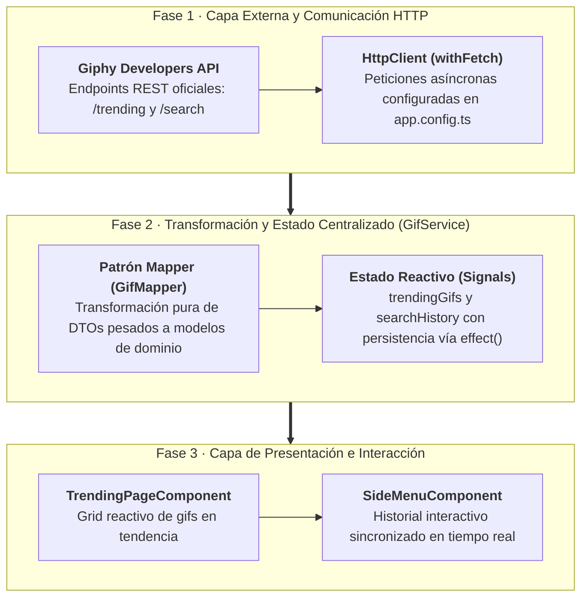

# Sección 07: GifsApp — Servicios, HTTP, Mappers y Persistencia

En esta sección conectamos nuestra aplicación con una API del mundo real: **Giphy API**. Aprenderemos a configurar el nuevo **`provideHttpClient()`**, modelar respuestas JSON complejas mediante **QuickType**, implementar el **Patrón Mapper** para blindar nuestra aplicación frente a cambios en APIs externas, construir un **Buscador con Caché en Memoria**, enlazar **Parámetros Dinámicos de URL** con **`toSignal()`**, y persistir el historial en **`LocalStorage`** usando **`effect()`**.

---

## 📋 Ficha Técnica y Objetivos Didácticos

* **Proyecto:** `gifs-app` (Continuación e integración de servicios).
* **API Externa:** Giphy Developers API (Endpoints: `/trending` y `/search`).
* **Patrones Arquitectónicos:** Patrón Mapper, Separación de Interfaces de Dominio vs API, Caché de Búsqueda en Servicio Singleton, Interoperabilidad RxJS $\leftrightarrow$ Signals con `toSignal()`.
* **Código Fuente de Referencia:** [GitHub - DevTalles GifsApp (fin-seccion-07)](https://github.com/DevTalles-corp/angular-gif-app/tree/fin-seccion-07)



---

## Configuración del Cliente HTTP y Giphy API

!!! info "📖 Para saber más: Manual de Referencia"
    Para dominar `provideHttpClient()`, configuración de interceptores funcionales y manejo de errores HTTP, consulta el **[Manual de Referencia: 10. Cliente HTTP y Comunicación con APIs](manual/10-http.md)**.

### Obtención de la API Key de Giphy

1. Regístrate en el portal oficial de desarrolladores: [developers.giphy.com](https://developers.giphy.com/).
2. Crea una nueva aplicación seleccionando la opción **API** (entorno de pruebas / desarrollo).
3. Copia tu **API Key** personal generada en el panel de control.

### Configuración de Variables de Entorno
Guardamos la clave y la URL base en `src/environments/environment.ts`:

```typescript title="src/environments/environment.ts"
export const environment = {
  production: false,
  giphyApiKey: 'TU_API_KEY_DE_GIPHY',
  giphyUrl: 'https://api.giphy.com/v1',
};
```

### Registro de `provideHttpClient` en `src/app/app.config.ts`
En Angular 19 no importamos módulos (`HttpClientModule` está en desuso). Registramos la función funcional **`provideHttpClient()`** en los proveedores globales:

```typescript title="src/app/app.config.ts" hl_lines="3 9"
import { ApplicationConfig, provideZoneChangeDetection } from '@angular/core';
import { provideRouter } from '@angular/router';
import { provideHttpClient } from '@angular/common/http';
import { routes } from './app.routes';

export const appConfig: ApplicationConfig = {
  providers: [
    provideZoneChangeDetection({ eventCoalescing: true }),
    provideHttpClient(), // Cliente HTTP disponible en toda la aplicación
    provideRouter(routes),
  ],
};
```

---

## Modelos y el Patrón Mapper

!!! info "📖 Para saber más: Manual de Referencia"
    Para estudiar los principios de diseño de servicios y la separación de contratos de datos, consulta el **[Manual de Referencia: 09. Servicios e Inyección de Dependencias](manual/09-servicios.md)**.

La respuesta de Giphy para cada gif contiene más de 50 propiedades (dimensiones, formatos mp4, webp, datos de usuario, analíticas). Si consumimos directamente ese objeto en nuestras plantillas:

1. El código se vuelve confuso y propenso a errores tipográficos.
2. Si Giphy cambia su estructura mañana, tendríamos que editar decenas de componentes.

Para evitar esto, aplicamos el **Patrón Mapper** y la **Separación de Interfaces**:

```
[Respuesta Giphy (50 campos)] ──> [GifMapper] ──> [Modelo Gif Interno (3 campos limpios)]
```

### Tipado Automático de la Respuesta con QuickType
Copiamos un JSON de respuesta de Giphy y utilizamos la herramienta online [quicktype.io](https://quicktype.io/) (o la extensión de VS Code *Paste JSON as Code*) seleccionando lenguaje **TypeScript Interfaces**.

Creamos el archivo `src/app/gifs/interfaces/giphy.interfaces.ts`:

```typescript title="src/app/gifs/interfaces/giphy.interfaces.ts"
export interface GiphyResponse {
  data:       GiphyItem[];
  meta:       Meta;
  pagination: Pagination;
}

export interface GiphyItem {
  type:                       string;
  id:                         string;
  url:                        string;
  slug:                       string;
  bitly_gif_url:              string;
  bitly_url:                  string;
  embed_url:                  string;
  username:                   string;
  source:                     string;
  title:                      string;
  rating:                     string;
  images:                     Images;
}

export interface Images {
  original: ImageProperties;
  fixed_height?: ImageProperties;
  fixed_width?: ImageProperties;
}

export interface ImageProperties {
  height:    string;
  width:     string;
  size:      string;
  url:       string;
}

export interface Meta {
  status:      number;
  msg:         string;
  response_id: string;
}

export interface Pagination {
  total_count: number;
  count:       number;
  offset:      number;
}
```

### Modelo de Dominio Interno: `src/app/gifs/interfaces/gif.interface.ts`
Este es el único contrato que conocerán nuestros componentes:

```typescript title="src/app/gifs/interfaces/gif.interface.ts"
export interface Gif {
  id: string;
  title: string;
  url: string;
}
```

### El Mapper: `src/app/gifs/mapper/gif.mapper.ts`
Funciones puras estáticas que realizan la conversión:

```typescript title="src/app/gifs/mapper/gif.mapper.ts"
import { Gif } from '../interfaces/gif.interface';
import { GiphyItem } from '../interfaces/giphy.interfaces';

export class GifMapper {
  // Transforma un único elemento de Giphy a nuestro modelo Gif
  static mapGiphyItemToGif(item: GiphyItem): Gif {
    return {
      id: item.id,
      title: item.title,
      url: item.images.original.url,
    };
  }

  // Transforma una lista completa mediante programación funcional
  static mapGiphyItemsToGifArray(items: GiphyItem[]): Gif[] {
    return items.map(this.mapGiphyItemToGif);
  }
}
```

---

## Servicio Centralizado de Gifs y Carga de Tendencias

Creamos el servicio `src/app/gifs/services/gifs.service.ts` para gestionar las peticiones HTTP y el estado reactivo con señales:

```typescript title="src/app/gifs/services/gifs.service.ts"
import { computed, effect, inject, Injectable, signal } from '@angular/core';
import { HttpClient } from '@angular/common/http';
import { environment } from '@environments/environment';
import { Observable, map, tap } from 'rxjs';
import { Gif } from '../interfaces/gif.interface';
import type { GiphyResponse } from '../interfaces/giphy.interfaces';
import { GifMapper } from '../mapper/gif.mapper';

const GIF_KEY = 'gifs_search_history';

@Injectable({ providedIn: 'root' })
export class GifService {
  private http = inject(HttpClient);

  // Señales de estado para tendencias
  trendingGifs = signal<Gif[]>([]);
  trendingGifsLoading = signal(true);

  // Historial organizado como diccionario de búsqueda (Caché): { 'goku': [gif1, gif2], ... }
  searchHistory = signal<Record<string, Gif[]>>(this.loadFromLocalStorage());
  searchHistoryKeys = computed(() => Object.keys(this.searchHistory()));

  constructor() {
    this.loadTrendingGifs();
  }

  // Efecto reactivo: persiste automáticamente cualquier cambio en el historial
  saveToLocalStorage = effect(() => {
    localStorage.setItem(GIF_KEY, JSON.stringify(this.searchHistory()));
  });

  loadTrendingGifs() {
    this.http
      .get<GiphyResponse>(`${environment.giphyUrl}/gifs/trending`, {
        params: {
          api_key: environment.giphyApiKey,
          limit: 20,
        },
      })
      .subscribe((resp) => {
        const gifs = GifMapper.mapGiphyItemsToGifArray(resp.data);
        this.trendingGifs.set(gifs);
        this.trendingGifsLoading.set(false);
      });
  }

  searchGifs(query: string): Observable<Gif[]> {
    return this.http
      .get<GiphyResponse>(`${environment.giphyUrl}/gifs/search`, {
        params: {
          api_key: environment.giphyApiKey,
          limit: 20,
          q: query,
        },
      })
      .pipe(
        map(({ data }) => GifMapper.mapGiphyItemsToGifArray(data)),
        // Guardamos los resultados en el caché del historial
        tap((gifs) => {
          this.searchHistory.update((history) => ({
            ...history,
            [query.toLowerCase()]: gifs,
          }));
        })
      );
  }

  getHistoryGifs(query: string): Gif[] {
    return this.searchHistory()[query.toLowerCase()] ?? [];
  }

  private loadFromLocalStorage(): Record<string, Gif[]> {
    const data = localStorage.getItem(GIF_KEY);
    return data ? JSON.parse(data) : {};
  }
}
```

!!! tip "💡 Evolución Angular 22: Servicios con `@Service()` y Reactividad Asíncrona con `rxResource()`"
    En el vídeo de Angular 19, observamos dos patrones clásicos:
    1. El decorador `@Injectable({ providedIn: 'root' })`.
    2. La suscripción manual a `HttpClient` con `.subscribe()` y la gestión de dos señales separadas: `trendingGifs` y `trendingGifsLoading = signal(true)`.

    En **Angular 22**, estos dos aspectos se simplifican con las nuevas características estables del framework:
    
    * **Nuevo decorador `@Service()`:** Reemplaza a `@Injectable({ providedIn: 'root' })` de forma autónoma.
    * **Reactividad Asíncrona Estable con `rxResource()`:** Elimina por completo las suscripciones manuales y los booleanos de carga. Angular gestiona automáticamente el ciclo de vida:
    
    ```typescript
    // Alternativa Angular 22 con @Service() y rxResource():
    import { computed, effect, inject, Service, signal } from '@angular/core';
    import { rxResource } from '@angular/core/rxjs-interop';
    import { HttpClient } from '@angular/common/http';
    import { environment } from '@environments/environment';
    import { map } from 'rxjs';
    import { GifMapper } from '../mapper/gif.mapper';

    @Service()
    export class GifService {
      private http = inject(HttpClient);

      // Recurso reactivo asíncrono: carga automática y señales integradas
      readonly trendingResource = rxResource({
        loader: () => this.http.get<GiphyResponse>(`${environment.giphyUrl}/gifs/trending`, {
          params: { api_key: environment.giphyApiKey, limit: 20 }
        }).pipe(
          map(resp => GifMapper.mapGiphyItemsToGifArray(resp.data))
        )
      });

      // Acceso directo en la plantilla o componentes:
      // trendingResource.value()      -> Arreglo de Gif[] cargado (o undefined mientras carga)
      // trendingResource.isLoading()  -> Booleano automático de carga
      // trendingResource.error()      -> Información del error si falla la petición
    }
    ```
    *Conclusión didáctica:* Ambas formas son plenamente funcionales. Aprender primero el `.subscribe()` del vídeo permite entender qué ocurre en el protocolo HTTP, mientras que `rxResource()` muestra el futuro declarativo hacia el que avanza Angular.

---

## Consumo Real en `TrendingPageComponent`

Conectamos la página de tendencias con los datos vivos de la API:

=== "src/app/gifs/pages/trending-page/trending-page.component.ts"
    ```typescript title="src/app/gifs/pages/trending-page/trending-page.component.ts"
    import { Component, inject } from '@angular/core';
    import { GifService } from '../../services/gifs.service';
    import { GifListComponent } from '../../components/gif-list/gif-list.component';

    @Component({
      selector: 'app-trending-page',
      imports: [GifListComponent],
      templateUrl: './trending-page.component.html',
    })
    export default class TrendingPageComponent {
      public gifService = inject(GifService);
    }
    ```

=== "src/app/gifs/pages/trending-page/trending-page.component.html"
    ```html title="src/app/gifs/pages/trending-page/trending-page.component.html"
    <div class="py-4">
      <h2 class="text-2xl font-bold text-white mb-4">Gifs Populares (Tendencias)</h2>

      @if (gifService.trendingGifsLoading()) {
        <div class="flex justify-center items-center py-20 text-blue-500">
          <i class="fa-solid fa-spinner fa-spin text-4xl"></i>
          <span class="ml-3 text-lg text-slate-300">Cargando tendencias...</span>
        </div>
      } @else {
        <!-- Extraemos las URLs limpias para el componente de galería -->
        <gif-list [gifs]="gifService.trendingGifs()" />
      }
    </div>
    ```

---

## Buscador de Gifs: `SearchPageComponent`

Creamos la pantalla de búsqueda con caja de texto reactiva y ejecución de búsqueda al pulsar ++enter++:

=== "src/app/gifs/pages/search-page/search-page.component.ts"
    ```typescript title="src/app/gifs/pages/search-page/search-page.component.ts"
    import { Component, inject, signal } from '@angular/core';
    import { GifService } from '../../services/gifs.service';
    import { Gif } from '../../interfaces/gif.interface';
    import { GifListComponent } from '../../components/gif-list/gif-list.component';

    @Component({
      selector: 'app-search-page',
      imports: [GifListComponent],
      templateUrl: './search-page.component.html',
    })
    export default class SearchPageComponent {
      private gifService = inject(GifService);

      searchedGifs = signal<Gif[]>([]);
      isLoading = signal(false);

      onSearch(query: string) {
        const cleanQuery = query.trim();
        if (!cleanQuery) return;

        this.isLoading.set(true);

        this.gifService.searchGifs(cleanQuery).subscribe((gifs) => {
          this.searchedGifs.set(gifs);
          this.isLoading.set(false);
        });
      }
    }
    ```

=== "src/app/gifs/pages/search-page/search-page.component.html"
    ```html title="src/app/gifs/pages/search-page/search-page.component.html"
    <div class="py-4">
      <h2 class="text-2xl font-bold text-white mb-2">Buscador de Gifs</h2>
      <p class="text-slate-400 text-sm mb-6">Busca y descubre millones de animaciones en tiempo real.</p>

      <!-- Input de Búsqueda -->
      <div class="flex space-x-2 mb-6">
        <input
          type="text"
          class="flex-1 bg-slate-900 border border-slate-700 rounded-lg px-4 py-2.5 text-white placeholder-slate-400 focus:outline-none focus:border-blue-500"
          placeholder="Ej: Goku, Star Wars, gatos divertidos..."
          (keyup.enter)="onSearch(txtSearch.value); txtSearch.value = ''"
          #txtSearch
        />
        <button
          (click)="onSearch(txtSearch.value); txtSearch.value = ''"
          class="bg-blue-600 hover:bg-blue-700 text-white font-medium px-5 py-2.5 rounded-lg transition"
        >
          <i class="fa-solid fa-magnifying-glass mr-2"></i> Buscar
        </button>
      </div>

      <!-- Resultados -->
      @if (isLoading()) {
        <div class="text-center py-16 text-blue-500">
          <i class="fa-solid fa-spinner fa-spin text-3xl"></i>
          <p class="mt-2 text-slate-400">Buscando resultados...</p>
        </div>
      } @else {
        <gif-list [gifs]="searchedGifs()" />
      }
    </div>
    ```

---

## Parámetros Dinámicos de URL e Interoperabilidad con `toSignal`

!!! info "📖 Para saber más: Manual de Referencia"
    Para aprender cuándo usar Observables vs Signals y cómo combinarlos con `toSignal()`, consulta el **[Manual de Referencia: 05. Signals y Reactividad](manual/05-signals.md)** y **[Manual de Referencia: 11. Angular Router y Navegación](manual/11-router.md)**.

Para permitir que el usuario comparta un enlace con una búsqueda fija (ej: `/dashboard/history/dragonball`) o pulse sobre un término del menú lateral, configuramos una ruta dinámica.

### Ruta Dinámica en `src/app/app.routes.ts`:
```typescript
{
  path: 'history/:query',
  loadComponent: () => import('./gifs/pages/gif-history/gif-history.component'),
}
```

### Conversión Reactiva con `toSignal()`: `GifHistoryComponent`
La función **`toSignal()`** de `@angular/core/rxjs-interop` transforma el Observable `params` en una Señal limpia, eliminando la necesidad de `subscribe` y desuscripciones manuales:

```typescript title="src/app/gifs/pages/gif-history/gif-history.component.ts"
import { Component, computed, inject } from '@angular/core';
import { toSignal } from '@angular/core/rxjs-interop';
import { ActivatedRoute } from '@angular/router';
import { map } from 'rxjs';
import { GifService } from '../../services/gifs.service';
import { GifListComponent } from '../../components/gif-list/gif-list.component';

@Component({
  selector: 'app-gif-history',
  imports: [GifListComponent],
  template: `
    <div class="py-4">
      <h2 class="text-2xl font-bold text-white mb-4">
        Historial de Búsqueda: <span class="text-blue-400 capitalize">{{ query() }}</span>
      </h2>

      <gif-list [gifs]="gifsByKey()" />
    </div>
  `,
})
export default class GifHistoryComponent {
  private route = inject(ActivatedRoute);
  private gifService = inject(GifService);

  // Convierte el Observable de la URL en una Señal pura
  query = toSignal(
    this.route.params.pipe(map((params) => params['query'] ?? ''))
  );

  // Señal computada: extrae del servicio los gifs correspondientes a la clave activa
  gifsByKey = computed(() => {
    const currentQuery = this.query();
    return currentQuery ? this.gifService.getHistoryGifs(currentQuery) : [];
  });
}
```

!!! tip "💡 Evolución Angular 22: Parámetros de Ruta mediante Signal Inputs directos"
    En el vídeo de Angular 19 se inyecta `ActivatedRoute` y se transforma el Observable `params` mediante `toSignal()`.
    
    En **Angular 19 y consolidado en Angular 22**, si configuras `withComponentInputBinding()` en `provideRouter()` (`app.config.ts`), puedes omitir completamente `ActivatedRoute` y `toSignal`. ¡Angular inyecta el parámetro dinámico `:query` de la ruta directamente como un **Signal Input**!:
    ```typescript
    // En app.config.ts:
    provideRouter(routes, withComponentInputBinding())

    // En GifHistoryComponent (Angular 22 directo y limpio):
    import { Component, computed, inject, input } from '@angular/core';

    export default class GifHistoryComponent {
      private gifService = inject(GifService);

      // El parámetro :query de la URL se enlaza de forma automática como Signal Input
      query = input.required<string>();

      gifsByKey = computed(() => {
        const currentQuery = this.query();
        return currentQuery ? this.gifService.getHistoryGifs(currentQuery) : [];
      });
    }
    ```
    *Ventaja didáctica:* Se reduce drásticamente el código, se prescinde de RxJS en el componente de vista y se unifica la lectura de propiedades mediante la API estándar de Signals.

---

## Actualización del Menú Lateral con el Historial Dinámico

Actualizamos `SideMenuOptionsComponent` para renderizar el historial de búsquedas guardadas en `localStorage` directamente en la barra lateral:

```html title="src/app/gifs/components/side-menu/side-menu-options/side-menu-options.component.html" hl_lines="13-27"
<div id="nav" class="w-full px-4 py-4 space-y-1">
  <!-- Opciones Estáticas -->
  @for (item of menuOptions; track item.route) {
    <a
      [routerLink]="item.route"
      routerLinkActive="bg-blue-600 text-white shadow-lg"
      class="w-full px-3 py-3 inline-flex space-x-3 items-center text-slate-300 hover:bg-slate-800 hover:text-white transition duration-150 rounded-lg"
    >
      <i [class]="item.icon + ' w-6 text-center text-lg'"></i>
      <span class="text-sm font-semibold">{{ item.label }}</span>
    </a>
  }

  <!-- Separador de Historial -->
  @if (gifService.searchHistoryKeys().length > 0) {
    <div class="pt-4 pb-2 px-3 border-t border-slate-800">
      <span class="text-xs uppercase tracking-wider text-slate-500 font-bold">Búsquedas Recientes</span>
    </div>

    @for (key of gifService.searchHistoryKeys(); track key) {
      <a
        [routerLink]="['/dashboard/history', key]"
        routerLinkActive="bg-slate-800 text-blue-400 font-semibold"
        class="w-full px-3 py-2 inline-flex items-center space-x-2 text-slate-400 hover:text-white hover:bg-slate-800/60 rounded-md transition text-sm capitalize"
      >
        <i class="fa-solid fa-clock-rotate-left text-xs"></i>
        <span>{{ key }}</span>
      </a>
    }
  }
</div>
```

---

## 🧪 Evaluación y Preguntas para el Aula

!!! question "Pregunta 1: ¿Por qué creamos un Mapper (`GifMapper`) en lugar de usar directamente la respuesta de Giphy?"
    ??? success "Respuesta"
        Para aislar nuestra aplicación de cambios en la API externa. Si la API de Giphy cambia la estructura de sus imágenes o renombra propiedades, solo editamos el Mapper; nuestros componentes y plantillas continúan funcionando sin ninguna modificación.

!!! question "Pregunta 2: ¿Qué ventaja ofrece `toSignal()` frente a suscribirse manualmente a `ActivatedRoute.params`?"
    ??? success "Respuesta"
        `toSignal()` gestiona automáticamente la desuscripción cuando el componente se destruye, previniendo fugas de memoria (*memory leaks*), y expone el valor como una señal pura para componerla con `computed()`.

!!! question "Pregunta 3: ¿Por qué es preferible almacenar el historial como diccionario `{ [query]: Gif[] }` en vez de un simple arreglo de textos?"
    ??? success "Respuesta"
        Porque funciona como una **Caché en Memoria**. Al almacenar los gifs asociados a cada término, si el usuario hace clic nuevamente en un término del historial, se muestran los gifs inmediatamente sin realizar una nueva petición HTTP a Giphy.

---

## 📖 Material de Referencia y Profundización

Para una comprensión exhaustiva de la comunicación HTTP y la reactividad combinada:

* **[Manual de Referencia: 05. Signals y Reactividad](manual/05-signals.md):** Interoperabilidad entre Observables y Señales (`toSignal()`, `toObservable()`).
* **[Manual de Referencia: 09. Servicios e Inyección de Dependencias](manual/09-servicios.md):** Inyección funcional con `inject()` y gestión de estado reactivo en servicios.
* **[Manual de Referencia: 10. Cliente HTTP y Comunicación con APIs](manual/10-http.md):** Guía completa de `provideHttpClient()`, tipado de peticiones, interceptores funcionales y manejo de errores.
* **[Manual de Referencia: 11. Angular Router y Navegación](manual/11-router.md):** Rutas dinámicas con parámetros (`:query`) y enlace de parámetros a inputs de componentes.