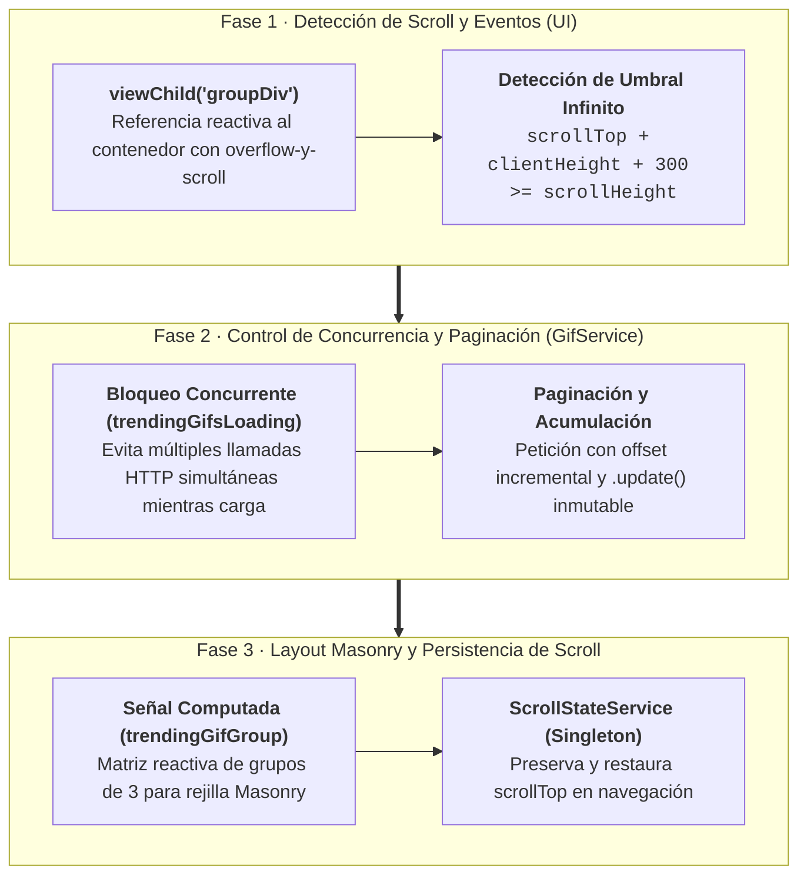

# Sección 08: GifsApp Intermedio/Avanzado — Masonry, Scroll Infinito, ViewChild y Depuración

En esta sección elevamos la calidad de nuestra aplicación **GifsApp** a un nivel profesional. Implementaremos una cuadrícula en cascada estilo **Masonry**, utilizaremos las Signal Queries (**`viewChild()`**) consolidadas en **Angular 22**, calcularemos matemáticamente el umbral de **Scroll Infinito** con paginación por `offset`, construiremos un servicio singleton de **Preservación del Estado del Scroll**, y dominaremos las técnicas reales de **depuración** (Angular DevTools, Breakpoints en VS Code con `F5` y `debugger;`).

---

## 📋 Ficha Técnica y Objetivos Didácticos

* **Proyecto:** `gifs-app` (Continuación — Técnicas avanzadas de UI, Reactividad Fina y Depuración).
* **Stack Angular 22:** `@Service()`, Signal Queries (`viewChild<ElementRef<HTMLDivElement>>()`), `computed()` para matrices de datos, ciclo de vida `AfterViewInit` (y alternativa moderna `afterNextRender()`).
* **Patrones UX:** Infinite Scrolling con bloqueo de peticiones concurrentes (*Concurrency Lock*), Preservación de posición del viewport (*Scroll Restoration Pattern*).
* **Código Fuente de Referencia:** [GitHub - DevTalles GifsApp (fin-seccion-08)](https://github.com/DevTalles-corp/angular-gif-app/tree/fin-seccion-08)



!!! warning "Puesta a punto antes de empezar (si retomas el proyecto o descargas el código)"
    1. Ejecuta `npm install` y `ng serve -o` para levantar la aplicación.
    2. Si **no ves ningún GIF** o aparecen errores de red, revisa que hayas configurado tu **API Key** (no el SDK) de [Giphy Developers](https://developers.giphy.com/dashboard/) exactamente igual en **ambos** archivos: `src/environments/environment.ts` y `src/environments/environment.development.ts`.
    3. Si quieres limpiar las búsquedas cacheadas del menú lateral, abre DevTools (++f12++) → pestaña **Application** → **Local Storage** → elimina la clave `gifs`.

---

## Diseño Masonry en Cascada con Tailwind CSS

!!! info "📖 Para saber más: Manual de Referencia"
    Para dominar el cálculo reactivo con `computed()` y la derivación pura de datos, consulta el **[Manual de Referencia: 05. Signals y Reactividad](manual/05-signals.md)**.

El diseño **Masonry** (popularizado por Pinterest) organiza imágenes de distintas alturas en columnas equilibradas sin dejar grandes huecos verticales. En lugar de depender de librerías externas, podemos resolverlo con Tailwind CSS y una señal computada.

Vamos a implementarlo en **tres pasos progresivos**:

### Paso 1: Maquetar la estructura base de Flowbite

En la documentación de [Flowbite — Tailwind CSS Gallery (Masonry)](https://flowbite.com/docs/components/gallery/), el patrón consiste en **un grid padre de columnas** (`grid-cols-2 md:grid-cols-4 gap-4`) que contiene **varios grids internos** (`grid gap-4`), cada uno con grupos de 3 imágenes.

Antes de conectar nuestros GIFs reales, comenta temporalmente `<gif-list ... />` en `src/app/gifs/pages/trending-page/trending-page.component.html` y pega el bloque estático de Flowbite (añadiendo `pt-5` arriba para que respire) para comprobar que el diseño responsive de 2 columnas en móvil y 4 en escritorio funciona.

### Paso 2: Agrupar la lista plana en subgrupos de 3 con `computed()`

Nuestros datos en `GifService` llegan como un array plano (`[gif1, gif2, gif3, gif4, gif5, ...]`), pero la plantilla Masonry necesita **un array de arrays de 3 elementos** (`[[gif1, gif2, gif3], [gif4, gif5, gif6], ...]`, pudiendo tener el último grupo menos de 3 elementos, por ejemplo 2 si hay 20 GIFs).

En `src/app/gifs/services/gifs.service.ts` creamos la señal computada `trendingGifGroup`:

```typescript title="src/app/gifs/services/gifs.service.ts" hl_lines="1 9-19"
@Service()
export class GifService {
  private http = inject(HttpClient);

  // Lista plana de gifs acumulados
  trendingGifs = signal<Gif[]>([]);
  trendingGifsLoading = signal(false);
  private trendingPage = signal(0);

  // SEÑAL COMPUTADA: Transforma Gif[] en Gif[][] (grupos de 3)
  trendingGifGroup = computed<Gif[][]>(() => {
    const groups: Gif[][] = [];

    for (let i = 0; i < this.trendingGifs().length; i += 3) {
      groups.push(this.trendingGifs().slice(i, i + 3));
    }

    return groups;
  });

  // ...
}
```

* **`i += 3` y `.slice(i, i + 3)`:** recorre el array de 3 en 3 y extrae cada subgrupo sin mutar `trendingGifs()`.
* **Reactividad automática:** cada vez que `trendingGifs` reciba nuevos GIFs al hacer scroll, `trendingGifGroup()` se recalculará automáticamente.

### Paso 3: Conectar los `@for` anidados en `TrendingPageComponent`

Ahora reemplazamos las imágenes estáticas de Flowbite por dos bucles `@for` anidados en `src/app/gifs/pages/trending-page/trending-page.component.html`:

```html title="src/app/gifs/pages/trending-page/trending-page.component.html" hl_lines="3-15"
<div class="grid grid-cols-2 md:grid-cols-4 gap-4 pt-5">

  @for (group of gifService.trendingGifGroup(); track $index) {
    <div class="grid gap-4">
      @for (gif of group; track gif.id) {
        <div>
          
        </div>
      }
    </div>
  }

</div>
```

*(Nota: si ya no usas `GifListComponent` en `TrendingPageComponent`, recuerda eliminar o comentar su importación en `trending-page.component.ts` para evitar warnings de compilación).*

---

## Señales de Consulta DOM con `viewChild` y Contenedor con Scroll

!!! info "📖 Para saber más: Manual de Referencia"
    Para dominar las consultas al DOM y a componentes hijos con Signal Queries (`viewChild`, `viewChildren`, `contentChild`), consulta el **[Manual de Referencia: 14. Queries del DOM (viewChild)](manual/14-queries.md)**.

### Paso 1: ¿Por qué `(scroll)="onScroll($event)"` no se dispara al principio?

Si añadimos `(scroll)="onScroll($event)"` directamente al `<div>` del Masonry, veremos que al mover la rueda del ratón **no aparece nada en consola**. ¿El motivo? El que está haciendo scroll es **todo el documento (`window`)**, no nuestro `<div>` interno, porque el `<div>` crece libremente según su contenido.

Para comprobarlo visualmente y convertir nuestro `<div>` en el contenedor con scroll propio:

1. Si pones temporalmente `h-[400px] bg-red-500`, verás que los GIFs se desbordan por debajo de la caja roja.
2. Si añades `overflow-hidden`, los GIFs que sobran se recortan y desaparecen.
3. La solución real es darle el alto exacto de la pantalla (**`h-screen`**) y habilitar el desplazamiento vertical (**`overflow-y-scroll`**), quitando el fondo rojo:

```html title="src/app/gifs/pages/trending-page/trending-page.component.html" hl_lines="2-4"
<div
  class="h-screen overflow-y-scroll grid grid-cols-2 md:grid-cols-4 gap-4 pt-5"
  (scroll)="onScroll($event)"
  #groupDiv
>
  <!-- @for anidados... -->
</div>
```

### Paso 2: Referencia local `#groupDiv` y `viewChild()`

En lugar de rebuscar en `$event.target` sin tipado estricto, colocamos la referencia local `#groupDiv` en el `<div>` y la capturamos en `TrendingPageComponent` mediante **`viewChild()`** (introducido en Angular 19 y estándar en Angular 22 frente al antiguo decorador `@ViewChild`):

```typescript title="src/app/gifs/pages/trending-page/trending-page.component.ts" hl_lines="1 6"
import { Component, ElementRef, inject, viewChild } from '@angular/core';
// ...

export default class TrendingPageComponent {
  gifService = inject(GifService);
  scrollDivRef = viewChild<ElementRef<HTMLDivElement>>('groupDiv');

  onScroll(event: Event) {
    const scrollDiv = this.scrollDivRef()?.nativeElement;
    if (!scrollDiv) return;

    console.log(scrollDiv);
  }
}
```

* **`viewChild` vs `viewChildren`:** `viewChild()` devuelve el **primer** elemento que coincida con el selector (como señal `Signal<ElementRef<HTMLDivElement> | undefined>`); `viewChildren()` se usa cuando hay múltiples elementos coincidentes y se necesita una lista/array.
* **Tipado `<ElementRef<HTMLDivElement>>`:** es fundamental indicar `HTMLDivElement` dentro de `ElementRef<...>`; de lo contrario, `nativeElement` sería de tipo `any` y perderíamos el autocompletado de `scrollTop`, `clientHeight` y `scrollHeight`.
* **¿Por qué el encadenamiento opcional `?.`?** En el instante en que se construye la clase del componente, la plantilla HTML aún no existe en el DOM, por lo que `scrollDivRef()` puede ser `undefined` inicialmente. El *early return* `if (!scrollDiv) return;` garantiza seguridad de tipos de ahí en adelante.

---

## Cálculo Matemático del Fin de Scroll (Infinite Scroll)

Para detectar cuándo el usuario está llegando al final del contenedor, medimos tres propiedades nativas del elemento `HTMLDivElement`:

```
┌───────────────────────────────────────┐ ── 0 (Inicio del scroll)
│                                       │
│          Área ya recorrida            │ ── scrollTop (píxeles desplazados desde arriba)
│                                       │
├───────────────────────────────────────┤ ── Borde superior del viewport visible
│                                       │
│          VENTANA VISIBLE              │ ── clientHeight (altura visible del contenedor)
│                                       │
├───────────────────────────────────────┤ ── Borde inferior del viewport visible
│      Umbral de anticipación (300px)   │
└───────────────────────────────────────┘ ── scrollHeight (altura total del contenido scrollable)
```

* **`scrollTop`:** píxeles que ya hemos bajado desde la parte superior (`0` cuando estamos arriba del todo).
* **`clientHeight`:** altura visible de la caja (`viewport` del contenedor; no cambia salvo que se redimensione la ventana).
* **`scrollHeight`:** altura total de todo el contenido interno del `<div>` (visible + oculto).

### Condición de activación y margen de gracia (`300px`)

Cuando el usuario llega exactamente al fondo, `scrollTop + clientHeight` iguala (o supera ligeramente por decimales/rebote) a `scrollHeight`. Sin embargo, en un **Infinite Scroll** real no queremos esperar a que el usuario choque contra el final en blanco: añadimos un **margen de anticipación de `300px`** para lanzar la petición antes de que termine de bajar:

$$\text{scrollTop} + \text{clientHeight} + 300 \ge \text{scrollHeight}$$

```typescript title="src/app/gifs/pages/trending-page/trending-page.component.ts" hl_lines="5-12"
onScroll(event: Event) {
  const scrollDiv = this.scrollDivRef()?.nativeElement;
  if (!scrollDiv) return;

  const scrollTop = scrollDiv.scrollTop;
  const clientHeight = scrollDiv.clientHeight;
  const scrollHeight = scrollDiv.scrollHeight;

  const isAtBottom = scrollTop + clientHeight + 300 >= scrollHeight;

  if (isAtBottom) {
    this.gifService.loadTrendingGifs();
  }
}
```

---

## Paginación por `offset`, Bloqueo Concurrente y Acumulación

### Paso 1: Entender `limit` y `offset` en la API de Giphy

A diferencia de otras APIs que usan `?page=1`, Giphy pagina mediante **`limit`** (cuántos registros traer) y **`offset`** (cuántos registros iniciales saltarse):

* Página `0` → `limit: 20`, `offset: 0 * 20` (`0`) → trae los primeros 20 GIFs.
* Página `1` → `limit: 20`, `offset: 1 * 20` (`20`) → se salta 20 y trae los siguientes 20.
* Página `2` → `limit: 20`, `offset: 2 * 20` (`40`) → se salta 40 y trae los siguientes 20.

### Paso 2: Implementar el bloqueo y la acumulación en `GifService`

Si el usuario hace scroll rápido dentro de la zona de los últimos `300px`, el evento `(scroll)` se disparará decenas de veces por segundo. Para evitar bombardear la API de Giphy (cuyo plan gratuito tiene un límite aproximado de **100 peticiones/hora**) y evitar páginas duplicadas, aplicamos **tres reglas** en `src/app/gifs/services/gifs.service.ts`:

```typescript title="src/app/gifs/services/gifs.service.ts" hl_lines="6-7 15 17 24 30-31"
@Service()
export class GifService {
  private http = inject(HttpClient);

  trendingGifs = signal<Gif[]>([]);
  trendingGifsLoading = signal(false); // Inicia en false para permitir la primera carga
  private trendingPage = signal(0);

  constructor() {
    this.loadTrendingGifs();
  }

  loadTrendingGifs() {
    // 1. Bloqueo de concurrencia: si ya hay una petición en curso, salimos
    if (this.trendingGifsLoading()) return;

    this.trendingGifsLoading.set(true);

    this.http
      .get<GiphyResponse>(`${environment.giphyUrl}/gifs/trending`, {
        params: {
          api_key: environment.giphyApiKey,
          limit: 20,
          offset: this.trendingPage() * 20, // 2. Paginación por offset
        },
      })
      .subscribe((resp) => {
        const gifs = GifMapper.mapGiphyItemsToGifArray(resp.data);
        // 3. Acumulación inmutable + liberar bloqueo
        this.trendingGifs.update((currentGifs) => [...currentGifs, ...gifs]);
        this.trendingGifsLoading.set(false);
      });
  }
}
```

Al probar ahora el scroll infinito en el navegador, notarás un comportamiento extraño: cada vez que llegas al final, la petición se dispara correctamente y los GIFs se acumulan en pantalla, **pero siempre ves los mismos 20 GIFs repetidos una y otra vez**.

---

## 🎯 Tarea Práctica: Solucionar la Paginación Repetida en el Scroll Infinito

### 📋 Enunciado del Reto para el Alumno

Con el código actual de `GifService`, el scroll infinito dispara nuevas peticiones HTTP al llegar al fondo de la pantalla, pero la API de Giphy devuelve exactamente los mismos 20 GIFs en cada carga.

Tu objetivo es **diagnosticar por qué ocurre este problema y corregirlo** para que cada nueva carga al hacer scroll traiga la página siguiente de tendencias (`offset: 20`, `40`, `60`...).

### ⏸️ Reto Práctico: ¡Inténtalo tú mismo!

!!! exercise "Pausa de Trabajo Autónomo"
    Detén la lectura un momento e intenta resolver el bug por tu cuenta antes de ver la solución:

    1. Inspecciona la pestaña **Network (Red)** de las DevTools del navegador mientras haces scroll hacia abajo. Fíjate en el parámetro `offset` de cada petición a `/gifs/trending`.
    2. Revisa el método `loadTrendingGifs()` en `src/app/gifs/services/gifs.service.ts` y determina **qué falta actualizar** y **en qué momento exacto** debe hacerse.
    3. Aplica el cambio y verifica en pantalla (y en la pestaña Network) que la segunda petición envía `offset=20`, la tercera `offset=40`, y que los GIFs nuevos son distintos a los anteriores.

### ⚠️ Errores Típicos del Alumno en esta Tarea

* **Incrementar `trendingPage` fuera del `.subscribe()`:** Si lo incrementas antes de que termine la petición o dentro de un `if` mal ubicado, puedes desincronizar el número de página si una petición falla o si se llama al método mientras está bloqueado.
* **Olvidar usar `.update()` y hacer `.set(this.trendingPage() + 1)`:** Aunque funciona, en señales cuyo nuevo valor depende del valor anterior es mejor práctica usar `.update((page) => page + 1)` para mantener la actualización atómica e idiomática.
* **Sobrescribir en lugar de acumular:** Usar `this.trendingGifs.set(gifs)` en vez de `this.trendingGifs.update((currentGifs) => [...currentGifs, ...gifs])` haría desaparecer los GIFs anteriores al cargar la página siguiente.

### Paso 3: Solución — Incrementar `trendingPage` tras cada carga

El problema se debe a que `trendingPage` arranca en `0` y **nunca se incrementa**, por lo que `this.trendingPage() * 20` siempre evalúa a `0 * 20 = 0`. La solución es incrementar la señal dentro del `.subscribe()`, justo después de recibir y acumular los nuevos GIFs:

```typescript title="src/app/gifs/services/gifs.service.ts (Método loadTrendingGifs completo)" hl_lines="19"
  loadTrendingGifs() {
    // 1. Bloqueo de concurrencia: si ya hay una petición en curso, salimos
    if (this.trendingGifsLoading()) return;

    this.trendingGifsLoading.set(true);

    this.http
      .get<GiphyResponse>(`${environment.giphyUrl}/gifs/trending`, {
        params: {
          api_key: environment.giphyApiKey,
          limit: 20,
          offset: this.trendingPage() * 20, // 2. Paginación por offset
        },
      })
      .subscribe((resp) => {
        const gifs = GifMapper.mapGiphyItemsToGifArray(resp.data);
        // 3. Acumulación inmutable + incremento de página + liberar bloqueo
        this.trendingGifs.update((currentGifs) => [...currentGifs, ...gifs]);
        this.trendingPage.update((page) => page + 1);
        this.trendingGifsLoading.set(false);
      });
  }
```

---

## Preservación del Estado del Scroll (`ScrollStateService`)

!!! info "📖 Para saber más: Manual de Referencia"
    Para estudiar los patrones de diseño en servicios singleton y la preservación de estado de interfaz en memoria, consulta el **[Manual de Referencia: 09. Servicios e Inyección de Dependencias](manual/09-servicios.md)**.

### El problema de navegación en SPAs

Cuando el usuario baja por el scroll infinito de **Trending**, cambia al **Buscador** y vuelve a **Trending**, Angular **destruye** el componente `TrendingPageComponent` al salir de la ruta y **crea una nueva instancia** al regresar. Aunque los GIFs siguen cargados en `GifService`, el scroll vuelve a `0` (arriba del todo).

**¿Por qué guardarlo en un Servicio Singleton y NO en `localStorage`?**  
Porque los GIFs de tendencias viven en **memoria** dentro de `GifService`. Si el usuario recarga el navegador o limpia la caché, esos GIFs desaparecen; restaurar un `scrollTop` guardado en `localStorage` sobre una lista recién reiniciada no tendría sentido.

### Paso 1: Crear `ScrollStateService`

Creamos `src/app/shared/services/scroll-state.service.ts` con `@Service()` (Angular 22):

```typescript title="src/app/shared/services/scroll-state.service.ts"
import { Service, signal } from '@angular/core';

@Service()
export class ScrollStateService {
  // Almacena la coordenada Y del scroll en píxeles
  trendingScrollState = signal<number>(0);
}
```

!!! tip "Escalabilidad y Encapsulación en `ScrollStateService`"
    * **Encapsulación:** en aplicaciones grandes conviene evitar que cualquier componente modifique la señal directamente exponiendo métodos dedicados (por ejemplo `setTrendingScroll(value: number)` o exponiendo `asReadonly()`), facilitando el seguimiento de cambios y las pruebas.
    * **Múltiples páginas con `Record<string, number>`:** si en el futuro necesitas recordar el scroll de muchas rutas distintas sin crear decenas de propiedades, puedes usar un diccionario:  
      `pagesScrollState = signal<Record<string, number>>({});` (por ejemplo `{ 'trending': 1000, 'about': 50 }`).

### Paso 2: Guardar y restaurar el scroll en `TrendingPageComponent`

Implementamos `AfterViewInit` (`ngAfterViewInit`) para restaurar `scrollDiv.scrollTop` justo cuando el DOM del componente termina de renderizarse:

```typescript title="src/app/gifs/pages/trending-page/trending-page.component.ts" hl_lines="1 3 8 10 14-20 31"
import { AfterViewInit, Component, ElementRef, inject, viewChild } from '@angular/core';
import { GifService } from '../../services/gifs.service';
import { ScrollStateService } from 'src/app/shared/services/scroll-state.service';

@Component({
  selector: 'app-trending-page',
  templateUrl: './trending-page.component.html',
})
export default class TrendingPageComponent implements AfterViewInit {
  gifService = inject(GifService);
  scrollStateService = inject(ScrollStateService);

  scrollDivRef = viewChild<ElementRef<HTMLDivElement>>('groupDiv');

  ngAfterViewInit(): void {
    const scrollDiv = this.scrollDivRef()?.nativeElement;
    if (!scrollDiv) return;

    // Restauramos el scroll guardado previamente en el servicio
    scrollDiv.scrollTop = this.scrollStateService.trendingScrollState();
  }

  onScroll(event: Event) {
    const scrollDiv = this.scrollDivRef()?.nativeElement;
    if (!scrollDiv) return;

    const scrollTop = scrollDiv.scrollTop;
    const clientHeight = scrollDiv.clientHeight;
    const scrollHeight = scrollDiv.scrollHeight;

    const isAtBottom = scrollTop + clientHeight + 300 >= scrollHeight;
    // Guardamos la posición actual en el servicio singleton
    this.scrollStateService.trendingScrollState.set(scrollTop);

    if (isAtBottom) {
      this.gifService.loadTrendingGifs();
    }
  }
}
```

*(Nota: guardar `scrollTop` dentro de `onScroll` actualiza la señal en cada movimiento; más adelante, al ver los **Lifecycle Hooks**, aprenderás a guardarlo una sola vez en `ngOnDestroy` justo antes de que el componente se destruya).*

!!! tip "💡 Alternativa Moderna en Angular 22: `afterNextRender()`"
    En Angular 22, si prefieres no implementar la interfaz `AfterViewInit` ni depender de hooks clásicos de clase, puedes ejecutar la restauración del DOM directamente en el constructor usando **`afterNextRender()`**:
    ```typescript
    import { afterNextRender } from '@angular/core';

    constructor() {
      afterNextRender(() => {
        const scrollDiv = this.scrollDivRef()?.nativeElement;
        if (scrollDiv) {
          scrollDiv.scrollTop = this.scrollStateService.trendingScrollState();
        }
      });
    }
    ```
    Además de ser más conciso, `afterNextRender()` solo se ejecuta en el navegador (nunca en SSR/servidor).

---

## Técnicas y Herramientas de Depuración

Para diagnosticar errores o inspeccionar señales y variables en tiempo real, contamos con **tres técnicas complementarias** más allá del clásico `console.log()`:

### 1. Angular DevTools (Extensión del Navegador)

Instala la extensión oficial **Angular DevTools** en Chrome o Edge, abre las DevTools (++f12++) y selecciona la pestaña **Angular**:

* **Pestaña Components:** muestra el árbol real de componentes (`app-root` → `router-outlet` → `app-dashboard-page` → `app-trending-page`). Al seleccionar un componente verás:
  * **Injected Services:** lista de servicios inyectados (`GifService`, `ScrollStateService`) y dónde están provistos (`Root`).
  * **Properties:** valores en vivo de cada `Signal` (`trendingGifs`, `trendingGifsLoading`, `trendingPage`, `trendingScrollState`) y `viewChild` (`scrollDivRef`).
  * *(Consejo práctico: en ocasiones la extensión no refresca el árbol automáticamente al cambiar de ruta; basta con cambiar de pestaña en DevTools o recargar una vez).*
* **Pestaña Profiler:** mide qué componentes se re-renderizan y cuánto tardan en cada evento.

### 2. Breakpoints directos en VS Code (++f5++)

Un punto de interrupción (*breakpoint*) rojo en el margen izquierdo de VS Code **no detiene la app** si no hay un depurador conectado al navegador. Para conectarlo:

1. Asegúrate de tener el servidor de desarrollo corriendo (`ng serve` en tu terminal).
2. Pulsa ++f5++ en VS Code (o ve a **Run and Debug**) para lanzar una instancia de Chrome vinculada al depurador.
3. Coloca un **breakpoint** (clic en el margen izquierdo del número de línea, por ejemplo dentro de `onScroll`).
4. Al hacer scroll en esa ventana de Chrome, la ejecución se pausará automáticamente en VS Code y podrás inspeccionar **Variables (Local)**, **Watch**, **Call Stack** y avanzar línea a línea.

### 3. La sentencia `debugger;` en el navegador

Si necesitas pausar la ejecución rápidamente sin configurar el depurador de VS Code, escribe `debugger;` en la línea que quieras inspeccionar:

```typescript
onScroll(event: Event) {
  const scrollDiv = this.scrollDivRef()?.nativeElement;
  if (!scrollDiv) return;

  debugger; // Pausa automáticamente si DevTools está abierto
  // ...
}
```

Con las DevTools abiertas (++f12++), el navegador se detendrá en la pestaña **Sources** mostrando las variables locales y permitiéndote avanzar paso a paso.

!!! warning "Limpia tu código antes de pasar a producción"
    Recuerda eliminar tanto los `debugger;` como los `console.log(...)` ruidosos (`gifs.service.ts`, `trending-page.component.ts`) una vez termines de depurar; es muy fácil olvidarlos y dejan trazas o pausas no deseadas.

---

## 🧪 Evaluación y Preguntas para el Aula

!!! question "Pregunta 1: ¿Por qué `viewChild()` es preferible al clásico decorador `@ViewChild()`?"
    ??? success "Respuesta"
        Porque `viewChild()` devuelve una Señal reactiva tipada (`Signal<ElementRef<HTMLDivElement> | undefined>`). Permite componer la referencia de forma declarativa con `computed()` o `effect()` y evita el operador `!` (*non-null assertion*) forzado en la clase.

!!! question "Pregunta 2: ¿Cómo evitamos que el Infinite Scroll dispare decenas de peticiones HTTP si el usuario sigue haciendo scroll rápido?"
    ??? success "Respuesta"
        Mediante la señal de bloqueo (*Concurrency Lock*) `trendingGifsLoading`, inicializada en `false`. Al entrar en `loadTrendingGifs()`, si está en `true` ejecutamos un *early return*; si está en `false`, la ponemos en `true` antes de la petición y la devolvemos a `false` cuando termina el `.subscribe()`.

!!! question "Pregunta 3: ¿Por qué al hacer scroll infinito repetido nos pueden salir siempre los mismos 20 GIFs si no actualizamos `trendingPage`?"
    ??? success "Respuesta"
        Porque Giphy pagina mediante `offset: this.trendingPage() * 20`. Si `trendingPage` permanece en `0`, todas las peticiones enviarán `offset=0` y devolverán exactamente la primera página. Debemos incrementarla con `this.trendingPage.update((page) => page + 1)`.

!!! question "Pregunta 4: ¿Por qué restauramos el scroll en `ngAfterViewInit` (o `afterNextRender`) y no en el `constructor`?"
    ??? success "Respuesta"
        Porque durante el `constructor` la plantilla HTML todavía no ha sido renderizada en el DOM, por lo que `scrollDivRef()?.nativeElement` es `undefined`. En `ngAfterViewInit` (o `afterNextRender`) el contenedor ya está montado y tiene altura scrollable disponible.

---

## 📖 Material de Referencia y Profundización

Para profundizar en las técnicas vistas en esta sección, consulta:

* **[Manual de Referencia: 05. Signals y Reactividad](manual/05-signals.md):** Derivación de estructuras con `computed()` y ciclos de actualización reactivos.
* **[Manual de Referencia: 09. Servicios e Inyección de Dependencias](manual/09-servicios.md):** Patrones de diseño para servicios singleton de estado y preservación de UI.
* **[Manual de Referencia: 14. Queries del DOM (viewChild)](manual/14-queries.md):** Guía completa de Signal Queries (`viewChild()`, `viewChildren()`, `contentChild()`).
* **[Manual de Referencia: 17. Proyecto Integrador Final](manual/17-proyecto-final.md):** Aplicación de todos los patrones avanzados en una aplicación completa de nivel profesional.
