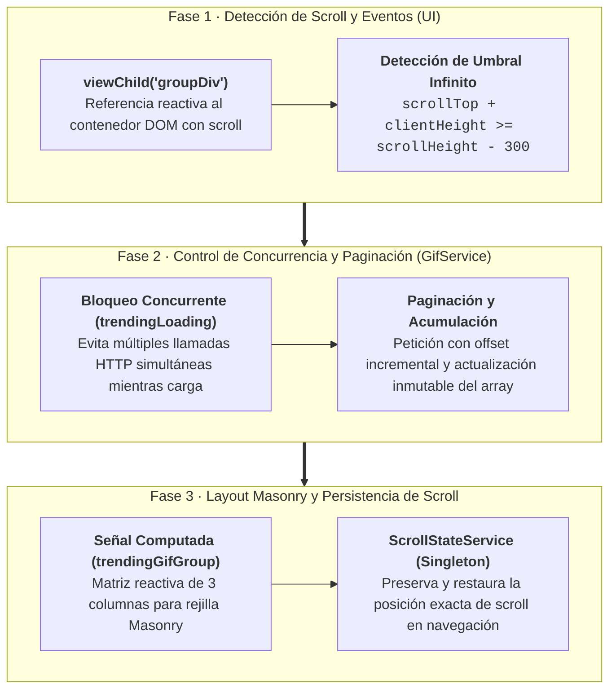

# Sección 08: GifsApp Intermedio/Avanzado — Scroll Infinito, Masonry y ViewChild

En esta sección elevamos la calidad de nuestra aplicación **GifsApp** a un nivel profesional. Implementaremos una cuadrícula en cascada estilo **Masonry**, utilizaremos la nueva función de consulta **`viewChild()`** de Angular 19, calcularemos matemáticamente el umbral de **Scroll Infinito** con paginación acumulativa, construiremos un servicio de **Preservación del Estado del Scroll** para mejorar la experiencia de usuario (UX), y aprenderemos a perfilar el rendimiento de la aplicación con **Angular DevTools**.

---

## 📋 Ficha Técnica y Objetivos Didácticos

* **Proyecto:** `gifs-app` (Técnicas avanzadas de UI y Reactividad Fina).
* **Novedades de Angular 19:** Signal Queries (`viewChild()`), `computed()` para matrices de datos, ciclo de vida `AfterViewInit`, profiling con Angular DevTools.
* **Patrones UX:** Infinite Scrolling con bloqueo de peticiones concurrentes (*Concurrency Lock*), Preservación de posición del viewport (*Scroll Restoration Pattern*).
* **Código Fuente de Referencia:** [GitHub - DevTalles GifsApp (fin-seccion-08)](https://github.com/DevTalles-corp/angular-gif-app/tree/fin-seccion-08)



---

## Diseño Masonry en Cascada con Tailwind CSS

!!! info "📖 Para saber más: Manual de Referencia"
    Para dominar el cálculo reactivo con `computed()` y la derivación pura de datos, consulta el **[Manual de Referencia: 05. Signals y Reactividad](manual/05-signals.md)**.

El diseño **Masonry** (popularizado por Pinterest y Unsplash) organiza elementos de diferentes alturas en columnas equilibradas sin dejar huecos vacíos. En CSS plano o Flexbox esto es complejo, pero con Tailwind y una señal computada en Angular se resuelve de forma limpia.

### Agrupación Reactiva con `computed()` en `GifService`
En lugar de forzar a la plantilla a reorganizar la lista, creamos una señal computada en `src/app/gifs/services/gifs.service.ts` que transforma la lista plana en una **matriz de grupos** (`Gif[][]`):

```typescript title="src/app/gifs/services/gifs.service.ts" hl_lines="10-23"
@Injectable({ providedIn: 'root' })
export class GifService {
  private http = inject(HttpClient);

  // Lista plana de gifs acumulados
  trendingGifs = signal<Gif[]>([]);
  trendingGifsLoading = signal(false);
  private trendingPage = signal(0); // Control de página para offset

  // SEÑAL COMPUTADA: Divide la lista en subgrupos de 3 para alimentar las columnas
  trendingGifGroup = computed<Gif[][]>(() => {
    const groups: Gif[][] = [];
    const gifs = this.trendingGifs();

    for (let i = 0; i < gifs.length; i += 3) {
      groups.push(gifs.slice(i, i + 3));
    }

    return groups;
  });

  // ...
}
```

### Cuadrícula en `TrendingPageComponent`
En la plantilla, iteramos primero sobre los grupos (columnas) y luego sobre los gifs individuales de cada grupo:

```html title="src/app/gifs/pages/trending-page/trending-page.component.html"
<div
  class="h-[calc(100vh-2rem)] overflow-y-scroll grid grid-cols-2 md:grid-cols-4 gap-4 pt-2"
  (scroll)="onScroll($event)"
  #groupDiv
>
  @for (group of gifService.trendingGifGroup(); track $index) {
    <div class="grid gap-4">
      @for (gif of group; track gif.id) {
        <div class="relative overflow-hidden rounded-lg shadow-md bg-slate-800">
          
        </div>
      }
    </div>
  }
</div>
```

---

## Señales de Consulta DOM con `viewChild` e Infinite Scroll

!!! info "📖 Para saber más: Manual de Referencia"
    Para dominar las consultas al DOM y a componentes hijos con Signal Queries (`viewChild`, `viewChildren`, `contentChild`), consulta el **[Manual de Referencia: 14. Queries del DOM (viewChild)](manual/14-queries.md)**.

En versiones anteriores de Angular se utilizaba el decorador `@ViewChild('groupDiv') groupDiv!: ElementRef`. En Angular 19, utilizamos la función **`viewChild()`**, que expone la referencia como una **Señal reactiva tipada**.

### Obtención de la Referencia en TypeScript
En `TrendingPageComponent`:

```typescript
// Referencia tipada y reactiva al elemento HTML con la variable #groupDiv
scrollDivRef = viewChild<ElementRef<HTMLDivElement>>('groupDiv');
```

### El Cálculo Matemático del Fin de Scroll

Para detectar que el usuario ha llegado al fondo del scroll, medimos tres magnitudes del elemento nativo:

```
┌───────────────────────────────────────┐ ── 0 (Inicio del scroll)
│                                       │
│          Área ya recorrida            │ ── scrollTop (píxeles ocultos arriba)
│                                       │
├───────────────────────────────────────┤ ── Borde superior de la ventana
│                                       │
│          VENTANA VISIBLE              │ ── clientHeight (altura del contenedor)
│                                       │
├───────────────────────────────────────┤ ── Borde inferior de la ventana
│      Umbral de anticipación (300px)   │
└───────────────────────────────────────┘ ── scrollHeight (altura total del contenido)
```

**Condición de activación:**
$$\text{scrollTop} + \text{clientHeight} + 300 \ge \text{scrollHeight}$$

Cuando la suma de lo que ya hemos bajado más el alto visible entra en los últimos 300 píxeles del documento, disparamos la siguiente página **antes de que el usuario llegue al final en blanco**.

```typescript
onScroll(event: Event) {
  const scrollDiv = this.scrollDivRef()?.nativeElement;
  if (!scrollDiv) return;

  const { scrollTop, clientHeight, scrollHeight } = scrollDiv;
  const isAtBottom = (scrollTop + clientHeight + 300) >= scrollHeight;

  // Persistimos la posición actual
  this.scrollStateService.trendingScrollState.set(scrollTop);

  if (isAtBottom) {
    this.gifService.loadNextPage();
  }
}
```

---

## Paginación y Acumulación en `GifService`

Al hacer scroll infinito, **no debemos reemplazar** la lista de gifs, sino concatenar los nuevos elementos al final del array existente.

En `src/app/gifs/services/gifs.service.ts`:

```typescript title="src/app/gifs/services/gifs.service.ts" hl_lines="18-36"
@Injectable({ providedIn: 'root' })
export class GifService {
  private http = inject(HttpClient);

  trendingGifs = signal<Gif[]>([]);
  trendingGifsLoading = signal(false);
  private trendingPage = signal(0);

  constructor() {
    this.loadTrendingGifs();
  }

  loadTrendingGifs() {
    // Si ya hay una petición en curso, bloqueamos llamadas simultáneas
    if (this.trendingGifsLoading()) return;

    this.trendingGifsLoading.set(true);

    this.http
      .get<GiphyResponse>(`${environment.giphyUrl}/gifs/trending`, {
        params: {
          api_key: environment.giphyApiKey,
          limit: 20,
          offset: this.trendingPage() * 20, // Paginación por offset
        },
      })
      .subscribe((resp) => {
        const newGifs = GifMapper.mapGiphyItemsToGifArray(resp.data);
        
        // Acumulación inmutable: preserva los anteriores y añade los nuevos
        this.trendingGifs.update((prev) => [...prev, ...newGifs]);
        
        // Avanzamos a la siguiente página y liberamos el bloqueo
        this.trendingPage.update((page) => page + 1);
        this.trendingGifsLoading.set(false);
      });
  }

  loadNextPage() {
    this.loadTrendingGifs();
  }
}
```

---

## Preservación del Estado del Scroll (`ScrollStateService`)

!!! info "📖 Para saber más: Manual de Referencia"
    Para estudiar los patrones de diseño en servicios singleton y la preservación de estado de interfaz en memoria, consulta el **[Manual de Referencia: 09. Servicios e Inyección de Dependencias](manual/09-servicios.md)**.

Un problema recurrente en las SPAs ocurre cuando un usuario desciende 80 elementos en la lista, cambia de pestaña en el menú lateral (ej: al Buscador), y al volver a "Trending", la página se reinicia arriba del todo (`scrollTop = 0`), obligándolo a hacer scroll de nuevo.

Para resolverlo, creamos un servicio singleton que guarde la posición en píxeles.

### Creación de `ScrollStateService`
Creamos `src/app/shared/services/scroll-state.service.ts`:

```typescript title="src/app/shared/services/scroll-state.service.ts"
import { Injectable, signal } from '@angular/core';

@Injectable({ providedIn: 'root' })
export class ScrollStateService {
  // Almacena la coordenada Y del scroll en píxeles
  trendingScrollState = signal<number>(0);
}
```

!!! tip "💡 Evolución Angular 22: Servicios de Estado de UI con `@Service()`"
    En Angular 22, este tipo de servicio singleton ligero para preservar coordenadas o filtros en memoria se define directamente con el nuevo decorador `@Service()`:
    ```typescript
    import { Service, signal } from '@angular/core';

    @Service()
    export class ScrollStateService {
      trendingScrollState = signal<number>(0);
    }
    ```
    Además, la integración de la Navigation API moderna en Angular 22 garantiza la liberación automática de recursos en memoria cuando los componentes de página se destruyen.

### Restauración de la Posición en `TrendingPageComponent`
Implementamos el ciclo de vida `AfterViewInit` para que, en cuanto el DOM esté listo tras navegar, se asigne la posición guardada:

```typescript title="src/app/gifs/pages/trending-page/trending-page.component.ts" hl_lines="13-18"
import { AfterViewInit, Component, ElementRef, inject, viewChild } from '@angular/core';
import { GifService } from '../../services/gifs.service';
import { ScrollStateService } from 'src/app/shared/services/scroll-state.service';

@Component({
  selector: 'app-trending-page',
  templateUrl: './trending-page.component.html',
})
export default class TrendingPageComponent implements AfterViewInit {
  public gifService = inject(GifService);
  private scrollStateService = inject(ScrollStateService);

  scrollDivRef = viewChild<ElementRef<HTMLDivElement>>('groupDiv');

  ngAfterViewInit(): void {
    const scrollDiv = this.scrollDivRef()?.nativeElement;
    if (!scrollDiv) return;

    // Restauramos el scroll guardado previamente en el servicio
    scrollDiv.scrollTop = this.scrollStateService.trendingScrollState();
  }

  onScroll(event: Event) {
    const scrollDiv = this.scrollDivRef()?.nativeElement;
    if (!scrollDiv) return;

    const { scrollTop, clientHeight, scrollHeight } = scrollDiv;
    const isAtBottom = (scrollTop + clientHeight + 300) >= scrollHeight;

    // Guardamos la posición en tiempo real
    this.scrollStateService.trendingScrollState.set(scrollTop);

    if (isAtBottom) {
      this.gifService.loadNextPage();
    }
  }
}
```

---

## Herramientas de Depuración: Angular DevTools

Para evaluar en directo la salud de nuestra aplicación, instalamos la extensión oficial **Angular DevTools** (disponible para Google Chrome y Microsoft Edge).

1. Abre las herramientas de desarrollador (++f12++) y selecciona la pestaña **Angular**.
2. **Pestaña Components:** Inspecciona la jerarquía del árbol de componentes standalone. Permite ver el valor actual de cada señal (`signal`), señal computada (`computed`) y entradas (`input`), e incluso modificarlas en caliente para probar la reactividad.
3. **Pestaña Profiler:** Mide el tiempo exacto que tarda cada componente en repintarse y qué evento detonó el cambio, demostrando visualmente el beneficio de la **reactividad quirúrgica** de las señales frente al ciclo tradicional de `Zone.js`.

---

## 🧪 Evaluación y Preguntas para el Aula

!!! question "Pregunta 1: ¿Por qué `viewChild()` es preferible al clásico decorador `@ViewChild()` en Angular 19?"
    ??? success "Respuesta"
        Porque `viewChild()` devuelve una Señal reactiva. Esto significa que podemos reaccionar a cambios en el DOM de forma declarativa y componer la referencia con `computed()` o `effect()` sin lidiar con valores nulos o llamadas forzadas en ngAfterViewInit.

!!! question "Pregunta 2: ¿Cómo evitamos que el Infinite Scroll dispare decenas de peticiones HTTP si el usuario sigue haciendo scroll rápido?"
    ??? success "Respuesta"
        Mediante una señal de bloqueo (*Concurrency Lock*) como `trendingGifsLoading`. Si la señal está en `true`, la función `loadTrendingGifs()` ejecuta un *early return* inmediato, impidiendo peticiones concurrentes hasta que la petición previa finalice exitosamente.

!!! question "Pregunta 3: ¿Por qué la restauración del scroll debe realizarse en `ngAfterViewInit` y no en el `constructor`?"
    ??? success "Respuesta"
        Porque en el momento del `constructor`, la plantilla HTML aún no ha sido renderizada ni montada en el DOM, por lo que `scrollDivRef()?.nativeElement` es `undefined`. En `ngAfterViewInit`, el contenedor ya tiene altura y píxeles disponibles.

---

## 📖 Material de Referencia y Profundización

Para profundizar en las técnicas avanzadas vistas en esta sección, consulta:

* **[Manual de Referencia: 05. Signals y Reactividad](manual/05-signals.md):** Derivación matemática de estructuras con `computed()` y ciclos de actualización reactivos.
* **[Manual de Referencia: 09. Servicios e Inyección de Dependencias](manual/09-servicios.md):** Patrones de diseño para servicios singleton de estado y preservación de UI.
* **[Manual de Referencia: 14. Queries del DOM (viewChild)](manual/14-queries.md):** Guía completa de Signal Queries (`viewChild()`, `viewChildren()`, `contentChild()`) frente a los antiguos decoradores.
* **[Manual de Referencia: 17. Proyecto Integrador Final](manual/17-proyecto-final.md):** Aplicación de todos los patrones avanzados en una aplicación completa de nivel profesional.