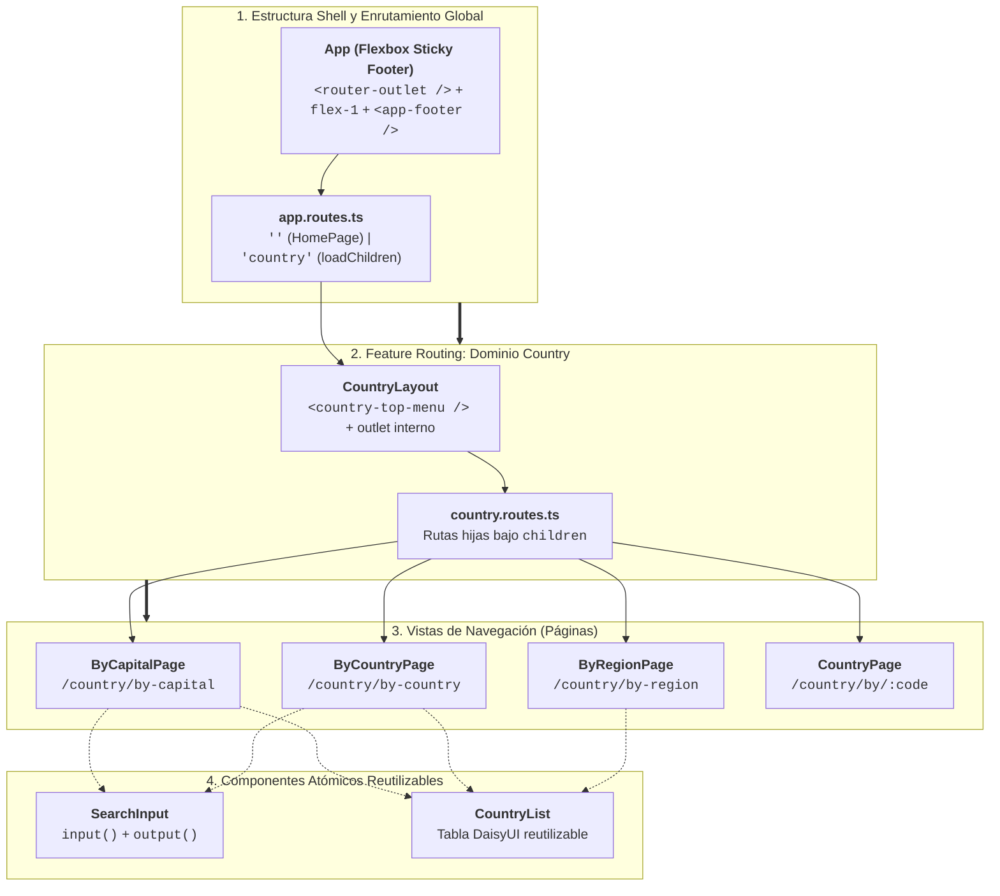
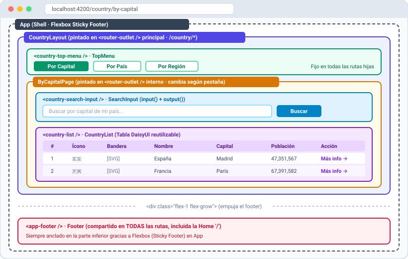
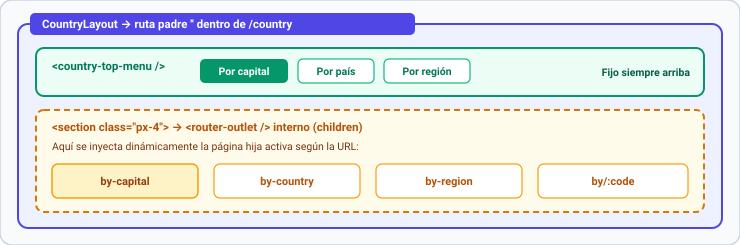
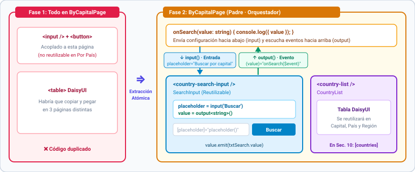

# Sección 09: CountryApp — Rutas Hijas, Layout y DaisyUI

En esta sección iniciamos la construcción de **CountryApp**, una Single Page Application (SPA) modular orientada a la exploración geográfica mundial. Aprenderemos a organizar aplicaciones medianas mediante **archivos de rutas desacoplados por funcionalidad (*feature routing*)**, diseñar un **Layout Wrapper reutilizable**, configurar **Tailwind CSS junto con DaisyUI** (tema `sunset` y arquitectura *Sticky Footer* con Flexbox), construir un **menú de navegación superior con iconos SVG de Iconify** y refactorizar progresivamente prototipos de página hacia **componentes atómicos (`SearchInput` y `CountryList`)** conectados mediante **Signal Inputs y Signal Outputs**, aplicando las mejores prácticas de la guía oficial de estilos de **Angular 22**.

---

## 📋 Ficha Técnica y Objetivos Didácticos

* **Proyecto:** `country-app` (SPA de países — Estructura, Diseño UI y Enrutamiento).
* **Stack Tecnológico (Angular 22):** Angular 22 (*Zoneless* y *Standalone Components* por defecto), Tailwind CSS v3/v4, DaisyUI v4/v5 (`themes: ["sunset"]`), [Iconify](https://iconify.design/) (iconos SVG vectoriales), Angular Schematics.
* **Patrones Arquitectónicos:**
    * **Feature-Driven Architecture:** Separación limpia entre el dominio de negocio (`src/app/country/`) y las piezas transversales (`src/app/shared/`).
    * **Nested Routing & Lazy Children:** Carga ansiosa de la portada (`HomePage`) y carga perezosa del subárbol `/country` mediante `loadChildren` + `export default`.
    * **Layout Wrapper Pattern:** Componente cascarón (`CountryLayout`) que fija `<country-top-menu />` y proyecta sus rutas hijas en un `<router-outlet />` interno.
    * **Progressive Atomic Extraction:** Prototipado rápido en página y extracción desacoplada hacia `SearchInput` (`country-search-input`) y `CountryList` (`country-list`).
* **Código Fuente de Referencia:** [GitHub - DevTalles CountryApp (fin-seccion-09)](https://github.com/DevTalles-corp/angular-country-app/tree/fin-seccion-09)



### 🗺️ Mapa Visual: ¿Qué parte de la pantalla pinta cada componente?

Antes de escribir la primera línea de código, este esquema muestra **cómo se encajan los distintos componentes dentro de la ventana del navegador** (por ejemplo, al visitar `/country/by-capital`):



* En la ruta raíz **`/`**, el `<router-outlet />` principal de `App` pinta **`HomePage`** en lugar de `CountryLayout`, manteniendo siempre **`<app-footer />`** anclado en la parte inferior.
* Al navegar entre **Por Capital**, **Por País**, **Por Región** o **Más info**, `CountryLayout` y `<country-top-menu />` permanecen intactos y únicamente se intercambia el componente dentro del **`<router-outlet />` interno**.

---

## 1. Inicio del Proyecto, Tailwind CSS, DaisyUI y *Sticky Footer*

!!! info "📖 Para saber más: Manual de Referencia"
    Para repasar la creación de proyectos y la integración de librerías CSS en Angular, consulta los capítulos:
    * **[Manual de Referencia: 02. Creación del Proyecto](manual/02-crear-proyecto.md)**
    * **[Manual de Referencia: 16. Integración de Librerías y UI](manual/16-integracion-librerias.md)**

### 1.1. Creación del proyecto en Angular 22

Generamos un nuevo proyecto con enrutamiento y CSS plano (sin SSR para centrarnos en una SPA de navegador):

```bash
ng new country-app --routing --style=css --ssr=false
cd country-app
```

!!! note "Angular 22: Modo Zoneless por defecto y generación de componentes"
    * En **Angular 22**, las aplicaciones nuevas nacen **Zoneless por defecto**, por lo que `src/app/app.config.ts` registra `provideBrowserGlobalErrorListeners()` y `provideRouter(routes)` sin depender de `provideZoneChangeDetection()`.
    * A partir de Angular 20–22, `ng generate component` omite el sufijo `.component` en los archivos y `Component` en las clases (`by-capital-page.ts` / `export class ByCapitalPage`). **En esta guía seguimos exactamente esa convención nativa de Angular 22** para que coincida 1:1 con lo que genera tu CLI (si descargas el repositorio histórico de referencia de GitHub en Angular 19, verás la convención clásica `*.component.ts`).

**Opción A — Si generas componentes desde la terminal con Angular CLI (recomendado y sin extensiones):**  
No necesitas crear `.vscode/settings.json`. Basta con pasar los flags **`--skip-tests`** (evita el `.spec.ts`) y **`--inline-style`** (o `-s`, evita crear un archivo `.css` vacío al usar Tailwind/DaisyUI):

```bash
ng g c country/pages/by-capital-page --skip-tests --inline-style
```

**Opción B — Solo si usas la extensión *Angular Schematics* de VS Code:**  
Esta configuración en `.vscode/settings.json` **únicamente tiene efecto al usar dicha extensión desde el menú contextual de VS Code** (la consola de Angular CLI la ignora):

```json title=".vscode/settings.json (Solo para la extensión Angular Schematics)"
{
  "angular-schematics.schematicsDefaultOptions": {
    "angular-*": {
      "externalTemplate": true,
      "skipStyle": true
    },
    "angular-component": {
      "skipChangeDetectionOnPush": true
    },
    "angular-page": {
      "skipChangeDetectionOnPush": true
    }
  }
}
```

* **`externalTemplate: true` y `skipStyle: true`:** genera archivos separados `.ts` y `.html` sin archivo `.css` adicional (usaremos clases de Tailwind/DaisyUI directamente en el HTML).
* **`skipChangeDetectionOnPush: true`:** evita inyectar `ChangeDetectionStrategy.OnPush` en cada generador cuando trabajamos con Signals o queremos explicitarlo aparte.

El archivo raíz de configuración en Angular 22 queda minimalista y limpio:

```typescript title="src/app/app.config.ts"
import { ApplicationConfig, provideBrowserGlobalErrorListeners } from '@angular/core';
import { provideRouter } from '@angular/router';

import { routes } from './app.routes';

export const appConfig: ApplicationConfig = {
  providers: [
    provideBrowserGlobalErrorListeners(),
    provideRouter(routes),
  ],
};
```

*(Si descargas el código del repositorio original grabado en Angular 19, verás `provideZoneChangeDetection({ eventCoalescing: true })` en lugar de `provideBrowserGlobalErrorListeners()`).*

### 1.2. Instalación de Tailwind CSS y DaisyUI (tema `sunset`)

**DaisyUI** añade componentes semánticos listos para usar (`btn`, `hero`, `footer`, `menu`, `table`, `stats`, `diff`) y temas completos de color sobre **Tailwind CSS**.

En el proyecto moderno con **Tailwind CSS v4 + DaisyUI v5** (estándar actual en Angular 22):

=== "Tailwind v4 + DaisyUI v5 (Recomendado Angular 22)"
    ```bash
    # 1. Instalar Tailwind v4, adaptador PostCSS y DaisyUI v5
    npm install -D tailwindcss @tailwindcss/postcss postcss daisyui@latest
    ```

    Crea `.postcssrc.json` en la raíz del proyecto:
    ```json title=".postcssrc.json"
    {
      "plugins": {
        "@tailwindcss/postcss": {}
      }
    }
    ```

    Importa Tailwind y registra DaisyUI con el tema `sunset` por defecto en `src/styles.css`:
    ```css title="src/styles.css"
    @import "tailwindcss";
    @plugin "daisyui" {
      themes: sunset --default;
    }
    ```

=== "Tailwind v3 + DaisyUI v4 (Versión original del repositorio)"
    ```bash
    npm install -D tailwindcss@^3 postcss autoprefixer daisyui@latest
    npx tailwindcss init
    ```

    ```javascript title="tailwind.config.js"
    /** @type {import('tailwindcss').Config} */
    module.exports = {
      content: [
        "./src/**/*.{html,ts}",
      ],
      theme: {
        extend: {},
      },
      plugins: [
        require('daisyui'),
      ],
      daisyui: {
        themes: ["sunset"], // Tema oscuro cálido usado en todo el curso
      },
    }
    ```

    ```css title="src/styles.css"
    @tailwind base;
    @tailwind components;
    @tailwind utilities;
    ```

#### Verificación rápida: comprobar que Tailwind CSS y DaisyUI funcionan

Antes de continuar, sustituye temporalmente el contenido de `src/app/app.html` por este bloque de prueba (y reinicia `ng serve` si ya lo tenías arrancado):

```html title="src/app/app.html (Prueba temporal de Tailwind + DaisyUI)"
<div class="p-8 space-y-4">
  <!-- Clases puras de Tailwind CSS -->
  <h1 class="text-3xl font-bold underline">Prueba Tailwind + DaisyUI</h1>

  <!-- Componentes y tema 'sunset' de DaisyUI -->
  <div class="flex gap-3">
    <button class="btn btn-primary">Botón Primary</button>
    <button class="btn btn-secondary">Botón Secondary</button>
    <span class="badge badge-accent self-center">Tema sunset activo</span>
  </div>
</div>
```

**Qué debes ver en `http://localhost:4200`:**

* Fondo oscuro propio del tema **`sunset`** de DaisyUI.
* El título grande, en negrita y subrayado (confirma que **Tailwind CSS** compila).
* Los botones redondeados con colores coral/rosa y la etiqueta `badge` (confirma que **DaisyUI** está activo). Si solo ves botones grises sin estilo, detén la terminal (++ctrl+c++) y ejecuta de nuevo `ng serve`.

### 1.3. Cascarón global con *Sticky Footer* en `App`

Antes de crear las páginas, preparamos `src/app/app.html` con un contenedor **Flexbox vertical** que garantice que el pie de página (`<app-footer />`) quede siempre pegado en la parte inferior de la pantalla aunque la página tenga pocos resultados:

```html title="src/app/app.html" hl_lines="1 4"
<main class="m-auto flex-grow flex flex-col min-h-screen">
  <router-outlet />

  <div class="flex-1 flex-grow"></div>

  <!-- En el punto 4.2 crearemos e insertaremos aquí <app-footer /> -->
</main>
```

* **`min-h-screen flex flex-col`:** convierte al `<main>` en una columna flexible que ocupa al menos el 100% del alto de la ventana.
* **`<div class="flex-1 flex-grow"></div>`:** actúa como un resorte elástico invisible entre el contenido del `<router-outlet />` y el `<app-footer />`, empujando el footer hasta abajo del todo.

---

## 2. Estructura de Carpetas por Dominio y Rutas Principales

A medida que una aplicación crece, conviene agrupar los archivos por **funcionalidad (*Feature-Driven Structure*)** dentro de `src/app/`, separando lo que pertenece al dominio geográfico (`country/`) de los elementos compartidos (`shared/`):

```text
src/app/
├── country/                      # Dominio funcional de Países
│   ├── components/               # Componentes UI reutilizables de países
│   │   ├── country-list/
│   │   ├── search-input/
│   │   └── top-menu/
│   ├── interfaces/               # Contratos y tipos (Sección 10 y 11)
│   ├── layouts/                  # Layouts contenedores con outlet hijo
│   │   └── country-layout/
│   ├── pages/                    # Páginas asociadas a una ruta
│   │   ├── by-capital-page/
│   │   ├── by-country-page/
│   │   ├── by-region-page/
│   │   └── country-page/
│   ├── services/                 # Servicios HTTP y caché (Sección 10 y 11)
│   └── country.routes.ts         # Subárbol de rutas del dominio country
└── shared/                       # Piezas transversales a toda la app
    ├── components/
    │   └── footer/
    └── pages/
        └── home-page/
```

!!! info "📖 Para saber más: Manual de Referencia"
    Para dominar `loadChildren`, `loadComponent`, rutas hijas y redirecciones en Angular Router, consulta el **[Manual de Referencia: 11. Angular Router y Navegación](manual/11-router.md)**.

### 2.1. Creación de `HomePage` y `ByCapitalPage`

Generamos inicialmente las dos páginas base desde la terminal con Angular CLI:

```bash
ng g c shared/pages/home-page --skip-tests --inline-style
ng g c country/pages/by-capital-page --skip-tests --inline-style
```

El CLI generará sus archivos `.ts` y `.html` correspondientes:

=== "HomePage"
    ```typescript title="src/app/shared/pages/home-page/home-page.ts"
    import { Component } from '@angular/core';

    @Component({
      selector: 'app-home-page',
      imports: [],
      templateUrl: './home-page.html',
    })
    export class HomePage {}
    ```

=== "ByCapitalPage"
    ```typescript title="src/app/country/pages/by-capital-page/by-capital-page.ts"
    import { Component } from '@angular/core';

    @Component({
      selector: 'app-by-capital-page',
      imports: [],
      templateUrl: './by-capital-page.html',
    })
    export class ByCapitalPage {}
    ```

### 2.2. Enrutador Global (`src/app/app.routes.ts`) y Archivo Base `country.routes.ts`

Antes de referenciar `./country/country.routes` desde `app.routes.ts` (para que TypeScript no marque error de módulo inexistente), creamos el archivo vacío base **`src/app/country/country.routes.ts`** (que completaremos en el siguiente apartado con `CountryLayout` y sus rutas hijas):

```typescript title="src/app/country/country.routes.ts (Base inicial)"
import { Routes } from '@angular/router';

export const countryRoutes: Routes = [];

export default countryRoutes;
```

Ahora sí, en `src/app/app.routes.ts` cargamos la portada (`HomePage`) de forma ansiosa (*eager*) al entrar en la raíz `''`, y delegamos toda la sección `/country` mediante carga perezosa (`loadChildren`):

```typescript title="src/app/app.routes.ts" hl_lines="5-12"
import { Routes } from '@angular/router';
import { HomePage } from './shared/pages/home-page/home-page';

export const routes: Routes = [
  {
    path: '',
    component: HomePage,
  },
  {
    path: 'country',
    loadChildren: () => import('./country/country.routes'), //.then(m => m.countryRoutes)
  },
  {
    path: '**',
    redirectTo: '',
  },
];
```

!!! tip "¿Por qué `import('./country/country.routes')` no necesita `.then(m => m.countryRoutes)`?"
    Si en `country.routes.ts` solo exportáramos `export const countryRoutes: Routes = [...]`, `loadChildren` necesitaría `.then((m) => m.countryRoutes)` para extraer la exportación nombrada.  
    Al añadir **`export default countryRoutes;`** al final de `country.routes.ts`, Angular obtiene el array de rutas directamente desde la exportación por defecto, logrando un `app.routes.ts` mucho más limpio.

---

## 3. Layout Components y Rutas Hijas (`children`)

Un **Layout Component** es un componente cascarón diseñado para envolver un conjunto de rutas relacionadas: renderiza elementos fijos comunes (como el menú superior de navegación) e incluye su **propio `<router-outlet />` interno** donde se inyecta la página hija activa.



### 3.1. Creación de `CountryLayout`

Generamos el componente de layout con Angular CLI:

```bash
ng g c country/layouts/country-layout --skip-tests --inline-style
```

Editamos `src/app/country/layouts/country-layout/country-layout.ts` y su plantilla (el menú `<country-top-menu />` lo crearemos y conectaremos en el punto 5):

```typescript title="src/app/country/layouts/country-layout/country-layout.ts" hl_lines="2 6"
import { Component } from '@angular/core';
import { RouterOutlet } from '@angular/router';

@Component({
  selector: 'app-country-layout',
  imports: [RouterOutlet],
  templateUrl: './country-layout.html',
})
export class CountryLayout {}
```

```html title="src/app/country/layouts/country-layout/country-layout.html" hl_lines="4"
<!-- En el punto 5 añadiremos aquí <country-top-menu /> -->

<section class="px-4">
  <router-outlet />
</section>
```

### 3.2. Archivo de Rutas por Funcionalidad: `country.routes.ts` (Fase 1)

Definimos inicialmente la ruta padre que monta `CountryLayout` y su array `children` con la primera ruta hija (`by-capital`) y la redirección por defecto:

```typescript title="src/app/country/country.routes.ts (Fase 1)" hl_lines="7-18 22"
import { Routes } from '@angular/router';
import { ByCapitalPage } from './pages/by-capital-page/by-capital-page';
import { CountryLayout } from './layouts/country-layout/country-layout';

export const countryRoutes: Routes = [
  {
    path: '',
    component: CountryLayout,
    children: [
      {
        path: 'by-capital',
        component: ByCapitalPage,
      },
      {
        path: '**',
        redirectTo: 'by-capital',
      },
    ],
  },
];

export default countryRoutes;
```

Al navegar a `/country`, Angular entra en `countryRoutes`, carga el `CountryLayout` y redirige `''` / `'**'` hacia `/country/by-capital`.

---

## 4. Componentes UI de DaisyUI: Portada Hero y Footer Global

### 4.1. Portada de Bienvenida (`HomePage`)

Utilizamos el componente **Hero with overlay** de [DaisyUI Hero](https://daisyui.com/components/hero/#hero-with-overlay-image) en `home-page.html` y añadimos `RouterLink` en el botón **Empezar** para navegar hacia `/country`:

=== "home-page.ts"
    ```typescript title="src/app/shared/pages/home-page/home-page.ts" hl_lines="2 6"
    import { Component } from '@angular/core';
    import { RouterLink } from '@angular/router';

    @Component({
      selector: 'app-home-page',
      imports: [RouterLink],
      templateUrl: './home-page.html',
    })
    export class HomePage {}
    ```

=== "home-page.html"
    ```html title="src/app/shared/pages/home-page/home-page.html" hl_lines="16"
    <div
      class="hero min-h-screen"
      style="
        background-image: url(https://img.daisyui.com/images/stock/photo-1507358522600-9f71e620c44e.webp);
      "
    >
      <div class="hero-overlay bg-opacity-60"></div>
      <div class="hero-content text-neutral-content text-center">
        <div class="max-w-md">
          <h1 class="mb-5 text-5xl font-bold">Aplicación de países</h1>
          <p class="mb-5">
            Provident cupiditate voluptatem et in. Quaerat fugiat ut assumenda
            excepturi exercitationem quasi. In deleniti eaque aut repudiandae et a
            id nisi.
          </p>
          <button routerLink="/country" class="btn btn-primary">Empezar</button>
        </div>
      </div>
    </div>
    ```

### 4.2. Pie de Página Reutilizable (`Footer`)

Generamos el componente `Footer` desde la terminal:

```bash
ng g c shared/components/footer --skip-tests --inline-style
```

Tomamos la plantilla estándar de [DaisyUI Footer (*Footer with a logo section*)](https://daisyui.com/components/footer/#footer-with-a-logo-section) y lo registramos en `App`:

=== "footer.ts"
    ```typescript title="src/app/shared/components/footer/footer.ts"
    import { Component } from '@angular/core';

    @Component({
      selector: 'app-footer',
      imports: [],
      templateUrl: './footer.html',
    })
    export class Footer {}
    ```

=== "footer.html"
    ```html title="src/app/shared/components/footer/footer.html"
    <footer class="footer sm:footer-horizontal bg-base-200 text-base-content p-10">
      <aside>
        <svg
          width="50"
          height="50"
          viewBox="0 0 24 24"
          xmlns="http://www.w3.org/2000/svg"
          fill-rule="evenodd"
          clip-rule="evenodd"
          class="fill-current"
        >
          <path
            d="M22.672 15.226l-2.432.811.841 2.515c.33 1.019-.209 2.127-1.23 2.456-1.15.325-2.148-.321-2.463-1.226l-.84-2.518-5.013 1.677.84 2.517c.391 1.203-.434 2.542-1.831 2.542-.88 0-1.601-.564-1.86-1.314l-.842-2.516-2.431.809c-1.135.328-2.145-.317-2.463-1.229-.329-1.018.211-2.127 1.231-2.456l2.432-.809-1.621-4.823-2.432.808c-1.355.384-2.558-.59-2.558-1.839 0-.817.509-1.582 1.327-1.846l2.433-.809-.842-2.515c-.33-1.02.211-2.129 1.232-2.458 1.02-.329 2.13.209 2.461 1.229l.842 2.515 5.011-1.677-.839-2.517c-.403-1.238.484-2.553 1.843-2.553.819 0 1.585.509 1.85 1.326l.841 2.517 2.431-.81c1.02-.33 2.131.211 2.461 1.229.332 1.018-.21 2.126-1.23 2.456l-2.433.809 1.622 4.823 2.433-.809c1.242-.401 2.557.484 2.557 1.838 0 .819-.51 1.583-1.328 1.847m-8.992-6.428l-5.01 1.675 1.619 4.828 5.011-1.674-1.62-4.829z"
          ></path>
        </svg>
        <p>
          ACME Industries Ltd.
          <br />
          Providing reliable tech since 1992
        </p>
      </aside>
      <nav>
        <h6 class="footer-title">Services</h6>
        <a class="link link-hover">Branding</a>
        <a class="link link-hover">Design</a>
        <a class="link link-hover">Marketing</a>
        <a class="link link-hover">Advertisement</a>
      </nav>
      <nav>
        <h6 class="footer-title">Company</h6>
        <a class="link link-hover">About us</a>
        <a class="link link-hover">Contact</a>
        <a class="link link-hover">Jobs</a>
        <a class="link link-hover">Press kit</a>
      </nav>
      <nav>
        <h6 class="footer-title">Legal</h6>
        <a class="link link-hover">Terms of use</a>
        <a class="link link-hover">Privacy policy</a>
        <a class="link link-hover">Cookie policy</a>
      </nav>
    </footer>
    ```

=== "app.ts y app.html"
    ```typescript title="src/app/app.ts" hl_lines="3 7"
    import { Component } from '@angular/core';
    import { RouterOutlet } from '@angular/router';
    import { Footer } from './shared/components/footer/footer';

    @Component({
      selector: 'app-root',
      imports: [RouterOutlet, Footer],
      templateUrl: './app.html',
    })
    export class App {}
    ```

    Y añadimos `<app-footer />` al final de `src/app/app.html`:

    ```html title="src/app/app.html" hl_lines="6"
    <main class="m-auto flex-grow flex flex-col min-h-screen">
      <router-outlet />

      <div class="flex-1 flex-grow"></div>

      <app-footer />
    </main>
    ```

---

## 5. Menú Superior e Iconos SVG con Iconify (`TopMenu`)

Para navegar entre las pantallas de búsqueda (*Por capital*, *Por país* y *Por región*), generamos `TopMenu` con Angular CLI:

```bash
ng g c country/components/top-menu --skip-tests --inline-style --prefix=country
```

!!! tip "Uso de `--prefix=country` en Angular CLI"
    Al añadir `--prefix=country`, el CLI genera directamente **`selector: 'country-top-menu'`** en lugar de `app-top-menu`, listo para usar como `<country-top-menu />` en `CountryLayout`.

Utilizamos el componente [DaisyUI Menu (*Responsive: vertical en móvil, horizontal en escritorio*)](https://daisyui.com/components/menu/#responsive-vertical-on-small-screen-horizontal-on-large-screen) (`menu bg-base-200 sm:menu-horizontal rounded-box`) e iconos vectoriales SVG copiados directamente desde [Iconify](https://icon-sets.iconify.design/):

* **Navegación declarativa:** cada enlace apunta a su ruta hija relativa (`routerLink="by-capital"`, `by-country`, `by-region`).
* **Estado activo automático:** `routerLinkActive="btn-primary"` resalta en el color primario del tema `sunset` el botón cuya ruta coincide con la URL actual.
* **Importaciones necesarias:** debemos importar `RouterLink` y `RouterLinkActive` de `@angular/router` en el `@Component` para que las directivas funcionen.

!!! tip "🎨 Cómo trabajar con Iconify paso a paso"
    **[Iconify](https://icon-sets.iconify.design/)** reúne más de 200.000 iconos vectoriales gratuitos (*Lucide*, *Heroicons*, *Material Design*, *FontAwesome*, *Tabler*...) listos para copiar como `<svg>` puro, **sin instalar paquetes `npm` ni cargar hojas de estilos externas** como hacíamos con FontAwesome.

    1. Entra en [icon-sets.iconify.design](https://icon-sets.iconify.design/) y escribe en el buscador lo que necesites en inglés (por ejemplo: `city`, `globe`, `world` o `map`).
    2. Haz clic sobre el icono elegido.
    3. En la parte inferior, abre la pestaña **SVG**, ajusta el tamaño a `20` (`width="20" height="20"`) y copia el bloque `<svg>...</svg>`.
    4. Pégalo directamente dentro del enlace `<a>` en `top-menu.html`.
    5. **Truco del color (`currentColor`):** si el `<path>` usa `fill="currentColor"` o `stroke="currentColor"`, el icono adoptará automáticamente el color de texto del botón de DaisyUI (incluso cuando cambie al estar activo con `btn-primary`).

=== "top-menu.ts"
    ```typescript title="src/app/country/components/top-menu/top-menu.ts" hl_lines="2 5-6"
    import { Component } from '@angular/core';
    import { RouterLink, RouterLinkActive } from '@angular/router';

    @Component({
      selector: 'country-top-menu',
      imports: [RouterLink, RouterLinkActive],
      templateUrl: './top-menu.html',
    })
    export class TopMenu {}
    ```

=== "top-menu.html"
    ```html title="src/app/country/components/top-menu/top-menu.html" hl_lines="4 21 39"
    <nav class="p-4 w-full">
      <ul class="menu bg-base-200 sm:menu-horizontal rounded-box">
        <li>
          <a routerLink="by-capital" routerLinkActive="btn-primary" class="btn">
            <svg
              xmlns="http://www.w3.org/2000/svg"
              width="20"
              height="20"
              viewBox="0 0 24 24"
            >
              <path
                fill="none"
                stroke="currentColor"
                d="M.5 15.5v-2.25S6 10.5 9.75 9.5V4.211c0-.79.23-1.565.707-2.194c.364-.48.828-1.052 1.293-1.517h.5c.465.465.93 1.037 1.293 1.517c.478.629.707 1.404.707 2.194V9.5c3.75 1 9.25 3.75 9.25 3.75v2.25s-5.5-1-9.25-1c0 0-.5 2.28-.5 6.5c0 0 1.25.75 2.25 1.75v.5S13.75 23 12 23s-4 .25-4 .25v-.5c1-1 2.25-1.75 2.25-1.75c0-4.22-.5-6.5-.5-6.5c-3.75 0-9.25 1-9.25 1Z"
              />
            </svg>
            Por capital
          </a>
        </li>
        <li>
          <a routerLink="by-country" routerLinkActive="btn-primary" class="btn">
            <svg
              xmlns="http://www.w3.org/2000/svg"
              width="20"
              height="20"
              viewBox="0 0 24 24"
            >
              <rect width="24" height="24" fill="none" />
              <path
                fill="none"
                stroke="currentColor"
                d="M4 12h2m12 0h2M.5 16.5V20H1a43 43 0 0 1 3-.37M.5 16.5H1a3 3 0 0 1 3 3v.13M.5 16.5v-9M4 19.63a95 95 0 0 1 8-.38c2.134 0 5.281.127 8 .38m0 0a43 43 0 0 1 3 .37h.5v-3.5M20 19.63v-.13a3 3 0 0 1 3-3h.5m0 0v-9m0 0V4H23a43 43 0 0 1-3 .37m3.5 3.13H23a3 3 0 0 1-3-3v-.13m0 0a95 95 0 0 1-8 .38a95 95 0 0 1-8-.38m0 0A43 43 0 0 1 1 4H.5v3.5M4 4.37v.13a3 3 0 0 1-3 3H.5m11.5 7a2.5 2.5 0 1 1 0-5a2.5 2.5 0 0 1 0 5Z"
              />
            </svg>
            Por país
          </a>
        </li>
        <li>
          <a routerLink="by-region" routerLinkActive="btn-primary" class="btn">
            <svg
              xmlns="http://www.w3.org/2000/svg"
              width="20"
              height="20"
              viewBox="0 0 24 24"
            >
              <rect width="24" height="24" fill="none" />
              <path
                fill="none"
                stroke="currentColor"
                d="M9.5.5V2A1.5 1.5 0 0 0 11 3.5h2A1.5 1.5 0 0 0 14.5 2V.5m-4.5 20h4M4.5.75S5 7.492 5 12s-.5 11.25-.5 11.25v.25h15v-.25S19 16.508 19 12S19.5.75 19.5.75V.5h-15z"
              />
            </svg>
            Por region
          </a>
        </li>
      </ul>
    </nav>
    ```

Ahora que `TopMenu` existe, lo importamos en `CountryLayout` y lo colocamos encima de su `<router-outlet />` interno:

=== "country-layout.ts"
    ```typescript title="src/app/country/layouts/country-layout/country-layout.ts" hl_lines="3 7"
    import { Component } from '@angular/core';
    import { RouterOutlet } from '@angular/router';
    import { TopMenu } from '../../components/top-menu/top-menu';

    @Component({
      selector: 'app-country-layout',
      imports: [RouterOutlet, TopMenu],
      templateUrl: './country-layout.html',
    })
    export class CountryLayout {}
    ```

=== "country-layout.html"
    ```html title="src/app/country/layouts/country-layout/country-layout.html" hl_lines="1"
    <country-top-menu />

    <section class="px-4">
      <router-outlet />
    </section>
    ```

---

## 6. Inputs, Tablas y Componentización Progresiva (en 3 Fases)

!!! info "📖 Para saber más: Manual de Referencia"
    Para profundizar en la comunicación padre-hijo mediante Signal Inputs (`input()`) y Signal Outputs (`output()`), consulta el **[Manual de Referencia: 07. Comunicación entre Componentes](manual/07-anidar-componentes.md)**.

Para que resulte fácil entender cómo evoluciona la interfaz desde un bloque rápido hasta una arquitectura reutilizable, dividimos este proceso en **tres fases progresivas**:

### Fase 1: Prototipado directo en `ByCapitalPage`

En un primer momento sustituimos todo el contenido inicial de `by-capital-page.html` para maquetar directamente tanto el buscador como la tabla de países usando DaisyUI:

=== "by-capital-page.html (Fase 1)"
    ```html title="src/app/country/pages/by-capital-page/by-capital-page.html (Prototipo inicial completo)"
    <section class="flex flex-row gap-2 mt-2">
      <input
        type="text"
        class="input input-bordered mr-2 w-56"
        placeholder="Buscar por capital"
        autofocus
        #txtSearch
        (keyup.enter)="onSearch(txtSearch.value)"
      />

      <button class="btn btn-primary" (click)="onSearch(txtSearch.value)">
        Buscar
      </button>
    </section>

    <section class="mt-5">
      <table class="table table-md mt-2 w-full">
        <thead>
          <tr>
            <th>#</th>
            <th>Icono</th>
            <th>Bandera</th>
            <th>Nombre</th>
            <th>Capital</th>
            <th>Población</th>
            <th></th>
          </tr>
        </thead>
        <tbody>
          <tr></tr>
        </tbody>
      </table>
    </section>
    ```

=== "by-capital-page.ts (Fase 1)"
    ```typescript title="src/app/country/pages/by-capital-page/by-capital-page.ts (Prototipo inicial)"
    import { Component } from '@angular/core';

    @Component({
      selector: 'app-by-capital-page',
      imports: [],
      templateUrl: './by-capital-page.html',
    })
    export class ByCapitalPage {
      onSearch(value: string) {
        console.log({ value });
      }
    }
    ```

* **Referencia local `#txtSearch`:** permite leer el texto escrito directamente desde la plantilla (`txtSearch.value`) sin necesidad de crear variables intermedias aún.
* **Doble disparador:** el usuario puede buscar pulsando ++enter++ (`(keyup.enter)`) o haciendo clic en el botón (`(click)`).

### Fase 2: Tarea 1 — Extracción a `SearchInput` y `CountryList`

Como **exactamente la misma caja de búsqueda** se usará también en *Por país*, y **exactamente la misma tabla** se reutilizará en *Por capital*, *Por país* y *Por región*, extraemos ambos bloques a sus propios componentes. Este esquema muestra **qué pasa de la Fase 1 a la Fase 2** y cómo fluyen los datos con **`input()`** (hacia abajo) y **`output()`** (hacia arriba):



Generamos ambos componentes bajo `src/app/country/components/`:

```bash
ng g c country/components/search-input --skip-tests --inline-style --prefix=country
ng g c country/components/country-list --skip-tests --inline-style --selector=country-list
```

!!! tip "¿Por qué `--prefix=country` en uno y `--selector=country-list` en el otro?"
    * `--prefix=country` en `search-input` genera directamente `selector: 'country-search-input'`.
    * En `country-list`, usar `--prefix=country` duplicaría el prefijo (`country-country-list`); pasando **`--selector=country-list`** fijamos el selector exacto `<country-list />` desde el primer momento.

#### A. Componente `SearchInput` (`country-search-input`)

Recibe un `placeholder` opcional (con valor por defecto `'Buscar'`) mediante `input('Buscar')` y emite el término tecleado mediante `output<string>()`:

=== "search-input.ts"
    ```typescript title="src/app/country/components/search-input/search-input.ts" hl_lines="4 9-10"
    import { Component, input, output } from '@angular/core';

    @Component({
      selector: 'country-search-input',
      imports: [],
      templateUrl: './search-input.html',
    })
    export class SearchInput {
      placeholder = input('Buscar');
      value = output<string>();
    }
    ```

=== "search-input.html"
    ```html title="src/app/country/components/search-input/search-input.html" hl_lines="5 8 11"
    <section class="flex flex-row gap-2 mt-2">
      <input
        type="text"
        class="input input-bordered mr-2 w-56"
        [placeholder]="placeholder()"
        autofocus
        #txtSearch
        (keyup.enter)="value.emit(txtSearch.value)"
      />

      <button class="btn btn-primary" (click)="value.emit(txtSearch.value)">
        Buscar
      </button>
    </section>
    ```

#### B. Componente `CountryList` (`country-list`)

Aísla el esqueleto de la tabla DaisyUI que mostrará el listado de países en las distintas pantallas (en la Sección 10 recibirá la lista real de países y estados de carga/error):

=== "country-list.ts"
    ```typescript title="src/app/country/components/country-list/country-list.ts" hl_lines="4"
    import { Component } from '@angular/core';

    @Component({
      selector: 'country-list',
      imports: [],
      templateUrl: './country-list.html',
    })
    export class CountryList {}
    ```

=== "country-list.html"
    ```html title="src/app/country/components/country-list/country-list.html"
    <section class="mt-5">
      <table class="table table-md mt-2 w-full">
        <thead>
          <tr>
            <th>#</th>
            <th>Icono</th>
            <th>Bandera</th>
            <th>Nombre</th>
            <th>Capital</th>
            <th>Población</th>
            <th></th>
          </tr>
        </thead>
        <tbody>
          <tr></tr>
        </tbody>
      </table>
    </section>
    ```

#### C. Composición limpia en `ByCapitalPage`

Ahora `ByCapitalPage` importa ambos componentes atómicos y su plantilla queda reducida a una composición declarativa muy legible:

=== "by-capital-page.ts"
    ```typescript title="src/app/country/pages/by-capital-page/by-capital-page.ts" hl_lines="2-3 7"
    import { Component } from '@angular/core';
    import { SearchInput } from '../../components/search-input/search-input';
    import { CountryList } from '../../components/country-list/country-list';

    @Component({
      selector: 'app-by-capital-page',
      imports: [SearchInput, CountryList],
      templateUrl: './by-capital-page.html',
    })
    export class ByCapitalPage {
      onSearch(value: string) {
        console.log({ value });
      }
    }
    ```

=== "by-capital-page.html"
    ```html title="src/app/country/pages/by-capital-page/by-capital-page.html"
    <country-search-input
      placeholder="Buscar por capital"
      (value)="onSearch($event)"
    />

    <country-list />
    ```

### Fase 3: Tarea 2 — Páginas adicionales y ruta dinámica `by/:code`

Generamos las tres páginas restantes del dominio `country`:

```bash
ng g c country/pages/by-country-page --skip-tests --inline-style
ng g c country/pages/by-region-page --skip-tests --inline-style
ng g c country/pages/country-page --skip-tests --inline-style
```

=== "ByCountryPage"
    ```typescript title="src/app/country/pages/by-country-page/by-country-page.ts"
    import { Component } from '@angular/core';
    import { SearchInput } from '../../components/search-input/search-input';
    import { CountryList } from '../../components/country-list/country-list';

    @Component({
      selector: 'app-by-country-page',
      imports: [SearchInput, CountryList],
      templateUrl: './by-country-page.html',
    })
    export class ByCountryPage {}
    ```

    ```html title="src/app/country/pages/by-country-page/by-country-page.html"
    <country-search-input placeholder="Buscar por país" />

    <country-list />
    ```

=== "ByRegionPage"
    ```typescript title="src/app/country/pages/by-region-page/by-region-page.ts"
    import { Component } from '@angular/core';
    import { CountryList } from '../../components/country-list/country-list';

    @Component({
      selector: 'app-by-region-page',
      imports: [CountryList],
      templateUrl: './by-region-page.html',
    })
    export class ByRegionPage {}
    ```

    ```html title="src/app/country/pages/by-region-page/by-region-page.html"
    <country-list />
    ```

=== "CountryPage"
    ```typescript title="src/app/country/pages/country-page/country-page.ts"
    import { Component } from '@angular/core';

    @Component({
      selector: 'app-country-page',
      imports: [],
      templateUrl: './country-page.html',
    })
    export class CountryPage {}
    ```

    ```html title="src/app/country/pages/country-page/country-page.html"
    <p>country-page works!</p>
    ```

Finalmente, registramos todas las rutas hijas en `src/app/country/country.routes.ts`, incluyendo la **ruta con parámetro dinámico `by/:code`** que renderizará el detalle de cada país:

```typescript title="src/app/country/country.routes.ts (Completo)" hl_lines="17-28"
import { Routes } from '@angular/router';
import { ByCapitalPage } from './pages/by-capital-page/by-capital-page';
import { CountryLayout } from './layouts/country-layout/country-layout';
import { ByCountryPage } from './pages/by-country-page/by-country-page';
import { ByRegionPage } from './pages/by-region-page/by-region-page';
import { CountryPage } from './pages/country-page/country-page';

export const countryRoutes: Routes = [
  {
    path: '',
    component: CountryLayout,
    children: [
      {
        path: 'by-capital',
        component: ByCapitalPage,
      },
      {
        path: 'by-country',
        component: ByCountryPage,
      },
      {
        path: 'by-region',
        component: ByRegionPage,
      },
      {
        path: 'by/:code',
        component: CountryPage,
      },
      {
        path: '**',
        redirectTo: 'by-capital',
      },
    ],
  },
];

export default countryRoutes;
```

---

## 7. Guía Oficial de Estilos y Arquitectura sin `NgModule`

En el resumen de arquitectura de la sección destacamos **dos convenciones clave** de Angular moderno:

### 7.1. ¿Por qué no creamos archivos `.module.ts`?

En proyectos antiguos anteriores a Angular 15–17 era habitual encontrar archivos `country.module.ts` o `shared.module.ts` que declaraban componentes con `@NgModule`.  
Hoy en día **cada Componente Standalone es su propio módulo autocontenido**: declara exactamente qué necesita en su propiedad `imports: [...]`, permitiendo que herramientas de análisis estático y *tree-shaking* eliminen código muerto automáticamente y eliminando decenas de archivos repetitivos.

### 7.2. Nomenclatura de Outputs (`value` frente a `onValue`)

!!! tip "Regla Oficial de la Guía de Estilos de Angular (Style 05-16): No prefijar outputs con `on`"
    La [Guía de Estilos Oficial de Angular](https://angular.dev/style-guide#dont-prefix-output-properties) establece explícitamente **no prefijar las propiedades `output()` con la palabra `on`**.

    * ❌ Evita: `onValue = output<string>()` → obliga a escribir en el HTML `(onValue)="onSearch($event)"`, duplicando la partícula `on`.
    * ✅ Usa: `value = output<string>()` → permite escribir de forma natural y semántica **`(value)="onSearch($event)"`**, reservando el prefijo `on` exclusivamente para los métodos manejadores en el componente padre.

---

## 💡 Evolución Angular 22: Novedades Clave en Enrutamiento y Componentes

!!! tip "1. `standalone: true` implícito y plantillas HTML declarativas"
    En Angular 19–22 todos los componentes son **Standalone por defecto** sin necesidad de escribir `standalone: true` en `@Component`. Además, **Angular 22** mejora las comprobaciones estrictas del compilador sobre rutas y enlaces `[routerLink]`.

!!! tip "2. Parámetros dinámicos como Signal Inputs (`withComponentInputBinding`)"
    Al configurar la ruta `by/:code`, en la Sección 10 veremos primero la lectura clásica mediante `ActivatedRoute`, y también cómo **Angular 22** permite activar `withComponentInputBinding()` en `provideRouter(routes, withComponentInputBinding())` para recibir `:code` directamente como `code = input.required<string>()` dentro de `CountryPage`.

---

## 📝 Evaluación y Preguntas para el Aula

??? question "¿Por qué combinamos `min-h-screen flex flex-col` con `<div class='flex-1 flex-grow'></div>` en `app.html`?"
    **Respuesta:** Para implementar un **Sticky Footer**. El `div` central con `flex-1 flex-grow` absorbe todo el espacio vertical sobrante entre `<router-outlet />` y `<app-footer />`, garantizando que el pie de página siempre quede anclado al borde inferior de la pantalla aunque la vista actual esté vacía.

??? question "¿Cuál es el propósito de `CountryLayout` respecto a `App`?"
    **Respuesta:** **Aislamiento de diseño por sección (*Nested Layout*)**. `App` contiene el footer global de toda la aplicación (presente tanto en `HomePage` como en `/country`), mientras que `CountryLayout` envuelve únicamente las rutas hijas de `/country` añadiendo el menú superior `<country-top-menu />` y un `<router-outlet />` interno.

??? question "¿Por qué no nombramos el evento de `SearchInput` como `onValue`?"
    **Respuesta:** Porque siguiendo la regla oficial de estilos de Angular (*Style 05-16*), los `output()` representan **el evento o dato emitido**, no su manejador. Llamarlo `value` permite leer limpiamente en el padre `(value)="onSearch($event)"` en lugar de `(onValue)="onSearch($event)"`.

---

## 📚 Material de Referencia y Profundización

* [Manual de Referencia: 03. Componentes Standalone](manual/03-componentes.md)
* [Manual de Referencia: 07. Comunicación entre Componentes (Signal Inputs & Outputs)](manual/07-anidar-componentes.md)
* [Manual de Referencia: 11. Angular Router y Navegación](manual/11-router.md)
* [Manual de Referencia: 16. Integración de Librerías y UI (Tailwind & DaisyUI)](manual/16-integracion-librerias.md)
* [Documentación Oficial de DaisyUI](https://daisyui.com/) y [Iconify SVG Icons](https://iconify.design/)
* [Guía Oficial de Estilos de Angular: Nomenclatura de Outputs](https://angular.dev/style-guide#dont-prefix-output-properties)
