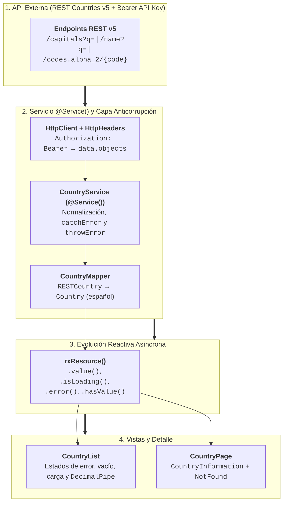

# Sección 10: CountryApp — Servicios, REST Countries API, Mappers y Resources

En esta sección conectamos **CountryApp** con datos reales procedentes de la **REST Countries API v5** (actualizada tras la retirada oficial de las versiones legacy v1–v4). Implementaremos el servicio singleton `CountryService` con el decorador `@Service()` de **Angular 22**, configuraremos la autenticación con **API Key** y orígenes permitidos (CORS), generaremos los contratos externos con QuickType y aplicaremos el **Patrón Mapper** (*Anti-Corruption Layer*) incluyendo la traducción al español y la prevención de errores de contexto `this`. Además, estudiaremos en tres fases progresivas cómo pasar de una suscripción manual (`.subscribe()`) a la reactividad asíncrona declarativa con **`resource()`** y **`rxResource()`**, centralizaremos los estados de carga/error/vacío en `CountryList` y construiremos la vista de detalle con estadísticas DaisyUI, un comparador de banderas (`diff`) y navegación hacia atrás con `Location`.

---

## 📋 Ficha Técnica y Objetivos Didácticos

* **Proyecto:** `country-app` (Capa de datos reales, transformación y reactividad asíncrona).
* **API Externa:** [REST Countries API v5](https://restcountries.com/docs/countries) (`https://api.restcountries.com/countries/v5`). Requiere **API Key gratuita** (`Authorization: Bearer <API_KEY>`).
* **Stack Tecnológico (Angular 22):** `@Service()`, `HttpClient` nativo (con Fetch por defecto), `HttpHeaders`, `environments`, RxJS (`map`, `catchError`, `throwError`, `delay`, `of`, `firstValueFrom`), Signals, `resource()`, `rxResource()`, `DecimalPipe`, `Location`.
* **Patrones Arquitectónicos:**
    * **Data Mapper Pattern:** Desacoplamiento total entre el DTO externo (`RESTCountriesV5Response` / `RESTCountry`) y el modelo de dominio (`Country`). Gracias a este patrón, la migración de v3.1 a v5 **no obliga a tocar ni una sola línea de las vistas HTML**.
    * **Declarative Async State:** Transición progresiva desde estado manual (`.subscribe()`) → Promesas (`resource()`) → Observables (`rxResource()`).
    * **Presentational State Inputs:** `CountryList` renderiza estados de error, carga y vacío recibidos desde cualquier página contenedor.
* **Código Fuente de Referencia (original v3.1):** [GitHub - DevTalles CountryApp (fin-seccion-10)](https://github.com/DevTalles-corp/angular-country-app/tree/fin-seccion-10) *(adaptado en esta guía a REST Countries v5)*.



---

## 1. REST Countries API v5, `HttpClient` en Angular 22 e Interfaces

!!! warning "⚠️ Aviso importante: Retirada de REST Countries v3.1 y migración a v5"
    En los vídeos originales del curso se utilizaba la URL pública sin clave `https://restcountries.com/v3.1/...`. **Esas versiones legacy (v1–v4) fueron retiradas oficialmente** (ver [aviso de deprecación oficial](https://restcountries.com/docs/countries/legacy-api-deprecation)) y ahora devuelven el error `countries.version_deprecated`.

    Esta guía está **completamente adaptada a REST Countries v5** (`https://api.restcountries.com/countries/v5`). Para que las peticiones funcionen desde Angular necesitas completar estos **2 pasos previos (2 minutos)**:

    1. **Obtener tu API Key gratuita:** regístrate en [restcountries.com/sign-up](https://restcountries.com/sign-up) (plan *Free*: 1.000 peticiones/mes, sin tarjeta de crédito) y crea una clave en la sección **API Keys**. *(Para pruebas rápidas en Postman o `curl` existe también la clave demo `rc_live_demo`, pero siempre devuelve un único objeto de muestra con el aviso `_demo`).*
    2. **Permitir `localhost` en CORS (imprescindible):** por seguridad, REST Countries v5 **bloquea por defecto las llamadas desde navegador** (política **CORS**, mecanismo de seguridad del navegador que exige que el servidor autorice explícitamente el dominio desde el que se llama). En la configuración de tu clave en la página **API Keys**, añade **`localhost`** en el campo **Allowed Origins** (solo el *hostname*, **sin** `http://` ni puerto `:4200`). Si usas `127.0.0.1`, añádelo separado por coma: `localhost, 127.0.0.1`. *(¿Es la primera vez que escuchas hablar de CORS? Consulta la explicación completa con diagrama en **[Manual 10: Qué es CORS y por qué falla en navegador](manual/10-http.md#seccion-7-cors-cross-origin-resource-sharing-y-proxy-de-desarrollo)**).*

!!! info "📖 Para saber más: Manual de Referencia"
    Para repasar la configuración del cliente HTTP, cabeceras, interceptores funcionales, gestión de errores y **CORS**, consulta el **[Manual de Referencia: 10. Cliente HTTP y Comunicación con APIs](manual/10-http.md)** (en concreto la **[Sección 7: CORS y Proxy de Desarrollo](manual/10-http.md#seccion-7-cors-cross-origin-resource-sharing-y-proxy-de-desarrollo)**).

### 1.1. Exploración de endpoints v5 en Postman

Antes de escribir código, probamos en Postman (o `curl`) los tres endpoints de [REST Countries v5](https://restcountries.com/docs/countries). En todos ellos debemos incluir la cabecera HTTP **`Authorization: Bearer TU_API_KEY`** (o `Bearer rc_live_demo` solo para ver la estructura del JSON):

* **Buscar por capital (subcadena, tolerante a tildes):** `GET https://api.restcountries.com/countries/v5/capitals?q=madrid`
* **Buscar por nombre de país (agregado `name`):** `GET https://api.restcountries.com/countries/v5/name?q=costa` *(busca en `names.common`, `names.official`, `names.alternates` y `names.native`; si quieres buscar también por traducciones al español como `"alemania"`, usa `/countries/v5/names.translations?q=alemania`)*.
* **Buscar por código Alpha exacto (2 o 3 letras):**
  * Código ISO Alpha-2: `GET https://api.restcountries.com/countries/v5/codes.alpha_2/ES`
  * Código ISO Alpha-3: `GET https://api.restcountries.com/countries/v5/codes.alpha_3/ESP`

!!! note "Cambio clave en la forma de respuesta de v5"
    A diferencia de v3.1 (que devolvía directamente un array `[...]`), **REST Countries v5 envuelve todas las respuestas exitosas** bajo un objeto con la forma `{ "data": { "objects": [ ... ], "meta": { "total": 1, "request_id": "..." } } }`. Los países se encuentran siempre dentro de **`resp.data.objects`**.

### 1.2. Configuración de `environments` y `HttpClient` en `src/app/app.config.ts`

Primero generamos los archivos de entorno para no escribir nuestra API Key directamente dentro del servicio (igual que hicimos en GifsApp):

```bash
ng g environments
```

Configuramos `src/environments/environment.ts` y `src/environments/environment.development.ts`:

```typescript title="src/environments/environment.development.ts"
export const environment = {
  restCountriesApiUrl: 'https://api.restcountries.com/countries/v5',
  restCountriesApiKey: 'TU_API_KEY_DE_REST_COUNTRIES',
};
```

En **Angular 21 y consolidado en Angular 22**, **`HttpClient` viene provisto automáticamente en `root`** y utiliza la **API nativa `Fetch`** como transporte por defecto. Por lo tanto, para realizar peticiones HTTP estándar en una aplicación nueva de Angular 22 **no es necesario añadir `provideHttpClient(withFetch())`** salvo que quieras configurar opciones avanzadas (como `withInterceptors([...])`).

=== "Angular 22 (Configuración por defecto)"
    ```typescript title="src/app/app.config.ts (Angular 22)"
    import { ApplicationConfig, provideBrowserGlobalErrorListeners } from '@angular/core';
    import { provideRouter } from '@angular/router';

    import { routes } from './app.routes';

    export const appConfig: ApplicationConfig = {
      providers: [
        provideBrowserGlobalErrorListeners(),
        provideRouter(routes),
      ],
    };
    ```

=== "Angular 19–21 / Características personalizadas"
    ```typescript title="src/app/app.config.ts (Angular 19–21 o con interceptores)" hl_lines="3 11"
    import { ApplicationConfig, provideZoneChangeDetection } from '@angular/core';
    import { provideRouter } from '@angular/router';
    import { provideHttpClient, withFetch } from '@angular/common/http';

    import { routes } from './app.routes';

    export const appConfig: ApplicationConfig = {
      providers: [
        provideZoneChangeDetection({ eventCoalescing: true }),
        provideRouter(routes),
        provideHttpClient(withFetch()),
      ],
    };
    ```

### 1.3. Generación del DTO Externo (`RESTCountriesV5Response` y `RESTCountry`) con QuickType

1. Copia el JSON devuelto por Postman al consultar `https://api.restcountries.com/countries/v5/capitals?q=madrid` (con tu cabecera `Authorization: Bearer ...`).
2. Crea `src/app/country/interfaces/rest-countries.interface.ts`.
3. Abre la paleta de comandos (++ctrl+shift+p++ / ++cmd+shift+p++), ejecuta **Paste JSON as Code** y escribe el nombre **`RESTCountriesV5Response`** (o define directamente el extracto tipado con los campos que usará el mapper):

!!! tip "Renombra `interface Object` → `interface RESTCountry` al usar QuickType"
    Como la propiedad del JSON se llama `"objects"`, QuickType la singularizará automáticamente como `export interface Object` (con `objects: Object[]` dentro de `Data`). Pon el cursor sobre `Object`, pulsa ++f2++ en VS Code y renómbralo a **`RESTCountry`**. Así evitas colisionar con el tipo global `Object` de JavaScript y coincidirá directamente con las importaciones de `CountryMapper`. *(Que QuickType genere campos adicionales o nombres distintos para sub-interfaces como `Names`, `Codes` o `Flag` no supone ningún problema).*

```typescript title="src/app/country/interfaces/rest-countries.interface.ts (Extracto principal v5)"
export interface RESTCountriesV5Response {
  data: {
    objects: RESTCountry[];
    meta: {
      total: number;
      request_id: string;
    };
  };
}

export interface RESTCountry {
  uuid:       string;
  names:      CountryNames;
  codes:      CountryCodes;
  capitals:   CountryCapital[];
  flag:       CountryFlag;
  region:     string;
  subregion:  string;
  population: number;
  // ... resto de los 90+ campos opcionales de v5 (area, borders, currencies, languages, etc.)
}

export interface CountryNames {
  common:       string;
  official:     string;
  translations: Record<string, Translation>;
}

export interface Translation {
  common:   string;
  official: string;
}

export interface CountryCodes {
  alpha_2: string;
  alpha_3: string;
  ccn3?:   string;
}

export interface CountryCapital {
  name: string;
}

export interface CountryFlag {
  emoji:       string;
  url_png:     string;
  url_svg:     string;
  description: string;
}
```

### 1.4. Entidad de Dominio (`Country`) y Patrón `CountryMapper`

Creamos nuestra interfaz limpia de dominio en `src/app/country/interfaces/country.interface.ts` con solo los campos que nuestra aplicación necesita (en la última fase de detalles añadiremos también `region` y `subRegion`):

```typescript title="src/app/country/interfaces/country.interface.ts"
export interface Country {
  cca2: string;
  flag: string;
  flagSvg: string;
  name: string;
  capital: string;
  population: number;

  region: string;
  subRegion: string;
}
```

Ahora implementamos `CountryMapper` en `src/app/country/mappers/country.mapper.ts` traduciendo el formato de **REST Countries v5** a nuestra entidad interna `Country`:

```typescript title="src/app/country/mappers/country.mapper.ts"
import type { Country } from '../interfaces/country.interface';
import type { RESTCountry } from '../interfaces/rest-countries.interface';

export class CountryMapper {
  // Transforma un único objeto RESTCountry (v5) => Country
  static mapRestCountryToCountry(restCountry: RESTCountry): Country {
    return {
      cca2: restCountry.codes.alpha_2,
      flag: restCountry.flag.emoji,
      flagSvg: restCountry.flag.url_svg,
      name:
        restCountry.names.translations?.['spa']?.common ??
        restCountry.names.common,
      capital:
        restCountry.capitals?.map((capital) => capital.name).join(', ') ||
        'Sin capital',
      population: restCountry.population,

      region: restCountry.region,
      subRegion: restCountry.subregion,
    };
  }

  // Transforma un array completo RESTCountry[] => Country[]
  static mapRestCountryArrayToCountryArray(
    restCountries: RESTCountry[]
  ): Country[] {
    return restCountries.map((restCountry) =>
      CountryMapper.mapRestCountryToCountry(restCountry)
    );
  }
}
```

!!! warning "Cuatro detalles fundamentales del Mapper explicados en clase"
    1. **Demostración real del Patrón Mapper (*Anti-Corruption Layer*):** cuando REST Countries cambió de v3.1 a v5, cambiaron casi todos los nombres de campo (`cca2` → `codes.alpha_2`, `flags.svg` → `flag.url_svg`, `capital: string[]` → `capitals: { name }[]`, `translations` → `names.translations`). Gracias a `CountryMapper`, **ningún componente visual (`CountryList`, `CountryInformation`, páginas) tiene que modificarse**.
    2. **Nombre del país en español (`'spa'`):** accedemos de forma segura a `restCountry.names.translations?.['spa']?.common`, recurriendo a `restCountry.names.common` como respaldo si faltase la traducción.
    3. **¿Por qué `capitals` es un array de objetos en v5?** Es un **array** porque existen países con **varias capitales oficiales** (por ejemplo, **Sudáfrica** tiene tres —Pretoria, Ciudad del Cabo y Bloemfontein— y **Bolivia** tiene dos —Sucre y La Paz—) y territorios **sin capital** (como la Antártida, con array vacío `[]`). Además, cada elemento es un **objeto** `{ name, coordinates, attributes }` porque v5 incluye las coordenadas y el rol institucional de cada capital (*primary*, *executive*, *legislative*, *judicial*, etc.). Por eso extraemos los nombres con `.map((capital) => capital.name)`, los unimos con `.join(', ')` y usamos `|| 'Sin capital'` como respaldo.
    4. **El error del `this` en `.pipe(map(...))`:** si en el servicio pasaras un método por referencia (`map(CountryMapper.mapRestCountryArrayToCountryArray)`) y dentro usaras `this.mapRestCountryToCountry`, JavaScript perdería el contexto de `this` (`undefined`). Por eso invocamos explícitamente `CountryMapper.mapRestCountryToCountry` dentro de una función flecha.

---

## 2. `CountryService`, `DecimalPipe`, Suscripción Manual y Excepciones

!!! info "📖 Para saber más: Manual de Referencia"
    Para dominar los servicios singleton con `@Service()` y el pipe `DecimalPipe`, consulta:
    * **[Manual de Referencia: 09. Servicios e Inyección de Dependencias](manual/09-servicios.md)**
    * **[Manual de Referencia: 06. Pipes Nativos (`DecimalPipe`)](manual/06-pipes.md)**

### 2.1. Construcción Progresiva de `CountryService` (`@Service()`, `HttpHeaders` y `catchError`)

En **Angular 22**, definimos el servicio directamente con **`@Service()`** (equivalente moderno, autónomo y *tree-shakeable* de `@Injectable({ providedIn: 'root' })`). Para no introducir varios conceptos nuevos de golpe, construiremos `src/app/country/services/country.service.ts` en **tres fases progresivas**:

#### Fase A: Petición autenticada con `HttpHeaders` y `params`

Antes de escribir el método, entendamos los dos elementos nuevos de `@angular/common/http` que pasamos en el segundo argumento de `http.get(url, opciones)`:

* **`HttpHeaders` (cabeceras HTTP):** es el equivalente en Angular a la pestaña **Headers** de Postman. Como REST Countries v5 requiere autenticación, creamos un objeto inmutable `new HttpHeaders({ Authorization: ... })` que adjunta la cabecera `Authorization: Bearer <API_KEY>` en cada petición. *(Consulta más detalles en [Manual 10: Cabeceras HTTP (`HttpHeaders`)](manual/10-http.md#18-cabeceras-http-httpheaders)).*
* **`params: { q: query }` (parámetros de consulta):** construye automáticamente la cadena `?q=...` al final de la URL (por ejemplo `/capitals?q=madrid`) y **codifica de forma segura espacios y tildes** (`bogotá`, `new delhi`) sin tener que concatenar texto a mano. *(Ver [Manual 10: Parámetros de consulta](manual/10-http.md#17-parametros-de-consulta-httpparams)).*

Creamos `country.service.ts` devolviendo inicialmente la respuesta tipada cruda de v5 (`RESTCountriesV5Response`):

```typescript title="src/app/country/services/country.service.ts (Fase A: petición con cabeceras y params)"
import { HttpClient, HttpHeaders } from '@angular/common/http';
import { inject, Service } from '@angular/core';
import { Observable } from 'rxjs';

import { environment } from '../../../environments/environment';
import type { RESTCountriesV5Response } from '../interfaces/rest-countries.interface';

@Service()
export class CountryService {
  private http = inject(HttpClient);
  private headers = new HttpHeaders({
    Authorization: `Bearer ${environment.restCountriesApiKey}`,
  });

  searchByCapital(query: string): Observable<RESTCountriesV5Response> {
    query = query.toLowerCase().trim();

    return this.http.get<RESTCountriesV5Response>(
      `${environment.restCountriesApiUrl}/capitals`,
      {
        headers: this.headers,
        params: { q: query },
      }
    );
  }
}
```

#### Fase B: Transformar la respuesta con `map` y `CountryMapper`

Los componentes de la interfaz no deben conocer la estructura interna `{ data: { objects: [...] } }` de REST Countries v5, sino trabajar únicamente con nuestro modelo limpio `Country[]`. Encadenamos `.pipe(map(...))` para extraer `resp.data.objects` y pasarlo por `CountryMapper`:

```typescript title="src/app/country/services/country.service.ts (Fase B: añadiendo CountryMapper)" hl_lines="3 7-8 17 28-32"
import { HttpClient, HttpHeaders } from '@angular/common/http';
import { inject, Service } from '@angular/core';
import { map, Observable } from 'rxjs';

import { environment } from '../../../environments/environment';
import type { RESTCountriesV5Response } from '../interfaces/rest-countries.interface';
import type { Country } from '../interfaces/country.interface';
import { CountryMapper } from '../mappers/country.mapper';

@Service()
export class CountryService {
  private http = inject(HttpClient);
  private headers = new HttpHeaders({
    Authorization: `Bearer ${environment.restCountriesApiKey}`,
  });

  searchByCapital(query: string): Observable<Country[]> {
    query = query.toLowerCase().trim();

    return this.http
      .get<RESTCountriesV5Response>(
        `${environment.restCountriesApiUrl}/capitals`,
        {
          headers: this.headers,
          params: { q: query },
        }
      )
      .pipe(
        map((resp) =>
          CountryMapper.mapRestCountryArrayToCountryArray(resp.data.objects)
        )
      );
  }
}
```

#### Fase C: Gestión de errores con `catchError` y `throwError`

¿Qué ocurre si falla la conexión, si la API Key es inválida (`401`) o si la API responde con un error (`400` / `429` / `500`)? Aquí introducimos dos herramientas fundamentales de **RxJS** que aparecen por primera vez en el curso:

* **`catchError((error) => ...)`:** operador de RxJS que funciona como un **`try / catch` dentro de una tubería `.pipe()`**. Si el Observable de `http.get(...)` emite un error técnico (`HttpErrorResponse`), `catchError` lo intercepta antes de llegar al componente.
* **`throwError(() => new Error(...))`:** en lugar de *ocultar* el fallo devolviendo un array vacío, creamos un nuevo Observable fallido con un **mensaje claro y comprensible** para la capa de presentación (que recogerá el bloque `error:` de `.subscribe()` o la señal `countryResource.error()`). Se pasa una función flecha (`() => new Error(...)`) para que el error se instancie únicamente en el momento de la suscripción.

!!! info "📖 Profundiza en el Manual de Referencia"
    Consulta **[Manual 10: Gestión de errores en `HttpClient`](manual/10-http.md#15-gestion-de-errores)** para ver cómo inspeccionar códigos de estado (`error.status`) y distinguir errores de red frente a errores del servidor.

Añadimos `catchError` y `throwError` al `.pipe(...)` de `searchByCapital`:

```typescript title="src/app/country/services/country.service.ts (Fase C: con control de errores)" hl_lines="3 32-38"
import { HttpClient, HttpHeaders } from '@angular/common/http';
import { inject, Service } from '@angular/core';
import { map, Observable, catchError, throwError } from 'rxjs';

import { environment } from '../../../environments/environment';
import type { RESTCountriesV5Response } from '../interfaces/rest-countries.interface';
import type { Country } from '../interfaces/country.interface';
import { CountryMapper } from '../mappers/country.mapper';

@Service()
export class CountryService {
  private http = inject(HttpClient);
  private headers = new HttpHeaders({
    Authorization: `Bearer ${environment.restCountriesApiKey}`,
  });

  searchByCapital(query: string): Observable<Country[]> {
    query = query.toLowerCase().trim();

    return this.http
      .get<RESTCountriesV5Response>(
        `${environment.restCountriesApiUrl}/capitals`,
        {
          headers: this.headers,
          params: { q: query },
        }
      )
      .pipe(
        map((resp) =>
          CountryMapper.mapRestCountryArrayToCountryArray(resp.data.objects)
        ),
        catchError((error) => {
          console.log('Error fetching ', error);

          return throwError(
            () => new Error(`No se pudieron obtener países con la búsqueda «${query}»`)
          );
        })
      );
  }
}
```

### 2.2. Fase 1 en `ByCapitalPage`: Suscripción manual con `.subscribe()`

Antes de introducir `resource()` y `rxResource()`, resulta muy instructivo implementar la primera versión controlando manualmente el ciclo completo de la petición HTTP con tres señales (`isLoading`, `isError`, `countries`) y `.subscribe({ next, error })`:

```typescript title="src/app/country/pages/by-capital-page/by-capital-page.ts (Fase 1: Manual)" hl_lines="13 15-17 21 23-35"
import { Component, inject, signal } from '@angular/core';
import { SearchInput } from '../../components/search-input/search-input';
import { CountryList } from '../../components/country-list/country-list';
import { CountryService } from '../../services/country.service';
import type { Country } from '../../interfaces/country.interface';

@Component({
  selector: 'app-by-capital-page',
  imports: [SearchInput, CountryList],
  templateUrl: './by-capital-page.html',
})
export class ByCapitalPage {
  countryService = inject(CountryService);

  isLoading = signal(false);
  isError = signal<string | null>(null);
  countries = signal<Country[]>([]);

  onSearch(query: string) {
    // Bloqueo preventivo: evita peticiones duplicadas si ya hay una en curso
    if (this.isLoading()) return;

    this.isLoading.set(true);
    this.isError.set(null);

    this.countryService.searchByCapital(query).subscribe({
      next: (countries) => {
        this.isLoading.set(false);
        this.countries.set(countries);
      },
      error: (err) => {
        this.isLoading.set(false);
        this.countries.set([]);
        this.isError.set(err);
      },
    });
  }
}
```

!!! tip "💡 Primera vez en el curso: el objeto *Observer* `{ next, error, complete }` en `.subscribe()`"
    En GifsApp (Secciones 07 y 08) solo pasamos una función directa a `.subscribe((resp) => { ... })`, que es un atajo para manejar únicamente el caso de éxito. Cuando necesitamos controlar también los errores, pasamos un **objeto Observador (*Observer*)** con sus *callbacks* por nombre:

    * **`next`:** se ejecuta cuando el Observable emite un valor correctamente (aquí recibe el array `countries`).
    * **`error`:** se ejecuta si ocurre un error en la petición o en el `.pipe()` (recibe el `Error` lanzado por `throwError`) y da por terminada la suscripción.
    * **`complete`** *(opcional)*: se ejecuta cuando el Observable se cierra sin errores (en `HttpClient`, justo después de emitir la respuesta).

    Consulta el ciclo de vida completo con diagramas en el **[Manual de Referencia: 10. Cliente HTTP y RxJS (Anatomía de un Observable)](manual/10-http.md#22-anatomia-y-ciclo-de-vida-de-un-observable)**.

```html title="src/app/country/pages/by-capital-page/by-capital-page.html (Fase 1)"
<country-search-input
  placeholder="Buscar por capital"
  (value)="onSearch($event)"
/>

@if (isError()) {
  <h3>{{ isError() }}</h3>
} @else {
  <country-list [countries]="countries()" />
}
```

### 2.3. Renderizado en `CountryList` con `DecimalPipe`

Actualizamos `CountryList` para recibir `countries = input.required<Country[]>()` y formatear la población con separadores de miles usando `DecimalPipe` (`| number`):

=== "country-list.ts"
    ```typescript title="src/app/country/components/country-list/country-list.ts" hl_lines="2-3 7 11"
    import { Component, input } from '@angular/core';
    import { Country } from '../../interfaces/country.interface';
    import { DecimalPipe } from '@angular/common';

    @Component({
      selector: 'country-list',
      imports: [DecimalPipe],
      templateUrl: './country-list.html',
    })
    export class CountryList {
      countries = input.required<Country[]>();
    }
    ```

=== "country-list.html"
    ```html title="src/app/country/components/country-list/country-list.html" hl_lines="14-27"
    <section class="mt-5">
      <table class="table table-md mt-2 w-full">
        <thead>
          <tr>
            <th>#</th>
            <th>Icono</th>
            <th>Bandera</th>
            <th>Nombre</th>
            <th>Capital</th>
            <th>Población</th>
            <th></th>
          </tr>
        </thead>
        <tbody>
          @for (country of countries(); track country.cca2; let index = $index) {
          <tr>
            <td>{{ index + 1 }}</td>
            <td>{{ country.flag }}</td>
            <td>
              
            </td>
            <td>{{ country.name }}</td>
            <td>{{ country.capital }}</td>
            <td>
              <span class="badge badge-secondary">
                {{ country.population | number }}
              </span>
            </td>
            <td>
              <a class="link-primary cursor-pointer">Más información</a>
            </td>
          </tr>
          }
        </tbody>
      </table>
    </section>
    ```

---

## 3. La Revolución Asíncrona: `resource()` y `rxResource()`

Gestionar manualmente `isLoading`, `isError`, `countries`, bloquear peticiones simultáneas y recordar actualizar todos los indicadores de estado en `next` y `error` genera mucho código repetitivo (*boilerplate*) y es propenso a *race conditions* si el usuario escribe rápido.

Para resolverlo de raíz, **Angular 22** consolida como APIs **estables** la familia **Resource API**: `resource()`, `rxResource()` y `httpResource()`.

!!! info "📖 Para saber más: Manual de Referencia"
    Para una explicación completa del grafo reactivo de señales asíncronas y el ciclo de vida de `resource()`, `rxResource()` y `httpResource()`, consulta:
    * **[Manual de Referencia: 05. Signals y Reactividad](manual/05-signals.md#resource-y-rxresource-reactividad-asincrona-con-signals)**
    * **[Manual de Referencia: 10. Cliente HTTP (`resource()`, `rxResource()`, `httpResource()`)](manual/10-http.md)**

### 3.1. Fase 2: Reactividad basada en Promesas con `resource()` y `firstValueFrom`

En este primer salto evolutivo eliminamos las tres señales manuales (`isLoading`, `isError`, `countries`) y el método `onSearch`. En su lugar declaramos únicamente una señal disparadora (`query = signal('')`) y conectamos **`resource()`**:

```typescript title="src/app/country/pages/by-capital-page/by-capital-page.ts (Fase 2: resource)" hl_lines="1-2 14 16-26"
import { Component, inject, resource, signal } from '@angular/core';
import { firstValueFrom } from 'rxjs';
import { SearchInput } from '../../components/search-input/search-input';
import { CountryList } from '../../components/country-list/country-list';
import { CountryService } from '../../services/country.service';

@Component({
  selector: 'app-by-capital-page',
  imports: [SearchInput, CountryList],
  templateUrl: './by-capital-page.html',
})
export class ByCapitalPage {
  countryService = inject(CountryService);
  query = signal('');

  countryResource = resource({
    request: () => ({ query: this.query() }),
    loader: async ({ request }) => {
      if (!request.query) return [];

      // resource() espera una Promesa: convertimos el Observable con firstValueFrom
      return await firstValueFrom(
        this.countryService.searchByCapital(request.query)
      );
    },
  });
}
```

* **`request` (disparador reactivo):** cada vez que cambia alguna señal leída dentro de `request` (aquí `this.query()`), Angular ejecuta automáticamente el `loader` y cancela cualquier ejecución previa pendiente.
* **`if (!request.query) return [];`:** al montar el componente `query()` vale `''`; devolvemos un array vacío sin disparar ninguna llamada HTTP innecesaria.
* **Señales expuestas automáticamente por `countryResource`:** `.value()`, `.isLoading()`, `.error()`, `.hasValue()`, `.status()` y `.reload()`.

### 3.2. 🎯 Tarea Práctica: Búsqueda por País (`searchByCountry`) y Navegación al Detalle

#### 📋 Enunciado del Reto

Antes de dar el salto a `rxResource()`, replica lo que acabas de construir en *Por capital* para habilitar la búsqueda **Por país** y preparar el enlace hacia la ficha de detalle:

1. **En `CountryService`:** añade el método `searchByCountry(query: string): Observable<Country[]>` con la misma estructura que `searchByCapital`, apuntando al endpoint **`/name`** de REST Countries v5 (cabecera `Authorization`, `params: { q: query }`, extracción de `resp.data.objects` con `CountryMapper` y gestión de errores con `catchError` + `throwError`). *(Si deseas buscar también por nombres en español como `"alemania"`, puedes apuntar a `/names.translations` con el mismo parámetro `q`).*
2. **En `ByCountryPage`:** declara la señal `query = signal('')`, inyecta `CountryService` y conecta **`resource()`** (usando `firstValueFrom`) con `searchByCountry(request.query)`. Enlaza `<country-search-input />` y `<country-list />` en `by-country-page.html`.
3. **En `CountryList`:** importa `RouterLink` y enlaza el botón **Más información** a la ruta dinámica `/country/by/:code` pasando el código `country.cca2` de cada fila.

#### ⏸️ Reto Práctico: ¡Inténtalo tú mismo!

!!! exercise "Pausa de Trabajo Autónomo"
    Detente aquí e implementa los tres puntos anteriores antes de mirar la solución.

    **Criterio de éxito:** Al navegar a **Por país** y buscar `"costa"`, deben aparecer los resultados en la tabla; al pulsar **Más información** en Costa Rica, la barra de direcciones debe cambiar a `/country/by/CR`.

#### ⚠️ Errores Típicos

* **Olvidar importar `RouterLink` en `CountryList`:** si no lo añades al array `imports` de `@Component`, el enlace `[routerLink]` no hará nada al pulsar sobre él.
* **Omitir la barra inicial en `'/country/by'`:** si escribes `['country/by', country.cca2]` (ruta relativa), Angular intentará navegar a `/country/by-country/country/by/CR`. Con la barra inicial `['/country/by', country.cca2]` navega siempre a la ruta absoluta correcta.
* **No comprobar `if (!request.query) return [];`:** al abrir la página se lanzaría una petición con `?q=` vacío y REST Countries v5 respondería con error HTTP `400`.

#### ✅ Solución de la Tarea Práctica

=== "country.service.ts (método añadido)"
    ```typescript title="src/app/country/services/country.service.ts (añadir searchByCountry)"
      searchByCountry(query: string): Observable<Country[]> {
        query = query.toLowerCase().trim();

        return this.http
          .get<RESTCountriesV5Response>(
            `${environment.restCountriesApiUrl}/name`,
            {
              headers: this.headers,
              params: { q: query },
            }
          )
          .pipe(
            map((resp) =>
              CountryMapper.mapRestCountryArrayToCountryArray(resp.data.objects)
            ),
            catchError((error) => {
              console.log('Error fetching ', error);

              return throwError(
                () =>
                  new Error(`No se pudieron obtener países con la búsqueda «${query}»`)
              );
            })
          );
      }
    ```

=== "by-country-page.ts y html"
    ```typescript title="src/app/country/pages/by-country-page/by-country-page.ts (con resource)"
    import { Component, inject, resource, signal } from '@angular/core';
    import { firstValueFrom } from 'rxjs';
    import { SearchInput } from '../../components/search-input/search-input';
    import { CountryList } from '../../components/country-list/country-list';
    import { CountryService } from '../../services/country.service';

    @Component({
      selector: 'app-by-country-page',
      imports: [SearchInput, CountryList],
      templateUrl: './by-country-page.html',
    })
    export class ByCountryPage {
      countryService = inject(CountryService);
      query = signal('');

      countryResource = resource({
        request: () => ({ query: this.query() }),
        loader: async ({ request }) => {
          if (!request.query) return [];

          return await firstValueFrom(
            this.countryService.searchByCountry(request.query)
          );
        },
      });
    }
    ```

    ```html title="src/app/country/pages/by-country-page/by-country-page.html"
    <country-search-input
      placeholder="Buscar por país"
      (value)="query.set($event)"
    />

    @if (countryResource.error()) {
      <h3>{{ countryResource.error() }}</h3>
    } @else {
      <country-list [countries]="countryResource.value() ?? []" />
    }
    ```

=== "country-list.ts y html"
    ```typescript title="src/app/country/components/country-list/country-list.ts" hl_lines="4 8"
    import { Component, input } from '@angular/core';
    import { Country } from '../../interfaces/country.interface';
    import { DecimalPipe } from '@angular/common';
    import { RouterLink } from '@angular/router';

    @Component({
      selector: 'country-list',
      imports: [DecimalPipe, RouterLink],
      templateUrl: './country-list.html',
    })
    export class CountryList {
      countries = input.required<Country[]>();
    }
    ```

    ```html title="src/app/country/components/country-list/country-list.html (Enlace a detalle)" hl_lines="2-5"
    <td>
      <a
        [routerLink]="['/country/by', country.cca2]"
        class="link-primary cursor-pointer"
        >Más información</a
      >
    </td>
    ```

### 3.3. Fase 3: Observables puros sin `firstValueFrom` usando `rxResource()`

Dado que `HttpClient` y nuestros métodos de `CountryService` ya trabajan con **Observables de RxJS**, tener que transformarlos a Promesas con `await firstValueFrom(...)` dentro de `resource()` añade fricción innecesaria.

La función **`rxResource()`** (de `@angular/core/rxjs-interop`) funciona exactamente igual que `resource()`, pero permite que `loader` devuelva directamente un **`Observable`**:

```typescript title="src/app/country/pages/by-capital-page/by-capital-page.ts (Fase 3: rxResource)" hl_lines="2-3 18-25"
import { Component, inject, signal } from '@angular/core';
import { rxResource } from '@angular/core/rxjs-interop';
import { of } from 'rxjs';

import { SearchInput } from '../../components/search-input/search-input';
import { CountryList } from '../../components/country-list/country-list';
import { CountryService } from '../../services/country.service';

@Component({
  selector: 'app-by-capital-page',
  imports: [SearchInput, CountryList],
  templateUrl: './by-capital-page.html',
})
export class ByCapitalPage {
  countryService = inject(CountryService);
  query = signal('');

  countryResource = rxResource({
    request: () => ({ query: this.query() }),
    loader: ({ request }) => {
      if (!request.query) return of([]);

      return this.countryService.searchByCapital(request.query);
    },
  });
}
```

Y aplicamos exactamente el mismo patrón en `ByCountryPage` llamando a `this.countryService.searchByCountry(request.query)`:

```typescript title="src/app/country/pages/by-country-page/by-country-page.ts" hl_lines="18-25"
import { Component, inject, signal } from '@angular/core';
import { rxResource } from '@angular/core/rxjs-interop';
import { of } from 'rxjs';

import { SearchInput } from '../../components/search-input/search-input';
import { CountryList } from '../../components/country-list/country-list';
import { CountryService } from '../../services/country.service';

@Component({
  selector: 'app-by-country-page',
  imports: [SearchInput, CountryList],
  templateUrl: './by-country-page.html',
})
export class ByCountryPage {
  countryService = inject(CountryService);
  query = signal('');

  countryResource = rxResource({
    request: () => ({ query: this.query() }),
    loader: ({ request }) => {
      if (!request.query) return of([]);

      return this.countryService.searchByCountry(request.query);
    },
  });
}
```

*Observa el detalle clave:* cuando `!request.query`, ya no podemos devolver `[]` a secas; como `rxResource` exige un `Observable`, envolvemos el array vacío con la función creacional **`of([])`** de RxJS.

!!! tip "💡 Angular 22: Novedades de nomenclatura en Resource API y `httpResource()`"
    * **API estable y alias unificados:** en Angular 19–20 nacieron las propiedades `request` y `loader` (presentes en el código del curso). En la estabilización hacia **Angular 22**, la firma moderna unificada permite usar **`params`** en lugar de `request` y, en el caso de `rxResource()`, **`stream`** en lugar de `loader` (`params: () => ({ query: this.query() }), stream: ({ params }) => ...`). Conocer ambas nomenclaturas te permitirá leer tanto el código del curso como cualquier proyecto nuevo en Angular 22.
    * **Alternativa directa `httpResource()`:** cuando un componente solo necesita hacer un `GET` sencillo sin lógica de caché en el servicio, Angular 22 ofrece **`httpResource()`** (`@angular/common/http`), capaz de reactivar la petición automáticamente cuando cambia una señal en la URL:
      ```typescript
      import { httpResource } from '@angular/common/http';
      // Si la función devuelve undefined, no dispara la petición HTTP
      rawResource = httpResource<RESTCountriesV5Response>(() =>
        this.query()
          ? {
              url: `${environment.restCountriesApiUrl}/capitals`,
              params: { q: this.query() },
              headers: { Authorization: `Bearer ${environment.restCountriesApiKey}` },
            }
          : undefined
      );
      ```
      En CountryApp seguimos usando `CountryService` + `rxResource()` para conservar el Patrón Mapper, el manejo de errores y la caché en memoria que implementaremos en la Sección 11.

---

## 4. Mostrar Estados al Usuario en `CountryList`

Para visualizar claramente el estado de carga durante las pruebas, simulamos una latencia de 2 segundos en `searchByCountry` encadenando el operador RxJS **`delay(2000)`** dentro del `.pipe(...)`:

```typescript title="src/app/country/services/country.service.ts (Simulación de latencia)" hl_lines="10"
    return this.http
      .get<RESTCountriesV5Response>(`${environment.restCountriesApiUrl}/name`, {
        headers: this.headers,
        params: { q: query },
      })
      .pipe(
        map((resp) =>
          CountryMapper.mapRestCountryArrayToCountryArray(resp.data.objects)
        ),
        delay(2000), // Simula conexión lenta de red
        catchError((error) => { ... })
      );
```

En lugar de duplicar bloques `@if` de carga/error/vacío en cada página, delegamos la presentación de esos estados a `CountryList` mediante **tres Signal Inputs opcionales**:

=== "country-list.ts"
    ```typescript title="src/app/country/components/country-list/country-list.ts" hl_lines="14-16"
    import { Component, input } from '@angular/core';
    import { Country } from '../../interfaces/country.interface';
    import { DecimalPipe } from '@angular/common';
    import { RouterLink } from '@angular/router';

    @Component({
      selector: 'country-list',
      imports: [DecimalPipe, RouterLink],
      templateUrl: './country-list.html',
    })
    export class CountryList {
      countries = input.required<Country[]>();

      errorMessage = input<string | unknown | null>();
      isLoading = input<boolean>(false);
      isEmpty = input<boolean>(false);
    }
    ```

=== "country-list.html"
    ```html title="src/app/country/components/country-list/country-list.html" hl_lines="39-59"
    <section class="mt-5">
      <table class="table table-md mt-2 w-full">
        <thead>
          <tr>
            <th>#</th>
            <th>Icono</th>
            <th>Bandera</th>
            <th>Nombre</th>
            <th>Capital</th>
            <th>Población</th>
            <th></th>
          </tr>
        </thead>
        <tbody>
          @for (country of countries(); track country.cca2; let index = $index) {
          <tr>
            <td>{{ index + 1 }}</td>
            <td>{{ country.flag }}</td>
            <td>
              
            </td>
            <td>{{ country.name }}</td>
            <td>{{ country.capital }}</td>
            <td>
              <span class="badge badge-secondary">
                {{ country.population | number }}
              </span>
            </td>
            <td>
              <a
                [routerLink]="['/country/by', country.cca2]"
                class="link-primary cursor-pointer"
                >Más información</a
              >
            </td>
          </tr>
          }

          @if (errorMessage()) {
          <tr>
            <td colspan="8" class="text-center">
              {{ errorMessage() }}
            </td>
          </tr>
          }

          <!--  -->
          @if (countries().length === 0 && !isLoading()) {
          <tr>
            <td colspan="8" class="text-center">No se encontraron resultados</td>
          </tr>
          }

          <!--  -->
          @if (isLoading()) {
          <tr>
            <td colspan="8" class="text-center">Buscando países</td>
          </tr>
          }
        </tbody>
      </table>
    </section>
    ```

!!! note "Dos detalles clave de implementación en `CountryList`"
    * **¿Por qué `errorMessage = input<string | unknown | null>()` incluye `unknown`?** Porque la señal `countryResource.error()` de Angular devuelve exactamente el tipo `Signal<unknown>`. Aceptar `unknown` evita errores de compilación al enlazar `[errorMessage]="countryResource.error()"`.
    * **Comentarios `<!-- -->` entre bloques `@if`:** cuando colocamos varios `@if` seguidos dentro de un `<tbody>`, el servicio de lenguaje de Angular en VS Code a veces pierde el autocompletado al pegar bloques contiguos; separar los bloques con un comentario HTML vacío `<!-- -->` resuelve el problema visual y de IntelliSense.

Ahora conectamos las cuatro propiedades en `by-capital-page.html` y `by-country-page.html`:

```html title="src/app/country/pages/by-capital-page/by-capital-page.html" hl_lines="6-11"
<country-search-input
  placeholder="Buscar por capital"
  (value)="query.set($event)"
/>

<country-list
  [countries]="countryResource.value() ?? []"
  [errorMessage]="countryResource.error()"
  [isEmpty]="countryResource.value()?.length === 0"
  [isLoading]="countryResource.isLoading()"
/>
```

*(En `by-country-page.html` solo cambia el `placeholder="Buscar por país"`).*

---

## 5. Vista de Detalle (`CountryPage`), `NotFound` y `CountryInformation`

Cuando el usuario hace clic en **"Más información"** sobre cualquier fila, navega a `/country/by/:code` (por ejemplo `/country/by/ESP`). Veamos cómo se construye esta pantalla en sus cuatro piezas:

### 5.1. `searchCountryByAlphaCode` en `CountryService`

En **REST Countries v5**, las búsquedas por código ISO exacto utilizan `/codes.alpha_2/{code}` (2 letras, como `ES` o `CR`) o `/codes.alpha_3/{code}` (3 letras, como `ESP` o `CRI`), y siempre devuelven un array dentro de `resp.data.objects`.

Además, como v5 puede responder con HTTP `200` y un array vacío `objects: []` cuando no existe ningún país con ese código, comprobamos explícitamente `if (!country)` y lanzamos un `Error` para que `countryResource.error()` active el componente `<app-not-found />`:

```typescript title="src/app/country/services/country.service.ts (Método de detalle v5)" hl_lines="2-3 5 7-15"
  searchCountryByAlphaCode(code: string) {
    const property = code.length === 3 ? 'codes.alpha_3' : 'codes.alpha_2';
    const url = `${environment.restCountriesApiUrl}/${property}/${code}`;

    return this.http.get<RESTCountriesV5Response>(url, { headers: this.headers }).pipe(
      map((resp) =>
        CountryMapper.mapRestCountryArrayToCountryArray(resp.data.objects)
      ),
      map((countries) => {
        const country = countries.at(0);
        if (!country) {
          throw new Error(`No se encontró ningún país con el código ${code}`);
        }
        return country;
      }),
      catchError((error) => {
        console.log('Error fetching ', error);

        return throwError(
          () => new Error(`No se pudo obtener ningún país con el código ${code}`)
        );
      })
    );
  }
```

### 5.2. Componente reutilizable `NotFound` y servicio `Location`

Creamos `src/app/shared/components/not-found/` para mostrar una vista amigable cuando el usuario introduce un código de país inexistente.  
Para el enlace **"Volver"**, inyectamos el servicio **`Location`** de `@angular/common` y ejecutamos **`this.location.back()`** (historial nativo del navegador). Así el botón devuelve al usuario exactamente a la pantalla desde la que vino (sea *Por capital*, *Por país* o *Por región*), manteniendo `NotFound` 100% reutilizable:

=== "not-found.ts"
    ```typescript title="src/app/shared/components/not-found/not-found.ts" hl_lines="1 10 13"
    import { Location } from '@angular/common';
    import { Component, inject } from '@angular/core';

    @Component({
      selector: 'app-not-found',
      imports: [],
      templateUrl: './not-found.html',
    })
    export class NotFound {
      location = inject(Location);

      goBack() {
        this.location.back();
      }
    }
    ```

=== "not-found.html"
    ```html title="src/app/shared/components/not-found/not-found.html" hl_lines="25"
    <section class="flex flex-col items-center justify-center mt-10">
      <svg
        xmlns="http://www.w3.org/2000/svg"
        width="75"
        height="75"
        viewBox="0 0 24 24"
      >
        <rect width="24" height="24" fill="none" />
        <g
          fill="none"
          stroke="currentColor"
          stroke-linecap="round"
          stroke-width="2"
        >
          <path
            stroke-linejoin="round"
            d="M14 19c3.771 0 5.657 0 6.828-1.172S22 14.771 22 11s0-5.657-1.172-6.828S17.771 3 14 3h-4C6.229 3 4.343 3 3.172 4.172S2 7.229 2 11s0 5.657 1.172 6.828c.653.654 1.528.943 2.828 1.07"
          />
          <path
            d="M14 19c-1.236 0-2.598.5-3.841 1.145c-1.998 1.037-2.997 1.556-3.489 1.225s-.399-1.355-.212-3.404L6.5 17.5m3.379-8.621L12 11m0 0l2.121 2.121M12 11l2.121-2.121M12 11l-2.121 2.121"
          />
        </g>
      </svg>
      <h1>No se encontró el país</h1>
      <a (click)="goBack()" class="link-primary cursor-pointer">Volver</a>
    </section>
    ```

### 5.3. Página Orquestadora `CountryPage`

Captura el segmento dinámico `:code` de la URL mediante `inject(ActivatedRoute).snapshot.params['code']`, consulta el país con `rxResource` y decide qué subcomponente mostrar en función del estado del recurso (`error()`, `isLoading()`, `hasValue()`):

=== "country-page.ts"
    ```typescript title="src/app/country/pages/country-page/country-page.ts" hl_lines="14 17-22"
    import { Component, inject } from '@angular/core';
    import { rxResource } from '@angular/core/rxjs-interop';
    import { ActivatedRoute } from '@angular/router';
    import { CountryService } from '../../services/country.service';
    import { NotFound } from '../../../shared/components/not-found/not-found';
    import { CountryInformation } from './country-information/country-information';

    @Component({
      selector: 'app-country-page',
      imports: [NotFound, CountryInformation],
      templateUrl: './country-page.html',
    })
    export class CountryPage {
      countryCode = inject(ActivatedRoute).snapshot.params['code'];
      countryService = inject(CountryService);

      countryResource = rxResource({
        request: () => ({ code: this.countryCode }),
        loader: ({ request }) => {
          return this.countryService.searchCountryByAlphaCode(request.code);
        },
      });
    }
    ```

=== "country-page.html"
    ```html title="src/app/country/pages/country-page/country-page.html"
    <!--  -->
    @if (countryResource.error()) {
    <app-not-found />
    }

    <!--  -->
    @if (countryResource.isLoading()) {
    <h1 class="text-3xl">Cargando...</h1>
    }

    <!--  -->
    @if (countryResource.hasValue()) {
    <country-information-page [country]="countryResource.value()!" />
    }
    ```

### 5.4. Subcomponente Presentacional `CountryInformation`

Recibe el país validado mediante `country = input.required<Country>()` y calcula `currentYear = computed(() => new Date().getFullYear())` (ya que las plantillas HTML de Angular no permiten instanciar clases con `new Date()` directamente).

Para la interfaz combinamos las tarjetas **`stats`** de DaisyUI (Población, Nombre, Sub Región y Bandera) con el componente interactivo **`diff aspect-[16/9]`**, que superpone la bandera nítida sobre una versión desenfocada (`blur brightness-75`) con un deslizador arrastrable (`diff-resizer`):

=== "country-information.ts"
    ```typescript title="src/app/country/pages/country-page/country-information/country-information.ts" hl_lines="11 13-15"
    import { Component, computed, input } from '@angular/core';
    import { Country } from '../../../interfaces/country.interface';
    import { DecimalPipe } from '@angular/common';

    @Component({
      selector: 'country-information-page',
      imports: [DecimalPipe],
      templateUrl: './country-information.html',
    })
    export class CountryInformation {
      country = input.required<Country>();

      currentYear = computed(() => {
        return new Date().getFullYear();
      });
    }
    ```

=== "country-information.html"
    ```html title="src/app/country/pages/country-page/country-information/country-information.html" hl_lines="8 35-46"
    <section class="mx-10">
      <h1 class="text-3xl">{{ country().name }}</h1>
      <h2 class="text-xl font-thin">
        Población {{ country().population | number }}
      </h2>
    </section>

    <section class="stats shadow mx-5">
      <div class="stat place-items-center">
        <div class="stat-title">Población</div>
        <div class="stat-value">{{ country().population | number }}</div>
        <div class="stat-desc">Desde {{ currentYear() }}</div>
      </div>

      <div class="stat place-items-center">
        <div class="stat-title">Nombre</div>
        <div class="stat-value text-secondary">{{ country().name }}</div>
        <div class="stat-desc text-secondary">{{ country().region }}</div>
      </div>

      <div class="stat place-items-center">
        <div class="stat-title">Sub Region</div>
        <div class="stat-value">{{ country().subRegion }}</div>
        <div class="stat-desc">{{ country().region }}</div>
      </div>

      <div class="stat place-items-center">
        <div class="stat-title">Bandera</div>
        <div class="stat-value">{{ country().flag }}</div>
        <div class="stat-desc">{{ country().subRegion }}</div>
      </div>
    </section>

    <section class="diff aspect-[16/9]">
      <div class="diff-item-1">
        
      </div>
      <div class="diff-item-2">
        
      </div>
      <div class="diff-resizer"></div>
    </section>
    ```

---

## 💡 Evolución Angular 22: Resumen de Prácticas Modernas

!!! tip "1. Servicios más limpios con `@Service()` y `HttpClient` integrado"
    En Angular 22 ya no necesitas registrar `provideHttpClient(withFetch())` manualmente para peticiones básicas ni repetir `@Injectable({ providedIn: 'root' })` en cada servicio estándar: `@Service()` y el proveedor automático de `HttpClient` en `root` reducen el código repetitivo al mínimo.

!!! tip "2. Recepción directa del parámetro `:code` con `withComponentInputBinding()`"
    Si añades `withComponentInputBinding()` a `provideRouter(routes, withComponentInputBinding())` en `app.config.ts`, `CountryPage` puede recibir el parámetro `:code` directamente como una señal de entrada en lugar de inyectar `ActivatedRoute`:
    ```typescript
    // En CountryPage (Angular 22 con withComponentInputBinding):
    export class CountryPage {
      countryService = inject(CountryService);
      code = input.required<string>(); // Vinculado automáticamente desde /country/by/:code

      countryResource = rxResource({
        request: () => ({ code: this.code() }),
        loader: ({ request }) => this.countryService.searchCountryByAlphaCode(request.code),
      });
    }
    ```
    Observa que además esto hace la vista reactiva si navegas de un país a otro sin destruir el componente.

---

## 📝 Evaluación y Preguntas para el Aula

??? question "¿Por qué usar `CountryMapper` en lugar de consumir directamente la interfaz `RESTCountry` en las plantillas?"
    **Respuesta:** Para aislar nuestra aplicación frente a cambios externos (*Anti-Corruption Layer*). De hecho, cuando REST Countries migró de v3.1 a v5 y renombró casi todos sus campos (`codes.alpha_2`, `flag.url_svg`, `capitals`, `names.translations`), solo hubo que adaptar el mapper y el servicio sin tocar ningún componente visual. Además, centraliza decisiones como traducir el nombre al español (`names.translations['spa']`) o extraer los nombres del array de objetos `capitals`.

??? question "¿Qué problema ocurre si pasamos `map(CountryMapper.mapRestCountryArrayToCountryArray)` por referencia y dentro llamamos a `this.mapRestCountryToCountry`?"
    **Respuesta:** **Pérdida del contexto `this`**. En JavaScript/TypeScript, pasar un método como callback desconecta la función de su clase, haciendo que `this` valga `undefined` dentro de `map`. Se resuelve invocando el método dentro de una función flecha (`map((resp) => CountryMapper.mapRestCountryArrayToCountryArray(resp))`) o refiriéndose directamente a `CountryMapper.mapRestCountryToCountry`.

??? question "¿Qué ventaja clave aporta `rxResource()` frente a `resource()` cuando trabajamos con `HttpClient`?"
    **Respuesta:** `HttpClient` devuelve **Observables** de RxJS. Con `resource()` estamos obligados a convertir el Observable a Promesa mediante `await firstValueFrom(...)`; con `rxResource()` devolvemos el Observable directamente (o `of([])` cuando la consulta está vacía) y Angular gestiona por nosotros la suscripción y la cancelación automática si el usuario cambia la búsqueda.

??? question "¿Por qué usamos `Location.back()` en `NotFound` en vez de un `routerLink` fijo?"
    **Respuesta:** Porque un país no encontrado puede haber sido abierto desde *Por capital*, *Por país*, *Por región* o mediante una URL externa. `location.back()` devuelve al usuario exactamente a su vista de origen sin acoplar `NotFound` a una ruta concreta.

---

## 📚 Material de Referencia y Profundización

* [Manual de Referencia: 05. Signals y Reactividad (`resource`, `rxResource`, `httpResource`)](manual/05-signals.md)
* [Manual de Referencia: 06. Pipes Nativos (`DecimalPipe`)](manual/06-pipes.md)
* [Manual de Referencia: 09. Servicios e Inyección de Dependencias (`@Service()`)](manual/09-servicios.md)
* [Manual de Referencia: 10. Cliente HTTP y Comunicación con APIs](manual/10-http.md)
* [Documentación Oficial de REST Countries v5](https://restcountries.com/docs/countries)
* [Aviso Oficial de Deprecación de REST Countries v1–v4](https://restcountries.com/docs/countries/legacy-api-deprecation)
