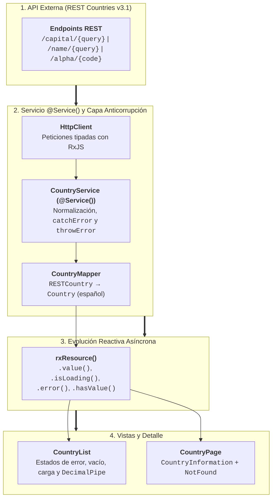

# Sección 10: CountryApp — Servicios, REST Countries API, Mappers y Resources

En esta sección conectamos **CountryApp** con datos reales procedentes de la **REST Countries API v3.1**. Implementaremos el servicio singleton `CountryService` con el decorador `@Service()` de **Angular 22**, generaremos los contratos externos con QuickType y aplicaremos el **Patrón Mapper** (*Anti-Corruption Layer*) incluyendo la traducción al español y la prevención de errores de contexto `this`. Además, estudiaremos en tres fases progresivas cómo pasar de una suscripción manual (`.subscribe()`) a la reactividad asíncrona declarativa con **`resource()`** y **`rxResource()`**, centralizaremos los estados de carga/error/vacío en `CountryList` y construiremos la vista de detalle con estadísticas DaisyUI, un comparador de banderas (`diff`) y navegación de retorno con `Location`.

---

## 📋 Ficha Técnica y Objetivos Didácticos

* **Proyecto:** `country-app` (Capa de datos reales, transformación y reactividad asíncrona).
* **API Externa:** [REST Countries API v3.1](https://restcountries.com/) (`https://restcountries.com/v3.1`).
* **Stack Tecnológico (Angular 22):** `@Service()`, `HttpClient` nativo (con Fetch por defecto), RxJS (`map`, `catchError`, `throwError`, `delay`, `of`, `firstValueFrom`), Signals, `resource()`, `rxResource()`, `DecimalPipe`, `Location`.
* **Patrones Arquitectónicos:**
    * **Data Mapper Pattern:** Desacoplamiento total entre el DTO externo (`RESTCountry`) y el modelo de dominio (`Country`).
    * **Declarative Async State:** Transición progresiva desde estado manual (`.subscribe()`) → Promesas (`resource()`) → Observables (`rxResource()`).
    * **Presentational State Inputs:** `CountryList` renderiza estados de error, carga y vacío recibidos desde cualquier página contenedor.
* **Código Fuente de Referencia:** [GitHub - DevTalles CountryApp (fin-seccion-10)](https://github.com/DevTalles-corp/angular-country-app/tree/fin-seccion-10)



---

## 1. REST Countries API, `HttpClient` en Angular 22 e Interfaces

!!! info "📖 Para saber más: Manual de Referencia"
    Para repasar la configuración del cliente HTTP, interceptores funcionales y gestión de errores, consulta el **[Manual de Referencia: 10. Cliente HTTP y Comunicación con APIs](manual/10-http.md)**.

### 1.1. Exploración de endpoints en Postman

Antes de escribir código, probamos en Postman (o en el navegador) los tres endpoints que consumiremos de [REST Countries v3.1](https://restcountries.com/):

* **Buscar por capital:** `https://restcountries.com/v3.1/capital/madrid` (devuelve `RESTCountry[]`).
* **Buscar por nombre de país:** `https://restcountries.com/v3.1/name/costa` (devuelve `RESTCountry[]`).
* **Buscar por código Alpha (cca2 / cca3):** `https://restcountries.com/v3.1/alpha/ESP` (también devuelve un array `RESTCountry[]` de un elemento).

### 1.2. Configuración de `HttpClient` en `src/app/app.config.ts`

En **Angular 21 y consolidado en Angular 22**, **`HttpClient` viene provisto automáticamente en `root`** y utiliza la **API nativa `Fetch`** como transporte por defecto. Por lo tanto, para realizar peticiones HTTP estándar en una aplicación nueva de Angular 22 **no es necesario añadir `provideHttpClient(withFetch())`** salvo que quieras configurar opciones avanzadas (como `withInterceptors([...])`).

=== "Angular 22 (Configuración por defecto)"
    ```typescript title="src/app/app.config.ts (Angular 22)"
    import { ApplicationConfig, provideBrowserGlobalErrorListeners } from '@angular/core';
    import { provideRouter } from '@angular/router';

    import { routes } from './app.routes';

    export const appConfig: ApplicationConfig = {
      providers: [
        provideBrowserGlobalErrorListeners(),
        provideRouter(routes),
      ],
    };
    ```

=== "Angular 19–21 / Características personalizadas"
    ```typescript title="src/app/app.config.ts (Angular 19–21 o con interceptores)" hl_lines="3 11"
    import { ApplicationConfig, provideZoneChangeDetection } from '@angular/core';
    import { provideRouter } from '@angular/router';
    import { provideHttpClient, withFetch } from '@angular/common/http';

    import { routes } from './app.routes';

    export const appConfig: ApplicationConfig = {
      providers: [
        provideZoneChangeDetection({ eventCoalescing: true }),
        provideRouter(routes),
        provideHttpClient(withFetch()),
      ],
    };
    ```

### 1.3. Generación del DTO Externo (`RESTCountry`) con QuickType

1. Copia el JSON devuelto por Postman al consultar `https://restcountries.com/v3.1/capital/tallinn` (o una muestra representativa de países).
2. Crea `src/app/country/interfaces/rest-countries.interface.ts`.
3. Abre la paleta de comandos (++ctrl+shift+p++ / ++cmd+shift+p++), ejecuta **Paste JSON as Code** y escribe el nombre **`RESTCountry`** (TypeScript inferirá automáticamente los tipos internos como `Name`, `Flags`, `Currency` y `Translation`):

```typescript title="src/app/country/interfaces/rest-countries.interface.ts (Extracto principal)"
export interface RESTCountry {
  name:         Name;
  cca2:         string;
  capital:      string[];
  region:       string;
  subregion:    string;
  translations: { [key: string]: Translation };
  flag:         string;
  population:   number;
  flags:        Flags;
  // ... resto de propiedades generadas por QuickType (borders, languages, maps, etc.)
}

export interface Flags {
  png:  string;
  svg:  string;
  alt?: string;
}

export interface Name {
  common:     string;
  official:   string;
  nativeName: { [key: string]: Translation };
}

export interface Translation {
  official: string;
  common:   string;
}
```

### 1.4. Entidad de Dominio (`Country`) y Patrón `CountryMapper`

Creamos nuestra interfaz limpia de dominio en `src/app/country/interfaces/country.interface.ts` con solo los campos que nuestra aplicación necesita (en la última fase de detalles añadiremos también `region` y `subRegion`):

```typescript title="src/app/country/interfaces/country.interface.ts"
export interface Country {
  cca2: string;
  flag: string;
  flagSvg: string;
  name: string;
  capital: string;
  population: number;

  region: string;
  subRegion: string;
}
```

Ahora implementamos `CountryMapper` en `src/app/country/mappers/country.mapper.ts` con dos métodos estáticos puros:

```typescript title="src/app/country/mappers/country.mapper.ts" hl_lines="11-12 21-27"
import type { Country } from '../interfaces/country.interface';
import type { RESTCountry } from '../interfaces/rest-countries.interface';

export class CountryMapper {
  // Transforma un único objeto RESTCountry => Country
  static mapRestCountryToCountry(restCountry: RESTCountry): Country {
    return {
      cca2: restCountry.cca2,
      flag: restCountry.flag,
      flagSvg: restCountry.flags.svg,
      name: restCountry.translations['spa']?.common ?? 'No Spanish Name',
      capital: restCountry.capital?.join(',') ?? 'No Capital',
      population: restCountry.population,

      region: restCountry.region,
      subRegion: restCountry.subregion,
    };
  }

  // Transforma un array completo RESTCountry[] => Country[]
  static mapRestCountryArrayToCountryArray(
    restCountries: RESTCountry[]
  ): Country[] {
    return restCountries.map((restCountry) =>
      CountryMapper.mapRestCountryToCountry(restCountry)
    );
  }
}
```

!!! warning "Tres detalles fundamentales del Mapper explicados en clase"
    1. **Nombre del país en español (computed property `'spa'`):** dentro de `RESTCountry`, `translations` tiene tipo `{ [key: string]: Translation }` (`Record<string, Translation>`). Accedemos a la clave `'spa'` con notación de corchetes (`restCountry.translations['spa']?.common ?? 'No Spanish Name'`).
    2. **Capital como `string[]` y territorios sin capital:** la API devuelve `capital` como array de strings (`["Madrid"]`), por eso usamos `.join(',')`. Además, conviene usar encadenamiento opcional (`restCountry.capital?.join(',')`) porque territorios como la Antártida o Macao no tienen propiedad `capital` y provocarían un `TypeError`.
    3. **El error del `this` en `.pipe(map(...))`:** si en el servicio escribieras `.pipe(map(CountryMapper.mapRestCountryArrayToCountryArray))` pasando el método por referencia **y dentro del método usaras `this.mapRestCountryToCountry`**, JavaScript perdería el contexto de `this` (`undefined`) al invocar la función suelta. Por eso usamos una función flecha en el `pipe` (`map((resp) => CountryMapper.mapRestCountryArrayToCountryArray(resp))`) y referenciamos explícitamente `CountryMapper.mapRestCountryToCountry` dentro del `.map()`.

---

## 2. `CountryService`, `DecimalPipe`, Suscripción Manual y Excepciones

!!! info "📖 Para saber más: Manual de Referencia"
    Para dominar los servicios singleton con `@Service()` y el pipe `DecimalPipe`, consulta:
    * **[Manual de Referencia: 09. Servicios e Inyección de Dependencias](manual/09-servicios.md)**
    * **[Manual de Referencia: 06. Pipes Nativos (`DecimalPipe`)](manual/06-pipes.md)**

### 2.1. `CountryService` con `@Service()` (Angular 22) y `catchError`

En **Angular 22**, definimos el servicio directamente con **`@Service()`** (equivalente moderno, autónomo y *tree-shakeable* de `@Injectable({ providedIn: 'root' })`).  
Además, normalizamos el término (`query = query.toLowerCase()`) y manejamos cualquier código HTTP de error (como un `404 Not Found` cuando la API no encuentra coincidencias) mediante `catchError` + `throwError`, **sin silenciar el fallo**:

```typescript title="src/app/country/services/country.service.ts (Fase inicial: searchByCapital)" hl_lines="2-3 11 13 18-27"
import { HttpClient } from '@angular/common/http';
import { inject, Service } from '@angular/core';
import { map, Observable, catchError, throwError } from 'rxjs';

import { RESTCountry } from '../interfaces/rest-countries.interface';
import type { Country } from '../interfaces/country.interface';
import { CountryMapper } from '../mappers/country.mapper';

const API_URL = 'https://restcountries.com/v3.1';

@Service()
export class CountryService {
  private http = inject(HttpClient);

  searchByCapital(query: string): Observable<Country[]> {
    query = query.toLowerCase();

    return this.http.get<RESTCountry[]>(`${API_URL}/capital/${query}`).pipe(
      map((resp) => CountryMapper.mapRestCountryArrayToCountryArray(resp)),
      catchError((error) => {
        console.log('Error fetching ', error);

        return throwError(
          () => new Error(`No se pudo obtener países con ese query ${query}`)
        );
      })
    );
  }
}
```

### 2.2. Fase 1 en `ByCapitalPage`: Suscripción manual con `.subscribe()`

Antes de introducir `resource()` y `rxResource()`, resulta muy instructivo implementar la primera versión controlando manualmente el ciclo completo de la petición HTTP con tres señales (`isLoading`, `isError`, `countries`) y `.subscribe({ next, error })`:

```typescript title="src/app/country/pages/by-capital-page/by-capital-page.ts (Fase 1: Manual)" hl_lines="13 15-17 21 23-35"
import { Component, inject, signal } from '@angular/core';
import { SearchInput } from '../../components/search-input/search-input';
import { CountryList } from '../../components/country-list/country-list';
import { CountryService } from '../../services/country.service';
import type { Country } from '../../interfaces/country.interface';

@Component({
  selector: 'app-by-capital-page',
  imports: [SearchInput, CountryList],
  templateUrl: './by-capital-page.html',
})
export class ByCapitalPage {
  countryService = inject(CountryService);

  isLoading = signal(false);
  isError = signal<string | null>(null);
  countries = signal<Country[]>([]);

  onSearch(query: string) {
    // Bloqueo preventivo: evita peticiones duplicadas si ya hay una en vuelo
    if (this.isLoading()) return;

    this.isLoading.set(true);
    this.isError.set(null);

    this.countryService.searchByCapital(query).subscribe({
      next: (countries) => {
        this.isLoading.set(false);
        this.countries.set(countries);
      },
      error: (err) => {
        this.isLoading.set(false);
        this.countries.set([]);
        this.isError.set(err);
      },
    });
  }
}
```

```html title="src/app/country/pages/by-capital-page/by-capital-page.html (Fase 1)"
<country-search-input
  placeholder="Buscar por capital"
  (value)="onSearch($event)"
/>

@if (isError()) {
  <h3>{{ isError() }}</h3>
} @else {
  <country-list [countries]="countries()" />
}
```

### 2.3. Renderizado en `CountryList` con `DecimalPipe`

Actualizamos `CountryList` para recibir `countries = input.required<Country[]>()` y formatear la población con separadores de miles usando `DecimalPipe` (`| number`):

=== "country-list.ts"
    ```typescript title="src/app/country/components/country-list/country-list.ts" hl_lines="2-3 7 11"
    import { Component, input } from '@angular/core';
    import { Country } from '../../interfaces/country.interface';
    import { DecimalPipe } from '@angular/common';

    @Component({
      selector: 'country-list',
      imports: [DecimalPipe],
      templateUrl: './country-list.html',
    })
    export class CountryList {
      countries = input.required<Country[]>();
    }
    ```

=== "country-list.html"
    ```html title="src/app/country/components/country-list/country-list.html" hl_lines="14-27"
    <section class="mt-5">
      <table class="table table-md mt-2 w-full">
        <thead>
          <tr>
            <th>#</th>
            <th>Icono</th>
            <th>Bandera</th>
            <th>Nombre</th>
            <th>Capital</th>
            <th>Población</th>
            <th></th>
          </tr>
        </thead>
        <tbody>
          @for (country of countries(); track country.cca2; let index = $index) {
          <tr>
            <td>{{ index + 1 }}</td>
            <td>{{ country.flag }}</td>
            <td>
              
            </td>
            <td>{{ country.name }}</td>
            <td>{{ country.capital }}</td>
            <td>
              <span class="badge badge-secondary">
                {{ country.population | number }}
              </span>
            </td>
            <td>
              <a class="link-primary cursor-pointer">Más información</a>
            </td>
          </tr>
          }
        </tbody>
      </table>
    </section>
    ```

---

## 3. La Revolución Asíncrona: `resource()` y `rxResource()`

Gestionar manualmente `isLoading`, `isError`, `countries`, bloquear peticiones simultáneas y recordar actualizar todas las banderas en `next` y `error` genera mucho código repetitivo (*boilerplate*) y es propenso a *race conditions* si el usuario escribe rápido.

Para resolverlo de raíz, **Angular 22** consolida como APIs **estables** la familia **Resource API**: `resource()`, `rxResource()` y `httpResource()`.

!!! info "📖 Para saber más: Manual de Referencia"
    Para una explicación completa del grafo reactivo de señales asíncronas y el ciclo de vida de `resource()`, `rxResource()` y `httpResource()`, consulta:
    * **[Manual de Referencia: 05. Signals y Reactividad](manual/05-signals.md#resource-y-rxresource-reactividad-asincrona-con-signals)**
    * **[Manual de Referencia: 10. Cliente HTTP (`resource()`, `rxResource()`, `httpResource()`)](manual/10-http.md)**

### 3.1. Fase 2: Reactividad basada en Promesas con `resource()` y `firstValueFrom`

En este primer salto evolutivo eliminamos las tres señales manuales (`isLoading`, `isError`, `countries`) y el método `onSearch`. En su lugar declaramos únicamente una señal disparadora (`query = signal('')`) y conectamos **`resource()`**:

```typescript title="src/app/country/pages/by-capital-page/by-capital-page.ts (Fase 2: resource)" hl_lines="1-2 14 16-26"
import { Component, inject, resource, signal } from '@angular/core';
import { firstValueFrom } from 'rxjs';
import { SearchInput } from '../../components/search-input/search-input';
import { CountryList } from '../../components/country-list/country-list';
import { CountryService } from '../../services/country.service';

@Component({
  selector: 'app-by-capital-page',
  imports: [SearchInput, CountryList],
  templateUrl: './by-capital-page.html',
})
export class ByCapitalPage {
  countryService = inject(CountryService);
  query = signal('');

  countryResource = resource({
    request: () => ({ query: this.query() }),
    loader: async ({ request }) => {
      if (!request.query) return [];

      // resource() espera una Promesa: convertimos el Observable con firstValueFrom
      return await firstValueFrom(
        this.countryService.searchByCapital(request.query)
      );
    },
  });
}
```

* **`request` (disparador reactivo):** cada vez que cambia alguna señal leída dentro de `request` (aquí `this.query()`), Angular ejecuta automáticamente el `loader` y cancela cualquier ejecución previa pendiente.
* **`if (!request.query) return [];`:** al montar el componente `query()` vale `''`; devolvemos un array vacío sin disparar ninguna llamada HTTP innecesaria.
* **Señales expuestas automáticamente por `countryResource`:** `.value()`, `.isLoading()`, `.error()`, `.hasValue()`, `.status()` y `.reload()`.

### 3.2. Tarea: `searchByCountry` y navegación al detalle (`[routerLink]`)

Antes de pasar a `rxResource()`, ampliamos `CountryService`, `CountryList` y `ByCountryPage`:

1. Añadimos **`searchByCountry(query: string)`** al endpoint `/name/${query}` en `CountryService`.
2. Importamos **`RouterLink`** en `CountryList` y enlazamos el botón **Más información** a la ruta dinámica `/country/by/:code`:

```html title="src/app/country/components/country-list/country-list.html (Enlace a detalle)" hl_lines="2-5"
<td>
  <a
    [routerLink]="['/country/by', country.cca2]"
    class="link-primary cursor-pointer"
    >Más información</a
  >
</td>
```

### 3.3. Fase 3: Observables puros sin `firstValueFrom` usando `rxResource()`

Dado que `HttpClient` y nuestros métodos de `CountryService` ya trabajan con **Observables de RxJS**, tener que transformarlos a Promesas con `await firstValueFrom(...)` dentro de `resource()` añade fricción innecesaria.

La función **`rxResource()`** (de `@angular/core/rxjs-interop`) funciona exactamente igual que `resource()`, pero permite que `loader` devuelva directamente un **`Observable`**:

```typescript title="src/app/country/pages/by-capital-page/by-capital-page.ts (Fase 3: rxResource)" hl_lines="2-3 18-25"
import { Component, inject, signal } from '@angular/core';
import { rxResource } from '@angular/core/rxjs-interop';
import { of } from 'rxjs';

import { SearchInput } from '../../components/search-input/search-input';
import { CountryList } from '../../components/country-list/country-list';
import { CountryService } from '../../services/country.service';

@Component({
  selector: 'app-by-capital-page',
  imports: [SearchInput, CountryList],
  templateUrl: './by-capital-page.html',
})
export class ByCapitalPage {
  countryService = inject(CountryService);
  query = signal('');

  countryResource = rxResource({
    request: () => ({ query: this.query() }),
    loader: ({ request }) => {
      if (!request.query) return of([]);

      return this.countryService.searchByCapital(request.query);
    },
  });
}
```

Y aplicamos exactamente el mismo patrón en `ByCountryPage` llamando a `this.countryService.searchByCountry(request.query)`:

```typescript title="src/app/country/pages/by-country-page/by-country-page.ts" hl_lines="18-25"
import { Component, inject, signal } from '@angular/core';
import { rxResource } from '@angular/core/rxjs-interop';
import { of } from 'rxjs';

import { SearchInput } from '../../components/search-input/search-input';
import { CountryList } from '../../components/country-list/country-list';
import { CountryService } from '../../services/country.service';

@Component({
  selector: 'app-by-country-page',
  imports: [SearchInput, CountryList],
  templateUrl: './by-country-page.html',
})
export class ByCountryPage {
  countryService = inject(CountryService);
  query = signal('');

  countryResource = rxResource({
    request: () => ({ query: this.query() }),
    loader: ({ request }) => {
      if (!request.query) return of([]);

      return this.countryService.searchByCountry(request.query);
    },
  });
}
```

*Observa el detalle clave:* cuando `!request.query`, ya no podemos devolver `[]` a secas; como `rxResource` exige un `Observable`, envolvemos el array vacío con la función creacional **`of([])`** de RxJS.

!!! tip "💡 Angular 22: Novedades de nomenclatura en Resource API y `httpResource()`"
    * **API estable y alias unificados:** en Angular 19–20 nacieron las propiedades `request` y `loader` (presentes en el código del curso). En la estabilización hacia **Angular 22**, la firma moderna unificada permite usar **`params`** en lugar de `request` y, en el caso de `rxResource()`, **`stream`** en lugar de `loader` (`params: () => ({ query: this.query() }), stream: ({ params }) => ...`). Conocer ambas nomenclaturas te permitirá leer tanto el código del curso como cualquier proyecto nuevo en Angular 22.
    * **Alternativa directa `httpResource()`:** cuando un componente solo necesita hacer un `GET` sencillo sin lógica de caché en el servicio, Angular 22 ofrece **`httpResource()`** (`@angular/common/http`), capaz de reactivar la petición automáticamente cuando cambia una señal en la URL:
      ```typescript
      import { httpResource } from '@angular/common/http';
      // Si la función devuelve undefined, no dispara la petición HTTP
      rawResource = httpResource<RESTCountry[]>(() =>
        this.query() ? `https://restcountries.com/v3.1/capital/${this.query()}` : undefined
      );
      ```
      En CountryApp seguimos usando `CountryService` + `rxResource()` para conservar el Patrón Mapper, el manejo de errores y la caché en memoria que implementaremos en la Sección 11.

---

## 4. Mostrar Estados al Usuario en `CountryList`

Para visualizar claramente el estado de carga durante las pruebas, simulamos una latencia de 2 segundos en `searchByCountry` encadenando el operador RxJS **`delay(2000)`** dentro del `.pipe(...)`:

```typescript title="src/app/country/services/country.service.ts (Simulación de latencia)" hl_lines="3"
    return this.http.get<RESTCountry[]>(url).pipe(
      map((resp) => CountryMapper.mapRestCountryArrayToCountryArray(resp)),
      delay(2000), // Simula conexión lenta de red
      catchError((error) => { ... })
    );
```

En lugar de duplicar bloques `@if` de carga/error/vacío en cada página, delegamos la presentación de esos estados a `CountryList` mediante **tres Signal Inputs opcionales**:

=== "country-list.ts"
    ```typescript title="src/app/country/components/country-list/country-list.ts" hl_lines="14-16"
    import { Component, input } from '@angular/core';
    import { Country } from '../../interfaces/country.interface';
    import { DecimalPipe } from '@angular/common';
    import { RouterLink } from '@angular/router';

    @Component({
      selector: 'country-list',
      imports: [DecimalPipe, RouterLink],
      templateUrl: './country-list.html',
    })
    export class CountryList {
      countries = input.required<Country[]>();

      errorMessage = input<string | unknown | null>();
      isLoading = input<boolean>(false);
      isEmpty = input<boolean>(false);
    }
    ```

=== "country-list.html"
    ```html title="src/app/country/components/country-list/country-list.html" hl_lines="39-59"
    <section class="mt-5">
      <table class="table table-md mt-2 w-full">
        <thead>
          <tr>
            <th>#</th>
            <th>Icono</th>
            <th>Bandera</th>
            <th>Nombre</th>
            <th>Capital</th>
            <th>Población</th>
            <th></th>
          </tr>
        </thead>
        <tbody>
          @for (country of countries(); track country.cca2; let index = $index) {
          <tr>
            <td>{{ index + 1 }}</td>
            <td>{{ country.flag }}</td>
            <td>
              
            </td>
            <td>{{ country.name }}</td>
            <td>{{ country.capital }}</td>
            <td>
              <span class="badge badge-secondary">
                {{ country.population | number }}
              </span>
            </td>
            <td>
              <a
                [routerLink]="['/country/by', country.cca2]"
                class="link-primary cursor-pointer"
                >Más información</a
              >
            </td>
          </tr>
          }

          @if (errorMessage()) {
          <tr>
            <td colspan="8" class="text-center">
              {{ errorMessage() }}
            </td>
          </tr>
          }

          <!--  -->
          @if (countries().length === 0 && !isLoading()) {
          <tr>
            <td colspan="8" class="text-center">No se encontraron resultados</td>
          </tr>
          }

          <!--  -->
          @if (isLoading()) {
          <tr>
            <td colspan="8" class="text-center">Buscando países</td>
          </tr>
          }
        </tbody>
      </table>
    </section>
    ```

!!! note "Dos detalles clave de implementación en `CountryList`"
    * **¿Por qué `errorMessage = input<string | unknown | null>()` incluye `unknown`?** Porque la señal `countryResource.error()` de Angular devuelve exactamente el tipo `Signal<unknown>`. Aceptar `unknown` evita errores de compilación al enlazar `[errorMessage]="countryResource.error()"`.
    * **Comentarios `<!-- -->` entre bloques `@if`:** cuando colocamos varios `@if` seguidos dentro de un `<tbody>`, el servicio de lenguaje de Angular en VS Code a veces pierde el autocompletado al pegar bloques contiguos; separar los bloques con un comentario HTML vacío `<!-- -->` resuelve el problema visual y de IntelliSense.

Ahora conectamos las cuatro propiedades en `by-capital-page.html` y `by-country-page.html`:

```html title="src/app/country/pages/by-capital-page/by-capital-page.html" hl_lines="6-11"
<country-search-input
  placeholder="Buscar por capital"
  (value)="query.set($event)"
/>

<country-list
  [countries]="countryResource.value() ?? []"
  [errorMessage]="countryResource.error()"
  [isEmpty]="countryResource.value()?.length === 0"
  [isLoading]="countryResource.isLoading()"
/>
```

*(En `by-country-page.html` solo cambia el `placeholder="Buscar por país"`).*

---

## 5. Vista de Detalle (`CountryPage`), `NotFound` y `CountryInformation`

Cuando el usuario hace clic en **"Más información"** sobre cualquier fila, navega a `/country/by/:code` (por ejemplo `/country/by/ESP`). Veamos cómo se construye esta pantalla en sus cuatro piezas:

### 5.1. `searchCountryByAlphaCode` en `CountryService`

Aunque consultemos un único código Alpha (`/alpha/ESP`), la API de REST Countries responde siempre con un **array de un elemento** (`RESTCountry[]`). Tras mapear el array con `CountryMapper`, encadenamos un segundo operador `map((countries) => countries.at(0))` para obtener directamente `Country | undefined`:

```typescript title="src/app/country/services/country.service.ts (Método de detalle)" hl_lines="5-7"
  searchCountryByAlphaCode(code: string) {
    const url = `${API_URL}/alpha/${code}`;

    return this.http.get<RESTCountry[]>(url).pipe(
      map((resp) => CountryMapper.mapRestCountryArrayToCountryArray(resp)),
      map((countries) => countries.at(0)),
      catchError((error) => {
        console.log('Error fetching ', error);

        return throwError(
          () => new Error(`No se pudo obtener países con ese código ${code}`)
        );
      })
    );
  }
```

### 5.2. Componente reutilizable `NotFound` y servicio `Location`

Creamos `src/app/shared/components/not-found/` para mostrar una vista amigable cuando el usuario introduce un código de país inexistente.  
Para el enlace **"Volver"**, inyectamos el servicio **`Location`** de `@angular/common` y ejecutamos **`this.location.back()`** (historial nativo del navegador). Así el botón devuelve al usuario exactamente a la pantalla desde la que vino (sea *Por capital*, *Por país* o *Por región*), manteniendo `NotFound` 100% reutilizable:

=== "not-found.ts"
    ```typescript title="src/app/shared/components/not-found/not-found.ts" hl_lines="1 10 13"
    import { Location } from '@angular/common';
    import { Component, inject } from '@angular/core';

    @Component({
      selector: 'app-not-found',
      imports: [],
      templateUrl: './not-found.html',
    })
    export class NotFound {
      location = inject(Location);

      goBack() {
        this.location.back();
      }
    }
    ```

=== "not-found.html"
    ```html title="src/app/shared/components/not-found/not-found.html" hl_lines="25"
    <section class="flex flex-col items-center justify-center mt-10">
      <svg
        xmlns="http://www.w3.org/2000/svg"
        width="75"
        height="75"
        viewBox="0 0 24 24"
      >
        <rect width="24" height="24" fill="none" />
        <g
          fill="none"
          stroke="currentColor"
          stroke-linecap="round"
          stroke-width="2"
        >
          <path
            stroke-linejoin="round"
            d="M14 19c3.771 0 5.657 0 6.828-1.172S22 14.771 22 11s0-5.657-1.172-6.828S17.771 3 14 3h-4C6.229 3 4.343 3 3.172 4.172S2 7.229 2 11s0 5.657 1.172 6.828c.653.654 1.528.943 2.828 1.07"
          />
          <path
            d="M14 19c-1.236 0-2.598.5-3.841 1.145c-1.998 1.037-2.997 1.556-3.489 1.225s-.399-1.355-.212-3.404L6.5 17.5m3.379-8.621L12 11m0 0l2.121 2.121M12 11l2.121-2.121M12 11l-2.121 2.121"
          />
        </g>
      </svg>
      <h1>No se encontró el país</h1>
      <a (click)="goBack()" class="link-primary cursor-pointer">Volver</a>
    </section>
    ```

### 5.3. Página Orquestadora `CountryPage`

Captura el segmento dinámico `:code` de la URL mediante `inject(ActivatedRoute).snapshot.params['code']`, consulta el país con `rxResource` y decide qué subcomponente mostrar en función del estado del recurso (`error()`, `isLoading()`, `hasValue()`):

=== "country-page.ts"
    ```typescript title="src/app/country/pages/country-page/country-page.ts" hl_lines="14 17-22"
    import { Component, inject } from '@angular/core';
    import { rxResource } from '@angular/core/rxjs-interop';
    import { ActivatedRoute } from '@angular/router';
    import { CountryService } from '../../services/country.service';
    import { NotFound } from '../../../shared/components/not-found/not-found';
    import { CountryInformation } from './country-information/country-information';

    @Component({
      selector: 'app-country-page',
      imports: [NotFound, CountryInformation],
      templateUrl: './country-page.html',
    })
    export class CountryPage {
      countryCode = inject(ActivatedRoute).snapshot.params['code'];
      countryService = inject(CountryService);

      countryResource = rxResource({
        request: () => ({ code: this.countryCode }),
        loader: ({ request }) => {
          return this.countryService.searchCountryByAlphaCode(request.code);
        },
      });
    }
    ```

=== "country-page.html"
    ```html title="src/app/country/pages/country-page/country-page.html"
    <!--  -->
    @if (countryResource.error()) {
    <app-not-found />
    }

    <!--  -->
    @if (countryResource.isLoading()) {
    <h1 class="text-3xl">Cargando...</h1>
    }

    <!--  -->
    @if (countryResource.hasValue()) {
    <country-information-page [country]="countryResource.value()!" />
    }
    ```

### 5.4. Subcomponente Presentacional `CountryInformation`

Recibe el país validado mediante `country = input.required<Country>()` y calcula `currentYear = computed(() => new Date().getFullYear())` (ya que las plantillas HTML de Angular no permiten instanciar clases con `new Date()` directamente).

Para la interfaz combinamos las tarjetas **`stats`** de DaisyUI (Población, Nombre, Sub Región y Bandera) con el componente interactivo **`diff aspect-[16/9]`**, que superpone la bandera nítida sobre una versión desenfocada (`blur brightness-75`) con un deslizador arrastrable (`diff-resizer`):

=== "country-information.ts"
    ```typescript title="src/app/country/pages/country-page/country-information/country-information.ts" hl_lines="11 13-15"
    import { Component, computed, input } from '@angular/core';
    import { Country } from '../../../interfaces/country.interface';
    import { DecimalPipe } from '@angular/common';

    @Component({
      selector: 'country-information-page',
      imports: [DecimalPipe],
      templateUrl: './country-information.html',
    })
    export class CountryInformation {
      country = input.required<Country>();

      currentYear = computed(() => {
        return new Date().getFullYear();
      });
    }
    ```

=== "country-information.html"
    ```html title="src/app/country/pages/country-page/country-information/country-information.html" hl_lines="8 35-46"
    <section class="mx-10">
      <h1 class="text-3xl">{{ country().name }}</h1>
      <h2 class="text-xl font-thin">
        Población {{ country().population | number }}
      </h2>
    </section>

    <section class="stats shadow mx-5">
      <div class="stat place-items-center">
        <div class="stat-title">Población</div>
        <div class="stat-value">{{ country().population | number }}</div>
        <div class="stat-desc">Desde {{ currentYear() }}</div>
      </div>

      <div class="stat place-items-center">
        <div class="stat-title">Nombre</div>
        <div class="stat-value text-secondary">{{ country().name }}</div>
        <div class="stat-desc text-secondary">{{ country().region }}</div>
      </div>

      <div class="stat place-items-center">
        <div class="stat-title">Sub Region</div>
        <div class="stat-value">{{ country().subRegion }}</div>
        <div class="stat-desc">{{ country().region }}</div>
      </div>

      <div class="stat place-items-center">
        <div class="stat-title">Bandera</div>
        <div class="stat-value">{{ country().flag }}</div>
        <div class="stat-desc">{{ country().subRegion }}</div>
      </div>
    </section>

    <section class="diff aspect-[16/9]">
      <div class="diff-item-1">
        
      </div>
      <div class="diff-item-2">
        
      </div>
      <div class="diff-resizer"></div>
    </section>
    ```

---

## 💡 Evolución Angular 22: Resumen de Prácticas Modernas

!!! tip "1. Servicios más limpios con `@Service()` y `HttpClient` integrado"
    En Angular 22 ya no necesitas registrar `provideHttpClient(withFetch())` manualmente para peticiones básicas ni repetir `@Injectable({ providedIn: 'root' })` en cada servicio estándar: `@Service()` y el proveedor automático de `HttpClient` en `root` reducen el código repetitivo al mínimo.

!!! tip "2. Recepción directa del parámetro `:code` con `withComponentInputBinding()`"
    Si añades `withComponentInputBinding()` a `provideRouter(routes, withComponentInputBinding())` en `app.config.ts`, `CountryPage` puede recibir el parámetro `:code` directamente como una señal de entrada en lugar de inyectar `ActivatedRoute`:
    ```typescript
    // En CountryPage (Angular 22 con withComponentInputBinding):
    export class CountryPage {
      countryService = inject(CountryService);
      code = input.required<string>(); // Vinculado automáticamente desde /country/by/:code

      countryResource = rxResource({
        request: () => ({ code: this.code() }),
        loader: ({ request }) => this.countryService.searchCountryByAlphaCode(request.code),
      });
    }
    ```
    Observa que además esto hace la vista reactiva si navegas de un país a otro sin destruir el componente.

---

## 📝 Evaluación y Preguntas para el Aula

??? question "¿Por qué usar `CountryMapper` en lugar de consumir directamente la interfaz `RESTCountry` en las plantillas?"
    **Respuesta:** Para aislar nuestra aplicación frente a cambios externos (*Anti-Corruption Layer*). Además de reducir decenas de propiedades innecesarias a solo los 8 campos que mostramos, centraliza decisiones como traducir el nombre al español (`translations['spa']`) o formatear el array `capital` con `.join(',')`.

??? question "¿Qué problema ocurre si pasamos `map(CountryMapper.mapRestCountryArrayToCountryArray)` por referencia y dentro llamamos a `this.mapRestCountryToCountry`?"
    **Respuesta:** **Pérdida del contexto `this`**. En JavaScript/TypeScript, pasar un método como callback desconecta la función de su clase, haciendo que `this` valga `undefined` dentro de `map`. Se resuelve invocando el método dentro de una función flecha (`map((resp) => CountryMapper.mapRestCountryArrayToCountryArray(resp))`) o refiriéndose directamente a `CountryMapper.mapRestCountryToCountry`.

??? question "¿Qué ventaja clave aporta `rxResource()` frente a `resource()` cuando trabajamos con `HttpClient`?"
    **Respuesta:** `HttpClient` devuelve **Observables** de RxJS. Con `resource()` estamos obligados a convertir el Observable a Promesa mediante `await firstValueFrom(...)`; con `rxResource()` devolvemos el Observable directamente (o `of([])` cuando la consulta está vacía) y Angular gestiona por nosotros la suscripción y la cancelación automática si el usuario cambia la búsqueda.

??? question "¿Por qué usamos `Location.back()` en `NotFound` en vez de un `routerLink` fijo?"
    **Respuesta:** Porque un país no encontrado puede haber sido abierto desde *Por capital*, *Por país*, *Por región* o mediante una URL externa. `location.back()` devuelve al usuario exactamente a su vista de origen sin acoplar `NotFound` a una ruta concreta.

---

## 📚 Material de Referencia y Profundización

* [Manual de Referencia: 05. Signals y Reactividad (`resource`, `rxResource`, `httpResource`)](manual/05-signals.md)
* [Manual de Referencia: 06. Pipes Nativos (`DecimalPipe`)](manual/06-pipes.md)
* [Manual de Referencia: 09. Servicios e Inyección de Dependencias (`@Service()`)](manual/09-servicios.md)
* [Manual de Referencia: 10. Cliente HTTP y Comunicación con APIs](manual/10-http.md)
* [API Oficial de REST Countries v3.1](https://restcountries.com/)
