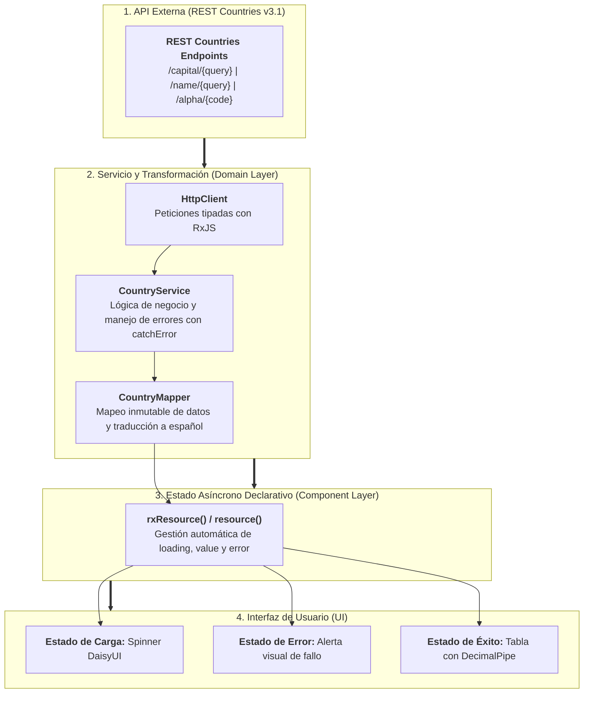

# Sección 10: CountryApp — Servicios, REST Countries API, Mappers y Resources

En esta sección dotamos de funcionalidad real a **CountryApp**. Conectamos la aplicación con la **REST Countries API**, aplicamos el **Patrón Mapper** para desacoplar los modelos externos de la capa de dominio, formateamos datos con **Pipes nativos (`DecimalPipe`)**, implementamos un robusto **manejo de excepciones HTTP** y dominamos la mayor revolución en el manejo de datos asíncronos en Angular: las primitivas reactivas **`resource()`** y **`rxResource()`**.

---

## 📋 Ficha Técnica y Objetivos Didácticos

* **Proyecto:** `country-app` (Integración de datos reales y capa de servicios).
* **API Externa:** [REST Countries API v3.1](https://restcountries.com/) (`https://restcountries.com/v3.1`).
* **Stack Tecnológico:** Angular 19 - 22, `HttpClient`, RxJS, Signals, `resource()`, `rxResource()`, DecimalPipe.
* **Patrones Arquitectónicos:**
    * **Data Mapper Pattern:** Transformación inmutable del contrato externo (`RESTCountry`) a la entidad de dominio (`Country`).
    * **Asynchronous Reactivity:** Sustitución de suscripciones manuales por recursos declarativos con gestión automática de estados (`isLoading`, `value`, `error`).
    * **Graceful Degradation:** Manejo de errores HTTP 404 y caídas de red retornando colecciones vacías seguras con `catchError`.
* **Código Fuente de Referencia:** [GitHub - DevTalles CountryApp (fin-seccion-10)](https://github.com/DevTalles-corp/angular-country-app/tree/fin-seccion-10)



---

## 1. Configuración del Cliente HTTP y Modelos de Dominio

!!! info "📖 Para saber más: Manual de Referencia"
    Para repasar la configuración moderna de `provideHttpClient`, interceptores y tipado de peticiones, consulta el **[Manual de Referencia: 10. Cliente HTTP y Comunicación con APIs](manual/10-http.md)**.

### 1.1. Registro de `provideHttpClient` en `app.config.ts`
En Angular standalone, el cliente HTTP se activa mediante `provideHttpClient()` con soporte optimizado para `fetch`:

```typescript title="src/app/app.config.ts" hl_lines="8"
import { ApplicationConfig, provideZoneChangeDetection } from '@angular/core';
import { provideRouter, withComponentInputBinding } from '@angular/router';
import { provideHttpClient, withFetch } from '@angular/common/http';
import { routes } from './app.routes';

export const appConfig: ApplicationConfig = {
  providers: [
    provideZoneChangeDetection({ eventCoalescing: true }),
    provideRouter(routes, withComponentInputBinding()),
    provideHttpClient(withFetch()), // Uso de fetch nativo
  ],
};
```

---

### 1.2. Interfaz Externa vs Entidad de Dominio
La API de REST Countries devuelve objetos masivos con decenas de propiedades que no necesitamos en nuestra aplicación. 

#### Modelo de Dominio Interno: `src/app/country/interfaces/country.interface.ts`
Diseñamos un contrato limpio con únicamente los datos que nuestra aplicación consume:

```typescript title="src/app/country/interfaces/country.interface.ts"
export interface Country {
  cca2: string;            // Código de 2 letras (ej: ES, MX, AR)
  flag: string;            // Emoji de bandera (ej: 🇪🇸)
  flagSvg: string;         // URL vectorial SVG de la bandera
  name: string;            // Nombre traducido al español
  capital: string;         // Capital principal
  population: number;      // Número de habitantes
  region: string;          // Continente / Región
  subregion: string;       // Subregión geográfica
}
```

#### Modelo de Respuesta Externa: `src/app/country/interfaces/rest-countries.interface.ts`
Generamos la interfaz de la API externa (obtenida mediante QuickType a partir del JSON de `https://restcountries.com/v3.1/all`):

```typescript title="src/app/country/interfaces/rest-countries.interface.ts"
export interface RESTCountry {
  name: {
    common: string;
    official: string;
    nativeName?: Record<string, { official: string; common: string }>;
  };
  cca2: string;
  capital?: string[];
  region: string;
  subregion?: string;
  population: number;
  flag: string;
  flags: {
    png: string;
    svg: string;
    alt?: string;
  };
  translations: Record<string, { official: string; common: string }>;
}
```

---

### 1.3. El Patrón Mapper: `CountryMapper`
Creamos `src/app/country/mappers/country.mapper.ts`. Este patrón convierte los datos volátiles del servidor externo en entidades seguras de nuestra aplicación. Si el servidor cambia el nombre de un campo en el futuro, **solo editamos este mapper**, manteniendo intactos nuestros componentes y vistas:

```typescript title="src/app/country/mappers/country.mapper.ts"
import { Country } from '../interfaces/country.interface';
import { RESTCountry } from '../interfaces/rest-countries.interface';

export class CountryMapper {
  // Transforma un único país de la API a nuestro modelo Country
  static mapRestCountryToCountry(restCountry: RESTCountry): Country {
    return {
      cca2: restCountry.cca2,
      flag: restCountry.flag,
      flagSvg: restCountry.flags.svg,
      // Si existe traducción oficial al español, la usamos; de lo contrario, nombre común en inglés
      name: restCountry.translations['spa']?.common ?? restCountry.name.common,
      capital: restCountry.capital ? restCountry.capital.join(', ') : 'Sin capital',
      population: restCountry.population,
      region: restCountry.region,
      subregion: restCountry.subregion ?? 'Sin subregión',
    };
  }

  // Transforma un array completo mediante programación funcional pura
  static mapRestCountryArrayToCountryArray(restCountries: RESTCountry[]): Country[] {
    return restCountries.map(this.mapRestCountryToCountry);
  }
}
```

---

## 2. El Servicio Central: `CountryService`

Creamos `src/app/country/services/country.service.ts`. Este servicio contiene las llamadas HTTP contra los diferentes endpoints de REST Countries, aplicando transformación con `map` y atrapando errores 404 con `catchError`.

!!! info "📖 Para saber más: Manual de Referencia"
    Para estudiar la inyección de dependencias con `inject()`, ámbitos de inyección y singletons, consulta el **[Manual de Referencia: 09. Servicios e Inyección de Dependencias](manual/09-servicios.md)**.

```typescript title="src/app/country/services/country.service.ts"
import { inject, Injectable } from '@angular/core';
import { HttpClient } from '@angular/common/http';
import { Observable, catchError, map, of, throwError } from 'rxjs';
import { Country } from '../interfaces/country.interface';
import { RESTCountry } from '../interfaces/rest-countries.interface';
import { CountryMapper } from '../mappers/country.mapper';

const API_URL = 'https://restcountries.com/v3.1';

@Injectable({
  providedIn: 'root',
})
export class CountryService {
  private http = inject(HttpClient);

  // 1. Buscar países por nombre de capital
  searchByCapital(query: string): Observable<Country[]> {
    const term = query.trim().toLowerCase();
    if (!term) return of([]);

    return this.http.get<RESTCountry[]>(`${API_URL}/capital/${term}`).pipe(
      map(resp => CountryMapper.mapRestCountryArrayToCountryArray(resp)),
      // Si la API devuelve 404 (no encontrado), devolvemos un array vacío sin romper la app
      catchError(error => {
        console.warn(`No se encontraron países para la capital: ${term}`);
        return of([]);
      })
    );
  }

  // 2. Buscar países por nombre de país
  searchByCountry(query: string): Observable<Country[]> {
    const term = query.trim().toLowerCase();
    if (!term) return of([]);

    return this.http.get<RESTCountry[]>(`${API_URL}/name/${term}`).pipe(
      map(resp => CountryMapper.mapRestCountryArrayToCountryArray(resp)),
      catchError(() => of([]))
    );
  }

  // 3. Buscar país individual por código Alfa (ej: ES, FRA, COL)
  searchCountryByAlphaCode(code: string): Observable<Country | undefined> {
    const term = code.trim().toLowerCase();
    return this.http.get<RESTCountry[]>(`${API_URL}/alpha/${term}`).pipe(
      map(resp => {
        const [first] = resp;
        return first ? CountryMapper.mapRestCountryToCountry(first) : undefined;
      }),
      catchError(() => of(undefined))
    );
  }
}
```

---

## 3. La Revolución Asíncrona: `resource()` y `rxResource()`

Tradicionalmente en Angular, para cargar datos HTTP en un componente se requería:
1. Declarar una variable para los datos.
2. Declarar un booleano `isLoading = true`.
3. Inscribirse con `.subscribe({ next, error })` en el ciclo de vida `ngOnInit`.
4. Acordarse de poner `isLoading = false` en `next` y en `error`.
5. Gestionar la desuscripción para evitar fugas de memoria.

En **Angular moderno**, el equipo de Google introdujo la **Resource API**, una primitiva que encapsula **todo el ciclo de vida asíncrono en una única señal reactiva declarativa**.

!!! info "📖 Para saber más: Manual de Referencia"
    Para una comparativa exhaustiva entre `resource()`, `rxResource()` y `toSignal()`, consulta el **[Manual de Referencia: 05. Signals y Reactividad](manual/05-signals.md)**.

### 3.1. ¿Cómo funciona `rxResource()`?

`rxResource()` toma una función `request` (que retorna los parámetros reactivos) y un `loader` (que devuelve un Observable de datos):

```typescript
// Señal que almacena el término que el usuario busca
query = signal('');

// Recurso asíncrono enlazado a la señal query
countryResource = rxResource({
  request: () => ({ query: this.query() }),
  loader: ({ request }) => {
    if (!request.query) return of([]);
    return this.countryService.searchByCapital(request.query);
  },
});
```

Propiedades reactivas que `countryResource` nos regala automáticamente:
* **`countryResource.value()`:** Señal con los datos resueltos (`Country[] | undefined`).
* **`countryResource.isLoading()`:** Señal booleana reactiva (`true` mientras la petición está en vuelo, `false` al terminar).
* **`countryResource.error()`:** Señal con el error capturado si la petición falla.
* **`countryResource.reload()`:** Método para reejecutar la petición manualmente.

---

## 4. Implementación en la Página: `ByCapitalPageComponent`

Actualizamos `ByCapitalPageComponent` integrando `rxResource()` y mostrando los distintos estados al usuario (carga, error y tabla de resultados):

```typescript title="src/app/country/pages/by-capital-page/by-capital-page.component.ts"
import { Component, inject, signal } from '@angular/core';
import { rxResource } from '@angular/core/rxjs-interop';
import { of } from 'rxjs';
import { CountryService } from '../../services/country.service';
import { SearchInputComponent } from '../../components/search-input/search-input.component';
import { CountryTableComponent } from '../../components/country-table/country-table.component';

@Component({
  selector: 'app-by-capital-page',
  imports: [SearchInputComponent, CountryTableComponent],
  templateUrl: './by-capital-page.component.html',
})
export default class ByCapitalPageComponent {
  private countryService = inject(CountryService);

  // Señal con el término de búsqueda activo
  query = signal<string>('');

  // Recurso reactivo asíncrono
  countryResource = rxResource({
    request: () => ({ query: this.query() }),
    loader: ({ request }) => {
      if (!request.query) return of([]);
      return this.countryService.searchByCapital(request.query);
    },
  });

  onSearch(newQuery: string) {
    this.query.set(newQuery);
  }
}
```

```html title="src/app/country/pages/by-capital-page/by-capital-page.component.html"
<h1 class="text-3xl font-extrabold mb-2">Por Capital</h1>
<p class="text-base-content/70 mb-6">Encuentra países buscando por el nombre de su capital.</p>

<!-- Buscador -->
<country-search-input 
  placeholder="Ej: Madrid, Tokyo, Bogotá..." 
  (value)="onSearch($event)" 
/>

<!-- 1. Estado de Carga (Spinner DaisyUI) -->
@if (countryResource.isLoading()) {
  <div class="flex flex-col items-center justify-center py-12 gap-3">
    <span class="loading loading-spinner loading-lg text-primary"></span>
    <p class="text-base-content/70 font-medium">Consultando REST Countries API...</p>
  </div>
}

<!-- 2. Estado de Error -->
@else if (countryResource.error()) {
  <div class="alert alert-error shadow-lg my-4">
    <span>❌ Ocurrió un error al cargar la información. Intenta de nuevo.</span>
  </div>
}

<!-- 3. Estado de Éxito: Tabla de Países -->
@else {
  <country-table [countries]="countryResource.value() ?? []" />
}
```

---

## 5. Ficha de Detalle de País: `CountryPageComponent`

Cuando el usuario hace clic en el botón "Ver más" de la tabla, la aplicación navega a `/country/by/:code`.

Creamos `src/app/country/pages/country-page/country-page.component.ts`. Usamos el parámetro de ruta `:code` junto con `rxResource` para cargar la ficha completa del país:

```typescript title="src/app/country/pages/country-page/country-page.component.ts"
import { Component, inject } from '@angular/core';
import { ActivatedRoute, RouterLink } from '@angular/router';
import { rxResource, toSignal } from '@angular/core/rxjs-interop';
import { DecimalPipe } from '@angular/common';
import { map, of } from 'rxjs';
import { CountryService } from '../../services/country.service';

@Component({
  selector: 'app-country-page',
  imports: [DecimalPipe, RouterLink],
  templateUrl: './country-page.component.html',
})
export default class CountryPageComponent {
  private route = inject(ActivatedRoute);
  private countryService = inject(CountryService);

  // Convierte el parámetro de ruta en una señal reactiva
  countryCode = toSignal(
    this.route.params.pipe(map(params => params['code'] ?? ''))
  );

  // Recurso asíncrono para cargar el país por código Alfa
  countryResource = rxResource({
    request: () => ({ code: this.countryCode() }),
    loader: ({ request }) => {
      if (!request.code) return of(undefined);
      return this.countryService.searchCountryByAlphaCode(request.code);
    },
  });
}
```

```html title="src/app/country/pages/country-page/country-page.component.html"
@if (countryResource.isLoading()) {
  <div class="flex justify-center py-16">
    <span class="loading loading-spinner loading-lg text-primary"></span>
  </div>
} @else if (countryResource.value(); as country) {
  <div class="card lg:card-side bg-base-100 shadow-xl border border-base-300">
    <figure class="lg:w-1/2 p-6 bg-base-200 flex items-center justify-center">
      
    </figure>
    
    <div class="card-body lg:w-1/2">
      <h2 class="card-title text-3xl font-bold flex items-center gap-2">
        {{ country.flag }} {{ country.name }}
      </h2>
      <p class="text-base-content/70">Código Alfa: <span class="badge badge-primary">{{ country.cca2 }}</span></p>

      <div class="divider my-2"></div>

      <div class="grid grid-cols-2 gap-4 text-sm">
        <div>
          <span class="font-bold block text-base-content/60">Capital:</span>
          <span class="text-base">{{ country.capital }}</span>
        </div>
        <div>
          <span class="font-bold block text-base-content/60">Población:</span>
          <!-- Uso de DecimalPipe para formato legible -->
          <span class="text-base font-semibold">{{ country.population | number }} hab.</span>
        </div>
        <div>
          <span class="font-bold block text-base-content/60">Región:</span>
          <span class="text-base">{{ country.region }}</span>
        </div>
        <div>
          <span class="font-bold block text-base-content/60">Subregión:</span>
          <span class="text-base">{{ country.subregion }}</span>
        </div>
      </div>

      <div class="card-actions justify-end mt-6">
        <a routerLink="/country/by-capital" class="btn btn-outline btn-secondary">
          ⬅ Regresar
        </a>
      </div>
    </div>
  </div>
} @else {
  <div class="alert alert-warning">
    <span>⚠️ No se encontró ningún país con el código indicado.</span>
  </div>
}
```

---

## 💡 Evolución Angular 22: Declaración Limpia y Asincronía Estable

!!! tip "1. Declaración Directa con `@Service()`"
    En el vídeo de Angular 19 se declara `CountryService` usando `@Injectable({ providedIn: 'root' })`.
    
    En **Angular 22**, puedes escribir directamente:
    ```typescript
    import { inject, Service } from '@angular/core';

    @Service()
    export class CountryService {
      private http = inject(HttpClient);
      // ... resto de métodos idénticos
    }
    ```
    `@Service()` asume automáticamente el ámbito singleton raíz (*root*) y habilita optimizaciones agresivas de *tree-shaking*.

!!! tip "2. Graduación de `resource()` y `rxResource()` a API Estable"
    En Angular 19, `resource` y `rxResource` formaban parte del paquete experimental en fase *Developer Preview*. En **Angular 22**, esta arquitectura asíncrona es **100% estable, recomendada y libre de advertencias**, convirtiéndose en la vía estándar para sincronizar llamadas HTTP con plantillas reactivas.

!!! tip "3. Parámetro de Ruta directo como Signal Input"
    En `CountryPageComponent`, en lugar de inyectar `ActivatedRoute` y transformar el Observable con `toSignal()`, en Angular 19/22 puedes recibir el código directamente como un **Signal Input**:
    ```typescript
    // En CountryPageComponent:
    export default class CountryPageComponent {
      private countryService = inject(CountryService);

      // Enlazado automáticamente desde la URL /country/by/:code
      countryCode = input.required<string>({ alias: 'code' });

      countryResource = rxResource({
        request: () => ({ code: this.countryCode() }),
        loader: ({ request }) => this.countryService.searchCountryByAlphaCode(request.code),
      });
    }
    ```

---

## 📝 Evaluación y Preguntas para el Aula

??? question "¿Qué ventajas ofrece el Patrón Mapper frente a usar directamente la interfaz de la API externa en los componentes?"
    **Respuesta:** Proporciona **aislamiento e independencia de dependencias externas**. Si la API externa cambia la estructura del JSON (por ejemplo, renombra `population` por `inhabitants` o modifica el formato de `flags`), solo debemos modificar una línea en `CountryMapper`. Todos nuestros componentes, plantillas y tests seguirán funcionando sin enterarse del cambio externo.

??? question "¿Por qué `rxResource()` es superior a gestionar manualmente un `isLoading = signal(true)` y un `.subscribe()`?"
    **Respuesta:** Porque `rxResource()` es **declarativo y automático**:
    1. Si la señal de entrada (`request`) cambia, cancela automáticamente la petición anterior (*switchMap* nativo) y dispara la nueva.
    2. Sincroniza de forma atómica los estados de `isLoading`, `value` y `error`.
    3. Evita fugas de memoria al encargarse Angular de la desuscripción cuando el componente se destruye.

??? question "¿Para qué sirve el pipe `number` (`DecimalPipe`) en la plantilla de países?"
    **Respuesta:** Para formatear cantidades numéricas grandes con separadores de miles según la configuración regional (`47420000` → `47,420,000` o `47.420.000`), mejorando drásticamente la legibilidad de la población para el usuario final.

---

## 📚 Material de Referencia y Profundización

* [Manual de Referencia: 05. Signals y Reactividad (`resource` y `rxResource`)](manual/05-signals.md)
* [Manual de Referencia: 06. Pipes Nativos y Custom (`DecimalPipe`)](manual/06-pipes.md)
* [Manual de Referencia: 09. Servicios e Inyección de Dependencias](manual/09-servicios.md)
* [Manual de Referencia: 10. Cliente HTTP y Comunicación con APIs](manual/10-http.md)
* [API Oficial de REST Countries v3.1](https://restcountries.com/)
