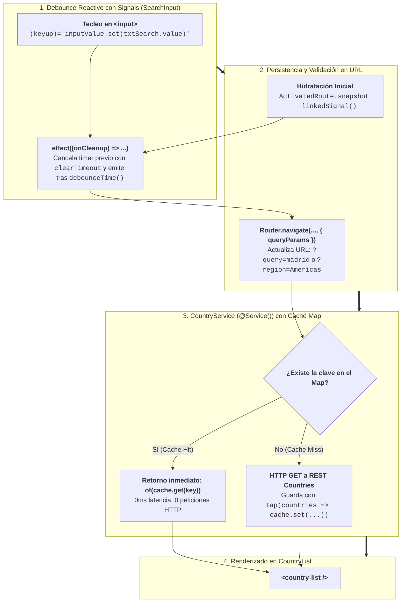

# Sección 11: CountryApp Intermedio/Avanzado — Debounce con Signals, Caché en Memoria y Query Parameters

En esta sección llevamos **CountryApp** a un estándar de producción profesional. Reemplazaremos las búsquedas manuales por **búsqueda automática reactiva con Debounce puro mediante Signals y `effect((onCleanup) => ...)`**, construiremos una **caché en memoria por endpoint basada en `Map`** dentro de nuestro servicio `@Service()`, implementaremos la pantalla de **búsqueda por región geográfica con tipos unión estrictos** y sincronizaremos el estado completo de filtros con la barra de direcciones mediante **`ActivatedRoute`, `linkedSignal()`, `Router.navigate()` y validación segura de `queryParams`**.

---

## 📋 Ficha Técnica y Objetivos Didácticos

* **Proyecto:** `country-app` (Optimización, caché en memoria y persistencia en URL).
* **Stack Tecnológico (Angular 22):** Signals, `effect((onCleanup) => ...)`, `linkedSignal()`, `@Service()`, RxJS (`of`, `tap`, `catchError`, `throwError`, `delay`), `ActivatedRoute`, `Router`, TypeScript (`Map`, `Record`, Union Types).
* **Patrones Arquitectónicos:**
    * **Signal-Based Debounce Pattern:** Temporizador en UI dentro de `SearchInput` cancelado automáticamente con `onCleanup` antes de saturar la API.
    * **In-Memory Cache Pattern:** Almacenes asociativos `Map` separados por dominio en `CountryService` (`queryCacheCapital`, `queryCacheCountry`, `queryCacheRegion`) para respuestas instantáneas (`0ms`).
    * **URL as Single Source of Truth + Input Validation:** Hidratación desde `ActivatedRoute.snapshot.queryParamMap` mediante `linkedSignal()`, actualización dinámica con `Router.navigate()` y saneamiento estricto con `validateQueryParam()`.
* **Código Fuente de Referencia:** [GitHub - DevTalles CountryApp (fin-seccion-11)](https://github.com/DevTalles-corp/angular-country-app/tree/fin-seccion-11)



---

## 1. Búsquedas Automáticas: Debounce con `effect((onCleanup) => ...)`

Hasta ahora, el usuario debía pulsar ++enter++ o hacer clic en **Buscar**. Queremos que la consulta se dispare **automáticamente mientras escribe**, pero esperando unos milisegundos tras la última tecla (*Debounce*) para no bombardear la API de REST Countries con una petición HTTP por cada carácter.

```text
Teclas:    t ──(60ms)── e ──(70ms)── g ──(espera debounceTime sin teclear)──> ¡Emite value: "teg"!
Timers:    └── cancelado   └── cancelado  └─────────── completa ─────────────> 1 sola petición HTTP
```

!!! note "¿Por qué colocar el Debounce en `SearchInput` y no en `CountryService`?"
    Por **Separación de Responsabilidades (SoC)**: el servicio (`CountryService`) tiene como única responsabilidad ejecutar peticiones HTTP y gestionar la caché, sin preocuparse de la velocidad a la que teclea el usuario. Es el componente visual de entrada (`SearchInput`) quien controla cuándo emitir el valor estabilizado hacia cualquier página que lo utilice.

### Paso 1: Proteger la API mientras probamos `(keyup)`

Si cambiamos temporalmente `(keyup.enter)` por `(keyup)` en `search-input.html`, cada tecla emitirá de inmediato hacia `ByCapitalPage` y luego al servicio. Mientras diseñamos el efecto de debounce, podemos cortocircuitar temporalmente `searchByCapital` devolviendo `of([])` (ya que `rxResource` espera un `Observable`) para comprobar las emisiones en consola sin saturar la API externa:

```typescript title="Prueba temporal en CountryService (solo durante el experimento)"
  searchByCapital(query: string): Observable<Country[]> {
    query = query.toLowerCase();
    console.log(`emitiendo valor ${query}`);
    return of([]); // Detiene temporalmente las peticiones reales mientras probamos
    // ... resto del código http.get
  }
```

*(Observa además cómo cuando borras todo el texto y `query` queda en `''`, `if (!request.query) return of([]);` en `rxResource` intercepta ese string vacío por ser falsy).*

### Paso 2: Señal local `inputValue` y por qué `setTimeout` solo no basta

En `src/app/country/components/search-input/search-input.ts` introducimos una señal reactiva local `inputValue` conectada al `<input>` mediante `(keyup)="inputValue.set(txtSearch.value)"`.

Si dentro de `debounceEffect = effect(() => { ... })` solo pusiéramos un `setTimeout`, **no tendríamos debounce**: todas las pulsaciones seguirían emitiéndose, simplemente retrasadas N milisegundos.

### Paso 3: El parámetro `onCleanup`, cuándo se ejecuta y parametrización

El secreto está en utilizar el callback **`onCleanup`** que Angular inyecta automáticamente como primer argumento de `effect((onCleanup) => { ... })`:

=== "search-input.ts (Con Debounce)"
    ```typescript title="src/app/country/components/search-input/search-input.ts" hl_lines="10 14 16-26"
    import { Component, effect, input, output, signal } from '@angular/core';

    @Component({
      selector: 'country-search-input',
      imports: [],
      templateUrl: './search-input.html',
    })
    export class SearchInput {
      placeholder = input('Buscar');
      debounceTime = input(1000);

      value = output<string>();

      inputValue = signal<string>('');

      debounceEffect = effect((onCleanup) => {
        const value = this.inputValue();

        const timeout = setTimeout(() => {
          this.value.emit(value);
        }, this.debounceTime());

        onCleanup(() => {
          clearTimeout(timeout);
        });
      });
    }
    ```

=== "search-input.html"
    ```html title="src/app/country/components/search-input/search-input.html" hl_lines="9"
    <section class="flex flex-row gap-2 mt-2">
      <input
        type="text"
        class="input input-bordered mr-2 w-56"
        [placeholder]="placeholder()"
        autofocus
        #txtSearch
        (keyup.enter)="value.emit(txtSearch.value)"
        (keyup)="inputValue.set(txtSearch.value)"
      />

      <button class="btn btn-primary" (click)="value.emit(txtSearch.value)">
        Buscar
      </button>
    </section>
    ```

=== "Uso personalizado en el padre"
    ```html title="src/app/country/pages/by-capital-page/by-capital-page.html" hl_lines="4"
    <country-search-input
      placeholder="Buscar por capital"
      (value)="query.set($event)"
      [debounceTime]="300"
    />
    ```

!!! tip "¿Cómo funciona exactamente `effect((onCleanup) => ...)`?"
    1. **Lectura síncrona obligatoria:** `const value = this.inputValue();` debe ejecutarse fuera del `setTimeout` porque Angular solo registra como dependencias del `effect` las señales leídas de forma síncrona durante su cuerpo principal.
    2. **Los dos momentos en los que se dispara `onCleanup`:**
       * **Antes de reejecutar el efecto (2.ª, 3.ª, 4.ª vez...):** en cuanto el usuario teclea otra letra, `inputValue()` cambia; Angular ejecuta primero `clearTimeout(timeout)` cancelando la emisión anterior pendiente y arranca un nuevo temporizador desde cero.
       * **Al destruir el componente:** si el usuario cambia de ruta antes de que venza el temporizador, `onCleanup` lo limpia evitando emisiones huérfanas o fugas de memoria.
    3. **Retirar el `return of([]);` temporal:** una vez verificado en consola que solo se emite al dejar de teclear, elimina el `return of([]);` de prueba en `CountryService`.

---

## 2. Caché en Memoria con `Map` en `CountryService`

Si el usuario busca `"Madrid"`, luego busca `"Tegucigalpa"`, y regresa a buscar `"Madrid"`, no tiene sentido volver a consultar por red la misma respuesta geográfica.

### 2.1. Seguridad en el Mapper ante búsquedas cortas (`Optional Chaining`)

Al buscar automáticamente con el debounce, términos cortos como `"te"` o `"an"` devuelven territorios especiales (como la Antártida o Macao) donde `restCountry.capital` viene `undefined`. Si aún tenías `restCountry.capital.join(',')` sin protección, lanzará un error en consola. Asegúrate de usar encadenamiento opcional en `src/app/country/mappers/country.mapper.ts`:

```typescript title="src/app/country/mappers/country.mapper.ts (Protección con ?. )" hl_lines="3"
    return {
      cca2: restCountry.cca2,
      capital: restCountry.capital?.join(','),
      flag: restCountry.flag,
      flagSvg: restCountry.flags.svg,
      name: restCountry.translations['spa']?.common ?? 'No Spanish Name',
      population: restCountry.population,
      region: restCountry.region,
      subRegion: restCountry.subregion,
    };
```

### 2.2. ¿Por qué `Map` frente a `Set` o un Objeto `{}`?

!!! info "📖 Concepto Clave: Map vs Set vs Object"
    * **`Set<T>`:** almacena únicamente valores únicos (como un array sin duplicados), pero **no** permite asociar una clave de búsqueda (`"madrid"`) con un resultado (`Country[]`).
    * **Objeto literal `{}`:** sus claves se convierten siempre en `string` y hereda propiedades de `Object.prototype` (`toString`, `constructor`).
    * **`Map<K, V>`:** colección clave-valor nativa optimizada para búsquedas, inserciones y comprobaciones frecuentes con una API expresiva (`.has(key)`, `.get(key)`, `.set(key, value)`), donde la clave puede ser un `string` o un tipo unión como `Region`.

### 2.3. Flujo *Cache Hit* (`of(...)`) vs *Cache Miss* (`tap(...)`) en `CountryService`

Declaramos almacenes privados independientes por endpoint (`queryCacheCapital` y `queryCacheCountry`, más `queryCacheRegion` que añadiremos en el punto 3) dentro de `CountryService` decorado con **`@Service()`** en Angular 22:

```typescript title="src/app/country/services/country.service.ts (Con Caché en Capital y País)" hl_lines="2 11 15-16 22-24 29 43-45 49"
import { HttpClient } from '@angular/common/http';
import { inject, Service } from '@angular/core';
import { map, Observable, catchError, throwError, delay, of, tap } from 'rxjs';

import { RESTCountry } from '../interfaces/rest-countries.interface';
import type { Country } from '../interfaces/country.interface';
import { CountryMapper } from '../mappers/country.mapper';

const API_URL = 'https://restcountries.com/v3.1';

@Service()
export class CountryService {
  private http = inject(HttpClient);

  private queryCacheCapital = new Map<string, Country[]>();
  private queryCacheCountry = new Map<string, Country[]>();

  searchByCapital(query: string): Observable<Country[]> {
    query = query.toLowerCase();

    // 1. Cache Hit: si la clave existe, devolvemos inmediatamente un Observable con los datos en memoria
    if (this.queryCacheCapital.has(query)) {
      return of(this.queryCacheCapital.get(query) ?? []);
    }

    // 2. Cache Miss: consultamos HTTP y guardamos el resultado en Map con tap()
    return this.http.get<RESTCountry[]>(`${API_URL}/capital/${query}`).pipe(
      map((resp) => CountryMapper.mapRestCountryArrayToCountryArray(resp)),
      tap((countries) => this.queryCacheCapital.set(query, countries)),
      catchError((error) => {
        console.log('Error fetching ', error);
        return throwError(
          () => new Error(`No se pudo obtener países con ese query ${query}`)
        );
      })
    );
  }

  searchByCountry(query: string): Observable<Country[]> {
    const url = `${API_URL}/name/${query}`;
    query = query.toLowerCase();

    if (this.queryCacheCountry.has(query)) {
      return of(this.queryCacheCountry.get(query) ?? []);
    }

    return this.http.get<RESTCountry[]>(url).pipe(
      map((resp) => CountryMapper.mapRestCountryArrayToCountryArray(resp)),
      tap((countries) => this.queryCacheCountry.set(query, countries)),
      delay(2000),
      catchError((error) => {
        console.log('Error fetching ', error);
        return throwError(
          () => new Error(`No se pudo obtener países con ese query ${query}`)
        );
      })
    );
  }
}
```

* **`tap((countries) => ...)`:** es un operador RxJS de efectos secundarios (*side-effect*). Recibe el array ya transformado por `map(...)`, lo almacena en el `Map` y deja pasar exactamente los mismos datos sin alterarlos.
* **`return of(this.queryCacheCapital.get(query) ?? []);`:** envuelve el array cacheado en un `Observable` porque la firma del método y `rxResource()` esperan un flujo reactivo (incluso podríamos encadenar `.pipe(...)` sobre ese `of()` si alguna vez fuera necesario). En la pestaña **Network** comprobarás que al repetir búsquedas previas no se dispara ninguna petición HTTP nueva.

---

## 3. Búsqueda por Región Geográfica (`Region`, Caché y Botones Activos)

En la vista *Por región* no queremos texto libre, sino una botonera cerrada con las seis regiones admitidas por REST Countries.

### Paso 1: Definir el tipo unión estricto `Region`

Creamos `src/app/country/interfaces/region.type.ts`:

```typescript title="src/app/country/interfaces/region.type.ts"
export type Region =
  | 'Africa'
  | 'Americas'
  | 'Asia'
  | 'Europe'
  | 'Oceania'
  | 'Antarctic';
```

### Paso 2: Añadir `queryCacheRegion` y `searchByRegion(region: Region)` en `CountryService`

Añadimos el mapa privado `private queryCacheRegion = new Map<Region, Country[]>();` y el método correspondiente en `CountryService`:

```typescript title="src/app/country/services/country.service.ts (Método searchByRegion)" hl_lines="1 6-8 12"
  private queryCacheRegion = new Map<Region, Country[]>();

  searchByRegion(region: Region): Observable<Country[]> {
    const url = `${API_URL}/region/${region}`;

    if (this.queryCacheRegion.has(region)) {
      return of(this.queryCacheRegion.get(region) ?? []);
    }

    return this.http.get<RESTCountry[]>(url).pipe(
      map((resp) => CountryMapper.mapRestCountryArrayToCountryArray(resp)),
      tap((countries) => this.queryCacheRegion.set(region, countries)),
      catchError((error) => {
        console.log('Error fetching ', error);
        return throwError(
          () => new Error(`No se pudo obtener países con ese query ${region}`)
        );
      })
    );
  }
```

*(Nota sobre el repositorio del curso: en la rama original `fin-seccion-11` se deslizó un pequeño desliz tipográfico leyendo `this.queryCacheCountry.has(region)` en lugar de `this.queryCacheRegion.has(region)`. Aquí lo corregimos usando `this.queryCacheRegion` para que la caché de regiones funcione realmente).*

### Paso 3: Implementar `ByRegionPage` (Fase inicial con `signal()`)

En la primera fase declaramos `selectedRegion = signal<Region | null>(null)` y enlazamos `rxResource` (en la Sección 4 evolucionará a `linkedSignal` + validación de URL):

=== "by-region-page.ts (Fase 1)"
    ```typescript title="src/app/country/pages/by-region-page/by-region-page.ts (Fase inicial)" hl_lines="26 28-35"
    import { Component, inject, signal } from '@angular/core';
    import { rxResource } from '@angular/core/rxjs-interop';
    import { of } from 'rxjs';

    import { CountryList } from '../../components/country-list/country-list';
    import { Region } from '../../interfaces/region.type';
    import { CountryService } from '../../services/country.service';

    @Component({
      selector: 'app-by-region-page',
      imports: [CountryList],
      templateUrl: './by-region-page.html',
    })
    export class ByRegionPage {
      countryService = inject(CountryService);

      public regions: Region[] = [
        'Africa',
        'Americas',
        'Asia',
        'Europe',
        'Oceania',
        'Antarctic',
      ];

      selectedRegion = signal<Region | null>(null);

      countryResource = rxResource({
        request: () => ({ region: this.selectedRegion() }),
        loader: ({ request }) => {
          if (!request.region) return of([]);

          return this.countryService.searchByRegion(request.region);
        },
      });
    }
    ```

=== "by-region-page.html"
    ```html title="src/app/country/pages/by-region-page/by-region-page.html" hl_lines="6-13"
    <h1 class="text-2xl">Por región</h1>
    <h3 class="text-lg">Seleccione una región</h3>

    <section class="row mt-2">
      <div class="flex-col">
        @for (region of regions; track region) {
        <button
          class="btn mr-2 btn-outline w-[100px]"
          (click)="selectedRegion.set(region)"
          [class.btn-primary]="selectedRegion() === region"
        >
          {{ region }}
        </button>
        }
      </div>
    </section>

    <country-list
      [countries]="countryResource.value() ?? []"
      [errorMessage]="countryResource.error()"
      [isEmpty]="countryResource.value()?.length === 0"
      [isLoading]="countryResource.isLoading()"
    />
    ```

---

## 4. Preservación de Estado en la URL con Query Parameters (en 3 Fases)

Si el usuario busca `"madrid"`, entra a ver la ficha de España (`/country/by/ESP`) y pulsa **Regresar**, Angular destruye y recrea `ByCapitalPage` desde cero, dejando el buscador vacío.

Podríamos pensar en guardar un `lastQuery` en `CountryService`, pero esa solución **no resuelve recargas (`F5`) ni permite compartir un enlace con resultados** a otro usuario. La solución arquitectónica correcta es reflejar el filtro activo en los **Query Parameters de la URL** (`/country/by-capital?query=madrid`).

!!! info "📖 Para saber más: Manual de Referencia"
    Para profundizar en `linkedSignal()`, `ActivatedRoute` y navegación con `queryParams`, consulta:
    * **[Manual de Referencia: 05. Signals y Reactividad (`linkedSignal`)](manual/05-signals.md#linkedsignal)**
    * **[Manual de Referencia: 11. Angular Router y Navegación](manual/11-router.md)**

### Fase 1: Lectura del `queryParam` inicial e hidratación con `linkedSignal()`

Cuando entramos a `/country/by-capital?query=madrid`, necesitamos que ocurran dos cosas a la vez:
1. Que `ByCapitalPage` lea `?query=madrid` al montarse.
2. Que `<country-search-input>` rellene la caja de texto con `"madrid"`.

#### ¿Por qué necesitamos `linkedSignal()` y no solo `signal()` o `computed()`?

* Si usamos `inputValue = signal<string>('')`, ignorará el `[initialValue]` que le pasa el padre y tras `debounceTime` milisegundos emitirá `""`, **borrando `"madrid"` de los resultados**.
* Si usáramos `computed(() => this.initialValue() ?? '')`, sería **de solo lectura** y no podríamos hacer `(keyup)="inputValue.set(txtSearch.value)"`.
* **`linkedSignal()`** nos da exactamente lo mejor de ambos mundos: crea una **señal escribible** (`WritableSignal`) cuyo valor inicial se calcula automáticamente a partir de una función origen (`() => this.initialValue() ?? ''`) y que aun así podemos mutar con `.set()` al teclear.

Actualizamos primero `SearchInput` añadiendo `initialValue` y cambiando `inputValue` a `linkedSignal`:

=== "search-input.ts (Completo)"
    ```typescript title="src/app/country/components/search-input/search-input.ts" hl_lines="5 17 21"
    import {
      Component,
      effect,
      input,
      linkedSignal,
      output,
    } from '@angular/core';

    @Component({
      selector: 'country-search-input',
      imports: [],
      templateUrl: './search-input.html',
    })
    export class SearchInput {
      placeholder = input('Buscar');
      debounceTime = input(1000);
      initialValue = input<string>();

      value = output<string>();

      inputValue = linkedSignal<string>(() => this.initialValue() ?? '');

      debounceEffect = effect((onCleanup) => {
        const value = this.inputValue();

        const timeout = setTimeout(() => {
          this.value.emit(value);
        }, this.debounceTime());

        onCleanup(() => {
          clearTimeout(timeout);
        });
      });
    }
    ```

=== "search-input.html (Completo)"
    ```html title="src/app/country/components/search-input/search-input.html" hl_lines="10"
    <section class="flex flex-row gap-2 mt-2">
      <input
        type="text"
        class="input input-bordered mr-2 w-56"
        [placeholder]="placeholder()"
        autofocus
        #txtSearch
        (keyup.enter)="value.emit(txtSearch.value)"
        (keyup)="inputValue.set(txtSearch.value)"
        [value]="inputValue()"
      />

      <button class="btn btn-primary" (click)="value.emit(txtSearch.value)">
        Buscar
      </button>
    </section>
    ```

Ahora leemos la fotografía inicial (`snapshot`) de la ruta en `ByCapitalPage` y la conectamos mediante `linkedSignal`:

```typescript title="src/app/country/pages/by-capital-page/by-capital-page.ts (Fase 1: Lectura)" hl_lines="1 4 6"
  activatedRoute = inject(ActivatedRoute);

  // Tomamos el snapshot inicial porque tras montar el componente los cambios los dicta el usuario
  queryParam = this.activatedRoute.snapshot.queryParamMap.get('query') ?? '';

  query = linkedSignal(() => this.queryParam);
```

### Fase 2: Escritura dinámica de `queryParams` en la URL con `Router.navigate()`

Con la Fase 1 ya podemos abrir directamente `/country/by-capital?query=madrid` y ver los resultados. Sin embargo, si el usuario borra `"madrid"` y busca `"tegu"`, la barra de direcciones sigue mostrando `?query=madrid`.

Para mantener la URL sincronizada, inyectamos **`Router`** y navegamos programáticamente dentro del `loader` de `rxResource` justo después de comprobar `if (!request.query) return of([]);`:

=== "ByCapitalPage (Completo)"
    ```typescript title="src/app/country/pages/by-capital-page/by-capital-page.ts" hl_lines="3 17-18 20 22 29-33"
    import { Component, inject, linkedSignal } from '@angular/core';
    import { rxResource } from '@angular/core/rxjs-interop';
    import { ActivatedRoute, Router } from '@angular/router';
    import { of } from 'rxjs';

    import { SearchInput } from '../../components/search-input/search-input';
    import { CountryList } from '../../components/country-list/country-list';
    import { CountryService } from '../../services/country.service';

    @Component({
      selector: 'app-by-capital-page',
      imports: [SearchInput, CountryList],
      templateUrl: './by-capital-page.html',
    })
    export class ByCapitalPage {
      countryService = inject(CountryService);
      activatedRoute = inject(ActivatedRoute);
      router = inject(Router);

      queryParam = this.activatedRoute.snapshot.queryParamMap.get('query') ?? '';

      query = linkedSignal(() => this.queryParam);

      countryResource = rxResource({
        request: () => ({ query: this.query() }),
        loader: ({ request }) => {
          if (!request.query) return of([]);

          this.router.navigate(['/country/by-capital'], {
            queryParams: {
              query: request.query,
            },
          });

          return this.countryService.searchByCapital(request.query);
        },
      });
    }
    ```

=== "by-capital-page.html"
    ```html title="src/app/country/pages/by-capital-page/by-capital-page.html" hl_lines="5"
    <country-search-input
      placeholder="Buscar por capital"
      (value)="query.set($event)"
      [debounceTime]="300"
      [initialValue]="query()"
    />

    <country-list
      [countries]="countryResource.value() ?? []"
      [errorMessage]="countryResource.error()"
      [isEmpty]="countryResource.value()?.length === 0"
      [isLoading]="countryResource.isLoading()"
    />
    ```

=== "ByCountryPage (Tarea resuelta)"
    ```typescript title="src/app/country/pages/by-country-page/by-country-page.ts" hl_lines="18-19 21 23 30-34"
    import { Component, inject, linkedSignal } from '@angular/core';
    import { rxResource } from '@angular/core/rxjs-interop';
    import { ActivatedRoute, Router } from '@angular/router';
    import { of } from 'rxjs';

    import { SearchInput } from '../../components/search-input/search-input';
    import { CountryList } from '../../components/country-list/country-list';
    import { CountryService } from '../../services/country.service';

    @Component({
      selector: 'app-by-country-page',
      imports: [SearchInput, CountryList],
      templateUrl: './by-country-page.html',
    })
    export class ByCountryPage {
      countryService = inject(CountryService);

      activatedRoute = inject(ActivatedRoute);
      router = inject(Router);

      queryParam = this.activatedRoute.snapshot.queryParamMap.get('query') ?? '';

      query = linkedSignal(() => this.queryParam);

      countryResource = rxResource({
        request: () => ({ query: this.query() }),
        loader: ({ request }) => {
          if (!request.query) return of([]);

          this.router.navigate(['/country/by-country'], {
            queryParams: {
              query: request.query,
            },
          });

          return this.countryService.searchByCountry(request.query);
        },
      });
    }
    ```

    ```html title="src/app/country/pages/by-country-page/by-country-page.html" hl_lines="4"
    <country-search-input
      (value)="query.set($event)"
      placeholder="Buscar por país"
      [initialValue]="query()"
    />

    <country-list
      [countries]="countryResource.value() ?? []"
      [errorMessage]="countryResource.error()"
      [isEmpty]="countryResource.value()?.length === 0"
      [isLoading]="countryResource.isLoading()"
    />
    ```

!!! warning "¿Por qué `queryParams` va en el segundo argumento (`NavigationExtras`)?"
    * Si escribieras `this.router.navigate(['/country/by-capital', request.query])`, Angular buscaría una ruta configurada como `by-capital/:algo` (segmento obligatorio de ruta), provocando un error de enrutamiento.
    * Al pasar `{ queryParams: { query: request.query } }` como segundo argumento (*NavigationExtras*), Angular construye una URL opcional (`/country/by-capital?query=...`) e incluso **escapa automáticamente caracteres especiales y espacios** (por ejemplo `"San José"` → `?query=San%20Jos%C3%A9`).

### Fase 3: Validación estricta de `queryParams` en `ByRegionPage`

En `ByRegionPage` también queremos guardar la región elegida en la URL (`?region=Europe`). Pero existe un riesgo importante: **cualquier usuario puede editar manualmente la barra de direcciones** y escribir `/country/by-region?region=Oceania123123` (o `?region=aMeriCas`).

Si confiáramos ciegamente en una aserción de TypeScript como `queryParam as Region`, en tiempo de ejecución pasaríamos `"Oceania123123"` a REST Countries y la petición fallaría con un error `404 Not Found`.

Para blindar la vista, creamos una **función pura validadora `validateQueryParam(queryParam: string): Region`** con un diccionario `Record<string, Region>` que normaliza a minúsculas y aplica un valor seguro por defecto (`'Americas'`) si el parámetro no existe o es inválido:

```typescript title="src/app/country/pages/by-region-page/by-region-page.ts (Completo con validación)" hl_lines="10-23 42-43 45 47-49 56-60"
import { Component, inject, linkedSignal } from '@angular/core';
import { rxResource } from '@angular/core/rxjs-interop';
import { ActivatedRoute, Router } from '@angular/router';
import { of } from 'rxjs';

import { CountryList } from '../../components/country-list/country-list';
import { Region } from '../../interfaces/region.type';
import { CountryService } from '../../services/country.service';

function validateQueryParam(queryParam: string): Region {
  queryParam = queryParam.toLowerCase();

  const validRegions: Record<string, Region> = {
    africa: 'Africa',
    americas: 'Americas',
    asia: 'Asia',
    europe: 'Europe',
    oceania: 'Oceania',
    antarctic: 'Antarctic',
  };

  return validRegions[queryParam] ?? 'Americas';
}

@Component({
  selector: 'app-by-region-page',
  imports: [CountryList],
  templateUrl: './by-region-page.html',
})
export class ByRegionPage {
  countryService = inject(CountryService);

  public regions: Region[] = [
    'Africa',
    'Americas',
    'Asia',
    'Europe',
    'Oceania',
    'Antarctic',
  ];

  activatedRoute = inject(ActivatedRoute);
  router = inject(Router);

  queryParam = this.activatedRoute.snapshot.queryParamMap.get('region') ?? '';

  selectedRegion = linkedSignal<Region>(() =>
    validateQueryParam(this.queryParam)
  );

  countryResource = rxResource({
    request: () => ({ region: this.selectedRegion() }),
    loader: ({ request }) => {
      if (!request.region) return of([]);

      this.router.navigate(['/country/by-region'], {
        queryParams: {
          region: request.region,
        },
      });

      return this.countryService.searchByRegion(request.region);
    },
  });
}
```

De este modo:
* Si alguien comparte `/country/by-region?region=eUrOpE`, se normaliza a `'Europe'`.
* Si alguien entra a `/country/by-region` sin parámetro o escribe `?region=abc123`, cae con seguridad en `'Americas'`.

---

## 💡 Evolución Angular 22: Vinculación Declarativa y `linkedSignal` Estable

!!! tip "1. `linkedSignal()` estable en Angular 22"
    En Angular 19 `linkedSignal()` nació marcado en *Developer Preview*. En **Angular 22** es una primitiva **100% estable** y la forma recomendada siempre que una señal local editable necesite derivar su valor inicial (o reiniciarse automáticamente) desde otra señal o `@Input`/`input()`.

!!! tip "2. Lectura de Query Params con `withComponentInputBinding()`"
    Si prefieres una alternativa puramente declarativa a `inject(ActivatedRoute).snapshot.queryParamMap` en casos reactivos continuos, activa `withComponentInputBinding()` en `provideRouter(routes, withComponentInputBinding())`. Esto permite recibir el query param directamente como un Signal Input en el componente:
    ```typescript
    // Si la URL es /country/by-capital?query=madrid
    queryParam = input<string>('', { alias: 'query' });
    query = linkedSignal(() => this.queryParam() ?? '');
    ```
    Además, **Angular 22** se integra con la **Navigation API** del navegador para preservar el historial y las transiciones sin re-peticiones innecesarias al usar Atrás/Adelante.

---

## 📝 Evaluación y Preguntas para el Aula

??? question "¿Por qué en `debounceEffect` debemos leer `this.inputValue()` fuera del `setTimeout` y limpiar con `onCleanup`?"
    **Respuesta:** Por dos motivos complementarios:
    1. Angular solo detecta dependencias de un `effect()` si se leen de forma **síncrona** durante su ejecución; si leyéramos `this.inputValue()` solo dentro del `setTimeout`, el efecto nunca volvería a ejecutarse al teclear.
    2. Sin `onCleanup(() => clearTimeout(timeout))`, cada tecla simplemente retrasaría todas las emisiones N milisegundos en vez de cancelar las anteriores.

??? question "¿Por qué elegimos `Map` frente a `Set` u objetos `{}` para la caché de `CountryService`?"
    **Respuesta:** Un `Set` solo guarda valores únicos sin clave asociativa, mientras que `Map<string, Country[]>` está diseñado específicamente para almacenar pares clave-valor (`término -> países`) con métodos limpios (`.has()`, `.get()`, `.set()`) y soporte nativo para tipos como `Region`.

??? question "¿Qué problema resolvemos con `linkedSignal()` en `SearchInput` que no resuelven ni `signal()` ni `computed()`?"
    **Respuesta:** `signal(this.initialValue())` toma una instantánea fija al crearse (ignora cambios posteriores y puede quedar desfasado si `initialValue` llega vacío), mientras que `computed()` es de solo lectura y no permite escribir con `(keyup)="inputValue.set(...)"`. **`linkedSignal()`** se sincroniza con `initialValue()` **y** sigue siendo escribible manualmente por el usuario.

??? question "¿Por qué usar `validateQueryParam()` en `ByRegionPage` en vez de `queryParam as Region`?"
    **Respuesta:** Porque `as Region` es una aserción de TypeScript que **desaparece al compilar a JavaScript**. Si un usuario modifica la URL a `?region=Marte`, la app enviaría una petición inválida y devolvería error 404. `validateQueryParam` verifica en tiempo de ejecución contra el diccionario `validRegions` y garantiza un valor `Region` válido.

---

## 📚 Material de Referencia y Profundización

* [Manual de Referencia: 05. Signals y Reactividad (`effect`, `linkedSignal`, `rxResource`)](manual/05-signals.md)
* [Manual de Referencia: 09. Servicios e Inyección de Dependencias (`@Service()` y caché)](manual/09-servicios.md)
* [Manual de Referencia: 10. Cliente HTTP y Comunicación con APIs (`tap`, `of`, `catchError`)](manual/10-http.md)
* [Manual de Referencia: 11. Angular Router y Navegación (`queryParams`, `ActivatedRoute`, `Router`)](manual/11-router.md)
* [MDN: JavaScript `Map`](https://developer.mozilla.org/es/docs/Web/JavaScript/Reference/Global_Objects/Map)
