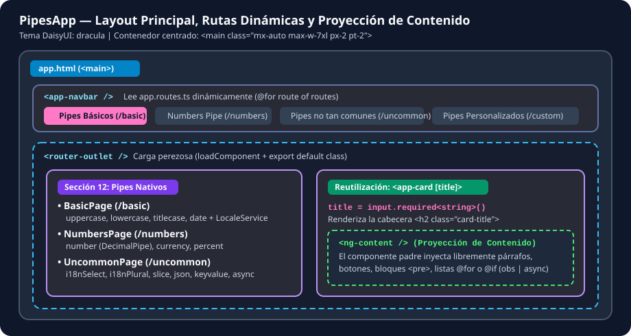
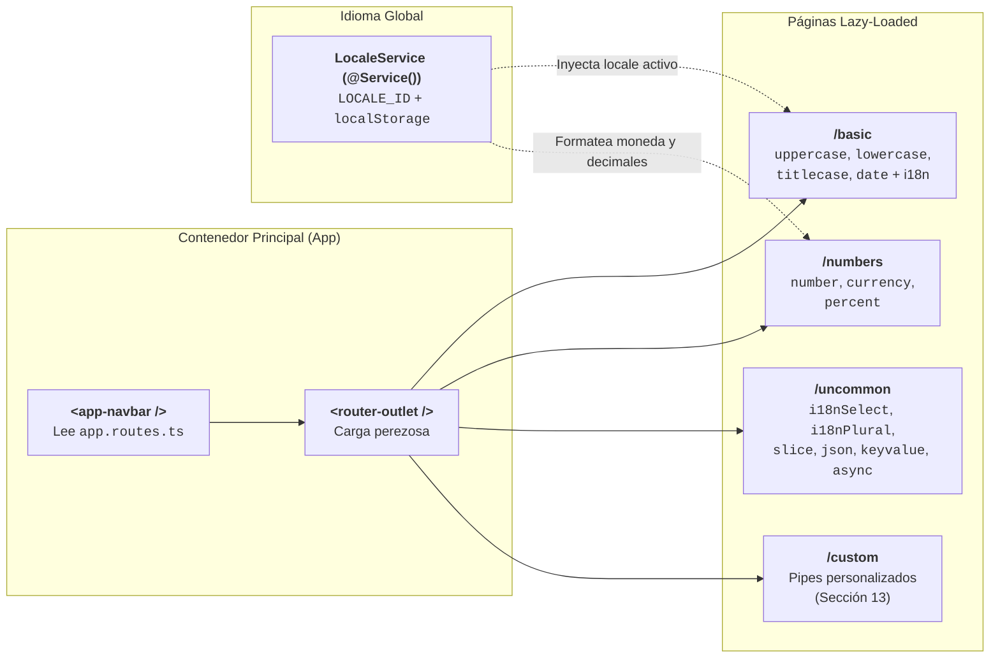

# Sección 12: PipesApp — Pipes Nativos, Internacionalización (i18n) y Proyección de Contenido

En esta sección construimos **PipesApp** (`05-pipes-app`), una aplicación interactiva diseñada para dominar todos los **Pipes integrados de Angular** (`@angular/common`): desde transformaciones básicas de texto, números y fechas, hasta **internacionalización dinámica (`LOCALE_ID` y `registerLocaleData`)**, **proyección de contenido (`<ng-content />`)** y pipes avanzados como `i18nSelect`, `i18nPlural`, `slice`, `json`, `keyvalue` y `async` (tanto con **Promesas** como con **Observables** de RxJS).

---

## 📋 Ficha Técnica y Objetivos Didácticos

* **Proyecto:** `05-pipes-app` (Catálogo interactivo de Pipes nativos de Angular).
* **Stack Tecnológico (Angular 22):** Componentes Standalone zoneless, Lazy Loading (`loadComponent` + `export default`), Signals (`signal()`, `input.required()`, `effect((onCleanup) => ...)`), `@Service()`, Tailwind CSS + DaisyUI (tema `dracula`), RxJS (`interval`, `map`, `tap`), i18n (`LOCALE_ID`, `registerLocaleData`).
* **Patrones Arquitectónicos:**
    * **Declarative View Transformation:** Transformar datos visualmente en la plantilla sin mutar el estado original de las Signals.
    * **Dynamic Route-Driven Navigation:** El componente `Navbar` deriva sus enlaces directamente del array de configuración `app.routes.ts`.
    * **Content Projection (`<ng-content />`):** Contenedor visual reutilizable `Card` que proyecta HTML arbitrario del componente padre.
    * **Dynamic DI Factory (`useFactory`):** Inyección dinámica del token `LOCALE_ID` leyendo la preferencia persistida en `LocaleService`.
* **Código Fuente de Referencia:** [GitHub - DevTalles PipesApp (fin-seccion-12)](https://github.com/DevTalles-corp/angular-pipes-app/tree/fin-seccion-12)





---

## 1. Inicio del Proyecto, Tailwind CSS + DaisyUI y Estructura Base

Creamos un proyecto Angular 22 nuevo con estilos CSS estándar y sin SSR/SSG, y renombramos la carpeta a `05-pipes-app`:

```bash
ng new pipes-app
# CSS -> Enter | SSR/SSG -> No (N)
mv pipes-app 05-pipes-app
cd 05-pipes-app
```

Configuramos **Tailwind CSS** y **DaisyUI** igual que en proyectos anteriores, activando el tema **`dracula`** como tema principal:

```css title="src/styles.css"
@import "tailwindcss";
@plugin "daisyui" {
  themes: dracula --default;
}
```

### 1.1. Estructura de Carpetas y Páginas Lazy-Loaded

Organizamos `src/app/` separando responsabilidades en cuatro carpetas:

```text
src/app/
├── components/
│   ├── navbar/
│   └── card/
├── interfaces/
├── pages/
│   ├── basic-page/
│   ├── numbers-page/
│   ├── uncommon-page/
│   └── custom-page/
├── services/
│   └── locale.service.ts
├── app.config.ts
├── app.html
├── app.routes.ts
└── app.ts
```

Generamos las cuatro páginas principales desde la terminal:

```bash
ng g c pages/basic-page --skip-tests --inline-style
ng g c pages/numbers-page --skip-tests --inline-style
ng g c pages/uncommon-page --skip-tests --inline-style
ng g c pages/custom-page --skip-tests --inline-style
```

Añadimos `export default class` a cada página (`BasicPage`, `NumbersPage`, `UncommonPage` y `CustomPage`) para simplificar su importación en el router, y configuramos `src/app/app.routes.ts` con la propiedad `title` en cada ruta (Angular actualizará automáticamente el título de la pestaña del navegador y podremos reutilizarlo en la barra de navegación):

```typescript title="src/app/app.routes.ts" hl_lines="5 6 7 10 15 20 25"
import { Routes } from '@angular/router';

export const routes: Routes = [
  {
    path: 'basic',
    title: 'Pipes Básicos',
    loadComponent: () => import('./pages/basic-page/basic-page'),
  },
  {
    path: 'numbers',
    title: 'Numbers Pipe',
    loadComponent: () => import('./pages/numbers-page/numbers-page'),
  },
  {
    path: 'uncommon',
    title: 'Pipes no tan comunes',
    loadComponent: () => import('./pages/uncommon-page/uncommon-page'),
  },
  {
    path: 'custom',
    title: 'Pipes Personalizados',
    loadComponent: () => import('./pages/custom-page/custom-page'),
  },
  {
    path: '**',
    redirectTo: 'basic',
  },
];
```

---

## 2. Barra de Navegación Dinámica (`Navbar`)

En lugar de escribir a mano los enlaces del menú y duplicar los títulos de las rutas, vamos a **leer dinámicamente el array `routes`** de `app.routes.ts`.

Generamos el componente `Navbar`:

```bash
ng g c components/navbar --skip-tests --inline-style
```

=== "navbar.ts"
    ```typescript title="src/app/components/navbar/navbar.ts" hl_lines="11 12 13 14"
    import { Component } from '@angular/core';
    import { RouterLink, RouterLinkActive } from '@angular/router';
    import { routes } from '../../app.routes';

    @Component({
      selector: 'app-navbar',
      imports: [RouterLink, RouterLinkActive],
      templateUrl: './navbar.html',
    })
    export class Navbar {
      routes = routes
        .filter((route) => route.path !== '**')
        .map((route) => ({
          title: route.title ?? '',
          path: route.path ?? '',
        }));
    }
    ```

=== "navbar.html"
    ```html title="src/app/components/navbar/navbar.html" hl_lines="3 4 5 6 7"
    <ul class="menu menu-horizontal bg-base-200 rounded-box my-2">
      @for (route of routes; track route.path) {
        <li>
          <a [routerLink]="route.path" routerLinkActive="text-accent">
            {{ route.title }}
          </a>
        </li>
      }
    </ul>
    ```

=== "app.ts y app.html"
    ```typescript title="src/app/app.ts"
    import { Component } from '@angular/core';
    import { RouterOutlet } from '@angular/router';
    import { Navbar } from './components/navbar/navbar';

    @Component({
      selector: 'app-root',
      imports: [RouterOutlet, Navbar],
      templateUrl: './app.html',
    })
    export class App {}
    ```

    ```html title="src/app/app.html"
    <main class="mx-auto max-w-7xl px-2 pt-2">
      <app-navbar />
      <router-outlet />
    </main>
    ```

!!! tip "Detalles importantes en `Navbar`"
    * **¿Por qué `routes` no es una Signal?** Porque el array de rutas es una configuración estática que no cambia durante la ejecución. No es necesario envolver valores constantes en `signal()`.
    * **`[routerLink]` con corchetes vs `routerLinkActive` sin corchetes:** `[routerLink]="route.path"` evalúa la expresión TypeScript `route.path`, mientras que `routerLinkActive="text-accent"` recibe el nombre literal de la clase CSS.
    * **Filtrar la ruta comodín `**`:** Si no filtramos `route.path !== '**'`, se generaría un `<li>` vacío al final del menú porque la ruta de redirección no tiene `title`.

---

## 3. Pipes de Texto: `LowerCasePipe`, `UpperCasePipe` y `TitleCasePipe`

Un **Pipe** transforma visualmente un dato justo antes de mostrarlo en la plantilla mediante el operador `|` (*pipe*), **sin modificar nunca el valor almacenado en la Signal o variable original**.

En `BasicPage` definimos tres Signals de texto y empezamos aplicando `LowerCasePipe` en la primera tarjeta de estadísticas de DaisyUI (`stats`):

```typescript title="src/app/pages/basic-page/basic-page.ts (Fase 1)" hl_lines="2 7 11 12 13"
import { Component, signal } from '@angular/core';
import { LowerCasePipe } from '@angular/common';

@Component({
  selector: 'app-basic-page',
  imports: [LowerCasePipe],
  templateUrl: './basic-page.html',
})
export default class BasicPage {
  nameLower = signal('fernando');
  nameUpper = signal('FERNANDO');
  fullName = signal('feRnaNdo HeRreRa');
}
```

```html title="src/app/pages/basic-page/basic-page.html (Fase 1)" hl_lines="11 12"
<section class="mx-5">
  <h1 class="text-2xl font-bold">Pipes Básicos</h1>
  <h3 class="text-xl font-thin">Pipes incluidos en Angular</h3>
</section>

<div class="stats stats-vertical lg:stats-horizontal shadow w-full">
  <div class="stat">
    <div class="stat-title">Lowercase Pipe</div>
    <div class="stat-value">{{ nameUpper() | lowercase }}</div>
    <div class="stat-desc">{{ nameUpper() }}</div>
  </div>

  <!-- TODO: Completar en la Tarea Práctica 1 -->
</div>
```

---

## 🎯 Tarea Práctica 1: Completar `UpperCasePipe` y `TitleCasePipe`

### 📋 Enunciado del Reto

Completa la sección de estadísticas de `BasicPage` añadiendo dos tarjetas `.stat` adicionales:

1. **Segunda tarjeta (`Uppercase Pipe`):** muestra `nameLower()` transformado a mayúsculas con el pipe `uppercase`, y debajo (`stat-desc`) el valor original de `nameLower()`.
2. **Tercera tarjeta (`TitleCase Pipe`):** muestra `fullName()` capitalizando cada palabra con el pipe `titlecase`, y debajo (`stat-desc`) el valor original de `fullName()`.

### ⏸️ Reto Práctico: ¡Inténtalo tú mismo!

!!! exercise "Pausa de Trabajo Autónomo"
    Antes de consultar la solución, importa los dos pipes necesarios en `basic-page.ts` y añade las dos tarjetas `.stat` en `basic-page.html`. Comprueba en el navegador que los valores originales mostrados en `.stat-desc` permanecen intactos.

### ⚠️ Errores Típicos

* **Olvidar importar el pipe en el componente Standalone:** si escribes `| uppercase` o `| titlecase` en el HTML sin añadir `UpperCasePipe` y `TitleCasePipe` al array `imports` de `@Component`, Angular lanzará el error `NG8004: No pipe found with name 'uppercase'`.
* **Confundir el nombre de la clase con el nombre del pipe en plantilla:** la clase se llama `TitleCasePipe`, pero en HTML se invoca siempre en minúsculas: `| titlecase`.

### ✅ Solución de la Tarea Práctica 1

=== "basic-page.ts"
    ```typescript title="src/app/pages/basic-page/basic-page.ts" hl_lines="2 6"
    import { Component, signal } from '@angular/core';
    import { LowerCasePipe, TitleCasePipe, UpperCasePipe } from '@angular/common';

    @Component({
      selector: 'app-basic-page',
      imports: [LowerCasePipe, UpperCasePipe, TitleCasePipe],
      templateUrl: './basic-page.html',
    })
    export default class BasicPage {
      nameLower = signal('fernando');
      nameUpper = signal('FERNANDO');
      fullName = signal('feRnaNdo HeRreRa');
    }
    ```

=== "basic-page.html"
    ```html title="src/app/pages/basic-page/basic-page.html" hl_lines="13 14 15 16 17 19 20 21 22 23"
    <section class="mx-5">
      <h1 class="text-2xl font-bold">Pipes Básicos</h1>
      <h3 class="text-xl font-thin">Pipes incluidos en Angular</h3>
    </section>

    <div class="stats stats-vertical lg:stats-horizontal shadow w-full">
      <div class="stat">
        <div class="stat-title">Lowercase Pipe</div>
        <div class="stat-value">{{ nameUpper() | lowercase }}</div>
        <div class="stat-desc">{{ nameUpper() }}</div>
      </div>

      <div class="stat">
        <div class="stat-title">Uppercase Pipe</div>
        <div class="stat-value">{{ nameLower() | uppercase }}</div>
        <div class="stat-desc">{{ nameLower() }}</div>
      </div>

      <div class="stat">
        <div class="stat-title">TitleCase Pipe</div>
        <div class="stat-value">{{ fullName() | titlecase }}</div>
        <div class="stat-desc">{{ fullName() }}</div>
      </div>
    </div>
    ```

---

## 4. Pipes Numéricos: `DecimalPipe`, `CurrencyPipe` y `PercentPipe`

En `NumbersPage` trabajamos con los tres pipes numéricos de `@angular/common`. Fíjate en el uso del separador numérico `_` de JavaScript/TypeScript (`2_433_232.5567`), que mejora la legibilidad sin alterar el número.

!!! note "Atención al nombre de `DecimalPipe`"
    La clase que importamos desde `@angular/common` es `DecimalPipe`, pero en la plantilla HTML su nombre es **`number`** (por ejemplo, `{{ totalSells() | number : '1.2-2' }}`).

Los argumentos de un pipe se separan mediante dos puntos (`:`). En el formato de dígitos `'minEnteros.minDecimales-maxDecimales'`, `'1.2-2'` indica al menos 1 dígito entero y exactamente 2 decimales (redondeando automáticamente).

=== "numbers-page.ts"
    ```typescript title="src/app/pages/numbers-page/numbers-page.ts" hl_lines="2 6 10 11"
    import { Component, signal } from '@angular/core';
    import { CurrencyPipe, DecimalPipe, PercentPipe } from '@angular/common';

    @Component({
      selector: 'app-numbers-page',
      imports: [DecimalPipe, PercentPipe, CurrencyPipe],
      templateUrl: './numbers-page.html',
    })
    export default class NumbersPage {
      totalSells = signal(2_433_232.5567);
      percent = signal(0.4856);
    }
    ```

=== "numbers-page.html"
    ```html title="src/app/pages/numbers-page/numbers-page.html" hl_lines="9 15 21 27"
    <section class="mx-5">
      <h1 class="text-2xl font-bold">Pipes Numéricos</h1>
      <h3 class="text-xl font-thin">Pipes incluidos en Angular</h3>
    </section>

    <div class="stats stats-vertical lg:stats-horizontal shadow w-full">
      <div class="stat">
        <div class="stat-title">Number: '1.2-2'</div>
        <div class="stat-value">{{ totalSells() | number : '1.2-2' }}</div>
        <div class="stat-desc">{{ totalSells() }}</div>
      </div>

      <div class="stat">
        <div class="stat-title">Number: '1.1-2' (con expresión)</div>
        <div class="stat-value">{{ totalSells() + 1234 | number : '1.1-2' }}</div>
        <div class="stat-desc">{{ totalSells() }}</div>
      </div>

      <div class="stat">
        <div class="stat-title">Currency</div>
        <div class="stat-value">
          {{ totalSells() | currency : 'CAD' : 'symbol-narrow' : '1.4-4' }}
        </div>
        <div class="stat-desc">{{ totalSells() }}</div>
      </div>

      <div class="stat">
        <div class="stat-title">Percent</div>
        <div class="stat-value">{{ percent() | percent : '1.2-2' }}</div>
        <div class="stat-desc">{{ percent() }}</div>
      </div>
    </div>
    ```

| Pipe | Clase | Argumentos del ejemplo | Resultado aproximado (`en`) |
| :--- | :--- | :--- | :--- |
| `number` | `DecimalPipe` | `'1.2-2'` | `2,433,232.56` |
| `currency` | `CurrencyPipe` | `'CAD' : 'symbol-narrow' : '1.4-4'` | `$2,433,232.5567` |
| `percent` | `PercentPipe` | `'1.2-2'` | `48.56%` |

---

## 5. `DatePipe` y Reloj Reactivo con `effect((onCleanup) => ...)`

Volvemos a `BasicPage` para trabajar con fechas mediante `DatePipe`. Además de probar formatos predefinidos (`'long'`, `'short'`), zonas horarias (`'GMT-6'`, `'GMT-4'`) y formatos personalizados (`'yyyy MM'`, `'dd/MM/yyyy'`, `'HH:mm:ss'`, `'EEEE d, MMMM'`), hacemos que `customDate` se actualice cada segundo como un reloj real usando `effect` con limpieza obligatoria (`onCleanup`):

```typescript title="src/app/pages/basic-page/basic-page.ts (DatePipe + reloj reactivo)" hl_lines="1 2 7 15 17 18 19 20 21 22 23 24 25"
import { Component, effect, signal } from '@angular/core';
import { DatePipe, LowerCasePipe, TitleCasePipe, UpperCasePipe } from '@angular/common';

@Component({
  selector: 'app-basic-page',
  imports: [LowerCasePipe, UpperCasePipe, TitleCasePipe, DatePipe],
  templateUrl: './basic-page.html',
})
export default class BasicPage {
  nameLower = signal('fernando');
  nameUpper = signal('FERNANDO');
  fullName = signal('feRnaNdo HeRreRa');

  customDate = signal(new Date());

  tickingDateEffect = effect((onCleanup) => {
    const interval = setInterval(() => {
      this.customDate.set(new Date());
    }, 1000);

    onCleanup(() => {
      clearInterval(interval);
    });
  });
}
```

!!! danger "Fuga de memoria si omites `onCleanup`"
    Si no llamas a `clearInterval(interval)` dentro de `onCleanup`, cada vez que el usuario navegue a otra ruta y vuelva a `/basic` se creará un nuevo intervalo **sin destruir el anterior**, acumulando temporizadores en memoria indefinidamente.

Añadimos tres filas de estadísticas en `basic-page.html` separadas con `<div class="divider"></div>` de DaisyUI:

```html title="src/app/pages/basic-page/basic-page.html (bloque DatePipe)"
<div class="divider"></div>

<div class="stats stats-vertical lg:stats-horizontal shadow w-full">
  <div class="stat">
    <div class="stat-title">Date Pipe</div>
    <div class="stat-value">{{ customDate() | date }}</div>
    <div class="stat-desc">{{ customDate() }}</div>
  </div>

  <div class="stat">
    <div class="stat-title">Date | long | GMT-6</div>
    <div class="stat-value">{{ customDate() | date : 'long' : 'GMT-6' }}</div>
    <div class="stat-desc">{{ customDate() }}</div>
  </div>
</div>

<div class="stats stats-vertical lg:stats-horizontal shadow w-full">
  <div class="stat">
    <div class="stat-title">Date: 'yyyy MM'</div>
    <div class="stat-value">{{ customDate() | date : 'yyyy MM' }}</div>
    <div class="stat-desc">{{ customDate() }}</div>
  </div>

  <div class="stat">
    <div class="stat-title">Date | short | GMT-4</div>
    <div class="stat-value">{{ customDate() | date : 'short' : 'GMT-4' }}</div>
    <div class="stat-desc">{{ customDate() }}</div>
  </div>
</div>

<div class="divider"></div>

<div class="stats stats-vertical lg:stats-horizontal shadow w-full">
  <div class="stat">
    <div class="stat-title">Date Pipe</div>
    <div class="stat-value">{{ customDate() | date : 'dd/MM/yyyy' }}</div>
    <div class="stat-desc">{{ customDate() }}</div>
  </div>

  <div class="stat">
    <div class="stat-title">Date Pipe</div>
    <div class="stat-value">{{ customDate() | date : 'HH:mm:ss' }}</div>
    <div class="stat-desc">{{ customDate() }}</div>
  </div>

  <div class="stat">
    <div class="stat-title">Date Pipe</div>
    <div class="stat-value">{{ customDate() | date : 'EEEE d, MMMM' }}</div>
    <div class="stat-desc">{{ customDate() }}</div>
  </div>
</div>
```

---

## 6. Internacionalización (i18n): `registerLocaleData` y `LocaleService`

Por defecto, Angular solo incluye el idioma inglés (`en-US`). Si intentamos configurar el `LOCALE_ID` en `'es'` o `'fr'` sin registrar primero los datos regionales, Angular lanzará el error **`NG02100: Missing locale data for the locale "es"`**.

### 6.1. Servicio `LocaleService` con `@Service()` (Angular 22)

Creamos `src/app/services/locale.service.ts` para gestionar el idioma activo, persistirlo en `localStorage` y recargar la aplicación al cambiar de idioma (necesario porque `LOCALE_ID` se evalúa durante el arranque de la aplicación):

```typescript title="src/app/services/locale.service.ts" hl_lines="1 3 5 9 10 11 18 19 20 21 22"
import { Service, signal } from '@angular/core';

export type AvailableLocale = 'es' | 'fr' | 'en';

@Service()
export class LocaleService {
  private currentLocale = signal<AvailableLocale>('fr');

  constructor() {
    this.currentLocale.set(
      (localStorage.getItem('locale') as AvailableLocale) ?? 'es'
    );
  }

  get getLocale() {
    return this.currentLocale();
  }

  changeLocale(locale: AvailableLocale) {
    localStorage.setItem('locale', locale);
    this.currentLocale.set(locale);
    window.location.reload();
  }
}
```

### 6.2. Registro de Locales y Proveedor Dinámico en `app.config.ts`

En `src/app/app.config.ts` registramos los paquetes de español (`es`) y francés (`fr`) —el inglés ya viene incluido— y proveemos `LOCALE_ID` mediante una factoría (`useFactory`) conectada a `LocaleService`:

```typescript title="src/app/app.config.ts" hl_lines="1 3 7 8 10 11 19 20 21 22 23"
import { ApplicationConfig, LOCALE_ID, provideBrowserGlobalErrorListeners } from '@angular/core';
import { provideRouter } from '@angular/router';
import { registerLocaleData } from '@angular/common';

import { routes } from './app.routes';
import { LocaleService } from './services/locale.service';

import localeEs from '@angular/common/locales/es';
import localeFr from '@angular/common/locales/fr';

registerLocaleData(localeEs, 'es');
registerLocaleData(localeFr, 'fr');

export const appConfig: ApplicationConfig = {
  providers: [
    provideBrowserGlobalErrorListeners(),
    provideRouter(routes),
    {
      provide: LOCALE_ID,
      deps: [LocaleService],
      useFactory: (localeService: LocaleService) => localeService.getLocale,
    },
  ],
};
```

!!! info "Variantes regionales"
    También puedes importar variantes específicas como `@angular/common/locales/es-ES`, `es-AR` o `es-MX` si necesitas convenciones concretas de moneda o formato de fecha de un país determinado.

### 6.3. Botones de Cambio de Idioma en `BasicPage`

Inyectamos `LocaleService` y el token `LOCALE_ID` en `BasicPage`, y añadimos tres botones en la parte inferior de `basic-page.html` para cambiar de idioma en vivo:

=== "basic-page.ts (fragmento)"
    ```typescript title="src/app/pages/basic-page/basic-page.ts" hl_lines="1 2 6 7 10 11 12"
    import { Component, effect, inject, LOCALE_ID, signal } from '@angular/core';
    import { AvailableLocale, LocaleService } from '../../services/locale.service';

    // ... dentro de BasicPage
    export default class BasicPage {
      localeService = inject(LocaleService);
      currentLocale = signal(inject(LOCALE_ID));

      // ... resto de propiedades y tickingDateEffect

      changeLocale(locale: AvailableLocale) {
        this.localeService.changeLocale(locale);
      }
    }
    ```

=== "basic-page.html (fragmento inferior)"
    ```html title="src/app/pages/basic-page/basic-page.html"
    <div class="flex flex-row gap-2 mt-4">
      <h1 class="text-2xl font-bold">
        Locale Actual:
        <span class="badge badge-secondary">{{ currentLocale() }}</span>
      </h1>

      <button (click)="changeLocale('fr')" class="btn btn-primary">
        Changer en français
      </button>
      <button (click)="changeLocale('en')" class="btn btn-primary">
        Change to English
      </button>
      <button (click)="changeLocale('es')" class="btn btn-primary">
        Cambiar a español
      </button>
    </div>
    ```

Comprueba ahora tanto `/basic` (los nombres de días y meses en `DatePipe`) como `/numbers` (el separador de miles y decimales en `DecimalPipe` y `CurrencyPipe`): todos se adaptan automáticamente al `LOCALE_ID` activo.

---

## 7. Proyección de Contenido: Componente Reutilizable `Card`

Para la página de pipes no tan comunes (`UncommonPage`), todas las tarjetas comparten exactamente el mismo marco visual de DaisyUI, pero cada una tiene un cuerpo distinto (textos, botones, listas `@for`, bloques `<pre>`, etc.). En lugar de repetir la estructura de la tarjeta seis veces, creamos un componente contenedor `Card` que utiliza **Proyección de Contenido (`<ng-content />`)**.

```bash
ng g c components/card --skip-tests --inline-style
```

=== "card.ts"
    ```typescript title="src/app/components/card/card.ts" hl_lines="9"
    import { Component, input } from '@angular/core';

    @Component({
      selector: 'app-card',
      imports: [],
      templateUrl: './card.html',
    })
    export class Card {
      title = input.required<string>();
    }
    ```

=== "card.html"
    ```html title="src/app/components/card/card.html" hl_lines="5"
    <div class="card bg-base-200 shadow-xl">
      <div class="card-body">
        <h2 class="card-title mb-2">{{ title() }}</h2>

        <ng-content />
      </div>
    </div>
    ```

Todo el HTML que coloquemos entre `<app-card title="...">` y `</app-card>` en `UncommonPage` se proyectará exactamente donde está `<ng-content />`.

!!! tip "Profundiza en Proyección de Contenido"
    Consulta el capítulo [13. Proyección de Contenido](manual/13-proyeccion-contenido.md) del Manual de Referencia para ver proyecciones múltiples con `select` y contenido por defecto.

---

## 8. Pipes No Tan Comunes (`UncommonPage`)

Maquetamos `UncommonPage` con un grid responsivo de Tailwind (`grid grid-cols-1 md:grid-cols-2 xl:grid-cols-3 gap-4`) y vamos añadiendo cada pipe dentro de su propia `<app-card>`.

### 8.1. `I18nSelectPipe` (Selección según clave de mapa)

Permite elegir una cadena de texto distinta en función de un valor clave (por ejemplo, concordancia de género o rol). Usamos el patrón *Early Return* al alternar entre dos clientes:

=== "uncommon-page.ts (I18nSelectPipe)"
    ```typescript title="src/app/pages/uncommon-page/uncommon-page.ts (fragmento)"
    const client1 = {
      name: 'Fernando',
      gender: 'male',
      age: 39,
      address: 'Ottawa, Canada',
    };

    const client2 = {
      name: 'Melissa',
      gender: 'female',
      age: 33,
      address: 'Toronto, Canada',
    };

    // Dentro de UncommonPage:
    client = signal(client1);

    invitationMap = {
      male: 'invitarlo',
      female: 'invitarla',
    };

    changeClient() {
      if (this.client() === client1) {
        this.client.set(client2);
        return;
      }

      this.client.set(client1);
    }
    ```

=== "uncommon-page.html (tarjeta)"
    ```html title="Tarjeta I18nSelectPipe"
    <app-card title="i18nSelectPipe">
      <p>
        Saludos {{ client().name }}, es un placer
        {{ client().gender | i18nSelect : invitationMap }} a nuestro evento.
      </p>

      <button (click)="changeClient()" class="btn btn-primary">
        Cambiar cliente
      </button>
    </app-card>
    ```

### 8.2. `I18nPluralPipe` (Pluralización dinámica)

Adapta el mensaje según la cantidad numérica recibida. El carácter especial **`#`** se sustituye automáticamente por el número recibido, y el mapa puede almacenarse en una Signal (recuerda invocar `clientsMap()` con paréntesis):

=== "uncommon-page.ts (I18nPluralPipe)"
    ```typescript title="src/app/pages/uncommon-page/uncommon-page.ts (fragmento)"
    clientsMap = signal({
      '=0': 'no tenemos ningún cliente esperando',
      '=1': 'tenemos un cliente esperando',
      '=2': 'tenemos 2 clientes esperando',
      other: 'tenemos # clientes esperando',
    });

    clients = signal([
      'Maria',
      'Pedro',
      'Fernando',
      'Melissa',
      'Natalia',
      'Andrea',
      'Juan',
      'Carlos',
    ]);

    deleteClient() {
      this.clients.update((prev) => prev.slice(1));
    }
    ```

=== "uncommon-page.html (tarjeta)"
    ```html title="Tarjeta I18nPluralPipe"
    <app-card title="i18nPluralPipe">
      <p>Actualmente {{ clients().length | i18nPlural : clientsMap() }}</p>

      <button
        [disabled]="clients().length === 0"
        (click)="deleteClient()"
        class="btn btn-primary"
      >
        Borrar cliente
      </button>
    </app-card>
    ```

!!! tip "Inmutabilidad en `deleteClient()`"
    Usamos `prev.slice(1)` en lugar de `prev.shift()` porque `.slice()` devuelve un **nuevo array** sin mutar el original, garantizando que Angular detecte el cambio en la Signal de forma limpia y predecible.

### 8.3. `SlicePipe` (Recorte de arrays y cadenas)

Extrae una porción de un array o `string` con la sintaxis `valor | slice : inicio : fin`, donde **`inicio` es inclusivo** y **`fin` es exclusivo**. Admite índices negativos (contando desde el final):

```html title="Tarjeta SlicePipe"
<app-card title="SlicePipe">
  <b>Original</b>
  <p class="text-primary">{{ clients().join(', ') }}</p>

  <b class="mt-2">Slice:0:2</b>
  <p class="text-primary">{{ clients() | slice : 0 : 2 }}</p>

  <b class="mt-2">Slice:1:2</b>
  <p class="text-primary">{{ clients() | slice : 1 : 2 }}</p>

  <b class="mt-2">Slice:1:3</b>
  <p class="text-primary">{{ clients() | slice : 1 : 3 }}</p>

  <b class="mt-2">Slice:3:4</b>
  <p class="text-primary">{{ clients() | slice : 3 : 4 }}</p>

  <b class="mt-2">Slice:0:-3</b>
  <p class="text-primary">{{ clients() | slice : 0 : -3 }}</p>
</app-card>
```

### 8.4. `JsonPipe` (Depuración visual y encadenamiento)

Si interpolamos un objeto directamente (`{{ client() }}`), JavaScript llama a `.toString()` y muestra `[object Object]`. `JsonPipe` serializa cualquier objeto o array a texto JSON formateado, ideal dentro de una etiqueta `<pre>`. Además, los pipes pueden **encadenarse de izquierda a derecha**:

```html title="Tarjeta JsonPipe"
<app-card title="JsonPipe">
  <pre class="text-primary">{{ clients() | json }}</pre>
  <pre class="text-primary">{{ client() | json }}</pre>
  <p class="text-primary">{{ clients().join(', ') | json | uppercase }}</p>
</app-card>
```

### 8.5. `KeyValuePipe` (Iterar objetos con `@for`)

Un objeto plano de JavaScript no es iterable directamente en `@for`. `KeyValuePipe` transforma un objeto (o `Map`) en un array de pares `{ key, value }` ordenados por clave:

=== "uncommon-page.ts (profile)"
    ```typescript title="Propiedad profile en UncommonPage"
    profile = {
      name: 'Fernando',
      age: 39,
      address: 'Ottawa, Canada',
    };
    ```

=== "uncommon-page.html (tarjeta)"
    ```html title="Tarjeta KeyValuePipe"
    <app-card title="KeyValuePipe">
      <ul>
        @for (item of profile | keyvalue; track $index) {
          <li>
            <strong class="text-primary">{{ item.key | titlecase }}:</strong>
            <span>{{ item.value }}</span>
          </li>
        }
      </ul>
    </app-card>
    ```

!!! warning "El orden de encadenamiento importa"
    `profile | keyvalue | json` funciona correctamente (primero convierte el objeto en array de `{ key, value }` y luego lo serializa a JSON). En cambio, `profile | json | keyvalue` **falla**, porque `json` devuelve un `string` y `keyvalue` espera un objeto o mapa.

### 8.6. `AsyncPipe` con Promesas y Observables

`AsyncPipe` se suscribe automáticamente a una `Promise` o a un `Observable`, actualiza la vista con cada nuevo valor emitido y **cancela la suscripción automáticamente al destruirse el componente**, evitando fugas de memoria.

=== "uncommon-page.ts (completo)"
    ```typescript title="src/app/pages/uncommon-page/uncommon-page.ts" hl_lines="2 12 13 14 15 16 17 18 19 20 21 57 58 59 60 61 62 63 64 65 66 67 68 69"
    import { Component, signal } from '@angular/core';
    import {
      AsyncPipe,
      I18nPluralPipe,
      I18nSelectPipe,
      JsonPipe,
      KeyValuePipe,
      SlicePipe,
      TitleCasePipe,
      UpperCasePipe,
    } from '@angular/common';
    import { interval, map, tap } from 'rxjs';
    import { Card } from '../../components/card/card';

    const client1 = {
      name: 'Fernando',
      gender: 'male',
      age: 39,
      address: 'Ottawa, Canada',
    };

    const client2 = {
      name: 'Melissa',
      gender: 'female',
      age: 33,
      address: 'Toronto, Canada',
    };

    @Component({
      selector: 'app-uncommon-page',
      imports: [
        Card,
        I18nSelectPipe,
        I18nPluralPipe,
        SlicePipe,
        JsonPipe,
        UpperCasePipe,
        KeyValuePipe,
        TitleCasePipe,
        AsyncPipe,
      ],
      templateUrl: './uncommon-page.html',
    })
    export default class UncommonPage {
      // i18n Select
      client = signal(client1);

      invitationMap = {
        male: 'invitarlo',
        female: 'invitarla',
      };

      changeClient() {
        if (this.client() === client1) {
          this.client.set(client2);
          return;
        }

        this.client.set(client1);
      }

      // i18n Plural
      clientsMap = signal({
        '=0': 'no tenemos ningún cliente esperando',
        '=1': 'tenemos un cliente esperando',
        '=2': 'tenemos 2 clientes esperando',
        other: 'tenemos # clientes esperando',
      });

      clients = signal([
        'Maria',
        'Pedro',
        'Fernando',
        'Melissa',
        'Natalia',
        'Andrea',
        'Juan',
        'Carlos',
      ]);

      deleteClient() {
        this.clients.update((prev) => prev.slice(1));
      }

      // KeyValue Pipe
      profile = {
        name: 'Fernando',
        age: 39,
        address: 'Ottawa, Canada',
      };

      // Async Pipe con Promesa
      promiseValue: Promise<string> = new Promise((resolve) => {
        setTimeout(() => {
          resolve('Tenemos data en la promesa.');
        }, 3500);
      });

      // Async Pipe con Observable
      myObservableTimer = interval(2000).pipe(
        map((value) => value + 1),
        tap((value) => console.log('tap:', value))
      );
    }
    ```

=== "uncommon-page.html (tarjetas AsyncPipe)"
    ```html title="Tarjetas AsyncPipe en uncommon-page.html" hl_lines="2 12"
    <app-card title="AsyncPipe">
      @if (promiseValue | async; as value) {
        <p class="text-primary">{{ value }}</p>
      } @else {
        <p class="text-accent">Espere por favor...</p>
      }

      <h3 class="text-2xl mt-4">Observable</h3>
      <p>{{ myObservableTimer | async }}</p>

      @if (myObservableTimer | async; as value) {
        <p>Valor: {{ value }}</p>
      } @else {
        <p>Esperando primer valor...</p>
      }
    </app-card>
    ```

!!! warning "Trampa clásica con `AsyncPipe` y el valor `0`"
    `interval(2000)` emite `0, 1, 2, 3...`. En JavaScript, **`0` es un valor *falsy***, por lo que `@if (myObservableTimer | async; as value)` seguiría mostrando el bloque `@else` durante el primer tick (`0`) hasta recibir el `1`.
    Por eso en el ejemplo sumamos `1` con `map((value) => value + 1)`. Si en una aplicación real el `0` es un dato válido que debes renderizar, usa una comprobación explícita contra `null`:

    ```html
    @let timer = myObservableTimer | async;
    @if (timer !== null) {
      <p>Valor: {{ timer }}</p>
    } @else {
      <p>Esperando primer valor...</p>
    }
    ```

---

## 📝 Repaso y Autoevaluación

??? question "1. ¿Por qué `DecimalPipe` no se escribe como `| decimal` en la plantilla?"
    Porque el metadato `name` de `DecimalPipe` en `@angular/common` es `'number'`. Siempre debes importar la clase `DecimalPipe` en el componente e invocarlo como `| number` en el HTML.

??? question "2. ¿Qué ocurre si cambiamos `LOCALE_ID` a `'es'` sin llamar antes a `registerLocaleData(localeEs, 'es')`?"
    Angular lanzará el error de ejecución `NG02100` indicando que faltan los datos de localización para `'es'`, ya que por defecto solo se empaqueta el locale `'en-US'`.

??? question "3. ¿Qué ventaja ofrece `AsyncPipe` frente a llamar manualmente a `.subscribe()` en un Observable?"
    `AsyncPipe` gestiona automáticamente tanto la suscripción al montarse la vista como la desuscripción (`unsubscribe`) cuando el componente se destruye, evitando fugas de memoria y código repetitivo.

---

## 📚 Material de Profundización

* [Manual 06 — Pipes Nativos y Personalizados](manual/06-pipes.md)
* [Manual 13 — Proyección de Contenido (`ng-content`)](manual/13-proyeccion-contenido.md)
* [Manual 05 — Signals y Reactividad (`effect` y `onCleanup`)](manual/05-signals.md)
* [Manual 10 — Cliente HTTP y Observables](manual/10-http.md)
