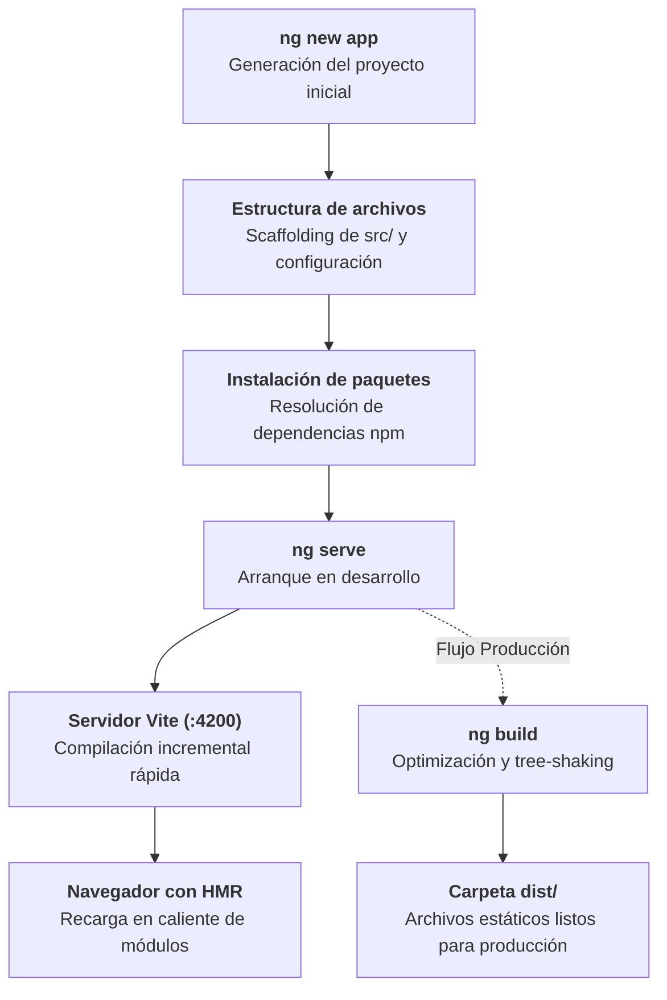
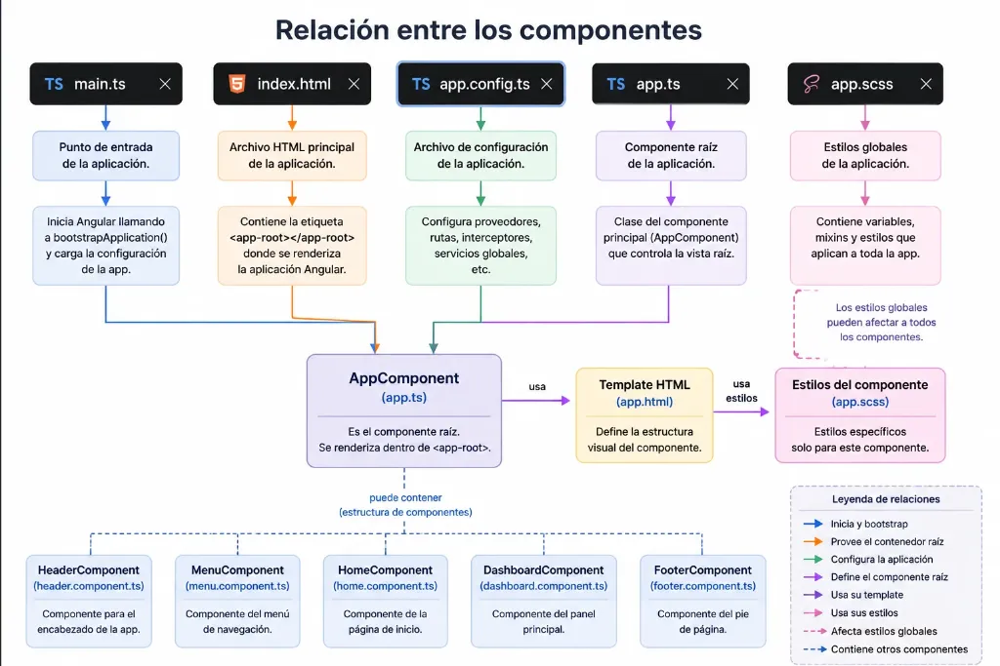
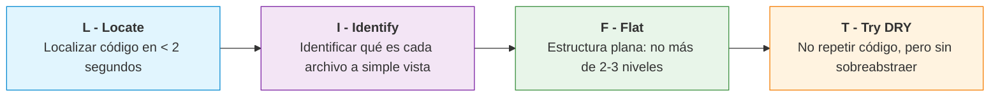
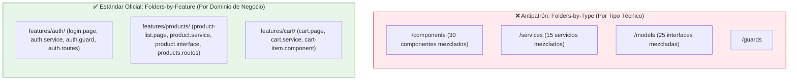
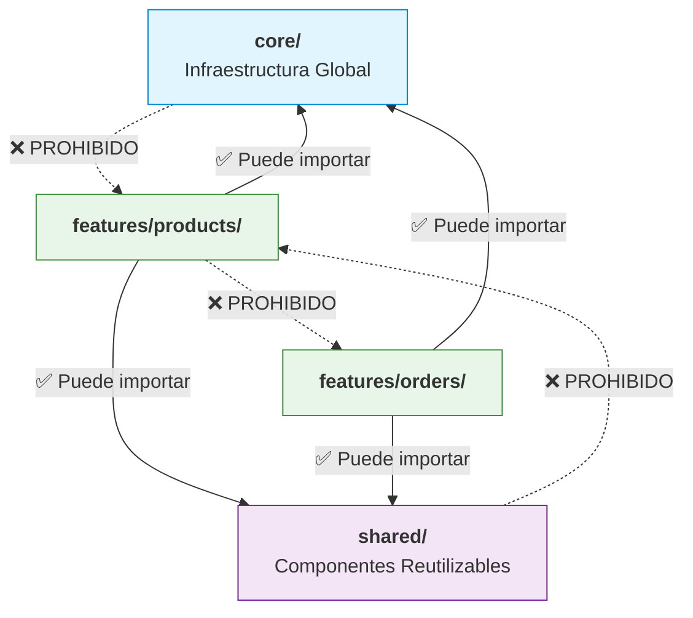
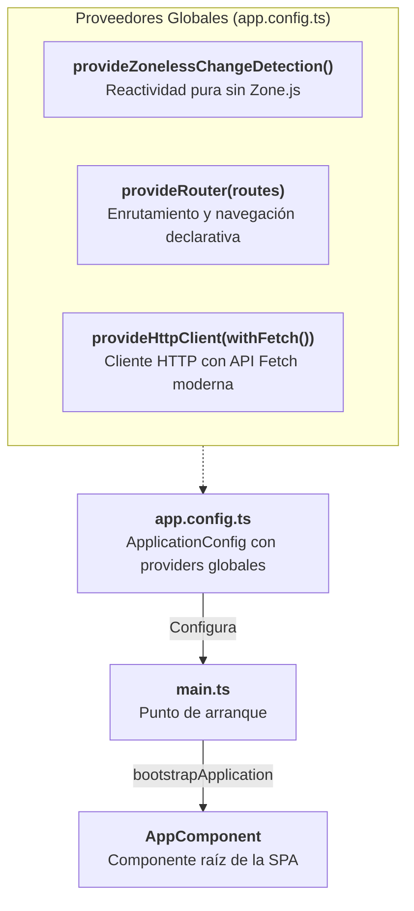

# Crear un Proyecto Angular

<div class="badges">
  <span class="badge badge-angular">Angular 19 - 22</span>
  <span class="badge badge-standalone">Standalone Project</span>
  <span class="badge badge-pro">Vite & esbuild</span>
</div>

## Objetivos de aprendizaje

Al finalizar esta unidad, el alumnado será capaz de:

1. Comprender el papel de Node.js y npm en el ecosistema Angular.
2. Utilizar Angular CLI para crear, compilar y servir proyectos Angular.
3. Interpretar la estructura de carpetas y archivos generada por `ng new`.
4. Configurar el archivo `angular.json` para personalizar el comportamiento del proyecto.
5. Diferenciar los archivos de configuración TypeScript y entender su propósito.
6. Explicar el proceso de build y sus opciones de optimización.
7. Configurar entornos de desarrollo y producción en un proyecto Angular.
8. Añadir bibliotecas externas compatibles con Angular CLI mediante `ng add`.

## Resultados de aprendizaje

Tras completar esta unidad, el estudiante será capaz de:

- Crear un proyecto Angular desde cero con las opciones adecuadas según los requisitos.
- Explicar la función de cada carpeta y archivo principal del proyecto.
- Modificar la configuración de `angular.json` para ajustar el comportamiento del build y serve.
- Configurar estilos globales con CSS puro y variables nativas.
- Añadir Angular Material a un proyecto existente.
- Crear y gestionar archivos de configuración de entornos.
- Identificar y corregir problemas comunes en la configuración inicial de un proyecto.

## Introducción

Si la unidad anterior fue el plano conceptual, esta unidad es el taller donde empezamos a construir. Hasta ahora hemos hablado de qué es Angular teóricamente; ahora vamos a crear nuestro primer proyecto, a entender cada archivo que se genera y a dominar las herramientas que usaremos cada día como desarrolladores Angular.

Piensa en un edificio: antes de colocar el primer ladrillo, necesitas los cimientos, las herramientas adecuadas y los planos detallados. En Angular, esos cimientos son Node.js y npm; las herramientas son Angular CLI; y los planos son los archivos de configuración del proyecto. Si dominas esta base, todo lo que construyas encima será sólido y mantenible.

En esta unidad, dedicaremos tiempo a entender en profundidad la estructura de un proyecto Angular, porque es la base sobre la que trabajarás durante todo el curso (y durante tu carrera profesional). No es un tema "aburrido que hay que pasar rápido": cada vez que tengas un error de compilación, un problema de rutas o necesites configurar un nuevo entorno, volverás a estos conceptos.

Un desarrollador Angular productivo no solo sabe escribir componentes: sabe navegar con soltura por la estructura del proyecto, modificar configuraciones cuando es necesario, y entender qué está pasando cuando ejecuta `ng serve` o `ng build`. Esa es exactamente la competencia que desarrollaremos en esta unidad.

## Desarrollo teórico

### Node.js y npm

#### ¿Qué es Node.js?

Node.js es un **entorno de ejecución de JavaScript para el servidor**, construido sobre el motor V8 de Google Chrome (el mismo que ejecuta JavaScript en el navegador). Node.js permite ejecutar JavaScript fuera del navegador, en el sistema operativo, accediendo al sistema de archivos, a la red y a otros recursos del sistema.

Para el desarrollo Angular, Node.js es fundamental por varias razones:

1. **Angular CLI es una aplicación Node.js**: cuando escribes `ng serve` en la terminal, estás ejecutando un programa escrito en Node.js que inicia webpack/vite, compila TypeScript, sirve archivos estáticos y recarga el navegador automáticamente.

2. **npm (Node Package Manager)**: el gestor de paquetes que viene con Node.js es la herramienta que usamos para instalar Angular, sus dependencias y cualquier biblioteca de terceros.

3. **Servidor de desarrollo**: `ng serve` inicia un servidor web construido con Node.js que sirve nuestra aplicación durante el desarrollo.

4. **Compilación**: TypeScript se compila a JavaScript usando el compilador de TypeScript, que es un paquete npm ejecutado por Node.js.

5. **SSR (Server-Side Rendering)**: cuando usamos Angular Universal o el SSR nativo, el servidor que renderiza nuestra aplicación es Node.js.

Node.js usa un modelo de ejecución **asíncrono y orientado a eventos**, lo que lo hace muy eficiente para aplicaciones I/O intensivas. A diferencia de los servidores tradicionales que crean un hilo por cada petición, Node.js usa un único hilo con un event loop que gestiona miles de conexiones simultáneas.

#### npm: el gestor de paquetes

npm (Node Package Manager) es el gestor de paquetes más grande del mundo. Cumple tres funciones principales:

1. **Repositorio online**: millones de paquetes publicados en https://www.npmjs.com
2. **Herramienta de línea de comandos**: para instalar, actualizar, publicar y gestionar paquetes.
3. **Gestor de dependencias**: resuelve árboles de dependencias complejos.

Comandos esenciales del gestor de paquetes para el día a día en Angular:

=== "npm"
    ```bash title="Terminal"
    npm install                         # Instala todas las dependencias listadas en package.json
    npm install <paquete>               # Instala un paquete y lo añade a dependencies
    npm install --save-dev <paquete>    # Instala en devDependencies
    npm uninstall <paquete>            # Desinstala un paquete
    npm update                         # Actualiza paquetes según semver
    npm run <script>                   # Ejecuta un script (ej: npm run build)
    npx <paquete>                      # Ejecuta un binario sin instalación global
    ```

=== "pnpm"
    ```bash title="Terminal"
    pnpm install                        # Instalación ultrarrápida con enlaces duros
    pnpm add <paquete>                  # Añade a dependencies
    pnpm add -D <paquete>               # Añade a devDependencies
    pnpm remove <paquete>               # Desinstala
    pnpm update                         # Actualiza según semver
    pnpm run <script>                   # Ejecuta script
    pnpm dlx <paquete>                  # Equivalente a npx
    ```

=== "yarn"
    ```bash title="Terminal"
    yarn install                        # Instala dependencias
    yarn add <paquete>                  # Añade a dependencies
    yarn add --dev <paquete>            # Añade a devDependencies
    yarn remove <paquete>               # Desinstala
    yarn upgrade                        # Actualiza paquetes
    yarn <script>                       # Ejecuta script directamente
    ```

=== "bun"
    ```bash title="Terminal"
    bun install                         # Motor nativo en Zig, velocidad extrema
    bun add <paquete>                   # Añade a dependencies
    bun add -d <paquete>                # Añade a devDependencies
    bun remove <paquete>                # Desinstala
    bun run <script>                    # Ejecuta script
    bunx <paquete>                      # Ejecuta binario temporalmente
    ```

#### package.json: el manifiesto del proyecto

El archivo `package.json` es el documento de identidad del proyecto. Contiene:

```json
{
  "name": "mi-proyecto-angular",          // Nombre del proyecto (minúsculas, sin espacios)
  "version": "0.0.0",                     // Versión semántica inicial
  "private": true,                         // Evita publicación accidental en npm
  "scripts": {                             // Comandos ejecutables con npm run
    "ng": "ng",
    "start": "ng serve",
    "build": "ng build",
    "watch": "ng build --watch --configuration development",
    "test": "ng test",
    "lint": "ng lint",
    "serve:ssr:mi-proyecto-angular": "node dist/mi-proyecto-angular/server/server.mjs"  // SSR
  },
  "dependencies": {                        // Paquetes necesarios en PRODUCCIÓN
    "@angular/animations": "^19.0.0",
    "@angular/common": "^19.0.0",
    "@angular/compiler": "^19.0.0",
    "@angular/core": "^19.0.0",
    "@angular/forms": "^19.0.0",
    "@angular/platform-browser": "^19.0.0",
    "@angular/platform-browser-dynamic": "^19.0.0",
    "@angular/platform-server": "^19.0.0",   // Para SSR
    "@angular/router": "^19.0.0",
    "@angular/ssr": "^19.0.0",               // Para SSR
    "express": "^4.18.2",                    // Servidor SSR
    "rxjs": "~7.8.0",
    "tslib": "^2.3.0",
    "zone.js": "~0.15.0"                     // Detección de cambios (se eliminará en el futuro)
  },
  "devDependencies": {                     // Paquetes SOLO para desarrollo
    "@angular-devkit/build-angular": "^19.0.0",    // Build system
    "@angular-eslint/builder": "19.0.0",           // ESLint para Angular
    "@angular-eslint/eslint-plugin": "19.0.0",
    "@angular-eslint/eslint-plugin-template": "19.0.0",
    "@angular-eslint/schematics": "19.0.0",
    "@angular-eslint/template-parser": "19.0.0",
    "@angular/cli": "^19.0.0",                     // Angular CLI
    "@angular/compiler-cli": "^19.0.0",            // Compilador para desarrollo
    "@types/express": "^4.17.17",                  // Tipos TypeScript
    "@types/node": "^18.18.0",
    "eslint": "^9.0.0",
    "vitest": "^2.1.0",                            // Ejecutor de tests oficial y moderno (ver Capítulo 18)
    "typescript": "~5.6.0"
  }
}
```

#### node_modules: el almacén de dependencias

La carpeta `node_modules/` contiene todas las dependencias instaladas del proyecto. Es notoriamente grande (cientos de megabytes) y **nunca debe incluirse en el control de versiones** (está en `.gitignore` por defecto). Cuando clonas un proyecto, ejecutas `npm install` y npm reconstruye `node_modules` basándose en `package.json` y `package-lock.json`.

#### Versionado semántico (SemVer)

El versionado semántico sigue el formato `MAYOR.MENOR.PARCHE` (por ejemplo, `19.2.1`):

- **MAYOR (19)**: cambios incompatibles con versiones anteriores (breaking changes). Las dependencias con `^` permitirán actualizaciones menores y parches, pero NUNCA cambios mayores automáticos.
- **MENOR (2)**: nuevas funcionalidades compatibles con versiones anteriores.
- **PARCHE (1)**: correcciones de errores compatibles.

Los prefijos en `package.json` controlan el rango de versiones permitido:

- `^19.0.0`: permite cualquier versión `>=19.0.0` y `<20.0.0` (cambios menores y parches).
- `~19.0.0`: permite `>=19.0.0` y `<19.1.0` (solo parches).
- `19.0.0`: versión exacta, sin actualizaciones automáticas.
- `*`: cualquier versión (peligroso, no recomendado).

#### package-lock.json

Este archivo, generado automáticamente, registra el árbol EXACTO de dependencias instaladas, con versiones específicas y URLs de descarga. Su propósito es garantizar que todos los desarrolladores del equipo y los servidores de CI/CD instalen exactamente las mismas versiones. No se edita manualmente y SÍ debe incluirse en el control de versiones.

### Angular CLI

Angular CLI (`@angular/cli`) es la herramienta de línea de comandos oficial para el desarrollo Angular. Está construida sobre el framework `@angular-devkit`, que proporciona la infraestructura para schematics, builders y workspaces.

#### Comandos principales

##### ng new

Crea un nuevo workspace de Angular con una aplicación inicial. Es el punto de partida de todo proyecto.

```bash
ng new <nombre-proyecto> [opciones]
```

Opciones fundamentales (las detallamos en la siguiente sección):

- `--routing`: Incluye configuración inicial de enrutamiento (`app.routes.ts`).
- `--style=css|scss|sass|less`: Preprocesador de estilos (CSS puro por defecto).
- `--ssr`: Incluye Server-Side Rendering (`@angular/ssr`).
- `--skip-tests`: Omite la generación inicial de archivos de test `.spec.ts`.
- `--inline-template`: Templates inline en el archivo `.ts` en lugar de archivo `.html` separado.
- `--inline-style`: Estilos inline en el archivo `.ts` en lugar de archivo `.css` separado.
- `--prefix`: Prefijo para los selectores de componentes (por defecto `app`).
- `--directory`: Subdirectorio personalizado donde crear el proyecto.

*(Nota: La arquitectura Standalone y el modo estricto de TypeScript son predeterminados e intrínsecos en Angular CLI; no requieren ningún flag).*

!!! tip "Comando recomendado para el aula y desarrollo profesional"
    Para crear un proyecto ligero, moderno y sin sobrecarga de SSR o archivos de test iniciales:
    ```bash title="Terminal"
    ng new mi-app --routing --style=css --ssr=false --skip-tests
    ```
    * :material-check: **Routing integrado:** Genera `app.routes.ts` y `<router-outlet>`.
    * :material-check: **CSS nativo:** Estilos limpios y directos con soporte de variables CSS nativas (*Custom Properties*).
    * :material-check: **Standalone puro:** Arquitectura directa sin módulos intermediarios.



##### ng generate (alias: ng g)

Genera elementos del proyecto: componentes, servicios, directivas, pipes, módulos, guards, interceptores, etc.

```bash
ng generate <schematics> <nombre> [opciones]
ng g c mi-componente                  # Generar componente standalone (por defecto)
ng g s servicios/datos                # Generar servicio en carpeta servicios
ng g d directivas/highlight           # Generar directiva
ng g p pipes/filtro                   # Generar pipe
ng g guard auth/auth                  # Generar guard de rutas
ng g interceptor http/auth            # Generar interceptor HTTP
```

Schematics disponibles:

- `component` (alias: `c`)
- `directive` (alias: `d`)
- `pipe` (alias: `p`)
- `service` (alias: `s`)
- `module` (alias: `m`)
- `guard`
- `interceptor`
- `resolver`
- `class`
- `interface`
- `enum`

##### ng serve

Inicia un servidor de desarrollo local con recarga en caliente.

```bash
ng serve [opciones]

# Opciones comunes:
ng serve --open             # Abre el navegador automáticamente
ng serve --port 4300        # Puerto personalizado
ng serve --ssl              # Usar HTTPS (localhost)
ng serve --hmr              # Hot Module Replacement
ng serve --configuration=production  # Usar configuración de producción
ng serve --host 0.0.0.0     # Permitir conexiones externas (para test en móviles)
```

##### ng build

Compila la aplicación para producción (o desarrollo). Genera archivos HTML, CSS y JavaScript optimizados.

```bash
ng build [opciones]

# Opciones clave:
ng build --configuration=production   # Build para producción
ng build --output-path=dist/mi-app    # Directorio de salida personalizado
ng build --base-href=/mi-app/         # Base href para despliegue en subdirectorio
ng build --watch                      # Recompilar al detectar cambios
ng build --source-map                 # Generar source maps (debug en producción)
ng build --optimization               # Optimización (minificación, tree-shaking)
ng build --aot                        # Compilación Ahead-of-Time
ng build --output-hashing=none|all|media|bundles  # Hashing en nombres de archivo
```

##### ng test

Ejecuta los tests unitarios con el nuevo ejecutor oficial **Vitest** (o Karma en proyectos anteriores a v21/v22). Consulta el **Capítulo 18** para un manual exhaustivo de testing con Vitest.

```bash
ng test [opciones]

ng test                      # Ejecución en modo watch (observa cambios y reejecuta)
ng test --watch=false        # Ejecución única (sin watch, ideal para CI/CD)
ng test --code-coverage      # Generar informe de cobertura de código
npx vitest --ui              # Abrir interfaz gráfica interactiva en el navegador
```

##### ng lint

Ejecuta el linter (ESLint) para verificar la calidad del código.

```bash
ng lint [opciones]

ng lint --fix                # Corregir errores automáticamente cuando sea posible
ng lint --format=stylish     # Formato de salida
```

##### ng deploy

Despliega la aplicación a un hosting configurado (Firebase, GitHub Pages, etc.).

```bash
ng add @angular/fire         # Añadir soporte para Firebase
ng deploy                    # Desplegar
```

##### ng update

Actualiza Angular y sus dependencias a la última versión, aplicando migraciones automáticas cuando es necesario.

```bash
ng update [opciones]

ng update @angular/cli @angular/core           # Actualizar a la última versión
ng update @angular/cli@19 @angular/core@19     # Actualizar a una versión específica
ng update --next                                # Actualizar a la versión "next" (pre-release)
ng update --allow-dirty                         # Permitir actualizar con cambios sin commit
```

El comando `ng update` es increíblemente útil porque:

1. Actualiza `package.json` a las versiones correctas.
2. Aplica schematics de migración que modifican el código automáticamente.
3. Valida que las versiones sean compatibles entre sí.

##### ng add

Añade bibliotecas externas con schematics de instalación. Permite que las bibliotecas configuren el proyecto automáticamente.

```bash
ng add @angular/material        # Angular Material
ng add @angular/pwa             # Progressive Web App
ng add @angular/fire            # Firebase
ng add @angular/elements        # Angular Elements (web components)
ng add @ngrx/store              # NgRx para gestión de estado
```

##### ng version

Muestra las versiones de Angular CLI, Node.js, npm y los paquetes de Angular.

```bash
ng version
```

### Creación de proyectos

Vamos a detallar las opciones y el comportamiento del comando `ng new`:

#### Arquitectura Standalone por Defecto (Sin NgModules)

A partir de **Angular 19 y totalmente consolidado en Angular 20, 21 y 22**, la arquitectura **Standalone es el único estándar predeterminado e intrínseco**. No es necesario indicar ningún flag (`--standalone` ya no es requerido): cualquier proyecto nuevo creado con `ng new` se genera directamente como una aplicación Standalone moderna.

Esto implica a nivel de arquitectura:

- **Sin `AppModule`**: Desaparece `app.module.ts`. Toda la burocracia de registrar componentes en arrays de `declarations` se elimina.
- **Arranque limpio y directo**: El punto de entrada (`main.ts`) inicializa la aplicación mediante `bootstrapApplication(AppComponent, appConfig)`, prescindiendo de `platformBrowserDynamic().bootstrapModule()`.
- **Componentes autónomos sin código redundante**: Los componentes se generan como standalone por defecto y ya **no necesitan especificar `standalone: true`** en el decorador `@Component({})`, pues el compilador asume `true` por omisión.
- **Configuración funcional de dependencias**: En lugar de `NgModule.providers`, todos los servicios y configuraciones globales (enrutador, cliente HTTP, animaciones) se declaran funcionalmente mediante `provide*()` en el archivo `app.config.ts`.

!!! info "Compatibilidad hacia atrás con NgModules (--no-standalone)"
    Si por motivos estrictos de mantenimiento de librerías legadas o proyectos heredados se necesitase generar un proyecto basado en los antiguos módulos `NgModule`, Angular CLI ofrece el flag `--no-standalone` (o `--standalone=false`). Sin embargo, para nuevos desarrollos en Angular 22, esta práctica está completamente en desuso y desaconsejada.

#### Opción --routing

Cuando se especifica `--routing` (o `--routing=true`), Angular CLI genera:

- Un archivo `app.routes.ts` con la configuración inicial de rutas tipadas.
- Registra `provideRouter(routes)` en `app.config.ts`.
- Añade `<router-outlet>` en la plantilla principal.

Si NO se usa `--routing`, la aplicación no tendrá enrutador configurado inicialmente, pero puedes añadirlo fácilmente en cualquier momento.

#### Opción --style

Especifica el formato de hojas de estilo para la aplicación:

| Valor | Descripción |
|---|---|
| `css` | CSS plano (por defecto). No requiere configuración adicional. |
| `scss` | SCSS (Sassy CSS). Sintaxis popular compatible con CSS, variables, mixins y nesting. |
| `sass` | Sass (sintaxis indentada sin llaves). |
| `less` | LESS. Alternativa con sintaxis similar a CSS. |

Recomendación para el aula: Utilizaremos **CSS puro** (`css`). Al haber trabajado ya con CSS y Tailwind en clase, aplicar CSS nativo con variables CSS (*Custom Properties*) permite comprender a la perfección la encapsulación de estilos de Angular sin sobrecarga de preprocesadores ni dependencias complejas.

```bash
ng new mi-app --style=css
```

#### Opción --ssr

A partir de Angular 17 y estabilizado en Angular 20-22, `--ssr` activa Server-Side Rendering nativo mediante `@angular/ssr`. Cuando se especifica:

- Se añade `@angular/ssr` al proyecto.
- Se genera `server.ts` con la configuración del servidor Express y `app.config.server.ts`.
- `angular.json` incluye la configuración del builder para SSR y Server Routing.
- Se actualizan los scripts en `package.json` para servir la aplicación con SSR y prerenderizado estático (SSG).

```bash
ng new mi-app --ssr
```

#### Opción --strict

El modo estricto activa comprobaciones rigurosas de TypeScript y Angular. **Viene activado por defecto en Angular CLI**:

- `strict: true` en `tsconfig.json` (incluye `noImplicitAny`, `strictNullChecks`, `strictFunctionTypes`, etc.).
- Las plantillas tienen type checking estricto (`strictTemplates: true`).
- Presupuestos de bundle (*budgets*) optimizados para producción.

#### Ejemplo completo de creación

```bash
ng new mi-aplicacion \
  --routing \
  --style=css \
  --ssr \
  --prefix=mcp \
  --directory=./mi-aplicacion \
  --skip-git=true
```

Donde:

- `--prefix=mcp`: los selectores de componentes usarán el prefijo `mcp` (ej: `<mcp-header>`).
- `--directory=./mi-aplicacion`: crea el proyecto en un subdirectorio llamado `mi-aplicacion`.
- `--skip-git=true`: no inicializa un repositorio git.
*(Nota: Tanto la arquitectura Standalone como el modo estricto de TypeScript vienen habilitados por defecto, sin necesidad de flags adicionales).*

### Estructura de carpetas

Al ejecutar `ng new mi-app --routing --style=css --ssr`, se genera la siguiente estructura. Vamos a explicar CADA archivo y carpeta:

```
mi-app/
├── .angular/                        # Caché del CLI (no se sube a git)
│   └── cache/                        # Caché de builds para acelerar recompilaciones
├── .vscode/                         # Configuración específica de VS Code
│   ├── extensions.json              # Extensiones recomendadas para el proyecto
│   ├── launch.json                  # Configuraciones de depuración
│   └── tasks.json                   # Tareas de VS Code (build, serve)
├── public/                          # Assets públicos (no procesados por webpack/vite)
│   └── favicon.ico                  # Favicon de la aplicación
├── src/                             # CÓDIGO FUENTE DE LA APLICACIÓN
│   ├── app/                         # Componentes, servicios y lógica de la aplicación
│   │   ├── app.component.ts        # Componente raíz (clase TypeScript)
│   │   ├── app.component.html      # Plantilla del componente raíz
│   │   ├── app.component.css      # Estilos del componente raíz
│   │   ├── app.component.spec.ts   # Tests unitarios del componente raíz
│   │   ├── app.config.ts           # Configuración de la aplicación (proveedores)
│   │   ├── app.config.server.ts    # Configuración adicional para SSR
│   │   └── app.routes.ts           # Definición de rutas de la aplicación
│   ├── index.html                   # Página HTML principal (entry point)
│   ├── main.ts                      # Entry point de la aplicación (bootstrap)
│   ├── main.server.ts               # Entry point para SSR
│   ├── server.ts                    # Configuración del servidor Express para SSR
│   └── styles.css                  # Estilos globales de la aplicación
├── angular.json                     # Configuración del workspace y proyectos Angular
├── package.json                     # Dependencias y scripts del proyecto
├── package-lock.json                # Versiones exactas de las dependencias
├── tsconfig.json                    # Configuración base de TypeScript
├── tsconfig.app.json                # Configuración TypeScript para la aplicación
├── tsconfig.spec.json               # Configuración TypeScript para los tests
├── .editorconfig                    # Configuración del editor (indentación, charset)
├── .gitignore                       # Archivos y carpetas ignorados por git
└── README.md                        # Documentación del proyecto (autogenerado)
```

#### Explicación detallada de cada elemento

##### `.angular/`
Directorio de caché interna usado por Angular CLI para almacenar artefactos de build compilados. Esta caché acelera las compilaciones incrementales. NO se debe subir a git (está en `.gitignore` por defecto). Si alguna vez tienes comportamientos extraños, puedes borrar esta carpeta de forma segura: se regenerará en el próximo build.

##### `.vscode/`
Cuando abres el proyecto con VS Code, esta carpeta contiene configuraciones específicas del proyecto:

- **extensions.json**: Recomienda extensiones al abrir el proyecto. Angular configura `angular.ng-template` y `dbaeumer.vscode-eslint`.
- **launch.json**: Configuraciones para depurar la aplicación desde VS Code. Angular configura perfiles para depurar en Chrome.
- **tasks.json**: Tareas de VS Code que se pueden ejecutar con `Ctrl+Shift+P`. Angular configura tareas para `ng serve` y `ng build`.

##### `public/`
Contiene assets que se copian directamente a la carpeta de salida del build sin ningún procesamiento. A diferencia de los assets en `src/assets/` (que son parte del sistema de build y pueden ser optimizados), los archivos en `public/` se sirven tal cual. Ideal para:

- `favicon.ico`: el icono que aparece en la pestaña del navegador.
- `robots.txt`: instrucciones para motores de búsqueda.
- `manifest.json`: manifiesto para PWA.
- Archivos que deben mantener su nombre exacto.

##### `src/` - El directorio de código fuente

Toda la lógica de la aplicación vive aquí. Es el directorio donde pasaremos el 95% de nuestro tiempo.

**`src/app/` - La aplicación**

El corazón del proyecto. Contiene todos los componentes, servicios, directivas, pipes, guards, interceptores y modelos de datos.

- **`app.component.ts`**: El componente raíz de la aplicación. Es el primer componente que se carga y actúa como contenedor principal. Su selector suele ser `app-root` y en su plantilla se renderiza el resto de la aplicación (normalmente mediante `<router-outlet>`).

```typescript
import { Component } from '@angular/core';
import { RouterOutlet } from '@angular/router';

@Component({
  selector: 'app-root',               // Nombre de la etiqueta HTML que usaremos
  imports: [RouterOutlet],             // Dependencias requeridas en la plantilla
  templateUrl: './app.component.html', // Plantilla externa
  styleUrl: './app.component.css'     // Estilos encapsulados (singular)
})
export class AppComponent {
  title = 'mi-app';                    // Propiedad disponible en la plantilla
}
```

- **`app.component.html`**: La plantilla del componente raíz. Normalmente contiene elementos de layout estático (header, footer, sidebar) y el `<router-outlet>` donde se renderizan las vistas según la ruta.

```html
<header>
  <h1>{{ title }}</h1>
  <nav>
    <a routerLink="/">Inicio</a>
    <a routerLink="/about">Acerca de</a>
  </nav>
</header>

<main>
  <router-outlet></router-outlet>
  <!-- Aquí se renderizan los componentes según la ruta activa -->
</main>

<footer>
  <p>© 2024 Mi Aplicación</p>
</footer>
```

- **`app.config.ts`**: Archivo fundamental en aplicaciones standalone. Aquí se configuran los proveedores globales de la aplicación.

```typescript
import { ApplicationConfig, provideZoneChangeDetection } from '@angular/core';
import { provideRouter } from '@angular/router';
import { provideClientHydration } from '@angular/platform-browser';
import { provideHttpClient, withFetch } from '@angular/common/http';

import { routes } from './app.routes';

export const appConfig: ApplicationConfig = {
  providers: [
    provideZoneChangeDetection({ eventCoalescing: true }), // Optimización de detección de cambios
    provideRouter(routes),           // Configuración de enrutamiento
    provideClientHydration(),        // Hidratación para SSR
    provideHttpClient(withFetch()),  // Cliente HTTP global
  ]
};
```

Cada función `provide*()` registra servicios y configuraciones en el sistema de inyección de dependencias de Angular. Esto reemplaza a los `imports` y `providers` de los NgModules tradicionales.

- **`app.routes.ts`**: Define las rutas de la aplicación.

```typescript
import { Routes } from '@angular/router';

export const routes: Routes = [
  {
    path: '',
    loadComponent: () => import('./home/home.component').then(m => m.HomeComponent),
    // Lazy loading: el componente se carga solo cuando el usuario navega a esta ruta
  },
  {
    path: 'about',
    loadComponent: () => import('./about/about.component').then(m => m.AboutComponent),
  },
  {
    path: '**',                       // Wildcard: ruta no encontrada
    redirectTo: ''                    // Redirige a la página principal
  }
];
```

- **`app.config.server.ts`**: Configuración específica para el entorno de servidor (SSR). Se fusiona con `app.config.ts` cuando la aplicación se ejecuta en el servidor.

```typescript
import { mergeApplicationConfig, ApplicationConfig } from '@angular/core';
import { provideServerRendering } from '@angular/platform-server';
import { appConfig } from './app.config';

const serverConfig: ApplicationConfig = {
  providers: [
    provideServerRendering()   // Proveedor necesario para renderizado en servidor
  ]
};

export const config = mergeApplicationConfig(appConfig, serverConfig);
```

**`src/index.html`**

El archivo HTML raíz que se sirve al navegador. Es el entry point estático. Angular no modifica este archivo dinámicamente; en su lugar, el componente raíz se renderiza dentro del selector (normalmente `<app-root>`).

```html
<!doctype html>
<html lang="es">
<head>
  <meta charset="utf-8">
  <title>Mi Aplicación</title>
  <base href="/">          <!-- Base URL para el router de Angular -->
  <meta name="viewport" content="width=device-width, initial-scale=1">
  <link rel="icon" type="image/x-icon" href="favicon.ico">
</head>
<body>
  <app-root></app-root>    <!-- Aquí se monta la aplicación Angular -->
</body>
</html>
```

Elementos clave:

- `<base href="/">`: Fundamental para el router de Angular. Define la URL base para navegación. Si despliegas en un subdirectorio (ej: `https://ejemplo.com/app/`), debes cambiarlo a `<base href="/app/">`.
- `<app-root></app-root>`: El selector del componente raíz. Angular reemplaza este elemento con el contenido renderizado de `AppComponent`.

**`src/main.ts`**

El entry point de la aplicación. Aquí se invoca `bootstrapApplication()` para iniciar Angular.

```typescript
import { bootstrapApplication } from '@angular/platform-browser';
import { appConfig } from './app/app.config';
import { AppComponent } from './app/app.component';

bootstrapApplication(AppComponent, appConfig)
  .catch((err) => console.error(err));
```

Este es el primer código TypeScript que se ejecuta. `bootstrapApplication()` recibe el componente raíz y la configuración de la aplicación, y monta todo en el DOM.

**`src/styles.css`**

Estilos CSS globales nativos. A diferencia de los estilos de componente (que están encapsulados), estos estilos afectan a TODA la aplicación. Es el lugar ideal para:

- Variables CSS globales (tema, colores).
- Estilos de reset/normalize.
- Tipografía base.
- Utilidades globales.

```css
/* Variables globales nativas */
:root {
  --color-primary: #3f51b5;
  --color-accent: #ff4081;
  --color-warn: #f44336;
  --font-family: 'Roboto', sans-serif;
}

/* Reset básico */
*, *::before, *::after {
  box-sizing: border-box;
  margin: 0;
  padding: 0;
}

body {
  font-family: var(--font-family);
  line-height: 1.6;
  color: #333;
}
```

**`server.ts`**

El servidor Express para SSR. Cuando la aplicación se ejecuta en modo SSR (`ng serve` con la configuración de SSR), este archivo inicia un servidor Node.js que renderiza la aplicación.

```typescript
import { APP_BASE_HREF } from '@angular/common';
import { CommonEngine } from '@angular/ssr';
import express from 'express';
import { fileURLToPath } from 'node:url';
import { dirname, join, resolve } from 'node:path';
import bootstrap from './src/main.server';

export function app(): express.Express {
  const server = express();
  const serverDistFolder = dirname(fileURLToPath(import.meta.url));
  const browserDistFolder = resolve(serverDistFolder, '../browser');
  const indexHtml = join(serverDistFolder, 'index.server.html');

  const commonEngine = new CommonEngine();

  server.set('view engine', 'html');
  server.set('views', browserDistFolder);

  // Servir archivos estáticos desde /browser
  server.get('*.*', express.static(browserDistFolder, {
    maxAge: '1y'
  }));

  // Todas las rutas regulares usan el motor de Angular para SSR
  server.get('*', (req, res, next) => {
    const { protocol, originalUrl, baseUrl, headers } = req;

    commonEngine
      .render({
        bootstrap,
        documentFilePath: indexHtml,
        url: `${protocol}://${headers.host}${originalUrl}`,
        publicPath: browserDistFolder,
        providers: [{ provide: APP_BASE_HREF, useValue: baseUrl }],
      })
      .then((html) => res.send(html))
      .catch((err) => next(err));
  });

  return server;
}
```

#### Esquema de arquitectura: Relación entre componentes y archivos de arranque

Una vez analizada la responsabilidad de cada archivo individual dentro de `src/`, el siguiente esquema visual resume cómo se conectan y orquestan entre sí en tiempo de ejecución:



!!! info "Nomenclatura en el esquema"
    En algunos esquemas arquitectónicos simplificados (como el diagrama superior), los archivos del componente raíz se abrevian como `app.ts`, `app.html` y `app.scss`. En la estructura estándar generada por Angular CLI corresponden a `app.component.ts`, `app.component.html` y `app.component.css` (o `.scss`), mientras que los estilos globales corresponden al archivo `src/styles.css` (o `styles.scss`).

##### Desglose del flujo y relaciones del esquema

1. **Punto de Entrada (`main.ts`)**:
    - Invoca a `bootstrapApplication()` para inicializar el motor de Angular en el navegador.
    - Conecta el componente raíz (`AppComponent`) con los proveedores configurados para la aplicación.
2. **Contenedor Raíz (`index.html`)**:
    - Provee la etiqueta de montaje `<app-root></app-root>` en el DOM del navegador.
    - Sirve como contenedor donde Angular renderiza dinámicamente el árbol de vistas.
3. **Configuración Global (`app.config.ts`)**:
    - Registra el inyector raíz de dependencias: enrutamiento (`provideRouter`), detección de cambios (`provideZoneChangeDetection` o Zoneless), cliente HTTP (`provideHttpClient`) y servicios globales.
4. **Componente Raíz (`AppComponent`)**:
    - Es la clase TypeScript controladora principal que gobierna la vista base.
    - Se vincula directamente con su plantilla HTML (`app.component.html`) para la estructura visual y con sus estilos encapsulados (`app.component.css` / `.scss`).
5. **Estilos Globales (`styles.css` / `styles.scss`)**:
    - Definen variables CSS globales (*Custom Properties*), reglas de reset tipográfico y utilidades que afectan a toda la aplicación.
6. **Árbol Jerárquico de Componentes**:
    - `AppComponent` actúa como contenedor y orquestador de componentes hijos especializados (`HeaderComponent`, `MenuComponent`, `HomeComponent`, `DashboardComponent`, `FooterComponent`, etc.), conformando la arquitectura en árbol característica de una Single Page Application (SPA).

---

### Organización y Arquitectura de un Proyecto en Producción

Hasta aquí hemos analizado el **esqueleto básico inicial** que genera `ng new`. Sin embargo, en cuanto una aplicación real empieza a crecer, surge de inmediato la gran pregunta del desarrollador:

> *¿Dónde debo colocar mis componentes, servicios, guards, interceptores y modelos para que el proyecto siga siendo mantenible cuando tenga decenas de archivos?*

Una mala organización inicial conduce inexorablemente al "código espagueti", importaciones circulares y una lentitud insoportable para encontrar archivos. A continuación, exploramos los principios y la estructura recomendada por la **Guía Oficial de Estilos de Angular (`angular.dev/style-guide`)** y los estándares de la industria para aplicaciones *Standalone*.

#### 1. El Principio LIFT de la Guía Oficial

La guía oficial de Angular propone la regla mnemotécnica **LIFT** para evaluar la calidad de la estructura de carpetas:



1. **L — Locate (Localizar rápidamente):** Debes poder abrir cualquier archivo en menos de dos segundos. Si necesitas buscar en cinco carpetas diferentes para encontrar el servicio de un producto, la estructura está fallando. Los archivos relacionados deben vivir juntos.
2. **I — Identify (Identificar a simple vista):** El nombre del archivo debe dejar meridianamente claro qué tipo de artefacto es. Angular lo logra mediante sufijos estándar: `producto.component.ts`, `producto.service.ts`, `auth.guard.ts`, `auth.interceptor.ts`.
3. **F — Flat (Estructura plana el mayor tiempo posible):** Evita crear carpetas dentro de carpetas innecesariamente (`features/admin/users/components/list/item/...`). Una regla práctica de la guía oficial es no crear una subcarpeta hasta que un directorio acumule más de **7 u 8 archivos**.
4. **T — Try to be DRY (Equilibrio con la reutilización):** *"Don't Repeat Yourself"* es un buen principio, pero no a costa de la legibilidad. Compartir código prematuramente genera acoplamientos rígidos. Es preferible tener dos componentes parecidos en dos features antes que crear un mega-componente compartido lleno de `if/else` condicionales.

#### 2. Folders-by-Feature vs Folders-by-Type (El Antipatrón Clásico)

Existen dos formas fundamentales de enfocar la estructura de carpetas:



* **El Antipatrón (*Folders-by-Type*):** Agrupar todos los componentes en `/components`, todos los servicios en `/services`, todos los modelos en `/models`. 
    * *Problema:* Cuando tienes que trabajar en la funcionalidad de "Facturación", tienes que abrir `components/factura/`, saltar a `services/factura.service.ts` y luego a `models/factura.model.ts`. A medida que la aplicación escala a más de 10 pantallas, el árbol se vuelve inmanejable.
* **El Enfoque Moderno (*Folders-by-Feature*):** Agrupar todo lo necesario para una funcionalidad de negocio bajo una misma carpeta. Todo lo relativo a "Productos" vive en `features/products/`. Trabajar en esa feature es inmediato, y si la feature se elimina o refactoriza, solo tocas una carpeta.

#### 3. Las 4 Capas Maestras en Angular Standalone

En aplicaciones modernas basadas en Standalone (Angular 17 a 22), al desaparecer los `NgModule` también desaparecen los antiguos `CoreModule` y `SharedModule`. En su lugar, el directorio `src/app/` se organiza en **4 capas maestras bien definidas**:

```
src/app/
├── core/         # Capa 1: Infraestructura global, seguridad y servicios singleton
├── shared/       # Capa 2: Componentes UI de presentación reutilizables, pipes y directivas
├── features/     # Capa 3: Dominios funcionales del negocio (con lazy loading)
└── layouts/      # Capa 4: Cascarones estructurales (Navbar, Sidebar, Outlet)
```

1. **`core/` (Infraestructura Global y Singletons):**  
    Contiene el código que **se carga una única vez** al arrancar la aplicación y que no está vinculado a una pantalla específica:
    * Servicios singleton de infraestructura (`auth.service.ts`, `theme.service.ts`).
    * Interceptores funcionales HTTP (`auth.interceptor.ts`, `error.interceptor.ts`).
    * Guards de enrutamiento (`auth.guard.ts`, `role.guard.ts`).
    * Modelos globales transversales (`user.model.ts`, `api-response.model.ts`).
    * Constantes de endpoints o almacenamiento.

2. **`shared/` (Componentes y Utilidades Reutilizables):**  
    Contiene elementos que se utilizan en **dos o más features distintas**. Son componentes "tontos" (*dumb components*) sin lógica de negocio:
    * Componentes de UI puros: botones personalizados, modales, alertas, spinners, tablas genéricas, barras de búsqueda.
    * Pipes personalizados: formateadores de fecha relativa, divisas, etc.
    * Directivas reutilizables: control de clicks fuera del elemento, debounce click, scroll infinito.
    * Validadores personalizados de formularios reactivos.

3. **`features/` (Módulos o Dominios de Negocio):**  
    Aquí reside el 80% del valor de tu aplicación. Cada carpeta representa un área funcional (`auth`, `products`, `orders`, `dashboard`, `profile`). Cada feature es autónoma y suele contener:
    * `pages/`: Componentes inteligentes (*Smart Components*) que responden a rutas.
    * `components/`: Componentes de presentación exclusivos de esta feature.
    * `services/`: Servicios que solo interesan a esta feature.
    * `interfaces/`: Modelos de datos específicos de este dominio.
    * `*.routes.ts`: Archivo de rutas de la feature para carga perezosa (*Lazy Loading*).

4. **`layouts/` (Cascarones de Diseño Estructural):**  
    Componentes estructurales que contienen `<router-outlet />` y definen la apariencia general de distintas zonas de la aplicación:
    * `MainLayoutComponent`: Navbar + Sidebar + Contenido para usuarios autenticados.
    * `AuthLayoutComponent`: Pantalla centrada limpia para Login y Registro.
    * `AdminLayoutComponent`: Barra de navegación avanzada para el panel de administración.

#### 4. Dónde se Ubica Cada Artefacto en el Proyecto

La siguiente tabla resume el criterio oficial de ubicación para cada elemento que crearás en Angular:

| Artefacto / Elemento | Carpeta de Destino | Convención de Nombre | Ejemplo Real | Propósito / Rol Arquitectónico |
|---|---|---|---|---|
| **Página / Vista de Ruta** | `features/<feature>/pages/` | `<nombre>.page.ts` o `<nombre>-page.component.ts` | `features/products/pages/product-list.page.ts` | **Smart Component:** inyecta servicios, lee parámetros de URL y orquesta datos. |
| **Componente Interno de Feature** | `features/<feature>/components/` | `<nombre>.component.ts` | `features/products/components/product-card.component.ts` | **Dumb Component:** recibe datos por `input()` y emite eventos por `output()`. |
| **Componente Reutilizable de UI** | `shared/components/` | `<nombre>.component.ts` | `shared/components/modal/modal.component.ts` | Componente visual genérico reutilizable en múltiples features. |
| **Servicio de Dominio Local** | `features/<feature>/services/` | `<nombre>.service.ts` | `features/products/services/product.service.ts` | Gestiona el estado y peticiones HTTP exclusivas de esa feature. |
| **Servicio Global / Singleton** | `core/services/` | `<nombre>.service.ts` | `core/services/auth.service.ts`, `theme.service.ts` | Estado transversal a toda la aplicación (sesión, tema visual, notificaciones). |
| **Guard de Rutas (Seguridad)** | `core/guards/` | `<nombre>.guard.ts` | `core/guards/auth.guard.ts`, `admin.guard.ts` | Función que autoriza o bloquea la navegación a una ruta. |
| **Interceptor HTTP** | `core/interceptors/` | `<nombre>.interceptor.ts` | `core/interceptors/auth.interceptor.ts` | Middleware que añade cabeceras (JWT), gestiona errores o muestra spinners. |
| **Pipe Reutilizable** | `shared/pipes/` | `<nombre>.pipe.ts` | `shared/pipes/time-ago.pipe.ts` | Transforma datos en la plantilla de manera pura. |
| **Directiva Reutilizable** | `shared/directives/` | `<nombre>.directive.ts` | `shared/directives/auto-focus.directive.ts` | Modifica el comportamiento o apariencia de elementos del DOM. |
| **Modelo / Interfaz de Feature** | `features/<feature>/interfaces/` | `<nombre>.interface.ts` | `features/products/interfaces/product.interface.ts` | Contrato TypeScript tipado exclusivo de la feature. |
| **Modelo Global de Dominio** | `core/models/` | `<nombre>.model.ts` o `*.interface.ts` | `core/models/user.model.ts` | Entidades globales compartidas por toda la arquitectura. |
| **Rutas Hijas de Feature** | `features/<feature>/` | `<feature>.routes.ts` | `features/products/products.routes.ts` | Define el subárbol de navegación para cargarlo con `loadChildren`. |
| **Layout / Estructura Visual** | `layouts/` | `<nombre>-layout.component.ts` | `layouts/dashboard-layout/dashboard-layout.component.ts` | Shell contenedor que aloja el `<router-outlet />` y los menús principales. |

#### 5. Árbol de Directorios Completo de Referencia

A continuación se muestra el árbol de directorios que representa el estándar de oro en aplicaciones Angular profesionales:

```text
src/
├── app/
│   ├── core/                                # INFRAESTRUCTURA Y SERVICIOS GLOBALES
│   │   ├── guards/
│   │   │   ├── auth.guard.ts                # Protege rutas privadas
│   │   │   └── role.guard.ts                # Verifica permisos de usuario
│   │   ├── interceptors/
│   │   │   ├── auth.interceptor.ts          # Añade token Bearer JWT
│   │   │   └── error-handler.interceptor.ts # Captura global de errores HTTP
│   │   ├── services/
│   │   │   ├── auth.service.ts              # Estado de autenticación
│   │   │   └── notification.service.ts      # Toasts / Alertas globales
│   │   └── models/
│   │       ├── user.model.ts                # Entidad de usuario autenticado
│   │       └── api-response.model.ts        # Envoltorio genérico de backend
│   │
│   ├── shared/                              # COMPONENTES Y UTILIDADES TRANSVERSALES
│   │   ├── components/
│   │   │   ├── button/button.component.ts
│   │   │   ├── modal/modal.component.ts
│   │   │   ├── spinner/spinner.component.ts
│   │   │   └── search-input/search-input.component.ts
│   │   ├── pipes/
│   │   │   └── relative-time.pipe.ts
│   │   ├── directives/
│   │   │   └── click-outside.directive.ts
│   │   └── validators/
│   │       └── password-match.validator.ts
│   │
│   ├── layouts/                             # CASCARONES ESTRUCTURALES
│   │   ├── auth-layout/                     # Layout centrado sin menús (login/registro)
│   │   └── dashboard-layout/                # Layout con Navbar, Sidebar y <router-outlet />
│   │
│   ├── features/                            # DOMINIOS DE NEGOCIO (CARGA PEREZOSA)
│   │   ├── auth/                            # Feature de autenticación
│   │   │   ├── pages/
│   │   │   │   ├── login-page.component.ts
│   │   │   │   └── register-page.component.ts
│   │   │   ├── services/auth-api.service.ts
│   │   │   └── auth.routes.ts               # Rutas de autenticación
│   │   │
│   │   ├── products/                        # Feature de catálogo de productos
│   │   │   ├── pages/
│   │   │   │   ├── product-list-page.component.ts
│   │   │   │   └── product-detail-page.component.ts
│   │   │   ├── components/
│   │   │   │   ├── product-card.component.ts
│   │   │   │   └── product-filter.component.ts
│   │   │   ├── services/products.service.ts
│   │   │   ├── interfaces/product.interface.ts
│   │   │   └── products.routes.ts           # Rutas cargadas con loadChildren
│   │   │
│   │   └── orders/                          # Feature de pedidos y carrito
│   │       ├── pages/order-history-page.component.ts
│   │       ├── services/orders.service.ts
│   │       └── orders.routes.ts
│   │
│   ├── app.component.ts                     # Componente raíz (simplemente monta <router-outlet>)
│   ├── app.config.ts                        # Proveedores globales (Router, HttpClient, Zoneless)
│   └── app.routes.ts                        # Enrutamiento raíz (mapea hacia features)
│
├── environments/                            # VARIABLES DE ENTORNO
│   ├── environment.ts                       # Producción
│   └── environment.development.ts           # Desarrollo local
│
├── public/                                  # Assets estáticos (favicon, robots.txt)
├── styles.css                               # Estilos globales y reset
└── main.ts                                  # Bootstrap de la aplicación
```

#### 6. Las Tres Reglas de Oro de Dependencias entre Carpetas

Para mantener una arquitectura sana a largo plazo, el equipo de desarrollo debe respetar tres reglas fundamentales de importación:



1. **Regla 1 (Aislamiento entre Features):** Una feature **nunca** debe importar archivos de otra feature hermana (por ejemplo, `products/` no debe importar de `orders/`). Si dos features necesitan compartir un modelo o un servicio, dicho elemento debe **promocionarse a `core/` o `shared/`**.
2. **Regla 2 (`shared/` es ciego al negocio):** `shared/` nunca puede importar nada de `features/`. Si un botón o un modal en `shared/` importa un servicio de productos, deja de ser reutilizable y contamina la arquitectura.
3. **Regla 3 (`core/` es la base):** `core/` provee servicios e infraestructura hacia afuera, pero nunca depende de las pantallas ni de las features.

---

### Ficheros de configuración

#### angular.json

Este es el archivo de configuración más importante del proyecto. Define la estructura del workspace, las opciones de build, serve, test y despliegue. Vamos a analizarlo en profundidad:

```json
{
  "$schema": "./node_modules/@angular/cli/lib/config/schema.json",
  "version": 1,                               // Versión del formato de configuración
  "newProjectRoot": "projects",               // Raíz para nuevos proyectos (en monorepos)
  "projects": {                               // Proyectos en el workspace
    "mi-app": {                               // Nombre del proyecto
      "projectType": "application",           // Tipo: application o library
      "schematics": {                         // Opciones por defecto para schematics
        "@schematics/angular:component": {
          "style": "css",                     // Usar SCSS al generar componentes
          "standalone": true,                  // Generar standalone por defecto
          "changeDetection": "OnPush"          // Estrategia de detección de cambios
        }
      },
      "root": "",
      "sourceRoot": "src",
      "prefix": "app",                        // Prefijo para selectores de componentes
      "architect": {                          // Configuración de tareas (build, serve, test)
        "build": {                            // Tarea: ng build
          "builder": "@angular-devkit/build-angular:application",
          "options": {                        // Opciones por defecto (desarrollo y producción)
            "outputPath": {                   // Directorio de salida
              "base": "dist/mi-app",
              "browser": "dist/mi-app/browser",      // Archivos para navegador
              "server": "dist/mi-app/server"          // Archivos para SSR
            },
            "index": "src/index.html",        // Entry point HTML
            "browser": "src/main.ts",         // Entry point para navegador
            "server": "src/main.server.ts",    // Entry point para SSR
            "polyfills": ["zone.js"],         // Polyfills necesarios
            "tsConfig": "tsconfig.app.json",  // Config TypeScript para la app
            "assets": [                       // Assets a copiar al output
              {
                "glob": "**/*",
                "input": "public"             // Carpeta public/
              }
            ],
            "styles": [                       // Estilos globales
              "src/styles.css"
            ],
            "scripts": [],                    // Scripts JS globales (ej: jQuery, Bootstrap JS)
            "stylePreprocessorOptions": {     // Opciones para SCSS/Sass
              "includePaths": [
                "src/styles"                  // Importar desde src/styles sin ruta completa
              ]
            }
          },
          "configurations": {                // Configuraciones específicas
            "development": {                  // ng build --configuration=development
              "optimization": false,          // Sin minificación
              "extractLicenses": false,       // No extraer licencias a archivo separado
              "sourceMap": true               // Generar source maps para debug
            },
            "production": {                   // ng build --configuration=production
              "optimization": true,           // Minificación y tree-shaking
              "outputHashing": "all",         // Hash en nombres de archivo
              "sourceMap": false,             // Sin source maps (más pequeño)
              "namedChunks": false,           // Sin nombres descriptivos en chunks
              "extractLicenses": true,        // Extraer licencias a archivo separado
              "budgets": [                    // Presupuestos de tamaño
                {
                  "type": "initial",
                  "maximumWarning": "500kb",  // Aviso si > 500KB
                  "maximumError": "1mb"       // Error si > 1MB
                }
              ]
            }
          },
          "defaultConfiguration": "production"  // Config por defecto para build
        },
        "serve": {                            // Tarea: ng serve
          "builder": "@angular-devkit/build-angular:dev-server",
          "options": {
            // La mayoría de opciones se heredan de "build"
          },
          "configurations": {
            "development": {
              "buildTarget": "mi-app:build:development"
            },
            "production": {
              "buildTarget": "mi-app:build:production"
            }
          },
          "defaultConfiguration": "development"
        },
        "extract-i18n": {                     // Tarea: ng extract-i18n
          "builder": "@angular-devkit/build-angular:extract-i18n"
        },
        "test": {                             // Tarea: ng test (con Vitest oficial)
          "builder": "@angular/build:unit-test",
          "options": {
            "tsConfig": "tsconfig.spec.json"
          }
        }
      }
    }
  }
}
```

**Conceptos clave de `angular.json`:**

- **Builder**: es la herramienta que ejecuta una tarea. Angular tiene builders para build, serve, test, lint, etc. Puedes crear builders personalizados.

- **Options**: configuración base que se aplica siempre, independientemente de la configuración seleccionada.

- **Configurations**: sobreescrituras de las opciones base para entornos específicos. Permiten tener configuraciones diferentes para desarrollo, producción, staging, etc.

- **Budgets**: límites de tamaño para los bundles. Si el bundle supera el límite, se muestra un warning o un error. Son fundamentales para mantener el rendimiento bajo control.

- **Scripts y styles**: archivos JS y CSS que se incluyen globalmente en la aplicación. Los scripts se añaden al bundle global (no lazy-loading). Siempre que sea posible, prefiere importar dependencias en los componentes específicos que las necesitan.

#### Configuración TypeScript

Angular genera varios archivos de configuración TypeScript que trabajan juntos mediante herencia:

**`tsconfig.json`** (configuración base):

```json
{
  "compileOnSave": false,
  "compilerOptions": {
    "outDir": "./dist/out-tsc",
    "strict": true,
    "noImplicitOverride": true,
    "noPropertyAccessFromIndexSignature": true,
    "noImplicitReturns": true,
    "noFallthroughCasesInSwitch": true,
    "skipLibCheck": true,
    "isolatedModules": true,
    "esModuleInterop": true,
    "sourceMap": true,
    "declaration": false,
    "experimentalDecorators": true,        // Necesario para decoradores @Component, @Input...
    "moduleResolution": "bundler",
    "importHelpers": true,
    "target": "ES2022",
    "module": "ES2022",
    "lib": ["ES2022", "dom"],
    "baseUrl": "./",
    "paths": {                             // Alias de rutas
      "@app/*": ["src/app/*"],
      "@environments/*": ["src/environments/*"]
    }
  },
  "angularCompilerOptions": {
    "enableI18nLegacyMessageIdFormat": false,
    "strictInjectionParameters": true,
    "strictInputAccessModifiers": true,
    "strictTemplates": true                // Type checking en plantillas HTML
  }
}
```

**`tsconfig.app.json`** (extiende `tsconfig.json` para la aplicación):

```json
{
  "extends": "./tsconfig.json",           // Hereda la configuración base
  "compilerOptions": {
    "outDir": "./out-tsc/app",
    "types": ["node"]                      // Tipos disponibles para el código de la app
  },
  "files": [
    "src/main.ts",                         // Entry point del navegador
    "src/main.server.ts",                  // Entry point del servidor (SSR)
    "src/server.ts"                        // Configuración del servidor Express
  ],
  "include": ["src/**/*.d.ts"]             // Archivos incluidos en la compilación
}
```

**`tsconfig.spec.json`** (para tests):

```json
{
  "extends": "./tsconfig.json",
  "compilerOptions": {
    "outDir": "./out-tsc/spec",
    "types": ["node"]                      // Tipos para el entorno de test (Vitest detecta sus globals automáticamente)
  },
  "include": [
    "src/**/*.spec.ts",                    // Solo archivos de test
    "src/**/*.d.ts"
  ]
}
```

**Opciones clave de TypeScript para Angular:**

| Opción | Propósito |
|---|---|
| `strict` | Activa todas las comprobaciones estrictas (noImplicitAny, strictNullChecks, etc.) |
| `experimentalDecorators` | Necesario para usar @Component, @Injectable, @Input, etc. |
| `target` | Versión de ECMAScript de salida (ES2022 recomendado) |
| `module` | Sistema de módulos (ES2022 para tree-shaking óptimo) |
| `strictTemplates` | Type checking en plantillas Angular (detecta errores de tipos en `{{ }}` y `[ ]`) |
| `baseUrl` | Directorio base para importaciones no relativas |
| `paths` | Alias de rutas para imports (ej: `@app/components/mi-componente`) |

#### app.config.ts y Arquitectura Zoneless

En las aplicaciones modernas de Angular, el archivo `src/app/app.config.ts` sustituye por completo al antiguo `app.module.ts`. Es el punto neurálgico donde se definen los **proveedores globales** (*providers*) de la aplicación mediante la interfaz `ApplicationConfig`.



##### Anatomía de `app.config.ts`

```typescript
// src/app/app.config.ts
import { ApplicationConfig, provideZonelessChangeDetection } from '@angular/core';
import { provideRouter, withComponentInputBinding, withViewTransitions } from '@angular/router';
import { provideHttpClient, withFetch } from '@angular/common/http';
import { routes } from './app.routes';

export const appConfig: ApplicationConfig = {
  providers: [
    // 1. Detección de cambios Zoneless nativa (estándar en Angular contemporáneo)
    provideZonelessChangeDetection(),

    // 2. Enrutador con enlace automático de parámetros a inputs y transiciones de vista
    provideRouter(
      routes,
      withComponentInputBinding(),
      withViewTransitions()
    ),

    // 3. Cliente HTTP optimizado para usar la API Fetch nativa del navegador
    provideHttpClient(withFetch())
  ]
};
```

##### El Paradigma Zoneless: Adiós a `zone.js`

Desde Angular 20 y consolidado en Angular 22, las nuevas aplicaciones prescinden por completo de la librería histórica `zone.js`. 

| Característica | Con `zone.js` (Legacy) | Arquitectura Zoneless (Angular 20-22) |
| :--- | :--- | :--- |
| **Mecanismo de detección** | Parcheo de APIs asíncronas globales (`setTimeout`, eventos DOM, XHR) | Reactividad por **Signals** y programación por microtareas |
| **Alcance de verificación** | Recorrido recursivo de todo el árbol de componentes | Notificación quirúrgica únicamente a las vistas afectadas |
| **Peso en el bundle** | ~35 KB adicionales en el bundle inicial de polyfills | **0 KB** (`zone.js` desaparece de `angular.json`) |
| **Compatibilidad `async`/`await`** | Requiere transformar `async/await` para ser interceptado | Ejecución nativa pura de `async`/`await` en el motor V8/JS |
| **Depuración en DevTools** | Stack traces de 40+ líneas saturadas de referencias internas a Zone | **Stack traces limpios** directos al método de tu componente |

!!! tip "Verificación en `angular.json`"
    Si revisas un proyecto generado en las versiones actuales, observarás que en la sección `"polyfills"` de `angular.json` ya no figura `"zone.js"`. Esto garantiza una velocidad de arranque significativamente mayor (mejora directa del First Contentful Paint y Time to Interactive).


### Build

El comando `ng build` compila la aplicación Angular en archivos estáticos (HTML, CSS, JS) que pueden ser servidos por cualquier servidor web. El proceso de build incluye:

#### Etapas del build

1. **Compilación TypeScript** (`tsc` o esbuild): Convierte TypeScript a JavaScript.
2. **Compilación de plantillas** (Angular compiler): Compila las plantillas HTML en instrucciones JavaScript. Con AOT (Ahead-of-Time), esto ocurre durante el build; con JIT (Just-in-Time), ocurre en el navegador.
3. **Bundling** (webpack o esbuild): Agrupa todos los módulos en archivos (chunks) optimizados para el navegador.
4. **Minificación y tree-shaking**: Elimina código no utilizado (dead code) y reduce el tamaño del código.
5. **Hashing**: Añade hashes a los nombres de archivo para cache-busting.
6. **Generación de index.html**: Inserta las etiquetas `<script>` y `<link>` necesarias.

#### Estructura de salida de `ng build`

```
dist/mi-app/
├── browser/                              # Archivos para el navegador
│   ├── index.html                        # Página HTML principal
│   ├── main-ABCDEF1234.js                # Bundle principal (lógica de la app)
│   ├── polyfills-ABCDEF1234.js           # Polyfills (Zone.js, etc.)
│   ├── styles-ABCDEF1234.css             # Estilos globales compilados
│   ├── chunk-XXXX.js                     # Lazy chunks (componentes cargados bajo demanda)
│   ├── worker-XXXX.js                    # Web Workers (si se usan)
│   └── assets/                           # Assets copiados (imágenes, fuentes)
├── server/                               # Archivos para SSR
│   ├── server.mjs                        # Servidor Express compilado
│   └── index.server.html                 # HTML para renderizado en servidor
```

#### Opciones importantes de build

- **`--configuration=production`**: Build optimizado para producción (minificado, sin source maps, con hashes).
- **`--output-path`**: Directorio donde se generan los archivos de salida.
- **`--base-href`**: URL base para la aplicación. Necesario si se despliega en un subdirectorio.
- **`--deploy-url`**: URL base para los assets (scripts, estilos).
- **`--source-map`**: Genera source maps para depurar en producción (aumenta el tamaño del build).
- **`--watch`**: Recompila automáticamente al detectar cambios en los archivos fuente.
- **`--optimization`**: Activa/desactiva la optimización (minificación, tree-shaking).
- **`--aot`**: Usa compilación Ahead-of-Time (activado por defecto en producción desde Angular 9).
- **`--output-hashing`**: Estrategia de hashing (`none`, `all`, `media`, `bundles`).
- **`--named-chunks`**: Usa nombres descriptivos para los chunks en lugar de IDs numéricos.
- **`--progress`**: Muestra el progreso de la compilación en la terminal.

#### Lazy loading y code splitting

Angular divide automáticamente el código en chunks cuando usas lazy loading con `loadComponent` o `loadChildren`. Esto significa que el código de una ruta solo se descarga cuando el usuario navega a ella:

```typescript
// En app.routes.ts
export const routes: Routes = [
  {
    path: 'dashboard',
    // El código del Dashboard NO se incluye en el bundle principal.
    // Se descarga en un archivo separado cuando se navega a /dashboard.
    loadComponent: () => import('./dashboard/dashboard.component')
      .then(m => m.DashboardComponent)
  }
];
```

### Serve

`ng serve` inicia un servidor de desarrollo basado en webpack-dev-server (o vite-dev-server en versiones modernas). Características:

#### Hot Module Replacement (HMR)

Cuando modificas un archivo, el servidor detecta el cambio y:

1. Recompila solo los módulos afectados (compilación incremental).
2. Notifica al navegador mediante WebSocket.
3. El navegador actualiza el componente modificado sin recargar la página completa.

Esto mantiene el estado de la aplicación (datos en formularios, scroll position, etc.) durante la recarga.

#### Configuración del proxy

Puedes configurar un proxy para redirigir peticiones API durante el desarrollo a un backend externo, evitando problemas de CORS. Crea un archivo `proxy.conf.json`:

```json
{
  "/api": {
    "target": "http://localhost:8080",   // Backend de desarrollo
    "secure": false,
    "changeOrigin": true,
    "logLevel": "debug"
  }
}
```

Luego, úsalo con:

```bash
ng serve --proxy-config proxy.conf.json
```

Esto redirige todas las peticiones a `/api/*` a `http://localhost:8080/api/*`.

#### SSL en desarrollo

```bash
ng serve --ssl
```

Esto genera un certificado autofirmado para probar HTTPS en localhost. Útil para probar Service Workers, geolocalización y otras APIs que requieren HTTPS.

### Configuración de entornos

Los entornos permiten tener configuraciones diferentes para desarrollo, producción, staging, etc. Angular no genera archivos de entornos por defecto en proyectos modernos (Angular 15+), pero puedes crearlos manualmente o utilizar el sistema de `configurations` en `angular.json`.

#### Método moderno: archivos de entorno (recomendado)

Crea una carpeta `src/environments/` con los siguientes archivos:

```typescript
// src/environments/environment.ts (desarrollo)
export const environment = {
  production: false,
  apiUrl: 'http://localhost:3000/api',
  apiKey: 'dev-key-12345',
  logging: true,
  featureFlags: {
    newDashboard: true,
    darkMode: false,
  }
};

// src/environments/environment.production.ts
export const environment = {
  production: true,
  apiUrl: 'https://api.miempresa.com/v2',
  apiKey: 'prod-key-67890',
  logging: false,
  featureFlags: {
    newDashboard: false,   // Desactivado en producción hasta que esté listo
    darkMode: true,
  }
};

// src/environments/environment.staging.ts (entorno de pruebas)
export const environment = {
  production: false,
  apiUrl: 'https://staging-api.miempresa.com/v2',
  apiKey: 'staging-key-11111',
  logging: true,
  featureFlags: {
    newDashboard: true,
    darkMode: true,
  }
};
```

Luego, configura `fileReplacements` en `angular.json`:

```json
{
  "projects": {
    "mi-app": {
      "architect": {
        "build": {
          "configurations": {
            "production": {
              "fileReplacements": [
                {
                  "replace": "src/environments/environment.ts",
                  "with": "src/environments/environment.production.ts"
                }
              ]
            },
            "staging": {
              "fileReplacements": [
                {
                  "replace": "src/environments/environment.ts",
                  "with": "src/environments/environment.staging.ts"
                }
              ]
            }
          }
        }
      }
    }
  }
}
```

Para usar los entornos:

```typescript
import { environment } from '../environments/environment';

// En cualquier servicio o componente
if (environment.logging) {
  console.log('Modo debug activado');
}

this.http.get(`${environment.apiUrl}/usuarios`);
```

Y para build con un entorno específico:

```bash
ng build --configuration=staging
ng build --configuration=production
```

## Ejemplos guiados

### Ejemplo 1: Crear un proyecto desde cero paso a paso

**Objetivo**: Crear un proyecto Angular completo con routing, CSS y SSR, interpretando cada paso del asistente.

```bash
# Paso 1: Crear el proyecto
ng new gestion-tareas

# El CLI interactivo preguntará:
# ? Which stylesheet format would you like to use?
#   Elegimos: CSS (estándar nativo y directo para el aula)
#
# ? Do you want to enable Server-Side Rendering (SSR)?
#   Respondemos: Yes (para tener SSR desde el principio)
#
# ? Would you like to use Standalone Components?
#   Respondemos: Yes (recomendado para proyectos nuevos)

# Paso 2: Navegar al directorio del proyecto
cd gestion-tareas

# Paso 3: Iniciar el servidor de desarrollo
ng serve --open

# El navegador se abre en http://localhost:4200
# Vemos la página de bienvenida de Angular
```

**Explicación del proyecto generado**:

- Como usamos `--style=css`, todos los componentes generados usarán archivos `.css`.
- Como activamos SSR, tenemos la estructura completa con `server.ts`, `main.server.ts` y `app.config.server.ts`.
- Como elegimos Standalone, tenemos `app.config.ts` en lugar de `app.module.ts`.

**Verificación del funcionamiento**:

1. Abre `src/app/app.component.ts`.
2. Cambia la propiedad `title` a `'Gestión de Tareas'`.
3. Guarda el archivo.
4. El navegador se actualiza automáticamente mostrando el nuevo título.

### Ejemplo 2: Personalizar estilos globales con CSS puro (Custom Properties y Reset)

**Explicación**: Dado que en clase ya dominas CSS y conceptos de utilidades de Tailwind, vamos a configurar `src/styles.css` con variables CSS nativas (*CSS Custom Properties*), un reset moderno y clases de utilidad reutilizables que cualquier componente de Angular puede consumir directamente con `var(--mi-variable)`.

#### Estructura de `src/styles.css`

```css
/* src/styles.css - Estilos globales de la aplicación */

/* 1. Definición del sistema de diseño (CSS Custom Properties) */
:root {
  /* Colores de marca */
  --color-primary: #3f51b5;
  --color-primary-light: #757de8;
  --color-primary-dark: #002984;
  --color-accent: #ff4081;
  --color-warn: #f44336;

  /* Escala de grises y neutros */
  --color-white: #ffffff;
  --color-gray-100: #f5f5f5;
  --color-gray-200: #eeeeee;
  --color-gray-300: #e0e0e0;
  --color-gray-700: #616161;
  --color-gray-900: #212121;

  /* Tipografía */
  --font-sans: 'Roboto', -apple-system, BlinkMacSystemFont, 'Segoe UI', sans-serif;
  --font-mono: 'Fira Code', 'Consolas', monospace;
  --font-base: 16px;
  --line-height: 1.6;

  /* Espaciado */
  --space-1: 4px;
  --space-2: 8px;
  --space-3: 12px;
  --space-4: 16px;
  --space-6: 24px;
  --space-8: 32px;

  /* Bordes y sombras */
  --radius-sm: 4px;
  --radius-md: 8px;
  --radius-lg: 12px;
  --shadow-sm: 0 1px 3px rgba(0, 0, 0, 0.1);
  --shadow-md: 0 4px 6px -1px rgba(0, 0, 0, 0.1);
  --shadow-lg: 0 10px 15px -3px rgba(0, 0, 0, 0.1);
}

/* 2. Reset moderno */
*, *::before, *::after {
  box-sizing: border-box;
  margin: 0;
  padding: 0;
}

body {
  font-family: var(--font-sans);
  font-size: var(--font-base);
  line-height: var(--line-height);
  color: var(--color-gray-900);
  background-color: var(--color-gray-100);
  -webkit-font-smoothing: antialiased;
}

img, svg {
  display: block;
  max-width: 100%;
}

button, input, select, textarea {
  font: inherit;
}

/* 3. Clases de utilidad (estilo Tailwind nativo) */
.flex { display: flex; }
.flex-col { flex-direction: column; }
.items-center { align-items: center; }
.justify-between { justify-content: space-between; }
.justify-center { justify-content: center; }
.gap-2 { gap: var(--space-2); }
.gap-4 { gap: var(--space-4); }

/* Botón base */
.btn {
  display: inline-flex;
  align-items: center;
  justify-content: center;
  padding: var(--space-2) var(--space-4);
  border-radius: var(--radius-sm);
  border: 1px solid transparent;
  font-weight: 500;
  cursor: pointer;
  transition: background-color 0.2s, transform 0.1s;
}

.btn-primary {
  background-color: var(--color-primary);
  color: var(--color-white);
}

.btn-primary:hover {
  background-color: var(--color-primary-dark);
}

.btn-primary:active {
  transform: scale(0.98);
}
```

#### Cómo consumir variables globales en cualquier componente

En Angular, los estilos de un componente están encapsulados, pero **las variables CSS globales (`var(--...)`) atraviesan automáticamente la encapsulación**:

```css
/* src/app/features/tarjeta.component.css */
.tarjeta {
  background-color: var(--color-white);
  border: 1px solid var(--color-gray-300);
  border-radius: var(--radius-md);
  padding: var(--space-4);
  box-shadow: var(--shadow-sm);
}

.tarjeta-titulo {
  color: var(--color-primary);
  margin-bottom: var(--space-2);
}
```

### Ejemplo 3: Personalizar angular.json (presupuestos, estilos globales, assets)

**Explicación**: Vamos a configurar presupuestos de bundle más estrictos para mantener el rendimiento bajo control y añadir assets adicionales como Google Fonts.

```json
// Fragmento de angular.json con configuraciones personalizadas
{
  "projects": {
    "gestion-tareas": {
      "architect": {
        "build": {
          "options": {
            "outputPath": "dist/gestion-tareas",
            "index": "src/index.html",
            "browser": "src/main.ts",
            "polyfills": ["zone.js"],
            "tsConfig": "tsconfig.app.json",
            "assets": [
              "src/favicon.ico",
              "src/assets",
              {
                "glob": "**/*",
                "input": "public"
              }
            ],
            "styles": [
              "src/styles.css"
            ],
            "scripts": [],
            "stylePreprocessorOptions": {
              "includePaths": ["src/styles"]
            },
            "allowedCommonJsDependencies": [
              "lodash"  // Si usas alguna dependencia CommonJS
            ]
          },
          "configurations": {
            "production": {
              "optimization": true,
              "outputHashing": "all",
              "sourceMap": false,
              "namedChunks": false,
              "extractLicenses": true,
              "vendorChunk": false,
              "buildOptimizer": true,
              "budgets": [
                {
                  "type": "initial",
                  "maximumWarning": "300kb",   // Más estricto que el default
                  "maximumError": "500kb"
                },
                {
                  "type": "anyComponentStyle",
                  "maximumWarning": "2kb",
                  "maximumError": "4kb"
                },
                {
                  "type": "any",
                  "maximumWarning": "1mb",
                  "maximumError": "2mb"
                }
              ],
              "outputHashing": "all"
            },
            "development": {
              "optimization": false,
              "extractLicenses": false,
              "sourceMap": true
            }
          }
        },
        "serve": {
          "builder": "@angular-devkit/build-angular:dev-server",
          "configurations": {
            "production": {
              "buildTarget": "gestion-tareas:build:production"
            },
            "development": {
              "buildTarget": "gestion-tareas:build:development"
            }
          },
          "defaultConfiguration": "development"
        }
      }
    }
  }
}
```

**Explicación de los presupuestos**:

- `initial`: Tamaño del bundle inicial (el que se carga en la primera visita).
- `anyComponentStyle`: Tamaño máximo de los estilos de cualquier componente individual.
- `any`: Tamaño máximo de cualquier chunk individual.

Si algún chunk supera el `maximumError`, el build falla (útil en CI/CD). Si solo supera el `maximumWarning`, se muestra una advertencia pero el build continúa.

## Ejercicios resueltos

### Ejercicio 1: Crear proyecto Angular con routing, CSS y SSR

**Enunciado**: Crea un proyecto Angular llamado `biblioteca-digital` con las siguientes características: routing activado, CSS como hojas de estilo, SSR activado, modo estricto, y componentes standalone. Documenta cada paso y verifica que todo funciona.

**Solución**:

```bash
# 1. Crear el proyecto con las opciones requeridas (Standalone y Strict activos por defecto)
ng new biblioteca-digital \
  --routing \
  --style=css \
  --ssr \
  --prefix=bib

# 2. Navegar al directorio
cd biblioteca-digital

# 3. Explorar la estructura generada
ls -la

# 4. Verificar que los archivos principales existen
ls src/app/
# Deberíamos ver: app.component.ts, app.component.html, app.component.css,
# app.component.spec.ts, app.config.ts, app.config.server.ts, app.routes.ts

# 5. Iniciar el servidor de desarrollo
ng serve --open

# 6. Verificar que el SSR funciona (en una segunda terminal)
npm run build
npm run serve:ssr:biblioteca-digital
# Visitar http://localhost:4000 para ver la versión con SSR

# 7. Verificar los scripts disponibles en package.json
# Deberían estar: start, build, watch, test, serve:ssr:biblioteca-digital
```

**Verificación**:

- `ng serve` funciona correctamente en `http://localhost:4200`.
- `ng build` genera los archivos en `dist/biblioteca-digital/`.
- `ng test` ejecuta los tests iniciales (aunque no haya tests personalizados, debería pasar).
- La estructura de carpetas coincide con la documentada.

### Ejercicio 2: Añadir Angular Material al proyecto

**Enunciado**: Añade Angular Material al proyecto `biblioteca-digital`, configurando un tema personalizado (indigo-pink), tipografía Roboto y animaciones. Personaliza el tema para usar colores corporativos.

**Solución**:

```bash
# 1. Añadir Angular Material mediante ng add
ng add @angular/material

# Durante la instalación, Angular Material hará preguntas interactivas:
# ? Choose a prebuilt theme name, or "custom" for a custom theme:
#   Elegimos: Custom (para aprender a personalizar)
#
# ? Set up global Angular Material typography styles?
#   Yes (para usar la tipografía de Material Design)
#
# ? Include the Angular animations module?
#   Yes (necesario para animaciones de Material)
```

**Archivos modificados por `ng add @angular/material`**:

1. **`angular.json`**: añade `src/styles.css` como estilo global si no estaba.
2. **`src/styles.css`**: modifica para incluir el tema.
3. **`src/index.html`**: añade enlaces a Google Fonts (Roboto) y Material Icons.
4. **`src/app/app.config.ts`**: añade `provideAnimations()` y `provideHttpClient()`.

**Configurar un tema con CSS estándar y variables**:

```css
/* src/styles.css */
/* Tema base e importación de Angular Material pre-compilado en CSS puro */
@import '@angular/material/prebuilt-themes/indigo-pink.css';

/* Personalización mediante CSS Custom Properties (variables nativas) */
:root {
  --app-primary: #303f9f;
  --app-primary-hover: #5c6bc0;
  --app-accent: #ff4081;
  --app-warn: #f44336;
  --app-bg: #f8fafc;
  --app-surface: #ffffff;
  --app-text: #1e293b;
  --app-radius: 8px;
}

body {
  font-family: 'Roboto', sans-serif;
  background-color: var(--app-bg);
  color: var(--app-text);
  margin: 0;
  padding: 0;
}

/* Modo oscuro aplicando variables CSS nativas */
body.dark-theme {
  --app-bg: #0f172a;
  --app-surface: #1e293b;
  --app-text: #f8fafc;
  --app-primary: #818cf8;
}
```

**Verificar la instalación**:

```typescript
// src/app/app.component.ts
import { Component } from '@angular/core';
import { RouterOutlet } from '@angular/router';
import { MatButtonModule } from '@angular/material/button';
import { MatIconModule } from '@angular/material/icon';
import { MatToolbarModule } from '@angular/material/toolbar';

@Component({
  selector: 'bib-root',
  imports: [RouterOutlet, MatButtonModule, MatIconModule, MatToolbarModule],
  templateUrl: './app.component.html',
  styleUrl: './app.component.css',
})
export class AppComponent {
  title = 'biblioteca-digital';
}
```

```html
<!-- src/app/app.component.html -->
<mat-toolbar color="primary">
  <button mat-icon-button aria-label="Menú">
    <mat-icon>menu</mat-icon>
  </button>
  <span>{{ title }}</span>
  <span class="spacer"></span>
  <button mat-icon-button aria-label="Cuenta">
    <mat-icon>account_circle</mat-icon>
  </button>
</mat-toolbar>

<main>
  <router-outlet></router-outlet>
</main>
```

```css
/* src/app/app.component.css */
.spacer {
  flex: 1 1 auto;
}

main {
  padding: 24px;
  max-width: 1200px;
  margin: 0 auto;
}
```

## Actividades propuestas

### Actividad 1: Análisis de la estructura del proyecto

**Descripción**: Crea un proyecto Angular con CSS, routing y sin SSR. Explora la estructura de carpetas y crea un diagrama de árbol explicando la función de cada carpeta y archivo principal en tus propias palabras.

**Objetivos**:

- Memorizar la estructura del proyecto Angular.
- Comprender la función de cada archivo.
- Desarrollar la capacidad de orientarse en proyectos Angular.

**Entregable**: Diagrama en formato digital (puede ser un esquema de texto, un dibujo o usar herramientas como draw.io) con anotaciones.

### Actividad 2: Configuración de diferentes entornos

**Descripción**: Crea tres entornos para un proyecto llamado `ecommerce`: desarrollo, staging y producción. Cada entorno debe tener diferentes URLs de API, claves de API y feature flags. Configura `angular.json` para usar el entorno correcto en cada build.

**Entregable**: Capturas de pantalla mostrando el contenido de los archivos de entorno y la configuración en `angular.json`.

### Actividad 3: Añadir Angular Material y configurar tema oscuro/claro

**Descripción**: Añade Angular Material a tu proyecto y configura un sistema de temas (claro y oscuro) con un botón para alternar entre ellos. Usa paletas de colores que representen una marca ficticia.

**Entregable**: Código del componente de cambio de tema y capturas mostrando ambos temas.

### Actividad 4: Análisis del build

**Descripción**: Ejecuta `ng build --configuration=production` en un proyecto Angular y analiza los archivos generados en `dist/`. Explica qué es cada archivo JS (main, polyfills, styles) y por qué tiene un hash en el nombre.

**Entregable**: Documento con capturas de la carpeta `dist/` y una explicación de cada archivo.

### Actividad 5: Configurar un proxy para desarrollo

**Descripción**: Configura un proxy en tu proyecto Angular para que las peticiones a `/api` se redirijan a `https://jsonplaceholder.typicode.com`. Crea un servicio que haga una petición a `/api/users` y verifica que los datos se reciben correctamente.

**Entregable**: Archivo `proxy.conf.json`, configuración en `angular.json` y código del servicio.

## Actividades de ampliación

### Actividad de ampliación 1: Crear un workspace multi-proyecto

**Descripción**: Crea un workspace Angular que contenga dos aplicaciones (una web pública y un panel de administración) y una biblioteca compartida de componentes. Investiga cómo funciona `ng generate application` y `ng generate library` dentro de un workspace.

**Entregable**: Estructura del workspace, explicación de cómo se comparten componentes entre aplicaciones y cómo se sirven por separado.

### Actividad de ampliación 2: Migrar un proyecto de NgModule a Standalone

**Descripción**: Encuentra un tutorial o proyecto de ejemplo que use la sintaxis antigua de NgModules. Migra al menos un módulo y sus componentes a la sintaxis standalone, documentando los pasos necesarios y los errores encontrados.

**Entregable**: Código antes y después de la migración, con comentarios explicando cada cambio.

### Actividad de ampliación 3: Automatizar la verificación de presupuestos en CI/CD

**Descripción**: Configura presupuestos de bundle estrictos en `angular.json` y crea un script que ejecute `ng build` y verifique que no se superen los límites. Documenta cómo integrar esto en un pipeline de CI/CD (por ejemplo, GitHub Actions).

**Entregable**: Archivo de configuración de CI/CD (ej: `.github/workflows/build.yml`) y explicación del flujo.

## Buenas prácticas profesionales

1. **Versionar siempre `package-lock.json`**: Este archivo garantiza que todos los miembros del equipo y los servidores de CI/CD instalen exactamente las mismas versiones de las dependencias. No añadirlo a `.gitignore`.

2. **No modificar `node_modules` manualmente**: Si necesitas parchear una dependencia, usa herramientas como `patch-package` en lugar de modificar directamente `node_modules`, que se regenera con cada `npm install`.

3. **Usar `ng add` en lugar de `npm install` cuando esté disponible**: Muchas bibliotecas Angular (Material, PWA, Firebase) proporcionan schematics que configuran el proyecto automáticamente. `ng add` ejecuta estos schematics, mientras que `npm install` solo descarga el paquete.

4. **Mantener los presupuestos de bundle actualizados**: Revisa periódicamente el tamaño de los bundles y ajusta los presupuestos. Un bundle que crece descontroladamente suele indicar que se están importando dependencias innecesarias.

5. **Separar estilos globales de estilos de componentes**: Los estilos en `src/styles.css` deben limitarse a variables, mixins, reset y tipografía base. Los estilos específicos de componentes deben estar en los archivos `.css` de cada componente para aprovechar la encapsulación de Angular.

6. **Usar `includePaths` para SCSS**: Configura los paths de inclusión en `angular.json` para poder importar variables y mixins desde cualquier componente sin rutas relativas largas y frágiles.

7. **Configurar un prefijo único para los selectores**: El prefijo por defecto (`app`) puede colisionar con otras bibliotecas. Usa un prefijo que identifique tu organización o proyecto (ej: `bib`, `mcp`, `crm`).

8. **No abusar de los scripts globales en `angular.json`**: Añadir scripts y estilos globales aumenta el bundle inicial. Siempre que sea posible, importa las dependencias de forma lazy o específica para cada componente.

## Errores frecuentes

1. **Intentar usar el flag obsoleto `--standalone` o buscar `AppModule`**: En tutoriales antiguos de Angular 14-17 era común indicar `--standalone` al crear proyectos o buscar el archivo `app.module.ts`. En Angular moderno (19 a 22), todos los proyectos y componentes son standalone de forma implícita e incontrovertible. No busques `AppModule` ni uses flags innecesarios; las dependencias globales se registran directamente en `app.config.ts`.

2. **Modificar `angular.json` con valores incorrectos**: Un error de sintaxis en `angular.json` puede romper todos los comandos del CLI (`ng serve`, `ng build`, etc.). Es un archivo JSON estricto: sin comentarios, sin comas finales, con comillas dobles.

3. **Instalar paquetes con `npm` en lugar de `ng add`**: Si instalas Angular Material con `npm install @angular/material` en lugar de `ng add @angular/material`, el paquete se descarga pero no se configura (faltan estilos, tema, tipografía, animaciones). Siempre usa `ng add` para paquetes Angular con schematics.

4. **No distinguir entre `styles` globales y estilos de componente**: Poner estilos específicos de un componente en `styles.css` rompe la encapsulación y puede causar conflictos. Cada componente debe tener sus propios estilos.

5. **Ignorar los warnings de presupuestos**: Si ignoras los warnings de tamaño de bundle durante el desarrollo, probablemente tendrás problemas de rendimiento en producción. Los presupuestos están diseñados para detectar problemas temprano.

6. **Subir `node_modules` al repositorio**: Esta carpeta puede pesar cientos de megabytes. Debe estar en `.gitignore` siempre. El comando `npm install` la reconstruye a partir de `package.json` y `package-lock.json`.

7. **No configurar `@types/node` en `tsconfig.app.json`**: Si usas APIs de Node.js en tu código Angular (para SSR o scripts de build), necesitas incluir `"types": ["node"]` en `compilerOptions`. De lo contrario, TypeScript no reconocerá `require`, `process`, `Buffer`, etc.

8. **Confundir el `--ssr` flag**: `--ssr` configura Server-Side Rendering, pero NO significa que la aplicación se ejecute automáticamente con SSR. Necesitas ejecutar el comando de serve SSR específico (`npm run serve:ssr:...`) o configurar un servidor Node.js para producción.

## Resumen

En esta unidad hemos cubierto en profundidad la creación y configuración de proyectos Angular. Los conceptos clave son:

- **Node.js y npm** son la base sobre la que se ejecuta todo el ecosistema Angular. Comprender `package.json`, el versionado semántico y la diferencia entre `dependencies` y `devDependencies` es fundamental para gestionar proyectos profesionales.

- **Angular CLI** es la navaja suiza del desarrollador Angular: permite crear proyectos, generar código, servir en desarrollo, compilar para producción, ejecutar tests y desplegar. Dominar los comandos `ng new`, `ng serve`, `ng build` y `ng generate` es esencial para la productividad diaria.

- **La estructura de carpetas** de un proyecto Angular está diseñada para escalar. Conocer la función de cada archivo (`main.ts`, `app.config.ts`, `angular.json`, `tsconfig.*.json`) permite diagnosticar problemas rápidamente y configurar el proyecto de manera eficiente.

- **`angular.json`** es el archivo de configuración central del workspace. Controla cómo se compila, sirve, prueba y despliega cada proyecto. Sus sistemas de `options`, `configurations` y `budgets` proporcionan flexibilidad para adaptarse a diferentes entornos.

- **Los entornos** permiten tener configuraciones diferentes para desarrollo, pruebas y producción. El mecanismo de `fileReplacements` reemplaza archivos de entorno según la configuración de build seleccionada.

Con estos conocimientos, estamos listos para pasar a la creación de componentes, la pieza fundamental de cualquier aplicación Angular.

## Recursos adicionales

### Documentación oficial

- **Angular CLI Reference**: https://angular.dev/cli
- **Angular Workspace Configuration**: https://angular.dev/reference/configs/workspace-config
- **Angular SSR Guide**: https://angular.dev/guide/ssr
- **npm Documentation**: https://docs.npmjs.com

### Tutoriales

- **Angular First App Tutorial**: https://angular.dev/tutorials/first-app
- **Angular Material Getting Started**: https://material.angular.io/guide/getting-started
- **Deploying Angular Applications**: https://angular.dev/guide/deployment

### Herramientas relacionadas

- **nvm (Node Version Manager)**: https://github.com/nvm-sh/nvm
- **Angular Builders (build, serve, test)**: https://angular.dev/tools/cli/cli-builder
- **esbuild**: https://esbuild.github.io (nuevo motor de build en Angular 17+)

### Libros

- "Angular for Enterprise Applications" - Doguhan Uluca (capítulos sobre configuración)
- "Pro Angular" - Adam Freeman (capítulos sobre entorno de desarrollo)
