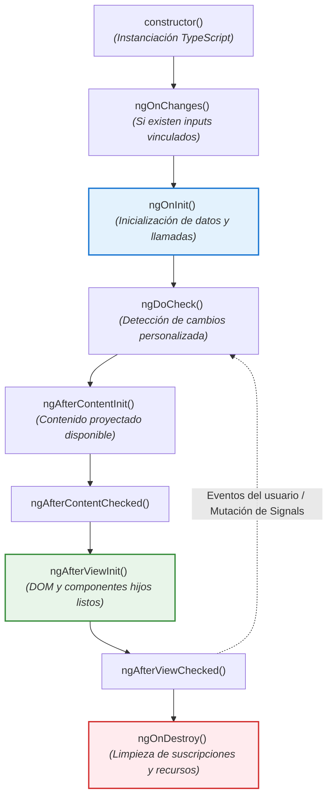
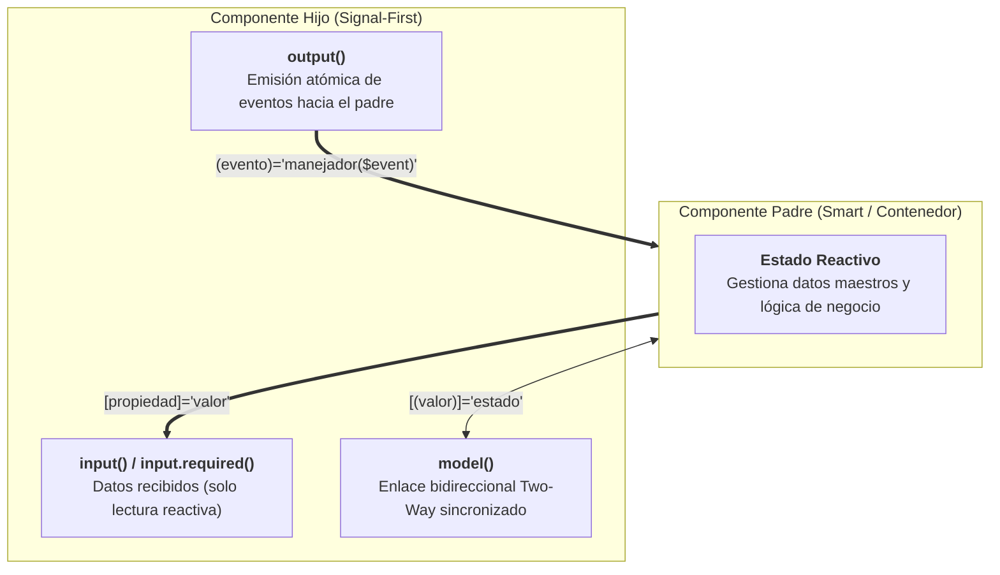

# Componentes en Angular

<div class="badges">
  <span class="badge badge-angular">Angular 19 - 22</span>
  <span class="badge badge-standalone">Standalone Components</span>
  <span class="badge badge-signals">Signal Inputs & model()</span>
  <span class="badge badge-pro">SoC Arquitectura Limpia</span>
</div>

## Objetivos de aprendizaje

Al finalizar esta unidad, el alumnado será capaz de:

1. Crear componentes standalone en Angular y comprender su importancia en la arquitectura moderna.
2. Utilizar todas las propiedades del decorador `@Component` para configurar componentes.
3. Diferenciar los tipos de encapsulación de estilos y elegir el adecuado según el contexto.
4. Implementar los hooks del ciclo de vida de un componente en el orden correcto.
5. Establecer comunicación unidireccional entre componentes mediante `@Input` y `@Output`.
6. Implementar two-way data binding entre componentes usando Model Inputs.
7. Aplicar las nuevas características reactivas de Angular en la definición de componentes.
8. Diseñar componentes reutilizables siguiendo el principio de responsabilidad única.

## Resultados de aprendizaje

Tras completar esta unidad, el estudiante será capaz de:

- Crear un componente standalone desde cero con todos sus archivos (TypeScript, HTML, CSS, tests).
- Configurar correctamente el selector, template y estilos de un componente.
- Implementar comunicación padre-hijo usando `@Input` (incluyendo `required` y `transform`).
- Emitir eventos desde un componente hijo hacia el padre usando `@Output` y `EventEmitter`.
- Implementar two-way binding entre componentes con Model Inputs.
- Elegir el hook de ciclo de vida adecuado para cada necesidad (inicialización, limpieza, detección de cambios).
- Diagnosticar y corregir problemas comunes de comunicación entre componentes.

## Introducción

Si la arquitectura de Angular fuera un edificio, los componentes serían los ladrillos. Todo en Angular es un componente o vive dentro de uno. Una aplicación Angular es, en esencia, un árbol de componentes: un componente raíz que contiene otros componentes, que a su vez contienen más componentes, formando una jerarquía que representa la interfaz de usuario completa.

Piensa en una aplicación como Gmail. La página completa es un componente raíz. Dentro, hay un componente de barra lateral (con la lista de carpetas), un componente de lista de correos (con los mensajes), un componente de barra de búsqueda, un componente de redacción de mensaje... Cada uno de estos es un componente independiente con su propia lógica, su propia plantilla HTML y sus propios estilos. Algunos se comunican entre sí: cuando haces clic en un correo de la lista, el panel de lectura se actualiza. Cuando escribes en la barra de búsqueda, la lista se filtra.

Esta modularidad es la clave del desarrollo Angular: divides un problema complejo en piezas pequeñas, manejables y reutilizables. Cada componente tiene una responsabilidad clara y definida. Si necesitas un botón personalizado en tres lugares diferentes, no copias y pegas el código: creas un componente `BotonPersonalizado` y lo usas donde lo necesites.

En esta unidad vamos a sumergirnos en el corazón de Angular: los componentes. Aprenderemos a crearlos, configurarlos, estilizarlos, controlar su ciclo de vida y —quizá lo más importante— hacer que se comuniquen entre sí. Porque un componente aislado es como un ladrillo suelto: tiene potencial, pero solo cuando se combina con otros construye algo significativo.

## Desarrollo teórico

### Standalone Components

#### ¿Qué son los Standalone Components?

!!! info "📖 Guía de Arquitectura: ¿Dónde se deben organizar los componentes?"
    Para aprender el criterio profesional sobre dónde ubicar los componentes en la estructura de carpetas (Smart Components en `features/*/pages/` vs Dumb Components en `shared/components/` o `features/*/components/`), consulta el **[Manual de Referencia: Organización y Arquitectura en Producción](02-crear-proyecto.md#organizacion-y-arquitectura-de-un-proyecto-en-produccion)**.

!!! note "Evolución: `standalone: true` es ahora el valor por defecto"
    A partir de **Angular 19 y consolidado en Angular 20-22**, todos los componentes, directivas y pipes son *standalone por defecto*. Ya no es obligatorio escribir `standalone: true` en la metadata del decorador `@Component({})`. Si se omite, el compilador asume automáticamente que es standalone. La propiedad `standalone: false` solo se especifica si se necesita compatibilidad con proyectos antiguos basados en `NgModule`.

Hasta Angular 14, todo componente debía "pertenecer" a un NgModule. Para crear un componente, tenías que:

1. Crear el componente.
2. Declararlo en el array `declarations` de un módulo.
3. Si el componente usaba directivas como `*ngIf` o `*ngFor`, importar `CommonModule` en ese módulo.
4. Si el componente necesitaba ser usado fuera del módulo, añadirlo a `exports`.

Esto creaba una capa de burocracia que, aunque útil para organizar aplicaciones grandes, resultaba tediosa para proyectos pequeños o para desarrolladores principiantes. La comunidad llevaba años pidiendo una solución más simple.

Los **Standalone Components** (introducidos como estables en Angular 15) eliminan la necesidad de NgModules para la mayoría de los casos. Un componente standalone:

- Es autónomo por defecto (no requiere pertenecer a ningún NgModule ni declarar `standalone: true`).
- Importa directamente en su propiedad `imports` los componentes, directivas y pipes que necesita su plantilla.
- Puede ser usado en cualquier otro componente simplemente importándolo.
- Simplifica drásticamente la creación, el mantenimiento y el testing.

#### ¿Por qué son el estándar actual?

A partir de **Angular 19 y plenamente consolidado en Angular 20, 21 y 22**, los Standalone Components son el estándar predeterminado e indiscutible del framework:

1. **Cero burocracia**: No necesitas crear ni mantener módulos para cada componente. Menos archivos, menos código, menos errores de configuración.

2. **`standalone: true` implícito**: En Angular 22 ya no es obligatorio escribir `standalone: true` en el decorador. El compilador asume que todo componente es standalone por omisión.

3. **Sin sobrecarga de `CommonModule`**: Con la sintaxis nativa de Control Flow (`@if`, `@for`, `@switch`), las plantillas no necesitan importar `CommonModule` para condicionales o bucles, reduciendo el peso del bundle final.

4. **Tree-shaking de máxima precisión**: El compilador analiza exactamente qué dependencias se importan en cada componente y elimina todo lo que no se use.

5. **Lazy loading directo**: Cualquier componente se puede cargar de forma diferida en las rutas mediante `loadComponent: () => import('./...')` sin necesidad de módulos intermedios.

6. **Testing aislado**: Los tests unitarios con Vitest se enfocan en el componente y sus dependencias directas, sin cargar módulos enteros.

#### Comparativa: Standalone vs NgModule

=== "Enfoque Moderno: Standalone Components (Angular 19 - 22)"
    ```typescript title="mi-componente.component.ts"
    import { Component } from '@angular/core';
    import { FormsModule } from '@angular/forms';

    @Component({
      selector: 'app-mi-componente',
      imports: [FormsModule], // Solo lo necesario (CommonModule no se requiere con @if/@for)
      templateUrl: './mi-componente.component.html',
      styleUrl: './mi-componente.component.css' // Sintaxis singular moderna
    })
    export class MiComponente {
      // Listo para usar directamente. No requiere NgModule ni standalone: true redundante.
    }
    ```

    ```typescript title="app.component.ts"
    import { Component } from '@angular/core';
    import { MiComponente } from './mi-componente.component';

    @Component({
      selector: 'app-root',
      imports: [MiComponente], // Se importa directamente en el array imports
      templateUrl: './app.component.html'
    })
    export class AppComponent {}
    ```

=== "Enfoque Tradicional: NgModule (Legacy)"
    ```typescript title="mi-componente.component.ts"
    import { Component } from '@angular/core';

    @Component({
      selector: 'app-mi-componente',
      templateUrl: './mi-componente.component.html'
    })
    export class MiComponente {
      // La clase no sabe de dónde vienen sus dependencias
    }
    ```

    ```typescript title="mi-modulo.module.ts"
    import { NgModule } from '@angular/core';
    import { CommonModule } from '@angular/common';
    import { FormsModule } from '@angular/forms';
    import { MiComponente } from './mi-componente.component';

    @NgModule({
      declarations: [MiComponente],         // Declarar el componente
      imports: [CommonModule, FormsModule],  // Importar lo que necesita su plantilla
      exports: [MiComponente]               // Exportar si otros módulos lo usarán
    })
    export class MiModulo {}
    ```

    ```typescript title="app.module.ts"
    import { NgModule } from '@angular/core';
    import { MiModulo } from './mi-modulo.module';

    @NgModule({
      imports: [MiModulo]                   // Importar el módulo contenedor completo
    })
    export class AppModule {}
    ```

#### El array `imports`

En un componente standalone, el array `imports` especifica todo lo que el componente necesita para funcionar:

```typescript
@Component({
  imports: [
    // Otros componentes standalone
    CabeceraComponent,
    PiePaginaComponent,
    TarjetaProductoComponent,

    // Directivas (pueden ser standalone también)
    NgIf, NgFor, NgClass, NgStyle,
    HighlightDirective,

    // Pipes
    CurrencyPipe, DatePipe, UpperCasePipe,

    // Módulos (los que aún existen, como los de Angular Material)
    MatButtonModule,
    MatCardModule,

    // Módulos clásicos
    CommonModule,    // Proporciona NgIf, NgFor, etc.
    FormsModule,     // Proporciona ngModel
    ReactiveFormsModule, // Formularios reactivos
    RouterModule     // Directivas de enrutamiento (routerLink, etc.)
  ]
})
export class MiComponente {}
```

Importante: si un componente standalone A usa otro componente standalone B, A debe importar B explícitamente en su array `imports`. No hay herencia de imports entre componentes.

### El Decorador @Component

!!! info "Bases de TypeScript: ¿Cómo funciona un decorador por debajo?"
    Para comprender la teoría de qué es un decorador en TypeScript puro (una función que se ejecuta al cargar el módulo en memoria, asocia metadatos y envuelve la clase sin alterar su lógica interna), consulta la sección formativa en **[03. Bases de TypeScript: Decoradores](../03-bases-typescript.md#decoradores-en-typescript)**.

El decorador `@Component` es la función que transforma una clase TypeScript ordinaria en un componente Angular. Acepta un objeto de configuración con las siguientes propiedades:

#### Propiedades del decorador

```typescript
@Component({
  // === PROPIEDADES ESENCIALES ===

  selector: 'app-mi-componente',        // Nombre de la etiqueta HTML
  // Tipos de selectores:
  // 'app-componente'     -> <app-componente></app-componente>   (elemento, más común)
  // '[app-componente]'  -> <div app-componente></div>           (atributo)
  // '.app-componente'   -> <div class="app-componente"></div>   (clase, raro)

  // En Angular 22, standalone es true por defecto (especificar standalone: true es opcional)

  // Template: solo UNO de estos dos
  templateUrl: './mi-componente.component.html',  // Archivo externo (recomendado)
  // template: `<h1>Hola</h1>`,                   // Template inline (componentes pequeños)

  // Estilos: singular para un archivo (estándar del CLI) o plural para múltiples
  styleUrl: './mi-componente.component.css',      // Archivo único externo (singular)
  // styleUrls: ['./base.css', './tema.css'],     // Múltiples archivos externos (array)
  // styles: [`h1 { color: red; }`],              // Estilos inline

  // === DEPENDENCIAS ===

  imports: [
    OtroComponente,      // Componentes, directivas o pipes que usa la plantilla
    FormsModule          // Módulos/librerías necesarios (CommonModule no se requiere con @if/@for)
  ],

  // === PROVEEDORES ===

  providers: [
    // Servicios específicos del componente (y sus hijos)
    // Cada instancia del componente tiene su propia instancia del servicio
    MiServicioLocal
  ],

  // === DETECCIÓN DE CAMBIOS ===

  changeDetection: ChangeDetectionStrategy.OnPush,
  // Opciones en Angular 22:
  // ChangeDetectionStrategy.OnPush  -> Estándar por defecto en Angular 22. Comprueba solo cuando:
  //   - Cambia una entrada @Input() / input()
  //   - Se emite un evento del componente o sus hijos
  //   - Se lee una señal que ha cambiado
  //   - Se usa async pipe en el template
  //   - Se llama manualmente a markForCheck()
  // ChangeDetectionStrategy.Eager   -> (Anteriormente llamada 'Default'). Comprueba todo el árbol en cada evento (costoso).

  // === ENCAPSULACIÓN DE ESTILOS ===

  encapsulation: ViewEncapsulation.Emulated,
  // Opciones:
  // ViewEncapsulation.Emulated -> Añade atributos únicos a los elementos (por defecto)
  // ViewEncapsulation.None     -> Sin encapsulación. Los estilos son globales.
  // ViewEncapsulation.ShadowDom -> Usa Shadow DOM nativo del navegador.

  // === ANIMACIONES ===

  animations: [
    // Triggers de animación definidos con @angular/animations
    trigger('fadeIn', [
      transition(':enter', [
        style({ opacity: 0 }),
        animate('300ms', style({ opacity: 1 }))
      ])
    ])
  ],

  // === HOST ===

  host: {
    // Vinculaciones en el elemento anfitrión (la etiqueta del componente)
    '[class.active]': 'isActive',           // Class binding
    '[style.border]': '"1px solid red"',    // Style binding
    '(click)': 'onClick()',                 // Event binding
    'role': 'button',                       // Atributo
    '[attr.aria-expanded]': 'isExpanded'    // Atributo dinámico
  },

  // === MISCELÁNEO ===

  preserveWhitespaces: false,  // Eliminar espacios en blanco innecesarios (por defecto)
  // true -> preserva espacios (útil en <pre> y elementos inline)

  // Interpolation delimiters personalizados (raro)
  // interpolation: ['[[', ']]'],  // Cambiar {{ }} por [[ ]]

  // Exportar el componente como elemento personalizado (Angular Elements)
  // exportAs: 'miComponente'
})
```

#### Desglose de propiedades clave

**Selector**: define cómo se usa el componente en el HTML.

- **Element selector** (recomendado): `selector: 'app-usuario'` se usa como `<app-usuario></app-usuario>`. Es el más semántico y el estándar.
- **Attribute selector**: `selector: '[app-usuario]'` se usa como `<div app-usuario></div>`. Útil para directivas o cuando necesitas aplicar un componente a elementos existentes.
- **Class selector**: `selector: '.app-usuario'` se usa como `<div class="app-usuario"></div>`. Raramente usado.

Convención de nomenclatura: `kebab-case` con un prefijo identificativo de la aplicación (definido en `angular.json`). Por ejemplo, si tu prefijo es `app`: `app-usuario`, `app-lista-tareas`, `app-boton-primario`.

**Template vs TemplateUrl**:

- `templateUrl`: referencia un archivo HTML externo. Recomendado para componentes con más de 10 líneas de HTML.
- `template`: plantilla inline como string. Útil para componentes muy simples o prototipos rápidos.

**styleUrl vs styleUrls vs styles**:

- `styleUrl`: archivo único de estilo externo como cadena (ej: `styleUrl: './app.component.css'`). Es el estándar predeterminado generado por Angular CLI.
- `styleUrls`: array para especificar múltiples archivos de estilos externos (ej: `styleUrls: ['./base.css', './tema.css']`).
- `styles`: estilos inline directamente como cadenas de texto en el decorador (ej: `styles: ['h1 { color: red; }']`).

**standalone**: booleano opcional. En Angular 22 es `true` por defecto (no hace falta escribirlo). Solo se especifica `standalone: false` si se requiere integrar el componente en una aplicación legada basada en NgModules.

**imports**: array de componentes, directivas, pipes y módulos que este componente necesita. En componentes standalone, esto reemplaza la funcionalidad de `NgModule.imports`.

**providers**: array de servicios que se inyectan a nivel de este componente y sus hijos. Útil para servicios con estado local (ej: un servicio de estado de formulario compartido entre un componente formulario y sus subcomponentes).

**changeDetection**: estrategia de detección de cambios. En **Angular 22**, la opción predeterminada generada por Angular CLI es `ChangeDetectionStrategy.OnPush`, que solo reevalúa la vista ante cambios explícitos de inputs, señales o eventos. La antigua estrategia voraz (que comprobaba todo el árbol y antes se denominaba `Default`) ha sido renombrada oficialmente a `ChangeDetectionStrategy.Eager` para evitar confusiones terminológicas.

**encapsulation**: controla cómo se aíslan los estilos del componente.

### Templates

La plantilla (template) es el HTML que define la interfaz visual del componente. Angular extiende el HTML estándar con sintaxis adicional para data binding, directivas y estructura de control.

#### Templates inline vs externos

```typescript
// Template INLINE: útil para componentes muy simples
@Component({
  selector: 'app-saludo',
  template: `
    <h1>{{ titulo }}</h1>
    <p>{{ mensaje }}</p>
  `,
  styles: [`
    h1 { color: blue; }
  `]
})
export class SaludoComponent {
  titulo = 'Bienvenido';
  mensaje = 'Gracias por visitar nuestra aplicación';
}

// Template EXTERNO: recomendado para la mayoría de componentes
@Component({
  selector: 'app-saludo',
  templateUrl: './saludo.component.html',
  styleUrls: ['./saludo.component.css']
})
export class SaludoComponent { }
```

Buenas prácticas:

- Templates inline para componentes con menos de 15 líneas de HTML.
- Templates externos para el resto. Facilitan la lectura, el resaltado de sintaxis y las herramientas de análisis estático.
- Usar template literals (backticks) para templates inline multilínea.

### Styles y Encapsulación

Angular proporciona un sistema de encapsulación de estilos que evita que los estilos de un componente "se escapen" y afecten a otros componentes. Esto se logra mediante atributos generados automáticamente que hacen de "alcance" de los estilos.

#### ViewEncapsulation.Emulated (por defecto)

Angular genera atributos únicos (como `_ngcontent-xxx`) y los añade tanto a los elementos del componente como a las reglas CSS. Esto simula el Shadow DOM sin depender de él:

```html
<!-- HTML generado -->
<h1 _ngcontent-abc-123>Título</h1>
<p _ngcontent-abc-123>Contenido</p>

<!-- CSS generado -->
h1[_ngcontent-abc-123] { color: red; }
p[_ngcontent-abc-123] { font-size: 16px; }
```

Ventajas: funciona en todos los navegadores, compatible con librerías CSS globales.
Desventajas: los estilos tienen mayor especificidad, lo que puede complicar sobrescrituras.

#### ViewEncapsulation.None

Los estilos del componente se inyectan en el `<head>` del documento como estilos globales. No existe ningún tipo de encapsulación ni atributo de ámbito.

```typescript title="app-global.component.ts"
@Component({
  selector: 'app-global',
  template: `<h1>Estilo global</h1>`,
  styles: [`h1 { color: red; }`],
  encapsulation: ViewEncapsulation.None  // ¡Cuidado! Afecta a TODOS los h1 de la aplicación
})
```

!!! warning "Peligro de Contaminación Global (Style Bleeding)"
    `ViewEncapsulation.None` rompe el aislamiento del componente y hace que sus reglas CSS se filtren a toda la aplicación.  
    
    * **Uso exclusivo:** Úsalo solo para temas globales controlados o cuando necesites personalizar clases internas de bibliotecas de terceros (como Angular Material o ng-bootstrap) que no aceptan estilos encapsulados.

#### ViewEncapsulation.ShadowDom

Usa el Shadow DOM nativo del navegador. Los estilos están completamente aislados y no pueden ser afectados desde fuera ni afectar al exterior.

```typescript
@Component({
  selector: 'app-aislado',
  template: `<h1>Estilo aislado</h1>`,
  styles: [`h1 { color: red; }`],
  encapsulation: ViewEncapsulation.ShadowDom
})
```

Ventajas: aislamiento real, sin fugas de estilos.
Desventajas: no todos los navegadores antiguos lo soportan, no se pueden usar estilos globales dentro.

#### Pseudo-selectores especiales

Angular proporciona pseudo-selectores CSS específicos para trabajar con la encapsulación:

**`:host`**: selecciona el elemento anfitrión (la etiqueta del componente).

```css
// mi-componente.component.css
:host {
  display: block;           // El componente se comporta como bloque
  padding: 16px;
  border: 1px solid #ccc;
}

:host(.activo) {            // Cuando el host tiene la clase 'activo'
  border-color: green;
}

:host(:hover) {             // Cuando el ratón está sobre el componente
  box-shadow: 0 2px 8px rgba(0,0,0,0.2);
}
```

**`:host-context()`**: selecciona el host basándose en alguna condición fuera del componente. Útil para temas.

```css
// Aplica cuando algún ancestro tiene la clase 'dark-theme'
:host-context(.dark-theme) {
  background-color: #333;
  color: #fff;
}

// Aplica cuando está dentro de un elemento con la clase 'sidebar'
:host-context(.sidebar) {
  font-size: 14px;
}
```

**`::ng-deep`**: fuerza que los estilos se apliquen a los componentes hijos, atravesando la encapsulación. Está marcado como deprecado, pero sigue siendo útil en ciertos casos (por ejemplo, para sobrescribir estilos de Angular Material).

```css
// Afecta a todos los h3 dentro de este componente, incluso en componentes hijos
:host ::ng-deep h3 {
  color: var(--color-primary);
}

// Alternativa: usar variables CSS globales en lugar de ::ng-deep
:host {
  --mi-color-primario: #3f51b5;
}
```

### Selector

El selector define cómo se invoca el componente en HTML. Las convenciones son importantes para la legibilidad y la consistencia del código.

#### Tipos de selectores

```typescript
// 1. Element selector (MÁS COMÚN - RECOMENDADO)
selector: 'app-boton'
// Uso: <app-boton></app-boton>

// 2. Attribute selector
selector: '[app-boton]'
// Uso: <button app-boton></button> o <div app-boton></div>

// 3. Class selector (RARO - EVITAR en componentes)
selector: '.app-boton'
// Uso: <button class="app-boton"></button>
```

#### Convenciones de nomenclatura

Según la guía de estilo oficial de Angular:

1. **Usar kebab-case** con guiones para separar palabras: `app-user-profile`, no `appUserProfile` ni `app_user_profile`.

2. **Usar un prefijo consistente** definido en `angular.json` (campo `prefix`). El prefijo por defecto es `app`, pero en proyectos reales debería identificar la organización o aplicación: `bib` (biblioteca), `mcp` (mi cliente portal), `crm` (customer relationship management).

3. **No usar prefijos de framework**: evita `ng-` (reservado para Angular), `x-` (web components), `data-` (atributos de datos HTML).

```json
// angular.json
{
  "projects": {
    "biblioteca-digital": {
      "prefix": "bib"
    }
  }
}
```

Con este prefijo, al usar `ng generate component` se genera automáticamente: `selector: 'bib-mi-componente'`.

### Ciclo de vida

Cada componente Angular tiene un ciclo de vida gestionado por el framework. Desde que se crea hasta que se destruye, Angular llama a una serie de métodos "hook" que permiten ejecutar código en momentos específicos.

#### Orden de ejecución y flujo de hooks



!!! tip "Regla de oro: ¿Cuándo usar ngOnInit() vs constructor()?"
    
    * **`constructor()`**: Reservado exclusivamente para inyección de dependencias (`private servicio = inject(MiServicio)`). No accedas a propiedades `@Input()` ni realices llamadas HTTP aquí.
    * **`ngOnInit()`**: Lugar idóneo para arrancar la lógica del componente, cargar datos iniciales y configurar escuchas tras recibir las entradas del padre.

#### Descripción detallada de cada hook

##### `constructor()`

El constructor de la clase TypeScript. NO es un hook de Angular propiamente dicho, sino una característica del lenguaje. Se ejecuta antes que cualquier hook.

```typescript
export class MiComponente {
  // Inyección moderna con inject() (Angular 19 - 22):
  private servicio = inject(DatosService);
  private http = inject(HttpClient);

  // ✅ USOS CORRECTOS del constructor (si se requiere):
  constructor() {
    // Solo inicialización simple de propiedades o registro de effects
    this.titulo = 'Valor por defecto';
  }

  // ❌ NO hacer en el constructor:
  // - Peticiones HTTP (los datos no estarán disponibles en la primera renderización)
  // - Acceder al DOM (aún no existe)
  // - Llamar a métodos que dependan de inputs (aún no están disponibles)
  // - Operaciones costosas (bloquean la creación del componente)
}
```

Regla de oro: en Angular moderno, las dependencias se inyectan con `inject()` directamente como propiedades de la clase, y el constructor se reserva únicamente para inicializaciones sincrónicas simples o registro de `effect()`. Cualquier lógica de inicialización asíncrona de datos va en `ngOnInit`.

##### `ngOnChanges(changes: SimpleChanges)`

Se ejecuta ANTES de `ngOnInit` (si hay inputs) y CADA VEZ que cambia el valor de un `@Input` del componente. Recibe un objeto `SimpleChanges` que contiene los valores anteriores y actuales de cada input modificado.

```typescript
import { Component, Input, OnChanges, SimpleChanges } from '@angular/core';

@Component({
  selector: 'app-info-usuario',
  template: `
    <h2>Información de Usuario</h2>
    <p>Nombre: {{ nombre }}</p>
    <p>Edad: {{ edad }}</p>
  `
})
export class InfoUsuarioComponent implements OnChanges {
  @Input() nombre: string = '';
  @Input() edad: number = 0;

  ngOnChanges(changes: SimpleChanges): void {
    // 'changes' tiene una propiedad por cada @Input que ha cambiado
    console.log('Cambios detectados:', changes);

    if (changes['nombre']) {
      console.log('Nombre anterior:', changes['nombre'].previousValue);
      console.log('Nombre actual:', changes['nombre'].currentValue);
      console.log('¿Primer cambio?:', changes['nombre'].firstChange);

      // Validar o transformar lógica cuando cambia el nombre
      if (changes['nombre'].currentValue.length < 2) {
        console.warn('El nombre es demasiado corto');
      }
    }

    if (changes['edad'] && changes['edad'].currentValue < 0) {
      console.warn('La edad no puede ser negativa');
    }
  }
}
```

Casos de uso típicos de `ngOnChanges`:

- Validar inputs cuando cambian.
- Reaccionar a cambios en múltiples inputs de forma conjunta.
- Actualizar propiedades derivadas que dependen de varios inputs.
- Realizar acciones cuando un input alcanza un valor específico.

##### `ngOnInit()`

Se ejecuta UNA SOLA VEZ, después del primer `ngOnChanges`. Es el lugar ideal para la lógica de inicialización.

```typescript
export class DashboardComponent implements OnInit {
  datos: any[] = [];
  cargando = true;
  private apiService = inject(ApiService);

  ngOnInit(): void {
    // ✅ USOS CORRECTOS de ngOnInit:
    this.cargarDatos();              // Peticiones HTTP iniciales
    this.inicializarFormulario();    // Configuración de formularios reactivos
    this.suscribirAEventos();        // Suscripciones a observables
    this.configurarGraficos();       // Inicialización de librerías de terceros

    // ❌ NO en ngOnInit:
    // - Acceder al DOM con ViewChild (todavía no está disponible, usa ngAfterViewInit)
    // - Manipular contenido proyectado (no disponible, usa ngAfterContentInit)
  }

  private cargarDatos(): void {
    this.apiService.obtenerDatos().subscribe({
      next: (datos) => {
        this.datos = datos;
        this.cargando = false;
      },
      error: (err) => {
        console.error('Error al cargar datos:', err);
        this.cargando = false;
      }
    });
  }
}
```

##### `ngDoCheck()`

Se ejecuta en CADA ciclo de detección de cambios. Útil para lógica de detección de cambios personalizada.

```typescript
export class ListaTareasComponent implements DoCheck, OnInit {
  @Input() tareas: Tarea[] = [];
  private tareasAnteriores: Tarea[] = [];

  ngOnInit(): void {
    this.tareasAnteriores = [...this.tareas];
  }

  ngDoCheck(): void {
    // Detectar cambios manualmente cuando OnPush no es suficiente
    if (this.tareas.length !== this.tareasAnteriores.length) {
      console.log('El número de tareas ha cambiado');
      this.recalcularEstadisticas();
      this.tareasAnteriores = [...this.tareas];
    }

    // ⚠️ CUIDADO: este hook se ejecuta MUY frecuentemente.
    // La lógica aquí debe ser extremadamente ligera para no impactar el rendimiento.
  }

  private recalcularEstadisticas(): void {
    // Lógica ligera de recálculo
  }
}
```

**Advertencia importante**: `ngDoCheck` se ejecuta con cada pulsación de tecla, movimiento de ratón, timer, etc. Cualquier lógica pesada aquí degradará el rendimiento de TODA la aplicación. Úsalo solo cuando `ngOnChanges` (con OnPush) no sea suficiente.

##### `ngAfterContentInit()`

Se ejecuta UNA VEZ después de que Angular proyecta contenido externo dentro del componente (ng-content). Aquí el contenido proyectado ya está disponible.

```typescript
import { Component, ContentChild, AfterContentInit } from '@angular/core';

@Component({
  selector: 'app-tab',
  template: `
    <div class="tab-header">
      <ng-content select="[tab-titulo]"></ng-content>
    </div>
    <div class="tab-content">
      <ng-content></ng-content>
    </div>
  `
})
export class TabComponent implements AfterContentInit {
  @ContentChild('contenidoProyectado') contenido: any;

  ngAfterContentInit(): void {
    // El contenido proyectado ya está disponible
    console.log('Contenido proyectado disponible:', this.contenido);

    // Inicializar librerías que dependan del contenido proyectado
    if (this.contenido) {
      this.inicializarPluginContenido();
    }
  }

  private inicializarPluginContenido(): void {
    // Configuración de plugins sobre el contenido proyectado
  }
}
```

Uso desde el padre:
```html
<app-tab>
  <h3 tab-titulo>Información General</h3>
  <p #contenidoProyectado>Este contenido se proyecta dentro del TabComponent.</p>
</app-tab>
```

##### `ngAfterContentChecked()`

Se ejecuta después de CADA verificación del contenido proyectado. Similar a `ngDoCheck` pero para contenido proyectado.

##### `ngAfterViewInit()`

Se ejecuta UNA VEZ después de que las vistas del componente y sus hijos están completamente inicializadas. Aquí el DOM ya está disponible.

```typescript
import { Component, ViewChild, ElementRef, AfterViewInit } from '@angular/core';

@Component({
  selector: 'app-grafico',
  template: `
    <canvas #canvasRef width="400" height="300"></canvas>
    <p #textoRef>Información del gráfico</p>
  `
})
export class GraficoComponent implements AfterViewInit {
  @ViewChild('canvasRef') canvas!: ElementRef<HTMLCanvasElement>;
  @ViewChild('textoRef') texto!: ElementRef<HTMLParagraphElement>;

  ngAfterViewInit(): void {
    // El DOM ya está disponible. Podemos acceder a elementos nativos.

    // Inicializar un gráfico con Chart.js (ejemplo)
    const ctx = this.canvas.nativeElement.getContext('2d');
    if (ctx) {
      // new Chart(ctx, { ... configuración ... });
    }

    // Manipular elementos del DOM
    this.texto.nativeElement.style.fontWeight = 'bold';

    // Inicializar librerías de terceros que manipulan el DOM
    // (jQuery plugins, D3, etc.)
  }
}
```

Este es el hook correcto para:

- Acceder a `@ViewChild` y `@ViewChildren`.
- Inicializar gráficos, mapas y otras visualizaciones.
- Manipular el DOM directamente (aunque debería evitarse en favor de bindings declarativos).
- Enfocar inputs automáticamente.

##### `ngAfterViewChecked()`

Se ejecuta después de CADA verificación de las vistas del componente y sus hijos. Similar a `ngDoCheck` pero para la vista.

```typescript
export class ScrollComponent implements AfterViewChecked {
  @ViewChild('contenedorScroll') contenedor!: ElementRef;
  private debeScrollear = false;

  ngAfterViewChecked(): void {
    // Ejemplo: auto-scroll al final después de añadir elementos
    if (this.debeScrollear) {
      this.scrollAlFinal();
      this.debeScrollear = false;
    }
  }

  agregarElemento(): void {
    // Añadir elemento a la lista...
    this.debeScrollear = true;  // Marcar para scroll en el próximo ciclo
  }

  private scrollAlFinal(): void {
    const el = this.contenedor.nativeElement;
    el.scrollTop = el.scrollHeight;
  }
}
```

**Precaución con ExpressionChangedAfterItHasBeenCheckedError**:

Este error ocurre cuando modificas una propiedad del componente durante `ngAfterViewChecked` (o `ngAfterViewInit`), después de que Angular ya ha verificado el ciclo de detección de cambios. Para evitarlo:

1. Usa `ChangeDetectorRef.detectChanges()` para forzar una nueva detección.
2. Usa `setTimeout()` para diferir el cambio al siguiente ciclo del event loop.
3. Reestructura tu lógica para que los cambios ocurran antes (en `ngOnInit` o `ngOnChanges`).

##### `ngOnDestroy()`

Se ejecuta justo antes de que Angular destruya el componente. Es el hook de limpieza.

```typescript
@Component({
  selector: 'app-reloj',
  template: `<p>Hora actual: {{ hora }}</p>`
})
export class RelojComponent implements OnInit, OnDestroy {
  hora = '';
  private intervaloId?: ReturnType<typeof setInterval>;

  ngOnInit(): void {
    this.actualizarHora();
    this.intervaloId = setInterval(() => this.actualizarHora(), 1000);
  }

  ngOnDestroy(): void {
    // ✅ LIMPIEZA OBLIGATORIA:

    // Limpiar timers
    if (this.intervaloId) {
      clearInterval(this.intervaloId);
    }

    // Cancelar suscripciones a observables (si no usas async pipe)
    // this.suscripcion.unsubscribe();

    // Desconectar de servicios externos
    // this.websocketService.desconectar();

    // Eliminar event listeners manuales
    // window.removeEventListener('resize', this.manejadorResize);

    console.log('Componente Reloj destruido y limpiado correctamente');
  }

  private actualizarHora(): void {
    this.hora = new Date().toLocaleTimeString();
  }
}
```

**Memoria y memory leaks**: No limpiar suscripciones, timers, intervalos o event listeners en `ngOnDestroy` causa fugas de memoria. El componente se destruye visualmente, pero sus referencias siguen activas en memoria, consumiendo recursos indefinidamente.

### Comunicación entre componentes

Angular tiene un flujo de datos **unidireccional**: los datos fluyen del padre al hijo mediante `@Input`, y los eventos fluyen del hijo al padre mediante `@Output`. Este flujo unidireccional hace que las aplicaciones sean más predecibles y fáciles de depurar.

```
            @Input (datos) →
  ┌─────────┐              ┌─────────┐
  │  PADRE  │              │  HIJO   │
  └─────────┘              └─────────┘
            ← @Output (eventos)
```

### @Input

El decorador `@Input` permite que un componente reciba datos de su padre. Se aplica a propiedades de la clase del componente.

#### @Input básico

```typescript
// hijo: tarjeta-producto.component.ts
@Component({
  selector: 'app-tarjeta-producto',
  template: `
    <div class="tarjeta">
      <h3>{{ nombre }}</h3>
      <p>Precio: {{ precio | currency:'EUR' }}</p>
      <span [class.disponible]="disponible">
        {{ disponible ? 'En stock' : 'Agotado' }}
      </span>
    </div>
  `
})
export class TarjetaProductoComponent {
  @Input() nombre: string = '';
  @Input() precio: number = 0;
  @Input() disponible: boolean = true;
}

// padre: tienda.component.ts
@Component({
  selector: 'app-tienda',
  imports: [TarjetaProductoComponent],
  template: `
    <h2>Productos</h2>
    <app-tarjeta-producto
      [nombre]="'Portátil HP'"
      [precio]="899.99"
      [disponible]="true">
    </app-tarjeta-producto>

    <app-tarjeta-producto
      [nombre]="'Monitor Dell'"
      [precio]="299.50"
      [disponible]="false">
    </app-tarjeta-producto>
  `
})
export class TiendaComponent {}
```

#### @Input required

A partir de Angular 16, puedes marcar un input como obligatorio:

```typescript
@Component({...})
export class TarjetaProductoComponent {
  @Input({ required: true }) id!: number;     // Obligatorio: si no se pasa, error en compilación
  @Input({ required: true }) nombre!: string;

  @Input() precio: number = 0;                // Opcional
  @Input() disponible: boolean = true;        // Opcional
}

// Si intentas usar <app-tarjeta-producto> sin pasar [id] y [nombre],
// Angular mostrará un error en consola.
```

Esto mejora la seguridad: evitas que un componente se renderice con datos incompletos.

#### @Input transform

Permite transformar el valor del input antes de asignarlo a la propiedad. Útil para normalizar datos, aplicar valores por defecto complejos, o convertir tipos.

```typescript
// Transformación simple: asegurar que el precio nunca sea negativo
@Input({ transform: (valor: number) => Math.max(0, valor) })
precio: number = 0;

// Transformación con validación: convertir string a booleano
@Input({ transform: booleanAttribute })
activo: boolean = false;
// Ahora acepta: <app-componente activo>, <app-componente [activo]="true">

// Transformación compleja: normalizar nombre de producto
@Input({
  transform: (valor: string) => {
    if (!valor) return '';
    return valor.trim().toLowerCase().replace(/\b\w/g, l => l.toUpperCase());
  }
})
nombreProducto: string = '';

// Transformación con función externa:
function normalizarUrlImagen(url: string): string {
  if (!url) return 'assets/placeholder.png';
  if (url.startsWith('http')) return url;
  return `https://cdn.mi-tienda.com/${url}`;
}

@Input({ transform: normalizarUrlImagen })
imagenUrl: string = 'assets/placeholder.png';
```

#### @Input alias

Permite que la propiedad TypeScript tenga un nombre diferente al atributo HTML:

```typescript
@Component({...})
export class MiComponente {
  @Input('nombre-usuario') nombreUsuario: string = '';
  // En la plantilla HTML: [nombre-usuario]="valor"
  // En la clase TypeScript: this.nombreUsuario

  @Input('data-id') dataId: string = '';
  // Útil cuando el nombre del atributo HTML contiene caracteres no válidos
  // en identificadores TypeScript (como guiones)
}
```

Uso en el padre:
```html
<app-mi-componente
  [nombre-usuario]="'Juan Pérez'"
  [data-id]="'abc123'">
</app-mi-componente>
```

### @Output

El decorador `@Output` permite que un componente hijo emita eventos personalizados que el padre puede escuchar.

```typescript
// hijo: contador.component.ts
@Component({
  selector: 'app-contador',
  template: `
    <div class="contador">
      <p>Valor actual: {{ valor }}</p>
      <button (click)="decrementar()">-</button>
      <button (click)="incrementar()">+</button>
    </div>
  `
})
export class ContadorComponent {
  @Input() valor: number = 0;

  // EventEmitter emite el valor actualizado al padre
  @Output() valorCambiado = new EventEmitter<number>();

  incrementar(): void {
    this.valor++;
    this.valorCambiado.emit(this.valor);  // Emitir el nuevo valor
  }

  decrementar(): void {
    this.valor--;
    this.valorCambiado.emit(this.valor);
  }
}

// padre: app.component.ts
@Component({
  selector: 'app-root',
  imports: [ContadorComponent],
  template: `
    <h2>Contador Principal</h2>
    <p>Cantidad total: {{ cantidadTotal }}</p>

    <!-- Escuchar el evento valorCambiado del hijo -->
    <app-contador
      [valor]="0"
      (valorCambiado)="manejarCambio($event)">
    </app-contador>
  `
})
export class AppComponent {
  cantidadTotal = 0;

  manejarCambio(nuevoValor: number): void {
    console.log('Nuevo valor recibido del hijo:', nuevoValor);
    this.cantidadTotal = nuevoValor;
  }
}
```

#### Buenas prácticas con @Output

1. **Nombrar los outputs como eventos**: usa nombres que indiquen que algo ha ocurrido, sin prefijo `on`: `valorCambiado`, `elementoEliminado`, `formularioEnviado`. Evita nombres como `click` o `change` (reservados para eventos nativos del DOM).

2. **Tipar siempre EventEmitter**: `EventEmitter<TipoDeDato>` proporciona seguridad de tipos tanto en el emisor como en el receptor.

3. **Emitir datos, no el evento DOM**: no pases el `$event` nativo al padre; extrae los datos relevantes y emite solo lo necesario.

4. **No emitir en ngOnChanges sin condiciones**: si emites en cada ciclo de cambios, puedes crear bucles infinitos (el padre recibe el evento, cambia el input, el input cambia, se emite otro evento...).

### Model Inputs

Introducidos en Angular 17.2, los **Model Inputs** simplifican la implementación de two-way data binding entre componentes. Antes, para lograr two-way binding, necesitabas combinar `@Input` y `@Output` con una convención de nombres específica:

```typescript
// ANTES: Two-way binding manual (complejo y propenso a errores)
@Component({...})
export class SelectorCantidadComponent {
  @Input() cantidad: number = 0;
  @Output() cantidadChange = new EventEmitter<number>();  // Nombre OBLIGATORIO: input + "Change"

  cambiarCantidad(nueva: number): void {
    this.cantidad = nueva;        // Actualizar localmente
    this.cantidadChange.emit(nueva);  // Emitir al padre
  }
}
// Uso: <app-selector [(cantidad)]="valor">

// AHORA: Model Inputs (simple y declarativo)
@Component({...})
export class SelectorCantidadComponent {
  // model() crea automáticamente el input Y el output
  cantidad = model(0);  // Valor inicial: 0

  cambiarCantidad(nueva: number): void {
    this.cantidad.set(nueva);  // Actualiza el modelo (input + output automático)
  }
}
// Uso: <app-selector [(cantidad)]="valor">
```

#### Diferencias con @Input + @Output

| Aspecto | @Input + @Output | Model Input |
|---|---|---|
| **Cantidad de código** | Requiere dos decoradores y dos propiedades | Una sola llamada a `model()` |
| **Convención de nombres** | El output DEBE llamarse `inputChange` | Automático, sin convenciones |
| **Lectura** | `this.propiedad` | `this.propiedad()` (llamada a función) |
| **Escritura** | `this.propiedad = valor` + `this.propiedadChange.emit(valor)` | `this.propiedad.set(valor)` |
| **Two-way binding** | Funciona con `[(ngModel)]` | Funciona con `[(propiedad)]` |
| **Tipo de dato** | Cualquiera | Cualquiera |
| **Valor inicial** | Definido en la propiedad | Definido en `model(valorInicial)` |

#### Ejemplo completo con Model Inputs

=== "editor-nota.component.ts"
    ```typescript title="editor-nota.component.ts"
    import { Component, model } from '@angular/core';
    import { FormsModule } from '@angular/forms';

    @Component({
      selector: 'app-editor-nota',
      imports: [FormsModule],
      templateUrl: './editor-nota.component.html'
    })
    export class EditorNotaComponent {
      // Model Inputs: definen señales con capacidad bidireccional automática
      titulo = model('');
      contenido = model('');
      prioridad = model<'baja' | 'media' | 'alta'>('media');
    }
    ```

=== "editor-nota.component.html"
    ```html title="editor-nota.component.html"
    <div class="editor-nota">
      <label for="titulo">Título:</label>
      <input
        id="titulo"
        type="text"
        [ngModel]="titulo()"
        (ngModelChange)="titulo.set($event)"
        placeholder="Escribe un título..."
      />

      <label for="contenido">Contenido:</label>
      <textarea
        id="contenido"
        [ngModel]="contenido()"
        (ngModelChange)="contenido.set($event)"
        rows="4"
        placeholder="Escribe el contenido...">
      </textarea>

      <!-- Two-way binding directo con model() -->
      <label for="prioridad">Prioridad:</label>
      <select [(ngModel)]="prioridad">
        <option [ngValue]="'baja'">Baja</option>
        <option [ngValue]="'media'">Media</option>
        <option [ngValue]="'alta'">Alta</option>
      </select>
    </div>
    ```

=== "app.component.ts"
    ```typescript title="app.component.ts"
    import { Component } from '@angular/core';
    import { EditorNotaComponent } from './editor-nota.component';

    @Component({
      selector: 'app-root',
      imports: [EditorNotaComponent],
      templateUrl: './app.component.html'
    })
    export class AppComponent {
      nota = {
        titulo: 'Nueva nota',
        contenido: 'Contenido inicial...',
        prioridad: 'media' as const
      };

      guardarNota(): void {
        console.log('Nota guardada:', this.nota);
      }
    }
    ```

=== "app.component.html"
    ```html title="app.component.html"
    <h1>Editor de Notas</h1>

    <!-- Two-way binding limpio con sintaxis 'banana-in-a-box' [(propiedad)] -->
    <app-editor-nota
      [(titulo)]="nota.titulo"
      [(contenido)]="nota.contenido"
      [(prioridad)]="nota.prioridad">
    </app-editor-nota>

    <!-- La vista previa sincroniza automáticamente los cambios del hijo -->
    <div class="vista-previa">
      <h2>Vista previa:</h2>
      <p><strong>Título:</strong> {{ nota.titulo }}</p>
      <p><strong>Contenido:</strong> {{ nota.contenido }}</p>
      <p><strong>Prioridad:</strong> {{ nota.prioridad }}</p>
    </div>

    <button (click)="guardarNota()">Guardar Nota</button>
    ```

#### Ventajas de Model Inputs

1. **Código más limpio**: una línea en lugar de dos o tres.
2. **Menos propenso a errores**: no hay riesgo de olvidar la convención `nombre + Change`.
3. **Integración natural con Signals**: `model()` usa internamente Signals, por lo que se beneficia de la reactividad fina.
4. **Sintaxis familiar**: `[(modelo)]` funciona exactamente como `[(ngModel)]`, que los desarrolladores Angular ya conocen.

### La Nueva Era: Signal Inputs (`input()`), Outputs (`output()`) y Model (`model()`)

Aunque los decoradores `@Input()` y `@Output()` siguen funcionando por compatibilidad histórica, la documentación oficial contemporánea de Angular (`angular.dev`) cataloga los decoradores como APIs heredadas (*legacy*) y establece como **estándar único recomendado** las funciones reactivas basadas en Signals:



#### Comparativa: Decoradores Tradicionales vs Signal APIs

| Característica | Decoradores Clásicos (`@Input` / `@Output`) | Funciones Signal (`input()` / `output()` / `model()`) |
| :--- | :--- | :--- |
| **Tipo de dato interno** | Variable estándar mutable (`this.miPropiedad`) | **Signal de solo lectura** (`this.miPropiedad()`) |
| **Cálculos derivados** | Requiere `ngOnChanges` o setters con variables privadas | Directo con `computed(() => this.miPropiedad() * 2)` |
| **Campos obligatorios** | `@Input({ required: true })` | `input.required<T>()` |
| **Transformaciones** | `@Input({ transform: booleanAttribute })` | `input(false, { transform: booleanAttribute })` |
| **Emisión de eventos** | `@Output() ev = new EventEmitter<T>()` | `ev = output<T>()` (más ligero y sin RxJS) |
| **Enlace bidireccional** | Pareja `@Input() val` + `@Output() valChange` | `val = model<T>()` en una sola línea |

#### Ejemplo Completo: Tarjeta de Producto con Signal Inputs y Outputs

=== "tarjeta-producto.component.ts"
    ```typescript
    import { Component, input, output, model, computed } from '@angular/core';
    import { CurrencyPipe } from '@angular/common';

    @Component({
      selector: 'app-tarjeta-producto-signal',
      templateUrl: './tarjeta-producto.component.html',
      styleUrl: './tarjeta-producto.component.css'
    })
    export class TarjetaProductoSignalComponent {
      // Input obligatorio tipado
      nombre = input.required<string>();

      // Input opcional con valor por defecto
      precioBase = input<number>(0);

      // Input con transformación automática
      destacado = input(false, {
        transform: (v: boolean | string) => typeof v === 'string' ? v !== 'false' : v
      });

      // Two-way binding mediante model(): sincroniza cantidad con el padre
      cantidad = model<number>(1);

      // Output para notificar acciones (reemplaza a EventEmitter)
      alComprar = output<{ producto: string; total: number }>();

      // Estado derivado reactivo automático: se recalcula solo si cambia precioBase o cantidad
      precioTotal = computed(() => this.precioBase() * this.cantidad());

      incrementar(): void {
        this.cantidad.update(c => c + 1);
      }

      decrementar(): void {
        if (this.cantidad() > 1) {
          this.cantidad.update(c => c - 1);
        }
      }

      comprar(): void {
        this.alComprar.emit({
          producto: this.nombre(),
          total: this.precioTotal()
        });
      }
    }
    ```

=== "tarjeta-producto.component.html"
    ```html
    <article class="tarjeta" [class.destacada]="destacado()">
      <header>
        <h3>{{ nombre() }}</h3>
        @if (destacado()) {
          <span class="badge">Novedad</span>
        }
      </header>

      <p class="precio-unitario">Precio unitario: {{ precioBase() | currency:'EUR' }}</p>

      <div class="selector-cantidad">
        <button type="button" (click)="decrementar()" [disabled]="cantidad() <= 1">−</button>
        <span class="unidades">{{ cantidad() }} uds</span>
        <button type="button" (click)="incrementar()">+</button>
      </div>

      <div class="total-caja">
        <strong>Total: {{ precioTotal() | currency:'EUR' }}</strong>
      </div>

      <button class="btn-comprar" type="button" (click)="comprar()">
        Añadir al Carrito
      </button>
    </article>
    ```

=== "tarjeta-producto.component.css"
    ```css
    .tarjeta {
      padding: 1.5rem;
      border: 1px solid #e0e0e0;
      border-radius: 12px;
      background: white;
      max-width: 320px;
      box-shadow: 0 2px 8px rgba(0, 0, 0, 0.05);
    }

    .tarjeta.destacada {
      border-color: #3498db;
      box-shadow: 0 4px 14px rgba(52, 152, 219, 0.2);
    }

    .tarjeta header {
      display: flex;
      justify-content: space-between;
      align-items: center;
      margin-bottom: 0.75rem;
    }

    .tarjeta header h3 {
      margin: 0;
      font-size: 1.25rem;
    }

    .tarjeta header .badge {
      background: #e8f4fd;
      color: #2980b9;
      font-size: 0.75rem;
      padding: 0.25rem 0.5rem;
      border-radius: 4px;
      font-weight: 600;
    }

    .tarjeta .selector-cantidad {
      display: flex;
      align-items: center;
      gap: 0.75rem;
      margin: 1rem 0;
    }

    .tarjeta .selector-cantidad button {
      width: 32px;
      height: 32px;
      border-radius: 6px;
      border: 1px solid #ccc;
      background: white;
      cursor: pointer;
      font-weight: bold;
    }

    .tarjeta .selector-cantidad button:hover:not(:disabled) {
      background: #f0f0f0;
    }

    .tarjeta .total-caja {
      margin-bottom: 1rem;
      font-size: 1.1rem;
      color: #2c3e50;
    }

    .tarjeta .btn-comprar {
      width: 100%;
      padding: 0.75rem;
      background: #27ae60;
      color: white;
      border: none;
      border-radius: 6px;
      font-weight: 600;
      cursor: pointer;
    }

    .tarjeta .btn-comprar:hover {
      background: #219150;
    }
    ```

=== "consumo-en-padre.component.html"
    ```html
    <!-- El padre usa enlace bidireccional [(cantidad)]='unidades' y escucha el output (alComprar) -->
    <app-tarjeta-producto-signal
      nombre="Teclado Mecánico RGB"
      [precioBase]="89.99"
      destacado="true"
      [(cantidad)]="unidadesCompradas"
      (alComprar)="procesarPedido($event)"
    />
    ```


## Ejemplos guiados

### Ejemplo 1: Crear un componente standalone completo con todas las propiedades del decorador

**Objetivo**: Crear un componente de perfil de usuario que demuestre el uso de múltiples propiedades del decorador `@Component`.

```typescript
// usuario-perfil.component.ts
import { Component, Input, ViewEncapsulation, ChangeDetectionStrategy } from '@angular/core';
import { DatePipe, UpperCasePipe } from '@angular/common';
import { MatCardModule } from '@angular/material/card';
import { MatButtonModule } from '@angular/material/button';
import { MatIconModule } from '@angular/material/icon';

@Component({
  selector: 'app-usuario-perfil',            // Selector como elemento HTML
  imports: [
    DatePipe,                                 // Pipe para formatear la fecha
    UpperCasePipe,                            // Pipe para convertir a mayúsculas
    MatCardModule,                            // Componentes de Material Design
    MatButtonModule,
    MatIconModule
  ],
  templateUrl: './usuario-perfil.component.html',
  styleUrls: ['./usuario-perfil.component.css'],

  // Usar Shadow DOM nativo para aislamiento total de estilos
  encapsulation: ViewEncapsulation.ShadowDom,

  // OnPush: solo re-renderizar cuando cambien los inputs
  changeDetection: ChangeDetectionStrategy.OnPush,

  // Host bindings: configuraciones en el elemento anfitrión
  host: {
    '[class.destacado]': 'usuario.vip',       // Añade clase 'destacado' si es VIP
    '[attr.role]': "'article'",                // Atributo de accesibilidad
    '[style.border-left]': 'usuario.vip ? "4px solid gold" : "4px solid transparent"',
    '(mouseenter)': 'onMouseEnter()',
    '(mouseleave)': 'onMouseLeave()'
  },

  preserveWhitespaces: false                   // Eliminar espacios sobrantes
})
export class UsuarioPerfilComponent {
  @Input({ required: true }) usuario!: {
    nombre: string;
    email: string;
    fechaRegistro: Date;
    avatar: string;
    vip: boolean;
  };

  hover = false;

  onMouseEnter(): void {
    this.hover = true;
  }

  onMouseLeave(): void {
    this.hover = false;
  }
}
```

```html
<!-- usuario-perfil.component.html -->
<div class="perfil">
  

  <div class="info">
    <h2>
      {{ usuario.nombre | uppercase }}               <!-- Pipe: convierte a mayúsculas -->
      <span *ngIf="usuario.vip" class="badge-vip">VIP</span>
    </h2>
    <p class="email">{{ usuario.email }}</p>
    <p class="fecha">
      Miembro desde: {{ usuario.fechaRegistro | date:'longDate' }}
      <!-- Pipe: formatea la fecha como "1 de enero de 2024" -->
    </p>
  </div>

  <div class="acciones">
    <button mat-raised-button color="primary">
      <mat-icon>edit</mat-icon>
      Editar
    </button>
    <button mat-icon-button aria-label="Más opciones">
      <mat-icon>more_vert</mat-icon>
    </button>
  </div>
</div>
```

```css
// usuario-perfil.component.css
// Con ShadowDom, estos estilos están completamente aislados

:host {
  display: block;
  transition: transform 0.2s ease, box-shadow 0.2s ease;
}

:host:hover {
  transform: translateY(-2px);
}

:host(.destacado) {
  // Se aplica cuando el usuario es VIP (clase añadida vía host binding)
}

.perfil {
  display: flex;
  align-items: center;
  gap: 16px;
  padding: 16px;
}

.avatar {
  width: 80px;
  height: 80px;
  border-radius: 50%;
  object-fit: cover;
  border: 3px solid #e0e0e0;
}

.info {
  flex: 1;

  h2 {
    margin: 0 0 4px 0;
    font-size: 1.2rem;
    display: flex;
    align-items: center;
    gap: 8px;
  }

  .badge-vip {
    background: gold;
    color: #333;
    padding: 2px 8px;
    border-radius: 12px;
    font-size: 0.75rem;
    font-weight: bold;
  }

  .email {
    color: #666;
    margin: 0 0 4px 0;
    font-size: 0.9rem;
  }

  .fecha {
    color: #999;
    margin: 0;
    font-size: 0.85rem;
  }
}

.acciones {
  display: flex;
  gap: 8px;
  align-items: center;
}
```

### Ejemplo 2: Implementar comunicación padre-hijo con @Input y @Output

**Objetivo**: Crear un sistema de votación donde una lista de elementos puede ser votada positivamente o negativamente, con comunicación bidireccional entre el componente de lista y los componentes de elemento.

=== "Hijo TS (`elemento-votacion.component.ts`)"

    ```typescript title="elemento-votacion.component.ts"
    import { Component, Input, Output, EventEmitter } from '@angular/core';

    @Component({
      selector: 'app-elemento-votacion',
      templateUrl: './elemento-votacion.component.html',
      styleUrls: ['./elemento-votacion.component.css']
    })
    export class ElementoVotacionComponent {
      @Input({ required: true }) id!: number;
      @Input({ required: true }) titulo!: string;
      @Input() descripcion: string = '';
      @Input({ transform: (v: number) => Math.max(0, v) }) votos: number = 0;

      // Outputs: eventos que el padre escucha
      @Output() votoPositivo = new EventEmitter<number>();    // Emite el ID
      @Output() votoNegativo = new EventEmitter<number>();     // Emite el ID
      @Output() eliminar = new EventEmitter<number>();         // Emite el ID

      votarPositivo(): void {
        this.votoPositivo.emit(this.id);
      }

      votarNegativo(): void {
        this.votoNegativo.emit(this.id);
      }

      solicitarEliminacion(): void {
        if (confirm(`¿Eliminar "${this.titulo}"?`)) {
          this.eliminar.emit(this.id);
        }
      }
    }
    ```

=== "Hijo HTML (`elemento-votacion.component.html`)"

    ```html title="elemento-votacion.component.html"
    <div class="elemento" [class.destacado]="votos > 10">
      <div class="info">
        <h3>{{ titulo }}</h3>
        <p class="descripcion">{{ descripcion }}</p>
      </div>

      <div class="votacion">
        <button class="btn-voto positivo" (click)="votarPositivo()">
          👍 {{ votos }}
        </button>
        <button class="btn-voto negativo" (click)="votarNegativo()">
          👎
        </button>
        <!-- Botón para eliminar: emite evento al padre -->
        <button class="btn-eliminar" (click)="solicitarEliminacion()">
          🗑️
        </button>
      </div>
    </div>
    ```

=== "Hijo CSS (`elemento-votacion.component.css`)"

    ```css title="elemento-votacion.component.css"
    .elemento {
      display: flex;
      justify-content: space-between;
      align-items: center;
      padding: 12px 16px;
      border: 1px solid #ddd;
      border-radius: 8px;
      margin-bottom: 8px;
      transition: background 0.2s;

      &.destacado {
        background: #fff3cd;
        border-color: #ffc107;
      }
    }

    .info {
      h3 {
        margin: 0 0 4px;
        font-size: 1rem;
      }
      .descripcion {
        margin: 0;
        color: #666;
        font-size: 0.9rem;
      }
    }

    .votacion {
      display: flex;
      gap: 4px;
      align-items: center;
    }

    .btn-voto,
    .btn-eliminar {
      border: none;
      background: transparent;
      cursor: pointer;
      font-size: 1.1rem;
      padding: 4px 8px;
      border-radius: 4px;
      transition: background 0.2s;

      &:hover {
        background: #f0f0f0;
      }
    }

    .positivo {
      color: #28a745;
    }

    .negativo {
      color: #dc3545;
    }
    ```

=== "Padre TS (`lista-votacion.component.ts`)"

    ```typescript title="lista-votacion.component.ts"
    import { Component } from '@angular/core';
    import { ElementoVotacionComponent } from './elemento-votacion.component';

    interface ElementoVotable {
      id: number;
      titulo: string;
      descripcion: string;
      votos: number;
    }

    @Component({
      selector: 'app-lista-votacion',
      imports: [ElementoVotacionComponent],
      templateUrl: './lista-votacion.component.html',
      styleUrls: ['./lista-votacion.component.css']
    })
    export class ListaVotacionComponent {
      elementos: ElementoVotable[] = [
        { id: 1, titulo: 'Propuesta A', descripcion: 'Ampliar el horario de la biblioteca', votos: 5 },
        { id: 2, titulo: 'Propuesta B', descripcion: 'Crear un espacio de coworking', votos: 12 },
        { id: 3, titulo: 'Propuesta C', descripcion: 'Organizar charlas técnicas mensuales', votos: 8 },
      ];

      private nextId = 4;

      get totalVotos(): number {
        return this.elementos.reduce((sum, el) => sum + el.votos, 0);
      }

      votarPositivo(id: number): void {
        const elemento = this.elementos.find(el => el.id === id);
        if (elemento) {
          elemento.votos++;
        }
      }

      votarNegativo(id: number): void {
        const elemento = this.elementos.find(el => el.id === id);
        if (elemento && elemento.votos > 0) {
          elemento.votos--;
        }
      }

      eliminarElemento(id: number): void {
        this.elementos = this.elementos.filter(el => el.id !== id);
      }

      agregarElemento(): void {
        const titulo = prompt('Título de la propuesta:');
        if (!titulo) return;
        const descripcion = prompt('Descripción:') || '';

        this.elementos.push({
          id: this.nextId++,
          titulo,
          descripcion,
          votos: 0
        });
      }
    }
    ```

=== "Padre HTML (`lista-votacion.component.html`)"

    ```html title="lista-votacion.component.html"
    <div class="lista">
      <h2>Sistema de Votación</h2>

      <div class="resumen">
        <p>Total de elementos: {{ elementos.length }}</p>
        <p>Total de votos: {{ totalVotos }}</p>
      </div>

      @for (elemento of elementos; track elemento.id) {
        <app-elemento-votacion
          [id]="elemento.id"
          [titulo]="elemento.titulo"
          [descripcion]="elemento.descripcion"
          [votos]="elemento.votos"
          (votoPositivo)="votarPositivo($event)"
          (votoNegativo)="votarNegativo($event)"
          (eliminar)="eliminarElemento($event)">
        </app-elemento-votacion>
      } @empty {
        <p class="vacio">No hay elementos para votar.</p>
      }

      <button class="btn-agregar" (click)="agregarElemento()">
        + Agregar elemento
      </button>
    </div>
    ```

=== "Padre CSS (`lista-votacion.component.css`)"

    ```css title="lista-votacion.component.css"
    .lista {
      max-width: 600px;
      margin: 0 auto;
    }

    .resumen {
      background: #f5f5f5;
      padding: 12px 16px;
      border-radius: 8px;
      margin-bottom: 16px;
      display: flex;
      gap: 24px;

      p {
        margin: 0;
      }
    }

    .vacio {
      text-align: center;
      color: #999;
      padding: 24px;
    }

    .btn-agregar {
      width: 100%;
      padding: 12px;
      background: #3f51b5;
      color: white;
      border: none;
      border-radius: 8px;
      cursor: pointer;
      font-size: 1rem;
      transition: background 0.2s;

      &:hover {
        background: #303f9f;
      }
    }
    ```

### Ejemplo 3: Implementar Model Inputs para two-way binding

**Objetivo**: Crear un componente de selector de fecha con two-way binding usando `model()`.

=== "Hijo TS (`selector-fecha.component.ts`)"

    ```typescript title="selector-fecha.component.ts"
    import { Component, model } from '@angular/core';
    import { FormsModule } from '@angular/forms';

    @Component({
      selector: 'app-selector-fecha',
      imports: [FormsModule],
      templateUrl: './selector-fecha.component.html',
      styleUrls: ['./selector-fecha.component.css']
    })
    export class SelectorFechaComponent {
      // Model Input: sincronización bidireccional
      fecha = model(new Date());

      meses = [
        { valor: 1, nombre: 'Enero' },
        { valor: 2, nombre: 'Febrero' },
        { valor: 3, nombre: 'Marzo' },
        { valor: 4, nombre: 'Abril' },
        { valor: 5, nombre: 'Mayo' },
        { valor: 6, nombre: 'Junio' },
        { valor: 7, nombre: 'Julio' },
        { valor: 8, nombre: 'Agosto' },
        { valor: 9, nombre: 'Septiembre' },
        { valor: 10, nombre: 'Octubre' },
        { valor: 11, nombre: 'Noviembre' },
        { valor: 12, nombre: 'Diciembre' },
      ];

      diasEnMes(): number {
        const f = this.fecha();
        return new Date(f.getFullYear(), f.getMonth() + 1, 0).getDate();
      }

      actualizarDia(dia: number): void {
        if (dia < 1 || dia > this.diasEnMes()) return;
        const nuevaFecha = new Date(this.fecha());
        nuevaFecha.setDate(dia);
        this.fecha.set(nuevaFecha);
      }

      actualizarMes(mes: number): void {
        const nuevaFecha = new Date(this.fecha());
        nuevaFecha.setMonth(mes - 1);
        this.fecha.set(nuevaFecha);
      }

      actualizarAnio(anio: number): void {
        const nuevaFecha = new Date(this.fecha());
        nuevaFecha.setFullYear(anio);
        this.fecha.set(nuevaFecha);
      }
    }
    ```

=== "Hijo HTML (`selector-fecha.component.html`)"

    ```html title="selector-fecha.component.html"
    <div class="selector-fecha">
      <label>Día:</label>
      <input
        type="number"
        min="1"
        [max]="diasEnMes()"
        [ngModel]="fecha().getDate()"
        (ngModelChange)="actualizarDia($event)"
      />

      <label>Mes:</label>
      <select
        [ngModel]="fecha().getMonth() + 1"
        (ngModelChange)="actualizarMes($event)">
        @for (mes of meses; track mes.valor) {
          <option [value]="mes.valor">{{ mes.nombre }}</option>
        }
      </select>

      <label>Año:</label>
      <input
        type="number"
        min="2000"
        max="2100"
        [ngModel]="fecha().getFullYear()"
        (ngModelChange)="actualizarAnio($event)"
      />
    </div>
    ```

=== "Hijo CSS (`selector-fecha.component.css`)"

    ```css title="selector-fecha.component.css"
    .selector-fecha {
      display: flex;
      gap: 12px;
      align-items: center;
      padding: 16px;
      background: #f5f5f5;
      border-radius: 8px;

      label {
        font-weight: 500;
        font-size: 0.9rem;
        margin-right: 4px;
      }

      input,
      select {
        padding: 8px;
        border: 1px solid #ddd;
        border-radius: 4px;
        width: 80px;
      }
    }
    ```

=== "Padre TS (`app.component.ts`)"

    ```typescript title="app.component.ts"
    import { Component } from '@angular/core';
    import { DatePipe } from '@angular/common';
    import { SelectorFechaComponent } from './selector-fecha.component';

    @Component({
      selector: 'app-root',
      imports: [SelectorFechaComponent, DatePipe],
      templateUrl: './app.component.html',
      styleUrls: ['./app.component.css']
    })
    export class AppComponent {
      fechaSeleccionada = new Date();

      restablecerFecha(): void {
        this.fechaSeleccionada = new Date();
      }
    }
    ```

=== "Padre HTML (`app.component.html`)"

    ```html title="app.component.html"
    <h1>Selector de Fecha con Model Input</h1>

    <!-- Two-way binding: [(fecha)] -->
    <app-selector-fecha [(fecha)]="fechaSeleccionada" />

    <div class="resultado">
      <p>Fecha seleccionada:</p>
      <strong>{{ fechaSeleccionada | date:'fullDate' }}</strong>
      <p class="timestamp">Timestamp: {{ fechaSeleccionada.getTime() }}</p>
    </div>

    <button (click)="restablecerFecha()">Restablecer a hoy</button>
    ```

=== "Padre CSS (`app.component.css`)"

    ```css title="app.component.css"
    h1 {
      margin-bottom: 24px;
    }

    .resultado {
      margin-top: 24px;
      padding: 16px;
      background: #e8f5e9;
      border-radius: 8px;

      p {
        margin: 0 0 4px;
      }

      .timestamp {
        font-size: 0.85rem;
        color: #666;
      }
    }

    button {
      margin-top: 16px;
      padding: 10px 20px;
      background: #3f51b5;
      color: white;
      border: none;
      border-radius: 4px;
      cursor: pointer;
    }
    ```

## Ejercicios resueltos

### Ejercicio 1: Crear un componente UserCard que reciba datos de usuario por Input

**Enunciado**: Crea un componente `UserCardComponent` que muestre la información de un usuario (nombre, email, avatar, rol) recibida mediante `@Input`. El componente debe ser standalone, usar OnPush, mostrar un badge de color según el rol y emitir un evento al hacer clic en la tarjeta.

**Solución**:

=== "TypeScript (`user-card.component.ts`)"

    ```typescript title="user-card.component.ts"
    import { Component, Input, Output, EventEmitter, ChangeDetectionStrategy } from '@angular/core';
    import { DatePipe, UpperCasePipe } from '@angular/common';
    import { Usuario } from '../models/usuario.interface';

    @Component({
      selector: 'app-user-card',
      imports: [DatePipe, UpperCasePipe],
      templateUrl: './user-card.component.html',
      styleUrls: ['./user-card.component.css'],
      changeDetection: ChangeDetectionStrategy.OnPush,
      host: {
        '[class.inactivo]': '!usuario.activo'
      }
    })
    export class UserCardComponent {
      @Input({ required: true }) usuario!: Usuario;

      @Output() tarjetaClic = new EventEmitter<Usuario>();
      @Output() editar = new EventEmitter<Usuario>();
      @Output() eliminar = new EventEmitter<number>();

      get claseRol(): string {
        return `rol-${this.usuario.rol}`;
      }

      get iniciales(): string {
        return this.usuario.nombre
          .split(' ')
          .map(palabra => palabra[0])
          .join('')
          .toUpperCase()
          .slice(0, 2);
      }

      onTarjetaClick(): void {
        if (this.usuario.activo) {
          this.tarjetaClic.emit(this.usuario);
        }
      }

      onEditar(event: Event): void {
        event.stopPropagation();
        this.editar.emit(this.usuario);
      }

      onEliminar(event: Event): void {
        event.stopPropagation();
        if (confirm(`¿Eliminar al usuario "${this.usuario.nombre}"?`)) {
          this.eliminar.emit(this.usuario.id);
        }
      }
    }
    ```

=== "HTML (`user-card.component.html`)"

    ```html title="user-card.component.html"
    <div class="tarjeta" [class.seleccionada]="false" (click)="onTarjetaClick()">
      <div class="avatar-container">
        @if (usuario.avatar) {
          
        } @else {
          <div class="avatar-placeholder">{{ iniciales }}</div>
        }
        <span class="badge-estado" [class.activo]="usuario.activo">
          {{ usuario.activo ? 'Activo' : 'Inactivo' }}
        </span>
      </div>

      <div class="contenido">
        <div class="cabecera">
          <h3>{{ usuario.nombre | uppercase }}</h3>
          <span class="badge-rol" [class]="claseRol">
            {{ usuario.rol | uppercase }}
          </span>
        </div>

        <p class="email">{{ usuario.email }}</p>
        <p class="ultimo-acceso">
          Último acceso: {{ usuario.ultimoAcceso | date:'dd/MM/yyyy HH:mm' }}
        </p>
      </div>

      <div class="acciones">
        <button class="btn-editar" (click)="onEditar($event)" aria-label="Editar usuario">
          ✏️
        </button>
        <button class="btn-eliminar" (click)="onEliminar($event)" aria-label="Eliminar usuario">
          🗑️
        </button>
      </div>
    </div>
    ```

=== "CSS (`user-card.component.css`)"

    ```css title="user-card.component.css"
    :host {
      display: block;
    }

    :host(.inactivo) {
      opacity: 0.6;
      pointer-events: none;
    }

    .tarjeta {
      display: flex;
      align-items: center;
      gap: 16px;
      padding: 16px;
      background: white;
      border: 1px solid #e0e0e0;
      border-radius: 12px;
      cursor: pointer;
      transition: all 0.2s ease;

      &:hover {
        box-shadow: 0 4px 12px rgba(0, 0, 0, 0.1);
        transform: translateY(-2px);
      }

      &.seleccionada {
        border-color: #3f51b5;
        background: #e8eaf6;
      }
    }

    .avatar-container {
      position: relative;
    }

    .avatar {
      width: 60px;
      height: 60px;
      border-radius: 50%;
      object-fit: cover;
    }

    .avatar-placeholder {
      width: 60px;
      height: 60px;
      border-radius: 50%;
      background: #3f51b5;
      color: white;
      display: flex;
      align-items: center;
      justify-content: center;
      font-weight: bold;
      font-size: 1.2rem;
    }

    .badge-estado {
      position: absolute;
      bottom: -2px;
      right: -2px;
      width: 14px;
      height: 14px;
      border-radius: 50%;
      border: 2px solid white;

      &.activo {
        background: #4caf50;
      }

      &:not(.activo) {
        background: #9e9e9e;
      }
    }

    .contenido {
      flex: 1;
      min-width: 0;

      .cabecera {
        display: flex;
        align-items: center;
        gap: 8px;
        margin-bottom: 4px;

        h3 {
          margin: 0;
          font-size: 1rem;
          white-space: nowrap;
          overflow: hidden;
          text-overflow: ellipsis;
        }
      }

      .email {
        margin: 0 0 4px;
        color: #666;
        font-size: 0.9rem;
      }

      .ultimo-acceso {
        margin: 0;
        color: #999;
        font-size: 0.8rem;
      }
    }

    .badge-rol {
      padding: 2px 8px;
      border-radius: 12px;
      font-size: 0.7rem;
      font-weight: 600;
      white-space: nowrap;

      &.rol-admin {
        background: #fce4ec;
        color: #c62828;
      }

      &.rol-editor {
        background: #e8f5e9;
        color: #2e7d32;
      }

      &.rol-usuario {
        background: #e3f2fd;
        color: #1565c0;
      }
    }

    .acciones {
      display: flex;
      flex-direction: column;
      gap: 4px;

      button {
        border: none;
        background: transparent;
        cursor: pointer;
        font-size: 1rem;
        padding: 4px;
        border-radius: 4px;
        transition: background 0.2s;

        &:hover {
          background: #f0f0f0;
        }
      }
    }
    ```

=== "Modelo (`usuario.interface.ts`)"

    ```typescript title="models/usuario.interface.ts"
    export interface Usuario {
      id: number;
      nombre: string;
      email: string;
      avatar: string;
      rol: 'admin' | 'editor' | 'usuario';
      activo: boolean;
      ultimoAcceso: Date;
    }
    ```

### Ejercicio 2: Crear un componente Counter que use Model Input para two-way binding

**Enunciado**: Crea un componente `CounterComponent` que implemente un contador con botones de incrementar, decrementar y reiniciar, usando `model()` para two-way binding. Además, debe tener un modelo secundario `paso` que controle de cuánto en cuánto se incrementa.

**Solución**:

=== "counter.component.ts"
    ```typescript title="counter.component.ts"
    import { Component, model, computed } from '@angular/core';
    import { FormsModule } from '@angular/forms';

    @Component({
      selector: 'app-counter',
      imports: [FormsModule],
      templateUrl: './counter.component.html',
      styleUrl: './counter.component.css'
    })
    export class CounterComponent {
      // Model Input principal: sincronizado bidireccionalmente con el padre [(valor)]
      valor = model(0);

      // Model Inputs de configuración
      paso = model(1);
      minimo = model(-100);
      maximo = model(100);

      // Valores derivados computados automáticamente
      esPar = computed(() => this.valor() % 2 === 0);
      esPositivo = computed(() => this.valor() > 0);
      esCero = computed(() => this.valor() === 0);

      incrementar(): void {
        const nuevoValor = this.valor() + this.paso();
        if (nuevoValor <= this.maximo()) {
          this.valor.set(nuevoValor);
        }
      }

      decrementar(): void {
        const nuevoValor = this.valor() - this.paso();
        if (nuevoValor >= this.minimo()) {
          this.valor.set(nuevoValor);
        }
      }

      reiniciar(): void {
        this.valor.set(0);
        this.paso.set(1);
      }

      valorAleatorio(): void {
        const min = this.minimo();
        const max = this.maximo();
        const aleatorio = Math.floor(Math.random() * (max - min + 1)) + min;
        this.valor.set(aleatorio);
      }
    }
    ```

=== "counter.component.html"
    ```html title="counter.component.html"
    <div class="counter-container" [class.negativo]="valor() < 0">
      <div class="controles">
        <button
          class="btn-contador"
          (click)="decrementar()"
          [disabled]="valor() <= minimo()"
          aria-label="Decrementar">
          −
        </button>

        <div class="valor-display">
          <span class="valor">{{ valor() }}</span>
        </div>

        <button
          class="btn-contador"
          (click)="incrementar()"
          [disabled]="valor() >= maximo()"
          aria-label="Incrementar">
          +
        </button>
      </div>

      <div class="configuracion">
        <label for="paso">Paso:</label>
        <input
          id="paso"
          type="number"
          min="1"
          max="100"
          [ngModel]="paso()"
          (ngModelChange)="paso.set($event)"
        />

        <label for="minimo">Mín:</label>
        <input
          id="minimo"
          type="number"
          [ngModel]="minimo()"
          (ngModelChange)="minimo.set($event)"
        />

        <label for="maximo">Máx:</label>
        <input
          id="maximo"
          type="number"
          [ngModel]="maximo()"
          (ngModelChange)="maximo.set($event)"
        />
      </div>

      <div class="acciones">
        <button class="btn-reiniciar" (click)="reiniciar()">
          🔄 Reiniciar
        </button>
        <button class="btn-aleatorio" (click)="valorAleatorio()">
          🎲 Aleatorio
        </button>
      </div>

      <div class="estadisticas">
        <p>{{ esPar() ? '🔵 El valor es PAR' : '🔴 El valor es IMPAR' }}</p>
        <p>{{ esPositivo() ? '🟢 Positivo' : esCero() ? '⚪ Cero' : '🔴 Negativo' }}</p>
      </div>
    </div>
    ```

=== "counter.component.css"
    ```css title="counter.component.css"
    .counter-container {
      max-width: 400px;
      margin: 0 auto;
      padding: 24px;
      background: white;
      border-radius: 16px;
      box-shadow: 0 4px 12px rgba(0, 0, 0, 0.1);
      text-align: center;
      transition: background 0.3s;
    }

    .negativo {
      background: #fff3cd;
    }

    .controles {
      display: flex;
      align-items: center;
      justify-content: center;
      gap: 24px;
      margin-bottom: 24px;
    }

    .btn-contador {
      width: 56px;
      height: 56px;
      border: none;
      border-radius: 50%;
      background: #3f51b5;
      color: white;
      font-size: 1.8rem;
      cursor: pointer;
      transition: all 0.2s;
      display: flex;
      align-items: center;
      justify-content: center;

      &:hover:not(:disabled) {
        background: #303f9f;
        transform: scale(1.1);
      }

      &:active:not(:disabled) {
        transform: scale(0.95);
      }

      &:disabled {
        opacity: 0.4;
        cursor: not-allowed;
      }
    }

    .valor-display {
      min-width: 100px;

      .valor {
        font-size: 2.5rem;
        font-weight: bold;
        font-variant-numeric: tabular-nums;
      }
    }

    .configuracion {
      display: flex;
      align-items: center;
      justify-content: center;
      gap: 8px;
      margin-bottom: 16px;

      label {
        font-size: 0.85rem;
        font-weight: 500;
        color: #666;
      }

      input {
        width: 70px;
        padding: 6px 8px;
        border: 1px solid #ddd;
        border-radius: 4px;
        text-align: center;
        font-size: 0.9rem;
      }
    }

    .acciones {
      display: flex;
      gap: 8px;
      justify-content: center;
      margin-bottom: 16px;

      button {
        padding: 8px 16px;
        border: 1px solid #ddd;
        border-radius: 8px;
        background: white;
        cursor: pointer;
        transition: all 0.2s;
        font-size: 0.9rem;

        &:hover {
          background: #f5f5f5;
          border-color: #bbb;
        }
      }
    }

    .estadisticas {
      p {
        margin: 4px 0;
        font-size: 0.9rem;
      }
    }
    ```

=== "app.component.ts (Consumo Padre)"
    ```typescript title="app.component.ts"
    import { Component } from '@angular/core';
    import { CounterComponent } from './counter.component';

    @Component({
      selector: 'app-root',
      imports: [CounterComponent],
      templateUrl: './app.component.html'
    })
    export class AppComponent {
      contadorGlobal = 0;
    }
    ```

=== "app.component.html (Consumo Padre)"
    ```html title="app.component.html"
    <h1>Contador con Model Inputs</h1>

    <!-- Two-way binding limpio con model() -->
    <app-counter [(valor)]="contadorGlobal"></app-counter>

    <div class="info-global">
      <p>Valor global sincronizado en el padre: <strong>{{ contadorGlobal }}</strong></p>
      <button (click)="contadorGlobal = 0">Reset global</button>
      <button (click)="contadorGlobal = 50">Set a 50</button>
    </div>
    ```

## Actividades propuestas

### Actividad 1: Componente de tarjeta de producto personalizable

**Descripción**: Crea un componente `ProductCardComponent` que reciba mediante `@Input` los datos de un producto (nombre, precio, imagen, stock, categoría). El componente debe mostrar un badge diferente según la categoría y, si el stock es menor a 5, mostrar una alerta de "Pocas unidades".

**Requisitos técnicos**:

- Usar `@Input({ required: true })` para los campos obligatorios.
- Usar `@Input({ transform })` para normalizar el precio (mínimo 0, 2 decimales).
- Usar `OnPush` como estrategia de detección de cambios.
- Emitir eventos `agregarAlCarrito` y `verDetalle`.

**Entregable**: Código del componente y una vista de demostración con varios productos.

### Actividad 2: Componente de pestañas (Tabs)

**Descripción**: Crea un sistema de pestañas completo con dos componentes: `TabsComponent` (contenedor) y `TabComponent` (cada pestaña). Usa `ng-content` para proyectar el contenido y `@ContentChildren` para gestionar las pestañas desde el contenedor.

**Entregable**: Código de ambos componentes y demostración con al menos 3 pestañas de contenido diferente.

### Actividad 3: Formulario multietapa con comunicación entre componentes

**Descripción**: Crea un formulario dividido en 3 etapas (Datos personales, Datos profesionales, Confirmación) donde cada etapa es un componente hijo independiente. El componente padre debe coordinar la navegación entre etapas y recopilar los datos de todas ellas usando `@Input`, `@Output` y `model()`.

**Entregable**: Código de los 4 componentes (padre + 3 etapas) con el flujo completo de datos.

### Actividad 4: Árbol de componentes y ciclo de vida

**Descripción**: Crea una pequeña aplicación con 3 niveles de anidación de componentes (Abuelo → Padre → Hijo). En cada componente, implementa TODOS los hooks del ciclo de vida con `console.log` para visualizar el orden de ejecución. Experimenta cambiando inputs y destruyendo componentes.

**Entregable**: Código de la aplicación y un documento con el orden de ejecución observado y tus conclusiones.

### Actividad 5: Migrar un componente de NgModule a Standalone

**Descripción**: Encuentra un ejemplo de componente Angular basado en NgModule (puede ser de un tutorial antiguo) y migralo a Standalone Components. Documenta cada paso y las diferencias encontradas.

**Entregable**: Código antes y después de la migración, con explicación de los cambios.

## Actividades de ampliación

### Actividad de ampliación 1: Biblioteca de componentes reutilizables

**Descripción**: Crea una pequeña biblioteca de al menos 5 componentes UI reutilizables (botón, input, tarjeta, badge, modal) usando Angular. Aplica las mejores prácticas de encapsulación, accesibilidad y documentación.

**Entregable**: Código de la biblioteca con un Storybook o página de demostración mostrando todos los componentes con sus variantes.

### Actividad de ampliación 2: Implementar un sistema de temas con ShadowDom

**Descripción**: Crea un componente que use `ViewEncapsulation.ShadowDom` y que admita múltiples temas (claro, oscuro, alto contraste) mediante variables CSS y `:host-context`. Compara la experiencia de desarrollo con la encapsulación por defecto.

**Entregable**: Código del componente y un análisis comparativo de las diferencias con Emulated.

### Actividad de ampliación 3: Componente de gráficos con ciclo de vida

**Descripción**: Integra una librería de gráficos (Chart.js o D3.js) en un componente Angular. Implementa los hooks `ngAfterViewInit` (para inicializar el gráfico), `ngOnChanges` (para actualizar datos) y `ngOnDestroy` (para limpiar). Añade redimensionamiento responsive.

**Entregable**: Componente funcional que se actualiza al cambiar los datos de entrada.

## Buenas prácticas profesionales

1. **Un componente, una responsabilidad**: Cada componente debe tener una única razón para cambiar. Si un componente hace "demasiadas cosas", es hora de dividirlo en subcomponentes. Esto facilita el testing, la reutilización y el mantenimiento.

2. **`ChangeDetectionStrategy.OnPush` como estándar predeterminado**: En Angular 22, `OnPush` es la configuración por defecto para nuevos componentes. Garantiza que la detección de cambios se ejecute de forma quirúrgica solo cuando cambian las entradas, se leen señales modificadas o se desencadenan eventos, optimizando el rendimiento de serie sin comprobaciones innecesarias de subárboles completos.

3. **Usar `required` en inputs obligatorios**: Los inputs marcados con `{ required: true }` generan errores en tiempo de compilación si no se pasan, evitando bugs difíciles de detectar donde un componente se renderiza sin datos.

4. **Limpiar siempre en `ngOnDestroy`**: Suscripciones, intervalos, timers, event listeners... todo lo que se inicie en el componente debe limpiarse en `ngOnDestroy`. Los memory leaks son difíciles de detectar y degradan la aplicación con el tiempo.

5. **Nombrar los outputs como eventos**: Usa nombres en pasado o que describan la acción completada: `valorCambiado`, `elementoEliminado`, `formularioEnviado`. Esto deja claro que el evento notifica que algo ocurrió, no que es una orden.

6. **Evitar lógica compleja en templates**: Las expresiones en las plantillas deben ser simples (acceso a propiedades, operadores básicos). Si necesitas lógica compleja, muévela a un método en la clase del componente o usa un pipe.

7. **Documentar los inputs y outputs con JSDoc**: Los comentarios JSDoc en las propiedades `@Input` y `@Output` son mostrados por IDEs y herramientas de documentación, facilitando el uso de tu componente por otros desarrolladores.

8. **Usar `model()` para two-way binding entre componentes**: Siempre que necesites sincronización bidireccional, prefiere `model()` sobre la combinación `@Input` + `@Output`. Es más conciso, menos propenso a errores y más legible.

## Errores frecuentes

1. **Olvidar `standalone: true` en componentes nuevos**: Si tu proyecto usa standalone por defecto, Angular CLI genera componentes standalone automáticamente. Pero si copias código de tutoriales antiguos o trabajas en proyectos mixtos, puedes olvidar esta propiedad, causando errores de compilación.

2. **Confundir `ngOnInit` con el constructor**: El constructor se ejecuta antes de que Angular inicialice los inputs. Si intentas acceder a `this.inputRecibido` en el constructor, tendrás el valor por defecto, no el valor pasado por el padre. Usa `ngOnInit` para acceder a los inputs.

3. **No limpiar suscripciones**: Cada suscripción a un Observable que no uses el `async` pipe debe ser cancelada en `ngOnDestroy`. Olvidar esto es la causa más común de memory leaks en Angular.

4. **Modificar inputs directamente**: Los `@Input` deben tratarse como datos de solo lectura. Si necesitas modificarlos, crea una copia local o usa `model()`. Modificar un input directamente puede causar comportamientos impredecibles.

5. **Usar `@Output` con nombres incorrectos para two-way binding**: Para que `[(nombre)]` funcione con `@Input` + `@Output`, el output DEBE llamarse `nombreChange`. Cualquier otra variación (`nombreCambiado`, `nombreChanged`, `cambioNombre`) no funcionará con la sintaxis banana-in-a-box.

6. **Crear componentes demasiado grandes**: Un componente con más de 300 líneas de TypeScript o 100 líneas de HTML probablemente esté haciendo demasiado. Divídelo en subcomponentes más manejables.

7. **Abusar de `::ng-deep`**: Este pseudo-selector está deprecado y puede dejar de funcionar en futuras versiones. Para estilos que necesitan atravesar encapsulación, considera usar variables CSS o mover los estilos a `styles.scss`.

8. **No tipar los `EventEmitter`**: `EventEmitter<any>` elimina toda la seguridad de tipos y hace que el padre no sepa qué datos espera recibir. Siempre tipa explícitamente: `EventEmitter<number>`, `EventEmitter<Usuario>`, etc.

## Resumen

En esta unidad hemos explorado en profundidad el elemento central de Angular: los componentes. Los puntos fundamentales son:

- **Los Standalone Components son el estándar moderno**: independientes por defecto (sin `standalone: true` redundante) y apoyados en el array `imports`, los componentes se autogestionan sin depender de NgModules. Esto simplifica la creación, el testing y el lazy loading.

- **El decorador `@Component`** proporciona un rico conjunto de opciones de configuración: selector, template, estilos, encapsulación, detección de cambios y animaciones. Cada propiedad tiene su propósito y entenderlas es clave para crear componentes eficientes.

- **La encapsulación de estilos** (`ViewEncapsulation.Emulated`, `None`, `ShadowDom`) determina cómo los estilos de un componente interactúan con el resto de la aplicación. `Emulated` es el valor por defecto y el más equilibrado.

- **El ciclo de vida** de un componente es una secuencia de hooks que Angular invoca en momentos concretos. `ngOnInit` para inicialización, `ngOnChanges` para reaccionar a cambios en inputs, `ngAfterViewInit` para acceder al DOM, y `ngOnDestroy` para limpiar recursos.

- **La comunicación entre componentes** sigue un flujo unidireccional: `@Input` para pasar datos del padre al hijo, `@Output` y `EventEmitter` para emitir eventos del hijo al padre. Los **Model Inputs** (`model()`) simplifican la implementación de two-way data binding, reduciendo el boilerplate.

Con estos conocimientos, el alumnado está preparado para crear componentes robustos, comunicarlos entre sí y gestionar su ciclo de vida correctamente. En la próxima unidad, profundizaremos en las plantillas, explorando todas las formas de data binding que Angular ofrece.

## Recursos adicionales

### Documentación oficial

- **Angular Components Guide**: https://angular.dev/guide/components
- **Lifecycle Hooks Reference**: https://angular.dev/guide/components/lifecycle
- **Component Interaction**: https://angular.dev/guide/components/inputs-outputs
- **Model Inputs**: https://angular.dev/guide/signals/model
- **View Encapsulation**: https://angular.dev/guide/components/styling

### Tutoriales y artículos

- **Angular University - Componentes**: https://blog.angular-university.io/angular-component
- **Model Inputs en Angular**: https://blog.angular.dev/model-inputs-in-angular-17-2-58cbc1004bc1
- **Understanding ViewEncapsulation**: https://angular.dev/guide/components/styling#view-encapsulation

### Videos

- **Angular Team - Standalone Components**: (canal oficial de Angular en YouTube)
- **Decoded Frontend - Angular Lifecycle Hooks Deep Dive**: (YouTube)

### Herramientas

- **Angular DevTools**: Extensión de navegador para inspeccionar el árbol de componentes y sus propiedades.
- **Compodoc**: Generador de documentación para proyectos Angular que muestra inputs, outputs y ciclo de vida.
