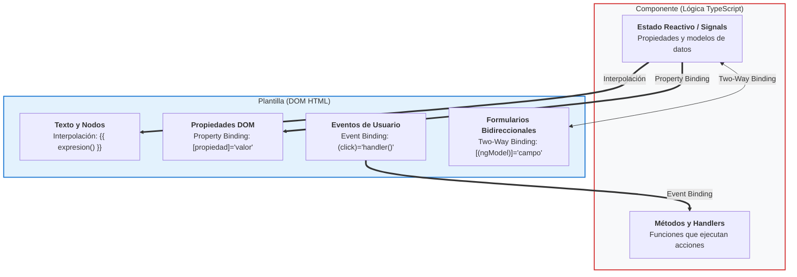
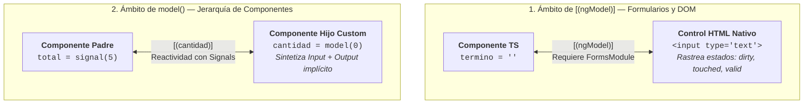
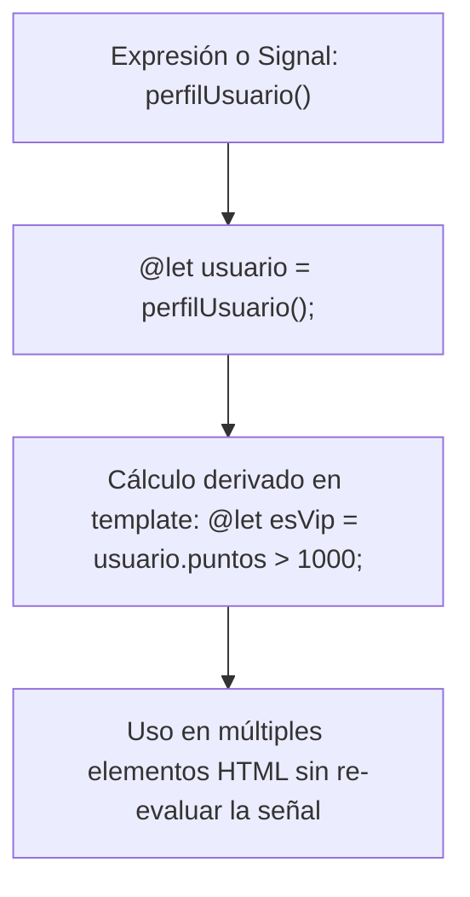
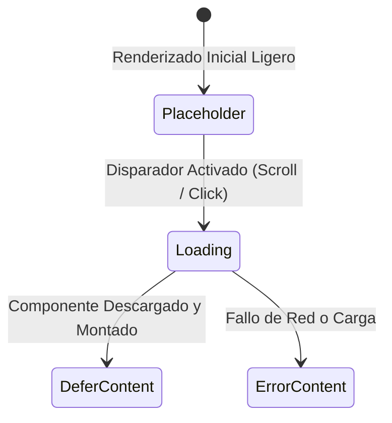

# Plantillas en Angular

<div class="badges">
  <span class="badge badge-angular">Angular 19 - 22</span>
  <span class="badge badge-signals">Control Flow (@if, @for, @switch)</span>
  <span class="badge badge-pro">Modern Template Engine</span>
</div>

## Objetivos de aprendizaje

Al finalizar esta unidad, el alumnado será capaz de:

1. Dominar la sintaxis de interpolación para mostrar datos dinámicos en plantillas Angular.
2. Utilizar property binding para vincular propiedades de elementos HTML a expresiones del componente.
3. Implementar event binding para responder a interacciones del usuario.
4. Comprender y aplicar two-way binding con `[(ngModel)]` y Model Inputs.
5. Utilizar variables locales de plantilla para referenciar elementos del DOM y variables declarativas con `@let`.
6. Diferenciar entre atributos HTML y propiedades DOM, aplicando el binding adecuado.
7. Escribir expresiones de plantilla seguras, idempotentes y eficientes.
8. Aplicar medidas de seguridad para prevenir vulnerabilidades XSS en plantillas.
9. Utilizar las nuevas características de expresividad de Angular 22: funciones flecha inline, operador spread, multi-`@case`, `@default never` y boundaries de error.

## Resultados de aprendizaje

Tras completar esta unidad, el estudiante será capaz de:

- Crear formularios e interfaces interactivas utilizando todos los tipos de binding de Angular.
- Aplicar las mejoras modernas de sintaxis de Angular 22 para simplificar la lógica de las plantillas.
- Utilizar el objeto `$event` para acceder a información detallada de eventos del DOM.
- Implementar filtrado de eventos de teclado para mejorar la experiencia de usuario.
- Diseñar bloques `@switch` exhaustivos y tipados con `@default never;`.
- Construir componentes con comunicación de datos fluida entre la lógica TypeScript y la vista HTML.

## Introducción

Las plantillas (templates) son el puente entre la lógica de negocio (TypeScript) y la interfaz de usuario (HTML) en Angular. Son, probablemente, el aspecto más visible y tangible del framework: lo que el usuario final ve y con lo que interactúa directamente. Una plantilla bien diseñada no solo muestra datos correctamente, sino que lo hace de forma eficiente, segura y mantenible.

Angular extiende el HTML estándar con una sintaxis de binding que permite una conexión dinámica entre el componente y el DOM. Esta sintaxis, que con el tiempo se convierte en algo natural para el desarrollador, es uno de los superpoderes de Angular: permite crear interfaces reactivas sin necesidad de manipular manualmente el DOM con `document.getElementById` o `addEventListener`, como se hacía en la era pre-frameworks.

En esta unidad, vamos a desglosar cada tipo de binding, entender cómo funciona internamente, cuándo usar cada uno y qué errores evitar. Dedicaremos especial atención a la nueva sintaxis de control de flujo (`@if`, `@for`, `@switch`), que ha reemplazado a las directivas estructurales clásicas (`*ngIf`, `*ngFor`, `*ngSwitch`), ofreciendo una experiencia más cercana a los lenguajes de plantillas modernos.

Piensa en las plantillas como el escenario de un teatro. Los actores (componentes) tienen su guion (TypeScript), pero el público (usuarios) solo ve lo que ocurre en el escenario (HTML). Cuanto mejor sea la conexión entre el guion y la puesta en escena, más cautivadora será la función.

!!! note "Delimitación Curricular: Sintaxis de Plantilla vs. Arquitectura de Componentes"
    En esta unidad nos enfocamos en la **sintaxis de plantilla y expresividad intra-componente**: cómo conectar la clase TypeScript con su propio documento HTML mediante bindings (`{{ }}`, `[]`, `()`, `[()]`), directivas nativas de control (`@if`, `@for`, `@switch`), variables locales (`@let`, `#ref`) y carga diferida (`@defer`).

    Aunque Angular reutiliza la misma sintaxis de corchetes `[ ]` y paréntesis `( )` para comunicarse con otros componentes, el diseño del **árbol jerárquico, contratos de interfaz (`input()` / `output()`), patrón Smart & Dumb y servicios mediadores** se aborda como disciplina de arquitectura en el [Capítulo 07: Comunicación entre Componentes](07-anidar-componentes.md).

## Desarrollo teórico



### Interpolación

La ==interpolación== es la forma más simple de data binding unidireccional en Angular. Permite proyectar el valor evaluado de una expresión del componente en el texto del DOM utilizando la sintaxis de dobles llaves `{{ }}`.

#### Sintaxis básica

```typescript
// componente.ts
export class SaludoComponent {
  nombre: string = 'María';
  edad: number = 28;
  activo: boolean = true;
}
```

```html
<!-- componente.html -->
<p>Hola, {{ nombre }}</p>
<p>Edad: {{ edad }}</p>
<p>Estado: {{ activo ? 'Activo' : 'Inactivo' }}</p>
```

Cuando Angular procesa esta plantilla, evalúa las expresiones entre llaves, las convierte a string y las inserta en el DOM. Si el valor de `nombre` cambia (por ejemplo, de 'María' a 'Carlos'), Angular actualiza automáticamente el texto mostrado.

#### ¿Qué se puede poner dentro de {{ }}?

La interpolación acepta **expresiones TypeScript** que cumplan estas características:

**Expresiones permitidas**:

- **Propiedades del componente**: `{{ titulo }}`, `{{ usuario.nombre }}`, `{{ usuario.direccion?.calle }}`
- **Operaciones matemáticas**: `{{ precio * cantidad }}`, `{{ (total / items.length) | number:'1.2-2' }}`
- **Concatenación de strings**: `{{ 'Hola ' + nombre + ' ' + apellido }}`
- **Template literals**: `{{ `Bienvenido/a ${nombre}` }}`
- **Llamadas a métodos del componente** (con precaución): `{{ formatearFecha(fecha) }}`
- **Operadores ternarios**: `{{ isLoggedIn ? nombre : 'Invitado' }}`
- **Operadores lógicos**: `{{ isActive && hasPermission }}`
- **Pipes**: `{{ fecha | date:'dd/MM/yyyy' }}`, `{{ precio | currency:'EUR' }}`

**Expresiones NO permitidas**:

```html
<!-- ❌ Asignaciones -->
{{ nombre = 'Otro' }}

<!-- ❌ Operadores de incremento/decremento -->
{{ contador++ }}
{{ --indice }}

<!-- ❌ Operadores de asignación compuesta -->
{{ precio += 5 }}

<!-- ❌ La palabra clave new -->
{{ new Date() }}

<!-- ❌ Punto y coma (encadenar expresiones) -->
{{ a = 5; b = 10; a + b }}

<!-- ❌ Variables globales del navegador -->
{{ window.location.href }}
{{ document.title }}
{{ console.log(algo) }}
```

La razón de estas restricciones es doble: seguridad (evitar ejecución de código arbitrario) y rendimiento (las expresiones deben ser rápidas e idempotentes).

#### Seguridad XSS (Cross-Site Scripting)

Angular sanitiza automáticamente los valores interpolados para prevenir ataques XSS. Cualquier valor que se muestre mediante interpolación se trata como texto plano, NO como HTML:

```typescript
export class SeguridadComponent {
  entradaUsuario = '<script>alert("HACKED!")</script>';
  htmlMalo = '';
}
```

```html
<!-- Ambos se muestran como TEXTO PLANO, no se ejecutan -->
<p>{{ entradaUsuario }}</p>
<!-- Resultado: se muestra literalmente el texto <script>alert("HACKED!")</script> -->

<p>{{ htmlMalo }}</p>
<!-- Resultado: se muestra literalmente el texto, la imagen NO se crea -->
```

Para renderizar HTML dinámico de forma segura (por ejemplo, contenido de un CMS), Angular proporciona la propiedad `[innerHTML]` con `DomSanitizer`. Pero esto debe usarse con extrema precaución:

```typescript
import { Component, inject } from '@angular/core';
import { DomSanitizer, SafeHtml } from '@angular/platform-browser';

@Component({...})
export class ContenidoComponent {
  private sanitizer = inject(DomSanitizer);
  htmlSeguro: SafeHtml;

  constructor() {
    const contenido = '<p>Contenido <strong>seguro</strong> del CMS</p>';
    this.htmlSeguro = this.sanitizer.bypassSecurityTrustHtml(contenido);
  }
}
```

```html
<div [innerHTML]="htmlSeguro"></div>
```

**Regla de oro**: nunca uses `bypassSecurityTrustHtml` con datos provenientes del usuario sin sanitizarlos exhaustivamente.

#### Operador de navegación segura (?.) y aserción non-null (!)

El operador `?.` (safe navigation operator) evita errores cuando se accede a propiedades de objetos que pueden ser `null` o `undefined`:

```html
<!-- ❌ Sin operador seguro: error si usuario o direccion es null/undefined -->
<p>{{ usuario.direccion.ciudad }}</p>

<!-- ✅ Con operador seguro: simplemente no muestra nada -->
<p>{{ usuario?.direccion?.ciudad }}</p>

<!-- ✅ Combinado con valores por defecto -->
<p>{{ usuario?.direccion?.ciudad || 'Ciudad no especificada' }}</p>
```

El operador `!` (non-null assertion) le dice al compilador de TypeScript: "confía en mí, esta expresión no es null/undefined":

```html
<p>{{ usuario!.direccion!.ciudad }}</p>
```

**Precaución**: usar `!` en exceso puede ocultar errores reales. Es preferible inicializar las propiedades con valores por defecto o usar el operador `?.`.

#### Uso de pipes en interpolación

Los pipes son funciones que transforman datos para su visualización. Se aplican con el operador `|`:

```html
<!-- Formateo de fechas -->
<p>{{ fechaNacimiento | date:'dd/MM/yyyy' }}</p>
<p>{{ ahora | date:'HH:mm:ss' }}</p>

<!-- Formateo de números y moneda -->
<p>{{ precio | currency:'EUR':'symbol':'1.2-2' }}</p>
<p>{{ ratio | percent:'1.0-1' }}</p>

<!-- Transformación de texto -->
<p>{{ nombre | uppercase }}</p>
<p>{{ descripcion | lowercase }}</p>
<p>{{ texto | titlecase }}</p>
<p>{{ resumen | slice:0:100 }}...</p>

<!-- JSON (debugging) -->
<pre>{{ objetoComplejo | json }}</pre>

<!-- Pipes encadenados -->
<p>{{ fecha | date:'fullDate' | uppercase }}</p>
```

Los pipes son "puros" por defecto: solo se ejecutan cuando detectan un cambio "puro" en la entrada (cambio de referencia para objetos, cambio de valor para primitivos). Esto mejora el rendimiento porque Angular no reevalúa el pipe en cada ciclo de detección de cambios a menos que la entrada haya cambiado.

### Property Binding

El ==property binding== vincula una propiedad del DOM de un elemento HTML con una expresión del componente. Se escribe con corchetes `[propiedad]="expresión"`.

#### Diferencia entre atributo HTML y propiedad DOM

!!! tip "Regla de oro: Atributos HTML vs Propiedades DOM"
    
    - **Atributo HTML**: se define en el HTML estático. Es la inicialización estática del elemento (`getAttribute`). No cambia tras la renderización inicial.
    - **Propiedad DOM**: es el nodo activo en memoria JavaScript del navegador (`element.property`). Cambia dinámicamente con la interacción del usuario y la reactividad.
    
    **Angular opera directamente sobre las propiedades DOM**, garantizando reactividad sin necesidad de re-parsear el string HTML. Solo en casos especiales de accesibilidad o SVGs se recurre al atributo explícito `[attr.nombre]`.

Ejemplo clásico: un campo de texto `<input>`.

```html
<input type="text" value="Nombre inicial">
```

- El **atributo HTML** `value` siempre será `"Nombre inicial"` (valor estático).
- La **propiedad DOM** `value` cambia cada vez que el usuario escribe en el campo.

Angular trabaja con **propiedades DOM**, no con atributos HTML. Por eso el property binding se vincula a la propiedad, no al atributo:

```html
<!-- Property binding: vincula la propiedad DOM 'value' -->
<input [value]="nombre">
```

#### Tipos de Property Binding

##### Property binding estándar

```html
<!-- Vinculación de propiedades de elementos HTML -->

<button [disabled]="formularioInvalido">Guardar</button>
<input [value]="nombre" [placeholder]="textoPlaceholder">
<progress [value]="progreso" [max]="100"></progress>

<!-- Vinculación de propiedades de componentes Angular -->
<app-usuario [nombre]="usuario.nombre" [email]="usuario.email"></app-usuario>
```

##### Attribute binding

Cuando necesitas vincular un atributo HTML (no una propiedad DOM), usas `[attr.atributo]`:

```html
<!-- Atributos que no tienen propiedad DOM equivalente -->
<td [attr.colspan]="numeroColumnas">Contenido</td>
<div [attr.aria-label]="etiquetaAccesibilidad">...</div>
<button [attr.aria-expanded]="expandido">Menú</button>
<svg [attr.viewBox]="viewBox">...</svg>
```

¿Cuándo usar attribute binding en lugar de property binding?

- Atributos de accesibilidad (`aria-*`): algunos no tienen propiedad DOM.
- Atributos de tablas (`colspan`, `rowspan`): no tienen propiedad DOM en todos los navegadores.
- Atributos SVG: muchos no tienen propiedades DOM equivalentes.
- Atributos `data-*` personalizados.

##### Class binding

Controla las clases CSS de un elemento de forma dinámica:

```html
<!-- Clase única: añade 'activo' si la expresión es true -->
<div [class.activo]="isActivo">Contenido</div>

<!-- Múltiples clases individuales -->
<div
  [class.activo]="usuario.activo"
  [class.admin]="usuario.rol === 'admin'"
  [class.premium]="usuario.suscripcion === 'premium'">
  {{ usuario.nombre }}
</div>

<!-- Alternativa: NgClass para múltiples clases -->
<div [ngClass]="{
  'activo': usuario.activo,
  'admin': usuario.rol === 'admin',
  'premium': usuario.suscripcion === 'premium',
  'baneado': usuario.baneado
}">
  {{ usuario.nombre }}
</div>
```

La sintaxis `[class.nombre-clase]="expresión"`:

- Añade la clase si la expresión es `true`.
- Elimina la clase si la expresión es `false`.
- No afecta a otras clases que el elemento ya tenga.

##### Style binding

Controla estilos CSS inline de forma dinámica:

```html
<!-- Estilo individual -->
<div [style.color]="esError ? 'red' : 'inherit'">Mensaje</div>
<div [style.font-size.px]="tamanoFuente">Texto</div>
<div [style.background-color]="colorFondo">Contenedor</div>

<!-- Con unidades (sufijo después del estilo) -->
<div [style.width.px]="ancho">...</div>
<div [style.height.%]="porcentaje">...</div>
<div [style.margin.em]="1.5">...</div>
<div [style.opacity]="transparencia">...</div>

<!-- NgStyle para múltiples estilos -->
<div [ngStyle]="{
  'color': colorTexto,
  'font-size.px': tamanoFuente,
  'background-color': colorFondo,
  'padding': padding + 'px'
}">
  Contenido estilizado dinámicamente
</div>
```

**Precaución**: los estilos inline tienen la máxima especificidad CSS. Si abusas de ellos, te resultará difícil sobrescribirlos con hojas de estilo externas. Siempre que sea posible, prefiere class binding + CSS.

### Event Binding

El event binding permite al componente responder a eventos del DOM (clics, teclado, ratón, etc.) ejecutando métodos definidos en la clase del componente. Se escribe con paréntesis `(evento)="manejador($event)"`.

#### Event binding básico

```typescript
export class BotonComponent {
  contador = 0;
  mensaje = '';

  onClick(): void {
    this.contador++;
    this.mensaje = `Botón pulsado ${this.contador} veces`;
  }

  onMouseEnter(): void {
    console.log('El cursor entró en el botón');
  }

  onMouseLeave(): void {
    console.log('El cursor salió del botón');
  }
}
```

```html
<button
  (click)="onClick()"
  (mouseenter)="onMouseEnter()"
  (mouseleave)="onMouseLeave()">
  {{ mensaje || 'Púlsame' }}
</button>
```

#### El objeto $event

`$event` es una variable especial disponible en los manejadores de eventos que contiene el objeto del evento nativo del DOM. Su tipo depende del evento:

```html
<!-- Eventos de ratón: $event es MouseEvent -->
<div (click)="manejarClick($event)"
     (mousemove)="rastrearRaton($event)"
     (contextmenu)="mostrarContextual($event)">
</div>

<!-- Eventos de teclado: $event es KeyboardEvent -->
<input (keydown)="detectarTecla($event)"
       (keyup)="validarEntrada($event)">

<!-- Eventos de formulario: $event es Event -->
<input (input)="procesarInput($event)"
       (change)="validarCambio($event)"
       (focus)="marcarActivo($event)"
       (blur)="validarCampo($event)">
```

```typescript
export class EventosComponent {
  manejarClick(event: MouseEvent): void {
    console.log('Coordenadas del clic:', event.clientX, event.clientY);
    console.log('Botón usado:', event.button);     // 0=izq, 1=centro, 2=der
    console.log('¿Tecla Shift?', event.shiftKey);
    console.log('Elemento clickeado:', event.target);

    // Prevenir comportamiento por defecto
    event.preventDefault();

    // Detener propagación del evento
    event.stopPropagation();
  }

  detectarTecla(event: KeyboardEvent): void {
    console.log('Tecla presionada:', event.key);
    console.log('Código de tecla:', event.code);

    if (event.key === 'Escape') {
      console.log('Se presionó Escape - cerrando modal');
    }

    if (event.ctrlKey && event.key === 's') {
      console.log('Ctrl+S - guardando');
      event.preventDefault();  // Prevenir el guardado del navegador
    }
  }

  getValue(event: Event): string {
    const input = event.target as HTMLInputElement;
    return input.value;
  }
}
```

#### Eventos de teclado y filtrado

Angular proporciona una sintaxis para filtrar eventos de teclado por tecla específica con la notación `(keydown.tecla)`:

```html
<!-- Escuchar solo teclas específicas -->
<input (keydown.enter)="buscar()">
<input (keydown.escape)="cerrarModal()">
<input (keydown.arrowup)="moverArriba()">
<input (keydown.arrowdown)="moverAbajo()">
<input (keydown.space)="toggleSeleccion()">
<input (keydown.tab)="manejarTab($event)">

<!-- Combinaciones de teclas -->
<textarea (keydown.control.enter)="enviarFormulario()">
<textarea (keydown.shift.enter)="agregarNuevaLinea()">
<textarea (keydown.alt.arrowleft)="anteriorPestana()">

<!-- Filtrado con el evento keyup -->
<input (keyup.enter)="busqueda.set($any($event.target).value)">
```

Lista de teclas soportadas (alias de Angular):

- Letras: `a`, `b`, `c`, ..., `z`
- Números: `0`, `1`, ..., `9`
- Flechas: `arrowup`, `arrowdown`, `arrowleft`, `arrowright`
- Especiales: `enter`, `escape`, `space`, `tab`, `backspace`, `delete`
- Modificadores: `shift`, `control` (o `ctrl`), `alt` (o `meta`)

También puedes combinar modificadores: `(keydown.control.shift.z)` para Ctrl+Shift+Z.

#### Eventos de formulario

```html
<!-- Evento input: se dispara en cada cambio (útil para búsquedas en tiempo real) -->
<input (input)="filtrarResultados($event)">

<!-- Evento change: se dispara al perder el foco (después de terminar de editar) -->
<input (change)="guardarCambio($event)">

<!-- Evento focus/blur -->
<input (focus)="mostrarAyuda()">
<input (blur)="validarCampo($event)">

<!-- Evento submit en formularios -->
<form (ngSubmit)="procesarFormulario()">
  <input name="nombre" [(ngModel)]="modelo.nombre">
  <button type="submit">Enviar</button>
</form>
```

**Importante sobre `(submit)` vs `(ngSubmit)`**:

- `(submit)` es el evento nativo del DOM. Se dispara con el botón submit y con Enter.
- `(ngSubmit)` es un evento de Angular que NO se dispara si el formulario no es válido (cuando se usan validaciones). Es la opción recomendada en formularios Angular.

### Two-way Binding

El two-way binding combina property binding y event binding en una sola sintaxis, permitiendo que los cambios en el template se reflejen automáticamente en el componente y viceversa.

#### Sintaxis "banana in a box"

La sintaxis `[( )]` se conoce coloquialmente como "banana in a box" (un plátano dentro de una caja):

```html
<input [(ngModel)]="nombre">
<!-- 
  Esto es equivalente a:
  <input [ngModel]="nombre" (ngModelChange)="nombre = $event">
-->
```

Para usar `[(ngModel)]`, necesitas importar `FormsModule` en el componente:

```typescript
import { FormsModule } from '@angular/forms';

@Component({
  imports: [FormsModule],
  // ...
})
```

#### Desglose: cómo funciona

`[(ngModel)]` no es magia. Es azúcar sintáctico que se descompone en:

```html
<!-- Two-way binding: forma corta -->
<input [(ngModel)]="nombre">

<!-- Equivalente: property binding + event binding -->
<input
  [ngModel]="nombre"
  (ngModelChange)="nombre = $event">
```

Esto significa que:

1. `[ngModel]="nombre"`: cuando `nombre` cambia en el componente, el input se actualiza.
2. `(ngModelChange)="nombre = $event"`: cuando el usuario escribe en el input, `nombre` se actualiza en el componente.

#### Two-way binding con diferentes elementos

```html
<!-- Input de texto -->
<input type="text" [(ngModel)]="texto">

<!-- Textarea -->
<textarea [(ngModel)]="descripcion" rows="4"></textarea>

<!-- Checkbox -->
<input type="checkbox" [(ngModel)]="aceptaTerminos">

<!-- Radio buttons -->
<input type="radio" name="genero" value="M" [(ngModel)]="genero"> Masculino
<input type="radio" name="genero" value="F" [(ngModel)]="genero"> Femenino

<!-- Select -->
<select [(ngModel)]="paisSeleccionado">
  <option value="">Selecciona un país</option>
  <option value="ES">España</option>
  <option value="FR">Francia</option>
  <option value="IT">Italia</option>
</select>

<!-- Select múltiple -->
<select [(ngModel)]="idiomasSeleccionados" multiple>
  <option value="es">Español</option>
  <option value="en">Inglés</option>
  <option value="fr">Francés</option>
</select>

<!-- Range slider -->
<input type="range" min="0" max="100" [(ngModel)]="volumen">
<span>{{ volumen }}%</span>

<!-- Date input -->
<input type="date" [(ngModel)]="fechaEvento">

<!-- Color picker -->
<input type="color" [(ngModel)]="colorFavorito">
```

#### Two-way binding entre componentes (Model Inputs)

Como vimos en la unidad de componentes, los **Model Inputs** (`model()`) permiten establecer enlace bidireccional entre componentes padre e hijo mediante Signals:

```typescript
// Componente hijo: selector-cantidad.component.ts
import { Component, model } from '@angular/core';

@Component({
  selector: 'app-selector-cantidad',
  template: `
    <button (click)="cantidad.set(cantidad() - 1)">-</button>
    <span>{{ cantidad() }}</span>
    <button (click)="cantidad.set(cantidad() + 1)">+</button>
  `
})
export class SelectorCantidadComponent {
  // Define un Input reactivo y un Output 'cantidadChange' implícito
  cantidad = model(0);
}

// Componente padre: app.component.ts
import { Component, signal } from '@angular/core';
import { SelectorCantidadComponent } from './selector-cantidad.component';

@Component({
  selector: 'app-root',
  imports: [SelectorCantidadComponent],
  template: `
    <!-- Banana-in-a-box hacia la propiedad model() del hijo -->
    <app-selector-cantidad [(cantidad)]="total" />
    <p>Total en el componente padre: {{ total() }}</p>
  `
})
export class AppComponent {
  total = signal(5);
}
```

#### Comparativa Arquitectónica: model() vs [(ngModel)]

Tanto `model()` como `[(ngModel)]` utilizan en la plantilla la sintaxis de *"banana in a box"* `[( ... )]`, lo que suele generar confusión en los alumnos que aprenden Angular. Sin embargo, resuelven **problemas arquitectónicos totalmente distintos** y pertenecen a capas diferentes del framework:



##### Tabla de diferencias técnicas

| Criterio | [`model()`](03-componentes.md#model-inputs) (Model Inputs) | `[(ngModel)]` (Directiva NgModel) |
| :--- | :--- | :--- |
| **Objetivo principal** | Comunicación bidireccional **entre componentes propios** (Padre ↔ Hijo). | Enlazar valores con **etiquetas HTML nativas de formulario** (`<input>`, `<select>`, `<textarea>`). |
| **Paquete / Dependencia** | `@angular/core` (núcleo del framework, sin imports adicionales). | `@angular/forms` (requiere importar `FormsModule` en `imports`). |
| **Tecnología base** | **Signals reactivas** (`ModelSignal<T>`). Óptimo para Zoneless. | Eventos del DOM nativo (`input`, `change`) y directivas de formulario. |
| **Sintaxis interna** | Es una señal escribible: se lee llamando `valor()` y se muta con `valor.set(...)` o `valor.update(...)`. | Variable estándar de TypeScript o señal conectada mediante `(ngModelChange)`. |
| **Componentes personalizados** | **1 línea de código**: `activo = model(false)`. Angular sintetiza automáticamente el evento `activoChange`. | Para usar `[(ngModel)]` en un componente propio requería implementar la compleja interfaz `ControlValueAccessor` (+40 líneas). |
| **Metadatos de formulario** | **No** gestiona estados de formulario ni validaciones (`valid`, `invalid`, `dirty`, `touched`). | **Sí** gestiona clases CSS y estados de formulario (`ng-dirty`, `ng-touched`, `ng-invalid`, etc.). |

##### Ejemplo práctico integrador: Convivencia de ambos patrones

El siguiente ejemplo muestra cómo ambos mecanismos conviven armónicamente en una aplicación Angular moderna sin solaparse:

```typescript
// 1. COMPONENTE HIJO REUTILIZABLE: switch.component.ts
// Utiliza model() porque es un componente propio que comunica su estado al padre
import { Component, model } from '@angular/core';

@Component({
  selector: 'app-switch',
  template: `
    <button (click)="activo.update(v => !v)" [class.on]="activo()">
      Estado: {{ activo() ? 'ACTIVADO' : 'DESACTIVADO' }}
    </button>
  `,
  styles: [`
    button { padding: 6px 14px; border-radius: 20px; border: 1px solid #ccc; cursor: pointer; }
    button.on { background: #22c55e; color: white; border-color: #16a34a; }
  `]
})
export class SwitchComponent {
  // ModelSignal bidireccional nativa de Angular Core
  activo = model<boolean>(false);
}

// 2. COMPONENTE PADRE: perfil-usuario.component.ts
// Utiliza model() para el switch y ngModel para el input nativo del formulario
import { Component, signal } from '@angular/core';
import { FormsModule } from '@angular/forms';
import { SwitchComponent } from './switch.component';

@Component({
  selector: 'app-perfil-usuario',
  imports: [FormsModule, SwitchComponent],
  template: `
    <div class="formulario">
      <!-- A) Two-way binding con control HTML NATIVO -> [(ngModel)] -->
      <label>Nombre de usuario:</label>
      <input type="text" [(ngModel)]="nombreUsuario" placeholder="Tu alias..." />

      <!-- B) Two-way binding con COMPONENTE HIJO PROPIO -> [(activo)] sobre model() -->
      <label>Notificaciones por correo:</label>
      <app-switch [(activo)]="notificacionesHabilitadas" />

      <hr />
      <p>Resumen: <b>{{ nombreUsuario }}</b> | Notificaciones: <b>{{ notificacionesHabilitadas() }}</b></p>
    </div>
  `
})
export class PerfilUsuarioComponent {
  nombreUsuario = '';
  notificacionesHabilitadas = signal(true);
}
```

##### Regla de Oro para el Alumno

!!! tip "Regla de Oro: ¿Cuándo usar model() y cuándo ngModel?"
    * **Usa `model()`** cuando diseñes un **componente reutilizable propio** (un modal con su estado abierto/cerrado, un selector de fechas, un contador numérico, un interruptor) y quieras que el componente padre se sincronice bidireccionalmente con él sin boilerplate.
    * **Usa `[(ngModel)]`** cuando interactúes con **etiquetas HTML nativas de formulario** (`<input>`, `<select>`, `<textarea>`) en formularios sencillos dirigidos por plantilla (*Template-Driven Forms*).
    * **Usa Reactive Forms (`FormGroup`, `FormControl`)** cuando te enfrentes a **formularios empresariales complejos** con validaciones cruzadas, arrays dinámicos o necesidad de tests unitarios rigurosos ([ver Capítulo 12: Formularios Reactivos](12-formularios.md)).
    * **Profundización Arquitectónica:** En este capítulo abordamos `model()` estrictamente como sintaxis de enlace en plantilla (`[( ... )]`). La declaración y el flujo de señales entre múltiples componentes jerárquicos se detallan a nivel de arquitectura de software en el [Capítulo 07: Comunicación entre Componentes](07-anidar-componentes.md#23-model-inputs-two-way-binding-entre-componentes).

### Variables locales de plantilla

Las variables locales de plantilla (template reference variables) permiten referenciar elementos del DOM, componentes o directivas desde la plantilla HTML, usando la sintaxis `#nombreVariable`.

#### ¿Qué referencia una variable de plantilla?

```html
<!-- Referencia a un elemento HTML nativo -->
<input #inputNombre type="text" placeholder="Nombre">
<button (click)="usarInput(inputNombre)">Usar valor</button>
<!-- inputNombre es HTMLInputElement -->

<!-- Referencia a un componente Angular -->
<app-calendario #calendario></app-calendario>
<button (click)="calendario.irAHoy()">Hoy</button>
<!-- #calendario referencia la instancia de CalendarioComponent -->

<!-- Referencia a una directiva -->
<form #formulario="ngForm" (ngSubmit)="enviar(formulario)">
  <input name="email" ngModel required>
</form>
<!-- #formulario referencia la instancia de NgForm -->

<!-- Referencia a un elemento con ngModel -->
<input #nombreModelo="ngModel" [(ngModel)]="nombre" required>
<p>¿Válido?: {{ nombreModelo.valid }}</p>
<p>Errores: {{ nombreModelo.errors | json }}</p>
<!-- #nombreModelo referencia la instancia de NgModel -->
```

#### Reglas importantes sobre variables de plantilla

1. **Ámbito limitado a la plantilla**: las variables de plantilla solo existen dentro del template HTML. No puedes acceder a `#inputNombre` directamente en el código TypeScript. Para acceder desde la clase, debes pasarla explícitamente a un método o usar `@ViewChild`.

2. **Acceso mediante paso a métodos**:

```html
<input #inputBusqueda type="search">
<button (click)="buscar(inputBusqueda.value)">Buscar</button>
```

```typescript
buscar(termino: string): void {
  console.log('Buscando:', termino);
}
```

3. **Acceso mediante `@ViewChild`**:

```typescript
import { Component, ViewChild, ElementRef, AfterViewInit } from '@angular/core';

@Component({...})
export class BuscadorComponent implements AfterViewInit {
  @ViewChild('inputBusqueda') inputBusqueda!: ElementRef<HTMLInputElement>;

  ngAfterViewInit(): void {
    // El DOM ya está disponible
    this.inputBusqueda.nativeElement.focus();
  }

  buscar(): void {
    const valor = this.inputBusqueda.nativeElement.value;
    console.log('Buscando:', valor);
  }
}
```

4. **`@ViewChild` con Signals (viewChild)**:

```typescript
import { Component, viewChild, ElementRef, AfterViewInit } from '@angular/core';

@Component({...})
export class BuscadorComponent implements AfterViewInit {
  inputBusqueda = viewChild<ElementRef<HTMLInputElement>>('inputBusqueda');

  ngAfterViewInit(): void {
    this.inputBusqueda()?.nativeElement.focus();
  }

  buscar(): void {
    const input = this.inputBusqueda();
    if (input) {
      console.log('Buscando:', input.nativeElement.value);
    }
  }
}
```

### Template Expressions

Las expresiones de plantilla son fragmentos de código TypeScript que Angular evalúa para determinar qué mostrar o cómo comportarse. Tienen reglas estrictas diseñadas para mantener el rendimiento y la previsibilidad.

#### Qué NO puede ir en una expresión de plantilla

```html
<!-- ❌ Asignaciones directas -->
{{ nombre = 'Nuevo' }}

<!-- ❌ Incremento / Decremento -->
{{ contador++ }}

<!-- ❌ Operadores de asignación compuesta -->
{{ total += 5 }}

<!-- ❌ La palabra clave new -->
{{ new Date() }}

<!-- ❌ Punto y coma (encadenamiento) -->
{{ a = 5; b = 10; a + b }}

<!-- ❌ Variables globales -->
{{ window.innerWidth }}
{{ document.title }}
{{ localStorage.getItem('token') }}

<!-- ❌ Expresiones con efectos secundarios -->
{{ enviarEmail() }}
{{ guardarEnBaseDeDatos() }}
```

#### Principios de las expresiones de plantilla

**1. Deben ser rápidas**: Angular evalúa las expresiones de plantilla en cada ciclo de detección de cambios. Una expresión lenta ralentiza toda la aplicación.

```typescript
// ✅ BUENO: propiedad simple
get nombreCompleto(): string {
  return `${this.nombre} ${this.apellido}`;
}

// ❌ MALO: operación costosa en getter
get usuariosFiltrados(): Usuario[] {
  return this.usuarios
    .filter(u => u.activo)
    .sort((a, b) => b.puntos - a.puntos)
    .map(u => this.transformarUsuario(u))
    .slice(0, 10);
}
// Este getter se ejecuta en CADA ciclo de detección de cambios.
// Mejor: calcular en ngOnInit y actualizar solo cuando los datos cambian.
```

**2. Deben ser idempotentes**: el resultado debe ser el mismo si se evalúa múltiples veces con los mismos datos. Esto permite a Angular ejecutar la detección de cambios en modo desarrollo dos veces para verificar la estabilidad.

**3. Sin efectos secundarios**: no deben modificar el estado de la aplicación. Los efectos secundarios deben estar en los manejadores de eventos, no en las expresiones de plantilla.

```html
<!-- ✅ BIEN: el efecto secundario está en el evento -->
<button (click)="guardar()">Guardar</button>

<!-- ❌ MAL: efecto secundario en expresión de plantilla -->
<span>{{ registrarVista() }}</span>
```

#### Expresiones útiles y seguras

```html
<!-- Operador ternario -->
<div [class.exito]="estado === 'completado'">
  {{ estado === 'completado' ? '✓' : '○' }}
</div>

<!-- Operadores lógicos -->
<button [disabled]="cargando || !formularioValido">Enviar</button>

<!-- Comparaciones (con nueva sintaxis de control de flujo) -->
@if (stock === 0) {
  <span class="agotado">Agotado</span>
}
@if (stock > 0 && stock < 5) {
  <span class="poco-stock">¡Últimas unidades!</span>
}

<!-- Pipes (más eficiente que métodos) -->
<span>{{ producto.precio | currency:'EUR' }}</span>
<!-- Los pipes puros solo se evalúan cuando cambia la entrada -->
```

### Control Flow Nativo (@if, @for, @switch)

A partir de **Angular 17 y consolidado en Angular 18-22**, Angular introdujo una sintaxis de control de flujo declarativa integrada directamente en el compilador. Esta arquitectura reemplaza a las antiguas directivas estructurales (`*ngIf`, `*ngFor`, `*ngSwitch`), ofreciendo mayor rendimiento, chequeo estricto de tipos y una experiencia de desarrollo (*DX*) mucho más limpia y cercana a JavaScript/TypeScript estándar.

!!! tip "Comando oficial de migración a Control Flow"
    Puedes migrar automáticamente proyectos legacy con directivas estructurales clásicas (`*ngIf`, `*ngFor`, `*ngSwitch`) a la nueva sintaxis nativa ejecutando en el CLI:
    ```bash
    ng generate @angular/core:control-flow
    ```

#### Diferencias con las directivas estructurales antiguas

Las directivas estructurales clásicas (`*ngIf`, `*ngFor`, `*ngSwitch`) presentaban limitaciones arquitectónicas significativas:

- **Sintaxis compleja con asterisco (`*`):** El asterisco era azúcar sintáctico que ocultaba la creación implícita de contenedores `<ng-template>`, dificultando la comprensión del DOM resultante.
- **Necesidad de importar `CommonModule`:** Obligaba a importar `CommonModule` o `BrowserModule` en cada componente standalone para poder usar directivas básicas.
- **Dificultad con condicionales múltiples:** Implementar estructuras `if / else if / else` requería múltiples etiquetas `<ng-template>` auxiliares referenciadas con identificadores locales.
- **Sobrecarga de rendimiento:** Cada directiva estructural clásica implicaba instanciar *EmbeddedViews* y ejecutar comprobaciones adicionales en el ciclo de detección de cambios.

El nuevo **Control Flow nativo** resuelve estos problemas:

- **Sintaxis declarativa integrada:** Bloques `@if`, `@for`, `@switch` procesados en tiempo de compilación.
- **Cero imports adicionales:** Al estar integrado en el motor de plantillas del core, no requiere importar `CommonModule`.
- **Rendimiento óptimo:** El compilador genera instrucciones atómicas directas sobre el DOM sin capas intermedias.
- **Soporte nativo para ramas complejas:** Soporta `@else`, `@else if`, `@empty` y variables contextuales sin boilerplate.

**Tabla comparativa:**

| Característica | Directivas clásicas (Legacy) | Control Flow Nativo (`@`) |
|---|---|---|
| Renderizado condicional | `<div *ngIf="condicion">` | `@if (condicion) { <div></div> }` |
| Iteración de colecciones | `<div *ngFor="let item of items">` | `@for (item of items; track item.id) { <div></div> }` |
| Selección por casos | `[ngSwitch]="valor"` + `*ngSwitchCase` | `@switch (valor) { @case ('a') { <div></div> } }` |
| Rama alternativa (Else) | `*ngIf="cond; else templateRef"` | `@else { <div></div> }` |
| Rama condicional intermedia | Múltiples `<ng-template>` manuales | `@else if (cond2) { <div></div> }` |
| Estado de colección vacía | `*ngIf="items.length === 0"` | `@empty { <div>Sin datos</div> }` |
| Rendimiento de listas | `trackBy` opcional (propensión a fugas) | `track` obligatorio por compilador |

---

#### @if: Renderizado condicional

El bloque `@if` evalúa una expresión booleana y renderiza su contenido únicamente si dicha expresión es verídica (*truthy*). Soporta bifurcaciones `@else if` y `@else` de forma nativa sin necesidad de crear etiquetas `<ng-template>` manuales:

##### Ejemplo Funcional: Gestión de Calificación y Sesión

Para que el alumno pueda probar la reactividad completa de `@if`, a continuación se proporciona el controlador TypeScript con sus señales reactivas y su plantilla asociada:

=== "src/app/components/control-if/control-if.component.ts"
    ```typescript title="src/app/components/control-if/control-if.component.ts"
    import { Component, signal } from '@angular/core';

    export interface Usuario {
      id: number;
      nombre: string;
      email: string;
      rol: 'admin' | 'alumno';
    }

    @Component({
      selector: 'app-control-if',
      templateUrl: './control-if.component.html',
    })
    export class ControlIfComponent {
      // Señales reactivas para probar las bifurcaciones condicionales
      puntuacion = signal<number>(85);
      cargando = signal<boolean>(false);
      usuarioActivo = signal<Usuario | null>({
        id: 1,
        nombre: 'Laura Morales',
        email: 'laura@example.com',
        rol: 'alumno',
      });

      actualizarPuntuacion(nuevoValor: number): void {
        this.puntuacion.set(nuevoValor);
      }

      alternarCarga(): void {
        this.cargando.update((estado) => !estado);
      }

      cerrarSesion(): void {
        this.usuarioActivo.set(null);
      }

      iniciarSesion(): void {
        this.usuarioActivo.set({
          id: 1,
          nombre: 'Laura Morales',
          email: 'laura@example.com',
          rol: 'alumno',
        });
      }
    }
    ```

=== "src/app/components/control-if/control-if.component.html"
    ```html title="src/app/components/control-if/control-if.component.html"
    <!-- 1. Bifurcaciones @if, @else if y @else -->
    <div class="card p-3 mb-3 shadow-sm">
      <h5>Calificación del Alumno: {{ puntuacion() }}</h5>

      <div class="btn-group mb-3" role="group">
        <button class="btn btn-outline-success btn-sm" (click)="actualizarPuntuacion(95)">Sobresaliente (95)</button>
        <button class="btn btn-outline-primary btn-sm" (click)="actualizarPuntuacion(75)">Notable (75)</button>
        <button class="btn btn-outline-warning btn-sm" (click)="actualizarPuntuacion(55)">Aprobado (55)</button>
        <button class="btn btn-outline-danger btn-sm" (click)="actualizarPuntuacion(35)">Suspenso (35)</button>
      </div>

      @if (puntuacion() >= 90) {
        <p class="badge text-bg-success fs-6">Sobresaliente: Excelente dominio técnico.</p>
      } @else if (puntuacion() >= 70) {
        <p class="badge text-bg-primary fs-6">Notable: Buen nivel de comprensión.</p>
      } @else if (puntuacion() >= 50) {
        <p class="badge text-bg-warning fs-6">Aprobado: Cumple los requisitos mínimos.</p>
      } @else {
        <p class="badge text-bg-danger fs-6">Suspenso: Requiere refuerzo de conceptos.</p>
      }
    </div>

    <!-- 2. Expresiones condicionales con alias 'as' y control de sesión -->
    <div class="card p-3 shadow-sm">
      <h5>Estado de la Sesión</h5>

      @if (usuarioActivo(); as user) {
        <div class="alert alert-success d-flex justify-content-between align-items-center">
          <div>
            <strong>Sesión activa:</strong> {{ user.nombre }} ({{ user.email }})
            <span class="badge text-bg-dark ms-2">{{ user.rol }}</span>
          </div>
          <button class="btn btn-sm btn-outline-danger" (click)="cerrarSesion()">Cerrar Sesión</button>
        </div>
      } @else {
        <div class="alert alert-secondary d-flex justify-content-between align-items-center">
          <span>No hay ninguna sesión activa en el sistema.</span>
          <button class="btn btn-sm btn-primary" (click)="iniciarSesion()">Iniciar Sesión</button>
        </div>
      }
    </div>
    ```

---

#### @for: Iteración de colecciones y tracking obligatorio

El bloque `@for` itera sobre arrays u objetos iterables con una sintaxis limpia, eficiente y declarativa. A diferencia del antiguo `*ngFor`, el compilador de Angular exige la presencia de la cláusula **`track`** para optimizar el renderizado del DOM.

##### La cláusula `track` obligatoria: ¿Por qué es crucial?

En Angular clásico, cuando un array cambiaba sin una función `trackBy`, Angular destruía y recreaba todos los elementos del DOM asociados desde cero, provocando parpadeos visibles, pérdida del foco del teclado y degradación del rendimiento.

En el nuevo `@for`, **`track` es estrictamente obligatorio por compilador**:

1. **Reutilización quirúrgica de nodos del DOM:** Angular asocia cada nodo visual a la clave única indicada (`alumno.id`). Si se inserta, reordena o elimina un elemento, solo se muta ese nodo específico en el DOM.
2. **¿Qué valor usar como `track`?**
    * **Propiedad identificadora única (Recomendado):** `track alumno.id` o `track alumno.codigo`.
    * **El propio objeto (si es inmutable):** `track alumno`.
    * **El índice `$index` (Último recurso):** `track $index` (únicamente aconsejable en listas 100% estáticas que nunca se reordenan, filtran ni mutan).

##### Variables de contexto integradas

Dentro de la cabecera de `@for` podemos exponer variables contextuales calculadas automáticamente por el motor:

| Variable | Tipo | Descripción |
|---|---|---|
| `$index` | `number` | Índice del elemento actual en la iteración (inicia en `0`). |
| `$count` | `number` | Cantidad total de elementos contenidos en el array. |
| `$first` | `boolean` | `true` si es el primer elemento de la colección. |
| `$last` | `boolean` | `true` si es el último elemento de la colección. |
| `$even` | `boolean` | `true` si el índice actual es par (`0, 2, 4...`). |
| `$odd` | `boolean` | `true` si el índice actual es impar (`1, 3, 5...`). |

##### Laboratorio Completo: Tabla Reactiva de Alumnos con Reordenación y `@empty`

A continuación dispones del código TypeScript y la plantilla HTML totalmente funcionales. Este ejemplo ilustra:

1. El uso de **Signals** para custodiar el array en memoria.
2. Los métodos `moverArriba(index)` y `moverAbajo(index)` implementados con el **Principio de Inmutabilidad** (`.update()`).
3. El uso de las variables de contexto (`$index`, `$count`, `$first`, `$last`, `$even`, `$odd`).
4. El bloque defensivo **`@empty`**, que se activa automáticamente al pulsar *"Vaciar Lista"*.

=== "src/app/components/tabla-alumnos/tabla-alumnos.component.ts"
    ```typescript title="src/app/components/tabla-alumnos/tabla-alumnos.component.ts"
    import { Component, signal } from '@angular/core';

    export interface Alumno {
      id: number;
      nombre: string;
      curso: string;
    }

    @Component({
      selector: 'app-tabla-alumnos',
      templateUrl: './tabla-alumnos.component.html',
    })
    export class TablaAlumnosComponent {
      // Señal reactiva con el listado inicial de alumnos
      alumnos = signal<Alumno[]>([
        { id: 1, nombre: 'Ana García', curso: 'Angular 22' },
        { id: 2, nombre: 'Carlos Ruiz', curso: 'TypeScript Avanzado' },
        { id: 3, nombre: 'Elena Beltrán', curso: 'Signals & Zoneless' },
        { id: 4, nombre: 'David Morales', curso: 'Clean Architecture' },
      ]);

      // Reordenación ascendente respetando el Principio de Inmutabilidad
      moverArriba(index: number): void {
        if (index <= 0) return; // Early Return defensivo

        this.alumnos.update((alumnosActuales) => {
          const nuevoArray = [...alumnosActuales];
          const temp = nuevoArray[index];
          nuevoArray[index] = nuevoArray[index - 1];
          nuevoArray[index - 1] = temp;
          return nuevoArray;
        });
      }

      // Reordenación descendente respetando el Principio de Inmutabilidad
      moverAbajo(index: number): void {
        if (index >= this.alumnos().length - 1) return; // Early Return defensivo

        this.alumnos.update((alumnosActuales) => {
          const nuevoArray = [...alumnosActuales];
          const temp = nuevoArray[index];
          nuevoArray[index] = nuevoArray[index + 1];
          nuevoArray[index + 1] = temp;
          return nuevoArray;
        });
      }

      // Métodos auxiliares para probar en vivo el bloque @empty
      vaciarLista(): void {
        this.alumnos.set([]);
      }

      restablecerLista(): void {
        this.alumnos.set([
          { id: 1, nombre: 'Ana García', curso: 'Angular 22' },
          { id: 2, nombre: 'Carlos Ruiz', curso: 'TypeScript Avanzado' },
          { id: 3, nombre: 'Elena Beltrán', curso: 'Signals & Zoneless' },
          { id: 4, nombre: 'David Morales', curso: 'Clean Architecture' },
        ]);
      }
    }
    ```

=== "src/app/components/tabla-alumnos/tabla-alumnos.component.html"
    ```html title="src/app/components/tabla-alumnos/tabla-alumnos.component.html"
    <div class="card p-3 shadow-sm">
      <!-- Barra de control para verificar la reactividad y el bloque @empty -->
      <div class="mb-3 d-flex gap-2">
        <button class="btn btn-outline-danger btn-sm" (click)="vaciarLista()">
          Vaciar Lista (Probar bloque @empty)
        </button>
        <button class="btn btn-outline-primary btn-sm" (click)="restablecerLista()">
          Restablecer Lista
        </button>
      </div>

      <table class="table table-hover align-middle">
        <thead class="table-dark">
          <tr>
            <th>#</th>
            <th>Nombre</th>
            <th>Curso</th>
            <th class="text-center">Acciones</th>
          </tr>
        </thead>
        <tbody>
          @for (alumno of alumnos(); track alumno.id; let idx = $index; let primero = $first; let ultimo = $last) {
            <tr [class.table-primary]="$even" [class.table-light]="$odd">
              <td><strong>#{{ idx + 1 }}</strong> de {{ $count }}</td>
              <td>{{ alumno.nombre }}</td>
              <td><span class="badge text-bg-secondary">{{ alumno.curso }}</span></td>
              <td class="text-center">
                @if (!primero) {
                  <button
                    class="btn btn-sm btn-outline-secondary me-1"
                    (click)="moverArriba(idx)"
                    title="Mover arriba"
                  >
                    ▲
                  </button>
                }
                @if (!ultimo) {
                  <button
                    class="btn btn-sm btn-outline-secondary"
                    (click)="moverAbajo(idx)"
                    title="Mover abajo"
                  >
                    ▼
                  </button>
                }
              </td>
            </tr>
          } @empty {
            <!-- Bloque ejecutado cuando alumnos() está vacío -->
            <tr>
              <td colspan="4" class="text-center text-muted py-4">
                <p class="mb-1 fw-bold">No hay alumnos registrados en la lista.</p>
                <small>Haz clic en "Restablecer Lista" para volver a cargar la señal reactiva.</small>
              </td>
            </tr>
          }
        </tbody>
      </table>
    </div>
    ```

---

#### @switch: Selección entre múltiples casos

El bloque `@switch` reemplaza las directivas clásicas `[ngSwitch]` y `*ngSwitchCase` por una estructura equivalente a la sentencia `switch` de JavaScript, garantizando legibilidad, chequeo estricto de tipos en tiempo de compilación y ausencia de dependencias externas.

##### Ejemplo Funcional: Gestor de Estado de Pedido

=== "src/app/components/estado-pedido/estado-pedido.component.ts"
    ```typescript title="src/app/components/estado-pedido/estado-pedido.component.ts"
    import { Component, signal } from '@angular/core';

    export type EstadoPedido = 'pendiente' | 'enviado' | 'entregado' | 'cancelado';

    @Component({
      selector: 'app-estado-pedido',
      templateUrl: './estado-pedido.component.html',
    })
    export class EstadoPedidoComponent {
      // Señal tipada con un tipo unión discriminado
      estadoPedido = signal<EstadoPedido>('pendiente');

      cambiarEstado(nuevoEstado: EstadoPedido): void {
        this.estadoPedido.set(nuevoEstado);
      }
    }
    ```

=== "src/app/components/estado-pedido/estado-pedido.component.html"
    ```html title="src/app/components/estado-pedido/estado-pedido.component.html"
    <div class="card p-3 shadow-sm">
      <h5>Seguimiento de Pedido</h5>

      <!-- Selector interactivo de estado -->
      <div class="btn-group mb-3" role="group">
        <button class="btn btn-sm btn-outline-warning" (click)="cambiarEstado('pendiente')">Pendiente</button>
        <button class="btn btn-sm btn-outline-info" (click)="cambiarEstado('enviado')">Enviado</button>
        <button class="btn btn-sm btn-outline-success" (click)="cambiarEstado('entregado')">Entregado</button>
        <button class="btn btn-sm btn-outline-danger" (click)="cambiarEstado('cancelado')">Cancelado</button>
      </div>

      <!-- Evaluación con Control Flow @switch -->
      @switch (estadoPedido()) {
        @case ('pendiente') {
          <div class="alert alert-warning mb-0">
            <strong>Estado:</strong> Tu pedido está pendiente de confirmación en el almacén central.
          </div>
        }
        @case ('enviado') {
          <div class="alert alert-info mb-0">
            <strong>Estado:</strong> El paquete ha sido enviado y llegará en 2-3 días hábiles.
          </div>
        }
        @case ('entregado') {
          <div class="alert alert-success mb-0">
            <strong>Estado:</strong> ¡Paquete entregado correctamente en la dirección indicada!
          </div>
        }
        @case ('cancelado') {
          <div class="alert alert-danger mb-0">
            <strong>Estado:</strong> El pedido ha sido cancelado. Contacta con soporte para devoluciones.
          </div>
        }
        @default {
          <div class="alert alert-secondary mb-0">
            <strong>Estado:</strong> Estado de pedido no identificado en el sistema.
          </div>
        }
      }
    </div>
    ```

##### Múltiples coincidencias en un solo `@case`

Se pueden agrupar varios valores separándolos por comas, evitando duplicar bloques de plantilla:

```html
@switch (diaSemana()) {
  @case ('sabado', 'domingo') {
    <p class="text-success">¡Fin de semana! Tiempo de descanso.</p>
  }
  @case ('lunes') {
    <p class="text-primary">Comienzo de semana laboral.</p>
  }
  @case ('viernes') {
    <p class="text-info">Último día laboral de la semana.</p>
  }
  @default {
    <p class="text-muted">Jornada habitual.</p>
  }
}
```

---

### Variables Declarativas de Plantilla con `@let`

A partir de **Angular 19 y consolidado en Angular 20-22**, las plantillas incorporan la directiva de asignación **`@let`**. Permite declarar variables locales de solo lectura directamente en el HTML, resolviendo una de las limitaciones históricas más demandadas por la comunidad.

#### ¿Por qué es revolucionario `@let`?
Antes de `@let`, para reutilizar el valor de una expresión compleja o de un pipe asíncrono, los desarrolladores tenían que:

1. Crear *getters* artificiales en la clase TypeScript.
2. Usar hacks con directivas estructurales, como `@if (usuario$ | async; as usuario)` únicamente para crear un alias.
3. Repetir la misma llamada a Signals o cálculos costosos múltiples veces en la plantilla.



#### Reglas de Ámbito y Comportamiento de `@let`

* **Ámbito Léxico (Block Scoping):** Una variable declarada con `@let` solo es accesible dentro del bloque donde se define (dentro de un `@if`, `@for`, etc.) o en todo el componente si se declara en la raíz.
* **Declaración previa:** Debe declararse antes de ser consumida en el HTML (orden de arriba a abajo).
* **Inmutabilidad:** Las variables `@let` son de solo lectura; no pueden ser reasignadas con operaciones como `@let x = x + 1`.
* **Inferencia Estricta de Tipos:** El compilador de Angular infiere automáticamente el tipo exacto, incluyendo *type-narrowing*.

#### Ejemplo Práctico: Resumen de Carrito con `@let`

=== "carrito-resumen.component.html"
    ```html
    <!-- 1. Definición de variables locales al inicio de la plantilla -->
    @let cliente = usuarioActual();
    @let items = carrito();
    @let subtotal = calcularSubtotal(items);
    @let iva = subtotal * 0.21;
    @let total = subtotal + iva;
    @let tieneEnvioGratis = total > 50;

    <div class="factura-card">
      <header>
        <h2>Resumen para {{ cliente.nombre }}</h2>
        @if (cliente.esSocio) {
          <span class="badge-socio">Socio Club 🎖</span>
        }
      </header>

      <ul class="lineas">
        @for (item of items; track item.id) {
          <!-- @let scoped a cada iteración del bucle -->
          @let subtotalItem = item.precio * item.cantidad;
          <li>
            <span>{{ item.nombre }} (x{{ item.cantidad }})</span>
            <strong>{{ subtotalItem | currency:'EUR' }}</strong>
          </li>
        }
      </ul>

      <footer class="totales">
        <p>Base imponible: {{ subtotal | currency:'EUR' }}</p>
        <p>IVA (21%): {{ iva | currency:'EUR' }}</p>
        <p class="total-destacado">Total a pagar: {{ total | currency:'EUR' }}</p>

        <p class="envio" [class.gratis]="tieneEnvioGratis">
          {{ tieneEnvioGratis ? '✓ Envío Gratuito incluido' : '+ 4,95 € de gastos de envío' }}
        </p>
      </footer>
    </div>
    ```

=== "carrito-resumen.component.ts"
    ```typescript
    import { Component, signal } from '@angular/core';
    import { CurrencyPipe } from '@angular/common';

    interface ItemCarrito {
      id: number;
      nombre: string;
      precio: number;
      cantidad: number;
    }

    @Component({
      selector: 'app-carrito-resumen',
      imports: [CurrencyPipe],
      templateUrl: './carrito-resumen.component.html',
      styleUrl: './carrito-resumen.component.css'
    })
    export class CarritoResumenComponent {
      usuarioActual = signal({
        nombre: 'Laura Morales',
        esSocio: true
      });

      carrito = signal<ItemCarrito[]>([
        { id: 1, nombre: 'Ratón Ergonómico', precio: 35.50, cantidad: 1 },
        { id: 2, nombre: 'Alfombrilla XXL', precio: 19.99, cantidad: 2 }
      ]);

      calcularSubtotal(items: ItemCarrito[]): number {
        return items.reduce((acc, item) => acc + (item.precio * item.cantidad), 0);
      }
    }
    ```

=== "carrito-resumen.component.css"
    ```css
    .factura-card {
      border: 1px solid #ddd;
      border-radius: 8px;
      padding: 1.5rem;
      max-width: 450px;
      background: white;
    }

    .factura-card header {
      display: flex;
      justify-content: space-between;
      align-items: center;
      margin-bottom: 1rem;
    }

    .factura-card header .badge-socio {
      background: #f39c12;
      color: white;
      padding: 0.2rem 0.5rem;
      border-radius: 4px;
      font-size: 0.8rem;
    }

    .factura-card ul.lineas {
      list-style: none;
      padding: 0;
      margin: 1rem 0;
    }

    .factura-card ul.lineas li {
      display: flex;
      justify-content: space-between;
      padding: 0.4rem 0;
      border-bottom: 1px dashed #eee;
    }

    .factura-card .totales {
      margin-top: 1rem;
    }

    .factura-card .totales p {
      margin: 0.3rem 0;
      display: flex;
      justify-content: space-between;
    }

    .factura-card .totales .total-destacado {
      font-size: 1.2rem;
      font-weight: bold;
      color: #2c3e50;
      border-top: 2px solid #ddd;
      padding-top: 0.5rem;
    }

    .factura-card .totales .envio.gratis {
      color: #27ae60;
      font-weight: 600;
    }
    ```

---

### Carga Diferida y Rendimiento con `@defer`

El bloque de control de flujo **`@defer`** permite retrasar la descarga e inicialización de componentes pesados hasta que se cumpla una condición específica (por ejemplo, cuando entran en la pantalla del usuario o cuando el usuario hace clic).

Esto reduce drásticamente el tamaño del bundle inicial y mejora de forma directa las métricas **Core Web Vitals** (LCP e INP).



#### Los 4 Bloques de `@defer`

1. **`@defer`**: Contiene los componentes que se cargarán de forma diferida en un *chunk* de JavaScript independiente.
2. **`@placeholder`**: Contenido inicial ligero que se muestra mientras el bloque diferido aún no se ha activado.
3. **`@loading`**: Contenido temporal (por ejemplo, un spinner o esqueleto) que se muestra durante la descarga del chunk JS.
4. **`@error`**: Vista de contingencia en caso de que la descarga del archivo falle (por ejemplo, por pérdida de conexión).

#### Disparadores (*Triggers*) de `@defer`

| Disparador | Sintaxis | Cuándo se activa |
| :--- | :--- | :--- |
| **Viewport** | `@defer (on viewport)` | Cuando el `@placeholder` entra en el área visible del navegador (ideal para scroll infinito y galerías). |
| **Interaction** | `@defer (on interaction)` | Cuando el usuario hace clic o interactúa con el `@placeholder`. |
| **Hover** | `@defer (on hover)` | Cuando el cursor del ratón sobrevuela el `@placeholder`. |
| **Timer** | `@defer (on timer(3s))` | Tras transcurrir un tiempo determinado tras el renderizado inicial. |
| **Immediate** | `@defer (on immediate)` | Tan pronto como la página termine de renderizarse en el cliente. |
| **Idle** | `@defer (on idle)` | Cuando el navegador entra en estado inactivo (*requestIdleCallback*). |
| **Condición personalizada** | `@defer (when condicion())` | Cuando una expresión booleana o Signal evalúa a `true`. |

!!! tip "Prefetching con `@defer`"
    Puedes separar la descarga del código de su visualización usando `prefetch`.  
    Por ejemplo: `@defer (on interaction; prefetch on hover)` descargará el JavaScript tan pronto el usuario pase el ratón por encima del botón, y lo renderizará instantáneamente cuando haga clic.

#### Ejemplo Guiado con `@defer`

=== "dashboard-pesado.component.html"
    ```html
    <h1>Panel de Control de Ventas</h1>

    <!-- Sección principal ligera (carga inmediata) -->
    <section class="resumen-rapido">
      <p>Bienvenido al sistema. Las métricas básicas están listas.</p>
    </section>

    <!-- Gráfico analítico pesado: se descarga SOLO cuando el usuario hace scroll hacia él -->
    @defer (on viewport; prefetch on idle) {
      <app-grafico-analitico [datos]="estadisticas()" />
    } @placeholder (minimum 500ms) {
      <div class="placeholder-grafico">
        <span class="icono-scroll">📊</span>
        <p>Desplázate hacia abajo para cargar los gráficos interactivos...</p>
      </div>
    } @loading (after 100ms; minimum 500ms) {
      <div class="cargando-grafico">
        <div class="spinner"></div>
        <p>Descargando módulo de visualización avanzada...</p>
      </div>
    } @error {
      <div class="error-grafico">
        <p>⚠️ No se pudo descargar el módulo de gráficos. Comprueba tu conexión.</p>
        <button (click)="reintentar()">Reintentar</button>
      </div>
    }
    ```

### Nuevas Capacidades del Compilador y Expresividad en Plantillas (Angular 22)

En **Angular 22**, el compilador de plantillas da un salto cualitativo incorporando mayor flexibilidad expresiva y seguridad en tiempo de compilación. Estas características eliminan código *boilerplate* y evitan crear métodos artificiales en TypeScript para mutaciones sencillas.

#### 1. Funciones Flecha Inline (*Arrow Functions*) en Eventos

Anteriormente, Angular prohibía el uso de funciones flecha directamente dentro de las plantillas HTML. En Angular 22 es posible utilizar *arrow functions* sencillas dentro de los *event bindings*, lo que resulta especialmente útil para actualizar Signals locales mediante `.update()`:

```angular-html
<!-- Actualización reactiva directa sin métodos auxiliares en TypeScript -->
<p>Stock actual: {{ producto().stock }}</p>

<button (click)="producto.update(p => ({ ...p, stock: p.stock - 1 }))">
  Vender una unidad
</button>

<button (click)="contador.update(c => c + 1)">
  +1
</button>
```

!!! tip "Criterio de legibilidad"
    Las funciones flecha en plantillas deben reservarse para **mutaciones simples y directas de Signals** (1 o 2 líneas). Si la lógica requiere condicionales complejos, validaciones o llamadas a servicios, trasládala a un método del componente para mantener la plantilla limpia y fácil de leer.

#### 2. Sintaxis Spread (`...`) en Bindings

El operador de propagación (*spread*) de JavaScript ahora está completamente soportado por el analizador de plantillas, permitiendo fusionar objetos de clases CSS y arrays de propiedades:

```angular-html
<!-- Fusión de clases CSS dinámicas -->
<div [class]="{ ...estilosBase, 'btn-destacado': esDestacado() }">
  Tarjeta de contenido
</div>

<!-- Expansión de arrays en inputs de componentes hijos -->
<app-selector-etiquetas [etiquetas]="[...etiquetasBase, 'Nueva Etiqueta']" />
```

#### 3. Multi-`@case` y Chequeo Exhaustivo con `@default never;` en `@switch`

El bloque de control de flujo `@switch` recibe dos mejoras fundamentales:

1. **Agrupación de casos (Multi-`@case`):** Permite que múltiples valores compartan exactamente el mismo bloque de renderizado sin duplicar plantillas:
2. **Chequeo exhaustivo con `@default never;`:** Fuerza al compilador de TypeScript a verificar que **todas** las variantes de un tipo unión estén contempladas en el `@switch`. Si en el futuro se añade un nuevo valor a la unión en TypeScript y no se añade su correspondiente `@case`, la compilación fallará:

```angular-html
<!-- Tipo: type EstadoPedido = 'Pendiente' | 'Procesando' | 'Enviado' | 'Entregado'; -->
@switch (pedido().estado) {
  @case ('Pendiente')
  @case ('Procesando') {
    <span class="badge badge-aviso">En preparación</span>
  }
  @case ('Enviado') {
    <span class="badge badge-info">En reparto</span>
  }
  @case ('Entregado') {
    <span class="badge badge-exito">Entregado con éxito</span>
  }
  @default never; <!-- Error de compilación si surge un nuevo estado no controlado -->
}
```

#### 4. Comentarios dentro de Etiquetas HTML

Ahora es posible escribir comentarios de una línea (`//`) o multilínea (`/* ... */`) directamente en el interior de la etiqueta de apertura de cualquier elemento HTML o componente. Esto agiliza la documentación de atributos complejos y permite usar el atajo de teclado del editor (`Ctrl + /`) sin romper el parseo del compilador:

```angular-html
<app-tabla-datos
  // Identificador único para persistencia en localStorage
  [tablaId]="'inventario-almacen'"
  /* Columnas dinámicas calculadas mediante una computed signal */
  [columnas]="columnasVisibles()"
  [tamanoPagina]="25"
  (filaSeleccionada)="abrirDetalle($event)">
</app-tabla-datos>
```

#### 5. Vista Previa: Template Error Boundaries (`@boundary` y `@error`)

Adelantado para su estabilización progresiva, Angular introduce una sintaxis de control de flujo para **contención de errores en plantillas** (*Error Boundaries*). Evita que el fallo inesperado o excepción no controlada de un componente hijo provoque la caída completa (*crash*) de la página:

```angular-html
@boundary {
  <!-- Si el widget de cotizaciones falla o arroja una excepción -->
  <app-widget-criptomonedas />
}
@error (let error) {
  <!-- Se aísla el fallo y se renderiza una vista de rescate local -->
  <div class="alerta-error">
    <p>⚠️ No se pudieron cargar las cotizaciones: {{ error.message }}</p>
    <button (click)="reintentarCarga()">Reintentar</button>
  </div>
}
```

## Ejemplos guiados

### Ejemplo 1: Formulario con los 4 tipos de binding

**Objetivo**: Crear un formulario de registro de usuario que demuestre interpolación, property binding, event binding y two-way binding trabajando en conjunto.

=== "TypeScript (`registro.component.ts`)"

    ```typescript title="registro.component.ts"
    import { Component } from '@angular/core';
    import { FormsModule } from '@angular/forms';
    import { NgClass } from '@angular/common';

    @Component({
      selector: 'app-registro',
      imports: [FormsModule, NgClass],
      templateUrl: './registro.component.html',
      styleUrls: ['./registro.component.css']
    })
    export class RegistroComponent {
      nombre = '';
      email = '';
      password = '';
      confirmarPassword = '';
      aceptaTerminos = false;
      enviado = false;
      fortalezaPassword = '';

      get formularioValido(): boolean {
        return (
          this.nombre.length >= 3 &&
          this.email.includes('@') &&
          this.password.length >= 8 &&
          this.password === this.confirmarPassword &&
          this.aceptaTerminos
        );
      }

      onSubmit(): void {
        if (!this.formularioValido) return;
        this.enviado = true;
        console.log('Formulario enviado:', {
          nombre: this.nombre,
          email: this.email,
          aceptaTerminos: this.aceptaTerminos
        });
      }

      evaluarFortaleza(): void {
        const pwd = this.password;
        let puntuacion = 0;
        if (pwd.length >= 8) puntuacion++;
        if (pwd.length >= 12) puntuacion++;
        if (/[A-Z]/.test(pwd)) puntuacion++;
        if (/[a-z]/.test(pwd)) puntuacion++;
        if (/[0-9]/.test(pwd)) puntuacion++;
        if (/[^A-Za-z0-9]/.test(pwd)) puntuacion++;

        if (puntuacion <= 2) this.fortalezaPassword = 'débil';
        else if (puntuacion <= 4) this.fortalezaPassword = 'media';
        else this.fortalezaPassword = 'fuerte';
      }

      resetear(): void {
        this.nombre = '';
        this.email = '';
        this.password = '';
        this.confirmarPassword = '';
        this.aceptaTerminos = false;
        this.enviado = false;
        this.fortalezaPassword = '';
      }
    }
    ```

=== "HTML (`registro.component.html`)"

    ```html title="registro.component.html"
    <div class="registro-container">
      <h2>Crear Cuenta</h2>

      @if (enviado) {
        <div class="mensaje-exito">
          <h3>¡Registro completado!</h3>
          <p>Bienvenido/a, <strong>{{ nombre }}</strong></p>
          <p>Te hemos enviado un correo a {{ email }}</p>
          <button (click)="resetear()">Crear otra cuenta</button>
        </div>
      } @else {
        <form (ngSubmit)="onSubmit()" #formRegistro="ngForm">
          <!-- NOMBRE -->
          <div class="campo">
            <label for="nombre">Nombre completo</label>
            <input
              type="text"
              id="nombre"
              name="nombre"
              [(ngModel)]="nombre"
              #inputNombre="ngModel"
              required
              minlength="3"
              [class.valido]="inputNombre.valid && inputNombre.touched"
              [class.invalido]="inputNombre.invalid && inputNombre.touched"
              placeholder="Tu nombre completo"
            />
            @if (inputNombre.invalid && inputNombre.touched) {
              <span class="error">
                @if (inputNombre.errors?.['required']) {
                  El nombre es obligatorio.
                }
                @if (inputNombre.errors?.['minlength']) {
                  Mínimo {{ inputNombre.errors?.['minlength'].requiredLength }} caracteres.
                }
              </span>
            }
          </div>

          <!-- EMAIL -->
          <div class="campo">
            <label for="email">Correo electrónico</label>
            <input
              type="email"
              id="email"
              name="email"
              [(ngModel)]="email"
              #inputEmail="ngModel"
              required
              email
              [class.valido]="inputEmail.valid && inputEmail.touched"
              [class.invalido]="inputEmail.invalid && inputEmail.touched"
              placeholder="tu@email.com"
            />
            @if (inputEmail.invalid && inputEmail.touched) {
              <span class="error">Introduce un email válido.</span>
            }
          </div>

          <!-- CONTRASEÑA -->
          <div class="campo">
            <label for="password">Contraseña</label>
            <input
              type="password"
              id="password"
              name="password"
              [(ngModel)]="password"
              #inputPassword="ngModel"
              required
              minlength="8"
              (input)="evaluarFortaleza()"
              [class.valido]="inputPassword.valid && inputPassword.touched"
              [class.invalido]="inputPassword.invalid && inputPassword.touched"
              placeholder="Mínimo 8 caracteres"
            />
            @if (password.length > 0) {
              <div class="fortaleza">
                <span>Fortaleza:</span>
                <span
                  class="indicador"
                  [class.debil]="fortalezaPassword === 'débil'"
                  [class.media]="fortalezaPassword === 'media'"
                  [class.fuerte]="fortalezaPassword === 'fuerte'"
                >
                  {{ fortalezaPassword || 'Evaluando...' }}
                </span>
                <progress
                  [value]="password.length"
                  [max]="20"
                  [class.barra-debil]="fortalezaPassword === 'débil'"
                  [class.barra-media]="fortalezaPassword === 'media'"
                  [class.barra-fuerte]="fortalezaPassword === 'fuerte'"
                ></progress>
              </div>
            }
          </div>

          <!-- CONFIRMAR CONTRASEÑA -->
          <div class="campo">
            <label for="confirmar">Confirmar contraseña</label>
            <input
              type="password"
              id="confirmar"
              name="confirmar"
              [(ngModel)]="confirmarPassword"
              required
              [class.valido]="confirmarPassword && password === confirmarPassword"
              [class.invalido]="confirmarPassword && password !== confirmarPassword"
              placeholder="Repite la contraseña"
            />
            @if (confirmarPassword && password !== confirmarPassword) {
              <span class="error">Las contraseñas no coinciden.</span>
            }
          </div>

          <!-- TÉRMINOS -->
          <div class="campo-checkbox">
            <input
              type="checkbox"
              id="terminos"
              name="terminos"
              [(ngModel)]="aceptaTerminos"
            />
            <label for="terminos">
              Acepto los <a href="/terminos" target="_blank">términos y condiciones</a>
            </label>
          </div>

          <!-- BOTÓN DE ENVÍO -->
          <button
            type="submit"
            class="btn-enviar"
            [disabled]="!formularioValido"
            [class.deshabilitado]="!formularioValido"
          >
            {{ formularioValido ? 'Crear cuenta' : 'Completa el formulario' }}
          </button>
        </form>
      }
    </div>
    ```

### Ejemplo 2: Uso avanzado de variables de plantilla

**Objetivo**: Demostrar diferentes formas de usar variables de plantilla para acceder a elementos del DOM y componentes.

=== "TypeScript (`galeria-lista.component.ts`)"

    ```typescript title="galeria-lista.component.ts"
    import { Component, ViewChildren, QueryList, ElementRef } from '@angular/core';

    @Component({
      selector: 'app-galeria-lista',
      templateUrl: './galeria-lista.component.html',
      styleUrls: ['./galeria-lista.component.css']
    })
    export class GaleriaListaComponent {
      imagenes = [
        { id: 1, titulo: 'Atardecer en la playa', autor: 'Ana García' },
        { id: 2, titulo: 'Montañas al amanecer', autor: 'Carlos Ruiz' },
        { id: 3, titulo: 'Retrato urbano', autor: 'María López' },
        { id: 4, titulo: 'Naturaleza salvaje', autor: 'Pedro Sánchez' },
        { id: 5, titulo: 'Arquitectura moderna', autor: 'Lucía Fernández' },
        { id: 6, titulo: 'Mercado tradicional', autor: 'Javier Moreno' },
        { id: 7, titulo: 'Vista aérea', autor: 'Elena Torres' },
        { id: 8, titulo: 'Retrato en blanco y negro', autor: 'David Castillo' },
      ];

      imagenSeleccionada: any = null;

      @ViewChildren('tarjeta') tarjetasRef!: QueryList<ElementRef<HTMLDivElement>>;

      // Usar variable de plantilla pasada desde el HTML
      seleccionarImagen(elemento: HTMLDivElement, imagen: any): void {
        this.imagenSeleccionada = imagen;
        elemento.scrollIntoView({ behavior: 'smooth', block: 'center' });
      }

      scrollAPrimera(): void {
        const primera = document.getElementById('img-1');
        primera?.scrollIntoView({ behavior: 'smooth' });
      }

      scrollAUltima(): void {
        const ultima = document.getElementById('img-' + this.imagenes.length);
        ultima?.scrollIntoView({ behavior: 'smooth' });
      }

      destacarTodas(): void {
        this.tarjetasRef.forEach(ref => {
          ref.nativeElement.classList.add('destacada');
        });
      }

      quitarDestacado(): void {
        this.tarjetasRef.forEach(ref => {
          ref.nativeElement.classList.remove('destacada');
        });
      }
    }
    ```

=== "HTML (`galeria-lista.component.html`)"

    ```html title="galeria-lista.component.html"
    <h2>Galería de Imágenes</h2>

    <div class="controles">
      <button (click)="scrollAPrimera()">⏫ Ir a primera</button>
      <button (click)="scrollAUltima()">⏬ Ir a última</button>
      <button (click)="destacarTodas()">✨ Destacar todas</button>
      <button (click)="quitarDestacado()">🔄 Quitar destacado</button>
    </div>

    <div class="galeria">
      @for (imagen of imagenes; track imagen.id; let idx = $index) {
        <div
          class="tarjeta-imagen"
          [id]="'img-' + imagen.id"
          #tarjeta
          (click)="seleccionarImagen(tarjeta, imagen)"
        >
          <div class="placeholder-img">{{ idx + 1 }}</div>
          <p>{{ imagen.titulo }}</p>
          <p class="autor">{{ imagen.autor }}</p>
        </div>
      }
    </div>

    @if (imagenSeleccionada) {
      <div class="info-seleccion">
        <p>
          Seleccionada:
          <strong>{{ imagenSeleccionada.titulo }}</strong>
          por {{ imagenSeleccionada.autor }}
        </p>
      </div>
    }
    ```

=== "SCSS (`galeria-lista.component.css`)"

    ```css title="galeria-lista.component.css"
    .galeria {
      display: grid;
      grid-template-columns: repeat(auto-fill, minmax(200px, 1fr));
      gap: 16px;
      max-height: 400px;
      overflow-y: auto;
      margin: 16px 0;
      padding: 16px;
      border: 1px solid #ddd;
      border-radius: 8px;
    }

    .tarjeta-imagen {
      border: 2px solid #eee;
      border-radius: 8px;
      padding: 16px;
      cursor: pointer;
      transition: all 0.2s;

      &:hover {
        border-color: #3f51b5;
        box-shadow: 0 2px 8px rgba(0, 0, 0, 0.1);
      }

      &.destacada {
        border-color: #ffc107;
        background: #fff8e1;
      }
    }

    .placeholder-img {
      width: 100%;
      height: 120px;
      background: #e0e0e0;
      display: flex;
      align-items: center;
      justify-content: center;
      font-size: 2rem;
      color: #999;
      border-radius: 4px;
      margin-bottom: 8px;
    }

    .controles {
      display: flex;
      gap: 8px;
      flex-wrap: wrap;

      button {
        padding: 8px 16px;
        border: 1px solid #ddd;
        border-radius: 4px;
        background: white;
        cursor: pointer;

        &:hover {
          background: #f5f5f5;
        }
      }
    }

    .info-seleccion {
      padding: 16px;
      background: #e8f5e9;
      border-radius: 8px;
      margin-top: 16px;
    }
    ```

### Ejemplo 3: Event binding con $event para formularios

**Objetivo**: Crear un buscador con sugerencias que demuestre el uso del objeto `$event` y eventos de teclado.

=== "TypeScript (`buscador.component.ts`)"

    ```typescript title="buscador.component.ts"
    import { Component } from '@angular/core';
    import { FormsModule } from '@angular/forms';

    interface ResultadoBusqueda {
      id: number;
      titulo: string;
      categoria: string;
    }

    @Component({
      selector: 'app-buscador',
      imports: [FormsModule],
      templateUrl: './buscador.component.html',
      styleUrls: ['./buscador.component.css']
    })
    export class BuscadorComponent {
      terminoBusqueda = '';
      mostrarSugerencias = false;
      indiceSeleccionado = -1;
      resultadoSeleccionado: ResultadoBusqueda | null = null;

      private todosLosResultados: ResultadoBusqueda[] = [
        { id: 1, titulo: 'Portátil HP Pavilion', categoria: 'Informática' },
        { id: 2, titulo: 'Monitor Dell 27"', categoria: 'Informática' },
        { id: 3, titulo: 'Teclado mecánico Logitech', categoria: 'Periféricos' },
        { id: 4, titulo: 'Ratón inalámbrico MX Master', categoria: 'Periféricos' },
        { id: 5, titulo: 'Auriculares Sony WH-1000XM5', categoria: 'Audio' },
        { id: 6, titulo: 'Altavoz Bluetooth JBL', categoria: 'Audio' },
        { id: 7, titulo: 'Tablet Samsung Galaxy Tab', categoria: 'Móviles' },
        { id: 8, titulo: 'iPhone 15 Pro', categoria: 'Móviles' },
        { id: 9, titulo: 'Cámara Sony Alpha 7 IV', categoria: 'Fotografía' },
        { id: 10, titulo: 'Objetivo Sigma 24-70mm', categoria: 'Fotografía' },
      ];

      resultadosFiltrados: ResultadoBusqueda[] = [];

      filtrarResultados(): void {
        const termino = this.terminoBusqueda.toLowerCase().trim();

        if (!termino) {
          this.resultadosFiltrados = [];
          this.indiceSeleccionado = -1;
          return;
        }

        this.resultadosFiltrados = this.todosLosResultados.filter(r =>
          r.titulo.toLowerCase().includes(termino) ||
          r.categoria.toLowerCase().includes(termino)
        );
        this.indiceSeleccionado = -1;
        this.mostrarSugerencias = true;
      }

      moverSeleccionAbajo(): void {
        if (this.indiceSeleccionado < this.resultadosFiltrados.length - 1) {
          this.indiceSeleccionado++;
        }
      }

      moverSeleccionArriba(): void {
        if (this.indiceSeleccionado > 0) {
          this.indiceSeleccionado--;
        }
      }

      seleccionarActual(): void {
        if (this.indiceSeleccionado >= 0 && this.indiceSeleccionado < this.resultadosFiltrados.length) {
          this.seleccionarResultado(this.resultadosFiltrados[this.indiceSeleccionado]);
        }
      }

      seleccionarResultado(resultado: ResultadoBusqueda): void {
        this.resultadoSeleccionado = resultado;
        this.terminoBusqueda = resultado.titulo;
        this.mostrarSugerencias = false;
        this.resultadosFiltrados = [];
      }

      limpiarBusqueda(input: HTMLInputElement): void {
        this.terminoBusqueda = '';
        this.resultadosFiltrados = [];
        this.mostrarSugerencias = false;
        this.indiceSeleccionado = -1;
        input.focus();
      }

      ocultarSugerencias(): void {
        // Usamos setTimeout para que el click en sugerencia se procese antes de ocultar
        setTimeout(() => {
          this.mostrarSugerencias = false;
        }, 200);
      }
    }
    ```

=== "HTML (`buscador.component.html`)"

    ```html title="buscador.component.html"
    <div class="buscador-container">
      <h2>Buscador de Productos</h2>

      <div class="input-busqueda">
        <input
          type="search"
          #inputBuscar
          [(ngModel)]="terminoBusqueda"
          (input)="filtrarResultados()"
          (keydown.escape)="limpiarBusqueda(inputBuscar)"
          (keydown.arrowdown)="moverSeleccionAbajo()"
          (keydown.arrowup)="moverSeleccionArriba()"
          (keydown.enter)="seleccionarActual()"
          (focus)="mostrarSugerencias = true"
          (blur)="ocultarSugerencias()"
          placeholder="Buscar productos..."
          autocomplete="off"
          aria-label="Buscar productos"
        />
        @if (terminoBusqueda) {
          <button
            class="btn-limpiar"
            (click)="limpiarBusqueda(inputBuscar)"
            aria-label="Limpiar búsqueda">
            ✕
          </button>
        }
      </div>

      @if (mostrarSugerencias && resultadosFiltrados.length > 0) {
        <ul class="sugerencias" role="listbox">
          @for (resultado of resultadosFiltrados; track resultado.id; let idx = $index) {
            <li
              role="option"
              [class.activo]="idx === indiceSeleccionado"
              (click)="seleccionarResultado(resultado)"
              (mouseenter)="indiceSeleccionado = idx"
            >
              <span class="titulo">{{ resultado.titulo }}</span>
              <span class="categoria">en {{ resultado.categoria }}</span>
            </li>
          }
        </ul>
      } @else if (mostrarSugerencias && terminoBusqueda && resultadosFiltrados.length === 0) {
        <div class="sin-resultados">
          <p>No se encontraron resultados para "{{ terminoBusqueda }}"</p>
        </div>
      }

      @if (resultadoSeleccionado) {
        <div class="detalle-seleccion">
          <h3>Producto seleccionado:</h3>
          <p><strong>{{ resultadoSeleccionado.titulo }}</strong></p>
          <p>Categoría: {{ resultadoSeleccionado.categoria }}</p>
          <button (click)="resultadoSeleccionado = null">Cerrar</button>
        </div>
      }
    </div>
    ```

=== "SCSS (`buscador.component.css`)"

    ```css title="buscador.component.css"
    .buscador-container {
      max-width: 500px;
      margin: 0 auto;
      font-family: 'Roboto', sans-serif;
    }

    .input-busqueda {
      position: relative;
      display: flex;
      align-items: center;

      input {
        width: 100%;
        padding: 12px 40px 12px 16px;
        border: 2px solid #ddd;
        border-radius: 8px;
        font-size: 1rem;
        transition: border-color 0.2s;

        &:focus {
          outline: none;
          border-color: #3f51b5;
        }
      }
    }

    .btn-limpiar {
      position: absolute;
      right: 8px;
      background: none;
      border: none;
      font-size: 1.2rem;
      cursor: pointer;
      color: #999;
      padding: 4px;
      line-height: 1;

      &:hover {
        color: #333;
      }
    }

    .sugerencias {
      list-style: none;
      margin: 4px 0 0;
      padding: 0;
      border: 1px solid #ddd;
      border-radius: 8px;
      max-height: 300px;
      overflow-y: auto;
      box-shadow: 0 4px 12px rgba(0, 0, 0, 0.1);

      li {
        padding: 12px 16px;
        cursor: pointer;
        display: flex;
        justify-content: space-between;
        align-items: center;
        transition: background 0.15s;

        &:hover,
        &.activo {
          background: #e8eaf6;
        }
      }

      .titulo {
        font-weight: 500;
      }

      .categoria {
        font-size: 0.8rem;
        color: #666;
        background: #f0f0f0;
        padding: 2px 8px;
        border-radius: 12px;
      }
    }

    .sin-resultados {
      padding: 16px;
      text-align: center;
      color: #999;
      border: 1px solid #ddd;
      border-radius: 8px;
      margin-top: 4px;
    }

    .detalle-seleccion {
      margin-top: 16px;
      padding: 16px;
      background: #e8f5e9;
      border-radius: 8px;

      h3 {
        margin: 0 0 8px;
      }

      button {
        margin-top: 8px;
        padding: 6px 12px;
        border: 1px solid #4caf50;
        background: white;
        color: #4caf50;
        border-radius: 4px;
        cursor: pointer;
      }
    }
    ```

## Ejercicios resueltos

### Ejercicio 1: Crear un componente de tarjeta de producto interactivo

**Enunciado**: Crea un componente `ProductCardComponent` que muestre información de un producto y permita al usuario interactuar con él mediante diversos tipos de binding. El componente debe mostrar imagen, nombre, precio, descripción y valoración con estrellas. Debe permitir marcar como favorito, seleccionar cantidad antes de añadir al carrito, y cambiar el color del producto.

**Solución**:

```typescript
// product-card.component.ts
import { Component, Input, Output, EventEmitter } from '@angular/core';
import { FormsModule } from '@angular/forms';
import { CurrencyPipe } from '@angular/common';

interface ProductColor {
  nombre: string;
  codigo: string;
}

@Component({
  selector: 'app-product-card',
  imports: [FormsModule, CurrencyPipe],
  templateUrl: './product-card.component.html',
  styleUrls: ['./product-card.component.css']
})
export class ProductCardComponent {
  @Input({ required: true }) id!: number;
  @Input({ required: true }) nombre!: string;
  @Input() descripcion: string = '';
  @Input({ transform: (v: number) => Math.max(0, Number(v.toFixed(2))) })
  precio: number = 0;
  @Input() imagenUrl: string = 'assets/placeholder.png';
  @Input() rating: number = 0;
  @Input() colores: ProductColor[] = [];
  @Input() stock: number = 10;

  @Output() agregarAlCarrito = new EventEmitter<{
    id: number;
    cantidad: number;
    color: string;
  }>();
  @Output() toggleFavorito = new EventEmitter<number>();

  // Estado local
  cantidad = 1;
  colorSeleccionado = '';
  esFavorito = false;

  // Computed properties
  get estrellas(): number[] {
    // Redondea el rating al 0.5 más cercano y genera array para mostrar estrellas
    const redondeado = Math.round(this.rating * 2) / 2;
    return Array(5).fill(0).map((_, i) => {
      if (i < Math.floor(redondeado)) return 1;       // Estrella llena
      if (i < redondeado) return 0.5;                   // Media estrella
      return 0;                                         // Estrella vacía
    });
  }

  get stockClass(): string {
    if (this.stock === 0) return 'sin-stock';
    if (this.stock <= 3) return 'poco-stock';
    return 'con-stock';
  }

  get stockMensaje(): string {
    if (this.stock === 0) return 'Agotado';
    if (this.stock <= 3) return `¡Solo quedan ${this.stock}!`;
    return `${this.stock} disponibles`;
  }

  get cantidadInvalida(): boolean {
    return this.cantidad < 1 || this.cantidad > this.stock;
  }

  onFavoritoClick(): void {
    this.esFavorito = !this.esFavorito;
    this.toggleFavorito.emit(this.id);
  }

  onAgregarAlCarrito(): void {
    if (this.cantidadInvalida || this.stock === 0) return;

    this.agregarAlCarrito.emit({
      id: this.id,
      cantidad: this.cantidad,
      color: this.colorSeleccionado
    });
  }

  seleccionarColor(color: ProductColor): void {
    this.colorSeleccionado = color.codigo;
  }

  incrementarCantidad(): void {
    if (this.cantidad < this.stock) {
      this.cantidad++;
    }
  }

  decrementarCantidad(): void {
    if (this.cantidad > 1) {
      this.cantidad--;
    }
  }
}
```

```html
<!-- product-card.component.html -->
<div class="tarjeta-producto" [class.agotado]="stock === 0">
  <!-- IMAGEN Y FAVORITO -->
  <div class="imagen-container">
    
    <button
      class="btn-favorito"
      [class.activo]="esFavorito"
      (click)="onFavoritoClick()"
      [attr.aria-label]="esFavorito ? 'Quitar de favoritos' : 'Añadir a favoritos'"
    >
      {{ esFavorito ? '❤️' : '🤍' }}
    </button>
    @if (stock <= 3 && stock > 0) {
      <span class="badge-oferta">¡Oferta!</span>
    }
  </div>

  <!-- INFORMACIÓN DEL PRODUCTO -->
  <div class="info-producto">
    <h3>{{ nombre }}</h3>
    <p class="descripcion">{{ descripcion | slice:0:100 }}{{ descripcion.length > 100 ? '...' : '' }}</p>

    <!-- ESTRELLAS -->
    <div class="rating">
      @for (estrella of estrellas; track $index) {
        <span class="estrella">
          @if (estrella === 1) { ⭐ }
          @else if (estrella === 0.5) { ✨ }
          @else { ☆ }
        </span>
      }
      <span class="rating-numero">({{ rating }})</span>
    </div>

    <!-- PRECIO -->
    <div class="precio">
      <span class="valor">{{ precio | currency:'EUR':'symbol':'1.2-2' }}</span>
    </div>

    <!-- STOCK -->
    <div class="stock">
      <span class="indicador" [class]="stockClass"></span>
      <span>{{ stockMensaje }}</span>
    </div>

    <!-- COLORES -->
    @if (colores.length > 0) {
      <div class="colores">
        <span class="label-color">Color:</span>
        <div class="opciones-color">
          @for (color of colores; track color.codigo) {
            <button
              class="color-option"
              [style.background-color]="color.codigo"
              [class.seleccionado]="colorSeleccionado === color.codigo"
              [attr.aria-label]="'Seleccionar color ' + color.nombre"
              (click)="seleccionarColor(color)"
            ></button>
          }
        </div>
      </div>
    }

    <!-- CANTIDAD Y BOTÓN DE COMPRA -->
    <div class="acciones-compra">
      <div class="selector-cantidad">
        <button
          (click)="decrementarCantidad()"
          [disabled]="cantidad <= 1"
          aria-label="Reducir cantidad"
        >−</button>
        <input
          type="number"
          [(ngModel)]="cantidad"
          [min]="1"
          [max]="stock"
          class="input-cantidad"
        />
        <button
          (click)="incrementarCantidad()"
          [disabled]="cantidad >= stock"
          aria-label="Aumentar cantidad"
        >+</button>
      </div>

      <button
        class="btn-agregar"
        [disabled]="cantidadInvalida || stock === 0"
        [class.deshabilitado]="cantidadInvalida || stock === 0"
        (click)="onAgregarAlCarrito()"
      >
        {{ stock === 0 ? 'Agotado' : '🛒 Añadir al carrito' }}
      </button>
    </div>
  </div>
</div>
```

```css
// product-card.component.css
.tarjeta-producto {
  max-width: 320px;
  background: white;
  border: 1px solid #e0e0e0;
  border-radius: 16px;
  overflow: hidden;
  transition: all 0.3s ease;
}

.tarjeta-producto:hover {
  box-shadow: 0 8px 24px rgba(0, 0, 0, 0.12);
  transform: translateY(-4px);
}

.tarjeta-producto.agotado {
  opacity: 0.7;
}

.imagen-container {
  position: relative;
  height: 240px;
  background: #f5f5f5;
  overflow: hidden;
}

.imagen-container .imagen-producto {
  width: 100%;
  height: 100%;
  object-fit: cover;
}

.imagen-container .btn-favorito {
  position: absolute;
  top: 12px;
  right: 12px;
  background: white;
  border: none;
  border-radius: 50%;
  width: 40px;
  height: 40px;
  display: flex;
  align-items: center;
  justify-content: center;
  cursor: pointer;
  font-size: 1.2rem;
  box-shadow: 0 2px 8px rgba(0, 0, 0, 0.1);
  transition: transform 0.2s;
}

.imagen-container .btn-favorito:hover {
  transform: scale(1.15);
}

.imagen-container .badge-oferta {
  position: absolute;
  top: 12px;
  left: 12px;
  background: #ff4081;
  color: white;
  padding: 4px 12px;
  border-radius: 20px;
  font-size: 0.8rem;
  font-weight: 600;
}

.info-producto {
  padding: 16px;
}

.info-producto h3 {
  margin: 0 0 4px;
  font-size: 1.1rem;
  color: #333;
}

.info-producto .descripcion {
  margin: 0 0 12px;
  color: #777;
  font-size: 0.9rem;
  line-height: 1.4;
}

.info-producto .rating {
  display: flex;
  align-items: center;
  gap: 2px;
  margin-bottom: 8px;
}

.info-producto .rating .estrella {
  font-size: 0.9rem;
}

.info-producto .rating .rating-numero {
  margin-left: 4px;
  color: #999;
  font-size: 0.85rem;
}

.info-producto .precio .valor {
  font-size: 1.3rem;
  font-weight: 700;
  color: #2e7d32;
}

.info-producto .stock {
  display: flex;
  align-items: center;
  gap: 6px;
  margin: 8px 0;
  font-size: 0.85rem;
}

.info-producto .stock .indicador {
  width: 8px;
  height: 8px;
  border-radius: 50%;
}

.info-producto .stock .con-stock { background: #4caf50; }
.info-producto .stock .poco-stock { background: #ff9800; }
.info-producto .stock .sin-stock { background: #f44336; }

.info-producto .colores {
  margin: 12px 0;
}

.info-producto .colores .label-color {
  font-size: 0.85rem;
  color: #666;
  margin-right: 8px;
}

.info-producto .colores .opciones-color {
  display: inline-flex;
  gap: 6px;
}

.info-producto .colores .color-option {
  width: 24px;
  height: 24px;
  border-radius: 50%;
  border: 2px solid #ddd;
  cursor: pointer;
  transition: transform 0.2s;
}

.info-producto .colores .color-option.seleccionado {
  border-color: #333;
  transform: scale(1.2);
}

.info-producto .acciones-compra {
  display: flex;
  gap: 8px;
  margin-top: 16px;
}

.info-producto .acciones-compra .selector-cantidad {
  display: flex;
  align-items: center;
  border: 1px solid #ddd;
  border-radius: 8px;
  overflow: hidden;
}

.info-producto .acciones-compra .selector-cantidad button {
  width: 36px;
  height: 36px;
  border: none;
  background: #f5f5f5;
  cursor: pointer;
  font-size: 1.1rem;
  transition: background 0.2s;
}

.info-producto .acciones-compra .selector-cantidad button:hover:not(:disabled) {
  background: #e0e0e0;
}

.info-producto .acciones-compra .selector-cantidad button:disabled {
  opacity: 0.3;
  cursor: not-allowed;
}

.info-producto .acciones-compra .selector-cantidad .input-cantidad {
  width: 50px;
  text-align: center;
  border: none;
  border-left: 1px solid #ddd;
  border-right: 1px solid #ddd;
  font-size: 1rem;
  padding: 8px 4px;
}

.info-producto .acciones-compra .btn-agregar {
  flex: 1;
  padding: 10px;
  background: #3f51b5;
  color: white;
  border: none;
  border-radius: 8px;
  cursor: pointer;
  font-size: 0.9rem;
  font-weight: 500;
  transition: background 0.2s;
}

.info-producto .acciones-compra .btn-agregar:hover:not(:disabled) {
  background: #303f9f;
}

.info-producto .acciones-compra .btn-agregar:disabled {
  background: #ccc;
  cursor: not-allowed;
}
```

### Ejercicio 2: Implementar un buscador con two-way binding

**Enunciado**: Crea un componente de búsqueda en tiempo real que filtre una lista de elementos mientras el usuario escribe, usando `[(ngModel)]` y eventos de entrada. La búsqueda debe resaltar el texto coincidente y mostrar el número de resultados encontrados.

**Solución**:

```typescript
// search-list.component.ts
import { Component } from '@angular/core';
import { FormsModule } from '@angular/forms';

interface ElementoBusqueda {
  id: number;
  texto: string;
  categoria: string;
  fecha: string;
}

=== "search-list.component.ts"
    ```typescript title="search-list.component.ts"
    import { Component } from '@angular/core';
    import { FormsModule } from '@angular/forms';

    interface ElementoBusqueda {
      id: number;
      texto: string;
      categoria: string;
      fecha: string;
    }

    @Component({
      selector: 'app-search-list',
      imports: [FormsModule], // Con Control Flow nativo (@if/@for), no se necesita CommonModule
      templateUrl: './search-list.component.html',
      styleUrl: './search-list.component.css'
    })
    export class SearchListComponent {
      terminoBusqueda = '';
      filtroCategoria = 'todos';
      resultados: ElementoBusqueda[] = [];

      private elementos: ElementoBusqueda[] = [
        { id: 1, texto: 'Informe trimestral de ventas Q1 2024', categoria: 'informes', fecha: '2024-03-31' },
        { id: 2, texto: 'Manual de usuario del sistema de gestión', categoria: 'manuales', fecha: '2024-02-15' },
        { id: 3, texto: 'Contrato de prestación de servicios con Proveedor ABC', categoria: 'contratos', fecha: '2024-01-10' },
        { id: 4, texto: 'Informe de auditoría de seguridad informática', categoria: 'informes', fecha: '2024-04-05' },
        { id: 5, texto: 'Manual de instalación del software ERP', categoria: 'manuales', fecha: '2024-03-01' },
        { id: 6, texto: 'Contrato de arrendamiento de oficinas centrales', categoria: 'contratos', fecha: '2024-05-20' },
        { id: 7, texto: 'Informe de resultados de campaña de marketing', categoria: 'informes', fecha: '2024-06-15' },
        { id: 8, texto: 'Manual de políticas de privacidad y datos', categoria: 'manuales', fecha: '2024-04-22' },
        { id: 9, texto: 'Contrato de servicios de consultoría estratégica', categoria: 'contratos', fecha: '2024-07-01' },
        { id: 10, texto: 'Informe de satisfacción de clientes 2024', categoria: 'informes', fecha: '2024-08-30' },
      ];

      constructor() {
        this.filtrar();
      }

      onSearchInput(): void {
        this.filtrar();
      }

      filtrar(): void {
        const termino = this.terminoBusqueda.toLowerCase().trim();

        this.resultados = this.elementos.filter(el => {
          const coincideTexto = !termino || el.texto.toLowerCase().includes(termino);
          const coincideCategoria = this.filtroCategoria === 'todos' || el.categoria === this.filtroCategoria;
          return coincideTexto && coincideCategoria;
        });
      }

      resaltarCoincidencia(texto: string): string {
        if (!this.terminoBusqueda.trim()) return texto;

        // Escapar caracteres especiales de regex
        const terminoEscapado = this.terminoBusqueda.replace(/[.*+?^${}()|[\]\\]/g, '\\$&');
        const regex = new RegExp(`(${terminoEscapado})`, 'gi');

        return texto.replace(regex, '<mark style="background: #ffeb3b; padding: 0 2px; border-radius: 2px;">$1</mark>');
      }
    }
    ```

=== "search-list.component.html"
    ```html title="search-list.component.html"
    <div class="search-container">
      <h2>Búsqueda de Documentos</h2>

      <div class="barra-busqueda">
        <!-- TWO-WAY BINDING con ngModel -->
        <input
          type="search"
          [(ngModel)]="terminoBusqueda"
          (input)="onSearchInput()"
          placeholder="Buscar documentos..."
          autocomplete="off"
        />
        @if (terminoBusqueda) {
          <span class="contador-resultados">
            {{ resultados.length }} resultado(s)
          </span>
        }
      </div>

      <div class="filtros">
        <label>
          <input
            type="radio"
            name="filtro"
            [value]="'todos'"
            [(ngModel)]="filtroCategoria"
            (ngModelChange)="filtrar()"
          />
          Todos ({{ resultados.length }})
        </label>
        <label>
          <input
            type="radio"
            name="filtro"
            [value]="'informes'"
            [(ngModel)]="filtroCategoria"
            (ngModelChange)="filtrar()"
          />
          Informes
        </label>
        <label>
          <input
            type="radio"
            name="filtro"
            [value]="'manuales'"
            [(ngModel)]="filtroCategoria"
            (ngModelChange)="filtrar()"
          />
          Manuales
        </label>
        <label>
          <input
            type="radio"
            name="filtro"
            [value]="'contratos'"
            [(ngModel)]="filtroCategoria"
            (ngModelChange)="filtrar()"
          />
          Contratos
        </label>
      </div>

      @if (resultados.length > 0) {
        <ul class="lista-resultados">
          @for (elemento of resultados; track elemento.id) {
            <li class="item-resultado">
              <span class="categoria-badge">{{ elemento.categoria }}</span>
              <span class="texto-resultado" [innerHTML]="resaltarCoincidencia(elemento.texto)"></span>
              <span class="fecha">{{ elemento.fecha }}</span>
            </li>
          }
        </ul>
      } @else if (terminoBusqueda) {
        <div class="sin-resultados">
          <p>No se encontraron documentos que coincidan con "{{ terminoBusqueda }}"</p>
        </div>
      }

      @if (!terminoBusqueda) {
        <p class="ayuda">Escribe en el campo de búsqueda para filtrar los documentos.</p>
      }
    </div>
    ```

=== "search-list.component.css"
    ```css title="search-list.component.css"
    .search-container {
      max-width: 700px;
      margin: 0 auto;

      h2 {
        margin-bottom: 16px;
        color: #333;
      }
    }

    .barra-busqueda {
      display: flex;
      align-items: center;
      gap: 12px;
      margin-bottom: 16px;

      input {
        flex: 1;
        padding: 12px 16px;
        border: 2px solid #e0e0e0;
        border-radius: 8px;
        font-size: 1rem;
        transition: border-color 0.2s;

        &:focus {
          outline: none;
          border-color: #3f51b5;
        }
      }
    }

    .contador-resultados {
      font-size: 0.9rem;
      color: #666;
      white-space: nowrap;
    }

    .filtros {
      display: flex;
      gap: 16px;
      margin-bottom: 16px;
      padding: 12px;
      background: #f5f5f5;
      border-radius: 8px;
      flex-wrap: wrap;

      label {
        display: flex;
        align-items: center;
        gap: 4px;
        font-size: 0.9rem;
        cursor: pointer;
      }
    }

    .lista-resultados {
      list-style: none;
      padding: 0;
      margin: 0;
    }

    .item-resultado {
      display: flex;
      align-items: center;
      gap: 12px;
      padding: 12px 16px;
      border: 1px solid #eee;
      border-radius: 8px;
      margin-bottom: 8px;
      transition: background 0.2s;

      &:hover {
        background: #f9f9f9;
      }
    }

    .categoria-badge {
      padding: 4px 10px;
      border-radius: 12px;
      font-size: 0.75rem;
      font-weight: 600;
      text-transform: uppercase;
      background: #e8eaf6;
      color: #3f51b5;
    }

    .texto-resultado {
      flex: 1;
      font-size: 0.95rem;
    }

    .fecha {
      font-size: 0.8rem;
      color: #999;
      white-space: nowrap;
    }

    .sin-resultados,
    .ayuda {
      text-align: center;
      padding: 32px;
      color: #999;
    }
    ```
```

## Actividades propuestas

### Actividad 1: Formulario de encuesta interactivo

**Descripción**: Crea un formulario de encuesta con al menos 5 tipos diferentes de campos (texto, radio, checkbox, select, range) usando two-way binding con `[(ngModel)]`. Muestra en tiempo real un resumen de las respuestas mientras el usuario completa el formulario.

**Requisitos**:

- Usar todos los tipos de binding vistos en la unidad.
- Validar campos required y mostrar mensajes de error.
- Mostrar una barra de progreso del formulario.

**Entregable**: Código del componente y capturas de pantalla del formulario en diferentes estados.

### Actividad 2: Comparador de productos con property binding

**Descripción**: Crea un componente que muestre dos productos lado a lado y permita compararlos. Usa class binding para resaltar el producto con mejor precio, mejor valoración, etc. Usa style binding para aplicar estilos dinámicos basados en la comparación.

**Entregable**: Código del componente y demostración visual.

### Actividad 3: Juego de memoria con event binding

**Descripción**: Crea un juego de "Simón dice" (memorizar secuencia de colores) usando event binding para capturar clics del usuario. Usa class binding para iluminar los botones y event binding con `$event` para registrar la interacción.

**Entregable**: Código del juego y explicación de los eventos utilizados.

### Actividad 4: Editor de texto enriquecido con variables de plantilla

**Descripción**: Crea un editor de texto simple con botones de formato (negrita, cursiva, subrayado) que modifiquen el contenido de un textarea usando variables de plantilla para acceder al elemento DOM. Añade contador de caracteres y palabras en tiempo real.

**Entregable**: Código del editor y demostración.

### Actividad 5: Galería de imágenes con @ViewChildren

**Descripción**: Crea una galería de imágenes que use variables de plantilla (con @ViewChildren) para implementar navegación por teclado (flechas izquierda/derecha), selección con Enter y modo presentación a pantalla completa.

**Entregable**: Código de la galería con las interacciones de teclado implementadas.

## Actividades de ampliación

### Actividad de ampliación 1: Dashboard con gráficos interactivos

**Descripción**: Crea un dashboard con múltiples widgets que se comuniquen mediante eventos. Por ejemplo, un selector de fechas que al cambiar actualice gráficos de barras y tablas. Usa event binding personalizado entre componentes.

**Entregable**: Código del dashboard con la comunicación entre widgets implementada.

### Actividad de ampliación 2: Formulario dinámico multietapa

**Descripción**: Crea un formulario de varias etapas (wizard) donde cada etapa se muestre/oculte condicionalmente usando `@if`. Usa two-way binding para que los datos persistan entre etapas. Implementa navegación con teclado, validación en cada etapa y guardado de progreso en localStorage.

**Entregable**: Código completo del wizard y explicación del flujo de datos.

### Actividad de ampliación 3: Chat en tiempo real simulado

**Descripción**: Crea una interfaz de chat simulada donde los mensajes se "envíen" localmente usando eventos de teclado (Enter para enviar, Shift+Enter para nueva línea). Usa variables de plantilla para auto-scroll al último mensaje y event binding para capturar `keydown` y `input`.

**Entregable**: Código de la interfaz de chat con las funciones de teclado implementadas.

## Buenas prácticas profesionales

1. **Prefiere property binding sobre interpolación para atributos**: Usa `[src]="imagenUrl"` en lugar de `src="{{imagenUrl}}"`. El property binding es más eficiente y evita problemas de timing con la detección de cambios.

2. **No llames a funciones costosas en expresiones de plantilla**: Los métodos llamados desde el template se ejecutan en CADA ciclo de detección de cambios. Para operaciones costosas, usa pipes (que son puros por defecto) o calcula los valores en `ngOnInit` y almacénalos en propiedades.

3. **Usa el operador `?.` para evitar errores con datos asíncronos**: Cuando trabajas con datos que pueden ser `null` o `undefined` (respuestas de API, inputs opcionales), el operador de navegación segura previene errores y hace el código más robusto.

4. **No abuses de `any` con `$event`**: Tipa correctamente los parámetros `$event` en tus métodos (`MouseEvent`, `KeyboardEvent`, `Event`). Esto mejora el autocompletado y la detección de errores.

5. **Usa `(ngSubmit)` en lugar de `(submit)` en formularios Angular**: `ngSubmit` respeta las validaciones del formulario y no emite el evento si el formulario no es válido.

6. **Evita manipulación directa del DOM**: Siempre que sea posible, usa los bindings de Angular en lugar de `document.getElementById` o `nativeElement`. El código es más testeable, mantenible y portable.

7. **Usa `track` en `@for`**: En la nueva sintaxis de control de flujo, siempre especifica `track` con una propiedad única (normalmente el `id`). Esto permite a Angular identificar elementos y optimizar las actualizaciones del DOM.

8. **Limpia las suscripciones y event listeners manuales**: Si añades event listeners con `addEventListener`, recuerda eliminarlos con `removeEventListener` en `ngOnDestroy` para evitar memory leaks.

## Errores frecuentes

1. **Confundir atributo y propiedad en bindings**: Intentar usar `[attr.value]` en un input en lugar de `[value]`. Recuerda: `value` es una propiedad DOM, no un atributo. Usa `[attr.xxx]` solo cuando no exista una propiedad DOM equivalente.

2. **Olvidar importar `FormsModule` para `[(ngModel)]`**: Si usas two-way binding sin importar `FormsModule`, Angular lanzará un error. En componentes standalone, debes importarlo explícitamente en el array `imports`.

3. **Usar interpolación en lugar de property binding para booleanos**: `<button disabled="{{isDisabled}}">` no funciona como esperas. Debes usar `<button [disabled]="isDisabled">`. La interpolación convierte todo a string, y el string `"false"` es truthy.

4. **Llamar a funciones con efectos secundarios en expresiones de plantilla**: `{{ guardarContador() }}` en el template se ejecutará en cada ciclo de detección de cambios, causando múltiples guardados no deseados y problemas de rendimiento.

5. **Intentar gestionar manualmente eventos `@Output` con sufijo `Change` en componentes nuevos**: En Angular moderno, no es necesario crear un `@Input()` y un `@Output()` emparejados manualmente; usa la función `model()` de `@angular/core`, que sintetiza el Two-Way Binding automáticamente mediante Signals.

6. **No limpiar event listeners añadidos manualmente**: Si añades listeners al `window` o `document` en `ngOnInit`, debes eliminarlos en `ngOnDestroy`. De lo contrario, la función seguirá ejecutándose incluso después de destruir el componente.

7. **Usar `[innerHTML]` sin sanitizar datos de usuario**: Esto abre una vulnerabilidad XSS. Siempre sanitiza los datos con `DomSanitizer` y nunca uses `bypassSecurityTrustHtml` con contenido no confiable.

8. **No validar que los datos existen antes de usar `?.` en exceso**: El operador de navegación segura puede ocultar bugs. Si un valor siempre debería existir pero es `undefined`, el operador `?.` silenciará el error. A veces es mejor que la aplicación falle visiblemente para que puedas corregir la causa raíz.

9. **Intentar usar `[(ngModel)]` en componentes personalizados sin `ControlValueAccessor`**: `[(ngModel)]` pertenece a `FormsModule` y está diseñado para controles nativos de formulario o componentes que implementen la compleja interfaz `ControlValueAccessor`. Para tus propios componentes, la forma idiomática, moderna y libre de boilerplate en Angular 22 es declarar un `model()` en el componente hijo y consumirlo con `[(propiedad)]` en el padre.

## Resumen

En esta unidad hemos explorado en profundidad el sistema de plantillas de Angular, el puente entre la lógica TypeScript y la interfaz HTML. Los puntos clave son:

- **La interpolación** (`{{ }}`) es la forma más básica de mostrar datos. Angular la protege automáticamente contra XSS y permite usar pipes para transformar valores antes de mostrarlos. Los operadores `?.` y `!` ayudan a manejar valores nulos.

- **El property binding** (`[propiedad]`) vincula propiedades DOM con expresiones del componente. Es crucial entender la diferencia entre atributo HTML (estático) y propiedad DOM (dinámica). Los bindings de clase (`[class.xxx]`) y estilo (`[style.xxx]`) permiten control preciso sobre la presentación.

- **El event binding** (`(evento)`) responde a interacciones del usuario. El objeto `$event` proporciona acceso al evento nativo, y el filtrado de teclas (`.enter`, `.escape`) simplifica la implementación de accesos rápidos.

- **El two-way binding** (`[( ... )]`): ofrece dos vertientes bien diferenciadas: **`[(ngModel)]`** (del paquete `@angular/forms`) para vincular controles de formulario del DOM nativo, y **`model()` (Model Inputs)** (del paquete `@angular/core`) para enlace bidireccional reactivo entre componentes padre e hijo mediante Signals, sin dependencias de formularios.

- **Las variables de plantilla** (`#variable`) permiten referenciar elementos del DOM y componentes desde la plantilla. Para acceder desde TypeScript, se usan `viewChild()` o el decorador histórico `@ViewChild`.

- **Las expresiones de plantilla** deben ser rápidas, idempotentes y sin efectos secundarios. Angular las restringe para garantizar la seguridad y el rendimiento de la aplicación.

Con estos conocimientos sobre plantillas, el alumnado puede crear interfaces ricas y reactivas que respondan a las interacciones del usuario de forma fluida y segura.

## Recursos adicionales

### Documentación oficial

- **Angular Template Syntax**: https://angular.dev/guide/templates
- **Binding Syntax**: https://angular.dev/guide/templates/binding
- **Pipes**: https://angular.dev/guide/templates/pipes
- **Template Reference Variables**: https://angular.dev/guide/templates/reference-variables
- **Security**: https://angular.dev/best-practices/security
- **Control Flow Syntax**: https://angular.dev/guide/templates/control-flow

### Tutoriales y artículos

- **Angular Template Syntax Demystified (Angular University)**: https://blog.angular-university.io
- **Understanding Angular Property Binding**: https://angular.dev/guide/templates/property-binding
- **Event Binding Deep Dive**: https://angular.dev/guide/templates/event-binding

### Libros

- "Pro Angular" - Adam Freeman (capítulos sobre data binding y plantillas)
- "Angular Development with TypeScript" - Yakov Fain y Anton Moiseev
