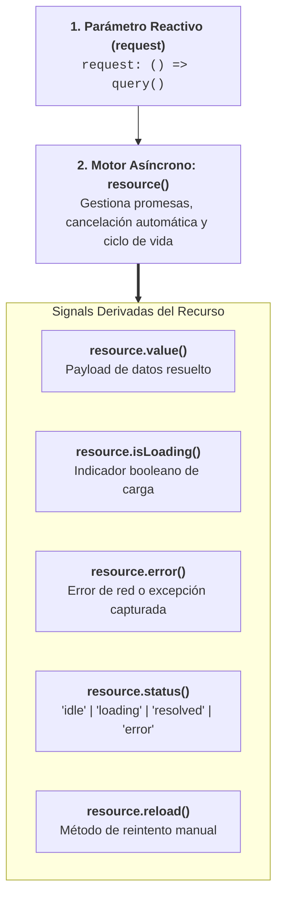

# Signals en Angular

<div class="badges">
  <span class="badge badge-angular">Angular 19 - 22</span>
  <span class="badge badge-signals">Fine-Grained Reactivity</span>
  <span class="badge badge-pro">Stable Asynchronous Resources</span>
</div>

## Objetivos de aprendizaje

Al finalizar esta unidad, el alumnado será capaz de:

1. Comprender el concepto de Signals y su papel en el nuevo modelo de reactividad de Angular.
2. Crear y manipular Signals con las funciones `signal()`, `computed()` y `effect()`.
3. Diferenciar los casos de uso apropiados para Signals frente a RxJS.
4. Implementar estado local reactivo en componentes usando Signals.
5. Utilizar `linkedSignal()` para gestionar dependencias reactivas avanzadas.
6. Aplicar la **Reactividad Asíncrona Estable** con `resource()` y `rxResource()` introducida en Angular 22.
7. Migrar componentes basados en Zone.js al modelo de Signals.
8. Aplicar buenas prácticas en la organización del estado con Signals.

## Resultados de aprendizaje

Tras completar esta unidad, el estudiante será capaz de:

- Refactorizar un componente existente para usar Signals en lugar de variables tradicionales.
- Crear valores derivados con `computed()` que se actualicen automáticamente.
- Gestionar efectos secundarios con `effect()` y limpiarlos adecuadamente.
- Implementar un sistema de carrito de compras completamente reactivo con Signals.
- Utilizar `linkedSignal()` para escenarios avanzados de dependencias reactivas.
- Comparar y elegir entre Signals y RxJS según el caso de uso.

## Introducción

Hasta Angular 16, la detección de cambios en Angular funcionaba con Zone.js: una biblioteca que "parchea" (monkey-patches) las APIs asíncronas del navegador (setTimeout, setInterval, Promises, eventos del DOM, XMLHttpRequest...) para que Angular pueda saber cuándo "algo ha cambiado" y ejecutar la detección de cambios. Este mecanismo, aunque funcional, tiene limitaciones:

- La detección de cambios se dispara ante cualquier evento asíncrono, incluso si no afecta al estado de la aplicación.
- Se recorre todo el árbol de componentes buscando cambios (aunque OnPush mitiga esto).
- Zone.js añade peso al bundle y complejidad al runtime.
- Los errores `ExpressionChangedAfterItHasBeenCheckedError` son difíciles de entender.

Las **Signals** representan un cambio fundamental en este paradigma. En lugar de depender de Zone.js para "adivinar" cuándo algo ha cambiado, las Signals implementan un modelo de **reactividad fina** (fine-grained reactivity): solo los componentes que dependen de una Signal que ha cambiado se actualizan. Es un enfoque más eficiente, más predecible y más alineado con cómo funcionan otros frameworks modernos como SolidJS, Svelte o Vue 3 con la Composition API.

Imagina que la detección de cambios tradicional es como un vigilante que recorre todas las habitaciones de un edificio buscando cambios cada pocos segundos. Las Signals son como sensores en cada habitación que solo avisan cuando su habitación específica ha cambiado. El resultado: menos trabajo, más eficiencia, y un comportamiento más predecible.

En esta unidad, exploraremos en profundidad el sistema de Signals de Angular. Comenzaremos por entender los conceptos básicos (`signal()`, `computed()`, `effect()`), pasaremos a técnicas avanzadas (`linkedSignal()`) y finalmente aprenderemos a organizar el estado de una aplicación completa usando Signals como fuente de verdad.

## Desarrollo teórico

### Qué son las Signals

Una **Signal** es un contenedor reactivo que almacena un valor y notifica automáticamente a sus consumidores cuando ese valor cambia. Es como una variable, pero "inteligente": sabe quién depende de ella y puede avisarles cuando cambia.

#### Concepto de reactividad fina (Fine-Grained Reactivity)

La reactividad fina significa que solo el código que depende directamente de un valor cambiado se re-ejecuta. No hay comprobaciones masivas de árboles completos, no hay diffs de Virtual DOM innecesarios. Si una Signal cambia, solo los `computed()` y `effect()` que la usan se actualizan, y solo los bindings de plantilla que muestran ese valor se re-renderizan.

```typescript
// Señal con reactividad fina
const nombre = signal('María');
const mensaje = computed(() => `Hola, ${nombre()}!`);

// Solo mensaje() se recalcula cuando nombre cambia.
// Nada más se toca. Eficiencia pura.
nombre.set('Carlos');
console.log(mensaje()); // "Hola, Carlos!" - automáticamente actualizado
```

#### Cómo funcionan internamente

Cada Signal mantiene:

1. **Un valor interno**: el dato que almacena.
2. **Un grafo de dependencias**: quién ha leído esta Signal y debe ser notificado cuando cambie.
3. **Mecanismo de notificación**: cuando el valor cambia (vía `set()` o `update()`), se notifica a todos los dependientes para que se actualicen.

Este sistema es similar a los grafos de dependencias de RxJS, pero mucho más ligero porque está diseñado para valores sincrónicos, no para flujos asíncronos.

#### El nuevo modelo de reactividad de Angular

Con Signals, el modelo de reactividad de Angular evoluciona:

```mermaid
flowchart TD
    subgraph Legacy["Modelo Legacy (Zone.js)"]
        Z1["Evento del navegador"] --> Z2["Zone.js 'monkey-patches' la llamada"]
        Z2 --> Z3["Recorrido del árbol completo de componentes"]
        Z3 --> Z4["Comprobación sucia (Dirty-checking) de cada binding"]
        Z4 --> Z5["Re-renderizado amplio del DOM"]
    end

    subgraph Modern["Modelo Moderno (Signals - Fine-Grained)"]
        S1["Mutación de Signal: precio.set(20)"] --> S2["Notificación directa en el grafo de dependencias"]
        S2 --> S3["Solo computed() y bindings suscritos se recalculan"]
        S3 --> S4["Actualización quirúrgica y directa en el DOM"]
    end

    style Legacy fill:#fff3e0,stroke:#f57c00
    style Modern fill:#e8f5e9,stroke:#388e3c
```



!!! tip "Garantía 'Glitch-Free' (Libre de estados inconsistentes)"
    En Angular Signals, nunca se leerán valores intermedios o desincronizados. Si dos valores `computed()` dependen de una misma señal raíz y ambos se muestran en la plantilla, Angular garantiza que se resuelven de forma atómica y consistente antes de pintar la vista.

Con Angular 19+, puedes ejecutar aplicaciones completamente sin Zone.js (Zoneless Angular), reduciendo el tamaño del bundle y mejorando el rendimiento general.

!!! tip "🎬 Recurso Didáctico Recomendado: ¿Qué son las Signals y por qué son tan importantes?"
    Para afianzar estos conceptos con una explicación visual muy didáctica y paso a paso, recomendamos el siguiente vídeo complementario:
    
    * 📺 **Canal:** Carlos Codea
    * 🔗 **Enlace:** [¿Qué son las signals/señales en Angular y por qué son tan importantes?](https://www.youtube.com/watch?v=fKp4VUKDyA4)
    * 💡 **Conceptos clave abordados:** Reactividad granular (*fine-grained*), comparación intuitiva frente al ciclo de comprobación de Zone.js, sintaxis de lectura/escritura (`set`, `update`) y el salto cualitativo hacia la arquitectura *Zoneless*.

### signal()

La función `signal()` crea una nueva Signal con un valor inicial. Es la primitiva más básica del sistema de reactividad.

#### Creación y tipado

```typescript
import { signal } from '@angular/core';

// Signal con tipo inferido del valor inicial
const nombre = signal('María');                 // Signal<string>
const edad = signal(28);                         // Signal<number>
const activo = signal(true);                     // Signal<boolean>

// Signal con tipo explícito (útil cuando el tipo no se puede inferir)
const usuario = signal<Usuario | null>(null);    // Signal<Usuario | null>
const lista = signal<string[]>([]);              // Signal<string[]>

// Signal con tipo literal
const estado = signal<'cargando' | 'listo' | 'error'>('cargando');
```

#### Lectura: la función getter ()

La Signal se lee **llamándola como una función** (con paréntesis). Esto es intencional: la llamada registra automáticamente esta lectura en el grafo de dependencias.

```typescript
const contador = signal(0);

// Lectura en código TypeScript
console.log(contador()); // 0

// Lectura en plantillas HTML
// <p>{{ contador() }}</p>

// Lectura en computed
const doble = computed(() => contador() * 2);
```

**Importante**: cada vez que llamas a `contador()`, Angular registra que este contexto (componente, computed, effect) depende de `contador`. Si `contador` cambia, todo lo que dependa de él se re-ejecutará.

#### Escritura: set() y update()

Existen dos métodos canónicos para modificar el valor de una Signal escribible (`WritableSignal`):

**`set(nuevoValor)`**: reemplaza el valor directamente por uno nuevo. Es la opción ideal cuando tienes un dato completamente nuevo que no depende del anterior (por ejemplo, el resultado de una petición HTTP o el reseteo de un formulario):

```typescript
const contador = signal(0);
contador.set(5);              // contador() ahora es 5
contador.set(10);             // contador() ahora es 10
```

**`update(fn)`**: recibe una función de actualización cuyo argumento es el valor actual de la señal y debe **retornar el nuevo valor calculado**. Es el método idóneo para mutaciones atómicas dependientes del estado previo y para transformar colecciones aplicando el **principio de inmutabilidad**.

```typescript
const contador = signal(0);

// 1. Incremento básico: 'valor' representa el estado actual (0)
contador.update(valor => valor + 1); // Retorna 1
contador.update(valor => valor + 1); // Retorna 2. contador() ahora es 2

// 2. Actualización con regla de negocio (tope máximo)
const puntuacion = signal(100);

// El jugador gana 50 puntos, pero el juego establece un máximo de 1000 puntos:
puntuacion.update(p => Math.min(p + 50, 1000)); // Retorna 150 (tope en 1000)
```

!!! info "Desglose Didáctico: ¿Qué hace exactamente `p => Math.min(p + 50, 1000)`?"
    * **`p` (parámetro de entrada):** Es el valor actual de la señal que Angular inyecta automáticamente al ejecutar la función (en este caso, `100`).
    * **`p + 50` (cálculo del nuevo valor):** Suma 50 puntos a la puntuación previa (`100 + 50 = 150`).
    * **`Math.min(..., 1000)` (función tope o techo):** Compara el resultado del cálculo contra el número `1000` y selecciona el valor menor. Si la puntuación previa fuera `980`, al sumar 50 daría `1030`; `Math.min(1030, 1000)` devolverá `1000`, garantizando que la puntuación nunca sobrepase el límite fijado por las reglas del juego.
    * **Retorno atómico:** Angular asigna el valor devuelto (`150`) a la señal y notifica de inmediato a todos los nodos del DOM y `computed` dependientes.

---

#### El Principio de Inmutabilidad en Angular Signals

Para dominar Angular moderno, es imprescindible entender qué ocurre bajo el capó cuando modificamos datos. Muchos desarrolladores sufren el mismo desconcierto al comenzar:

> *"¿Por qué cuando actualizo un número con `contador.update(c => c + 1)` la pantalla se actualiza sola, pero si tengo una lista de usuarios y hago `lista.push(nuevoUsuario)` la pantalla no reacciona?"*

La respuesta está en cómo JavaScript gestiona la memoria y cómo Angular detecta los cambios.

---

##### 1. Tipos por Valor (Primitivos) vs Tipos por Referencia (Objetos y Arrays)

En JavaScript existen dos grandes familias de datos:

* **Tipos Primitivos (números, strings, booleanos):** Se guardan **por valor**. Si el contador pasa de `0` a `1`, los dos valores son físicamente distintos (`0 !== 1`). Angular lo detecta de forma inmediata.
* **Tipos Complejos (Arrays y Objetos):** **No se guardan directamente dentro de la variable.** La variable solo almacena un **puntero o dirección de memoria** (una referencia que indica en qué ubicación física residen los datos dentro de la memoria del navegador).

---

##### 2. La Metáfora de la Casa y la Dirección Postal

Imagina que tu variable con un array de usuarios es un **papelito con una dirección postal**: `"Calle Gran Vía, 12"` (en memoria: `0x001`).

```
Variable (Papelito)              Memoria Heap (La Casa física)
┌──────────────────────┐        ┌──────────────────────────────────┐
│  usuarios = 0x001    ├───────►│  [ { id: 1, nombre: 'Goku' } ]   │
└──────────────────────┘        └──────────────────────────────────┘
```

* **Mutación Directa (`lista.push()`):**  
  Equivale a entrar en la casa y meter un mueble nuevo. La casa ha cambiado por dentro, pero **el papelito sigue diciendo `"Calle Gran Vía, 12"` (`0x001`)**.
* **El Inspector de Angular (`defaultEquals`):**  
  Angular revisa la señal para saber si debe repintar la pantalla. Pero Angular no entra a registrar toda la casa habitación por habitación; **solo mira el papelito de la dirección**. Como el papelito sigue diciendo `0x001 === 0x001`, Angular concluye: *"La dirección no ha cambiado, no hago nada"* ➔ **La pantalla no se repinta (Bug Silencioso)**.
* **Inmutabilidad (`[...lista, nuevo]`):**  
  En lugar de alterar la casa existente, construyes una **casa nueva e independiente** en `"Avenida Diagonal, 45"` (`0x002`) con todos los muebles anteriores más el nuevo. El papelito de la señal pasa a contener `0x002`.  
  Cuando Angular mira el papelito, comprueba `0x001 !== 0x002`: *"¡Hay una dirección nueva!"* ➔ **Sincroniza el DOM al instante**.

---

##### 3. ¿Por qué Angular no mira dentro del Array? (Rendimiento O(1) vs O(N))

Muchos alumnos se preguntan: *"¿Por qué Angular no revisa elemento por elemento para ver si algo cambió?"*

No es una limitación de Angular; es una **decisión de ingeniería para alcanzar el máximo rendimiento posible**:

* Si Angular tuviera que comparar profundamente (*deep equality*) listas de 5.000 o 10.000 elementos cada vez que ocurre un evento, la aplicación se congelaría (complejidad `O(N)`).
* Comparar dos direcciones de memoria (`referenciaAnterior === nuevaReferencia`) es una única instrucción de procesador que tarda **1 nanosegundo** (complejidad constante `O(1)`).

!!! note "Regla de Oro de Reactividad en Signals"
    **`¿Hay cambio a notificar? <==> (referenciaAnterior !== nuevaReferencia)`**  
    Si la dirección de memoria física no cambia, para Angular **el cambio nunca ocurrió**.

---

##### 4. Desmitificando el Operador Spread (`...`) paso a paso

Cuando escribes `[...lista, nuevoItem]`, el motor de JavaScript realiza cuatro pasos físicos:

1. **`[` :** Reserva un **nuevo espacio físico en memoria** (ej. dirección `0x002`).
2. **`...lista` :** Extrae uno a uno los elementos del array anterior y los copia dentro del nuevo espacio.
3. **`, nuevoItem` :** Añade el nuevo elemento al final del nuevo espacio.
4. **`]` :** Cierra el array y retorna la **nueva dirección de memoria** (`0x002`).

---

##### 5. El Gran Mito: "¿Por qué usar update() no lo hace automático?"

!!! warning "Error Conceptual Muy Frecuente"
    El método `update(fn)` **NO clona tus datos automáticamente**.  
    `update()` solo ejecuta tu función y asigna a la señal **lo que tú decidas retornar**:

    ```typescript
    // ❌ ERROR GRAVE: Usar .push() dentro de update() sigue rompiendo la reactividad
    usuarios.update(lista => {
      lista.push({ id: 2, nombre: 'Vegeta' }); // Modifica el array original en 0x001
      return lista;                            // Retorna la MISMA dirección 0x001 -> NO repinta
    });

    // ✅ CORRECTO: Retornar siempre una nueva referencia creada con spread o métodos puros
    usuarios.update(lista => [
      ...lista,
      { id: 2, nombre: 'Vegeta' }              // Genera y retorna 0x002 -> ¡Repinta de inmediato!
    ]);
    ```

---

##### Comparativa de Flujo en Memoria: Mutación vs Inmutabilidad

```mermaid
flowchart TD
    subgraph MutacionDirecta ["Mutación Directa: Misma Referencia"]
        A1["<b>Memoria: 0x001</b><br/>Array original<br/>(2 elementos)"]
        Accion1["<b>Operación mutable:</b><br/><code>lista.push(nuevo)</code>"]
        A2["<b>Memoria: 0x001</b><br/>(Misma referencia)"]
        Comp1["<b>defaultEquals:</b><br/>0x001 === 0x001<br/><i>(Sin cambios)</i>"]
        Res1["❌ <b>Sin cambios</b><br/>La vista NO se repinta"]

        A1 --> Accion1 --> A2 --> Comp1 --> Res1
    end

    subgraph Inmutabilidad ["Inmutabilidad: Nueva Referencia"]
        B1["<b>Memoria: 0x001</b><br/>Array original<br/>(2 elementos)"]
        Accion2["<b>Operación inmutable:</b><br/><code>[...lista, nuevo]</code>"]
        B2["<b>Memoria: 0x002</b><br/>(Nueva referencia)"]
        Comp2["<b>defaultEquals:</b><br/>0x001 !== 0x002<br/><i>(Cambio detectado)</i>"]
        Res2["✅ <b>Cambio detectado</b><br/>Repintado del DOM"]

        B1 --> Accion2 --> B2 --> Comp2 --> Res2
    end

    classDef bad fill:#ffebee,stroke:#c62828,stroke-width:2px,color:#b71c1c;
    classDef good fill:#e8f5e9,stroke:#2e7d32,stroke-width:2px,color:#1b5e20;
    classDef step fill:#f5f5f5,stroke:#616161,stroke-width:1px,color:#212121;

    class Res1,A2 bad;
    class Res2,B2 good;
    class Accion1,Accion2,Comp1,Comp2,A1,B1 step;
```



---

##### Tabla de Patrones: Métodos Prohibidos vs Alternativas Inmutables

| Operación | Método Mutable (❌ No usar en Signals) | Alternativa Inmutable (✅ Usar siempre) |
| :--- | :--- | :--- |
| **Añadir elemento** | `arr.push(x)`, `arr.unshift(x)` | `[...arr, x]`, `[x, ...arr]` |
| **Eliminar elemento** | `arr.splice(i, 1)`, `arr.pop()` | `arr.filter(item => item.id !== idEliminar)` |
| **Modificar elemento** | `arr[i].nombre = 'Nuevo'` | `arr.map(item => item.id === id ? { ...item, nombre: 'Nuevo' } : item)` |
| **Ordenar / Invertir** | `arr.sort()`, `arr.reverse()` | `[...arr].sort()`, `[...arr].reverse()` |
| **Actualizar objeto** | `usuario.edad = 30` | `{ ...usuario, edad: 30 }` |

---

##### Modificación inmutable de Arrays y Objetos con `update()` (Guía de Patrones)

```typescript
// 1. Arrays: añadir, eliminar o modificar elementos
const usuarios = signal([
  { id: 1, nombre: 'Ana' },
  { id: 2, nombre: 'Carlos' }
]);

// Añadir un nuevo usuario (retornando un nuevo array con spread)
usuarios.update(lista => [
  ...lista,
  { id: 3, nombre: 'María' }
]);

// Eliminar un usuario inmutablemente con filter
usuarios.update(lista => lista.filter(u => u.id !== 2));

// Modificar un usuario específico con map
usuarios.update(lista =>
  lista.map(u => u.id === 1 ? { ...u, nombre: 'Ana María' } : u)
);

// 2. Objetos: modificar una propiedad conservando las demás
const config = signal({ tema: 'claro', idioma: 'es', volumen: 80 });

// Cambiar una propiedad retornando un nuevo objeto
config.update(c => ({
  ...c,
  tema: 'oscuro'
}));
```

!!! warning "Nota histórica: ¿Qué ocurrió con `mutate()`?"
    Durante la fase preliminar experimental de Angular 16 existió un método llamado `mutate()`. El equipo de Angular **lo eliminó formalmente en Angular 17** y no existe en Angular moderno (v17 a v22).
    
    * **Por qué se eliminó:** La mutación directa en memoria (*in-place*) no cambia la referencia del objeto o array (`oldValue === newValue`), lo que rompía la detección de cambios en `computed()` y `effect()`.
    * **Estándar actual:** Toda modificación de colecciones debe realizarse **exclusivamente mediante `update()`** produciendo una nueva referencia inmutable.

**¿Cuándo usar `set()` vs `update()`?**

| Situación | Método recomendado | Ejemplo |
|---|---|---|
| Reemplazar completamente un valor sin importar el anterior | `set()` | `usuario.set(respuestaHttp)` |
| Resetear o inicializar una Signal | `set()` | `contador.set(0)` |
| Incrementar, decrementar o acumular | `update()` | `contador.update(c => c + 1)` |
| Añadir o eliminar elementos de un array | `update()` | `items.update(arr => [...arr, nuevo])` |
| Actualizar una o varias propiedades de un objeto | `update()` | `config.update(c => ({ ...c, activo: true }))` |

#### Laboratorio Práctico: Variable Normal vs Signal (El Experimento del `setInterval`)

Para comprender la diferencia fundamental entre una variable tradicional de JavaScript y una Signal en Angular moderno, analicemos qué ocurre cuando actualizamos datos de forma asíncrona mediante un temporizador (`setInterval`).

Imagina un componente que mantiene dos contadores idénticos iniciados en `10`: uno almacenado en una **propiedad normal de clase** y otro custodiado por una **Signal**.

##### 1. Implementación del Componente de Prueba

```typescript title="src/app/pages/counter/counter-page.component.ts"
import { Component, signal } from '@angular/core';

@Component({
  selector: 'app-counter-page',
  templateUrl: './counter-page.component.html',
  styles: `
    button {
      padding: 6px 12px;
      margin: 4px;
    }
  `,
})
export class CounterPageComponent {
  // Variable normal de clase (valor pasivo en memoria)
  counter = 10;

  // Signal reactiva (contenedor inteligente auto-notificable)
  counterSignal = signal(10);

  constructor() {
    // Temporizador asíncrono ejecutado cada 2 segundos
    setInterval(() => {
      this.counter += 1;
      this.counterSignal.update((current) => current + 1);

      console.log({
        variableNormal: this.counter,
        signalReactiva: this.counterSignal(),
      });
    }, 2000);
  }

  increaseBy(value: number) {
    this.counter += value;
    this.counterSignal.update((current) => current + value);
  }

  resetCounter() {
    this.counter = 0;
    this.counterSignal.set(0);
  }
}
```

##### 2. Plantilla Visual

```html title="src/app/pages/counter/counter-page.component.html"
<section class="p-4">
  <h1 class="text-xl font-bold">Contador Tradicional: {{ counter }}</h1>
  <h1 class="text-xl font-bold text-blue-500">Contador Signal: {{ counterSignal() }}</h1>
  <hr class="my-4" />

  <button (click)="increaseBy(1)">+1</button>
  <button (click)="increaseBy(-1)">-1</button>
  <button (click)="resetCounter()">Reset</button>
</section>
```

---

##### 3. ¿Qué ocurre en el Navegador? (El Momento "¡Eureka!")

Al ejecutar este componente y abrir la consola de desarrollo (F12), se comprueba de forma inmediata el comportamiento del nuevo motor reactivo:

1. **En la Consola de JavaScript:**  
   Ambos contadores se incrementan a la vez en memoria cada 2 segundos:  
   `{ variableNormal: 11, signalReactiva: 11 }`  
   `{ variableNormal: 12, signalReactiva: 12 }`  
   `{ variableNormal: 13, signalReactiva: 13 }`

2. **En la Pantalla (DOM):**  
   * **Contador Tradicional:** Se queda **completamente congelado en `10`**. No cambia nunca por sí solo dentro del temporizador.
   * **Contador Signal:** Avanza fluidamente: **`11, 12, 13, 14...`** en tiempo real ante la vista del usuario.

3. **La Paradoja del Clic:**  
   Si el usuario pulsa el botón `+1`, de repente el contador tradicional da un salto gigante (por ejemplo, salta de golpe de `10` a `18`). ¿Por qué? Porque el evento `(click)` sí despierta la detección de cambios de Angular, forzando a pintar el valor acumulado que la variable normal guardaba en memoria.

---

##### 4. Análisis Arquitectónico: ¿Por qué ocurre esto?

| Característica | Variable Normal (`counter = 10`) | Signal (`counterSignal = signal(10)`) |
| :--- | :--- | :--- |
| **Naturaleza** | **Dato Pasivo (Muerto):** Solo existe en la memoria RAM de JavaScript. | **Dato Reactivo (Vivo):** Conectado al grafo de dependencias de Angular. |
| **Mecanismo de aviso** | Ninguno. Angular no tiene "ojos" para vigilar variables primitivas dentro de un temporizador. | Al ejecutar `.update()`, la Signal emite una notificación al scheduler de Angular. |
| **Comportamiento en Zoneless** | ❌ **Invisible:** El DOM nunca se actualiza a menos que ocurra otro evento externo. | ✅ **Quirúrgico:** Angular actualiza únicamente el nodo del DOM donde se leyó `counterSignal()`. |

---

##### 5. Nota sobre `ChangeDetectionStrategy.OnPush` vs la Era Zoneless

!!! info "Evolución Arquitectónica: De OnPush a Zoneless"
    * **En el pasado (Angular con Zone.js):**  
      Históricamente, `Zone.js` interceptaba `setInterval` y revisaba todos los componentes de la app. Para evitar esa sobrecarga, los desarrolladores tenían que configurar manualmente `changeDetection: ChangeDetectionStrategy.OnPush` en el `@Component`, obligando a usar técnicas manuales como `ChangeDetectorRef.markForCheck()`.
    
    * **En el presente y futuro (Angular 18+ a 22 Zoneless):**  
      `ChangeDetectionStrategy.OnPush` pasa a ser un concepto en transición. Al configurar Angular sin Zone.js (`provideZonelessChangeDetection()`), **toda la aplicación es reactiva por defecto gracias a las Signals**. Ya no necesitas configurar estrategias complejas en cada componente: si necesitas que un dato se refleje en la pantalla de forma predecible y eficiente, **úsalo como una Signal**.

### computed()

`computed()` crea una Signal cuyo valor se **deriva** de otras Signals. Es el equivalente reactivo de una propiedad calculada.

#### Valores derivados

```typescript
import { signal, computed } from '@angular/core';

const nombre = signal('María');
const apellido = signal('García');

// computed depende de nombre() y apellido()
// Se recalcula AUTOMÁTICAMENTE cuando cualquiera de ellas cambia
const nombreCompleto = computed(() => `${nombre()} ${apellido()}`);

console.log(nombreCompleto()); // "María García"

nombre.set('Ana');
console.log(nombreCompleto()); // "Ana García" - actualizado automáticamente
```

#### Lazy Evaluation

Los `computed()` son **perezoosos** (lazy): solo se evalúan cuando alguien los lee. Si nadie lee un `computed()`, nunca se ejecuta, por mucho que cambien sus dependencias.

```typescript
const contador = signal(0);
const calculoCostoso = computed(() => {
  console.log('Calculando...');
  return fibonacci(contador()); // Operación costosa
});

// Mientras nadie llame a calculoCostoso(), no se ejecuta
contador.set(1);  // No se ejecuta el computed
contador.set(2);  // No se ejecuta el computed

// Solo ahora se ejecuta, y lo hace UNA SOLA VEZ con el valor actual
console.log(calculoCostoso()); // "Calculando..." aparece solo una vez
```

#### Caching automático

Los `computed()` almacenan en caché su último valor calculado. Mientras sus dependencias no cambien, devolverán el valor cacheado sin re-ejecutar la función:

```typescript
const precio = signal(100);
const iva = computed(() => {
  console.log('Calculando IVA...');
  return precio() * 0.21;
});

console.log(iva()); // "Calculando IVA..." → 21
console.log(iva()); // (sin log) → 21 (cacheado)
console.log(iva()); // (sin log) → 21 (cacheado)

precio.set(200);     // Cambia la dependencia
console.log(iva()); // "Calculando IVA..." → 42 (recalcula)
```

#### Dependencias automáticas

Angular rastrea automáticamente qué Signals se leen dentro de un `computed()`. Si una dependencia cambia, el `computed()` se marca como "sucio" (dirty) y se recalcula la próxima vez que se lea.

```typescript
const a = signal(1);
const b = signal(2);
const usarA = signal(true);

const resultado = computed(() => {
  if (usarA()) {
    return a() * 10;    // Depende de a y usarA
  } else {
    return b() * 10;    // Depende de b y usarA
  }
});

// Si usarA es true, el computed depende de [a, usarA]
// Cambiar b NO afecta a resultado porque b no se lee en este camino
b.set(5);  // resultado NO se recalcula (b no se usó)

// Pero si usarA cambia a false, ahora depende de [b, usarA]
usarA.set(false);  // resultado se recalcula usando b()
// Ahora depende de [b, usarA]
```

**Importante**: las dependencias se determinan dinámicamente en cada ejecución. Si un camino condicional no lee una Signal en esta ejecución, esa Signal no es dependencia (hasta que el camino cambie).

#### Sin efectos secundarios

Al igual que las expresiones de plantilla, los `computed()` NO deben tener efectos secundarios:

```typescript
// ❌ MAL: efecto secundario en computed
const log = signal<string[]>([]);
const nombre = signal('María');
const gritarNombre = computed(() => {
  const gritado = nombre().toUpperCase();
  log.update(l => [...l, gritado]); // ❌ EFECTO SECUNDARIO: modificar otra señal desde un computed
  return gritado;
});

// ✅ BIEN: computed puro, sin efectos secundarios
const gritarNombre = computed(() => nombre().toUpperCase());

// Si necesitas un efecto secundario (como logging), usa effect()
```

#### Comparación con getters y pipes

```typescript
// GETTER: se ejecuta en CADA ciclo de detección de cambios
get nombreCompleto(): string {
  return `${this.nombre} ${this.apellido}`;
}
// Problemeas: se ejecuta incluso si nombre/apellido no cambiaron.
// Con Zone.js, se ejecuta ante cualquier evento asíncrono.

// COMPUTED: solo se ejecuta cuando cambian sus dependencias
nombreCompleto = computed(() => `${this.nombre()} ${this.apellido()}`);
// Ventaja: solo se ejecuta cuando nombre o apellido cambian realmente.
// Se cachea entre lecturas. Mucho más eficiente.

// PIPE: se ejecuta cuando Angular detecta cambios en los inputs
// Los pipes son puros por defecto (caching similar a computed)
// Pero los pipes tienen overhead de instanciación y solo funcionan en plantillas.
// computed() puede usarse tanto en TypeScript como en plantillas.
```

### effect()

`effect()` ejecuta una función cada vez que las Signals que lee dentro de ella cambian. Es el mecanismo para gestionar **efectos secundarios reactivos**: sincronización con localStorage, logging, manipulación del DOM, llamadas a APIs externas, etc.

#### Creación de efectos

```typescript
import { Component, signal, effect } from '@angular/core';

@Component({...})
export class PreferenciasComponent {
  tema = signal('claro');
  idioma = signal('es');

  constructor() {
    // Effect: se ejecuta cuando tema O idioma cambian
    effect(() => {
      // Este código se ejecuta UNA VEZ al inicio
      // y CADA VEZ que tema() o idioma() cambien
      console.log(`Tema: ${this.tema()}, Idioma: ${this.idioma()}`);
      document.documentElement.setAttribute('data-theme', this.tema());
      document.documentElement.setAttribute('lang', this.idioma());
    });
  }

  toggleTema(): void {
    this.tema.set(this.tema() === 'claro' ? 'oscuro' : 'claro');
  }
}
```

Los efectos:

- Se ejecutan **al menos una vez** (cuando se crean) para establecer el estado inicial.
- Se ejecutan **cada vez que sus dependencias cambian**.
- Se ejecutan de forma **asíncrona** (en el próximo microtask) para evitar ejecuciones redundantes.

#### Cuándo USAR effects

Los effects son para **sincronizar el estado de la aplicación con sistemas externos** que no son reactivos por naturaleza:

1. **Logging y depuración**:
```typescript
effect(() => {
  console.log('Estado actual:', {
    usuario: this.usuario(),
    carrito: this.carrito(),
    tema: this.tema()
  });
});
```

2. **Persistencia en localStorage**:
```typescript
effect(() => {
  const prefs = {
    tema: this.tema(),
    idioma: this.idioma(),
  };
  localStorage.setItem('preferencias', JSON.stringify(prefs));
});
```

3. **Sincronización con APIs externas** (gráficos, mapas):
```typescript
effect(() => {
  const datos = this.datosGrafico();
  if (datos.length > 0) {
    actualizarGrafico(datos); // Librería externa de gráficos
  }
});
```

4. **Manipulación del DOM** no declarativa (evitar si es posible):
```typescript
effect(() => {
  if (this.modalAbierto()) {
    document.body.style.overflow = 'hidden';
  } else {
    document.body.style.overflow = '';
  }
});
```

5. **Actualización de título de página**:
```typescript
effect(() => {
  document.title = `${this.titulo()} - Mi Aplicación`;
});
```

#### Cuándo NO usar effects

1. **Para derivar estado**: si puedes calcular un valor a partir de otras Signals, usa `computed()`, NO `effect()`.
```typescript
// ❌ MAL: usar effect para derivar estado
const precio = signal(100);
let precioConIVA = signal(0);
effect(() => {
  precioConIVA.set(precio() * 1.21); // ¡No hagas esto!
});

// ✅ BIEN: usar computed
const precioConIVA = computed(() => precio() * 1.21);
```

2. **Para propagar cambios entre Signals**: Signals + computed ya manejan esto automáticamente.

3. **Para lógica de negocio que debe ser síncrona y predecible**: los effects son asíncronos y pueden ejecutarse en momentos inesperados.

#### Cleanup functions

Cuando un effect se re-ejecuta (porque una dependencia cambió), puedes necesitar limpiar el estado del efecto anterior. La función que pasas a `effect()` puede devolver una función de limpieza (cleanup), que se ejecutará antes de la siguiente ejecución:

```typescript
effect((onCleanup) => {
  const usuario = this.usuarioActual();

  // Conectar a un WebSocket para este usuario
  const ws = new WebSocket(`wss://api.ejemplo.com/ws?user=${usuario.id}`);

  ws.onmessage = (event) => {
    this.mensajes.update(m => [...m, JSON.parse(event.data)]);
  };

  // Función de limpieza: se ejecuta cuando el effect se re-ejecuta
  // (porque usuarioActual cambió) o cuando el componente se destruye
  onCleanup(() => {
    ws.close();
    console.log(`WebSocket cerrado para usuario ${usuario.id}`);
  });
});
```

```typescript
// Otro ejemplo: debounce con cleanup
effect((onCleanup) => {
  const busqueda = this.termino();
  if (busqueda.length < 2) return;

  const timer = setTimeout(() => {
    console.log('Buscando:', busqueda);
    this.realizarBusqueda(busqueda);
  }, 300);

  onCleanup(() => {
    clearTimeout(timer); // Cancelar el timer anterior si el término cambia antes
  });
});
```

#### DestroyRef e injection context

Los effects deben ser destruidos cuando el componente se destruye, para evitar memory leaks. Angular maneja esto automáticamente en ciertos contextos:

```typescript
// El effect se limpia automáticamente cuando el componente se destruye
// porque se creó en el constructor (injection context)
constructor() {
  effect(() => {
    console.log(this.contador());
  });
}

// Si creas un effect fuera del injection context, debes usar DestroyRef
import { DestroyRef, inject } from '@angular/core';

ngOnInit(): void {
  const destroyRef = inject(DestroyRef);

  const miEffect = effect(() => {
    console.log(this.contador());
  });

  // Registrar limpieza manual
  destroyRef.onDestroy(() => {
    miEffect.destroy();
  });
}
```

#### runOutsideAngular

Si tu effect realiza operaciones que no deberían desencadenar la detección de cambios de Angular (por ejemplo, animaciones con requestAnimationFrame), puedes usar `runOutsideAngular`:

```typescript
import { NgZone, inject } from '@angular/core';

private ngZone = inject(NgZone);

constructor() {
  effect(() => {
    const animar = this.animando();
    if (animar) {
      this.ngZone.runOutsideAngular(() => {
        requestAnimationFrame(() => {
          // Esta operación no desencadenará la detección de cambios
          actualizarCanvas();
        });
      });
    }
  });
}
```

#### allowSignalWrites

Por defecto, `effect()` no permite escribir Signals dentro de él (para evitar bucles infinitos). Si necesitas escribir una Signal dentro de un effect, debes usar la opción `allowSignalWrites`:

```typescript
const historial = signal<string[]>([]);
const accion = signal('');

effect(() => {
  const acc = accion();
  if (acc) {
    // Sin allowSignalWrites, esto lanzaría un error
    historial.update(h => [...h, acc]);
  }
}, { allowSignalWrites: true });
```

**Precaución**: `allowSignalWrites` puede causar bucles infinitos si un effect escribe una Signal que también lee. Úsalo con moderación y siempre asegurándote de que la escritura no cause una re-ejecución del mismo effect.

### linkedSignal()

`linkedSignal()` es una API introducida en Angular 19 que crea una Signal vinculada a otra Signal "fuente". Cuando la fuente cambia, la Signal vinculada puede resetearse automáticamente o computar un nuevo valor.

#### ¿Qué es y para qué sirve?

Imagina que tienes un selector de país y, dependiendo del país seleccionado, un selector de ciudad. Cuando el usuario cambia de país, la ciudad seleccionada debería resetearse (porque la ciudad anterior probablemente no existe en el nuevo país). Con Signals normales, necesitarías un effect para resetear manualmente. Con `linkedSignal()`, este comportamiento es declarativo.

```typescript
import { signal, linkedSignal } from '@angular/core';

const pais = signal('ES');
const ciudad = linkedSignal({
  source: pais,              // Vinculada a pais()
  computation: () => {       // Se ejecuta cuando pais cambia
    return ciudadPorDefecto(pais());
  }
});

// Cuando pais cambia, ciudad se recalcula automáticamente
pais.set('FR');
console.log(ciudad()); // La ciudad por defecto de Francia
```

#### Casos de uso avanzados

**Caso 1: Selector dependiente con reset**

```typescript
@Component({...})
export class FormularioDireccionComponent {
  paises = signal(['ES', 'FR', 'IT', 'DE']);
  paisSeleccionado = signal('ES');

  // Ciudades disponibles según el país
  ciudadesPorPais: Record<string, string[]> = {
    'ES': ['Madrid', 'Barcelona', 'Valencia', 'Sevilla'],
    'FR': ['París', 'Lyon', 'Marsella', 'Toulouse'],
    'IT': ['Roma', 'Milán', 'Nápoles', 'Turín'],
    'DE': ['Berlín', 'Múnich', 'Hamburgo', 'Colonia'],
  };

  // linkedSignal: se resetea cuando cambia el país
  ciudadSeleccionada = linkedSignal({
    source: this.paisSeleccionado,
    computation: (pais) => {
      const ciudades = this.ciudadesPorPais[pais] || [];
      return ciudades[0] || ''; // Seleccionar la primera ciudad por defecto
    }
  });

  // Propiedad computada: ciudades disponibles para el país actual
  ciudadesDisponibles = computed(() => {
    return this.ciudadesPorPais[this.paisSeleccionado()] || [];
  });

  cambiarPais(event: Event): void {
    const select = event.target as HTMLSelectElement;
    this.paisSeleccionado.set(select.value);
    // ciudadSeleccionada se recalcula automáticamente gracias a linkedSignal
  }
}
```

**Caso 2: Paginación con reset al cambiar filtros**

```typescript
@Component({...})
export class ListaProductosComponent {
  filtroCategoria = signal('todas');
  filtroPrecio = signal('todos');
  ordenarPor = signal<'nombre' | 'precio' | 'rating'>('nombre');

  // Página actual: se resetea a 1 cuando cambia cualquier filtro
  paginaActual = linkedSignal({
    source: () => ({
      categoria: this.filtroCategoria(),
      precio: this.filtroPrecio(),
      orden: this.ordenarPor(),
    }),
    computation: () => 1 // Siempre vuelve a página 1 cuando cambian filtros
  });

  // También se puede actualizar manualmente
  siguientePagina(): void {
    this.paginaActual.set(this.paginaActual() + 1);
  }

  anteriorPagina(): void {
    if (this.paginaActual() > 1) {
      this.paginaActual.set(this.paginaActual() - 1);
    }
  }

  // Productos filtrados y paginados
  productosVisibles = computed(() => {
    const filtrados = this.filtrarProductos();
    const pagina = this.paginaActual();
    const inicio = (pagina - 1) * 12;
    return filtrados.slice(inicio, inicio + 12);
  });
}
```

### resource() y rxResource(): Reactividad Asíncrona con Signals

Hasta Angular 18, las Signals estaban diseñadas exclusivamente para **estado sincrónico**. Para conectar una Signal con una operación asíncrona (como una promesa o una petición a un servidor), era necesario recurrir a `effect()`, `toSignal()` o gestionar banderas manuales de `cargando` y `error`.

A partir de **Angular 22**, la API de **Reactividad Asíncrona** (`resource` y `rxResource` en `@angular/core`, y `httpResource` en `@angular/common/http`) se gradúa oficialmente a **ESTABLE (Production-Ready)**. Supera el periodo experimental y se convierte en el estándar de la industria para sincronizar el grafo reactivo de señales con orígenes de datos asíncronos y servicios remotos.



#### Anatomía de `resource()`
`resource()` recibe un objeto de configuración con:

1. **`request`**: Una función que lee las Signals de las que depende la petición (parámetros de búsqueda, IDs, filtros).
2. **`loader`**: Una función asíncrona (`async/await`) que ejecuta la petición y devuelve el dato. Recibe el valor resuelto por `request` y un `AbortSignal` para cancelar peticiones desactualizadas automáticamente.

#### Ejemplo Práctico: Búsqueda Asíncrona con `resource()`

=== "perfil-usuario.component.ts"
    ```typescript
    import { Component, signal, resource } from '@angular/core';

    interface Perfil {
      id: number;
      nombre: string;
      email: string;
      rol: string;
    }

    @Component({
      selector: 'app-perfil-usuario-resource',
      templateUrl: './perfil-usuario.component.html',
      styleUrl: './perfil-usuario.component.css'
    })
    export class PerfilUsuarioResourceComponent {
      // Signal sincrónica que actúa como disparador de búsqueda
      usuarioId = signal<number>(1);

      // resource() asíncrono que reacciona automáticamente al cambio de usuarioId()
      perfilResource = resource<Perfil, number>({
        request: () => this.usuarioId(),
        loader: async ({ request: id, abortSignal }) => {
          const respuesta = await fetch(
            `https://jsonplaceholder.typicode.com/users/${id}`,
            { signal: abortSignal }
          );

          if (!respuesta.ok) {
            throw new Error(`Error ${respuesta.status}: Usuario no encontrado`);
          }

          const data = await respuesta.json();
          return {
            id: data.id,
            nombre: data.name,
            email: data.email,
            rol: 'Desarrollador Web'
          };
        }
      });

      siguienteUsuario(): void {
        this.usuarioId.update(id => id + 1);
      }

      anteriorUsuario(): void {
        if (this.usuarioId() > 1) {
          this.usuarioId.update(id => id - 1);
        }
      }
    }
    ```

=== "perfil-usuario.component.html"
    ```html
    <div class="perfil-card">
      <div class="acciones">
        <button (click)="anteriorUsuario()" [disabled]="usuarioId() <= 1">◀ Anterior</button>
        <span>ID Actual: {{ usuarioId() }}</span>
        <button (click)="siguienteUsuario()">Siguiente ▶</button>
        <button (click)="perfilResource.reload()" class="btn-recargar">🔄 Recargar</button>
      </div>

      <!-- Estados reactivos expuestos automáticamente por el resource -->
      @if (perfilResource.isLoading()) {
        <div class="estado cargando">
          <span class="spinner"></span>
          <p>Cargando información del usuario {{ usuarioId() }}...</p>
        </div>
      } @else if (perfilResource.error()) {
        <div class="estado error">
          <p>⚠️ {{ perfilResource.error() }}</p>
          <button (click)="perfilResource.reload()">Reintentar petición</button>
        </div>
      } @else if (perfilResource.value(); as perfil) {
        <article class="datos-perfil">
          <h3>{{ perfil.nombre }}</h3>
          <p><strong>Email:</strong> {{ perfil.email }}</p>
          <p><strong>Rol:</strong> {{ perfil.rol }}</p>
        </article>
      }
    </div>
    ```

=== "perfil-usuario.component.css"
    ```css
    .perfil-card {
      border: 1px solid #e0e0e0;
      border-radius: 12px;
      padding: 1.5rem;
      max-width: 480px;
      background: white;
      box-shadow: 0 4px 12px rgba(0, 0, 0, 0.05);
    }

    .perfil-card .acciones {
      display: flex;
      justify-content: space-between;
      align-items: center;
      margin-bottom: 1.5rem;
      gap: 0.5rem;
    }

    .perfil-card .acciones button {
      padding: 0.5rem 0.8rem;
      border: 1px solid #ccc;
      border-radius: 6px;
      background: #f8f9fa;
      cursor: pointer;
    }

    .perfil-card .acciones button:disabled {
      opacity: 0.5;
      cursor: not-allowed;
    }

    .perfil-card .acciones button.btn-recargar {
      background: #eaf2f8;
      color: #2980b9;
      border-color: #aed6f1;
    }

    .perfil-card .estado {
      text-align: center;
      padding: 2rem 1rem;
      border-radius: 8px;
    }

    .perfil-card .estado.cargando {
      background: #fdfefe;
      color: #7f8c8d;
    }

    .perfil-card .estado.error {
      background: #fdebd0;
      color: #c0392b;
    }

    .perfil-card .datos-perfil h3 {
      margin-top: 0;
      color: #2c3e50;
    }

    .perfil-card .datos-perfil p {
      margin: 0.4rem 0;
      color: #555;
    }
    ```

---

### Gestión de estado local con Signals

#### Cómo organizar el estado en un componente

En lugar de tener múltiples propiedades sueltas, organiza el estado del componente en objetos Signal:

```typescript
interface EstadoFormulario {
  nombre: string;
  email: string;
  password: string;
  errores: Record<string, string>;
  enviado: boolean;
  cargando: boolean;
}

@Component({...})
export class FormularioRegistroComponent {
  // Estado centralizado en una sola Signal
  private estado = signal<EstadoFormulario>({
    nombre: '',
    email: '',
    password: '',
    errores: {},
    enviado: false,
    cargando: false,
  });

  // Selectores (computed) para partes específicas del estado
  nombre = computed(() => this.estado().nombre);
  email = computed(() => this.estado().email);
  errores = computed(() => this.estado().errores);
  formularioValido = computed(() => {
    const e = this.estado();
    return e.nombre.length >= 3 && e.email.includes('@') && e.password.length >= 8;
  });

  // Acciones que modifican el estado (inmutable con update)
  actualizarNombre(nuevoNombre: string): void {
    this.estado.update(e => {
      const errores = { ...e.errores };
      if (errores['nombre'] && nuevoNombre.length >= 3) {
        delete errores['nombre'];
      }
      return {
        ...e,
        nombre: nuevoNombre,
        errores
      };
    });
  }

  actualizarEmail(nuevoEmail: string): void {
    this.estado.update(e => ({
      ...e,
      email: nuevoEmail
    }));
  }

  async enviarFormulario(): Promise<void> {
    if (!this.formularioValido()) return;

    this.estado.update(e => ({ ...e, cargando: true }));

    try {
      await this.api.registrar(this.estado());
      this.estado.update(e => ({
        ...e,
        enviado: true,
        cargando: false
      }));
    } catch (err) {
      this.estado.update(e => ({
        ...e,
        errores: { ...e.errores, general: 'Error al enviar el formulario' },
        cargando: false
      }));
    }
  }
}
```

#### Signals como fuente única de verdad (Single Source of Truth)

El principio es: cada dato debe existir en un solo lugar. Si necesitas el mismo dato en varios componentes, elévialo al padre común y pásalo mediante inputs o un servicio con Signals:

```typescript
// Servicio de carrito con Signals (estado global)
@Injectable({ providedIn: 'root' })
export class CarritoService {
  items = signal<ItemCarrito[]>([]);

  total = computed(() =>
    this.items().reduce((sum, item) => sum + item.precio * item.cantidad, 0)
  );

  cantidadTotal = computed(() =>
    this.items().reduce((sum, item) => sum + item.cantidad, 0)
  );

  agregarItem(item: ItemCarrito): void {
    this.items.update(items => {
      const index = items.findIndex(i => i.id === item.id);
      if (index !== -1) {
        return items.map((it, idx) =>
          idx === index ? { ...it, cantidad: it.cantidad + item.cantidad } : it
        );
      }
      return [...items, item];
    });
  }

  eliminarItem(id: number): void {
    this.items.update(items => items.filter(i => i.id !== id));
  }

  vaciar(): void {
    this.items.set([]);
  }
}
```

### Comparación con RxJS

Signals y RxJS no son competidores; son complementarios. Cada uno brilla en diferentes escenarios.

#### Signals para estado sincrónico

```typescript
// Estado síncrono que cambia por acciones del usuario o temporizadores
const contador = signal(0);
const tema = signal('claro');
const modalAbierto = signal(false);

// Valores derivados del estado síncrono
const contadorDoble = computed(() => contador() * 2);
const mensaje = computed(() => `El contador es ${contador()}`);
```

#### RxJS para operaciones asíncronas

```typescript
// Flujos asíncronos: peticiones HTTP, WebSockets, eventos del DOM
import { fromEvent, debounceTime, switchMap } from 'rxjs';

// Búsqueda con debounce y cancelación de peticiones anteriores
const input$ = fromEvent(inputElement, 'input').pipe(
  debounceTime(300),
  map(e => (e.target as HTMLInputElement).value),
  switchMap(termino => this.http.get(`/api/buscar?q=${termino}`))
);

input$.subscribe(resultados => {
  this.resultados.set(resultados); // Combinar: RxJS para el flujo, Signal para el estado
});
```

#### Tabla comparativa

| Característica | Signals | RxJS |
|---|---|---|
| **Propósito principal** | Estado sincrónico reactivo | Flujos asíncronos y eventos |
| **Orientación** | Valores individuales que cambian | Streams de valores a lo largo del tiempo |
| **Lectura** | Síncrona: `signal()` devuelve el valor actual | Asíncrona: necesitas suscribirte o usar async pipe |
| **Operadores** | `computed()`, `effect()`, `linkedSignal()` | `map`, `filter`, `debounceTime`, `switchMap`, `merge`, etc. |
| **Cancelación** | No aplica (valores instantáneos) | Operadores como `switchMap`, `takeUntil` |
| **Inmutabilidad** | Inmutabilidad requerida (mediante `update()` y `set()`; `mutate()` fue eliminado) | Fomenta inmutabilidad (operadores funcionales) |
| **Integración Angular** | Nativa (parte de @angular/core) | Nativa (HttpClient, Forms, Router usan RxJS) |
| **Curva de aprendizaje** | Baja (conceptos simples) | Alta (muchos operadores, patrones) |
| **Bundle size** | Mínimo (incluido en Angular) | Depende (~30 KB minificado) |

#### Estrategia: combinar ambos

El patrón recomendado es usar RxJS para gestionar flujos asíncronos y convertir los resultados a Signals para el estado sincrónico:

```typescript
@Injectable({ providedIn: 'root' })
export class UsuarioService {
  private http = inject(HttpClient);
  usuario = signal<Usuario | null>(null);
  cargando = signal(false);

  cargarUsuario(id: number): void {
    this.cargando.set(true);

    // RxJS maneja el flujo asíncrono
    this.http.get<Usuario>(`/api/usuarios/${id}`).subscribe({
      next: (usuario) => {
        this.usuario.set(usuario);  // Signal almacena el estado
        this.cargando.set(false);
      },
      error: (err) => {
        console.error('Error al cargar usuario:', err);
        this.cargando.set(false);
      }
    });
  }

  // Alternativa: convertir Observable a Signal
  private usuario$ = this.http.get<Usuario>('/api/usuarios/me');
  // Se puede usar toSignal() de @angular/core/rxjs-interop
}
```

## Ejemplos guiados

### Ejemplo 1: Contador reactivo con signal(), computed() y effect()

**Objetivo**: Demostrar el uso básico de las tres primitivas Signals para crear un contador con funcionalidades derivadas y efectos secundarios.

=== "counter-signal.component.ts"
    ```typescript title="counter-signal.component.ts"
    import { Component, signal, computed, effect } from '@angular/core';
    import { DatePipe } from '@angular/common';

    interface EntradaHistorial {
      timestamp: number;
      accion: string;
      valor: number;
    }

    @Component({
      selector: 'app-counter-signal',
      imports: [DatePipe],
      templateUrl: './counter-signal.component.html',
      styleUrl: './counter-signal.component.css'
    })
    export class CounterSignalComponent {
      // Señal principal que almacena el estado reactivo del contador
      contador = signal(0);

      // Computed signals: cálculos puros y reactivos derivados
      doble = computed(() => this.contador() * 2);
      triple = computed(() => this.contador() * 3);
      esPar = computed(() => this.contador() % 2 === 0);
      esPositivo = computed(() => this.contador() >= 0);

      // Historial inmutable de cambios
      historial = signal<EntradaHistorial[]>([]);

      constructor() {
        // Effect reactivo para sincronizar con localStorage de forma automática
        effect(() => {
          const valorActual = this.contador();
          localStorage.setItem('contadorValor', String(valorActual));
        });
      }

      incrementar(): void {
        const anterior = this.contador();
        this.contador.update(c => c + 1);
        this.registrarCambio(anterior, this.contador(), 'Incremento');
      }

      decrementar(): void {
        const anterior = this.contador();
        this.contador.update(c => c - 1);
        this.registrarCambio(anterior, this.contador(), 'Decremento');
      }

      reiniciar(): void {
        const anterior = this.contador();
        this.contador.set(0);
        this.registrarCambio(anterior, 0, 'Reinicio');
      }

      private registrarCambio(anterior: number, actual: number, accion: string): void {
        const cambio = actual - anterior;
        const nuevaEntrada: EntradaHistorial = {
          timestamp: Date.now(),
          accion,
          valor: cambio
        };
        // Actualización inmutable sin mutación de estado
        this.historial.update(lista => [nuevaEntrada, ...lista.slice(0, 19)]);
      }
    }
    ```

=== "counter-signal.component.html"
    ```html title="counter-signal.component.html"
    <div class="counter-app">
      <h1>Contador Reactivo con Signals</h1>

      <div class="pantalla">
        <span class="valor">{{ contador() }}</span>
      </div>

      <div class="controles">
        <button (click)="decrementar()" class="btn">−</button>
        <button (click)="reiniciar()" class="btn btn-reset">↺</button>
        <button (click)="incrementar()" class="btn">+</button>
      </div>

      <div class="info-derivada">
        <div class="info-item">
          <span class="label">Doble:</span>
          <span class="value">{{ doble() }}</span>
        </div>
        <div class="info-item">
          <span class="label">Triple:</span>
          <span class="value">{{ triple() }}</span>
        </div>
        <div class="info-item">
          <span class="label">¿Es par?</span>
          <span class="value">{{ esPar() ? '✅ Sí' : '❌ No' }}</span>
        </div>
        <div class="info-item">
          <span class="label">¿Positivo?</span>
          <span class="value">{{ esPositivo() ? '✅ Sí' : '❌ No' }}</span>
        </div>
      </div>

      <div class="historial">
        <h3>Historial de cambios</h3>
        @if (historial().length === 0) {
          <p class="vacio">No hay cambios registrados</p>
        }
        @for (entrada of historial(); track entrada.timestamp) {
          <div class="entrada-historial" [class.positivo]="entrada.valor > 0" [class.negativo]="entrada.valor < 0">
            <span class="timestamp">{{ entrada.timestamp | date:'HH:mm:ss' }}</span>
            <span class="accion">{{ entrada.accion }}</span>
            <span class="valor-cambio">{{ entrada.valor >= 0 ? '+' : '' }}{{ entrada.valor }}</span>
          </div>
        }
      </div>
    </div>
    ```

=== "counter-signal.component.css"
    ```css title="counter-signal.component.css"
    .counter-app {
      max-width: 500px;
      margin: 0 auto;
      font-family: 'Roboto', sans-serif;

      h1 {
        text-align: center;
        color: #333;
        margin-bottom: 24px;
      }
    }

    .pantalla {
      text-align: center;
      margin-bottom: 24px;
      padding: 32px;
      background: #f5f5f5;
      border-radius: 16px;

      .valor {
        font-size: 4rem;
        font-weight: 700;
        color: #3f51b5;
        font-variant-numeric: tabular-nums;
      }
    }

    .controles {
      display: flex;
      gap: 16px;
      justify-content: center;
      margin-bottom: 32px;

      .btn {
        width: 64px;
        height: 64px;
        border: none;
        border-radius: 50%;
        font-size: 1.5rem;
        background: #3f51b5;
        color: white;
        cursor: pointer;
        transition: all 0.2s;
        display: flex;
        align-items: center;
        justify-content: center;

        &:hover {
          background: #303f9f;
          transform: scale(1.1);
        }
      }

      .btn-reset {
        background: #f44336;

        &:hover {
          background: #d32f2f;
        }
      }
    }

    .info-derivada {
      display: grid;
      grid-template-columns: 1fr 1fr;
      gap: 12px;
      margin-bottom: 24px;

      .info-item {
        padding: 12px;
        background: #e8eaf6;
        border-radius: 8px;
        display: flex;
        justify-content: space-between;
        align-items: center;

        .label {
          font-weight: 500;
          color: #555;
        }

        .value {
          font-weight: 700;
          color: #333;
        }
      }
    }

    .historial {
      border: 1px solid #e0e0e0;
      border-radius: 8px;
      padding: 16px;
      max-height: 300px;
      overflow-y: auto;

      h3 {
        margin: 0 0 12px;
        font-size: 1rem;
      }
    }

    .entrada-historial {
      display: flex;
      justify-content: space-between;
      align-items: center;
      padding: 8px 12px;
      border-radius: 4px;
      margin-bottom: 4px;
      font-size: 0.9rem;

      &.positivo {
        background: #e8f5e9;
      }

      &.negativo {
        background: #ffebee;
      }

      .timestamp {
        color: #999;
        font-size: 0.8rem;
      }

      .accion {
        flex: 1;
        margin-left: 12px;
      }

      .valor-cambio {
        font-weight: 600;
      }
    }

    .vacio {
      text-align: center;
      color: #999;
      padding: 16px;
    }
    ```

### Ejemplo 2: Carrito de compras con Signals

**Objetivo**: Implementar un carrito de compras completamente reactivo usando Signals como única fuente de estado, con cálculos automáticos de totales, persistencia en localStorage y efectos secundarios para guardar el estado.

```typescript
// models/producto.interface.ts
export interface Producto {
  id: number;
  nombre: string;
  precio: number;
  imagen: string;
  stock: number;
}

export interface ItemCarrito {
  producto: Producto;
  cantidad: number;
}

// services/carrito.service.ts
import { Injectable, signal, computed, effect } from '@angular/core';
import { Producto, ItemCarrito } from '../models/producto.interface';

@Injectable({ providedIn: 'root' })
export class CarritoService {
  // Estado: items del carrito
  items = signal<ItemCarrito[]>([]);

  // Valores derivados (computed)
  totalItems = computed(() =>
    this.items().reduce((sum, item) => sum + item.cantidad, 0)
  );

  subtotal = computed(() =>
    this.items().reduce((sum, item) => sum + (item.producto.precio * item.cantidad), 0)
  );

  iva = computed(() => this.subtotal() * 0.21);

  total = computed(() => this.subtotal() + this.iva());

  envioGratis = computed(() => this.subtotal() >= 50);

  costoEnvio = computed(() => this.envioGratis() ? 0 : 5.99);

  totalFinal = computed(() => this.total() + this.costoEnvio());

  estaVacio = computed(() => this.items().length === 0);

  constructor() {
    // Cargar carrito desde localStorage al iniciar
    const guardado = localStorage.getItem('carrito');
    if (guardado) {
      try {
        const items = JSON.parse(guardado);
        this.items.set(items);
      } catch {
        this.items.set([]);
      }
    }

    // Effect: guardar en localStorage cada vez que cambie el carrito
    effect(() => {
      const items = this.items();
      localStorage.setItem('carrito', JSON.stringify(items));
    });

    // Effect: notificar al usuario cuando el carrito esté vacío
    effect(() => {
      if (this.items().length === 0) {
        console.log('🛒 Carrito vacío');
      }
    });
  }

  // Acciones (inmutables con update)
  agregarProducto(producto: Producto, cantidad: number = 1): void {
    this.items.update(items => {
      const index = items.findIndex(i => i.producto.id === producto.id);
      if (index !== -1) {
        const itemActual = items[index];
        const nuevaCantidad = Math.min(itemActual.cantidad + cantidad, producto.stock);
        return items.map((it, idx) =>
          idx === index ? { ...it, cantidad: nuevaCantidad } : it
        );
      }
      return [
        ...items,
        { producto, cantidad: Math.min(cantidad, producto.stock) }
      ];
    });
  }

  actualizarCantidad(productoId: number, cantidad: number): void {
    if (cantidad <= 0) {
      this.eliminarProducto(productoId);
      return;
    }

    this.items.update(items =>
      items.map(item =>
        item.producto.id === productoId && cantidad <= item.producto.stock
          ? { ...item, cantidad }
          : item
      )
    );
  }

  eliminarProducto(productoId: number): void {
    this.items.update(items => items.filter(i => i.producto.id !== productoId));
  }

  vaciar(): void {
    this.items.set([]);
  }

  // Verificar si un producto ya está en el carrito
  tieneProducto(productoId: number): boolean {
    return this.items().some(i => i.producto.id === productoId);
  }
}
```

=== "carrito.component.ts"
    ```typescript title="components/carrito.component.ts"
    import { Component, inject } from '@angular/core';
    import { CurrencyPipe } from '@angular/common';
    import { CarritoService } from '../services/carrito.service';

    @Component({
      selector: 'app-carrito',
      imports: [CurrencyPipe],
      templateUrl: './carrito.component.html',
      styleUrl: './carrito.component.css'
    })
    export class CarritoComponent {
      carrito = inject(CarritoService);
    }
    ```

=== "carrito.component.html"
    ```html title="components/carrito.component.html"
    <div class="carrito">
      <h2>🛒 Carrito de Compras</h2>

      @if (carrito.estaVacio()) {
        <div class="vacio">
          <span class="icono">🛒</span>
          <p>Tu carrito está vacío</p>
          <p class="sugerencia">Añade productos desde la tienda</p>
        </div>
      } @else {
        <!-- Lista de items -->
        <div class="items">
          @for (item of carrito.items(); track item.producto.id) {
            <div class="item">
              <div class="info-producto">
                <div class="imagen-placeholder">📦</div>
                <div class="detalles">
                  <h3>{{ item.producto.nombre }}</h3>
                  <p class="precio-unitario">
                    {{ item.producto.precio | currency:'EUR':'symbol':'1.2-2' }} c/u
                  </p>
                </div>
              </div>

              <div class="control-cantidad">
                <button
                  (click)="carrito.actualizarCantidad(item.producto.id, item.cantidad - 1)"
                  [disabled]="item.cantidad <= 1"
                  aria-label="Reducir cantidad"
                >−</button>
                <span>{{ item.cantidad }}</span>
                <button
                  (click)="carrito.actualizarCantidad(item.producto.id, item.cantidad + 1)"
                  [disabled]="item.cantidad >= item.producto.stock"
                  aria-label="Aumentar cantidad"
                >+</button>
              </div>

              <div class="subtotal-item">
                {{ (item.producto.precio * item.cantidad) | currency:'EUR':'symbol':'1.2-2' }}
              </div>

              <button
                class="btn-eliminar"
                (click)="carrito.eliminarProducto(item.producto.id)"
                aria-label="Eliminar producto"
              >🗑️</button>
            </div>
          }
        </div>

        <!-- Resumen del pedido -->
        <div class="resumen">
          <h3>Resumen del Pedido</h3>

          <div class="linea">
            <span>Subtotal ({{ carrito.totalItems() }} items)</span>
            <span>{{ carrito.subtotal() | currency:'EUR':'symbol':'1.2-2' }}</span>
          </div>

          <div class="linea">
            <span>IVA (21%)</span>
            <span>{{ carrito.iva() | currency:'EUR':'symbol':'1.2-2' }}</span>
          </div>

          <div class="linea">
            <span>Envío</span>
            @if (carrito.envioGratis()) {
              <span class="gratis">GRATIS</span>
            } @else {
              <span>{{ carrito.costoEnvio() | currency:'EUR':'symbol':'1.2-2' }}</span>
            }
          </div>

          @if (!carrito.envioGratis()) {
            <div class="aviso-envio-gratis">
              💡 Añade {{ (50 - carrito.subtotal()) | currency:'EUR':'symbol':'1.2-2' }} más para envío gratis
            </div>
          }

          <div class="linea total">
            <span>Total</span>
            <span>{{ carrito.totalFinal() | currency:'EUR':'symbol':'1.2-2' }}</span>
          </div>

          <div class="acciones">
            <button class="btn-vaciar" (click)="carrito.vaciar()">
              🗑️ Vaciar carrito
            </button>
            <button class="btn-comprar">
              💳 Proceder al pago
            </button>
          </div>
        </div>
      }
    </div>
    ```

=== "carrito.component.css"
    ```css title="components/carrito.component.css"
    .carrito {
      max-width: 700px;
      margin: 0 auto;
      font-family: 'Roboto', sans-serif;
    }
    h2 { margin-bottom: 24px; color: #333; }
    .vacio {
      text-align: center;
      padding: 48px;
      background: #f9f9f9;
      border-radius: 12px;
    }
    .vacio .icono { font-size: 3rem; display: block; margin-bottom: 16px; }
    .vacio .sugerencia { color: #999; font-size: 0.9rem; }
    .item {
      display: flex;
      align-items: center;
      gap: 16px;
      padding: 16px;
      border: 1px solid #eee;
      border-radius: 12px;
      margin-bottom: 12px;
    }
    .info-producto {
      flex: 1;
      display: flex;
      align-items: center;
      gap: 12px;
    }
    .imagen-placeholder {
      width: 60px;
      height: 60px;
      background: #e0e0e0;
      border-radius: 8px;
      display: flex;
      align-items: center;
      justify-content: center;
      font-size: 1.5rem;
    }
    .detalles h3 { margin: 0 0 4px; font-size: 0.95rem; }
    .precio-unitario { margin: 0; color: #666; font-size: 0.85rem; }
    .control-cantidad {
      display: flex;
      align-items: center;
      gap: 8px;
    }
    .control-cantidad button {
      width: 32px;
      height: 32px;
      border: 1px solid #ddd;
      border-radius: 50%;
      background: white;
      cursor: pointer;
      font-size: 1rem;
    }
    .control-cantidad button:hover:not(:disabled) { background: #f0f0f0; }
    .control-cantidad button:disabled { opacity: 0.3; cursor: not-allowed; }
    .subtotal-item { font-weight: 600; min-width: 80px; text-align: right; }
    .btn-eliminar {
      background: none;
      border: none;
      cursor: pointer;
      font-size: 1.1rem;
      opacity: 0.5;
      transition: opacity 0.2s;
    }
    .btn-eliminar:hover { opacity: 1; }
    .resumen {
      background: #f9f9f9;
      border-radius: 12px;
      padding: 24px;
      margin-top: 24px;
    }
    .resumen h3 { margin: 0 0 16px; }
    .linea {
      display: flex;
      justify-content: space-between;
      padding: 8px 0;
      border-bottom: 1px solid #eee;
    }
    .linea.total {
      font-weight: 700;
      font-size: 1.2rem;
      border-bottom: 2px solid #333;
      margin-top: 8px;
      padding-top: 16px;
    }
    .gratis { color: #4caf50; font-weight: 600; }
    .aviso-envio-gratis {
      background: #fff8e1;
      padding: 8px 12px;
      border-radius: 6px;
      margin-top: 8px;
      font-size: 0.85rem;
      color: #f57c00;
    }
    .acciones {
      display: flex;
      gap: 12px;
      margin-top: 16px;
    }
    .btn-vaciar {
      padding: 12px 24px;
      background: white;
      border: 1px solid #f44336;
      color: #f44336;
      border-radius: 8px;
      cursor: pointer;
    }
    .btn-comprar {
      flex: 1;
      padding: 12px 24px;
      background: #4caf50;
      color: white;
      border: none;
      border-radius: 8px;
      cursor: pointer;
      font-size: 1rem;
      font-weight: 600;
    }
    .btn-comprar:hover { background: #388e3c; }
    ```

### Ejemplo 3: Dashboard con linkedSignal()

**Objetivo**: Crear un dashboard con filtros dependientes que usan `linkedSignal()` para resetear selecciones cuando cambian los filtros principales.

=== "TypeScript (`dashboard.component.ts`)"

    ```typescript title="dashboard.component.ts"
    import { Component, signal, computed, linkedSignal } from '@angular/core';
    import { CurrencyPipe, PercentPipe } from '@angular/common';

    interface DatosDashboard {
      periodo: string;
      categoria: string;
      metrica: string;
      ventas: number;
      objetivos: number;
      crecimiento: number;
    }

    @Component({
      selector: 'app-dashboard',
      imports: [CurrencyPipe, PercentPipe],
      templateUrl: './dashboard.component.html',
      styleUrls: ['./dashboard.component.css']
    })
    export class DashboardComponent {
      // Signals de filtros principales
      periodo = signal('mes');
      categoria = signal('todas');

      // linkedSignal: la métrica se resetea a 'ventas' cuando cambia periodo o categoria
      metrica = linkedSignal({
        source: () => ({ periodo: this.periodo(), categoria: this.categoria() }),
        computation: () => 'ventas'
      });

      // Etiquetas legibles para los filtros
      etiquetaPeriodo = computed(() => {
        const map: Record<string, string> = {
          hoy: 'Hoy', semana: 'Esta semana', mes: 'Este mes',
          trimestre: 'Este trimestre', anio: 'Este año'
        };
        return map[this.periodo()] || this.periodo();
      });

      etiquetaCategoria = computed(() => {
        const map: Record<string, string> = {
          todas: 'Todas', electronica: 'Electrónica',
          ropa: 'Ropa', hogar: 'Hogar', deportes: 'Deportes'
        };
        return map[this.categoria()] || this.categoria();
      });

      etiquetaMetrica = computed(() => {
        const map: Record<string, string> = {
          ventas: 'Ventas totales', objetivos: 'Objetivos', crecimiento: 'Crecimiento'
        };
        return map[this.metrica()] || this.metrica();
      });

      // Datos simulados del panel (en una app real, vendrían de una API)
      datosPanel = computed<DatosDashboard>(() => {
        const p = this.periodo();
        const c = this.categoria();
        // Simulación de datos basados en los filtros
        const multiplicador = p === 'anio' ? 12 : p === 'trimestre' ? 3 : p === 'semana' ? 0.25 : 1;
        const base = 50000 * multiplicador;
        return {
          periodo: p,
          categoria: c,
          metrica: this.metrica(),
          ventas: base * (c === 'todas' ? 4 : 1),
          objetivos: base * 1.2 * (c === 'todas' ? 4 : 1),
          crecimiento: 0.15 + (Math.random() * 0.1 - 0.05),
        };
      });

      obtenerValorSelect(event: Event): string {
        return (event.target as HTMLSelectElement).value;
      }
    }
    ```

=== "HTML (`dashboard.component.html`)"

    ```html title="dashboard.component.html"
    <div class="dashboard">
          <h1>Dashboard de Ventas</h1>

          <!-- Filtros -->
          <div class="filtros">
            <div class="filtro">
              <label for="periodo">Período:</label>
              <select id="periodo" [value]="periodo()" (change)="periodo.set(obtenerValorSelect($event))">
                <option value="hoy">Hoy</option>
                <option value="semana">Esta semana</option>
                <option value="mes">Este mes</option>
                <option value="trimestre">Este trimestre</option>
                <option value="anio">Este año</option>
              </select>
            </div>

            <div class="filtro">
              <label for="categoria">Categoría:</label>
              <select id="categoria" [value]="categoria()" (change)="categoria.set(obtenerValorSelect($event))">
                <option value="todas">Todas las categorías</option>
                <option value="electronica">Electrónica</option>
                <option value="ropa">Ropa</option>
                <option value="hogar">Hogar</option>
                <option value="deportes">Deportes</option>
              </select>
            </div>

            <div class="filtro">
              <label for="metrica">Métrica principal:</label>
              <!-- linkedSignal: el valor se resetea cuando cambia periodo o categoria -->
              <select id="metrica" [value]="metrica()" (change)="metrica.set(obtenerValorSelect($event))">
                <option value="ventas">Ventas totales</option>
                <option value="objetivos">Objetivos</option>
                <option value="crecimiento">Crecimiento</option>
              </select>
            </div>
          </div>

          <!-- Métricas principales -->
          <div class="metricas-principales">
            <div class="metrica-card">
              <span class="label">Período</span>
              <span class="valor">{{ etiquetaPeriodo() }}</span>
            </div>
            <div class="metrica-card">
              <span class="label">Categoría</span>
              <span class="valor">{{ etiquetaCategoria() }}</span>
            </div>
            <div class="metrica-card">
              <span class="label">Métrica</span>
              <span class="valor">{{ etiquetaMetrica() }}</span>
            </div>
          </div>

          <!-- Datos del dashboard -->
          <div class="datos-dashboard">
            <div class="tarjeta-dato principal">
              <h3>Ventas Totales</h3>
              <span class="cifra">{{ datosPanel().ventas | currency:'EUR':'symbol':'0.0-0' }}</span>
              <span class="comparativa" [class.positivo]="datosPanel().crecimiento > 0">
                {{ datosPanel().crecimiento > 0 ? '↑' : '↓' }}
                {{ datosPanel().crecimiento | percent:'1.1-1' }}
              </span>
            </div>
            <div class="tarjeta-dato">
              <h3>Objetivo</h3>
              <span class="cifra">{{ datosPanel().objetivos | currency:'EUR':'symbol':'0.0-0' }}</span>
              <span class="porcentaje">
                {{ (datosPanel().ventas / datosPanel().objetivos) | percent:'1.0-0' }}
              </span>
            </div>
          </div>
        </div>
    ```

=== "SCSS (`dashboard.component.css`)"

    ```css title="dashboard.component.css"
    .dashboard {
          max-width: 900px;
          margin: 0 auto;
          font-family: 'Roboto', sans-serif;
        }
        h1 { margin-bottom: 24px; color: #333; }
        .filtros {
          display: flex;
          gap: 16px;
          margin-bottom: 24px;
          padding: 16px;
          background: #f5f5f5;
          border-radius: 12px;
          flex-wrap: wrap;
        }
        .filtro {
          display: flex;
          flex-direction: column;
          gap: 4px;
        }
        .filtro label { font-size: 0.8rem; color: #666; font-weight: 500; }
        .filtro select {
          padding: 8px 12px;
          border: 1px solid #ddd;
          border-radius: 6px;
          background: white;
          font-size: 0.95rem;
          cursor: pointer;
        }
        .metricas-principales {
          display: grid;
          grid-template-columns: repeat(3, 1fr);
          gap: 12px;
          margin-bottom: 24px;
        }
        .metrica-card {
          padding: 16px;
          background: white;
          border: 1px solid #e0e0e0;
          border-radius: 8px;
          text-align: center;
        }
        .metrica-card .label {
          display: block;
          font-size: 0.8rem;
          color: #999;
          margin-bottom: 4px;
        }
        .metrica-card .valor {
          font-size: 1.1rem;
          font-weight: 600;
          color: #333;
        }
        .datos-dashboard {
          display: grid;
          grid-template-columns: 1fr 1fr;
          gap: 16px;
        }
        .tarjeta-dato {
          padding: 24px;
          background: white;
          border: 1px solid #e0e0e0;
          border-radius: 12px;
        }
        .tarjeta-dato.principal {
          background: #3f51b5;
          color: white;
          border-color: #3f51b5;
        }
        .tarjeta-dato.principal h3 { color: rgba(255,255,255,0.8); margin: 0 0 8px; }
        .tarjeta-dato h3 { margin: 0 0 8px; color: #666; font-size: 0.9rem; }
        .cifra {
          display: block;
          font-size: 2rem;
          font-weight: 700;
          margin-bottom: 4px;
        }
        .comparativa { font-size: 0.9rem; }
        .comparativa.positivo { color: #4caf50; }
        .comparativa:not(.positivo) { color: #f44336; }
        .porcentaje { font-size: 0.9rem; color: #666; }
    ```

## Ejercicios resueltos

### Ejercicio 1: Lista de tareas (ToDo app) con Signals

**Enunciado**: Crea una aplicación de lista de tareas (ToDo) completamente reactiva usando Signals. Debe permitir añadir, completar, eliminar tareas y filtrar por estado (todas, pendientes, completadas). Implementa persistencia en localStorage con `effect()`.

**Solución**:

=== "TypeScript (`tareas.component.ts`)"

    ```typescript title="tareas.component.ts"
    import { Component, inject } from '@angular/core';
    import { FormsModule } from '@angular/forms';
    import { DatePipe, PercentPipe } from '@angular/common';
    import { TareasService } from '../services/tareas.service';

    @Component({
      selector: 'app-tareas',
      imports: [FormsModule, DatePipe, PercentPipe],
      templateUrl: './tareas.component.html',
      styleUrls: ['./tareas.component.css']
    })
    export class TareasComponent {
      tareas = inject(TareasService);
      textoNuevaTarea = '';

      agregarTarea(): void {
        if (this.textoNuevaTarea.trim()) {
          this.tareas.agregarTarea(this.textoNuevaTarea);
          this.textoNuevaTarea = '';
        }
      }
    }
    ```

=== "HTML (`tareas.component.html`)"

    ```html title="tareas.component.html"
    <div class="todo-app">
          <h1>📝 Mis Tareas</h1>

          <!-- Añadir tarea -->
          <div class="nueva-tarea">
            <input
              type="text"
              [(ngModel)]="textoNuevaTarea"
              (keydown.enter)="agregarTarea()"
              placeholder="¿Qué necesitas hacer?"
              autocomplete="off"
            />
            <button (click)="agregarTarea()" [disabled]="!textoNuevaTarea.trim()">
              Añadir
            </button>
          </div>

          <!-- Progreso -->
          <div class="progreso">
            <div class="barra-progreso">
              <div class="relleno" [style.width.%]="tareas.porcentajeCompletado() * 100"></div>
            </div>
            <div class="estadisticas">
              <span>{{ tareas.tareasPendientes() }} pendientes</span>
              <span>{{ tareas.tareasCompletadas() }} completadas</span>
              <span>{{ tareas.porcentajeCompletado() | percent:'1.0-0' }}</span>
            </div>
          </div>

          <!-- Filtros -->
          <div class="filtros">
            <button
              [class.activo]="tareas.filtro() === 'todas'"
              (click)="tareas.cambiarFiltro('todas')">
              Todas ({{ tareas.totalTareas() }})
            </button>
            <button
              [class.activo]="tareas.filtro() === 'pendientes'"
              (click)="tareas.cambiarFiltro('pendientes')">
              Pendientes ({{ tareas.tareasPendientes() }})
            </button>
            <button
              [class.activo]="tareas.filtro() === 'completadas'"
              (click)="tareas.cambiarFiltro('completadas')">
              Completadas ({{ tareas.tareasCompletadas() }})
            </button>
          </div>

          <!-- Lista de tareas -->
          <div class="lista-tareas">
            @if (tareas.tareasFiltradas().length === 0) {
              <div class="vacio">
                <span>✨</span>
                @if (tareas.filtro() === 'todas') {
                  <p>No hay tareas. ¡Añade una!</p>
                } @else if (tareas.filtro() === 'pendientes') {
                  <p>¡Todas las tareas están completadas!</p>
                } @else {
                  <p>No hay tareas completadas</p>
                }
              </div>
            }

            @for (tarea of tareas.tareasFiltradas(); track tarea.id) {
              <div class="tarea" [class.completada]="tarea.completada">
                <input
                  type="checkbox"
                  [checked]="tarea.completada"
                  (change)="tareas.toggleTarea(tarea.id)"
                  class="checkbox"
                />
                <span class="texto">{{ tarea.texto }}</span>
                <span class="fecha">{{ tarea.fechaCreacion | date:'dd/MM HH:mm' }}</span>
                <button class="btn-eliminar" (click)="tareas.eliminarTarea(tarea.id)">🗑️</button>
              </div>
            }
          </div>

          <!-- Limpiar completadas -->
          @if (tareas.tareasCompletadas() > 0) {
            <div class="limpiar">
              <button (click)="tareas.eliminarCompletadas()">
                🧹 Limpiar completadas ({{ tareas.tareasCompletadas() }})
              </button>
            </div>
          }
        </div>
    ```

=== "SCSS (`tareas.component.css`)"

    ```css title="tareas.component.css"
    .todo-app {
          max-width: 600px;
          margin: 0 auto;
          font-family: 'Roboto', sans-serif;
        }
        h1 { text-align: center; margin-bottom: 24px; color: #333; }
        .nueva-tarea {
          display: flex;
          gap: 8px;
          margin-bottom: 20px;
        }
        .nueva-tarea input {
          flex: 1;
          padding: 12px 16px;
          border: 2px solid #e0e0e0;
          border-radius: 8px;
          font-size: 1rem;
          transition: border-color 0.2s;
        }
        .nueva-tarea input:focus { outline: none; border-color: #3f51b5; }
        .nueva-tarea button {
          padding: 12px 24px;
          background: #3f51b5;
          color: white;
          border: none;
          border-radius: 8px;
          cursor: pointer;
          font-weight: 500;
          transition: background 0.2s;
        }
        .nueva-tarea button:hover:not(:disabled) { background: #303f9f; }
        .nueva-tarea button:disabled { background: #ccc; cursor: not-allowed; }
        .progreso { margin-bottom: 20px; }
        .barra-progreso {
          height: 8px;
          background: #e0e0e0;
          border-radius: 4px;
          overflow: hidden;
        }
        .relleno {
          height: 100%;
          background: #4caf50;
          transition: width 0.3s ease;
        }
        .estadisticas {
          display: flex;
          justify-content: space-between;
          margin-top: 8px;
          font-size: 0.85rem;
          color: #666;
        }
        .filtros {
          display: flex;
          gap: 8px;
          margin-bottom: 16px;
        }
        .filtros button {
          flex: 1;
          padding: 8px;
          border: 1px solid #ddd;
          border-radius: 8px;
          background: white;
          cursor: pointer;
          font-size: 0.85rem;
          transition: all 0.2s;
        }
        .filtros button.activo {
          background: #3f51b5;
          color: white;
          border-color: #3f51b5;
        }
        .tarea {
          display: flex;
          align-items: center;
          gap: 12px;
          padding: 12px 16px;
          border: 1px solid #eee;
          border-radius: 8px;
          margin-bottom: 8px;
          transition: background 0.2s;
        }
        .tarea:hover { background: #f9f9f9; }
        .tarea.completada { opacity: 0.6; }
        .tarea.completada .texto { text-decoration: line-through; }
        .checkbox { width: 20px; height: 20px; cursor: pointer; }
        .texto { flex: 1; }
        .fecha { font-size: 0.75rem; color: #999; }
        .btn-eliminar {
          background: none;
          border: none;
          cursor: pointer;
          opacity: 0.3;
          transition: opacity 0.2s;
        }
        .btn-eliminar:hover { opacity: 1; }
        .vacio {
          text-align: center;
          padding: 48px;
          color: #999;
        }
        .vacio span { font-size: 2rem; display: block; margin-bottom: 12px; }
        .limpiar { text-align: center; margin-top: 16px; }
        .limpiar button {
          padding: 8px 16px;
          background: none;
          border: 1px solid #f44336;
          color: #f44336;
          border-radius: 8px;
          cursor: pointer;
          transition: all 0.2s;
        }
        .limpiar button:hover { background: #f44336; color: white; }
    ```

=== "Servicio (`tareas.service.ts`)"

    ```typescript title="services/tareas.service.ts"
    import { Injectable, signal, computed, effect } from '@angular/core';
    import { Tarea } from '../models/tarea.interface';

    @Injectable({ providedIn: 'root' })
    export class TareasService {
      tareas = signal<Tarea[]>([]);
      filtro = signal<'todas' | 'pendientes' | 'completadas'>('todas');

      // Cargar tareas desde localStorage
      constructor() {
        const guardadas = localStorage.getItem('tareas');
        if (guardadas) {
          try {
            const tareas = JSON.parse(guardadas);
            // Convertir fechas de string a Date
            const parseadas = tareas.map((t: any) => ({
              ...t,
              fechaCreacion: new Date(t.fechaCreacion)
            }));
            this.tareas.set(parseadas);
          } catch {
            this.tareas.set([]);
          }
        }

        // Effect: persistir en localStorage
        effect(() => {
          localStorage.setItem('tareas', JSON.stringify(this.tareas()));
        });
      }

      // Selectores computados
      tareasFiltradas = computed(() => {
        switch (this.filtro()) {
          case 'pendientes':
            return this.tareas().filter(t => !t.completada);
          case 'completadas':
            return this.tareas().filter(t => t.completada);
          default:
            return this.tareas();
        }
      });

      totalTareas = computed(() => this.tareas().length);
      tareasPendientes = computed(() => this.tareas().filter(t => !t.completada).length);
      tareasCompletadas = computed(() => this.tareas().filter(t => t.completada).length);
      porcentajeCompletado = computed(() => {
        const total = this.totalTareas();
        return total > 0 ? this.tareasCompletadas() / total : 0;
      });

      // Acciones
      agregarTarea(texto: string): void {
        if (!texto.trim()) return;

        const nuevaTarea: Tarea = {
          id: Date.now(),
          texto: texto.trim(),
          completada: false,
          fechaCreacion: new Date()
        };

        this.tareas.update(tareas => [nuevaTarea, ...tareas]);
      }

      toggleTarea(id: number): void {
        this.tareas.update(tareas =>
          tareas.map(t => t.id === id ? { ...t, completada: !t.completada } : t)
        );
      }

      eliminarTarea(id: number): void {
        this.tareas.update(tareas => tareas.filter(t => t.id !== id));
      }

      cambiarFiltro(nuevoFiltro: 'todas' | 'pendientes' | 'completadas'): void {
        this.filtro.set(nuevoFiltro);
      }

      eliminarCompletadas(): void {
        this.tareas.update(tareas => tareas.filter(t => !t.completada));
      }

      // Editar texto de tarea
      editarTarea(id: number, nuevoTexto: string): void {
        this.tareas.update(tareas =>
          tareas.map(t => t.id === id ? { ...t, texto: nuevoTexto.trim() } : t)
        );
      }
    }
    ```

=== "Modelo (`tarea.interface.ts`)"

    ```typescript title="models/tarea.interface.ts"
    export interface Tarea {
      id: number;
      texto: string;
      completada: boolean;
      fechaCreacion: Date;
    }
    ```

### Ejercicio 2: Filtro de productos con Signals

**Enunciado**: Crea una aplicación de filtrado de productos donde los filtros de precio, categoría y búsqueda se implementen con Signals, y los resultados se deriven mediante `computed()`.

**Solución**:

=== "TypeScript (`filtro-productos.component.ts`)"

    ```typescript title="filtro-productos.component.ts"
    import { Component, signal, computed } from '@angular/core';
    import { FormsModule } from '@angular/forms';
    import { CurrencyPipe, SlicePipe } from '@angular/common';

    interface Producto {
      id: number;
      nombre: string;
      precio: number;
      categoria: string;
      rating: number;
      stock: number;
    }

    @Component({
      selector: 'app-filtro-productos',
      imports: [FormsModule, CurrencyPipe, SlicePipe],
      templateUrl: './filtro-productos.component.html',
      styleUrls: ['./filtro-productos.component.css']
    })
    export class FiltroProductosComponent {
      // Signals de estado de filtros
      terminoBusqueda = signal('');
      categoriaSeleccionada = signal('todas');
      precioMaximo = signal(1000);
      ratingMinimo = signal(0);
      soloConStock = signal(false);
      ordenarPor = signal('relevancia');

      readonly precioMaximoPosible = 2000;

      categorias = ['Electrónica', 'Ropa', 'Hogar', 'Deportes', 'Libros'];

      // Datos de productos (en una app real vendrían de una API)
      private todosLosProductos: Producto[] = [
        { id: 1, nombre: 'Portátil Pro', precio: 899, categoria: 'Electrónica', rating: 4, stock: 5 },
        { id: 2, nombre: 'Auriculares BT', precio: 79, categoria: 'Electrónica', rating: 5, stock: 0 },
        { id: 3, nombre: 'Camiseta Running', precio: 35, categoria: 'Ropa', rating: 4, stock: 20 },
        { id: 4, nombre: 'Zapatillas Trail', precio: 120, categoria: 'Deportes', rating: 5, stock: 3 },
        { id: 5, nombre: 'Lámpara LED', precio: 45, categoria: 'Hogar', rating: 3, stock: 10 },
        { id: 6, nombre: 'Tablet 10"', precio: 299, categoria: 'Electrónica', rating: 4, stock: 7 },
        { id: 7, nombre: 'Chaqueta impermeable', precio: 89, categoria: 'Ropa', rating: 4, stock: 2 },
        { id: 8, nombre: 'Balón de fútbol', precio: 25, categoria: 'Deportes', rating: 4, stock: 15 },
        { id: 9, nombre: 'Cafetera italiana', precio: 32, categoria: 'Hogar', rating: 5, stock: 8 },
        { id: 10, nombre: 'Auriculares Gaming', precio: 149, categoria: 'Electrónica', rating: 4, stock: 4 },
        { id: 11, nombre: 'Mochila 30L', precio: 55, categoria: 'Deportes', rating: 3, stock: 12 },
        { id: 12, nombre: 'Sartén antiadherente', precio: 28, categoria: 'Hogar', rating: 5, stock: 0 },
        { id: 13, nombre: 'Sudadera algodón', precio: 42, categoria: 'Ropa', rating: 4, stock: 18 },
        { id: 14, nombre: 'Router WiFi 6', precio: 110, categoria: 'Electrónica', rating: 4, stock: 6 },
        { id: 15, nombre: 'Bicicleta estática', precio: 450, categoria: 'Deportes', rating: 5, stock: 2 },
        { id: 16, nombre: 'Esterilla yoga', precio: 22, categoria: 'Deportes', rating: 3, stock: 25 },
      ];

      // Computed: productos filtrados según todos los criterios
      productosFiltrados = computed(() => {
        const termino = this.terminoBusqueda().toLowerCase().trim();
        const categoria = this.categoriaSeleccionada();
        const precioMax = this.precioMaximo();
        const ratingMin = this.ratingMinimo();
        const conStock = this.soloConStock();
        const orden = this.ordenarPor();

        let resultados = this.todosLosProductos.filter(p => {
          if (termino && !p.nombre.toLowerCase().includes(termino)) return false;
          if (categoria !== 'todas' && p.categoria !== categoria) return false;
          if (p.precio > precioMax) return false;
          if (p.rating < ratingMin) return false;
          if (conStock && p.stock === 0) return false;
          return true;
        });

        // Ordenar según el criterio seleccionado
        switch (orden) {
          case 'precio-asc':
            resultados = [...resultados].sort((a, b) => a.precio - b.precio);
            break;
          case 'precio-desc':
            resultados = [...resultados].sort((a, b) => b.precio - a.precio);
            break;
          case 'rating':
            resultados = [...resultados].sort((a, b) => b.rating - a.rating);
            break;
          case 'nombre':
            resultados = [...resultados].sort((a, b) => a.nombre.localeCompare(b.nombre));
            break;
        }

        return resultados;
      });

      filtrosActivos = computed(() => {
        return this.terminoBusqueda() !== '' ||
               this.categoriaSeleccionada() !== 'todas' ||
               this.precioMaximo() < this.precioMaximoPosible ||
               this.ratingMinimo() > 0 ||
               this.soloConStock();
      });

      resetFiltros(): void {
        this.terminoBusqueda.set('');
        this.categoriaSeleccionada.set('todas');
        this.precioMaximo.set(this.precioMaximoPosible);
        this.ratingMinimo.set(0);
        this.soloConStock.set(false);
      }
    }
    ```

=== "HTML (`filtro-productos.component.html`)"

    ```html title="filtro-productos.component.html"
    <div class="filtro-app">
          <h1>Catálogo de Productos</h1>

          <!-- Filtros -->
          <div class="panel-filtros">
            <div class="filtro-busqueda">
              <input
                type="search"
                [ngModel]="terminoBusqueda()"
                (ngModelChange)="terminoBusqueda.set($event)"
                placeholder="Buscar productos..."
              />
            </div>

            <div class="filtro-categoria">
              <span class="filtro-label">Categoría:</span>
              <select [ngModel]="categoriaSeleccionada()" (ngModelChange)="categoriaSeleccionada.set($event)">
                <option value="todas">Todas las categorías</option>
                @for (cat of categorias; track cat) {
                  <option [value]="cat">{{ cat }}</option>
                }
              </select>
            </div>

            <div class="filtro-precio">
              <span class="filtro-label">Precio máximo:</span>
              <input
                type="range"
                min="0"
                [max]="precioMaximoPosible"
                [ngModel]="precioMaximo()"
                (ngModelChange)="precioMaximo.set($event)"
              />
              <span>{{ precioMaximo() | currency:'EUR':'symbol':'0.0-0' }}</span>
            </div>

            <div class="filtro-rating">
              <span class="filtro-label">Rating mínimo:</span>
              @for (est of [1,2,3,4,5]; track est) {
                <button
                  [class.activo]="ratingMinimo() >= est"
                  (click)="ratingMinimo.set(ratingMinimo() === est ? 0 : est)"
                >
                  {{ '⭐'.repeat(est) }}
                </button>
              }
            </div>

            <div class="filtro-stock">
              <label>
                <input
                  type="checkbox"
                  [ngModel]="soloConStock()"
                  (ngModelChange)="soloConStock.set($event)"
                />
                Solo productos con stock
              </label>
            </div>

            @if (filtrosActivos()) {
              <button class="btn-reset" (click)="resetFiltros()">
                Limpiar filtros
              </button>
            }
          </div>

          <!-- Resultados -->
          <div class="resultados-header">
            <span>{{ productosFiltrados().length }} producto(s) encontrado(s)</span>
            <select [ngModel]="ordenarPor()" (ngModelChange)="ordenarPor.set($event)">
              <option value="relevancia">Más relevantes</option>
              <option value="precio-asc">Precio: menor a mayor</option>
              <option value="precio-desc">Precio: mayor a menor</option>
              <option value="rating">Mejor valorados</option>
              <option value="nombre">Nombre A-Z</option>
            </select>
          </div>

          <div class="grid-productos">
            @for (producto of productosFiltrados(); track producto.id) {
              <div class="producto-card">
                <div class="imagen-placeholder">📦</div>
                <h3>{{ producto.nombre }}</h3>
                <span class="categoria-badge">{{ producto.categoria }}</span>
                <div class="rating">
                  {{ '⭐'.repeat(producto.rating) }}{{ '☆'.repeat(5 - producto.rating) }}
                </div>
                <span class="precio">{{ producto.precio | currency:'EUR':'symbol':'1.2-2' }}</span>
                @if (producto.stock === 0) {
                  <span class="sin-stock">Agotado</span>
                } @else if (producto.stock <= 3) {
                  <span class="poco-stock">Solo {{ producto.stock }} uds.</span>
                }
              </div>
            }
          </div>

          @if (productosFiltrados().length === 0) {
            <div class="sin-resultados">
              <span>🔍</span>
              <p>No se encontraron productos con los filtros actuales.</p>
              <button (click)="resetFiltros()">Limpiar filtros</button>
            </div>
          }
        </div>
    ```

=== "SCSS (`filtro-productos.component.css`)"

    ```css title="filtro-productos.component.css"
    .filtro-app { max-width: 1000px; margin: 0 auto; font-family: 'Roboto', sans-serif; }
        h1 { margin-bottom: 24px; }
        .panel-filtros {
          background: #f5f5f5;
          border-radius: 12px;
          padding: 20px;
          margin-bottom: 24px;
          display: flex;
          flex-wrap: wrap;
          gap: 16px;
          align-items: center;
        }
        .filtro-busqueda input {
          padding: 10px 16px;
          border: 1px solid #ddd;
          border-radius: 8px;
          font-size: 1rem;
          min-width: 250px;
        }
        .filtro-label {
          font-size: 0.85rem;
          color: #666;
          margin-right: 8px;
        }
        .filtro-categoria select {
          padding: 8px 12px;
          border: 1px solid #ddd;
          border-radius: 6px;
        }
        .filtro-precio {
          display: flex;
          align-items: center;
          gap: 8px;
        }
        .filtro-rating button {
          padding: 4px 8px;
          border: 1px solid #ddd;
          border-radius: 4px;
          background: white;
          cursor: pointer;
        }
        .filtro-rating button.activo {
          background: #fff8e1;
          border-color: #ffc107;
        }
        .btn-reset {
          padding: 8px 16px;
          background: white;
          border: 1px solid #f44336;
          color: #f44336;
          border-radius: 6px;
          cursor: pointer;
        }
        .resultados-header {
          display: flex;
          justify-content: space-between;
          align-items: center;
          margin-bottom: 16px;
          color: #666;
          font-size: 0.9rem;
        }
        .resultados-header select {
          padding: 6px 12px;
          border: 1px solid #ddd;
          border-radius: 6px;
        }
        .grid-productos {
          display: grid;
          grid-template-columns: repeat(auto-fill, minmax(220px, 1fr));
          gap: 16px;
        }
        .producto-card {
          background: white;
          border: 1px solid #e0e0e0;
          border-radius: 12px;
          padding: 16px;
          text-align: center;
          transition: box-shadow 0.2s;
        }
        .producto-card:hover { box-shadow: 0 4px 12px rgba(0,0,0,0.08); }
        .imagen-placeholder {
          width: 100%;
          height: 140px;
          background: #f0f0f0;
          border-radius: 8px;
          display: flex;
          align-items: center;
          justify-content: center;
          font-size: 2.5rem;
          margin-bottom: 12px;
        }
        .producto-card h3 { margin: 0 0 8px; font-size: 0.95rem; }
        .categoria-badge {
          display: inline-block;
          background: #e8eaf6;
          color: #3f51b5;
          padding: 2px 8px;
          border-radius: 12px;
          font-size: 0.75rem;
          margin-bottom: 8px;
        }
        .rating { margin-bottom: 8px; font-size: 0.9rem; }
        .precio {
          display: block;
          font-size: 1.2rem;
          font-weight: 700;
          color: #2e7d32;
          margin-bottom: 4px;
        }
        .sin-stock { color: #f44336; font-size: 0.85rem; }
        .poco-stock { color: #ff9800; font-size: 0.85rem; }
        .sin-resultados {
          text-align: center;
          padding: 48px;
          color: #999;
        }
        .sin-resultados span { font-size: 3rem; display: block; margin-bottom: 12px; }
        .sin-resultados button {
          margin-top: 12px;
          padding: 8px 16px;
          border: 1px solid #3f51b5;
          color: #3f51b5;
          border-radius: 8px;
          background: white;
          cursor: pointer;
        }
    ```

## Actividades propuestas

### Actividad 1: Migrar un componente de Zone.js a Signals

**Descripción**: Toma un componente existente que uses variables de clase normales (Zone.js) y migralo para usar Signals. Documenta los cambios necesarios y compara el rendimiento antes y después.

**Entregable**: Código del componente antes y después, con métricas o análisis de diferencias.

### Actividad 2: Sistema de puntuación con computed

**Descripción**: Crea una aplicación de puntuación de un videojuego donde los puntos, nivel y logros se deriven unos de otros mediante `computed()`. Por ejemplo: los puntos determinan el nivel, el nivel determina los logros desbloqueados.

**Entregable**: Código completo y explicación del grafo de dependencias entre Signals.

### Actividad 3: Carrito de compras con persistencia

**Descripción**: Implementa un carrito de compras que use Signals para el estado y `effect()` para persistir en localStorage automáticamente. Añade un effect que muestre notificaciones toast cuando se añadan productos.

**Entregable**: Código del carrito con los effects implementados.

### Actividad 4: Formulario multietapa con Signals

**Descripción**: Crea un formulario de registro en 3 etapas usando Signals para el estado de cada etapa. Implementa validación reactiva con `computed()` y navegación entre etapas.

**Entregable**: Código completo del formulario con validaciones.

### Actividad 5: Comparativa Signals vs RxJS

**Descripción**: Implementa la misma funcionalidad (un buscador con debounce y resultados en tiempo real) usando primero solo RxJS y luego solo Signals. Compara el código, la legibilidad y el rendimiento.

**Entregable**: Ambos códigos y un documento comparativo.

## Actividades de ampliación

### Actividad de ampliación 1: Gestor de estado global con Signals

**Descripción**: Crea un servicio de estado global usando Signals que gestione la autenticación, preferencias de usuario y datos de la aplicación. Implementa selectores derivados y efectos para sincronización.

**Entregable**: Servicio de estado y demostración de uso desde múltiples componentes.

### Actividad de ampliación 2: Drag and drop reactivo con Signals

**Descripción**: Implementa un sistema de drag and drop de tarjetas entre columnas (estilo Kanban) usando Signals para gestionar el estado de las tarjetas y las columnas. Usa effects para animaciones y persistencia.

**Entregable**: Código del Kanban y explicación de la arquitectura de Signals utilizada.

### Actividad de ampliación 3: Undo/Redo con Signals

**Descripción**: Implementa un sistema de deshacer/rehacer usando una Signal para el estado y un array de historial también gestionado con Signals. Permite deshacer y rehacer cambios en cualquier orden.

**Entregable**: Código del sistema undo/redo y tests unitarios.

## Buenas prácticas profesionales

1. **Nombrar Signals sin prefijos especiales**: Usa nombres descriptivos igual que las variables normales: `contador`, no `$contador` ni `sContador`. La sintaxis `()` ya indica que es una Signal.

2. **Preferir siempre `computed()` sobre `effect()` para derivar estado**: Si puedes calcular un valor a partir de otras Signals, `computed()` es la opción correcta. `effect()` es solo para sincronizar con sistemas externos al grafo de Signals.

3. **Crear effects en el injection context**: Siempre crea los effects dentro del constructor, `ngOnInit` o propiedades de clase donde Angular pueda rastrearlos. Si necesitas crearlos en otro momento, usa `DestroyRef` para limpiarlos.

4. **No escribir Signals dentro de computed**: `computed()` debe ser una función pura sin efectos secundarios. Si necesitas modificar otra Signal como resultado del cambio, reconsidera tu diseño: probablemente necesitas otra Signal independiente o un `linkedSignal()`.

5. **Usar `update()` cuando el nuevo valor depende del anterior**: `contador.update(c => c + 1)` es más seguro que `contador.set(contador() + 1)` porque evita condiciones de carrera si la Signal se modifica concurrentemente.

6. **Mantener Signals atómicas y con granularidad adecuada**: Prefiere varias Signals pequeñas a una Signal con un objeto enorme. Esto permite que `computed()` y las plantillas dependan solo de lo que realmente necesitan.

7. **Evitar dependencias circulares**: Si A depende de B y B depende de A, se crea un bucle infinito. Angular detecta algunas dependencias circulares, pero otras pueden causar recursión infinita. Diseña el grafo de Signals de forma acíclica.

8. **Documentar effects con comentarios sobre sus dependencias**: Los effects que leen muchas Signals pueden ser difíciles de razonar. Un comentario indicando qué Signals se leen dentro del effect ayuda al mantenimiento.

## Errores frecuentes

1. **Olvidar los paréntesis () al leer una Signal en el template**: Escribir `{{ contador }}` en lugar de `{{ contador() }}` no mostrará el valor de la Signal, sino el objeto Signal en sí. El compilador de Angular suele avisar de este error.

2. **Usar effect() para lo que debería ser computed()**: `effect(() => { this.doble.set(this.contador() * 2); })` es un antipatrón. Usa `doble = computed(() => this.contador() * 2)`.

3. **No limpiar effects al destruir el componente**: Si creas effects fuera del injection context sin usar `DestroyRef`, seguirán ejecutándose después de que el componente se destruya, causando memory leaks y potenciales errores.

4. **Intentar mutar arrays u objetos en sitio (*in-place*) en vez de inmutablemente**: Hacer `miSignal().push(nuevo)` o esperar que `mutate()` exista. Angular 17 eliminó `mutate()`. Al mutar un objeto sin generar una nueva referencia, `computed()` y la detección de cambios no detectan la alteración. Siempre se debe usar `update()` retornando una nueva referencia inmutable: `miSignal.update(lista => [...lista, nuevo])`.

5. **Leer Signals en efectos sin ser dependencia intencionada**: Si lees una Signal dentro de un effect pero no quieres que el effect se ejecute cuando cambie, usa `untracked()` para leerla sin establecer dependencia.

6. **Escribir en una Signal desde un computed**: Los computed deben ser puros. Si intentas llamar a `set()` o `update()` dentro de un computed, Angular lanzará un error.

7. **Comparar Signals con === en lugar de comparar sus valores**: `signalA === signalB` compara los objetos Signal, no sus valores. Para comparar valores, usa `signalA() === signalB()`.

8. **Ignorar `allowSignalWrites` y escribir en Signals desde effects sin permiso**: Por defecto, escribir Signals dentro de effects está prohibido para prevenir bucles infinitos. Si realmente lo necesitas, usa `{ allowSignalWrites: true }`, pero asegúrate de que no crea un bucle.

## Resumen

En esta unidad hemos explorado el nuevo sistema de reactividad de Angular basado en Signals. Los conceptos fundamentales son:

- **`signal()`** crea contenedores reactivos que notifican automáticamente a sus dependientes cuando su valor cambia. A diferencia de las variables normales, las Signals garantizan que la vista siempre refleje el estado actual.

- **`computed()`** deriva valores de otras Signals de forma eficiente: solo se recalcula cuando sus dependencias cambian, y cachea el resultado entre lecturas. Es el reemplazo reactivo de getters y pipes.

- **`effect()`** ejecuta efectos secundarios cuando las Signals de las que depende cambian. Es la herramienta para sincronizar el estado reactivo con sistemas externos: localStorage, APIs, DOM, etc. Debe usarse con moderación y siempre limpiarse adecuadamente.

- **`linkedSignal()`** permite crear Signals vinculadas a una fuente, que se recalculan automáticamente cuando la fuente cambia. Ideal para dependencias como selectores en cascada o paginación con reset.

- **Signals vs RxJS**: Signals brillan para estado sincrónico; RxJS brilla para flujos asíncronos. El patrón recomendado es combinar ambos: RxJS para operaciones asíncronas, Signals para almacenar el estado resultante.

La migración a Signals no es obligatoria (Angular sigue soportando Zone.js), pero es el futuro del framework. Las aplicaciones construidas con Signals son más eficientes, más predecibles y, en última instancia, más mantenibles. Con Angular 19+, puedes incluso eliminar Zone.js completamente, obteniendo bundles más pequeños y mejor rendimiento.

## Recursos adicionales

### Documentación oficial

- **Angular Signals**: https://angular.dev/guide/signals
- **Signal API Reference**: https://angular.dev/api/core/signal
- **Computed API Reference**: https://angular.dev/api/core/computed
- **Effect API Reference**: https://angular.dev/api/core/effect
- **LinkedSignal API**: https://angular.dev/api/core/linkedSignal
- **RxJS Interop**: https://angular.dev/guide/signals/rxjs-interop

### Artículos y tutoriales

- **Angular Blog - Signals**: https://blog.angular.dev
- **Angular University - Angular Signals Guide**: https://blog.angular-university.io/angular-signals
- **Angular Zoneless**: https://angular.dev/guide/experimental/zoneless

### Videos

- **Carlos Codea - ¿Qué son las signals/señales en Angular y por qué son tan importantes?**: [Ver en YouTube (fKp4VUKDyA4)](https://www.youtube.com/watch?v=fKp4VUKDyA4) — Excelente recurso didáctico introductorio que ilustra de forma clara y visual la reactividad fina y la transición desde Zone.js.
- **Angular Team - Rethinking Reactivity with Signals**: Canal oficial de Angular en YouTube
- **Decoded Frontend - Angular Signals Deep Dive**

### Libros

- "Modern Angular" (Actualmente en desarrollo por la comunidad, capítulos sobre Signals)
- "Angular for Enterprise Applications" - Doguhan Uluca (incluye capítulos sobre Signals)
