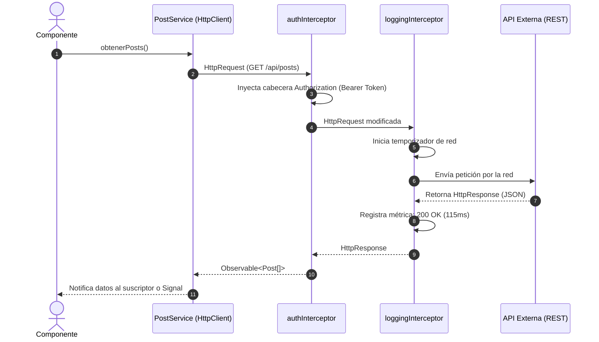
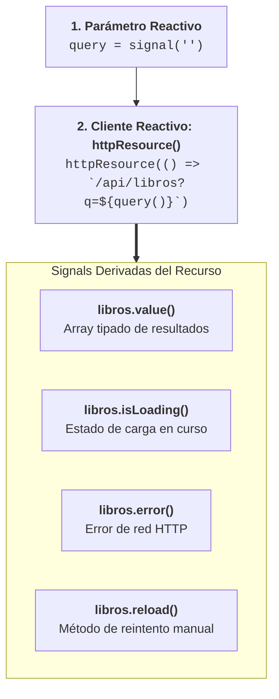
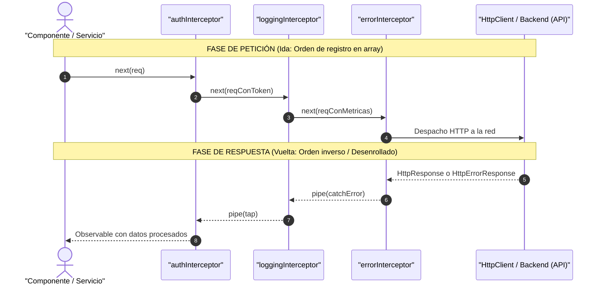

# Cliente HTTP, APIs e Interceptores en Angular

<div class="badges">
  <span class="badge badge-angular">Angular 19 - 22</span>
  <span class="badge badge-signals">resource() & rxResource()</span>
  <span class="badge badge-pro">HttpClient & Interceptors</span>
  <span class="badge badge-standalone">provideHttpClient()</span>
</div>

## Objetivos de aprendizaje

1. Configurar y utilizar `HttpClient` para realizar peticiones HTTP a APIs REST.
2. Dominar el tipado de respuestas con genéricos y las opciones de configuración de peticiones.
3. Comprender los fundamentos de RxJS y la programación reactiva como base del `HttpClient`.
4. Utilizar correctamente el `AsyncPipe` para gestionar suscripciones en plantillas.
5. Integrar Signals con RxJS mediante `toSignal()` y `toObservable()`.
6. Conocer la `resource()` API para carga de datos reactiva.
7. Implementar interceptores funcionales para autenticación, logging y manejo de errores.

## Resultados de aprendizaje

Al finalizar esta unidad, el alumnado será capaz de:

- Realizar operaciones CRUD completas contra una API REST usando `HttpClient`.
- Tipar correctamente las respuestas HTTP con genéricos TypeScript.
- Manejar errores HTTP con `catchError` y patrones de loading/success/error.
- Configurar cabeceras HTTP y parámetros de consulta.
- Utilizar Observables y los operadores principales de RxJS (map, filter, switchMap, debounceTime, etc.).
- Integrar el `AsyncPipe` correctamente en plantillas para gestión automática de suscripciones.
- Convertir Observables a Signals y viceversa para interoperabilidad.
- Crear interceptores funcionales para autenticación JWT, logging global y manejo de errores centralizado.

## Introducción

Ninguna aplicación web moderna vive aislada. Tarde o temprano, necesitará comunicarse con un servidor: obtener datos de una base de datos, enviar formularios, autenticar usuarios o sincronizar información en tiempo real. En Angular, esta comunicación se realiza a través del módulo `HttpClient`, una capa de abstracción sobre `XMLHttpRequest` y `fetch` que proporciona una API potente, tipada y profundamente integrada con RxJS.

RxJS (Reactive Extensions for JavaScript) es la biblioteca sobre la que se construye el sistema reactivo de Angular. Sus conceptos fundamentales —Observables, Subjects, operadores— no solo son la base de `HttpClient`, sino que permean todo el ecosistema del framework: formularios reactivos, enrutador, detección de cambios. Por eso, esta unidad dedica una sección completa a entender RxJS desde sus fundamentos hasta sus operadores más útiles.

La evolución de Angular ha traído consigo nuevas formas de trabajar con datos asíncronos. Las Signals, introducidas en Angular 16-17, ofrecen un modelo de reactividad más simple y síncrono. La función `toSignal()` permite tender un puente entre el mundo de Observables y el de Signals, mientras que la nueva API `resource()` proporciona una forma declarativa de cargar datos reactivos.

Por último, los interceptores HTTP son una herramienta poderosa para implementar preocupaciones transversales: añadir tokens de autenticación, registrar peticiones, manejar errores globalmente o gestionar indicadores de carga. Con los interceptores funcionales, crear estas capas de middleware es más sencillo que nunca.

## Desarrollo teórico

### SECCIÓN 1 - HttpClient

#### 1.1. Configuración

En aplicaciones standalone (Angular 17+), `HttpClient` se configura mediante `provideHttpClient()` en `app.config.ts`:

```typescript
// app.config.ts
import { ApplicationConfig } from '@angular/core';
import { provideHttpClient, withFetch, withInterceptors } from '@angular/common/http';
import { provideRouter } from '@angular/router';
import { routes } from './app.routes';

export const appConfig: ApplicationConfig = {
  providers: [
    provideRouter(routes),
    provideHttpClient(
      withFetch(), // Usa la API fetch nativa (recomendado para SSR y rendimiento)
      withInterceptors([authInterceptor, loggingInterceptor])
    )
  ]
};
```



!!! tip "Por qué withFetch() es el estándar en Angular moderno"
    `withFetch()` sustituye la implementación legacy basada en `XMLHttpRequest` por la API `fetch` nativa del navegador. Esto reduce el peso del bundle, mejora la compatibilidad con Server-Side Rendering (SSR) y permite aprovechar HTTP/2, streaming y cancelaciones limpias con `AbortController`.

**Características de configuración:**

| Función | Descripción |
|---|---|
| `provideHttpClient()` | Configuración básica, obligatorio |
| `withFetch()` | Usa la API `fetch` nativa en lugar de `XMLHttpRequest`. Necesario para SSR (Angular Universal). |
| `withInterceptors([])` | Registra interceptores funcionales |
| `withJsonpSupport()` | Habilita peticiones JSONP (escenario legacy) |
| `withRequestsViaParent()` | Hereda configuración HTTP de un inyector padre |
| `withXsrfConfiguration(...)` | Configura protección XSRF/CSRF |

#### 1.2. Métodos HTTP

`HttpClient` proporciona métodos para todos los verbos HTTP:

```typescript
import { HttpClient } from '@angular/common/http';
import { Injectable, inject } from '@angular/core';
import { Observable } from 'rxjs';

@Injectable({ providedIn: 'root' })
export class ApiService {
  private http = inject(HttpClient);
  private apiUrl = 'https://jsonplaceholder.typicode.com';

  // GET - Obtener recursos
  obtenerPosts(): Observable<Post[]> {
    return this.http.get<Post[]>(`${this.apiUrl}/posts`);
  }

  obtenerPostPorId(id: number): Observable<Post> {
    return this.http.get<Post>(`${this.apiUrl}/posts/${id}`);
  }

  // POST - Crear recurso
  crearPost(post: Omit<Post, 'id'>): Observable<Post> {
    return this.http.post<Post>(`${this.apiUrl}/posts`, post);
  }

  // PUT - Reemplazar recurso completo
  actualizarPost(id: number, post: Post): Observable<Post> {
    return this.http.put<Post>(`${this.apiUrl}/posts/${id}`, post);
  }

  // PATCH - Actualizar parcialmente
  actualizarParcialPost(id: number, cambios: Partial<Post>): Observable<Post> {
    return this.http.patch<Post>(`${this.apiUrl}/posts/${id}`, cambios);
  }

  // DELETE - Eliminar recurso
  eliminarPost(id: number): Observable<void> {
    return this.http.delete<void>(`${this.apiUrl}/posts/${id}`);
  }
}
```

#### 1.3. Tipado de respuestas (genéricos)

`HttpClient` acepta un parámetro de tipo genérico que define la forma esperada de la respuesta:

```typescript
// Interfaz que define la estructura de la respuesta de la API
export interface User {
  id: number;
  name: string;
  email: string;
  address: {
    street: string;
    city: string;
    zipcode: string;
  };
  company: {
    name: string;
    catchPhrase: string;
  };
}

// Respuesta tipada
obtenerUsuario(id: number): Observable<User> {
  return this.http.get<User>(`/api/users/${id}`);
}
// El consumidor recibe User directamente, con autocompletado y verificación de tipos
```

**Tipado de respuestas paginadas y envueltas:**

Muchas APIs envuelven los datos en objetos de respuesta:

```typescript
// Respuesta de API paginada típica
export interface ApiResponse<T> {
  data: T[];
  total: number;
  pagina: number;
  porPagina: number;
}

export interface Producto {
  id: number;
  nombre: string;
  precio: number;
}

obtenerProductos(pagina: number = 1): Observable<ApiResponse<Producto>> {
  return this.http.get<ApiResponse<Producto>>(`/api/productos?page=${pagina}`);
}
// Uso: response.data es Producto[], response.total es number
```

#### 1.4. Observables como base de HttpClient

`HttpClient` devuelve Observables en lugar de Promises. Esto es una decisión deliberada de diseño por varias razones:

1. **Cancelación:** Las peticiones HTTP pueden cancelarse desuscribiéndose del Observable.
2. **Reintentos:** Operadores como `retry()` permiten reintentar peticiones fallidas fácilmente.
3. **Composición:** Los Observables se pueden combinar, transformar y encadenar con operadores.
4. **Manejo de eventos:** `observe: 'events'` permite acceder a eventos del ciclo de vida de la petición.

#### 1.5. Gestión de errores

```typescript
import { catchError, throwError, retry, timeout } from 'rxjs';
import { HttpErrorResponse } from '@angular/common/http';

obtenerDatos(): Observable<Datos[]> {
  return this.http.get<Datos[]>('/api/datos').pipe(
    timeout(10000), // Timeout de 10 segundos
    retry(2),       // Reintentar 2 veces antes de fallar
    catchError(this.manejarError)
  );
}

private manejarError(error: HttpErrorResponse): Observable<never> {
  let mensajeError = 'Error desconocido';

  if (error.error instanceof ErrorEvent) {
    // Error del lado del cliente (red, CORS, etc.)
    mensajeError = `Error de red: ${error.error.message}`;
  } else {
    // Error del lado del servidor
    mensajeError = `Código: ${error.status}, Mensaje: ${error.message}`;
  }

  console.error(mensajeError);
  return throwError(() => new Error(mensajeError));
}
```

**Patrón para manejo de estados loading/success/error:**

```typescript
import { signal } from '@angular/core';
import { finalize } from 'rxjs';

@Component({...})
export class DatosComponent implements OnInit {
  private apiService = inject(ApiService);

  datos = signal<Datos[]>([]);
  cargando = signal(false);
  error = signal<string | null>(null);

  ngOnInit(): void {
    this.cargarDatos();
  }

  cargarDatos(): void {
    this.cargando.set(true);
    this.error.set(null);

    this.apiService.obtenerDatos().subscribe({
      next: (response) => {
        this.datos.set(response);
        this.cargando.set(false);
      },
      error: (err: HttpErrorResponse) => {
        this.error.set(`Error ${err.status}: ${err.message}`);
        this.cargando.set(false);
      }
    });
  }
}
```

#### 1.6. Manejo de respuestas: observe y responseType

**`observe`** controla qué parte de la respuesta HTTP se devuelve:

| Valor | Descripción | Tipo del Observable |
|---|---|---|
| `'body'` | Solo el cuerpo (por defecto) | `Observable<T>` |
| `'response'` | Respuesta completa (body + headers + status) | `Observable<HttpResponse<T>>` |
| `'events'` | Todos los eventos del ciclo de vida | `Observable<HttpEvent<T>>` |

```typescript
// Acceder a cabeceras y status code
this.http.get<Producto[]>('/api/productos', {
  observe: 'response'
}).pipe(
  map(response => {
    console.log('Status:', response.status);
    console.log('Headers:', response.headers.get('X-Total-Count'));
    return response.body as Producto[];
  })
);

// Seguimiento de progreso (útil para uploads)
this.http.post('/api/upload', formData, {
  observe: 'events',
  reportProgress: true
}).subscribe(event => {
  if (event.type === HttpEventType.UploadProgress) {
    const progreso = Math.round(100 * event.loaded / (event.total ?? 1));
    console.log(`Progreso: ${progreso}%`);
  } else if (event.type === HttpEventType.Response) {
    console.log('Subida completada:', event.body);
  }
});
```

**`responseType`** especifica cómo interpretar el cuerpo de la respuesta:

| Valor | Descripción |
|---|---|
| `'json'` | JSON (por defecto) |
| `'text'` | Texto plano |
| `'blob'` | Datos binarios (archivos, imágenes) |
| `'arraybuffer'` | ArrayBuffer (datos binarios de bajo nivel) |

```typescript
// Descargar archivo binario (PDF, imagen)
descargarArchivo(url: string): Observable<Blob> {
  return this.http.get(url, {
    responseType: 'blob'
  });
}

// Descargar y guardar archivo
descargarPDF(id: number): void {
  this.http.get(`/api/informes/${id}/pdf`, {
    responseType: 'blob'
  }).subscribe(blob => {
    const url = window.URL.createObjectURL(blob);
    const a = document.createElement('a');
    a.href = url;
    a.download = `informe-${id}.pdf`;
    a.click();
    window.URL.revokeObjectURL(url);
  });
}
```

#### 1.7. Parámetros de consulta (HttpParams)

`HttpParams` es una clase inmutable para construir parámetros de consulta de forma segura:

```typescript
import { HttpParams } from '@angular/common/http';

buscarProductos(filtros: {
  nombre?: string;
  categoria?: string;
  precioMin?: number;
  precioMax?: number;
  enStock?: boolean;
  pagina?: number;
  ordenarPor?: string;
}): Observable<Producto[]> {
  let params = new HttpParams();

  if (filtros.nombre) {
    params = params.set('q', filtros.nombre);
  }
  if (filtros.categoria) {
    params = params.set('categoria', filtros.categoria);
  }
  if (filtros.precioMin !== undefined) {
    params = params.set('precio_min', filtros.precioMin.toString());
  }
  if (filtros.precioMax !== undefined) {
    params = params.set('precio_max', filtros.precioMax.toString());
  }
  if (filtros.enStock) {
    params = params.set('en_stock', 'true');
  }
  if (filtros.pagina) {
    params = params.set('_page', filtros.pagina.toString());
  }
  if (filtros.ordenarPor) {
    params = params.set('_sort', filtros.ordenarPor);
  }

  return this.http.get<Producto[]>('/api/productos', { params });
}

// Alternativa concisa: usar fromObject
const params = new HttpParams({
  fromObject: {
    q: filtros.nombre || '',
    categoria: filtros.categoria || '',
    _page: String(filtros.pagina || 1),
    _limit: '20'
  }
});
```

#### 1.8. Cabeceras HTTP (HttpHeaders)

`HttpHeaders` es inmutable, similar a `HttpParams`:

```typescript
import { HttpHeaders } from '@angular/common/http';

crearPostConHeaders(post: Post): Observable<Post> {
  const headers = new HttpHeaders({
    'Content-Type': 'application/json',
    'X-Custom-Header': 'valor-personalizado',
    'Authorization': `Bearer ${this.authService.obtenerToken()}`
  });

  return this.http.post<Post>('/api/posts', post, { headers });
}
```

#### 1.9. Interceptores (introducción)

Los interceptores son middleware que se ejecutan en cada petición/respuesta HTTP. Se detallan en la Sección 6. Brevemente, permiten:

- Añadir cabeceras de autenticación automáticamente.
- Registrar todas las peticiones y respuestas.
- Manejar errores globalmente.
- Transformar peticiones y respuestas.

### SECCIÓN 2 - Observables (RxJS)

#### 2.1. Qué es RxJS

RxJS (Reactive Extensions for JavaScript) es una biblioteca para programación reactiva utilizando Observables. Permite trabajar con secuencias de eventos asíncronos (streams de datos) utilizando operadores funcionales.

**Conceptos clave:**

- **Observable:** Un stream de datos que emite valores a lo largo del tiempo.
- **Observer:** Un objeto que reacciona a los valores emitidos (`next`, `error`, `complete`).
- **Subscription:** La conexión entre un Observable y un Observer.
- **Subject:** Un Observable que también puede emitir valores (multicast).
- **Operadores:** Funciones puras que transforman Observables (map, filter, etc.).

#### 2.2. Observable

**Creación de Observables:**

```typescript
import { Observable, of, from, interval } from 'rxjs';

// Observable desde cero
const manual$ = new Observable<string>(subscriber => {
  subscriber.next('Primer valor');
  subscriber.next('Segundo valor');

  setTimeout(() => {
    subscriber.next('Valor asíncrono');
    subscriber.complete(); // Finaliza el stream
  }, 1000);

  // Cleanup (se ejecuta al desuscribirse)
  return () => {
    console.log('Limpieza: desuscripción');
  };
});

// Creación con helpers
of(1, 2, 3, 4, 5);           // Emite valores y completa
from([10, 20, 30]);           // Desde array/iterable
from(fetch('/api/datos'));    // Desde Promise
interval(1000);               // Emite números cada segundo
```

**Suscripción:**

```typescript
const subscription = manual$.subscribe({
  next: (valor) => console.log('Recibido:', valor),
  error: (err) => console.error('Error:', err),
  complete: () => console.log('Stream completado')
});
```

**Desuscripción y memory leaks:**

Las suscripciones que no se cancelan causan memory leaks. Estrategias para evitarlos:

```typescript
import { Subject, takeUntil, take } from 'rxjs';

// Estrategia 1: takeUntil con Subject
private destroy$ = new Subject<void>();

ngOnInit(): void {
  this.dataService.obtenerDatos()
    .pipe(takeUntil(this.destroy$))
    .subscribe(data => this.datos = data);
}

ngOnDestroy(): void {
  this.destroy$.next();
  this.destroy$.complete();
}

// Estrategia 2: take(1) - solo la primera emisión
this.http.get('/api/data').pipe(take(1)).subscribe(/* ... */);

// Estrategia 3: AsyncPipe (automático, la mejor opción)
// En template: {{ datos$ | async }}

// Estrategia 4: takeUntilDestroyed() (Angular 16+)
import { takeUntilDestroyed } from '@angular/core/rxjs-interop';
this.http.get('/api/data').pipe(takeUntilDestroyed()).subscribe(/* ... */);
```

#### 2.3. Subject

Un `Subject` es un tipo especial de Observable que permite emitir valores a múltiples suscriptores (multicast) y también actuar como Observer.

```typescript
import { Subject } from 'rxjs';

const eventoSubject = new Subject<string>();

// Suscriptor 1
eventoSubject.subscribe(valor => console.log('Sub 1:', valor));

// Suscriptor 2
eventoSubject.subscribe(valor => console.log('Sub 2:', valor));

// Emitir valores
eventoSubject.next('Evento A'); // Ambos suscriptores lo reciben
eventoSubject.next('Evento B');
```

**Casos de uso típicos de Subject:**

- **Event Bus:** Comunicación desacoplada entre componentes.
- **Notificaciones:** Servicio de notificaciones que emite a múltiples consumidores.
- **Señal de destrucción:** `takeUntil(this.destroy$)`.

#### 2.4. BehaviorSubject

`BehaviorSubject` es una variante de `Subject` que:

- Requiere un valor inicial.
- Almacena el último valor emitido.
- Los nuevos suscriptores reciben inmediatamente el último valor.

```typescript
import { BehaviorSubject } from 'rxjs';

const usuarioSubject = new BehaviorSubject<Usuario | null>(null);

// Estado reactivo simple
usuarioSubject.subscribe(usuario => {
  console.log('Usuario actual:', usuario);
});

// Nuevo suscriptor recibe el último valor inmediatamente
usuarioSubject.next({ id: 1, nombre: 'Ana' });

// Suscriptor tardío
setTimeout(() => {
  usuarioSubject.subscribe(u => console.log('Tardío:', u));
  // Output: Tardío: { id: 1, nombre: 'Ana' }
}, 2000);
```

#### 2.5. Operadores principales de RxJS

##### map - Transformar valores

```typescript
import { map } from 'rxjs';

this.http.get<Producto[]>('/api/productos').pipe(
  map(productos =>
    productos.map(p => ({
      ...p,
      nombre: p.nombre.toUpperCase(),
      precioConIVA: p.precio * 1.21
    }))
  )
).subscribe(productos => console.log(productos));
```

##### filter - Filtrar stream

```typescript
import { filter } from 'rxjs';

interval(1000).pipe(
  filter(n => n % 2 === 0) // Solo números pares
).subscribe(par => console.log('Par:', par));
// Output: Par: 0, Par: 2, Par: 4, ...
```

##### tap - Efectos secundarios (side effects)

```typescript
import { tap } from 'rxjs';

this.http.post('/api/login', credenciales).pipe(
  tap(() => console.log('Petición enviada')),
  tap(response => console.log('Respuesta:', response)),
  tap({
    error: err => console.error('Error en tap:', err)
  })
);
```

##### switchMap - Cancelar anterior, iniciar nuevo

Ideal para búsquedas: cancela la petición anterior si llega un nuevo valor.

```typescript
import { switchMap } from 'rxjs';

@Component({...})
export class BusquedaComponent {
  private terminoBusqueda$ = new Subject<string>();

  resultados$ = this.terminoBusqueda$.pipe(
    debounceTime(300), // Esperar 300ms de inactividad
    distinctUntilChanged(), // Ignorar si el valor no cambió
    filter(termino => termino.length >= 2),
    switchMap(termino =>
      this.apiService.buscar(termino)
    )
  );
  // Si el usuario escribe rápido, solo se procesa el último término
  // Las peticiones anteriores se cancelan automáticamente
}
```

##### mergeMap - Mantener múltiples suscripciones

Ejecuta todas las peticiones en paralelo y emite los resultados según lleguen.

```typescript
import { mergeMap, forkJoin } from 'rxjs';

// Procesar múltiples IDs en paralelo
de([1, 2, 3, 4, 5]).pipe(
  mergeMap(id => this.http.get(`/api/items/${id}`))
).subscribe(item => console.log('Item cargado:', item));
```

##### concatMap - Encolar en orden

Ejecuta las peticiones secuencialmente, una tras otra, manteniendo el orden.

```typescript
de([1, 2, 3]).pipe(
  concatMap(id => this.http.get(`/api/items/${id}`))
);
// Espera a que termine la petición de id=1 antes de iniciar id=2
```

##### exhaustMap - Ignorar hasta completar

Ignora nuevos valores mientras la suscripción actual no haya terminado. Útil para prevenir doble submit.

```typescript
fromEvent(boton, 'click').pipe(
  exhaustMap(() => this.http.post('/api/submit', datos))
);
// Clicks adicionales se ignoran hasta que la petición actual termine
```

##### combineLatest - Combinar múltiples streams

Emite cuando cualquiera de los Observables fuente emite (incluye el último valor de todos).

```typescript
import { combineLatest, map } from 'rxjs';

const categoria$ = this.categoriaService.categoriaSeleccionada$;
const termino$ = this.busquedaService.terminoBusqueda$;

const resultadosFiltrados$ = combineLatest([categoria$, termino$]).pipe(
  switchMap(([categoria, termino]) =>
    this.apiService.buscar({ categoria, termino })
  )
);
```

##### forkJoin - Esperar a que todos terminen

Emite una sola vez cuando todos los Observables han completado.

```typescript
import { forkJoin } from 'rxjs';

// Cargar datos de múltiples fuentes en paralelo
ngOnInit(): void {
  forkJoin({
    usuarios: this.http.get<User[]>('/api/users'),
    productos: this.http.get<Producto[]>('/api/products'),
    configuracion: this.http.get<Config>('/api/config')
  }).subscribe(({ usuarios, productos, configuracion }) => {
    // Todas las peticiones completadas
    console.log('Datos cargados:', { usuarios, productos, configuracion });
  });
}
```

##### debounceTime y distinctUntilChanged

```typescript
import { debounceTime, distinctUntilChanged } from 'rxjs';

buscador$.pipe(
  debounceTime(400), // Espera 400ms tras la última emisión
  distinctUntilChanged() // Ignora valores duplicados consecutivos
);
```

##### catchError y retry

```typescript
import { catchError, retry, throwError } from 'rxjs';

this.http.get('/api/datos').pipe(
  retry(3), // Reintenta hasta 3 veces
  catchError(err => {
    console.error('Error tras 3 intentos:', err);
    return throwError(() => err);
  })
);
```

### SECCIÓN 3 - Async Pipe

El `AsyncPipe` (`| async`) se suscribe a un `Observable` o `Promise`, devuelve el último valor emitido y automáticamente se desuscribe cuando el componente se destruye.

**Sintaxis básica:**

```html
<!-- Observable -->
<p>{{ usuario$ | async | json }}</p>

<!-- Promise -->
<p>{{ datosPromise | async }}</p>
```

**AsyncPipe con alias (`as`):**

```html
@if (usuario$ | async; as usuario) {
  <div class="perfil">
    <h2>{{ usuario.nombre }}</h2>
    <p>{{ usuario.email }}</p>
  </div>
} @else {
  <p>Cargando perfil...</p>
}
```

**Combinar AsyncPipe con otros pipes:**

```html
<p>{{ fechaActualizacion$ | async | date:'fullDate' }}</p>
<p>{{ precioTotal$ | async | currency:'EUR' }}</p>
```

**Ventajas del AsyncPipe:**

1. **Gestión automática de suscripciones:** No hay que llamar a `unsubscribe()`.
2. **OnPush friendly:** El `AsyncPipe` marca el componente para verificación de cambios cuando emite un nuevo valor.
3. **Código más limpio:** Las plantillas quedan libres de suscripciones manuales.
4. **Menos memory leaks:** Angular se encarga de limpiar.

### SECCIÓN 4 - Signals + RxJS

Angular proporciona funciones de interoperabilidad para conectar el mundo de Signals con el de Observables.

#### 4.1. toSignal() - Observable a Signal

```typescript
import { toSignal } from '@angular/core/rxjs-interop';

@Component({...})
export class UsersComponent {
  private userService = inject(UserService);

  // Observable del servicio
  private users$ = this.userService.obtenerUsuarios();

  // Convertir a Signal
  users = toSignal(this.users$, { initialValue: [] });
  // users() devuelve User[] (síncrono, reactivo)

  // Opciones de toSignal
  user = toSignal(this.userService.obtenerUsuario(1), {
    initialValue: null,       // Valor inicial antes de la primera emisión
    requireSync: false,       // No requiere valor síncrono inmediato
    manualCleanup: false,     // Limpieza automática al destruir
    injector: this.injector   // Injector (opcional, usa el del contexto)
  });
}
```

```html
<!-- Plantilla reactiva con Signals -->
<h2>Usuarios ({{ users().length }})</h2>
@for (user of users(); track user.id) {
  <div class="user-card">
    <h3>{{ user.name }}</h3>
    <p>{{ user.email }}</p>
  </div>
} @empty {
  <p>No hay usuarios.</p>
}
```

#### 4.2. toObservable() - Signal a Observable

```typescript
import { toObservable } from '@angular/core/rxjs-interop';

@Component({...})
export class SearchComponent {
  private apiService = inject(ApiService);

  // Signal que cambia con el input del usuario
  termino = signal('');

  // Convertir Signal a Observable para usar con RxJS
  resultados = toSignal(
    toObservable(this.termino).pipe(
      debounceTime(400),
      distinctUntilChanged(),
      filter(termino => termino.length >= 2),
      switchMap(termino => this.apiService.buscar(termino))
    ),
    { initialValue: [] }
  );
}
```

#### 4.3. Patrón recomendado

El patrón más común en aplicaciones modernas:

1. `HttpClient` devuelve `Observable<T>` desde los servicios.
2. En el componente, convertir a `Signal` con `toSignal()`.
3. En la plantilla, usar la Signal con Control Flow (`@if`, `@for`).

```typescript
// Servicio (capa de datos)
@Injectable({ providedIn: 'root' })
export class ProductService {
  private http = inject(HttpClient);

  obtenerProductos(filtros?: any): Observable<Producto[]> {
    return this.http.get<Producto[]>('/api/productos', { params: filtros });
  }

  obtenerProducto(id: number): Observable<Producto> {
    return this.http.get<Producto>(`/api/productos/${id}`);
  }
}

// Componente (capa de presentación)
@Component({
  template: `
    @if (productos(); as lista) {
      @for (producto of lista; track producto.id) {
        <app-producto-card [producto]="producto" />
      } @empty {
        <p>No se encontraron productos.</p>
      }
    } @else {
      <p>Cargando productos...</p>
    }
  `
})
export class ProductoListaComponent {
  private productService = inject(ProductService);
  productos = toSignal(this.productService.obtenerProductos());
}
```

### SECCIÓN 5 - Resource API

La API `resource()` y `rxResource()` (totalmente estables en Angular 22) proporcionan una forma declarativa y de primera clase para cargar datos asíncronos y conectar APIs REST directamente con el grafo reactivo de señales.

#### 5.1. resource() básico

```typescript
import { resource } from '@angular/core';

@Component({...})
export class UserDetailComponent {
  private userService = inject(UserService);

  // ID del usuario, reactivo
  userId = input.required<number>();

  // El resource se recarga automáticamente cuando cambia userId
  userResource = resource({
    // request: define las dependencias reactivas
    request: () => this.userId(),

    // loader: función que carga los datos
    loader: ({ request: id }) =>
      lastValueFrom(this.userService.obtenerUsuario(id))
  });
}
```

**Propiedades del resource:**

| Propiedad | Tipo | Descripción |
|---|---|---|
| `value` | `Signal<T>` | Valor actual de los datos |
| `status` | `Signal<ResourceStatus>` | Estado: Idle, Loading, Resolved, Error |
| `error` | `Signal<unknown>` | Error si falló |
| `isLoading` | `Signal<boolean>` | `true` si está cargando |
| `reload()` | `() => void` | Fuerza recarga manual |

```html
@if (userResource.isLoading()) {
  <app-spinner />
} @else if (userResource.error()) {
  <app-error [error]="userResource.error()!" />
} @else if (userResource.value(); as user) {
  <h2>{{ user.name }}</h2>
  <p>{{ user.email }}</p>
  <button (click)="userResource.reload()">Recargar</button>
}
```

#### 5.2. rxResource() para integración con RxJS

`rxResource()` es específico para usar con Observables de RxJS:

```typescript
import { rxResource } from '@angular/core/rxjs-interop';

@Component({...})
export class ProductListComponent {
  private productService = inject(ProductService);

  filtro = signal('todos');

  // rxResource se integra directamente con HttpClient (Observable)
  productosResource = rxResource({
    request: () => ({ categoria: this.filtro() }),
    loader: ({ request }) =>
      this.productService.obtenerProductos({ categoria: request.categoria })
  });

  productos = computed(() => this.productosResource.value() ?? []);
  cargando = this.productosResource.isLoading;
  error = this.productosResource.error;
}
```

#### 5.3. Comparación con el enfoque tradicional

| Característica | HttpClient + toSignal | resource() / rxResource() |
|---|---|---|
| Carga inicial | Manual (ngOnInit) | Automática al crear el resource |
| Recarga por dependencias | Manual con signals + switchMap | Automática con request |
| Estado (loading/error) | Manual con señales separadas | Incluido (status, error, isLoading) |
| Recarga manual | Implementación ad-hoc | Método reload() incluido |
| Código necesario | Más boilerplate | Menos código, más declarativo |

#### 5.4. `httpResource()`: El estándar de `@angular/common/http` (Estable en Angular 22)

En **Angular 22**, la API **`httpResource()`** se gradúa oficialmente a **ESTABLE (Production-Ready)**, convirtiéndose en la herramienta predeterminada recomendada para operaciones de lectura REST.

A diferencia de `resource()` (que requiere un `loader` con `fetch`) o `rxResource()` (que requiere devolver un `Observable`), `httpResource()` acepta directamente una función que devuelve la URL o un objeto de opciones HTTP. Si la URL depende de una Signal, la petición se cancela y se relanza automáticamente cuando la Signal cambia (resolviendo *race conditions* de serie sin necesidad de `switchMap`).



##### Ejemplo Completo con `httpResource()`

=== "catalogo-libros.component.ts"
    ```typescript
    import { Component, signal } from '@angular/core';
    import { httpResource } from '@angular/common/http';
    import { CurrencyPipe } from '@angular/common';

    export interface Libro {
      id: string;
      titulo: string;
      autor: string;
      precio: number;
    }

    @Component({
      selector: 'app-catalogo-libros',
      imports: [CurrencyPipe],
      templateUrl: './catalogo-libros.component.html',
      styleUrl: './catalogo-libros.component.css'
    })
    export class CatalogoLibrosComponent {
      // Filtros reactivos mediante Signals
      categoriaSeleccionada = signal<string>('tecnologia');

      // httpResource enlaza automáticamente la señal 'categoriaSeleccionada' con el backend
      librosResource = httpResource<Libro[]>(() => 
        `https://api.ejemplo.com/libros?cat=${this.categoriaSeleccionada()}`
      );

      cambiarCategoria(nuevaCat: string): void {
        this.categoriaSeleccionada.set(nuevaCat);
        // ¡Automáticamente se cancela cualquier petición en curso y se lanza la nueva!
      }
    }
    ```

=== "catalogo-libros.component.html"
    ```html
    <div class="catalogo-container">
      <header class="filtros">
        <h2>Catálogo de Libros</h2>
        <div class="botones-categoria">
          <button (click)="cambiarCategoria('tecnologia')" [class.activo]="categoriaSeleccionada() === 'tecnologia'">
            Tecnología
          </button>
          <button (click)="cambiarCategoria('diseno')" [class.activo]="categoriaSeleccionada() === 'diseno'">
            Diseño
          </button>
          <button (click)="cambiarCategoria('negocios')" [class.activo]="categoriaSeleccionada() === 'negocios'">
            Negocios
          </button>
          <button (click)="librosResource.reload()" class="btn-recargar">
            🔄 Refrescar
          </button>
        </div>
      </header>

      <!-- Manejo declarativo de estados HTTP sin banderas booleanas manuales -->
      @if (librosResource.isLoading()) {
        <div class="estado-cargando">
          <div class="spinner"></div>
          <p>Consultando catálogo para {{ categoriaSeleccionada() }}...</p>
        </div>
      } @else if (librosResource.error()) {
        <div class="estado-error">
          <p>❌ Error de conexión al cargar libros: {{ librosResource.error() }}</p>
          <button (click)="librosResource.reload()">Reintentar</button>
        </div>
      } @else if (librosResource.value(); as libros) {
        <div class="grid-libros">
          @for (libro of libros; track libro.id) {
            <article class="card-libro">
              <h3>{{ libro.titulo }}</h3>
              <p class="autor">Por {{ libro.autor }}</p>
              <strong class="precio">{{ libro.precio | currency:'EUR' }}</strong>
            </article>
          } @empty {
            <p class="sin-datos">No hay libros registrados en esta categoría.</p>
          }
        </div>
      }
    </div>
    ```

=== "catalogo-libros.component.css"
    ```css
    .catalogo-container {
      max-width: 900px;
      margin: 1.5rem auto;
      padding: 1rem;
    }

    .catalogo-container .filtros {
      display: flex;
      justify-content: space-between;
      align-items: center;
      flex-wrap: wrap;
      gap: 1rem;
      margin-bottom: 2rem;
    }

    .catalogo-container .filtros .botones-categoria {
      display: flex;
      gap: 0.5rem;
    }

    .catalogo-container .filtros .botones-categoria button {
      padding: 0.5rem 1rem;
      border: 1px solid #ddd;
      background: white;
      border-radius: 6px;
      cursor: pointer;
    }

    .catalogo-container .filtros .botones-categoria button.activo {
      background: #3498db;
      color: white;
      border-color: #2980b9;
      font-weight: 600;
    }

    .catalogo-container .filtros .botones-categoria button.btn-recargar {
      background: #f8f9fa;
      border-color: #bdc3c7;
    }

    .catalogo-container .estado-cargando,
    .catalogo-container .estado-error {
      text-align: center;
      padding: 3rem 1rem;
    }

    .catalogo-container .grid-libros {
      display: grid;
      grid-template-columns: repeat(auto-fill, minmax(260px, 1fr));
      gap: 1.5rem;
    }

    .catalogo-container .card-libro {
      padding: 1.25rem;
      border-radius: 8px;
      border: 1px solid #eee;
      background: white;
      box-shadow: 0 2px 6px rgba(0, 0, 0, 0.04);
    }

    .catalogo-container .card-libro h3 {
      margin-top: 0;
      font-size: 1.15rem;
      color: #2c3e50;
    }

    .catalogo-container .card-libro .autor {
      color: #7f8c8d;
      font-size: 0.9rem;
    }

    .catalogo-container .card-libro .precio {
      color: #27ae60;
      font-size: 1.1rem;
      display: block;
      margin-top: 0.75rem;
    }
    ```


### SECCIÓN 6 - Interceptors

#### 6.1. Qué son y para qué sirven

Los **interceptores HTTP** son funciones que actúan como una capa de middleware entre el código de la aplicación y el backend. Se ejecutan automáticamente en **cada petición saliente** y en **cada respuesta entrante** gestionada por `HttpClient`.

Permiten implementar **preocupaciones transversales** (*cross-cutting concerns*) de forma completamente desacoplada de los componentes y servicios de negocio:
- Inyectar cabeceras de autenticación (tokens JWT Bearer o API keys).
- Registrar telemetría, métricas y logs de red.
- Capturar y traducir errores HTTP globalmente (401, 403, 404, 500).
- Activar indicadores globales de carga (spinners/progress bars con Signals).
- Renovar tokens de acceso expirados de forma transparente (*Refresh Token*).
- Gestionar sistemas de caché en memoria para peticiones GET repetitivas.



#### 6.2. Interceptores funcionales (forma moderna)

```typescript
import { HttpInterceptorFn } from '@angular/common/http';

export const miInterceptor: HttpInterceptorFn = (req, next) => {
  // Modificar la petición antes de enviarla
  const reqModificada = req.clone({
    // Añadir cabeceras, modificar URL, etc.
  });

  // Pasar al siguiente interceptor o al backend
  return next(reqModificada).pipe(
    // Transformar la respuesta
    tap(evento => console.log('Respuesta:', evento))
  );
};
```

**Registro en app.config.ts:**

```typescript
import { provideHttpClient, withInterceptors } from '@angular/common/http';

export const appConfig: ApplicationConfig = {
  providers: [
    provideHttpClient(
      withInterceptors([authInterceptor, loggingInterceptor, errorInterceptor])
    )
  ]
};
```

#### 6.3. Casos de uso

**Intercepter de autenticación JWT:**

```typescript
// interceptors/auth.interceptor.ts
import { HttpInterceptorFn, HttpErrorResponse } from '@angular/common/http';
import { inject } from '@angular/core';
import { AuthService } from '../services/auth.service';
import { Router } from '@angular/router';
import { catchError, throwError } from 'rxjs';

export const authInterceptor: HttpInterceptorFn = (req, next) => {
  const authService = inject(AuthService);
  const router = inject(Router);

  const token = authService.obtenerToken();

  // Si hay token, añadirlo a la cabecera Authorization
  if (token) {
    req = req.clone({
      setHeaders: {
        Authorization: `Bearer ${token}`
      }
    });
  }

  return next(req).pipe(
    catchError((error: HttpErrorResponse) => {
      // Si el servidor devuelve 401 (no autorizado)
      if (error.status === 401) {
        authService.logout();
        router.navigate(['/login']);
      }
      return throwError(() => error);
    })
  );
};
```

**Intercepter de logging:**

```typescript
// interceptors/logging.interceptor.ts
import { HttpInterceptorFn, HttpResponse } from '@angular/common/http';
import { tap } from 'rxjs';

export const loggingInterceptor: HttpInterceptorFn = (req, next) => {
  const inicio = Date.now();
  const url = req.urlWithParams;
  const metodo = req.method;

  console.log(`[HTTP] ${metodo} ${url} - Iniciando...`);

  return next(req).pipe(
    tap({
      next: (evento) => {
        if (evento instanceof HttpResponse) {
          const duracion = Date.now() - inicio;
          console.log(
            `[HTTP] ${metodo} ${url} - ${evento.status} - ${duracion}ms`
          );
        }
      },
      error: (error) => {
        const duracion = Date.now() - inicio;
        console.error(
          `[HTTP] ${metodo} ${url} - ERROR ${error.status || 'red'} - ${duracion}ms`,
          error
        );
      }
    })
  );
};
```

**Intercepter de manejo de errores globales:**

```typescript
// interceptors/error.interceptor.ts
import { HttpInterceptorFn, HttpErrorResponse } from '@angular/common/http';
import { inject } from '@angular/core';
import { catchError, throwError } from 'rxjs';
import { NotificacionesService } from '../services/notificaciones.service';

export const errorInterceptor: HttpInterceptorFn = (req, next) => {
  const notificaciones = inject(NotificacionesService);

  return next(req).pipe(
    catchError((error: HttpErrorResponse) => {
      let mensaje = 'Error inesperado';

      if (error.error instanceof ErrorEvent) {
        // Error de red o del lado del cliente
        mensaje = `Error de conexión: ${error.error.message}`;
      } else {
        // Error del servidor
        switch (error.status) {
          case 400:
            mensaje = error.error?.mensaje || 'Datos inválidos';
            break;
          case 403:
            mensaje = 'No tienes permisos para realizar esta acción';
            break;
          case 404:
            mensaje = 'Recurso no encontrado';
            break;
          case 422:
            mensaje = error.error?.mensaje || 'Error de validación';
            break;
          case 429:
            mensaje = 'Demasiadas peticiones. Inténtalo más tarde';
            break;
          case 500:
            mensaje = 'Error interno del servidor';
            break;
          case 503:
            mensaje = 'Servicio no disponible temporalmente';
            break;
        }
      }

      // Mostrar notificación al usuario
      notificaciones.error('Error', mensaje);

      return throwError(() => error);
    })
  );
};
```

**Intercepter de indicador de carga global (spinner):**

```typescript
// interceptors/loading.interceptor.ts
import { HttpInterceptorFn } from '@angular/common/http';
import { inject } from '@angular/core';
import { finalize } from 'rxjs';
import { LoadingService } from '../services/loading.service';

export const loadingInterceptor: HttpInterceptorFn = (req, next) => {
  const loadingService = inject(LoadingService);

  // Activar indicador de carga
  loadingService.incrementar();

  return next(req).pipe(
    finalize(() => {
      // Desactivar indicador cuando termina (éxito o error)
      loadingService.decrementar();
    })
  );
};
```

**Servicio de loading complementario:**

```typescript
// services/loading.service.ts
import { Injectable, signal, computed } from '@angular/core';

@Injectable({ providedIn: 'root' })
export class LoadingService {
  private peticionesActivas = signal(0);

  readonly cargando = computed(() => this.peticionesActivas() > 0);

  incrementar(): void {
    this.peticionesActivas.update(n => n + 1);
  }

  decrementar(): void {
    this.peticionesActivas.update(n => Math.max(0, n - 1));
  }
}
```

```html
<!-- En algún componente de layout -->
@if (loadingService.cargando()) {
  <div class="global-spinner">
    <div class="spinner"></div>
    <p>Cargando...</p>
  </div>
}
```

**Intercepter de transformación de respuestas:**

```typescript
// interceptors/transform.interceptor.ts
import { HttpInterceptorFn } from '@angular/common/http';
import { map } from 'rxjs';

export const transformInterceptor: HttpInterceptorFn = (req, next) => {
  return next(req).pipe(
    map(evento => {
      if (evento instanceof HttpResponse && evento.body) {
        // Si la API envuelve los datos en { data: ..., meta: ... }
        // se puede transformar aquí para que el componente reciba datos planos
        if (evento.body && typeof evento.body === 'object' && 'data' in evento.body) {
          return evento.clone({ body: (evento.body as any).data });
        }
      }
      return evento;
    })
  );
};
```

#### 6.4. Control granular y omisión de interceptores con `HttpContext` y `HttpContextToken`

En aplicaciones reales, **no todas las peticiones deben ser tratadas por todos los interceptores**. Por ejemplo:
- La petición de login (`/api/auth/login`) no tiene token Bearer todavía; inyectarle una cabecera vacía o redirigir en caso de error es problemático.
- Ciertas peticiones periódicas en segundo plano (*polling*) o precarga de imágenes no deben activar el spinner global de carga para no molestar al usuario.
- Peticiones a APIs públicas externas (como OpenWeather o REST Countries) no deben enviar las credenciales privadas de tu backend.

##### El antipatrón: Comprobar la URL como texto
Una solución común pero **frágil y desaconsejada** es comprobar la cadena de texto de la URL:

```typescript
// ANTIPATRÓN: Frágil, acoplado y propenso a errores al cambiar rutas o usar proxies
if (req.url.includes('/login') || req.url.includes('api.externa.com')) {
  return next(req);
}
```

##### La solución limpia de Angular: `HttpContextToken` y `HttpContext`
Angular proporciona un mecanismo fuertemente tipado para asociar metadatos a peticiones HTTP sin alterar los parámetros de la URL ni las cabeceras HTTP:

```typescript
// core/http/http-context.tokens.ts
import { HttpContextToken } from '@angular/common/http';

/**
 * Token booleano para indicar que una petición es pública y no requiere Authorization Header.
 * El valor por defecto es false (todas las peticiones requieren auth por omisión).
 */
export const IS_PUBLIC_REQUEST = new HttpContextToken<boolean>(() => false);

/**
 * Token booleano para omitir el spinner o indicador de carga global.
 */
export const SKIP_LOADING_INDICATOR = new HttpContextToken<boolean>(() => false);
```

##### Uso en el servicio que dispara la petición:
```typescript
// features/auth/services/auth.service.ts
import { Injectable, inject } from '@angular/core';
import { HttpClient, HttpContext } from '@angular/common/http';
import { Observable } from 'rxjs';
import { IS_PUBLIC_REQUEST, SKIP_LOADING_INDICATOR } from '../../../core/http/http-context.tokens';

export interface AuthResponse {
  accessToken: string;
  refreshToken: string;
}

@Injectable({ providedIn: 'root' })
export class AuthService {
  private readonly http = inject(HttpClient);

  login(credenciales: { email: string; pass: string }): Observable<AuthResponse> {
    return this.http.post<AuthResponse>('/api/auth/login', credenciales, {
      // Configuramos el contexto tipado de esta petición específica
      context: new HttpContext()
        .set(IS_PUBLIC_REQUEST, true)
        .set(SKIP_LOADING_INDICATOR, false)
    });
  }

  consultarCatalogoPublico(): Observable<any[]> {
    return this.http.get<any[]>('/api/catalogo', {
      context: new HttpContext().set(IS_PUBLIC_REQUEST, true)
    });
  }
}
```

##### Lectura del token en el interceptor:
```typescript
// core/interceptors/auth.interceptor.ts
import { HttpInterceptorFn } from '@angular/common/http';
import { inject } from '@angular/core';
import { AuthService } from '../services/auth.service';
import { IS_PUBLIC_REQUEST } from '../http/http-context.tokens';

export const authInterceptor: HttpInterceptorFn = (req, next) => {
  // 1. Si la petición está marcada como pública, la dejamos pasar sin tocar
  if (req.context.get(IS_PUBLIC_REQUEST)) {
    return next(req);
  }

  // 2. Si no es pública, inyectamos el token Bearer si existe
  const authService = inject(AuthService);
  const token = authService.obtenerToken();

  if (!token) {
    return next(req);
  }

  const reqAutenticada = req.clone({
    setHeaders: {
      Authorization: `Bearer ${token}`
    }
  });

  return next(reqAutenticada);
};
```

---

#### 6.5. Patrón avanzado de producción: Renovación transparente de Token (*Refresh Token*)

En arquitecturas con tokens JWT de corta duración (ej. expiración a los 15 minutos) y tokens de refresco (*Refresh Tokens* de 7 a 30 días), el interceptor debe renovar el token automáticamente cuando el backend responde con un código de estado `401 Unauthorized`.

El flujo debe ser transparente para el usuario:
1. La petición original falla con `401`.
2. El interceptor intercepta el error.
3. Se invoca el endpoint de refresco de credenciales (marcado como `IS_PUBLIC_REQUEST` para evitar bucles infinitos).
4. Si el refresco es exitoso, se clona la petición original fallida con el nuevo token y se reintenta automáticamente mediante el operador `switchMap` de RxJS.
5. Si el refresco falla (el refresh token expiró), se cierra la sesión y se redirige a `/login`.

```typescript
// core/interceptors/jwt-refresh.interceptor.ts
import { HttpInterceptorFn, HttpErrorResponse } from '@angular/common/http';
import { inject } from '@angular/core';
import { Router } from '@angular/router';
import { catchError, switchMap, throwError } from 'rxjs';
import { AuthService } from '../services/auth.service';
import { IS_PUBLIC_REQUEST } from '../http/http-context.tokens';

export const jwtRefreshInterceptor: HttpInterceptorFn = (req, next) => {
  const authService = inject(AuthService);
  const router = inject(Router);

  // Dejar pasar peticiones públicas sin inspección
  if (req.context.get(IS_PUBLIC_REQUEST)) {
    return next(req);
  }

  return next(req).pipe(
    catchError((error: HttpErrorResponse) => {
      // Capturamos el error 401 que indica token caducado
      if (error.status === 401) {
        // Intentamos renovar el token mediante el servicio de autenticación
        return authService.refrescarToken().pipe(
          switchMap(nuevoToken => {
            // Reintentamos la petición original con el nuevo token generado
            const reqReintentada = req.clone({
              setHeaders: {
                Authorization: `Bearer ${nuevoToken.accessToken}`
              }
            });
            return next(reqReintentada);
          }),
          catchError(refreshError => {
            // Si el refresh token también expiró o es inválido, forzamos logout
            authService.logout();
            router.navigate(['/login']);
            return throwError(() => refreshError);
          })
        );
      }

      return throwError(() => error);
    })
  );
};
```

---

#### 6.6. Interceptores funcionales vs Interceptores basados en clases (`withInterceptorsFromDi`)

Angular introdujo los **interceptores funcionales** (`HttpInterceptorFn`) a partir de Angular 15 como parte de la revolución Standalone. Conviene entender las diferencias con el modelo tradicional y cómo conviven en proyectos de migración.

| Característica | Interceptores Funcionales (Moderno) | Interceptores de Clase (Legacy) |
| :--- | :--- | :--- |
| **Tipo / Firma** | Función pura: `HttpInterceptorFn = (req, next) => ...` | Clase con método `intercept(req, next)` que implementa `HttpInterceptor` |
| **Inyección de dependencias** | Directa mediante `inject(MiServicio)` | Vía constructor tradicional de la clase |
| **Registro** | `withInterceptors([miInterceptor])` en `provideHttpClient` | Objeto provider `{ provide: HTTP_INTERCEPTORS, useClass: ..., multi: true }` |
| **Tree-shaking y tamaño** | Óptimo (funciones puras sin overhead de clase ni metadatos) | Menor optimización (clases decoradas con `@Injectable()`) |
| **Composición y modularidad** | Alta: encadenamiento y reutilización funcional | Más rígida: jerarquía de clases |

##### Convivencia en proyectos en transición
Si trabajas en un proyecto empresarial que está migrando hacia Standalone pero aún tiene interceptores legados basados en clases que no se pueden reescribir inmediatamente, puedes activar ambos sistemas simultáneamente utilizando la función `withInterceptorsFromDi()`:

```typescript
// app.config.ts
import { ApplicationConfig } from '@angular/core';
import { 
  provideHttpClient, 
  withInterceptors, 
  withInterceptorsFromDi,
  HTTP_INTERCEPTORS 
} from '@angular/common/http';
import { authInterceptor, loggingInterceptor } from './core/interceptors';
import { LegacyMonitoringInterceptor } from './legacy/monitoring.interceptor';

export const appConfig: ApplicationConfig = {
  providers: [
    provideHttpClient(
      // Interceptores funcionales modernos (se ejecutan primero)
      withInterceptors([authInterceptor, loggingInterceptor]),
      // Habilita el soporte para interceptores basados en clases registrados en DI
      withInterceptorsFromDi()
    ),
    // Registro del interceptor de clase legado
    {
      provide: HTTP_INTERCEPTORS,
      useClass: LegacyMonitoringInterceptor,
      multi: true
    }
  ]
};
```

---

#### 6.7. Múltiples interceptores y orden de ejecución (Modelo Cebolla)

Cuando se registran múltiples interceptores en `provideHttpClient(withInterceptors([A, B, C]))`, el orden de la lista es estrictamente respetado:

1. **Fase de Petición (Request):** Se ejecutan en el orden exacto del array: **`A → B → C → Backend`**.
   - Por ejemplo, `authInterceptor` debe ejecutarse antes de que cualquier otro interceptor intente leer o loguear las cabeceras finales de autenticación.
2. **Fase de Respuesta (Response):** Al resolverse la petición en el backend, el flujo de respuesta se desenrolla en orden inverso a través de los operadores de RxJS (`pipe`, `tap`, `catchError`): **`Backend → C → B → A → Componente`**.
   - El interceptor de manejo global de errores (`errorInterceptor`) o el de telemetría debe situarse habitualmente hacia el final de la cadena de ida para ser el primero en recibir el error en el retorno.

```
Petición (ida):      authInterceptor  ──>  loggingInterceptor  ──>  errorInterceptor  ──>  [Backend API]
Respuesta (vuelta):  authInterceptor  <──  loggingInterceptor  <──  errorInterceptor  <──  [Backend API]
```

## Ejemplos guiados

### Ejemplo 1: CRUD completo contra JSONPlaceholder API

```typescript
// models/post.model.ts
export interface Post {
  userId: number;
  id: number;
  title: string;
  body: string;
}

// services/post.service.ts
import { Injectable, inject } from '@angular/core';
import { HttpClient, HttpErrorResponse } from '@angular/common/http';
import { Observable, catchError, retry, throwError } from 'rxjs';
import { Post } from '../models/post.model';

@Injectable({ providedIn: 'root' })
export class PostService {
  private http = inject(HttpClient);
  private apiUrl = 'https://jsonplaceholder.typicode.com/posts';

  /** Obtener todos los posts */
  obtenerTodos(): Observable<Post[]> {
    return this.http.get<Post[]>(this.apiUrl).pipe(
      retry(1),
      catchError(this.manejarError)
    );
  }

  /** Obtener post por ID */
  obtenerPorId(id: number): Observable<Post> {
    return this.http.get<Post>(`${this.apiUrl}/${id}`).pipe(
      catchError(this.manejarError)
    );
  }

  /** Crear nuevo post */
  crear(post: Omit<Post, 'id'>): Observable<Post> {
    return this.http.post<Post>(this.apiUrl, post).pipe(
      catchError(this.manejarError)
    );
  }

  /** Actualizar post completo */
  actualizar(id: number, post: Post): Observable<Post> {
    return this.http.put<Post>(`${this.apiUrl}/${id}`, post).pipe(
      catchError(this.manejarError)
    );
  }

  /** Actualizar post parcial */
  actualizarParcial(id: number, cambios: Partial<Post>): Observable<Post> {
    return this.http.patch<Post>(`${this.apiUrl}/${id}`, cambios).pipe(
      catchError(this.manejarError)
    );
  }

  /** Eliminar post */
  eliminar(id: number): Observable<void> {
    return this.http.delete<void>(`${this.apiUrl}/${id}`).pipe(
      catchError(this.manejarError)
    );
  }

  private manejarError(error: HttpErrorResponse): Observable<never> {
    let mensaje = 'Error desconocido';
    if (error.error instanceof ErrorEvent) {
      mensaje = `Error de red: ${error.error.message}`;
    } else {
      mensaje = `Error ${error.status}: ${error.message}`;
    }
    console.error(mensaje);
    return throwError(() => new Error(mensaje));
  }
}
```

### Ejemplo 2: Búsqueda con debounce y switchMap

=== "search-posts.component.ts"
    ```typescript title="components/search-posts.component.ts"
    import { Component, OnInit, signal, inject } from '@angular/core';
    import { FormsModule } from '@angular/forms';
    import { Subject, debounceTime, distinctUntilChanged, switchMap, map } from 'rxjs';
    import { PostService } from '../../services/post.service';
    import { Post } from '../../models/post.model';

    @Component({
      selector: 'app-search-posts',
      imports: [FormsModule],
      templateUrl: './search-posts.component.html',
      styleUrl: './search-posts.component.css'
    })
    export class SearchPostsComponent implements OnInit {
      private postService = inject(PostService);

      termino = signal('');
      cargando = signal(false);
      error = signal<string | null>(null);
      resultados = signal<Post[] | null>(null);

      private busquedaSubject = new Subject<string>();

      ngOnInit(): void {
        // Pipeline reactivo: debounce para esperar a que el usuario termine de escribir
        this.busquedaSubject.pipe(
          debounceTime(400),
          distinctUntilChanged(),
          switchMap(termino => {
            if (termino.length < 2) {
              this.resultados.set(null);
              return [];
            }
            this.cargando.set(true);
            this.error.set(null);
            return this.postService.obtenerTodos().pipe(
              map(posts =>
                posts.filter(p =>
                  p.title.toLowerCase().includes(termino.toLowerCase())
                )
              )
            );
          })
        ).subscribe({
          next: (posts) => {
            this.resultados.set(posts);
            this.cargando.set(false);
          },
          error: (err) => {
            this.error.set(err.message);
            this.cargando.set(false);
          }
        });
      }

      buscar(valor: string): void {
        this.termino.set(valor);
        this.busquedaSubject.next(valor);
      }
    }
    ```

=== "search-posts.component.html"
    ```html title="components/search-posts.component.html"
    <div class="search-container">
      <h2>Buscar Posts</h2>

      <div class="search-input-group">
        <input
          type="text"
          placeholder="Buscar por título..."
          [value]="termino()"
          (input)="buscar($any($event.target).value)"
          class="search-input"
        />
        @if (cargando()) {
          <span class="searching">Buscando...</span>
        }
      </div>

      <div class="search-results">
        @if (error()) {
          <p class="error">{{ error() }}</p>
        }

        @if (resultados() && resultados()!.length > 0) {
          <p class="count">{{ resultados()!.length }} resultados</p>
          @for (post of resultados()!; track post.id) {
            <article class="result-item">
              <h3>{{ post.title }}</h3>
              <p>{{ post.body }}</p>
            </article>
          }
        } @else if (termino().length >= 2 && !cargando() && !error()) {
          <p class="no-results">No se encontraron resultados para "{{ termino() }}"</p>
        }
      </div>
    </div>
    ```

=== "search-posts.component.css"
    ```css title="components/search-posts.component.css"
    .search-container {
      max-width: 700px;
      margin: 2rem auto;
    }

    .search-input-group {
      position: relative;
      margin-bottom: 1.5rem;
    }

    .search-input {
      width: 100%;
      padding: 0.75rem 1rem;
      font-size: 1.1rem;
      border: 2px solid #e0e0e0;
      border-radius: 8px;
      transition: border-color 0.3s;

      &:focus {
        border-color: #1976d2;
        outline: none;
      }
    }

    .searching {
      position: absolute;
      right: 1rem;
      top: 50%;
      transform: translateY(-50%);
      color: #1976d2;
      font-weight: 500;
    }

    .result-item {
      background: white;
      border: 1px solid #eee;
      border-radius: 8px;
      padding: 1rem;
      margin-bottom: 0.75rem;
      box-shadow: 0 2px 4px rgba(0, 0, 0, 0.04);

      h3 {
        margin-top: 0;
        color: #1976d2;
      }
    }

    .count {
      color: #666;
      margin-bottom: 0.75rem;
      font-size: 0.9rem;
    }

    .error {
      color: #d32f2f;
      font-weight: 500;
    }

    .no-results {
      text-align: center;
      color: #999;
      padding: 2rem;
    }
    ```

### Ejemplo 3: Signal + RxJS - datos de API a Signals

=== "user-dashboard.component.ts"
    ```typescript
    import { Component, inject, signal, computed, effect } from '@angular/core';
    import { toSignal } from '@angular/core/rxjs-interop';
    import { UserService } from '../../services/user.service';
    import { PostService } from '../../services/post.service';
    import { User, Post } from '../../models';

    @Component({
      selector: 'app-user-dashboard',
      templateUrl: './user-dashboard.component.html',
      styleUrl: './user-dashboard.component.css'
    })
    export class UserDashboardComponent {
      private userService = inject(UserService);
      private postService = inject(PostService);

      // Convertir Observables a Signals
      private usuarios = toSignal(this.userService.obtenerUsuarios(), { initialValue: [] });
      private posts = toSignal(this.postService.obtenerTodos(), { initialValue: [] });

      loading = signal(true);
      error = signal<string | null>(null);

      // Datos computados
      totalUsuarios = computed(() => this.usuarios().length);
      totalPosts = computed(() => this.posts().length);

      mediaPosts = computed(() =>
        this.totalUsuarios() > 0
          ? (this.totalPosts() / this.totalUsuarios()).toFixed(1)
          : '0'
      );

      usuariosConPosts = computed(() =>
        this.usuarios().map(user => ({
          ...user,
          postCount: this.posts().filter(p => p.userId === user.id).length
        }))
      );

      constructor() {
        // Efecto: cuando ambos datos estén cargados, quitar loading
        effect(() => {
          if (this.totalUsuarios() > 0 || this.totalPosts() > 0) {
            this.loading.set(false);
          }
        });
      }
    }
    ```

=== "user-dashboard.component.html"
    ```html
    <h1>Dashboard de Usuarios</h1>

    @if (loading()) {
      <p>Cargando datos del dashboard...</p>
    } @else if (error()) {
      <p class="error">{{ error() }}</p>
    } @else {
      <!-- Estadísticas -->
      <div class="stats">
        <div class="stat-card">
          <span class="stat-number">{{ totalUsuarios() }}</span>
          <span class="stat-label">Usuarios</span>
        </div>
        <div class="stat-card">
          <span class="stat-number">{{ totalPosts() }}</span>
          <span class="stat-label">Posts</span>
        </div>
        <div class="stat-card">
          <span class="stat-number">{{ mediaPosts() }}</span>
          <span class="stat-label">Posts/Usuario</span>
        </div>
      </div>

      <!-- Tabla de usuarios con posts -->
      <h2>Usuarios y sus posts</h2>
      <table>
        <thead>
          <tr><th>Usuario</th><th>Email</th><th>Ciudad</th><th>Posts</th></tr>
        </thead>
        <tbody>
          @for (user of usuariosConPosts(); track user.id) {
            <tr>
              <td>{{ user.name }}</td>
              <td>{{ user.email }}</td>
              <td>{{ user.address.city }}</td>
              <td>{{ user.postCount }}</td>
            </tr>
          }
        </tbody>
      </table>
    }
    ```

=== "user-dashboard.component.css"
    ```css
    .stats {
      display: grid;
      grid-template-columns: repeat(3, 1fr);
      gap: 1rem;
      margin-bottom: 2rem;
    }

    .stat-card {
      text-align: center;
      padding: 1.5rem;
      background: white;
      border-radius: 12px;
      box-shadow: 0 2px 8px rgba(0, 0, 0, 0.08);
    }

    .stat-card .stat-number {
      display: block;
      font-size: 2rem;
      font-weight: 700;
      color: #1976d2;
    }

    .stat-card .stat-label {
      color: #666;
      font-size: 0.9rem;
    }

    table {
      width: 100%;
      border-collapse: collapse;
      background: white;
      border-radius: 8px;
    }

    table th, table td {
      padding: 0.75rem;
      text-align: left;
      border-bottom: 1px solid #eee;
    }

    table th {
      background: #f5f5f5;
    }
    ```

### Ejemplo 4: Interceptor de autenticación JWT

```typescript
// interceptors/auth.interceptor.ts
import { HttpInterceptorFn, HttpErrorResponse } from '@angular/common/http';
import { inject } from '@angular/core';
import { AuthService } from '../services/auth.service';
import { Router } from '@angular/router';
import { catchError, throwError, switchMap } from 'rxjs';

export const authInterceptor: HttpInterceptorFn = (req, next) => {
  const authService = inject(AuthService);
  const router = inject(Router);

  // Rutas que no necesitan token (login, registro, assets públicos)
  const rutasPublicas = ['/api/auth/login', '/api/auth/register'];

  if (rutasPublicas.some(ruta => req.url.includes(ruta))) {
    return next(req); // No añadir token a rutas públicas
  }

  const token = authService.obtenerToken();
  if (token) {
    req = agregarToken(req, token);
  }

  return next(req).pipe(
    catchError((error: HttpErrorResponse) => {
      if (error.status === 401) {
        // Token expirado o inválido
        authService.cerrarSesion();
        router.navigate(['/login'], {
          queryParams: { returnUrl: router.url }
        });
      }
      return throwError(() => error);
    })
  );
};

function agregarToken(req: HttpRequest<any>, token: string) {
  return req.clone({
    setHeaders: { Authorization: `Bearer ${token}` }
  });
}
```

### Ejemplo 5: Interceptor de spinner global

```typescript
// services/loading.service.ts
import { Injectable, signal, computed } from '@angular/core';

@Injectable({ providedIn: 'root' })
export class LoadingService {
  private peticionesActivas = signal(0);

  readonly cargando = computed(() => this.peticionesActivas() > 0);

  incrementar(): void { this.peticionesActivas.update(n => n + 1); }
  decrementar(): void { this.peticionesActivas.update(n => Math.max(0, n - 1)); }
}

// interceptors/loading.interceptor.ts
import { HttpInterceptorFn } from '@angular/common/http';
import { inject } from '@angular/core';
import { finalize } from 'rxjs';
import { LoadingService } from '../services/loading.service';

export const loadingInterceptor: HttpInterceptorFn = (req, next) => {
  const loadingService = inject(LoadingService);
  loadingService.incrementar();

  return next(req).pipe(
    finalize(() => loadingService.decrementar())
  );
};

// components/app.component.ts
@Component({
  selector: 'app-root',
  imports: [RouterOutlet],
  template: `
    <!-- Spinner global -->
    @if (loadingService.cargando()) {
      <div class="global-loader">
        <div class="spinner"></div>
      </div>
    }
    <router-outlet />
  `,
  styles: [`
    .global-loader {
      position: fixed;
      top: 0; left: 0;
      width: 100%; height: 3px;
      z-index: 9999;
      background: linear-gradient(90deg, #1976d2, #64b5f6, #1976d2);
      background-size: 200% 100%;
      animation: loading-bar 1.5s ease infinite;
    }
    @keyframes loading-bar {
      0% { background-position: 0% 50%; }
      100% { background-position: 200% 50%; }
    }
  `]
})
export class AppComponent {
  loadingService = inject(LoadingService);
}
```

## Ejercicios resueltos

### Ejercicio 1: Servicio CRUD genérico reutilizable

**Enunciado:** Crear un servicio CRUD genérico que pueda extenderse para cualquier entidad, eliminando código duplicado.

```typescript
// services/generic-crud.service.ts
import { Injectable, inject } from '@angular/core';
import { HttpClient, HttpErrorResponse, HttpParams } from '@angular/common/http';
import { Observable, catchError, retry, throwError } from 'rxjs';

export interface CrudOperations<T, ID> {
  obtenerTodos(params?: Record<string, string>): Observable<T[]>;
  obtenerPorId(id: ID): Observable<T>;
  crear(item: Omit<T, 'id'>): Observable<T>;
  actualizar(id: ID, item: Partial<T>): Observable<T>;
  eliminar(id: ID): Observable<void>;
}

@Injectable()
export abstract class GenericCrudService<T extends { id: ID }, ID = number>
  implements CrudOperations<T, ID> {

  protected http = inject(HttpClient);
  protected abstract endpoint: string;

  obtenerTodos(params?: Record<string, string>): Observable<T[]> {
    let httpParams = new HttpParams();
    if (params) {
      Object.entries(params).forEach(([key, value]) => {
        httpParams = httpParams.set(key, value);
      });
    }
    return this.http.get<T[]>(this.endpoint, { params: httpParams }).pipe(
      retry(1),
      catchError(this.manejarError)
    );
  }

  obtenerPorId(id: ID): Observable<T> {
    return this.http.get<T>(`${this.endpoint}/${id}`).pipe(
      catchError(this.manejarError)
    );
  }

  crear(item: Omit<T, 'id'>): Observable<T> {
    return this.http.post<T>(this.endpoint, item).pipe(
      catchError(this.manejarError)
    );
  }

  actualizar(id: ID, item: Partial<T>): Observable<T> {
    return this.http.patch<T>(`${this.endpoint}/${id}`, item).pipe(
      catchError(this.manejarError)
    );
  }

  eliminar(id: ID): Observable<void> {
    return this.http.delete<void>(`${this.endpoint}/${id}`).pipe(
      catchError(this.manejarError)
    );
  }

  private manejarError(error: HttpErrorResponse): Observable<never> {
    const mensaje = error.error instanceof ErrorEvent
      ? `Error de red: ${error.error.message}`
      : `Error ${error.status}: ${error.message}`;
    return throwError(() => new Error(mensaje));
  }
}

// Uso: Servicio concreto para Productos
@Injectable({ providedIn: 'root' })
export class ProductCrudService extends GenericCrudService<Producto> {
  override endpoint = 'https://jsonplaceholder.typicode.com/posts';
}

// Uso: Servicio concreto para Usuarios
@Injectable({ providedIn: 'root' })
export class UserCrudService extends GenericCrudService<User> {
  override endpoint = 'https://jsonplaceholder.typicode.com/users';
}
```

### Ejercicio 2: Búsqueda de países con Signals + HttpClient

=== "country-search.component.ts"
    ```typescript
    import { Component, OnInit, inject, signal, computed } from '@angular/core';
    import { DecimalPipe } from '@angular/common';
    import { Subject, debounceTime } from 'rxjs';
    import { CountryService } from './services/country.service';
    import { Country } from './models/country.interface';

    @Component({
      selector: 'app-country-search',
      imports: [DecimalPipe],
      templateUrl: './country-search.component.html',
      styleUrl: './country-search.component.css'
    })
    export class CountrySearchComponent implements OnInit {
      private countryService = inject(CountryService);

      termino = signal('');
      regionSeleccionada = signal('');
      cargando = signal(false);
      error = signal<string | null>(null);
      paisSeleccionado = signal<Country | null>(null);

      private todosPaises = signal<Country[]>([]);

      paisesFiltrados = computed(() => {
        let paises = this.todosPaises();
        const termino = this.termino().toLowerCase();
        const region = this.regionSeleccionada();

        if (termino) {
          paises = paises.filter(p =>
            p.name.common.toLowerCase().includes(termino) ||
            (p.capital?.[0]?.toLowerCase().includes(termino))
          );
        }
        if (region) {
          paises = paises.filter(p => p.region === region);
        }
        return paises;
      });

      // Pipeline de búsqueda con debounce
      private busquedaSubject = new Subject<string>();

      ngOnInit(): void {
        this.cargando.set(true);
        this.countryService.obtenerTodos().subscribe({
          next: (paises) => {
            this.todosPaises.set(paises);
            this.cargando.set(false);
          },
          error: (err) => {
            this.error.set(err.message);
            this.cargando.set(false);
          }
        });

        // Búsqueda en cliente con debounce
        this.busquedaSubject.pipe(debounceTime(300)).subscribe(termino => {
          this.termino.set(termino);
        });
      }

      buscar(valor: string): void {
        this.busquedaSubject.next(valor);
      }

      obtenerMonedas(pais: Country): string {
        if (!pais.currencies) return 'N/A';
        return Object.values(pais.currencies).map(c => `${c.name} (${c.symbol || 'N/A'})`).join(', ');
      }

      obtenerIdiomas(pais: Country): string {
        if (!pais.languages) return 'N/A';
        return Object.values(pais.languages).join(', ');
      }
    }
    ```

=== "country-search.component.html"
    ```html
    <div class="country-search">
      <div class="search-bar">
        <input
          #inputSearch
          type="text"
          placeholder="Buscar por nombre o capital..."
          (input)="buscar(inputSearch.value)"
        />
        <select (change)="regionSeleccionada.set($any($event.target).value)">
          <option value="">Todas las regiones</option>
          <option value="Africa">África</option>
          <option value="Americas">América</option>
          <option value="Asia">Asia</option>
          <option value="Europe">Europa</option>
          <option value="Oceania">Oceanía</option>
        </select>
      </div>

      @if (cargando()) {
        <div class="loading">Cargando países...</div>
      } @else if (error()) {
        <div class="error">Error: {{ error() }}</div>
      } @else {
        <div class="country-grid">
          @for (pais of paisesFiltrados(); track pais.cca3) {
            <div class="country-card" (click)="paisSeleccionado.set(pais)">
              
              <div class="info">
                <h3>{{ pais.name.common }}</h3>
                <p><strong>Capital:</strong> {{ pais.capital?.join(', ') || 'N/A' }}</p>
                <p><strong>Región:</strong> {{ pais.region }}</p>
                <p><strong>Población:</strong> {{ pais.population | number }}</p>
              </div>
            </div>
          } @empty {
            <div class="no-results">No se encontraron países</div>
          }
        </div>

        @if (paisSeleccionado()) {
          <div class="detail-overlay" (click)="paisSeleccionado.set(null)">
            <div class="detail-card" (click)="$event.stopPropagation()">
              <button class="close" (click)="paisSeleccionado.set(null)">✕</button>
              
              <h2>{{ paisSeleccionado()!.name.official }}</h2>
              <p><strong>Capital:</strong> {{ paisSeleccionado()!.capital?.join(', ') }}</p>
              <p><strong>Región:</strong> {{ paisSeleccionado()!.region }} ({{ paisSeleccionado()!.subregion }})</p>
              <p><strong>Población:</strong> {{ paisSeleccionado()!.population | number }}</p>
              <p><strong>Monedas:</strong> {{ obtenerMonedas(paisSeleccionado()!) }}</p>
              <p><strong>Idiomas:</strong> {{ obtenerIdiomas(paisSeleccionado()!) }}</p>
            </div>
          </div>
        }
      }
    </div>
    ```

=== "country-search.component.css"
    ```css
    .country-search {
      max-width: 1200px;
      margin: 2rem auto;
      padding: 0 1rem;
    }

    .search-bar {
      display: flex;
      gap: 0.75rem;
      margin-bottom: 1.5rem;
    }

    .search-bar input {
      flex: 1;
      padding: 0.65rem;
      border: 2px solid #e0e0e0;
      border-radius: 8px;
      font-size: 1rem;
    }

    .search-bar select {
      padding: 0.65rem;
      border: 2px solid #e0e0e0;
      border-radius: 8px;
    }

    .country-grid {
      display: grid;
      grid-template-columns: repeat(auto-fill, minmax(250px, 1fr));
      gap: 1rem;
    }

    .country-card {
      background: white;
      border-radius: 12px;
      overflow: hidden;
      cursor: pointer;
      box-shadow: 0 2px 8px rgba(0, 0, 0, 0.08);
      transition: transform 0.2s;
    }

    .country-card:hover {
      transform: translateY(-3px);
    }

    .country-card img {
      width: 100%;
      height: 150px;
      object-fit: cover;
    }

    .country-card .info {
      padding: 1rem;
    }

    .detail-overlay {
      position: fixed;
      inset: 0;
      background: rgba(0, 0, 0, 0.5);
      display: flex;
      align-items: center;
      justify-content: center;
      z-index: 1000;
    }

    .detail-card {
      background: white;
      border-radius: 16px;
      padding: 2rem;
      max-width: 500px;
      width: 90%;
      position: relative;
    }

    .detail-card .close {
      position: absolute;
      top: 1rem;
      right: 1rem;
      background: none;
      border: none;
      font-size: 1.5rem;
      cursor: pointer;
    }

    .loading, .error, .no-results {
      text-align: center;
      padding: 3rem;
    }

    .error {
      color: #d32f2f;
    }
    ```

=== "country.service.ts"
    ```typescript
    import { Injectable, inject } from '@angular/core';
    import { HttpClient } from '@angular/common/http';
    import { Observable } from 'rxjs';
    import { Country } from '../models/country.interface';

    @Injectable({ providedIn: 'root' })
    export class CountryService {
      private http = inject(HttpClient);
      private apiUrl = 'https://restcountries.com/v3.1';

      obtenerTodos(): Observable<Country[]> {
        return this.http.get<Country[]>(
          `${this.apiUrl}/all?fields=name,cca3,region,subregion,population,capital,flags,currencies,languages`
        );
      }

      buscarPorNombre(nombre: string): Observable<Country[]> {
        return this.http.get<Country[]>(`${this.apiUrl}/name/${nombre}`);
      }

      obtenerPorRegion(region: string): Observable<Country[]> {
        return this.http.get<Country[]>(`${this.apiUrl}/region/${region}`);
      }
    }
    ```

=== "country.interface.ts"
    ```typescript
    export interface Country {
      name: { common: string; official: string };
      cca3: string;
      region: string;
      subregion: string;
      population: number;
      capital: string[];
      flags: { png: string; svg: string };
      currencies: Record<string, { name: string; symbol: string }>;
      languages: Record<string, string>;
    }
    ```

## Actividades propuestas

### Actividad 1: Galería de imágenes con JSONPlaceholder (Nivel básico)

**Descripción:** Crear una galería de imágenes consumiendo la API JSONPlaceholder `/photos`.

**Tareas:**

1. Configurar `HttpClient` en `app.config.ts`.
2. Crear `PhotoService` con método `obtenerFotos(albumId?: number)`.
3. Crear componente `PhotoGallery` que muestre las fotos en un grid.
4. Implementar filtro por álbum usando un select.
5. Implementar paginación (JSONPlaceholder soporta `_page` y `_limit`).
6. Gestionar estados loading y error.

**Duración estimada:** 1.5 horas.

### Actividad 2: Panel de administración CRUD (Nivel medio)

**Descripción:** Construir un panel CRUD completo para gestionar usuarios usando JSONPlaceholder `/users`.

**Tareas:**

1. Crear `UserService` con operaciones CRUD completas.
2. Componente `UserList` que muestre todos los usuarios en una tabla.
3. Componente `UserForm` con formulario reactivo para crear/editar usuarios.
4. Confirmación de eliminación con modal.
5. Feedback de operaciones con el servicio de notificaciones toasts.

**Duración estimada:** 2 horas.

### Actividad 3: Dashboard con combineLatest (Nivel medio)

**Descripción:** Construir un dashboard que cargue datos de múltiples endpoints y los combine.

**Tareas:**

1. Cargar posts, usuarios y comentarios de JSONPlaceholder en paralelo.
2. Usar `forkJoin` o `combineLatest` para combinar datos.
3. Mostrar estadísticas: posts por usuario, usuarios más activos, posts más comentados.
4. Implementar filtrado por usuario y búsqueda.
5. Usar `toSignal()` y `computed()` para datos derivados.

**Duración estimada:** 2 horas.

### Actividad 4: Sistema de autenticación con interceptores (Nivel avanzado)

**Descripción:** Implementar un sistema de autenticación completo con JWT e interceptores.

**Tareas:**

1. Crear `AuthService` con login, registro y almacenamiento de token.
2. Crear `authInterceptor` que añada token a peticiones autenticadas.
3. Crear `errorInterceptor` que redirija a login en errores 401.
4. Implementar rutas protegidas con guard funcional.
5. Añadir interceptor de logging para depuración.
6. Crear página de login y registro con formularios reactivos.

**Duración estimada:** 3 horas.

### Actividad 5: Búsqueda en tiempo real con debounce (Nivel medio)

**Descripción:** Implementar búsqueda de productos con filtros combinados y operadores RxJS avanzados.

**Tareas:**

1. Crear barra de búsqueda con input y filtros adicionales (categoría, rango de precios).
2. Implementar pipeline reactivo con `combineLatest` para múltiples criterios de filtro.
3. Usar `debounceTime` y `distinctUntilChanged` en el input de búsqueda.
4. Usar `switchMap` para cancelar peticiones anteriores.
5. Mostrar spinner mientras carga y mensaje si no hay resultados.
6. Convertir a Signals con `toSignal()` y usar Control Flow.

**Duración estimada:** 2 horas.

## Actividades de ampliación

### Actividad de ampliación 1: Sistema de caché con interceptores

**Descripción:** Implementar un sistema de caché HTTP que evite peticiones repetidas.

**Tareas:**

1. Crear `CacheService` con Map de URL -> respuesta cacheada con TTL.
2. Crear interceptor que verifique si una petición GET está en caché.
3. Si está en caché y no expiró, devolver respuesta cacheada (sin tocar el servidor).
4. Si no está en caché, ejecutar petición y almacenar resultado.
5. Implementar invalidación de caché al hacer POST/PUT/DELETE.
6. Añadir cabecera X-Cache: HIT/MISS en la respuesta.

**Duración estimada:** 3 horas.

### Actividad de ampliación 2: Subida de archivos con progreso

**Descripción:** Implementar un componente de subida de archivos múltiple con barra de progreso por archivo.

**Tareas:**

1. Crear componente drag and drop para seleccionar archivos.
2. Subir archivos con `observe: 'events'` y `reportProgress: true`.
3. Crear barra de progreso individual para cada archivo.
4. Permitir cancelar subidas (usando `unsubscribe()` del Observable).
5. Validar tipo y tamaño de archivo antes de subir.
6. Previsualización de imágenes antes de subir.

**Duración estimada:** 3 horas.

### Actividad de ampliación 3: Cliente API con tipado generado

**Descripción:** Configurar un generador de tipos TypeScript desde una especificación OpenAPI/Swagger.

**Tareas:**

1. Instalar y configurar `openapi-generator` o `ng-openapi-gen`.
2. Generar interfaces TypeScript y servicios Angular desde una API pública (ej. Petstore).
3. Configurar el generador para crear servicios Angular modernos (standalone, inject()).
4. Integrar en el build pipeline como script npm.
5. Comparar calidad de tipos generados vs escritos manualmente.

**Duración estimada:** 2.5 horas.

## Buenas prácticas profesionales

1. **Usar `provideHttpClient()` en `app.config.ts`:** Centralizar la configuración HTTP (interceptores, withFetch, etc.) en la configuración de la aplicación, no en componentes individuales.

2. **Siempre tipar las respuestas con genéricos:** `this.http.get<User>('/api/users')` en lugar de `this.http.get('/api/users')`. Esto proporciona autocompletado, validación en tiempo de compilación y documentación implícita de la API.

3. **Centralizar URLs de API en constantes o variables de entorno:** Evitar URLs hardcodeadas en los servicios. Usar `InjectionToken` para la URL base o archivos de entorno (`environment.ts`).

   ```typescript
   export const API_BASE_URL = new InjectionToken<string>('API Base URL', {
     factory: () => 'https://api.miapp.com/v1'
   });
   ```

4. **Usar `AsyncPipe` siempre que sea posible:** El `AsyncPipe` gestiona automáticamente las suscripciones y desuscripciones, evitando memory leaks. Preferirlo sobre suscripciones manuales en componentes.

5. **Manejar errores de forma consistente:** Crear un interceptor global de errores y un servicio de notificaciones para mostrar errores al usuario. No esparcir `catchError` en cada componente.

6. **Usar `switchMap` para búsquedas y acciones que cancelan:** Preferir `switchMap` sobre `mergeMap` en escenarios de búsqueda, navegación y formularios, para cancelar peticiones obsoletas automáticamente.

7. **Evitar suscripciones anidadas (subscribe hell):** Si una petición depende del resultado de otra, usar `switchMap`, `mergeMap` o `concatMap` en lugar de anidar `.subscribe()` dentro de otro.

   ```typescript
   // Mal: subscribe hell
   this.userService.getUser().subscribe(user => {
     this.postService.getPosts(user.id).subscribe(posts => {
       // ...
     });
   });

   // Bien: switchMap
   this.userService.getUser().pipe(
     switchMap(user => this.postService.getPosts(user.id))
   ).subscribe(posts => { /* ... */ });
   ```

8. **Configurar interceptores por orden lógico:** El orden importa. Típicamente: autenticación -> logging -> manejo de errores -> transformación de respuesta. La respuesta fluye en orden inverso.

## Errores frecuentes

1. **No desuscribirse de Observables:** Suscripciones manuales que no se cancelan en `ngOnDestroy` causan memory leaks. Usar `takeUntil(this.destroy$)`, `takeUntilDestroyed()`, `take(1)`, o preferentemente `AsyncPipe`.

2. **Olvidar que `HttpClient` requiere `provideHttpClient()`:** En aplicaciones standalone, sin esta configuración, `HttpClient` no está disponible y se obtiene un `NullInjectorError`.

3. **No tipar correctamente las respuestas:** Usar `any` como tipo genérico (`this.http.get<any>()`) elimina la seguridad de tipos. Especificar siempre la interfaz esperada.

4. **Hacer peticiones en el constructor:** Las peticiones HTTP deben realizarse en `ngOnInit` o después, nunca en el constructor del componente. El constructor es para inicialización básica e inyección de dependencias.

5. **Anidar suscripciones en lugar de usar operadores RxJS:** Esto es uno de los errores más comunes entre principiantes. Cada nivel de anidamiento hace el código menos legible y más propenso a bugs.

6. **No manejar el caso de error en `subscribe`:** Si una petición falla y no hay `error` callback, el error se propaga silenciosamente y la UI puede quedar en estado inconsistente. Siempre manejar errores.

7. **Usar `responseType: 'json'` con respuestas que no son JSON:** Si el servidor devuelve texto plano o HTML en lugar de JSON, Angular intentará parsearlo como JSON y lanzará un error. Usar `responseType: 'text'` en ese caso.

8. **Confundir `forkJoin` con `combineLatest`:** `forkJoin` emite una sola vez cuando todos completan (para peticiones HTTP que completan tras una emisión). `combineLatest` emite cada vez que cualquiera de las fuentes emite (para streams continuos). En la mayoría de casos con HTTP, `forkJoin` es la elección correcta.

## Resumen

Las peticiones HTTP en Angular se construyen sobre tres pilares: `HttpClient` como capa de transporte, RxJS como sistema reactivo de composición, y el `AsyncPipe`/Signals como puente hacia las plantillas.

`HttpClient` proporciona una API tipada, configurable y extensible para comunicación con APIs REST. Su integración con RxJS permite componer flujos de datos complejos mediante operadores como `switchMap`, `debounceTime` y `catchError`, creando pipelines declarativos para escenarios como búsquedas avanzadas o carga de datos dependientes.

La interoperabilidad entre Signals y RxJS (`toSignal`, `toObservable`) permite aprovechar lo mejor de ambos mundos: la reactividad síncrona de Signals para el estado de UI y la potencia de RxJS para streams asíncronos. La API `resource()` simplifica aún más la carga de datos reactivos, eliminando boilerplate de estados de carga y error.

Los interceptores funcionales son la herramienta ideal para implementar preocupaciones transversales como autenticación, logging y manejo de errores de forma centralizada, manteniendo los servicios y componentes limpios y enfocados en su responsabilidad principal.

## Recursos adicionales

- [Documentación oficial: HttpClient](https://angular.dev/guide/http)
- [Documentación oficial: Interceptores](https://angular.dev/guide/http/interceptors)
- [Documentación oficial: RxJS Interop (toSignal/toObservable)](https://angular.dev/guide/signals/rxjs-interop)
- [Documentación oficial: Resource API](https://angular.dev/guide/signals/resource)
- [RxJS Documentation](https://rxjs.dev/guide/overview)
- [Learn RxJS - Operadores](https://www.learnrxjs.io/learn-rxjs/operators)
- [JSONPlaceholder (API de prueba gratuita)](https://jsonplaceholder.typicode.com/)
- [REST Countries API](https://restcountries.com/)
- [Angular: TakeUntilDestroyed](https://angular.dev/api/core/rxjs-interop/takeUntilDestroyed)
