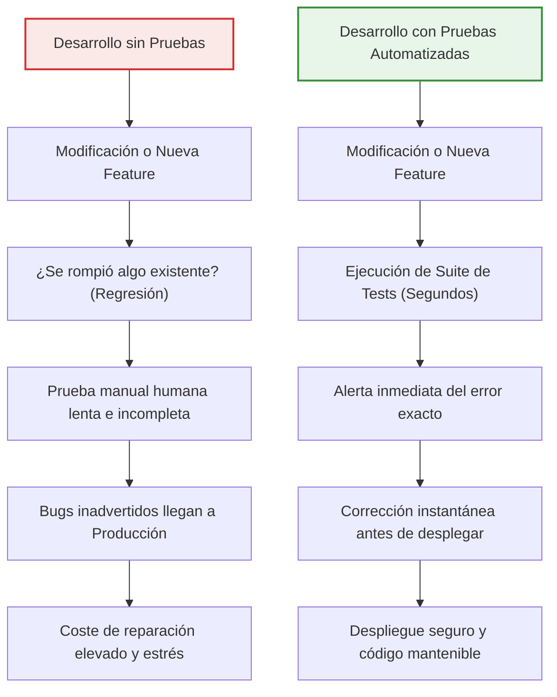
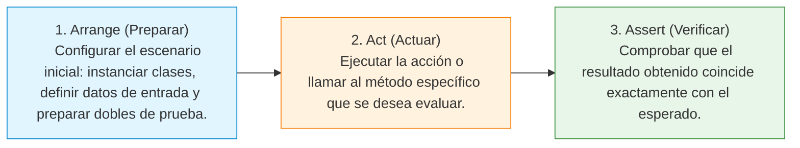
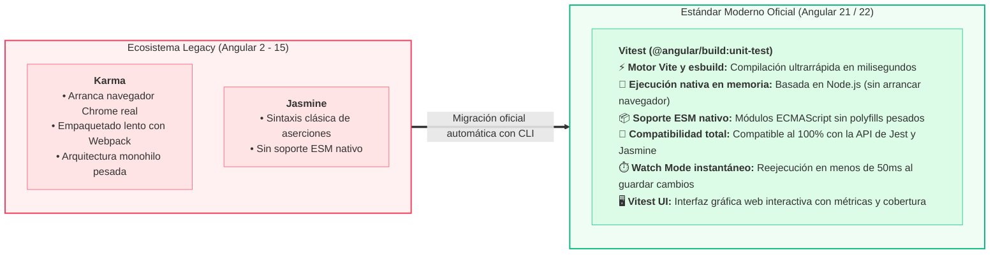
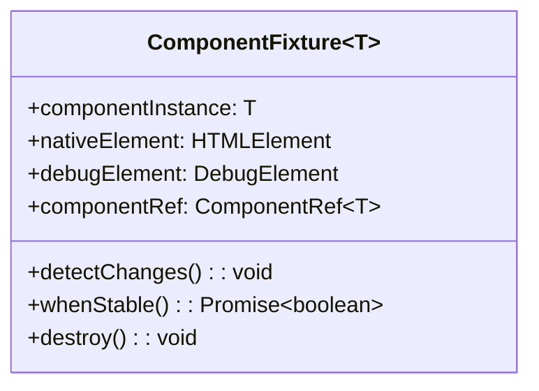

# Pruebas Unitarias y de Integración con Vitest en Angular

<div class="badges">
  <span class="badge badge-angular">Angular 19 - 22</span>
  <span class="badge badge-pro">Vitest (Runner Oficial)</span>
  <span class="badge badge-signals">TestBed & Signals</span>
  <span class="badge badge-core">Zoneless Testing</span>
</div>

## Objetivos de aprendizaje

1. Comprender la importancia crítica del testing en el ciclo de vida del software y dominar la pirámide de pruebas (unitarias, integración, E2E).
2. Conocer la evolución del ecosistema de testing en Angular: la obsolescencia de Karma/Jasmine y la adopción de **Vitest** como estándar oficial.
3. Dominar la sintaxis y aserciones de Vitest (`describe`, `it`/`test`, `expect`, matchers comunes y hooks de ciclo de vida).
4. Diseñar y ejecutar pruebas unitarias aisladas de lógica pura y servicios de Angular con y sin `TestBed`.
5. Probar servicios reactivos modernos basados en Signals (`signal()`, `computed()`, mutaciones de estado y efectos reactivos).
6. Configurar y dominar el testing de componentes Standalone mediante `TestBed` y `ComponentFixture`.
7. Inspeccionar el DOM, verificar renderizado y simular eventos de usuario respetando las nuevas APIs reactivas (Signal Inputs y Signal Outputs).
8. Realizar pruebas de integración para peticiones HTTP simuladas usando `provideHttpClientTesting()` y `HttpTestingController`.
9. Comprender las particularidades del testing en aplicaciones Zoneless (sin `zone.js`) utilizando `flushEffects()` y asincronía nativa con `async/await`.
10. Aplicar buenas prácticas arquitectónicas, el patrón AAA (Arrange, Act, Assert) y evitar los antipatrones más comunes en testing.

## Resultados de aprendizaje

Al finalizar esta unidad, el alumnado será capaz de:

- Explicar razonadamente por qué se testea y clasificar adecuadamente cada prueba en la pirámide de testing.
- Configurar y ejecutar suites de pruebas con el CLI de Angular (`ng test`, `--watch`, `--code-coverage` e interfaz visual Vitest UI).
- Escribir tests unitarios limpios, legibles y desacoplados para servicios con inyección de dependencias.
- Probar componentes Standalone verificando su plantilla, detección de cambios y enlaces de datos reactivos.
- Emular peticiones de red HTTP (éxito, error, headers y cancelación) sin contactar con un backend real.
- Escribir aserciones precisas para estados reactivos asíncronos y arquitecturas Zoneless.
- Refactorizar código con la seguridad y red de contención que proporciona una cobertura de pruebas sólida.

---

## Introducción al Testing: Fundamentos desde Cero

Para muchos desarrolladores noveles, escribir pruebas suele percibirse inicialmente como una tarea accesoria o una pérdida de tiempo: *"Si ya he probado mi componente en el navegador y el botón funciona, ¿para qué escribir 30 líneas de código adicionales?"*.

Sin embargo, en el desarrollo de software profesional, las pruebas automáticas no son un lujo, sino **el cimiento indispensable de la calidad, la velocidad de entrega y la estabilidad a largo plazo**.

### 1. ¿Por qué testeamos software?



Las razones fundamentales para escribir pruebas automatizadas son:

1. **Prevención de regresiones:** Una regresión ocurre cuando un cambio nuevo o la corrección de un bug estropea una funcionalidad que antes funcionaba perfectamente. Los tests garantizan que lo ya construido siga comportándose según lo especificado.
2. **Red de seguridad para refactorizar:** Mejorar la arquitectura, limpiar código sucio o actualizar dependencias (por ejemplo, migrar a una nueva versión de Angular) resulta aterrador sin tests. Con una buena suite de pruebas, si la suite pasa en verde, sabes con certeza que no has roto la lógica de negocio.
3. **Documentación viva y ejecutable:** Un test bien escrito describe exactamente qué hace una función o componente ante distintas condiciones (qué recibe, qué devuelve, cómo reacciona a errores). A diferencia de los comentarios o la documentación en PDF, los tests nunca quedan desactualizados porque, si el código cambia y el test no se actualiza, la compilación falla.
4. **Diseño de código superior (SoC y Desacoplamiento):** El código difícil de testear suele ser código mal diseñado (funciones gigantes con demasiadas responsabilidades, dependencias ocultas o mezcla de UI con lógica de negocio). Escribir tests nos obliga de forma natural a respetar el principio de responsabilidad única (Single Responsibility Principle) y la inyección de dependencias.

---

### 2. La Pirámide de Pruebas

No todas las pruebas son iguales ni evalúan el sistema con el mismo nivel de detalle. El modelo clásico para estructurar una estrategia de calidad es la **Pirámide de Pruebas**:

<div class="testing-pyramid-container">
  <div class="pyramid-scale-indicator">
    <span>▲ Mayor lentitud y coste de mantenimiento</span>
    <span>Flujos críticos E2E</span>
  </div>

  <!-- Nivel 3: Cúspide (E2E) -->
  <div class="pyramid-tier tier-e2e">
    <div class="pyramid-tier-header">
      <h4 class="pyramid-tier-title">🌐 Pruebas End-to-End (E2E)</h4>
      <span class="pyramid-tier-badge">5% - 10% del total</span>
    </div>
    <ul class="pyramid-tier-body">
      <li><strong>Herramientas:</strong> Playwright, Cypress.</li>
      <li><strong>Alcance:</strong> Simulan al usuario final navegando en un navegador real y prueban flujos completos (ej: Login ➔ Carrito ➔ Pasarela de pago).</li>
      <li><strong>Características:</strong> Lentas (segundos/minutos), mayor coste de mantenimiento y mayor propensión a fallos por red o UI volátil.</li>
    </ul>
  </div>

  <!-- Nivel 2: Intermedio (Integración) -->
  <div class="pyramid-tier tier-int">
    <div class="pyramid-tier-header">
      <h4 class="pyramid-tier-title">🧩 Pruebas de Integración (Componentes & DOM)</h4>
      <span class="pyramid-tier-badge">15% - 20% del total</span>
    </div>
    <ul class="pyramid-tier-body">
      <li><strong>Herramientas:</strong> Vitest + <code>TestBed</code> + <code>ComponentFixture</code>.</li>
      <li><strong>Alcance:</strong> Verifican la interacción entre la clase TypeScript, la plantilla HTML, renderizado del DOM, Signal Inputs/Outputs y servicios inyectados.</li>
      <li><strong>Características:</strong> Velocidad moderada (décimas de segundo), equilibran confianza visual y agilidad técnica.</li>
    </ul>
  </div>

  <!-- Nivel 1: Base ancha (Unitarias) -->
  <div class="pyramid-tier tier-unit">
    <div class="pyramid-tier-header">
      <h4 class="pyramid-tier-title">⚡ Pruebas Unitarias (Lógica Aislada)</h4>
      <span class="pyramid-tier-badge">70% - 80% (Base Fundamental)</span>
    </div>
    <ul class="pyramid-tier-body">
      <li><strong>Herramientas:</strong> Vitest (ejecución nativa en memoria sobre Node.js).</li>
      <li><strong>Alcance:</strong> Evalúan la unidad mínima de código en aislamiento estricto (funciones puras, cálculos, servicios con Signals, transformaciones de datos y mappers).</li>
      <li><strong>Características:</strong> Ultrarrápidas (pocos milisegundos por test), ejecución en memoria, muy económicas de escribir y mantener.</li>
    </ul>
  </div>

  <div class="pyramid-scale-indicator">
    <span>▼ Máxima velocidad de ejecución y aislamiento</span>
    <span>Base de Calidad Continua</span>
  </div>
</div>

| Criterio | Pruebas Unitarias | Pruebas de Integración | Pruebas End-to-End (E2E) |
|---|---|---|---|
| **Alcance** | Una clase, método o función aislada | Componente y su plantilla / Servicios interconectados | Toda la aplicación funcionando con backend real |
| **Velocidad de ejecución** | Milisegundos por test (miles por minuto) | Décimas de segundo por test | Varios segundos o minutos por flujo |
| **Coste de creación y mantenimiento** | Muy bajo | Moderado | Elevado (sensibles a cambios visuales) |
| **Herramientas en Angular** | **Vitest** (nativo), Node.js en memoria | **Vitest** + `TestBed` de Angular | Playwright, Cypress |
| **Porcentaje recomendado** | **70% - 80%** de la suite total | **15% - 20%** | **5% - 10%** |

---

### 3. El Patrón Fundamental: AAA (Arrange, Act, Assert)

Para que un test sea legible y mantenible, debe seguir una estructura estandarizada conocida universalmente como el patrón **AAA**:



#### Analogía del mundo real
Imagina que vas a probar el funcionamiento de una tostadora:
1. **Arrange (Preparar):** Conectas la tostadora a la corriente, seleccionas la potencia en nivel 3 y colocas una rebanada de pan blanco en la ranura.
2. **Act (Actuar):** Bajas la palanca para iniciar el tostado.
3. **Assert (Verificar):** Al saltar la palanca, compruebas que el pan esté dorado (no quemado ni crudo) y que la resistencia se haya apagado.

En código TypeScript, esto se traduce en:

```typescript
it('debe calcular el descuento correctamente para usuarios VIP', () => {
  // 1. Arrange (Preparar el escenario y datos)
  const servicio = new CalculadoraDescuentosService();
  const precioBase = 100;
  const esVip = true;

  // 2. Act (Ejecutar la operación a testear)
  const precioFinal = servicio.aplicarDescuento(precioBase, esVip);

  // 3. Assert (Comprobar que el resultado es el esperado)
  expect(precioFinal).toBe(80); // Esperamos 20% de descuento
});
```

---

### 4. Vocabulario y Conceptos Clave que Todo Desarrollador Debe Dominar

Antes de escribir una sola línea en Angular, es esencial dominar la terminología estándar:

- **Suite de Pruebas (`describe`):** Contenedor o bloque que agrupa varios tests relacionados lógicamente (por ejemplo, todos los tests de un servicio o de un componente específico).
- **Caso de Prueba o Spec (`it` o `test`):** Unidad individual que valida un comportamiento o caso concreto. El nombre debe ser una frase clara y descriptiva que complete la lectura: *"it should return total with tax"* o *"debe deshabilitar el botón cuando el formulario es inválido"*.
- **Aserción (`expect`):** Instrucción que evalúa si una condición se cumple. Si la condición falla, el test se marca en rojo.
- **Matcher (`toBe`, `toEqual`, `toContain`, etc.):** Método encadenado a `expect` que define el tipo de comparación a realizar.
- **Dobles de Prueba (Test Doubles):** Objetos falsos o simulados que reemplazan dependencias reales (como APIs externas o bases de datos) para aislar la prueba:
  - **Dummy:** Objeto que se pasa solo para rellenar parámetros obligatorios, pero nunca se utiliza.
  - **Stub:** Objeto que devuelve datos prefijados enlatados para satisfacer una llamada.
  - **Spy:** Función que envuelve a otra para espiar cuántas veces fue llamada, con qué argumentos y qué devolvió.
  - **Mock:** Objeto preprogramado con expectativas de comportamiento que verifica llamadas específicas.

---

## SECCIÓN 1: La Nueva Era de Pruebas en Angular: Vitest

### 1.1. Contexto Histórico: El Fin de Karma y Jasmine

Durante más de una década (desde los tiempos de AngularJS en 2012 hasta Angular 15), la configuración oficial de pruebas en Angular se basaba en **Karma** como ejecutor de pruebas y **Jasmine** como framework de aserciones.

**¿Por qué Angular abandonó Karma?**
1. **Lanzamiento de navegadores reales pesados:** Karma requería arrancar una instancia completa de Google Chrome o Firefox (o Chrome Headless). Esto consumía muchísima memoria RAM y varios segundos solo para inicializar el navegador antes de ejecutar el primer test.
2. **Lentitud extrema en proyectos medianos y grandes:** Suites con cientos de componentes tardaban varios minutos en ejecutarse en local y en entornos de Integración Continua (CI).
3. **Herramienta obsoleta y abandonada:** El proyecto Karma fue oficialmente declarado *deprecated* (obsoleto y sin mantenimiento activo) por la propia comunidad web en abril de 2023.

### 1.2. Por qué Vitest es el Estándar Moderno en Angular

A partir de **Angular 21 y 22**, el equipo de Angular ha consagrado a **Vitest** como el ejecutor de pruebas nativo y recomendado por defecto para todos los proyectos nuevos a través del builder `@angular/build:unit-test`.



**Ventajas clave de Vitest para el desarrollador:**
- **Velocidad de ejecución hasta 10 veces superior:** Los tests se ejecutan en memoria sobre Node.js usando hilos de ejecución paralelos rápidos (`worker threads`).
- **Recarga instantánea en modo Watch:** Cuando guardas un archivo `.spec.ts`, Vitest solo reejecuta ese test concreto en menos de 50 milisegundos gracias al grafo de dependencias de Vite.
- **Sintaxis limpia y compatible:** Vitest ofrece compatibilidad con la API de Jest y Jasmine, facilitando una transición suave.

---

### 1.3. Configuración en `angular.json` y `vitest.config.ts`

En los proyectos modernos de Angular generados con el CLI actual, la tarea `test` en `angular.json` utiliza el nuevo builder oficial:

```json
// angular.json
{
  "$schema": "./node_modules/@angular/cli/lib/config/schema.json",
  "version": 1,
  "projects": {
    "mi-aplicacion-angular": {
      "architect": {
        "test": {
          "builder": "@angular/build:unit-test",
          "options": {
            "tsConfig": "tsconfig.spec.json"
          }
        }
      }
    }
  }
}
```

Para personalizar opciones avanzadas de Vitest (como entornos de ejecución, reporters o umbrales de cobertura), Angular permite utilizar un archivo `vitest.config.ts` en la raíz del proyecto:

```typescript
// vitest.config.ts
import { defineConfig } from 'vitest/config';

export default defineConfig({
  test: {
    globals: true,
    environment: 'happy-dom', // Entorno DOM ultraligero en memoria (o 'jsdom')
    setupFiles: ['src/test-setup.ts'],
    coverage: {
      provider: 'v8',
      reporter: ['text', 'json', 'html'],
      reportsDirectory: './coverage',
      thresholds: {
        lines: 80,
        functions: 80,
        branches: 75,
        statements: 80
      }
    }
  }
});
```

#### Migración automática desde Jasmine/Karma
Si tienes un proyecto existente que aún utiliza Karma y Jasmine, Angular incluye un *schematic* oficial que migra las dependencias y la sintaxis de forma totalmente automática:

```bash
# Migrar automáticamente los archivos spec y dependencias de Jasmine a Vitest
ng g @schematics/angular:refactor-jasmine-vitest
```

---

### 1.4. Comandos del CLI y Herramientas

Para ejecutar las pruebas en tu terminal dispones de los siguientes comandos clave:

```bash
# 1. Ejecutar tests en modo vigilancia (observa cambios y reejecuta al guardar)
ng test

# 2. Ejecutar tests una sola vez y salir (ideal para pipelines de CI/CD en GitHub Actions o GitLab)
ng test --watch=false

# 3. Generar informe de cobertura de código (Code Coverage)
ng test --code-coverage

# 4. Abrir la interfaz web visual e interactiva de Vitest UI
npx vitest --ui
```

!!! tip "Vitest UI: La experiencia visual definitiva"
    El comando `npx vitest --ui` abre un dashboard web local en tu navegador donde puedes ver gráficamente qué tests han pasado, el tiempo exacto en milisegundos que tarda cada spec, explorar el árbol de componentes y ver la cobertura de código en tiempo real con una interfaz moderna y atractiva.

---

### 1.5. Comparativa de Sintaxis: Jasmine vs Vitest

La mayoría de aserciones básicas son muy similares, pero Vitest introduce funciones de espionaje (`vi`) más potentes y basadas en promesas nativas:

| Característica | Jasmine (Legacy) | Vitest (Estándar Moderno) |
|---|---|---|
| **Estructura** | `describe()`, `it()` | `describe()`, `it()` o `test()` |
| **Aserción de igualdad estricta** | `expect(a).toBe(b)` | `expect(a).toBe(b)` |
| **Aserción de objetos/arrays** | `expect(obj).toEqual(esperado)` | `expect(obj).toEqual(esperado)` |
| **Verificación de verdad/falsedad** | `toBeTrue()`, `toBeFalse()` | `toBeTruthy()`, `toBeFalsy()` |
| **Verificación de nulos o indefinidos** | `toBeNull()`, `toBeUndefined()` | `toBeNull()`, `toBeUndefined()` |
| **Crear un espía vacío** | `jasmine.createSpy('nombre')` | `vi.fn()` |
| **Espiar método existente** | `spyOn(objeto, 'metodo')` | `vi.spyOn(objeto, 'metodo')` |
| **Simular retorno de valor** | `.and.returnValue(valor)` | `.mockReturnValue(valor)` |
| **Simular retorno de Promesa** | `.and.resolveTo(valor)` | `.mockResolvedValue(valor)` |
| **Temporizadores falsos** | `jasmine.clock().install()` | `vi.useFakeTimers()` |
| **Avanzar tiempo en pruebas** | `jasmine.clock().tick(1000)` | `vi.advanceTimersByTime(1000)` |

---

## SECCIÓN 2: Pruebas Unitarias Aisladas (Servicios y Lógica de Negocio)

La lógica de negocio pura (cálculos matemáticos, validadores, formateadores o servicios sin dependencias visuales) debe probarse de la forma más rápida y desacoplada posible: **sin involucrar a Angular**.

### 2.1. Pruebas Unitarias Puras sin `TestBed` (Instanciación Directa)

Cuando un servicio no depende de inyectores complejos, no necesitas configurar el motor de Angular. Puedes instanciarlo con el operador nativo `new` de TypeScript. Esto hace que tus tests se ejecuten a velocidades de vértigo (menos de 2 milisegundos por test).

#### El Servicio a Testear: `CalculadoraIvaService`

```typescript
// src/app/services/calculadora-iva.service.ts
import { Injectable } from '@angular/core';

export type TipoIva = 'general' | 'reducido' | 'superreducido';

@Injectable({
  providedIn: 'root'
})
export class CalculadoraIvaService {
  private readonly tasasIva: Record<TipoIva, number> = {
    general: 0.21,
    reducido: 0.10,
    superreducido: 0.04
  };

  calcularIva(importeBase: number, tipo: TipoIva = 'general'): number {
    if (importeBase < 0) {
      throw new Error('El importe base no puede ser negativo');
    }
    const tasa = this.tasasIva[tipo];
    return Number((importeBase * tasa).toFixed(2));
  }

  calcularTotalConIva(importeBase: number, tipo: TipoIva = 'general'): number {
    const cuotaIva = this.calcularIva(importeBase, tipo);
    return Number((importeBase + cuotaIva).toFixed(2));
  }
}
```

#### La Suite de Pruebas con Vitest

```typescript
// src/app/services/calculadora-iva.service.spec.ts
import { describe, it, expect, beforeEach } from 'vitest';
import { CalculadoraIvaService } from './calculadora-iva.service';

describe('CalculadoraIvaService (Pruebas Aisladas)', () => {
  let servicio: CalculadoraIvaService;

  // Se ejecuta antes de CADA test individual: garantiza aislamiento e inmutabilidad
  beforeEach(() => {
    servicio = new CalculadoraIvaService();
  });

  it('debe instanciarse correctamente sin errores', () => {
    expect(servicio).toBeDefined();
  });

  describe('calcularIva()', () => {
    it('debe calcular el 21% de IVA para tipo general por defecto', () => {
      // Arrange
      const base = 100;

      // Act
      const resultado = servicio.calcularIva(base);

      // Assert
      expect(resultado).toBe(21.00);
    });

    it('debe calcular el 10% de IVA para tipo reducido', () => {
      const base = 250;
      const resultado = servicio.calcularIva(base, 'reducido');
      expect(resultado).toBe(25.00);
    });

    it('debe calcular el 4% de IVA para tipo superreducido', () => {
      const base = 50;
      const resultado = servicio.calcularIva(base, 'superreducido');
      expect(resultado).toBe(2.00);
    });

    it('debe lanzar una excepción si el importe base es negativo', () => {
      // Para verificar que una función lanza un error, debemos envolver la llamada en una función anónima
      expect(() => servicio.calcularIva(-10)).toThrowError(
        'El importe base no puede ser negativo'
      );
    });
  });

  describe('calcularTotalConIva()', () => {
    it('debe sumar correctamente la base imponible y el IVA correspondiente', () => {
      const base = 100;
      const total = servicio.calcularTotalConIva(base, 'general');
      expect(total).toBe(121.00);
    });
  });
});
```

---

### 2.2. Pruebas con `TestBed` y el Sistema de Inyección de Dependencias

Cuando un servicio depende de otros servicios inyectados mediante `inject()` o constructor, entra en juego el `TestBed`.

`TestBed` es la utilidad central de Angular para crear un entorno de inyección de dependencias virtual y configurado a medida para cada prueba.

```typescript
// src/app/services/logger.service.ts
import { Injectable } from '@angular/core';

@Injectable({ providedIn: 'root' })
export class LoggerService {
  log(mensaje: string): void {
    console.log(`[INFO]: ${mensaje}`);
  }
}
```

```typescript
// src/app/services/notificador.service.ts
import { Injectable, inject } from '@angular/core';
import { LoggerService } from './logger.service';

@Injectable({ providedIn: 'root' })
export class NotificadorService {
  private readonly logger = inject(LoggerService);

  enviarAlerta(usuario: string, texto: string): boolean {
    if (!usuario.trim() || !texto.trim()) {
      return false;
    }
    this.logger.log(`Alerta para ${usuario}: ${texto}`);
    return true;
  }
}
```

#### Test con Doble de Prueba (Mock) inyectado en `TestBed`:

```typescript
// src/app/services/notificador.service.spec.ts
import { describe, it, expect, beforeEach, vi } from 'vitest';
import { TestBed } from '@angular/core/testing';
import { NotificadorService } from './notificador.service';
import { LoggerService } from './logger.service';

describe('NotificadorService con TestBed y Mocks', () => {
  let servicio: NotificadorService;
  let loggerMock: { log: ReturnType<typeof vi.fn> };

  beforeEach(() => {
    // 1. Creamos un mock con una función espía de Vitest para aislar el Logger
    loggerMock = {
      log: vi.fn()
    };

    // 2. Configuramos el módulo de pruebas de Angular indicando qué proveer
    TestBed.configureTestingModule({
      providers: [
        NotificadorService,
        // Cuando alguien pida LoggerService, Angular entregará nuestro loggerMock
        { provide: LoggerService, useValue: loggerMock }
      ]
    });

    // 3. Obtenemos la instancia del servicio a través del inyector de TestBed
    servicio = TestBed.inject(NotificadorService);
  });

  it('debe registrar el log y retornar true cuando los datos son válidos', () => {
    // Act
    const resultado = servicio.enviarAlerta('Carlos', 'Servidor reiniciado');

    // Assert
    expect(resultado).toBe(true);
    // Verificamos que el mock fue llamado exactamente 1 vez con el mensaje formateado
    expect(loggerMock.log).toHaveBeenCalledTimes(1);
    expect(loggerMock.log).toHaveBeenCalledWith('Alerta para Carlos: Servidor reiniciado');
  });

  it('no debe llamar al logger y debe retornar false si los datos están vacíos', () => {
    const resultado = servicio.enviarAlerta('', '');

    expect(resultado).toBe(false);
    expect(loggerMock.log).not.toHaveBeenCalled();
  });
});
```

---

### 2.3. Testing de Reactividad con Signals

Las **Signals** (`signal()`, `computed()`, `effect()`) son síncronas en su lectura y evaluación, lo que simplifica enormemente el testing en comparación con los Observables de RxJS.

#### El Servicio Reactivo: `ContadorService`

```typescript
// src/app/services/contador.service.ts
import { Injectable, signal, computed } from '@angular/core';

@Injectable({ providedIn: 'root' })
export class ContadorService {
  // Estado privado con Signal
  private readonly _cuenta = signal<number>(0);

  // Señal pública de solo lectura
  readonly cuenta = this._cuenta.asReadonly();

  // Señal computada derivada
  readonly esPar = computed(() => this._cuenta() % 2 === 0);
  readonly descripcion = computed(() => `El valor actual es: ${this._cuenta()}`);

  incrementar(): void {
    this._cuenta.update(valor => valor + 1);
  }

  decrementar(): void {
    if (this._cuenta() > 0) {
      this._cuenta.update(valor => valor - 1);
    }
  }

  establecerValor(nuevoValor: number): void {
    if (nuevoValor >= 0) {
      this._cuenta.set(nuevoValor);
    }
  }

  resetear(): void {
    this._cuenta.set(0);
  }
}
```

#### Testeando Signals y Computeds con Vitest:

```typescript
// src/app/services/contador.service.spec.ts
import { describe, it, expect, beforeEach } from 'vitest';
import { ContadorService } from './contador.service';

describe('ContadorService (Testing de Signals y Computeds)', () => {
  let servicio: ContadorService;

  beforeEach(() => {
    servicio = new ContadorService();
  });

  it('debe inicializarse con valor 0 y ser número par', () => {
    // Para leer una Signal en un test, simplemente la ejecutamos como función: cuenta()
    expect(servicio.cuenta()).toBe(0);
    expect(servicio.esPar()).toBe(true);
    expect(servicio.descripcion()).toBe('El valor actual es: 0');
  });

  it('debe incrementar la cuenta reactivamente y actualizar computeds', () => {
    servicio.incrementar();

    expect(servicio.cuenta()).toBe(1);
    expect(servicio.esPar()).toBe(false); // 1 es impar
    expect(servicio.descripcion()).toBe('El valor actual es: 1');

    servicio.incrementar();
    expect(servicio.cuenta()).toBe(2);
    expect(servicio.esPar()).toBe(true); // 2 es par
  });

  it('no debe permitir decrementar por debajo de cero', () => {
    servicio.decrementar();
    expect(servicio.cuenta()).toBe(0); // Se mantiene en 0
  });

  it('debe establecer un valor arbitrario válido con .set()', () => {
    servicio.establecerValor(42);

    expect(servicio.cuenta()).toBe(42);
    expect(servicio.esPar()).toBe(true);
    expect(servicio.descripcion()).toBe('El valor actual es: 42');
  });

  it('debe reiniciar la cuenta a 0 con resetear()', () => {
    servicio.establecerValor(15);
    servicio.resetear();

    expect(servicio.cuenta()).toBe(0);
  });
});
```

---

## SECCIÓN 3: Pruebas de Componentes Standalone (`TestBed` & `ComponentFixture`)

Probar componentes es una prueba de integración: verificamos que la clase TypeScript interactúe correctamente con el template HTML y el DOM generado.

### 3.1. Anatomía de `ComponentFixture<T>`

Al crear un componente con `TestBed.createComponent(MiComponente)`, recibimos un objeto `ComponentFixture<MiComponente>`. Este objeto es el puente entre el código del test y el renderizado de Angular:



- **`fixture.componentInstance`:** Instancia directa de la clase TypeScript del componente. Permite leer sus métodos y propiedades.
- **`fixture.nativeElement`:** Referencia al elemento HTML raíz del componente en el DOM (`HTMLElement`). Permite hacer `querySelector()`, leer `textContent`, clases, etc.
- **`fixture.debugElement`:** Envoltorio de depuración de Angular. Permite buscar elementos mediante predicados de Angular (`By.css()`, `By.directive()`).
- **`fixture.componentRef`:** Referencia de bajo nivel de Angular. Crucial para asignar **Signal Inputs** mediante `fixture.componentRef.setInput('nombre', valor)`.
- **`fixture.detectChanges()`:** Fuerza a Angular a ejecutar la detección de cambios, sincronizando las variables y Signals de TypeScript con la plantilla HTML.

---

### 3.2. Componente a Testear: `BotonLikeComponent` (Standalone con Signals)

```typescript
// src/app/components/boton-like.component.ts
import { Component, input, output, signal } from '@angular/core';

@Component({
  selector: 'app-boton-like',
  template: `
    <div class="like-container">
      <button 
        type="button"
        class="btn-like"
        [class.activo]="leGusta()"
        [disabled]="deshabilitado()"
        (click)="alternarLike()"
        data-testid="like-button">
        {{ leGusta() ? '❤️ Te gusta' : '🤍 Dar like' }}
      </button>

      <span class="contador-likes" data-testid="likes-count">
        {{ totalLikes() }} likes
      </span>
    </div>
  `,
  styles: [`
    .activo { font-weight: bold; color: crimson; }
    button:disabled { opacity: 0.5; cursor: not-allowed; }
  `]
})
export class BotonLikeComponent {
  // Signal Inputs modernos
  readonly totalInicial = input<number>(0);
  readonly deshabilitado = input<boolean>(false);

  // Signal Output moderno
  readonly cambioLike = output<boolean>();

  // Estado interno con Signal
  readonly leGusta = signal<boolean>(false);
  readonly totalLikes = signal<number>(0);

  // Inicializar estado según input cuando el componente carga
  ngOnInit(): void {
    this.totalLikes.set(this.totalInicial());
  }

  alternarLike(): void {
    if (this.deshabilitado()) return;

    const nuevoEstado = !this.leGusta();
    this.leGusta.set(nuevoEstado);

    // Actualizar contador
    this.totalLikes.update(total => nuevoEstado ? total + 1 : total - 1);

    // Emitir evento al padre
    this.cambioLike.emit(nuevoEstado);
  }
}
```

---

### 3.3. Suite Completa del Componente: Inputs, DOM, Eventos y Outputs

```typescript
// src/app/components/boton-like.component.spec.ts
import { describe, it, expect, beforeEach } from 'vitest';
import { ComponentFixture, TestBed } from '@angular/core/testing';
import { BotonLikeComponent } from './boton-like.component';
import { By } from '@angular/platform-browser';

describe('BotonLikeComponent (Testing de Componente Standalone)', () => {
  let component: BotonLikeComponent;
  let fixture: ComponentFixture<BotonLikeComponent>;
  let compiled: HTMLElement;

  beforeEach(async () => {
    // 1. Configuramos el módulo de pruebas importando el componente Standalone
    await TestBed.configureTestingModule({
      imports: [BotonLikeComponent]
    }).compileComponents();

    // 2. Creamos el fixture y la instancia
    fixture = TestBed.createComponent(BotonLikeComponent);
    component = fixture.componentInstance;
    compiled = fixture.nativeElement as HTMLElement;
  });

  it('debe crearse correctamente', () => {
    expect(component).toBeTruthy();
  });

  it('debe renderizar el texto inicial y contador en 0 por defecto', () => {
    // 3. Disparamos la detección de cambios para renderizar el template inicial
    fixture.detectChanges();

    const boton = compiled.querySelector<HTMLButtonElement>('[data-testid="like-button"]');
    const contador = compiled.querySelector<HTMLElement>('[data-testid="likes-count"]');

    expect(boton?.textContent?.trim()).toBe('🤍 Dar like');
    expect(contador?.textContent?.trim()).toBe('0 likes');
    expect(boton?.classList.contains('activo')).toBe(false);
  });

  it('debe respetar el Signal Input totalInicial asignado mediante setInput()', () => {
    // Asignamos valor a un Signal Input usando componentRef
    fixture.componentRef.setInput('totalInicial', 25);
    
    // Ejecutamos detección de cambios para que ngOnInit procese el nuevo input
    fixture.detectChanges();

    const contador = compiled.querySelector('[data-testid="likes-count"]');
    expect(contador?.textContent?.trim()).toBe('25 likes');
  });

  it('debe alternar el estado de like al hacer clic en el botón', () => {
    fixture.detectChanges();

    const boton = compiled.querySelector<HTMLButtonElement>('[data-testid="like-button"]')!;

    // 1. Primer clic: Dar like
    boton.click();
    fixture.detectChanges(); // Refrescar DOM tras mutación de Signals

    expect(component.leGusta()).toBe(true);
    expect(boton.textContent?.trim()).toBe('❤️ Te gusta');
    expect(boton.classList.contains('activo')).toBe(true);
    expect(component.totalLikes()).toBe(1);

    // 2. Segundo clic: Quitar like
    boton.click();
    fixture.detectChanges();

    expect(component.leGusta()).toBe(false);
    expect(boton.textContent?.trim()).toBe('🤍 Dar like');
    expect(boton.classList.contains('activo')).toBe(false);
    expect(component.totalLikes()).toBe(0);
  });

  it('debe emitir el Signal Output cambioLike al hacer clic', () => {
    fixture.detectChanges();

    // Espiamos las emisiones suscribiéndonos al output
    let ultimoEventoEmitido: boolean | undefined;
    component.cambioLike.subscribe(valor => {
      ultimoEventoEmitido = valor;
    });

    const boton = compiled.querySelector<HTMLButtonElement>('[data-testid="like-button"]')!;
    boton.click();

    expect(ultimoEventoEmitido).toBe(true);
  });

  it('debe deshabilitar el botón y no reaccionar a clics si el input deshabilitado es true', () => {
    fixture.componentRef.setInput('deshabilitado', true);
    fixture.detectChanges();

    const boton = compiled.querySelector<HTMLButtonElement>('[data-testid="like-button"]')!;
    
    expect(boton.disabled).toBe(true);

    // Intentamos hacer clic
    boton.click();
    fixture.detectChanges();

    // No debe haber cambiado el estado
    expect(component.leGusta()).toBe(false);
    expect(component.totalLikes()).toBe(0);
  });
});
```

---

## SECCIÓN 4: Pruebas de Servicios HTTP y Mocks (`HttpTestingController`)

En las pruebas unitarias y de integración, **está terminantemente prohibido realizar peticiones HTTP reales a servidores de producción o desarrollo**.

### 4.1. ¿Por qué simular peticiones HTTP?
1. **Lentitud e inestabilidad:** Una prueba que depende de internet puede fallar si la red se corta o si el servidor externo tarda 3 segundos en responder.
2. **Efectos secundarios destructivos:** Imagina un test que ejecuta `DELETE /api/usuarios/1`. En cada ejecución borraría datos reales de la base de datos.
3. **Imposibilidad de probar errores forzados:** Con un servidor real es difícil forzar un error HTTP 500 (Internal Server Error) o una caída de red para probar cómo reacciona tu aplicación.

### 4.2. Configuración con `provideHttpClientTesting()`

Angular proporciona el paquete `@angular/common/http/testing`, que incluye la herramienta de simulación `HttpTestingController`:

```typescript
TestBed.configureTestingModule({
  providers: [
    provideHttpClient(),
    provideHttpClientTesting() // Reemplaza el backend HTTP real por uno simulado en memoria
  ]
});
```

---

### 4.3. El Servicio a Testear: `UsuariosHttpService`

```typescript
// src/app/services/usuarios-http.service.ts
import { Injectable, inject } from '@angular/core';
import { HttpClient, HttpErrorResponse } from '@angular/common/http';
import { Observable, catchError, throwError } from 'rxjs';

export interface Usuario {
  id: number;
  nombre: string;
  email: string;
}

@Injectable({
  providedIn: 'root'
})
export class UsuariosHttpService {
  private readonly http = inject(HttpClient);
  readonly apiUrl = 'https://api.ejemplo.com/v1/usuarios';

  obtenerUsuarios(): Observable<Usuario[]> {
    return this.http.get<Usuario[]>(this.apiUrl).pipe(
      catchError((error: HttpErrorResponse) => {
        return throwError(() => new Error(`Error al cargar usuarios: ${error.status}`));
      })
    );
  }

  crearUsuario(nuevoUsuario: Omit<Usuario, 'id'>): Observable<Usuario> {
    return this.http.post<Usuario>(this.apiUrl, nuevoUsuario);
  }
}
```

---

### 4.4. Suite de Pruebas HTTP con `HttpTestingController`

```typescript
// src/app/services/usuarios-http.service.spec.ts
import { describe, it, expect, beforeEach, afterEach } from 'vitest';
import { TestBed } from '@angular/core/testing';
import { provideHttpClient } from '@angular/common/http';
import { HttpTestingController, provideHttpClientTesting } from '@angular/common/http/testing';
import { UsuariosHttpService, Usuario } from './usuarios-http.service';

describe('UsuariosHttpService con HttpTestingController', () => {
  let servicio: UsuariosHttpService;
  let httpTesting: HttpTestingController;

  beforeEach(() => {
    TestBed.configureTestingModule({
      providers: [
        UsuariosHttpService,
        provideHttpClient(),
        provideHttpClientTesting()
      ]
    });

    servicio = TestBed.inject(UsuariosHttpService);
    httpTesting = TestBed.inject(HttpTestingController);
  });

  // afterEach: Garantiza que NO queden peticiones HTTP pendientes sin verificar
  afterEach(() => {
    httpTesting.verify();
  });

  it('debe obtener la lista de usuarios correctamente mediante GET', () => {
    const usuariosMock: Usuario[] = [
      { id: 1, nombre: 'Ana García', email: 'ana@ejemplo.com' },
      { id: 2, nombre: 'David López', email: 'david@ejemplo.com' }
    ];

    let respuestaRecibida: Usuario[] | undefined;

    // 1. Act: Llamamos al método del servicio
    servicio.obtenerUsuarios().subscribe(datos => {
      respuestaRecibida = datos;
    });

    // 2. Interceptamos la petición con httpTesting.expectOne()
    const req = httpTesting.expectOne('https://api.ejemplo.com/v1/usuarios');

    // 3. Verificamos que sea de tipo GET
    expect(req.request.method).toBe('GET');

    // 4. Simulamos la respuesta exitosa del servidor enviando los datos simulados
    req.flush(usuariosMock);

    // 5. Assert: Comprobamos que el servicio emitió los datos esperados
    expect(respuestaRecibida).toEqual(usuariosMock);
    expect(respuestaRecibida?.length).toBe(2);
  });

  it('debe enviar datos por POST al crear un usuario y devolver el usuario creado', () => {
    const nuevoUsuario: Omit<Usuario, 'id'> = {
      nombre: 'Elena Ruiz',
      email: 'elena@ejemplo.com'
    };

    const usuarioCreadoMock: Usuario = {
      id: 99,
      ...nuevoUsuario
    };

    let resultado: Usuario | undefined;

    servicio.crearUsuario(nuevoUsuario).subscribe(usuario => {
      resultado = usuario;
    });

    // Interceptamos la petición POST
    const req = httpTesting.expectOne('https://api.ejemplo.com/v1/usuarios');

    expect(req.request.method).toBe('POST');
    // Verificamos el cuerpo (payload) enviado por el servicio
    expect(req.request.body).toEqual(nuevoUsuario);

    // Respondemos con el recurso creado
    req.flush(usuarioCreadoMock);

    expect(resultado).toEqual(usuarioCreadoMock);
    expect(resultado?.id).toBe(99);
  });

  it('debe manejar errores HTTP 500 y transformar el mensaje con catchError', () => {
    let mensajeError: string | undefined;

    servicio.obtenerUsuarios().subscribe({
      next: () => {
        // No debería entrar aquí
        throw new Error('No debería haber tenido éxito');
      },
      error: (err: Error) => {
        mensajeError = err.message;
      }
    });

    const req = httpTesting.expectOne('https://api.ejemplo.com/v1/usuarios');

    // Simulamos un error del servidor (HTTP 500 Internal Server Error)
    req.flush('Error interno del servidor', {
      status: 500,
      statusText: 'Internal Server Error'
    });

    expect(mensajeError).toBe('Error al cargar usuarios: 500');
  });
});
```

---

## SECCIÓN 5: Testing en Aplicaciones Modernas Zoneless (Sin `zone.js`)

En Angular 19, 21 y 22, las aplicaciones pueden prescindir de `zone.js` mediante la detección de cambios **Zoneless** (`provideExperimentalZonelessChangeDetection()`).

### 5.1. ¿Qué Cambia en el Testing sin Zone.js?

Tradicionalmente con Zone.js, los tests de Angular utilizaban las funciones `fakeAsync()` y `tick()` para detener y avanzar el tiempo de los temporizadores y microtareas. 

En un entorno **Zoneless con Vitest**, la arquitectura se simplifica enormemente:
1. **No se utiliza `fakeAsync()`:** El parcheo global de Zone.js es innecesario y contraproducente en entornos modernos ESM.
2. **Uso de Asincronía Nativa (`async/await`):** Las pruebas asíncronas se escriben con código JavaScript/TypeScript estándar.
3. **Temporizadores con Vitest:** Para manipular el tiempo (`setTimeout`, `setInterval`), se utilizan los temporizadores nativos de Vitest: `vi.useFakeTimers()` y `vi.advanceTimersByTime(ms)`.
4. **Sincronización de Efectos con `TestBed.flushEffects()`:** Los `effect()` de Angular se ejecutan de forma asíncrona dentro de la cola del scheduler. En tests, `TestBed.flushEffects()` obliga a Angular a resolver inmediatamente todos los efectos pendientes de forma síncrona.

```typescript
it('debe ejecutar un effect() y actualizar el DOM de forma síncrona', () => {
  // Modificamos una Signal que activa un effect()
  servicio.actualizarPreferencia('tema-oscuro');

  // Forzamos la ejecución de los efectos en cola
  TestBed.flushEffects();

  // El efecto ya se ejecutó de forma determinista
  expect(servicio.temaActual()).toBe('tema-oscuro');
});
```

---

## SECCIÓN 6: Ejemplos Guiados de Extremo a Extremo (Tutoriales Paso a Paso)

### Ejemplo Guiado 1: Servicio de Lógica de Negocio `CarritoCompraService`

Vamos a construir un servicio real de carrito de compras que gestiona un catálogo, calcula subtotales, aplica descuentos promocionales y calcula el IVA del 21% mediante Signals computadas.

#### 1. Definición del Modelo y Servicio

```typescript
// src/app/models/carrito.models.ts
export interface ItemCarrito {
  readonly id: string;
  readonly nombre: string;
  readonly precioUnitario: number;
  readonly cantidad: number;
}
```

```typescript
// src/app/services/carrito-compra.service.ts
import { Injectable, signal, computed } from '@angular/core';
import { ItemCarrito } from '../models/carrito.models';

@Injectable({
  providedIn: 'root'
})
export class CarritoCompraService {
  private readonly _items = signal<readonly ItemCarrito[]>([]);
  private readonly _cuponDescuento = signal<number>(0); // Porcentaje de 0 a 100

  // Señales de solo lectura
  readonly items = this._items.asReadonly();
  readonly cuponDescuento = this._cuponDescuento.asReadonly();

  // Computeds derivadas
  readonly cantidadTotalItems = computed(() => 
    this._items().reduce((acum, item) => acum + item.cantidad, 0)
  );

  readonly subtotal = computed(() => {
    const total = this._items().reduce(
      (acum, item) => acum + (item.precioUnitario * item.cantidad), 
      0
    );
    return Number(total.toFixed(2));
  });

  readonly importeDescuento = computed(() => {
    const porcentaje = this._cuponDescuento();
    const descuento = (this.subtotal() * porcentaje) / 100;
    return Number(descuento.toFixed(2));
  });

  readonly baseImponibleConDescuento = computed(() => {
    const base = this.subtotal() - this.importeDescuento();
    return Math.max(0, Number(base.toFixed(2)));
  });

  readonly cuotaIva = computed(() => {
    const iva = this.baseImponibleConDescuento() * 0.21;
    return Number(iva.toFixed(2));
  });

  readonly totalFinal = computed(() => {
    const total = this.baseImponibleConDescuento() + this.cuotaIva();
    return Number(total.toFixed(2));
  });

  // Métodos de negocio inmutables
  agregarProducto(producto: { id: string; nombre: string; precioUnitario: number }): void {
    const itemsActuales = this._items();
    const indiceExistente = itemsActuales.findIndex(i => i.id === producto.id);

    if (indiceExistente >= 0) {
      // Si ya existe, incrementamos cantidad respetando inmutabilidad
      this._items.update(items => items.map((item, idx) => 
        idx === indiceExistente 
          ? { ...item, cantidad: item.cantidad + 1 }
          : item
      ));
    } else {
      // Si es nuevo, lo añadimos con cantidad 1
      this._items.update(items => [
        ...items,
        { ...producto, cantidad: 1 }
      ]);
    }
  }

  eliminarProducto(productoId: string): void {
    this._items.update(items => items.filter(item => item.id !== productoId));
  }

  aplicarCupon(porcentaje: number): boolean {
    if (porcentaje < 0 || porcentaje > 100) {
      return false;
    }
    this._cuponDescuento.set(porcentaje);
    return true;
  }

  vaciar(): void {
    this._items.set([]);
    this._cuponDescuento.set(0);
  }
}
```

#### 2. Suite de Pruebas Exhaustiva con Vitest

```typescript
// src/app/services/carrito-compra.service.spec.ts
import { describe, it, expect, beforeEach } from 'vitest';
import { CarritoCompraService } from './carrito-compra.service';

describe('CarritoCompraService (Pruebas Unitarias de Negocio)', () => {
  let carrito: CarritoCompraService;

  beforeEach(() => {
    carrito = new CarritoCompraService();
  });

  it('debe iniciar con el carrito vacío y totales en 0', () => {
    expect(carrito.items().length).toBe(0);
    expect(carrito.cantidadTotalItems()).toBe(0);
    expect(carrito.subtotal()).toBe(0);
    expect(carrito.cuotaIva()).toBe(0);
    expect(carrito.totalFinal()).toBe(0);
  });

  it('debe agregar un producto nuevo y recalcular totales', () => {
    carrito.agregarProducto({ id: 'P1', nombre: 'Curso de Angular', precioUnitario: 100 });

    expect(carrito.items().length).toBe(1);
    expect(carrito.items()[0]).toEqual({
      id: 'P1',
      nombre: 'Curso de Angular',
      precioUnitario: 100,
      cantidad: 1
    });

    expect(carrito.subtotal()).toBe(100.00);
    expect(carrito.cuotaIva()).toBe(21.00); // 21% de 100
    expect(carrito.totalFinal()).toBe(121.00);
  });

  it('debe incrementar la cantidad si el producto ya estaba en el carrito', () => {
    carrito.agregarProducto({ id: 'P1', nombre: 'Teclado Mecánico', precioUnitario: 50 });
    carrito.agregarProducto({ id: 'P1', nombre: 'Teclado Mecánico', precioUnitario: 50 });

    expect(carrito.items().length).toBe(1);
    expect(carrito.items()[0].cantidad).toBe(2);
    expect(carrito.subtotal()).toBe(100.00);
    expect(carrito.totalFinal()).toBe(121.00);
  });

  it('debe aplicar un cupón de descuento y ajustar la base imponible y el IVA', () => {
    // Subtotal: 200€
    carrito.agregarProducto({ id: 'P1', nombre: 'Monitor 4K', precioUnitario: 200 });

    // Aplicar 10% de descuento (20€ de descuento -> Base: 180€)
    const exito = carrito.aplicarCupon(10);

    expect(exito).toBe(true);
    expect(carrito.importeDescuento()).toBe(20.00);
    expect(carrito.baseImponibleConDescuento()).toBe(180.00);
    expect(carrito.cuotaIva()).toBe(37.80); // 21% de 180
    expect(carrito.totalFinal()).toBe(217.80); // 180 + 37.80
  });

  it('debe rechazar cupones inválidos con porcentaje menor a 0 o mayor a 100', () => {
    expect(carrito.aplicarCupon(-5)).toBe(false);
    expect(carrito.aplicarCupon(105)).toBe(false);
    expect(carrito.cuponDescuento()).toBe(0);
  });

  it('debe eliminar un producto por su identificador', () => {
    carrito.agregarProducto({ id: 'P1', nombre: 'Ratón', precioUnitario: 20 });
    carrito.agregarProducto({ id: 'P2', nombre: 'Alfombrilla', precioUnitario: 10 });

    carrito.eliminarProducto('P1');

    expect(carrito.items().length).toBe(1);
    expect(carrito.items()[0].id).toBe('P2');
    expect(carrito.subtotal()).toBe(10.00);
  });

  it('debe vaciar el carrito completamente', () => {
    carrito.agregarProducto({ id: 'P1', nombre: 'Libro TypeScript', precioUnitario: 30 });
    carrito.aplicarCupon(15);

    carrito.vaciar();

    expect(carrito.items().length).toBe(0);
    expect(carrito.cuponDescuento()).toBe(0);
    expect(carrito.totalFinal()).toBe(0);
  });
});
```

---

### Ejemplo Guiado 2: Componente Standalone `TarjetaUsuarioComponent`

#### 1. Implementación del Componente

```typescript
// src/app/components/tarjeta-usuario.component.ts
import { Component, input, output, signal } from '@angular/core';

export interface DatosUsuario {
  id: number;
  nombre: string;
  rol: 'administrador' | 'estudiante' | 'docente';
  activo: boolean;
}

@Component({
  selector: 'app-tarjeta-usuario',
  template: `
    <article class="tarjeta-usuario" [class.bloqueado]="!estaActivo()">
      <header>
        <h3 data-testid="usuario-nombre">{{ usuario().nombre }}</h3>
        <span class="badge" [attr.data-rol]="usuario().rol" data-testid="usuario-rol">
          {{ usuario().rol }}
        </span>
      </header>

      <div class="acciones">
        <button 
          type="button" 
          (click)="alternarEstado()" 
          data-testid="btn-toggle-estado">
          {{ estaActivo() ? 'Suspender cuenta' : 'Reactivar cuenta' }}
        </button>
      </div>
    </article>
  `,
  styles: [`
    .tarjeta-usuario { border: 1px solid #ddd; padding: 1rem; border-radius: 8px; }
    .tarjeta-usuario.bloqueado { opacity: 0.6; background-color: #f5f5f5; }
    .badge { font-weight: bold; text-transform: uppercase; }
  `]
})
export class TarjetaUsuarioComponent {
  // Signal Input obligatorio
  readonly usuario = input.required<DatosUsuario>();

  // Signal Output para notificar al padre
  readonly cambioEstado = output<{ id: number; activo: boolean }>();

  // Estado reactivo local
  readonly estaActivo = signal<boolean>(true);

  ngOnInit(): void {
    this.estaActivo.set(this.usuario().activo);
  }

  alternarEstado(): void {
    const nuevoEstado = !this.estaActivo();
    this.estaActivo.set(nuevoEstado);

    this.cambioEstado.emit({
      id: this.usuario().id,
      activo: nuevoEstado
    });
  }
}
```

#### 2. Suite de Pruebas del Componente

```typescript
// src/app/components/tarjeta-usuario.component.spec.ts
import { describe, it, expect, beforeEach } from 'vitest';
import { ComponentFixture, TestBed } from '@angular/core/testing';
import { TarjetaUsuarioComponent, DatosUsuario } from './tarjeta-usuario.component';

describe('TarjetaUsuarioComponent', () => {
  let fixture: ComponentFixture<TarjetaUsuarioComponent>;
  let component: TarjetaUsuarioComponent;
  let element: HTMLElement;

  const mockUsuario: DatosUsuario = {
    id: 101,
    nombre: 'Laura Morales',
    rol: 'docente',
    activo: true
  };

  beforeEach(async () => {
    await TestBed.configureTestingModule({
      imports: [TarjetaUsuarioComponent]
    }).compileComponents();

    fixture = TestBed.createComponent(TarjetaUsuarioComponent);
    component = fixture.componentInstance;
    element = fixture.nativeElement as HTMLElement;
  });

  it('debe renderizar el nombre y el rol pasados por Signal Input', () => {
    // Proporcionamos el input requerido
    fixture.componentRef.setInput('usuario', mockUsuario);
    fixture.detectChanges();

    const nombreEl = element.querySelector('[data-testid="usuario-nombre"]');
    const rolEl = element.querySelector('[data-testid="usuario-rol"]');

    expect(nombreEl?.textContent?.trim()).toBe('Laura Morales');
    expect(rolEl?.textContent?.trim()).toBe('docente');
    expect(rolEl?.getAttribute('data-rol')).toBe('docente');
  });

  it('debe aplicar la clase CSS "bloqueado" si el usuario inicia inactivo', () => {
    fixture.componentRef.setInput('usuario', {
      ...mockUsuario,
      activo: false
    });
    fixture.detectChanges();

    const articleEl = element.querySelector('.tarjeta-usuario');
    const botonEl = element.querySelector('[data-testid="btn-toggle-estado"]');

    expect(articleEl?.classList.contains('bloqueado')).toBe(true);
    expect(botonEl?.textContent?.trim()).toBe('Reactivar cuenta');
  });

  it('debe cambiar de estado y emitir el Signal Output cambioEstado al hacer clic', () => {
    fixture.componentRef.setInput('usuario', mockUsuario);
    fixture.detectChanges();

    let eventoCapturado: { id: number; activo: boolean } | undefined;
    component.cambioEstado.subscribe(payload => {
      eventoCapturado = payload;
    });

    const boton = element.querySelector<HTMLButtonElement>('[data-testid="btn-toggle-estado"]')!;
    boton.click();
    fixture.detectChanges();

    // Verificamos estado interno
    expect(component.estaActivo()).toBe(false);

    // Verificamos DOM
    expect(boton.textContent?.trim()).toBe('Reactivar cuenta');
    const articleEl = element.querySelector('.tarjeta-usuario');
    expect(articleEl?.classList.contains('bloqueado')).toBe(true);

    // Verificamos emisión del Output
    expect(eventoCapturado).toEqual({
      id: 101,
      activo: false
    });
  });
});
```

---

## SECCIÓN 7: Ejercicios Prácticos y Actividades para el Alumno

### Ejercicio 1 (Dificultad: Básica - Test Unitario de Servicio)
**Enunciado:** Crea y testea un servicio `ConversorDivisasService` que permita convertir cantidades en Euros (€) a Dólares Americanos ($ USD) y Libras Esterlinas (£ GBP). Las tasas de cambio iniciales son:
- EUR a USD: 1.08
- EUR a GBP: 0.85

El servicio debe tener un método `actualizarTasa(divisa: 'USD' | 'GBP', nuevaTasa: number): void` y un método `convertir(euros: number, divisa: 'USD' | 'GBP'): number` que lance un error si los euros son menores que cero. Escribe pruebas unitarias con Vitest que verifiquen el cálculo por defecto, la actualización de tasas y el manejo de errores.

??? success "Ver Solución Completa del Ejercicio 1"
    ```typescript
    // conversor-divisas.service.ts
    import { Injectable } from '@angular/core';

    export type DivisaDestino = 'USD' | 'GBP';

    @Injectable({ providedIn: 'root' })
    export class ConversorDivisasService {
      private tasas: Record<DivisaDestino, number> = {
        USD: 1.08,
        GBP: 0.85
      };

      actualizarTasa(divisa: DivisaDestino, nuevaTasa: number): void {
        if (nuevaTasa <= 0) {
          throw new Error('La tasa debe ser mayor que cero');
        }
        this.tasas[divisa] = nuevaTasa;
      }

      convertir(euros: number, divisa: DivisaDestino): number {
        if (euros < 0) {
          throw new Error('El importe no puede ser negativo');
        }
        return Number((euros * this.tasas[divisa]).toFixed(2));
      }
    }
    ```

    ```typescript
    // conversor-divisas.service.spec.ts
    import { describe, it, expect, beforeEach } from 'vitest';
    import { ConversorDivisasService } from './conversor-divisas.service';

    describe('ConversorDivisasService', () => {
      let servicio: ConversorDivisasService;

      beforeEach(() => {
        servicio = new ConversorDivisasService();
      });

      it('debe convertir EUR a USD con la tasa por defecto (1.08)', () => {
        expect(servicio.convertir(100, 'USD')).toBe(108.00);
      });

      it('debe convertir EUR a GBP con la tasa por defecto (0.85)', () => {
        expect(servicio.convertir(100, 'GBP')).toBe(85.00);
      });

      it('debe permitir actualizar una tasa de cambio', () => {
        servicio.actualizarTasa('USD', 1.15);
        expect(servicio.convertir(100, 'USD')).toBe(115.00);
      });

      it('debe lanzar error ante importes negativos', () => {
        expect(() => servicio.convertir(-50, 'USD')).toThrowError('El importe no puede ser negativo');
      });

      it('debe lanzar error ante tasas menores o iguales a cero', () => {
        expect(() => servicio.actualizarTasa('USD', 0)).toThrowError('La tasa debe ser mayor que cero');
      });
    });
    ```

---

### Ejercicio 2 (Dificultad: Intermedia - Test de Componente con Formularios)
**Enunciado:** Diseña un componente Standalone `BuscadorFiltroComponent` con un `<input type="text">` y un botón de "Limpiar". Al escribir un término de búsqueda, debe emitir el Signal Output `busqueda` solo si el texto tiene al menos 3 caracteres. Al hacer clic en "Limpiar", el campo debe vaciarse y emitir una cadena vacía. Escribe la suite con Vitest simulando la interacción en el DOM.

??? success "Ver Solución Completa del Ejercicio 2"
    ```typescript
    // buscador-filtro.component.ts
    import { Component, output, signal } from '@angular/core';

    @Component({
      selector: 'app-buscador-filtro',
      template: `
        <div class="buscador">
          <input 
            type="text" 
            [value]="termino()" 
            (input)="alEscribir($event)" 
            placeholder="Buscar..."
            data-testid="input-busqueda" />
          
          <button 
            type="button" 
            (click)="limpiar()" 
            [disabled]="termino().length === 0"
            data-testid="btn-limpiar">
            Limpiar
          </button>
        </div>
      `
    })
    export class BuscadorFiltroComponent {
      readonly busqueda = output<string>();
      readonly termino = signal<string>('');

      alEscribir(event: Event): void {
        const input = event.target as HTMLInputElement;
        const valor = input.value;
        this.termino.set(valor);

        if (valor.trim().length >= 3) {
          this.busqueda.emit(valor.trim());
        }
      }

      limpiar(): void {
        this.termino.set('');
        this.busqueda.emit('');
      }
    }
    ```

    ```typescript
    // buscador-filtro.component.spec.ts
    import { describe, it, expect, beforeEach } from 'vitest';
    import { ComponentFixture, TestBed } from '@angular/core/testing';
    import { BuscadorFiltroComponent } from './buscador-filtro.component';

    describe('BuscadorFiltroComponent', () => {
      let fixture: ComponentFixture<BuscadorFiltroComponent>;
      let component: BuscadorFiltroComponent;
      let element: HTMLElement;

      beforeEach(async () => {
        await TestBed.configureTestingModule({
          imports: [BuscadorFiltroComponent]
        }).compileComponents();

        fixture = TestBed.createComponent(BuscadorFiltroComponent);
        component = fixture.componentInstance;
        element = fixture.nativeElement as HTMLElement;
        fixture.detectChanges();
      });

      it('el botón Limpiar debe estar deshabilitado inicialmente', () => {
        const btn = element.querySelector<HTMLButtonElement>('[data-testid="btn-limpiar"]')!;
        expect(btn.disabled).toBe(true);
      });

      it('no debe emitir si el término tiene menos de 3 caracteres', () => {
        let emitido: string | undefined;
        component.busqueda.subscribe(val => { emitido = val; });

        const input = element.querySelector<HTMLInputElement>('[data-testid="input-busqueda"]')!;
        input.value = 'an';
        input.dispatchEvent(new Event('input'));
        fixture.detectChanges();

        expect(emitido).toBeUndefined();
      });

      it('debe emitir cuando se ingresan 3 o más caracteres', () => {
        let emitido: string | undefined;
        component.busqueda.subscribe(val => { emitido = val; });

        const input = element.querySelector<HTMLInputElement>('[data-testid="input-busqueda"]')!;
        input.value = 'angular';
        input.dispatchEvent(new Event('input'));
        fixture.detectChanges();

        expect(emitido).toBe('angular');
        const btn = element.querySelector<HTMLButtonElement>('[data-testid="btn-limpiar"]')!;
        expect(btn.disabled).toBe(false);
      });

      it('debe limpiar el input y emitir cadena vacía al pulsar Limpiar', () => {
        let emitido: string | undefined;
        component.busqueda.subscribe(val => { emitido = val; });

        // Simular texto existente
        component.termino.set('texto prueba');
        fixture.detectChanges();

        const btn = element.querySelector<HTMLButtonElement>('[data-testid="btn-limpiar"]')!;
        btn.click();
        fixture.detectChanges();

        expect(component.termino()).toBe('');
        expect(emitido).toBe('');
      });
    });
    ```

---

## Resumen y Mejores Prácticas (Cheat Sheet de Testing)

!!! note "Las 10 Reglas de Oro del Desarrollador Profesional al Escribir Tests"
    1. **Sigue el principio AAA:** Separa visualmente mediante saltos de línea el *Arrange*, *Act* y *Assert*.
    2. **Un concepto por test:** Cada `it()` debe validar un único comportamiento específico. Si un test tiene 10 `expect` sobre cosas dispares, divídelo en varios tests más pequeños.
    3. **Aislamiento absoluto:** Ningún test debe depender de que otro test se haya ejecutado antes. Cada test debe empezar con un estado limpio gracias a `beforeEach()`.
    4. **No testees detalles de implementación:** Testea *qué hace* tu componente o servicio desde fuera (su API pública o su DOM visible), no sus propiedades privadas internas.
    5. **Nombres de tests ultra descriptivos:** Utiliza frases en lenguaje natural (`debe calcular el total con IVA`, `debe deshabilitar el botón si el saldo es insuficiente`). Cuando un test falle en el servidor de CI, el nombre debe decirte exactamente qué se rompió sin tener que abrir el código.
    6. **Nunca contactes con servidores reales:** Usa siempre `HttpTestingController` para simular peticiones HTTP y `useValue` para mockear dependencias pesadas.
    7. **Limpia siempre las peticiones HTTP pendientes:** Llama a `httpTestingController.verify()` en el `afterEach()` de tus pruebas de servicios HTTP.
    8. **Detección de cambios explícita:** En tests de componentes, recuerda siempre llamar a `fixture.detectChanges()` tras modificar un input o simular una acción de usuario.
    9. **Prioriza selectores por atributos de test:** Usa atributos como `data-testid="btn-guardar"` en lugar de clases CSS volátiles como `.btn-primary` que pueden cambiar si el diseñador renombra estilos.
    10. **Ejecuta la suite con frecuencia:** Haz de `ng test` tu compañero constante de trabajo mientras programas. Vitest es tan rápido que puedes mantenerlo abierto en una terminal secundaria sin notar ralentización en tu equipo.
