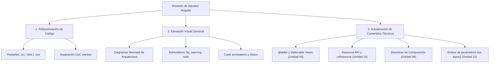
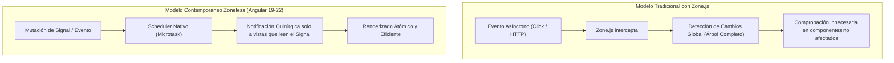
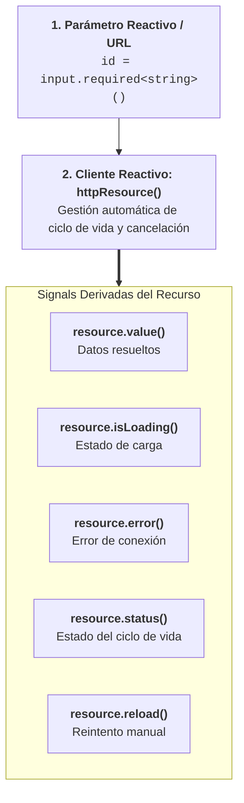

# Auditoría Curricular y Propuesta de Ampliación de Materiales de Angular

> **Documento de Trabajo y Plan de Mejora Continua**  
> **Destinatario:** Coordinación Docente / Alumnado de FP Superior y Especialización Web  
> **Referencias:** Documentación oficial de Angular ([angular.dev](https://angular.dev/)) y Temario Profesional de [FullStackPro.es (Curso de Angular)](https://fullstackpro.es/courses/curso-angular).

---

## 1. Resumen Ejecutivo y Diagnóstico Global

Tras analizar en detalle los **17 capítulos actuales** que componen los apuntes de Angular, contrastándolos rigurosamente con la documentación oficial contemporánea (Angular 18 y 19 en `angular.dev`) y con la estructura formativa de **FullStackPro.es**, se extraen las siguientes conclusiones principales:

### Fortalezas de los Apuntes Actuales

1. **Modernidad de base:** Los apuntes ya han abandonado el enfoque antiguo centrado en `NgModule`, adoptando **Standalone Components** por defecto y comenzando a enseñar la reactividad con **Signals**.
2. **Amplitud temática:** Se tocan aspectos que muchos cursos omiten, como *Content Projection*, *Queries*, *SSR* y la integración de librerías avanzadas (*Capacitor*, *OpenLayers*, *OAuth*).
3. **Rigurosidad teórica:** La explicación conceptual detrás de la Inversión de Control (IoC), la Detección de Cambios y el ciclo de vida es profunda y sólida.

### Oportunidades Clave de Mejora Identificadas

1. **Separación de Responsabilidades en el Código de Ejemplo (SoC):**  
   Muchos ejemplos combinan en un único archivo `.ts` la lógica de la clase, más de 60 líneas de HTML dentro de `template: '...'` y más de 80 líneas de CSS dentro de `styles: ['...']`.  
   *Solución requerida:* Separar en pestañas de Zensical (`.ts`, `.html`, `.css`), reflejando la arquitectura real de archivos (`templateUrl` y `styleUrl`) que genera el Angular CLI en el mundo laboral.

2. **Aprovechamiento Didáctico del Ecosistema Zensical:**  
   Los apuntes carecían de elementos gráficos interactivos (cero diagramas Mermaid, cero cajas de advertencia/truco `admonitions`, nula tokenización visual de buenas prácticas).  
   *Solución requerida:* Incorporar diagramas de flujo de datos, cajas de aviso para errores frecuentes y pestañas vinculadas.

3. **Brechas Curriculares y Funcionalidades de Angular 18/19 no Explotadas:**  
   Existen novedades de primer orden en el framework y en el temario de FullStackPro que enriquecerían enormemente el perfil profesional del alumnado:
   
   - **Vistas Diferidas (`@defer`, `@placeholder`, `@loading`, `@error`):** Ausente en el capítulo de plantillas (`04-plantillas.md`), a pesar de ser la revolución de rendimiento más importante de Angular moderno.
   - **Resource API (`resource()` y `rxResource()`):** Introducida para sustituir la gestión manual de banderas `isLoading`, `error` y peticiones HTTP en componentes reactivos con Signals.
   - **Signal Forms vs Reactive Forms:** Profundizar en el estado de la API y el enlace bidireccional moderno con `model()`.
   - **Directivas de Composición (`hostDirectives`):** Una de las herramientas de arquitectura limpia más valoradas en empresas para componer comportamientos sin herencia.
   - **Enrutamiento Funcional Avanzado:** `withComponentInputBinding()` combinado con `input()` en componentes de página.
   - **Zoneless Angular:** Explicar el camino hacia la eliminación de `zone.js` (`provideExperimentalZonelessChangeDetection()`).

---

## 2. Matriz Comparativa: Apuntes Actuales vs. FullStackPro vs. Angular.dev

| Módulo / Capacidad | Apuntes Actuales | Temario FullStackPro.es | Documentación Oficial (Angular 18/19) | Dictamen / Acción Propuesta |
| :--- | :--- | :--- | :--- | :--- |
| **Arquitectura de Componentes** | Standalone Components explicados; código monolítico en inline templates. | Standalone + Anidamiento + Comunicación limpia. | Standalone por defecto; `input()`, `output()`, `model()`. | **Reestructurar ejemplos en pestañas** (`.ts`, `.html`, `.css`). Añadir comparativa `input()` vs `@Input`. |
| **Control de Flujo en Plantillas** | `@if`, `@for`, `@switch` presentes. | Sintaxis moderna de control de flujo. | Control Flow nativo + `@defer` con todos sus triggers (`on viewport`, `hover`, etc.). | **Añadir sección completa de `@defer`** con ejemplos prácticos en `04-plantillas.md`. |
| **Signals & Reactividad** | `signal()`, `computed()`, `effect()`, `linkedSignal`. | Señales, interacción con RxJS y `async pipe`. | Signals estables, `linkedSignal()`, `toSignal()`, `toObservable()`. | **Añadir comparativa práctica:** ¿Cuándo usar Signal vs Observable? Patrón *Store Local Ligero*. |
| **Peticiones HTTP y Asincronía** | `HttpClient` tradicional + `toSignal()`. | HTTP, Observables, async pipe + Signals, Resource API, Interceptores. | `HttpClient`, `provideHttpClient(withFetch())`, `resource()` y `rxResource()`. | **Incorporar `rxResource()`** en `10-http.md` con estados automáticos de carga/error. |
| **Enrutamiento (Router)** | Rutas, Guards funcionales (`CanActivateFn`), Lazy Loading. | Router, Parámetros de entrada, Route guards, Lazy Loading. | `provideRouter`, `withComponentInputBinding()`, redirecciones funcionales. | **Potenciar `withComponentInputBinding()`** mapeando parámetros de URL a `input()` de señal. |
| **Formularios** | Template-driven, Reactive Forms (`FormGroup`, `FormControl`). | Template-driven, Reactive Forms, Signal Forms. | Reactive Forms tipados (`FormRecord`, `FormArray`), `model()` binding. | **Enriquecer comparativa de enfoques** e ilustrar validadores asíncronos y buenas prácticas UX. |
| **Arquitectura Avanzada** | Proyección (`ng-content`), Queries (`viewChild`), SSR. | Content Projection, View/Content queries, SSR con hidratación. | Signal Queries (`viewChild()`, `contentChild()`), SSR + Client Hydration. | **Añadir diagramas Mermaid** de inyección y jerarquía de vistas. Modernizar a Signal Queries. |
| **Integración de Librerías** | SweetAlert2, FontAwesome, ngBootstrap, OpenLayers, Capacitor, OAuth. | Mismo stack práctico (SweetAlert2, FontAwesome, ngBootstrap, Google/FB Auth, OpenLayers, Capacitor). | Integración de librerías JS externas en proyectos Standalone. | **Excelente alineación con FullStackPro.** Mejorar la presentación visual con ejemplos tabulados. |

---

## 3. Propuesta de Modificaciones y Ampliaciones Detallada por Capítulo

A continuación se detalla la propuesta quirúrgica para cada archivo, indicando qué se debería modificar, qué se debería añadir y qué recursos visuales de Zensical se van a incorporar.



---

### Capítulo 01: `index.md` (Introducción a Angular)

* **Estado Actual:** Excelente introducción histórica y comparativa Framework vs Biblioteca.
* **Qué modificar/añadir:**
  - Añadir diagrama Mermaid conceptual comparando el ciclo de petición de una **MPA tradicional** frente al funcionamiento de una **SPA con Angular**.
  - Incorporar una caja `!!! info "El Renacimiento de Angular (Angular Renaissance)"` explicando el salto generacional a partir de Angular 17-19 (Standalone por defecto, nuevo control flow, Signals, SSR con hidratación).
  - Incluir mapa de ruta visual del curso con las competencias clave DAW/DAM.

---

### Capítulo 02: `02-crear-proyecto.md` (Crear un Proyecto Angular)

* **Estado Actual:** Buen detalle del CLI y estructura de carpetas.
* **Qué modificar/añadir:**
  - Modernizar la sección del builder: explicar `@angular/build:application` basado en **esbuild y Vite**, en sustitución del antiguo Webpack.
  - Añadir pestañas con comandos de instalación para diferentes gestores (`npm`, `pnpm`, `yarn`, `bun`).
  - Añadir llamada de atención `!!! tip "Flags de productividad en ng new"` con comandos recomendados para clase:
    ```bash
    ng new mi-app --routing --style=scss --ssr=false
    ```
  - Diagrama Mermaid del flujo de compilación y ejecución (`ng serve`).

---

### Capítulo 03: `03-componentes.md` (Componentes y Standalone)

* **Estado Actual:** Muy completo, pero tiene ejemplos como el "Contador Avanzado" (más de 200 líneas) con el template y los estilos embebidos en el `.ts`.
* **Qué modificar/añadir:**
  - **Separar el ejemplo del Contador en tres pestañas:**
    - `=== "counter.component.ts"`
    - `=== "counter.component.html"`
    - `=== "counter.component.css"`
  - **Separar el ejemplo de Model Inputs (Editor de Notas) en pestañas.**
  - Añadir diagrama Mermaid del **Ciclo de Vida del Componente** (`ngOnInit`, `ngOnChanges`, `ngOnDestroy`, `afterNextRender`).
  - Comparativa visual clara entre la sintaxis tradicional `@Input()` / `@Output()` y las nuevas funciones de señal `input()`, `output()` y `model()`.

---

### Capítulo 04: `04-plantillas.md` (Plantillas y Binding)

* **Estado Actual:** Cubre bien interpolación, property binding, event binding y `@if`, `@for`, `@switch`.
* **Gran Carencia Identificada:** **No incluye `@defer` (Vistas Diferidas)**.
* **Qué modificar/añadir:**
  - **Añadir Sección Mayor: Deferrable Views (`@defer`):**
    - Sintaxis básica: `@defer`, `@placeholder`, `@loading`, `@error`.
    - Triggers de activación: `on idle`, `on viewport(ref)`, `on interaction`, `on hover`, `on timer(5s)`, `when condición`.
    - Estrategias de precarga: `prefetch on idle`.
    - Caso de uso real: componentes pesados (mapas, gráficas, comentarios) que no deben penalizar la métrica LCP (*Largest Contentful Paint*).
  - Separar los formularios interactivos de ejemplo en pestañas `.ts` y `.html`.
  - Caja `!!! warning "Regla de Oro en @for: El bloque track es obligatorio"` explicando por qué `track item.id` optimiza la reconciliación del DOM frente al antiguo `trackBy`.

---

### Capítulo 05: `05-signals.md` (Signals y Reactividad)

* **Estado Actual:** Muy bien estructurado; incluye `signal()`, `computed()`, `effect()` y `linkedSignal`.
* **Qué modificar/añadir:**
  - Añadir diagrama Mermaid del **Grafo de Dependencias de Señales (Glitch-free Reactivity)** mostrando cómo un cambio en una señal raíz propaga la actualización únicamente a los nodos computados dependientes.
  - Separar en pestañas los ejemplos completos de componentes que usan Signals (Gestor de Tareas, Carrito de la Compra).
  - Caja `!!! caution "Cuándo NO usar effect()"`: explicar las malas prácticas habituales (mutar otras señales dentro de un effect sin `allowSignalWrites`, llamadas HTTP sin limpieza) y por qué `computed()` es la opción idónea en el 90% de los casos.

---

### Capítulo 06: `06-pipes.md` (Pipes y Transformación de Datos)

* **Estado Actual:** Cubre pipes nativos y custom.
* **Qué modificar/añadir:**
  - Separar los ejemplos de componentes consumidores y definición del pipe en pestañas (`.ts`, `.html`).
  - Añadir sección comparativa: **`async pipe` frente a `toSignal()`**. Explicar cómo la comunidad de Angular está pasando de:
    `{{ datos$ | async }}`  
    hacia:  
    `datos = toSignal(this.servicio.datos$);` con `{{ datos() }}` en la plantilla.
  
  - Caja `!!! note "Pipes Puros vs Impuros"` con diagrama de rendimiento.

---

### Capítulo 07: `07-anidar-componentes.md` (Anidamiento y Comunicación)

* **Estado Actual:** Contiene múltiples ejemplos ricos (Listas maestras, Detalle, Modales) pero todos con `template: '...'` y `styles: ['...']`.
* **Qué modificar/añadir:**
  - **Refactorización urgente en pestañas:** Separar componente Padre (`padre.component.ts`, `padre.component.html`, `padre.component.css`) y componente Hijo (`hijo.component.ts`, `hijo.component.html`, `hijo.component.css`).
  - Diagrama Mermaid de comunicación:
    - *Top-Down:* Datos fluyen hacia abajo mediante `input()` / `@Input()`.
    - *Bottom-Up:* Notificaciones fluyen hacia arriba mediante `output()` / `EventEmitter`.
  - Caja `!!! tip "Patrón Contenedor y Presentador (Smart vs Dumb Components)"` aplicando los principios de la arquitectura limpia y las reglas de F3 Martos.

---

### Capítulo 08: `08-directivas.md` (Directivas Personalizadas)

* **Estado Actual:** Atributos y estructurales.
* **Gran Carencia Identificada:** Falta la **API de Composición de Directivas (`hostDirectives`)**.
* **Qué modificar/añadir:**
  - **Añadir sección sobre `hostDirectives`:**
    - Explicar cómo reutilizar directivas (`TooltipDirective`, `HighlightDirective`, `CdkTrapFocus`) dentro de un componente sin necesidad de herencia múltiple ni marcado duplicado en HTML.
  - Separar en pestañas la directiva (`mi-directiva.directive.ts`) y el componente que la prueba (`demo.component.html`, `demo.component.ts`).

---

### Capítulo 09: `09-servicios.md` (Servicios e Inyección de Dependencias)

* **Estado Actual:** Correcto, usa `inject()`.
* **Qué modificar/añadir:**
  - Diagrama Mermaid del **Árbol de Inyección de Dependencias (DI Hierarchical Injectors)**:
    - `root` (Singleton en toda la app).
    - `EnvironmentInjector` (Rutas con `providers: [...]` en configuración).
    - `ElementInjector` (Componente con `providers: [...]` en decorador).
  - Separar el servicio y el componente consumidor en pestañas.
  - Caja `!!! tip "La función inject() frente al Constructor"`: explicar por qué `inject()` permite inicializaciones en línea, mejor inferencia de tipos y funciones composables (*functional injection context*).

---

### Capítulo 10: `10-http.md` (Comunicación HTTP y Asincronía)

* **Estado Actual:** Explica `HttpClient`, interceptores y menciona `resource()`.
* **Qué modificar/añadir:**
  - **Profundizar en `rxResource()` y `resource()`:**
    - Mostrar el contraste de código: cómo pasar de suscribirse a un Observable con flags manuales (`loading = true`, `error = null`) a una sola declaración reactiva con `rxResource`.
  - Separar en pestañas: `api.service.ts`, `interceptor.ts`, `component.ts`, `component.html`.
  - Diagrama Mermaid del **Ciclo de vida de una petición HTTP con Interceptores** (Request -> Auth Interceptor -> Logging -> Servidor -> Response -> Error Interceptor -> Componente).

---

### Capítulo 11: `11-router.md` (Enrutamiento y Navegación)

* **Estado Actual:** Muy buen capítulo; tiene guards funcionales.
* **Qué modificar/añadir:**
  - **Reforzar `withComponentInputBinding()` con Signal `input()`:**
    - Mostrar cómo recibir `:id` de la ruta directamente con `id = input.required<string>();` sin inyectar `ActivatedRoute`.
  - Separar la configuración de rutas (`app.routes.ts`), el layout (`app.component.html`) y las vistas en pestañas.
  - Diagrama Mermaid del **Pipeline de Resolución de Rutas** (`canMatch` -> `canActivate` -> `resolve` -> `canDeactivate`).

---

### Capítulo 12: `12-formularios.md` (Formularios en Angular)

* **Estado Actual:** Cubre Template-driven y Reactive Forms extensamente; menciona Signal Forms.
* **Qué modificar/añadir:**
  - Diagrama comparativo de decisión: **¿Cuándo usar Template-Driven, cuándo Reactive Forms y qué esperar de Signal Forms?**
  - Separar formularios complejos (validadores personalizados, `FormArray` dinámico) en pestañas: `.ts`, `.html`, `.css`.
  - Caja `!!! warning "Evitar arrow-code en validaciones"`: aplicar el patrón Early Return para mostrar errores de formulario en la plantilla de manera elegante.

---

### Capítulo 13: `13-proyeccion-contenido.md` (Proyección de Contenido)

* **Estado Actual:** Explica `ng-content`, selectores y `ngProjectAs`.
* **Qué modificar/añadir:**
  - Separar los componentes reutilizables (Card, Modal, Layout con slots) en pestañas claras de `.ts`, `.html` y `.css`.
  - Diagrama Mermaid visualizando los "huecos" (slots) de proyección en un componente contenedor.

---

### Capítulo 14: `14-queries.md` (ViewChild, ContentChild y Signal Queries)

* **Estado Actual:** Cubre `@ViewChild` y `viewChild()`.
* **Qué modificar/añadir:**
  - Consolidar la recomendación oficial: **migrar a Signal Queries** (`viewChild()`, `viewChildren()`, `contentChild()`, `contentChildren()`).
  - Separar ejemplos en pestañas.

---

### Capítulo 15: `15-ssr.md` (Server-Side Rendering e Hidratación)

* **Estado Actual:** Conceptos de SSR explicados.
* **Qué modificar/añadir:**
  - Diagrama Mermaid del flujo de **Hidratación en el Navegador** (HTML pre-renderizado en Node.js -> Descarga de JS -> Hidratación no destructiva de eventos y estado).
  - Explicar la directiva `ngSkipHydration` y problemas comunes con `window`, `document` y `localStorage`.

---

### Capítulo 16: `16-integracion-librerias.md` (Librerías Externas)

* **Estado Actual:** Gran cobertura práctica (SweetAlert2, Font Awesome, ngBootstrap, OpenLayers, Capacitor, OAuth). Coincide al 100% con los bloques prácticos del curso de FullStackPro.es.
* **Qué modificar/añadir:**
  - Separar en pestañas cada ejemplo:
    - Instalación y configuración (`terminal`).
    - Servicio wrapper desacoplado (`mi-libreria.service.ts`) respetando la regla de **Agnosticismo de Dependencias**.
    - Componente consumidor (`demo.component.ts` y `demo.component.html`).
  - Añadir caja `!!! tip "Regla de Oro: Wrappers para Librerías de Terceros"` fundamentada en los principios de arquitectura de F3 Martos.

---

### Capítulo 17: `17-proyecto-final.md` (Proyecto Final Integrador)

* **Estado Actual:** Excelente aplicación completa que amalgama todo lo aprendido.
* **Qué modificar/añadir:**
  - Presentar la arquitectura del proyecto mediante pestañas de código por módulo/capa (Modelos, Servicios, Componentes, Estilos globales).
  - Diagrama Mermaid con la arquitectura modular y el flujo de datos del proyecto final.

---

## 4. Radiografía de Novedades desde Angular 19 hasta Angular 22 (Propuesta de Inclusión Curricular)

Con la llegada y consolidación de **Angular 19, 20, 21 y 22**, el ecosistema de Angular ha culminado la mayor transición arquitectónica de su historia moderna: el paso definitivo desde un framework dependiente de Zone.js y decoradores imperativos hacia una plataforma **100% reactiva por señales (Signal-First)**, **Zoneless por defecto**, con **sintaxis de plantillas declarativa** y capacidades avanzadas de **renderizado híbrido e hidratación incremental**.

A continuación se detallan las innovaciones clave que han madurado en estas versiones y que se propone incorporar a los materiales formativos para mantener los apuntes en la vanguardia absoluta de la industria.

---

### 4.1. Paradigma Zoneless Consolidado (`provideZonelessChangeDetection`)

#### Contexto y Evolución
Históricamente, Angular dependía de `zone.js` para interceptar llamadas asíncronas (`setTimeout`, `fetch`, eventos DOM) y disparar un barrido global de detección de cambios de arriba hacia abajo en todo el árbol de componentes.
A partir de Angular 19 (donde se estabilizó) y su consagración como estándar recomendado en **Angular 20, 21 y 22**, el framework puede operar de forma totalmente **Zoneless**.



#### Ventajas Didácticas y Técnicas

1. **Reducción del Bundle:** Supresión de `zone.js` del bundle inicial (~35 KB gzipped eliminados).
2. **Compatibilidad Nativa con `async`/`await`:** El compilador ya no necesita convertir `async/await` en generadores o promesas parcheadas.
3. **Stack Traces Limpios:** En la consola del navegador, los errores apuntan directamente al código del alumno sin decenas de llamadas intermedias e incomprensibles de `zone.js`.
4. **Arquitectura Reactiva Predecible:** La vista se actualiza porque una señal cambió, eliminando bugs sutiles donde la UI "no se enteraba" del cambio.

#### Propuesta de Inclusión en los Apuntes

* **En [`02-crear-proyecto.md`](02-crear-proyecto.md):**  
  Actualizar la configuración de arranque en `app.config.ts`:
  ```typescript
  import { ApplicationConfig, provideZonelessChangeDetection } from '@angular/core';

  export const appConfig: ApplicationConfig = {
    providers: [
      provideZonelessChangeDetection(),
      provideRouter(routes)
    ]
  };
  ```
  Añadir una llamada explicativa de por qué ya no existe la dependencia de `zone.js` en `package.json` ni en `angular.json`.

* **En [`03-componentes.md`](03-componentes.md):**  
  Explicar cómo el ciclo de detección de cambios deja de ser un barrido masivo del árbol y pasa a ser dirigido por Signals.

---

### 4.2. Declaración de Variables Locales en Plantillas con `@let`

#### Contexto y Problema Resuelto
Hasta versiones anteriores, si una plantilla necesitaba reutilizar un cálculo complejo o el resultado de un observable/signal en múltiples partes de la vista, los desarrolladores debían recurrir a getters en la clase TypeScript o a trucos con directivas estructurales (`@if (datos$ | async; as datos)`).

Angular introdujo la directiva nativa **`@let`** dentro del nuevo Control Flow de plantillas.

#### Ejemplo de Código Comparativo

=== "Sintaxis Moderna con @let (Angular 19-22)"
    ```html
    <!-- Cálculo de variables locales declarativas directamente en la vista -->
    @let usuario = perfilUsuario();
    @let total = calcularTotal(carrito());
    @let esVip = usuario.puntos > 1000;

    <header class="perfil">
      <h2>Bienvenido, {{ usuario.nombre }}</h2>
      @if (esVip) {
        <span class="badge-vip">Cliente Preferente ⭐</span>
      }
    </header>

    <div class="resumen">
      <p>Total a liquidar: <strong>{{ total | currency:'EUR' }}</strong></p>
      @if (esVip) {
        <p>Descuento aplicado: {{ total * 0.1 | currency:'EUR' }}</p>
      }
    </div>
    ```

=== "Sintaxis Clásica / Alternativa Previa"
    ```html
    <!-- Requería anidar bloques @if artificiales para capturar variables -->
    @if (perfilUsuario(); as usuario) {
      <header class="perfil">
        <h2>Bienvenido, {{ usuario.nombre }}</h2>
        @if (usuario.puntos > 1000) {
          <span class="badge-vip">Cliente Preferente ⭐</span>
        }
      </header>
    }
    ```

#### Propuesta de Inclusión en los Apuntes

* **En [`04-plantillas.md`](04-plantillas.md):**  
  Crear una sección específica: **"Variables de Plantilla con `@let`"**, detallando:
  
  - Reglas de ámbito (scope): las variables `@let` son de solo lectura y solo son visibles dentro de su bloque contenedor o hacia adelante en el mismo nivel.
  - Inmutabilidad: no se pueden reasignar con operaciones tipo `@let x = x + 1`.
  - Casos de uso típicos: operaciones matemáticas en UI, formateo de cadenas reutilizadas y desempaquetado de signals de forma limpia.

---

### 4.3. Signals de Segunda Generación: `linkedSignal()`

#### Contexto y Problema Resuelto
Una de las situaciones más complejas en Angular 16-18 ocurría cuando un estado dependía de una señal origen (origen de verdad), pero debía permitir modificaciones locales por parte del usuario (estado derivado editable).

* `computed()` es de solo lectura y no permite `.set()`.
* Usar un `effect()` para escuchar la fuente y mutar otra señal manual provocaba bucles de actualización infinita y requería el flag desaconsejado `{ allowSignalWrites: true }`.

Angular 19 solventó esto introduciendo **`linkedSignal()`**.

#### Ejemplo Práctico: Selector de Variantes con Opción por Defecto

```typescript
import { Component, signal, linkedSignal } from '@angular/core';

@Component({
  selector: 'app-selector-producto',
  template: `
    <h3>Producto: {{ productoSeleccionado().nombre }}</h3>

    <label>Opciones disponibles:</label>
    <select [value]="opcionElegida()" (change)="opcionElegida.set($any($event.target).value)">
      @for (opcion of productoSeleccionado().opciones; track opcion) {
        <option [value]="opcion">{{ opcion }}</option>
      }
    </select>

    <p>Opción actualmente activa: <strong>{{ opcionElegida() }}</strong></p>
    <button (click)="cambiarProducto()">Cargar Siguiente Producto</button>
  `
})
export class SelectorProductoComponent {
  // Señal fuente
  productoSeleccionado = signal({
    id: 1,
    nombre: 'Camiseta Deportiva',
    opciones: ['Talla S', 'Talla M', 'Talla L']
  });

  // linkedSignal: Se resetea automáticamente al primer elemento si cambia el producto,
  // pero el usuario puede modificarla libremente con .set() mediante el <select>.
  opcionElegida = linkedSignal(() => this.productoSeleccionado().opciones[0]);

  cambiarProducto(): void {
    this.productoSeleccionado.set({
      id: 2,
      nombre: 'Zapatillas Running',
      opciones: ['Número 41', 'Número 42', 'Número 43']
    });
    // ¡opcionElegida se reinicia automáticamente a 'Número 41' sin ningún effect()!
  }
}
```

#### Propuesta de Inclusión en los Apuntes

* **En [`05-signals.md`](05-signals.md):**  
  Añadir un apartado dedicado a `linkedSignal()` como la alternativa arquitectónicamente correcta a los efectos con escritura. Explicar su variante simple y su variante con objeto de configuración `{ source, computation }`.

---

### 4.4. Carga Asíncrona Declarativa: `resource()` y `httpResource()`

#### Contexto y Revolución en la Capa de Datos
En versiones previas de Angular, cargar datos de una API REST exigía:

1. Inyectar `HttpClient`.
2. Crear un observable, suscribirse manualmente o usar `toSignal()`.
3. Manejar señales manuales para `cargando = signal(true)` y `error = signal(null)`.

A partir de Angular 19 y consolidado en Angular 20-22, la librería `@angular/core` introdujo **`resource()`** / **`rxResource()`**, y el paquete HTTP incorporó **`httpResource()`**.



#### Ejemplo de Código Declarativo con `httpResource()`

=== "Nuevo Enfoque con httpResource (Angular 19-22)"
    ```typescript
    import { Component, signal } from '@angular/core';
    import { httpResource } from '@angular/common/http';
    import { User } from './models/user.interface';

    @Component({
      selector: 'app-detalle-usuario',
      template: `
        <div class="control">
          <button (click)="userId.set(userId() - 1)" [disabled]="userId() <= 1">Anterior</button>
          <span>Usuario ID: {{ userId() }}</span>
          <button (click)="userId.set(userId() + 1)">Siguiente</button>
          <button (click)="usuarioResource.reload()">🔄 Reintentar</button>
        </div>

        @if (usuarioResource.isLoading()) {
          <div class="spinner">Cargando datos del usuario...</div>
        } @else if (usuarioResource.error()) {
          <div class="alerta-error">Error al cargar: {{ usuarioResource.error() }}</div>
        } @else if (usuarioResource.value(); as usuario) {
          <article class="ficha">
            <h2>{{ usuario.name }}</h2>
            <p>Email: {{ usuario.email }}</p>
            <p>Empresa: {{ usuario.company?.name }}</p>
          </article>
        }
      `
    })
    export class DetalleUsuarioComponent {
      userId = signal(1);

      // httpResource enlaza automáticamente la señal userId con la petición HTTP.
      // Cuando userId cambia, cancela la petición anterior y lanza la nueva.
      usuarioResource = httpResource<User>(() => `https://jsonplaceholder.typicode.com/users/${this.userId()}`);
    }
    ```

#### Propuesta de Inclusión en los Apuntes

* **En [`10-http.md`](10-http.md):**  
  Presentar una subsección principal que compare el enfoque imperativo basado en Observables (`subscribe` / `AsyncPipe`) con el paradigma declarativo con `httpResource()`, destacando la eliminación de variables booleanas de carga y manejo de cancelación automática de peticiones (race conditions resueltas de serie).

---

### 4.5. Hidratación Incremental y Event Replay en SSR con `@defer`

#### Contexto y Rendimiento Web Moderno
En Angular 17 se introdujo la hidratación no destructiva completa. Sin embargo, para páginas extensas (como e-commerces con cientos de productos, comentarios y widgets), descargar e hidratar todo el JavaScript del cliente de golpe deterioraba el **INP (Interaction to Next Paint)**.

Angular 19+ incorporó **Hidratación Incremental** combinada con `@defer` y **Event Replay**.

```html
<!-- El bloque se renderiza en el servidor como HTML estático. -->
<!-- No descarga ni ejecuta JS hasta que el usuario hace scroll y entra en el viewport. -->
@defer (hydrate on viewport; on interaction) {
  <app-carrusel-opiniones [productoId]="producto().id" />
} @placeholder {
  <div class="esqueleto-carrusel">Cargando opiniones...</div>
}
```

#### Puntos Clave para el Alumnado:

1. **Hidratación Bajo Demanda:** La página carga instantáneamente y solo las partes con las que el usuario interactúa o que se vuelven visibles son hidratadas.
2. **Event Replay:** Si el usuario hace click en un botón antes de que el script del componente haya terminado de descargarse e hidratarse, el navegador retiene el evento y lo despacha de forma transparente tan pronto como la hidratación se completa, evitando la frustración del "clic fantasma".

#### Propuesta de Inclusión en los Apuntes

* **En [`15-ssr.md`](15-ssr.md):**  
  Añadir el apartado **"Hidratación Incremental e Islas de Interactividad con `@defer (hydrate ...)`"**.

---

### 4.6. Enrutamiento en Servidor Granular: `app.routes.server.ts` y `RenderMode`

#### Contexto
Anteriormente, una aplicación Angular se configuraba globalmente: o todo era SSR dinámico o todo era SSG estático pre-renderizado.
En las versiones recientes, Angular unifica esto mediante el archivo `app.routes.server.ts` con modos por ruta:

```typescript
// app.routes.server.ts
import { RenderMode, ServerRoute } from '@angular/ssr';

export const serverRoutes: ServerRoute[] = [
  // Páginas estáticas generadas en tiempo de compilación (SSG)
  { path: '', renderMode: RenderMode.Prerender },
  { path: 'aviso-legal', renderMode: RenderMode.Prerender },
  
  // Páginas con datos dinámicos en tiempo real renderizadas en cada petición (SSR)
  { path: 'productos/:id', renderMode: RenderMode.Server },
  
  // Rutas privadas exclusivas del cliente (SPA pura sin SSR)
  { path: 'panel-admin/**', renderMode: RenderMode.Client }
];
```

#### Propuesta de Inclusión en los Apuntes

* **En [`15-ssr.md`](15-ssr.md):**  
  Incluir la explicación de los tres modos de renderizado (`Prerender`, `Server`, `Client`) y cómo configurar arquitecturas híbridas según los requisitos SEO y de privacidad de cada página.

---

### 4.7. Estandarización de `standalone: true` Implícito y Deprecación de Decoradores Tradicionales

#### Cambios de Convención en el Código Fuente

1. **`standalone: true` es ahora el valor por defecto:**  
   Desde Angular 19, escribir `standalone: true` en `@Component({})`, `@Directive({})` o `@Pipe({})` ya no es necesario; el compilador asume por defecto que todos los artefactos son standalone. Si por alguna razón histórica se requiere un módulo tradicional, se debe especificar `standalone: false`.

2. **Reemplazo Formal de Decoradores por Funciones Signal:**  
   La documentación oficial en `angular.dev` marca los decoradores `@Input()`, `@Output()`, `@ViewChild()` y `@ContentChild()` como APIs históricas (legacy), promoviendo de forma exclusiva:
   
   - `input()` y `input.required()`
   - `output()` (sustituye a `EventEmitter`)
   - `model()` (enlace bidireccional reactivo nativo)
   - `viewChild()` y `viewChildren()`
   - `contentChild()` y `contentChildren()`

#### Propuesta de Inclusión en los Apuntes

* **En [`03-componentes.md`](03-componentes.md) y transversalmente:**  
  Aclarar la regla a los alumnos para que no se extrañen al encontrar código en Angular 22 donde se omite `standalone: true`. Enseñar ambas lecturas para garantizar que puedan mantener proyectos anteriores y desarrollar con soltura en versiones nuevas.

---

### 4.8. Matriz de Impacto Curricular: Novedades Angular 19 a 22

| Versión | Característica Técnica | Archivo de Apuntes Impactado | Nivel de Prioridad Didáctica |
| :--- | :--- | :--- | :--- |
| **Angular 19** | `@let` (Variables locales en templates) | [`04-plantillas.md`](04-plantillas.md) | 🟢 **Alta** (Sencillo de aprender y de alto uso) |
| **Angular 19** | `linkedSignal()` (Señales vinculadas reseteables) | [`05-signals.md`](05-signals.md) | 🟢 **Alta** (Evita anti-patrones con `effect`) |
| **Angular 19** | `resource()` / `rxResource()` | [`10-http.md`](10-http.md) | 🟡 **Media** (Explicar como evolución de Observables) |
| **Angular 19** | `standalone: true` por defecto | [`03-componentes.md`](03-componentes.md) | 🟢 **Alta** (Aclaración conceptual inmediata) |
| **Angular 19** | Hidratación Incremental y Event Replay | [`15-ssr.md`](15-ssr.md) | 🟡 **Media** (Concepto avanzado de arquitectura) |
| **Angular 19** | `server.routes.ts` (`RenderMode`) | [`15-ssr.md`](15-ssr.md) | 🟡 **Media** (Estrategia híbrida de despliegue) |
| **Angular 20-22** | `provideZonelessChangeDetection()` por defecto | [`02-crear-proyecto.md`](02-crear-proyecto.md), [`03-componentes.md`](03-componentes.md) | 🟢 **Alta** (Configuración estándar de nuevos proyectos) |
| **Angular 20-22** | `httpResource()` nativo en HTTP | [`10-http.md`](10-http.md) | 🟢 **Alta** (Simplifica drásticamente el consumo REST) |
| **Angular 21-22** | Consolidación de Signal Forms & Two-Way Signals | [`12-formularios.md`](12-formularios.md) | ⚪ **Baja/Opcional** (Mantener ReactiveFormsModule como base sólida) |

---

## 5. Plan de Acción y Hoja de Ruta para el Profesor

1. **Fase 1 (Inmediata):**  
   - Modernizar los archivos actuales aplicando la **separación por pestañas** en todos los ejemplos significativos que mezclan `.ts`, `.html` y `.css`.
   - Incorporar elementos de **Zensical** (admonitions temáticas, diagramas Mermaid arquitectónicos, títulos de bloques de código).
2. **Fase 2 (Revisión y Aprobación):**  
   - El docente revisa esta propuesta y decide si desea incorporar formalmente las secciones de contenido nuevo propuestas:
     - Sección completa de `@defer` en `04-plantillas.md`.
     - Sección ampliada de `rxResource` y carga declarativa en `10-http.md`.
     - Sección de directivas de composición `hostDirectives` en `08-directivas.md`.
3. **Fase 3 (Despliegue):**  
   - Generación de build limpio con `zensical build` verificado al 100%.
